# 10. 约束优化

优化在数学的许多分支和工业应用中无处不在。例如，许多统计理论（如回归和最大似然估计）都被表述为优化问题。定量金融通过最大化投资组合的收益风险比来进行资产配置。在我们公司 NM Limited，我们构建数据驱动的决策系统，以帮助管理层做出科学的业务决策，而非临时性的。例如，为钢铁制造厂设计资源分配系统，以优化原材料、机器和人力使用；规划最佳邮件取送路线；以及安排车辆及班次的调度系统。

## 10.1 优化问题

通常，约束优化问题是指寻找满足以下条件的向量`x`^*^：

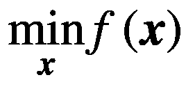

满足约束条件：

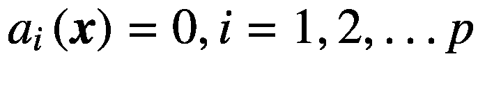


我们假设`ai`和`cj`是二次可微的连续函数。这些约束共同定义了优化问题的可行域`R`。也就是说，`x`^*^ ∈ `R`。假设该可行域是凸的。

凸集是一个集合，对于该集合中的任意两个点`x`和`y`，连接这两个点的任何线段`(1 − t)x + t*y*`都落在该集合内。图 10-1 展示了一个凸集的例子。

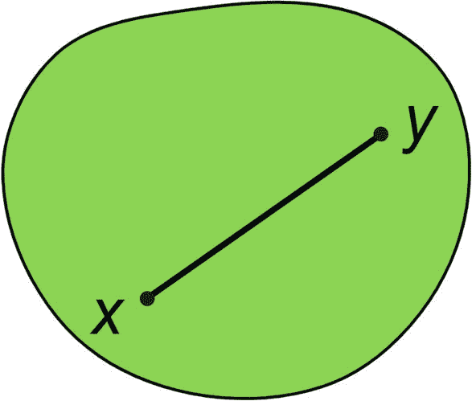

**图 10-1** 一个凸集

图 10-2 展示了一个非凸集的例子。

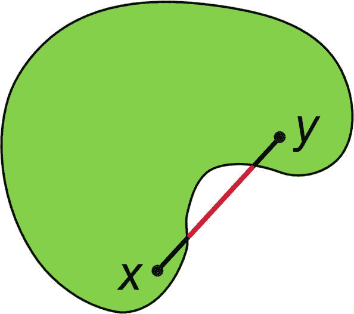

**图 10-2** 一个非凸集

以下是一个约束优化问题的示例：

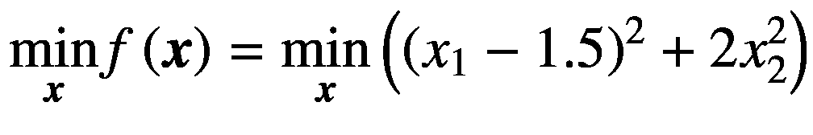

满足约束条件：

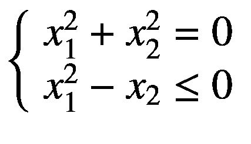

图 10-3 显示了由约束中两条曲线相交定义的可行域。

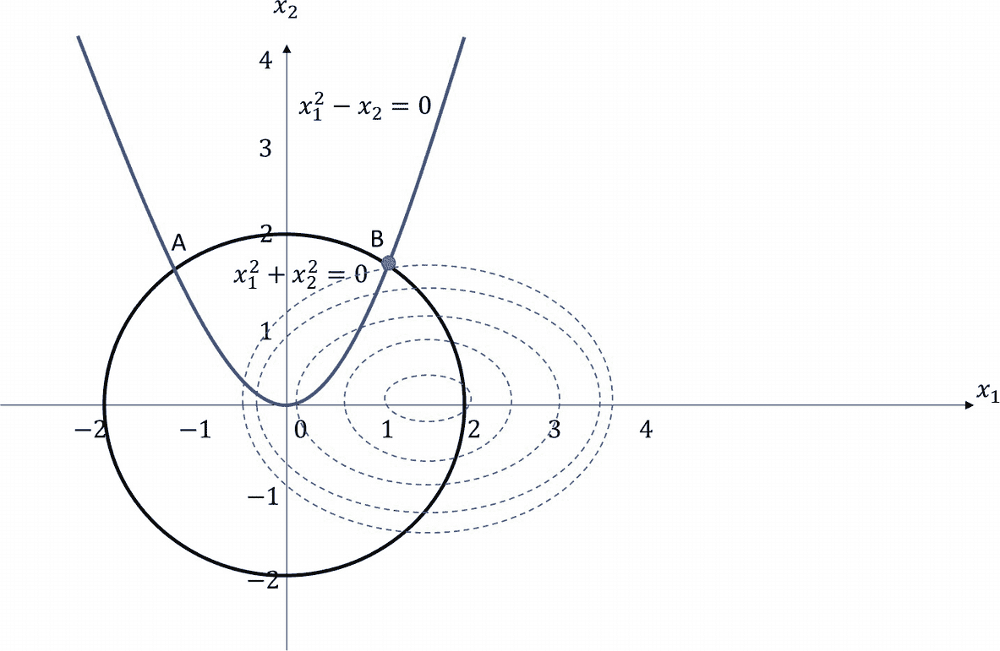

**图 10-3** 由约束定义的可行域

等高线图（虚线）表示了目标函数可以取到的（相同）值。（小于）不等式约束将解限制在抛物线曲线上方。等式约束要求解位于圆的圆周上。因此，可行域仅为抛物线曲线内部的圆弧 AB。点 B 处的圆点表示该圆弧上目标函数最小的解。

### 10.1.1 通用优化算法

通常，寻找优化问题的解是一个迭代过程（除非我们拥有其解析表达式，但通常我们并没有）。因此，我们从一个初始点或初始猜测开始并尝试它。如果它不奏效，我们尝试另一个点。任何数值优化算法的核心组成部分是我们如何选择下一个要尝试的点。在第`k`次迭代中，有两个因素决定搜索点：方向`d[k]`和该方向上的变化幅度`α[k]`。因此，下一个搜索点如下所示：

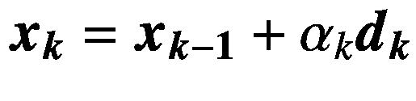

我们重复这个过程，直到满足收敛准则。这个准则可以是目标函数值的变化太小。

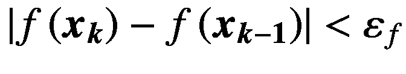

或者也可以是`x[k]`的变化太小。

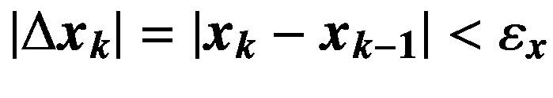

### 10.1.2 约束

在 NM Dev 中，一组等式或不等式约束由一个实值多元函数列表表示。其接口是`Constraints`。该类的签名如下：

```
/**
* 使用秩一法构建多变量极小化器。
*
* @param epsilon       精度参数：当数字 |x| &le;
*                      &epsilon; 时，视为 0
* @param maxIterations 最大迭代次数
*/
public RankOneMinimizer(double epsilon, int maxIterations)
/**
* 使用 DFP 方法构建多变量极小化器。
*
* @param epsilon       精度参数：当数字 |x| &le;
*                      &epsilon; 时，视为 0
* @param maxIterations 最大迭代次数
*/
public DFPMinimizer(double epsilon, int maxIterations)
/**
* 使用 BFGS 方法构建多变量极小化器。
*
* @param epsilon          精度参数：当数字 |x| &le;
*                         &epsilon; 时，视为 0
* @param maxIterations    最大迭代次数
* @param isFletcherSwitch 指示是否使用 Fletcher 切换
*/
public BFGSMinimizer(boolean isFletcherSwitch, double epsilon, int maxIterations)
/**
* 使用 Huang 方法构建多变量极小化器。
*
* @param theta        Huang 公式中的 &theta;
* @param phi          Huang 公式中的 &phi;
* @param psi          Huang 公式中的 &psi;
* @param omega        Huang 公式中的 &omega;
* @param epsilon      精度参数：当数字 |x| &le;
*                     &epsilon; 时，视为 0
* @param maxIterations 最大迭代次数
*/
public HuangMinimizer(
double theta,
double phi,
double psi,
double omega,
double epsilon,
int maxIterations
)
/**
* 使用 Pearson 方法构建多变量极小化器。
*
* @param epsilon       精度参数：当数字 |x| &le;
*                      &epsilon; 时，视为 0
* @param maxIterations 最大迭代次数
*/
public PearsonMinimizer(double epsilon, int maxIterations)
```

# 等式约束

```java
public interface Constraints {
    /**
     * 获取约束函数列表。
     *
     * @return 约束函数列表
     */
    public List getConstraints();

    /**
     * 获取变量数量。
     *
     * @return 变量数量
     */
    public int dimension();

    /**
     * 获取约束数量。
     *
     * @return 约束数量
     */
    public int size();
}
```

## 等式约束的定义

等式约束的集合如下所示：


或者用向量形式表示如下：

![$$ a\left(\boldsymbol{x}\right)={\left[{a}_1\left(\boldsymbol{x}\right),{a}_2\left(\boldsymbol{x}\right),\dots, {a}_p\left(\boldsymbol{x}\right)\right]}^T=0 $$](images/500382_1_En_10_Chapter/500382_1_En_10_Chapter_TeX_Equj.png)

这定义了 `R^n` 中的一个超曲面。

如果点 `x` 满足约束条件，并且列向量 `∇a1`, `∇a2`, ..., `∇ap` 线性无关，则称点 `x` 为等式约束的**正则点**。也就是说，`x` 是一个解。

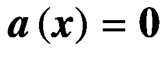

其雅可比矩阵如下所示：

![$$ {\mathbf{J}}_{\mathbf{e}}\left(\boldsymbol{x}\right)=\left[\nabla {a}_1\left(\boldsymbol{x}\right),\nabla {a}_2\left(\boldsymbol{x}\right),\dots, \nabla {a}_p\left(\boldsymbol{x}\right)\right] $$](images/500382_1_En_10_Chapter/500382_1_En_10_Chapter_TeX_Equl.png)

![$$ =\left[\begin{array}{ccc}\frac{d{a}_1}{d{x}_1}& \cdots & \frac{d{a}_1}{d{x}_n}\\ {}& \ddots & \\ {}\frac{d{a}_p}{d{x}_1}& & \frac{d{a}_p}{d{x}_n}\end{array}\right] $$](images/500382_1_En_10_Chapter/500382_1_En_10_Chapter_TeX_Equm.png)

该矩阵具有满行秩 `p`。

如果 `p > n`，则 `J_e` 不可能满行秩。此时不存在正则点。如果 `p = n`，则只存在有限个正则点，优化问题变得平凡。因此，我们通常假定 `p < n`。如果 `x` 是一组等式约束的正则点，则它定义了约束超曲面的一个切平面。

Antoniou & Lu (2007) 给出了以下示例：

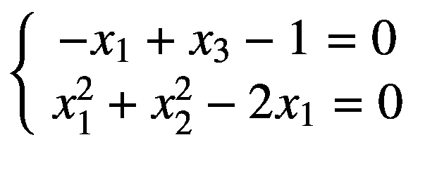

其雅可比矩阵如下：

![$$ {\mathbf{J}}_{\mathbf{e}}\left(\boldsymbol{x}\right)=\left[\begin{array}{ccc}-1& 0& 1\\ {}2{x}_1-2& 2{x}_2& 0\end{array}\right] $$](images/500382_1_En_10_Chapter/500382_1_En_10_Chapter_TeX_Equo.png)

除了在点 `x = [1 0 x3]^T` 处（因其不满足约束条件）秩为 1 外，其他点处秩均为 2。任何其他点均为正则点。

## 在 NM Dev 中的实现

在 NM Dev 中，接口 `EqualityConstraints` 是一个标记，用于表示一组等式约束。其签名如下：

```java
public interface EqualityConstraints extends Constraints {
}
```

类 `GeneralEqualityConstraints` 实现了一组等式约束。该类签名如下：

```java
public class GeneralEqualityConstraints extends GeneralConstraints implements EqualityConstraints {
    /**
     * 从实值函数集合构造一个等式约束实例。
     *
     * @param constraints 等式约束
     */
    public GeneralEqualityConstraints(Collection constraints) {
        super(constraints);
    }

    /**
     * 从实值函数数组构造一个等式约束实例。
     *
     * @param constraints 等式约束
     */
    public GeneralEqualityConstraints(RealScalarFunction... constraints) {
        super(constraints);
    }
}
```

以下代码片段表示了上述示例：

```java
// 非线性约束
GeneralEqualityConstraints a
= new GeneralEqualityConstraints(
// 第一个等式约束
new AbstractRealScalarFunction(3) { // 定义域维度
    @Override
    public Double evaluate(Vector x) {
        double x1 = x.get(1);
        double x3 = x.get(3);
        double a1 = -x1 + x3 + 1;
        return a1;
    }
},
// 第二个等式约束
new AbstractRealScalarFunction(3) { // 定义域维度
    @Override
    public Double evaluate(Vector x) {
        double x1 = x.get(1);
        double x2 = x.get(2);
        double a2 = x1 * x1 + x2 * x2 - 2. * x1;
        return a2;
    }
}
);
```

## 线性等式约束

若所有等式约束均为线性，则可写为：

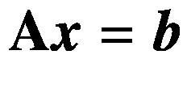

其中 `A` 是一个 `p` × `n` 矩阵，`b` 是一个 `p` × 1 向量。雅可比矩阵 `J_e` 与常数矩阵 `A` 相同。因此，如果 `rank(A) = p`，则线性系统 `A x = b` 的任何解都是正则点。否则，当 `rank(A) = p' < p` 时，有两种可能情况。

如果 ![$$ \operatorname{rank}\left(\left[\mathbf{A}\kern0.5em \mathbf{b}\right]\right)>p $$](images/500382_1_En_10_Chapter/500382_1_En_10_Chapter_TeX_IEq1.png)，则线性系统无解。需要仔细检查以消除矛盾。如果 ![$$ \operatorname{rank}\left(\left[\mathbf{A}\kern0.5em \mathbf{b}\right]\right)=\operatorname{rank}\left(\mathbf{A}\right)={p}^{\prime }<p $$](images/500382_1_En_10_Chapter/500382_1_En_10_Chapter_TeX_IEq2.png)，则可以将约束缩减为一个更小且等价的等式约束集合。

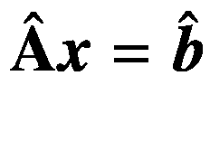

其中 `$\hat{\mathbf{A}}$` 是一个 *p*′ × *n* 矩阵，`$\hat{\boldsymbol{b}}$` 是一个 *p*′ × 1 向量。

一种方法是应用奇异值分解（SVD）对 **A** 进行分解。更多信息请参见第 2 章。我们可以将 **A** 分解如下：

$$
\mathbf{A}=\mathbf{UD}{\boldsymbol{V}}^{\boldsymbol{T}}
$$

其中 **U** 是一个 *p* × *p* 正交矩阵，**V** 是一个 *n* × *n* 正交矩阵。

$$
\mathbf{D}=\left[\begin{array}{cc}\hat{\boldsymbol{D}}& \mathbf{0}\\ {} \mathbf{0}& \mathbf{0}\end{array}\right]
$$

其中 `$\hat{\boldsymbol{D}}$` 包含所有正奇异值。

$$
\mathbf{A}=\mathbf{UD}{\boldsymbol{V}}^{\boldsymbol{T}}=\boldsymbol{U}\left[\begin{array}{c}\hat{\boldsymbol{A}}\\ {} \mathbf{0}\end{array}\right]
$$

$$
\hat{\boldsymbol{A}}=\hat{\boldsymbol{D}}{\left[{\boldsymbol{v}}_{\mathbf{1}},\dots, {\boldsymbol{v}}_{{\boldsymbol{p}}^{\prime }}\right]}^{\boldsymbol{T}}
$$

`$\boldsymbol{v}_\mathbf{i}$` 是 **V**^(**T**) 中的列。`$\hat{\boldsymbol{A}}$` 是一个 *p*^′ × *n* 矩阵。

$$
\left[\begin{array}{c}\hat{\boldsymbol{A}}\\ {} \mathbf{0}\end{array}\right]\boldsymbol{x}=\left[\begin{array}{c}\hat{\boldsymbol{b}}\\ {} \mathbf{0}\end{array}\right]
$$

`$\hat{\boldsymbol{b}}$` 是 **U**^(**T**)**b** 的前 *p*^′ 个元素。

以下代码片段复现了 Antoniou & Lu (2007) 中的示例 10.2：

$$
\left\{\begin{array}{c}{x}_1-2{x}_2+3{x}_3+2{x}_4=4\\ {} 2{x}_2-{x}_3=1\\ {} 2{x}_1-10{x}_2+9{x}_3+4{x}_4=5\end{array}\right.
$$

该线性系统的秩为 2，因此可约简。简化后的等式约束集合如下：

$$
\left\{\begin{array}{c}2.177001{x}_1-10.342933{x}_2+9.525469{x}_3+4.354003{x}_4=5.713540\\ {} 0.510554{x}_1+1.011800{x}_2+0.515208{x}_3+1.021108{x}_4=3.058670\end{array}\right.
$$

```java
/** 示例 10.2，第 270 页。实用优化：算法与
 * 工程应用。Andreas Antoniou，Wu-Sheng Lu */
// 线性约束
Matrix A = new DenseMatrix(new double[][]{
    {1, -2, 3, 2},
    {0, 2, -1, 0},
    {2, -10, 9, 4}
});
Vector b = new DenseVector(new double[]{4, 1, 5});
LinearEqualityConstraints A_eq
        = new LinearEqualityConstraints(A, b);
System.out.println("原始等式约束：");
System.out.println(A_eq);
// 进行 SVD 分解以简化等式约束
SVD svd = new SVD(A, true);
Matrix U = svd.U();
System.out.println("U = ");
System.out.println(U);
Matrix D = svd.D();
System.out.println("D = ");
System.out.println(D);
Matrix V = svd.V();
System.out.println("V = ");
System.out.println(V);
// 检查原始等式约束是否可简化
double epsilon = 1e-8; // 精度参数，小于该值视为 0
boolean isReducible = A_eq.isReducible(epsilon);
System.out.println(isReducible);
int r = MatrixMeasure.rank(
        A,
        epsilon
);
System.out.printf("A 的秩 = %d%n", r);
// 构造一组新的简化约束
LinearEqualityConstraints A_eq_hat
        = A_eq.getReducedLinearEqualityConstraints(epsilon);
System.out.println("简化后的等式约束：");
System.out.println(A_eq_hat);
```

输出结果如下：

```
原始等式约束：
3x4
[,1] [,2] [,3] [,4]
[1,] 1.000000, -2.000000, 3.000000, 2.000000,
[2,] 0.000000, 2.000000, -1.000000, 0.000000,
[3,] 2.000000, -10.000000, 9.000000, 4.000000,  * x =
[4.000000, 1.000000, 5.000000]
U =
3x3
[,1] [,2] [,3]
[1,] 0.271659, 0.800304, -0.534522,
[2,] -0.136451, 0.581828, 0.801784,
[3,] 0.952671, -0.144875, 0.267261,
D =
3x3
[,1] [,2] [,3]
[1,] 14.879768, 0.000000, 0.000000,
[2,] 0.000000, 1.610126, 0.000000,
[3,] 0.000000, 0.000000, 0.000000,
V =
4x3
[,1] [,2] [,3]
[1,] 0.146306, 0.317089, -0.936741,
[2,] -0.695100, 0.628398, 0.112540,
[3,] 0.640162, 0.319980, 0.225081,
[4,] 0.292612, 0.634179, 0.243290,
true
A 的秩 = 2
简化后的等式约束：
2x4
[,1] [,2] [,3] [,4]
[1,] 2.177001, -10.342933, 9.525469, 4.354003,
[2,] 0.510554, 1.011800, 0.515208, 1.021108,  * x =
[5.713540, 3.058670]
```

#### 10.1.2.2 不等式约束

不等式约束的形式如下：

# 不等式约束

与等式约束不同，不等式约束的数量`q`不必小于`n`。对于任何可行点$$\overline{\boldsymbol{x}}$$，存在两类不等式约束。满足`c[j](x) > 0`的约束集称为非活动约束，例如图 10-2 中的$$c_1(\overline{\boldsymbol{x}})$$和$$c_2(\overline{\boldsymbol{x}})$$。由于$$\overline{\boldsymbol{x}}$$处于它们的边界上，下一个搜索点不能朝违反这些约束的方向移动。因此，这些活动约束限制了$$\overline{\boldsymbol{x}}$$邻域内的可行域。另一方面，像$$c_3(\overline{\boldsymbol{x}})$$这样的非活动约束远离$$\overline{\boldsymbol{x}}$$，因此在$$\overline{\boldsymbol{x}}$$的一个足够小的邻域内，它们对可行域没有影响。见图 10-4。

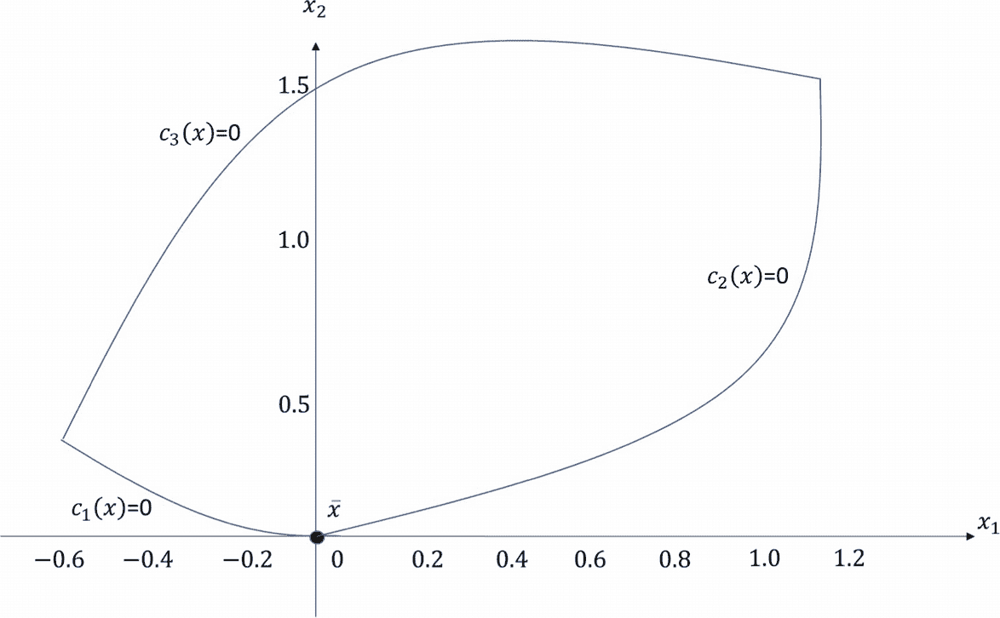

## 大于型不等式约束

在 NM Dev 中，接口`GreaterThanConstraints`是一个标记，用于表示一组（大于型）不等式约束。其签名如下：

```java
public interface GreaterThanConstraints extends Constraints {
    /**
     * 将大于或等于约束转换为小于或等于约束。
     *
     * @return 等价的小于或等于约束
     */
    public LessThanConstraints toLessThanConstraints();
}
```

等价地，我们可以通过改变符号将不等式约束写成小于型不等式约束。即：

$$ c_j(\boldsymbol{x}) \le 0, j=1,2,\dots q $$

例如，以下代码片段构造了这个大于型不等式约束：

$$ x_2 - x_1^2 \ge 0 $$

```java
GeneralGreaterThanConstraints c_gr
    = new GeneralGreaterThanConstraints(
        new AbstractBivariateRealFunction() {
            @Override
            public double evaluate(double x1, double x2) {
                double c = x2 - x1 * x1;
                return c;
            }
        });
```

## 小于型不等式约束

接口`LessThanConstraints`是一个标记，用于表示一组小于型不等式约束。其签名如下：

```java
public interface LessThanConstraints extends Constraints {
    /**
     * 将小于或等于约束转换为大于或等于约束。
     *
     * @return 等价的大于或等于约束
     */
    public GreaterThanConstraints toGreaterThanConstraints();
}
```

类`GeneralGreaterThanConstraints`实现了一组大于型等式约束。该类的签名如下：

```java
public class GeneralGreaterThanConstraints
    extends GeneralConstraints
    implements GreaterThanConstraints {
    /**
     * 从一个实值函数集合构造一个大于或等于不等式约束的实例。
     *
     * @param constraints 大于或等于不等式约束
     */
    public GeneralGreaterThanConstraints(Collection constraints) {
        super(constraints);
    }
    /**
     * 从一个实值函数数组构造一个大于或等于不等式约束的实例。
     *
     * @param constraints 大于或等于不等式约束
     */
    public GeneralGreaterThanConstraints(RealScalarFunction... constraints) {
        super(constraints);
    }
    // ...
}
```

或者，我们可以使用`GeneralLessThanConstraints`类构造相同的约束。该类签名如下：

```java
public class GeneralLessThanConstraints
    extends GeneralConstraints
    implements LessThanConstraints {
    /**
     * 从一组实值函数构造小于等于不等式约束的实例。
     *
     * @param constraints 小于等于不等式约束
     */
    public GeneralLessThanConstraints(Collection constraints) {
        super(constraints);
    }
    /**
     * 从一组实值函数数组构造小于等于不等式约束的实例。
     *
     * @param constraints 小于等于不等式约束
     */
    public GeneralLessThanConstraints(RealScalarFunction... constraints) {
        super(constraints);
    }
    // ...
}
```

例如，相同的约束可以写成如下形式：

$$ x_1^2 - x_2 \le 0 $$

代码如下：

```java
GeneralLessThanConstraints c_less = new GeneralLessThanConstraints(
    new AbstractBivariateRealFunction() {
        @Override
        public double evaluate(double x1, double x2) {
            double c = x1 * x1 - x2;
            return c;
        }
    });
```

如果所有不等式约束都是线性的，如下所示：

$$ \boldsymbol{Ax} \ge \boldsymbol{b} $$

那么我们可以使用`LinearGreaterThanConstraints`类。该类签名如下：

```java
public class LinearGreaterThanConstraints
    extends LinearConstraints
    implements GreaterThanConstraints {
    /**
     * 构造一组线性大于等于约束。
     *
     * @param A 不等式系数
     * @param b 不等式值
     */
    public LinearGreaterThanConstraints(Matrix A, Vector b);

    @Override
    public LinearLessThanConstraints toLessThanConstraints();

    /**
     * 给定一组线性大于等于约束以及一组等式约束，
     * 找到一个满足约束的可行初始点。
     * 该实现求解参考文献中的公式 11.25。
     * 前 (n-1) 个条目构成一个可行初始点。
     * 最后一个条目是单点扰动。
     *
     * @param equal 一组线性等式约束
     * @return 一个可行初始点以及单点扰动（在同一向量中）
     */
    public Vector findFeasibleStart(LinearEqualityConstraints equal);
}
```

# 线性约束类示例

`@see`

"Jorge Nocedal, Stephen Wright, "p. 473," 数值优化."

"Andreas Antoniou, Wu-Sheng Lu, "公式 11.25, 二次与凸规划," 实用优化：算法与工程应用."

`getFeasibleInitialPoint(LinearEqualityConstraints equal)`

该方法给定一组线性大于等于约束，找到一个满足约束的可行初始点。该实现求解参考文献中的公式 11.25。前 `(n-1)` 个条目构成一个可行初始点，最后一个条目是单点扰动。

- **返回值**：一个可行初始点以及单点扰动（在同一向量中）。
- **`@see`**："Andreas Antoniou, Wu-Sheng Lu, "公式 11.25, 二次与凸规划," 实用优化：算法与工程应用."

`getFeasibleInitialPoint()`

该方法给定一组线性大于等于约束，找到一个满足约束的可行初始点。该实现求解参考文献中的公式 11.25。前 `(n-1)` 个条目构成一个可行初始点，最后一个条目是单点扰动。

- **返回值**：一个可行初始点以及单点扰动（在同一向量中）。
- **`@see`**："Andreas Antoniou, Wu-Sheng Lu, "公式 11.25, 二次与凸规划," 实用优化：算法与工程应用."

## 线性大于等于约束 (`LinearGreaterThanConstraints`)

例如，在现代投资组合优化中，我们通常对每只股票施加一个最小权重，例如 0%。这意味着不允许卖空。这个不等式约束可以写成：


以下代码表示这组约束：

```
// w_i >= 0 表示不允许卖空
Matrix A = new DenseMatrix(new double[][]{
    {1, 0, 0},
    {0, 1, 0},
    {0, 0, 1}
});
Vector b1 = new DenseVector(new double[]{0, 0, 0}); // 3 只股票
LinearGreaterThanConstraints no_short_selling1
        = new LinearGreaterThanConstraints(A, b1);// w >= 0
System.out.println(no_short_selling1);
```

输出如下：

```
3x3
[,1] [,2] [,3]
[1,] 1.000000, 0.000000, 0.000000,
[2,] 0.000000, 1.000000, 0.000000,
[3,] 0.000000, 0.000000, 1.000000,  * x >=
[0.000000, 0.000000, 0.000000]
```

或者，我们可以使用包装类 `LowerBoundConstraints` 来构造这样一组下界约束。

```
LowerBoundConstraints no_short_selling2
        = new LowerBoundConstraints(3, 0.);
System.out.println(no_short_selling2);
```

输出如下：

```
3x3
[,1] [,2] [,3]
[1,] 1.000000, 0.000000, 0.000000,
[2,] 0.000000, 1.000000, 0.000000,
[3,] 0.000000, 0.000000, 1.000000,  * x >=
[0.000000, 0.000000, 0.000000]
```

如果所有变量的下界都为 0，那么我们可以直接使用 `NonNegativityConstraints` 类。例如，以下代码片段构建了完全相同的禁止卖空约束：

```
NonNegativityConstraints no_short_selling3
        = new NonNegativityConstraints(3);
System.out.println(no_short_selling3);
```

输出如下：

```
3x3
[,1] [,2] [,3]
[1,] 1.000000, 0.000000, 0.000000,
[2,] 0.000000, 1.000000, 0.000000,
[3,] 0.000000, 0.000000, 1.000000,  * x >=
[0.000000, 0.000000, 0.000000]
```

## 线性小于等于约束 (`LinearLessThanConstraints`)

类似地，`LinearLessThanConstraints` 类表示线性小于等于约束。

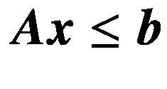

该类签名如下：

```
public class LinearLessThanConstraints
        extends LinearConstraints
        implements LessThanConstraints {
    /**
     * 构造一组线性小于等于约束。
     *
     * @param A 小于等于不等式约束
     * @param b 小于等于不等式值
     */
    public LinearLessThanConstraints(Matrix A, Vector b) {
        super(A, b);
    }

    @Override
    public LinearGreaterThanConstraints toGreaterThanConstraints() {
        return new LinearGreaterThanConstraints(A().scaled(-1), b().scaled(-1));
    }

    /**
     * 给定一组线性小于等于约束以及一组等式约束，
     * 找到一个满足约束的可行初始点。
     * 该实现求解参考文献中的公式 11.25。
     * 前 (n-1) 个条目构成一个可行初始点。
     * 最后一个条目是单点扰动。
     *
     * @param equal 一组线性等式约束
     * @return 一个可行初始点以及单点扰动（在同一向量中）
     * @see "Andreas Antoniou, Wu-Sheng Lu, "公式 11.25, 二次与凸规划,"
     *      实用优化：算法与工程应用."
     */
    public Vector getFeasibleInitialPoint(LinearEqualityConstraints equal) {
        return this.toGreaterThanConstraints().getFeasibleInitialPoint(equal);
    }

    /**
     * 给定一组线性小于等于约束，
     * 找到一个满足约束的可行初始点。
     * 该实现求解参考文献中的公式 11.25。
     * 前 (n-1) 个条目构成一个可行初始点。
     * 最后一个条目是单点扰动。
     *
     * @return 一个可行初始点以及单点扰动（在同一向量中）
     * @see "Andreas Antoniou, Wu-Sheng Lu, "公式 11.25, 二次与凸规划,"
     *      实用优化：算法与工程应用."
     */
    public Vector getFeasibleInitialPoint() {
        return getFeasibleInitialPoint(null);
    }
}
```

例如，我们可能希望对投资组合中的每只股票施加最大权重，以避免过度集中。以下不等式约束确保没有股票占投资组合比重超过 20%：

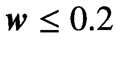

对应代码片段如下：

```
// w_i = 0
System.out.println(maximum_exposure);
```

输出如下：

```
3x3
[,1] [,2] [,3]
[1,] 1.000000, 0.000000, 0.000000,
[2,] 0.000000, 1.000000, 0.000000,
[3,] 0.000000, 0.000000, 1.000000,  * x <=
[0.200000, 0.200000, 0.200000]
```

# 10.2 线性规划

线性规划（LP）在数学优化中非常重要。许多其他类型优化问题的算法都通过将 LP 问题作为子问题求解来实现。它广泛应用于商业、经济学和工程领域。使用 LP 模型的行业包括交通运输、能源、电信和制造业。实践证明，它在规划、路由、调度、分配和设计等各类问题的建模中非常有用。例如，管理层利用 LP 在有限资源下最大化利润和最小化成本。YouTube 使用 LP 来稳定视频。众所周知，LP 问题的最优解必须是可行域的一个顶点。虽然理论上我们可以使用暴力方法逐一检查所有顶点并加以比较，但这并非实用方法。一些大规模 LP 问题可能涉及多达 1200 万个变量。有许多高效算法可以解决 LP 问题。在本节中，我们将介绍基本的单纯形法，这是解决 LP 问题的主要方法。

## 10.2.1 线性规划问题

标准形式的 LP 问题表述如下：


并满足以下约束条件：

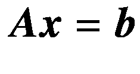


其中，`c ≠ 0` 是一个 `n × 1` 向量，`n` 是变量数量，`A` 是一个 `p × n` 矩阵，`p` 是约束条件数量，`b` 是一个 `p × 1` 向量。我们假设 `A` 是满秩的，即 `rank(A) = p < n`。目标函数 `f` 和所有约束条件均为线性函数。

对于固定的标量 `β`，`c^T x = β` 在 `n` 维欧几里得空间中定义了一个仿射（线性）流形。当 `n = 2` 时，它是一条直线。`c^T x = β[i]` 对于不同的 `β[i]` 表示一组平行线。这些线的法线是 `c`，因此 `c` 通常被称为目标函数的法向量。

在 `NM Dev` 中，我们可以使用 `LPStandardProblem` 类构建一个标准形式的 LP 问题。该类签名如下：

```java
public class LPStandardProblem extends LPProblemImpl1 {

    /**
     * 构造一个标准形式的线性规划问题。
     *
     * @param c     目标函数
     * @param equal 等式约束
     */
    public LPStandardProblem(Vector c, LinearEqualityConstraints equal);

}
```

例如，以下代码片段构建了此 LP 问题：

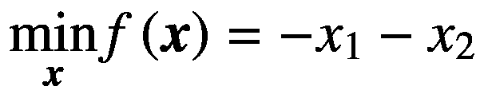

满足约束条件：

![$$ \left[\begin{array}{cccc}7&amp; 1&amp; 1&amp; 0\\ {}-1&amp; 1&amp; 0&amp; 1\end{array}\right]\left[\begin{array}{c}{x}_1\\ {}{x}_2\\ {}{x}_3\\ {}{x}_4\end{array}\right]=\left[\begin{array}{c}15\\ {}1\end{array}\right] $$](images/500382_1_En_10_Chapter/500382_1_En_10_Chapter_TeX_Equak.png)

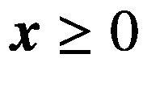

```java
// 构建一个标准形式的 LP 问题
LPStandardProblem problem1 = new LPStandardProblem(
    new DenseVector(new double[]{-1.0, -1.0, 0, 0}), // c
    new LinearEqualityConstraints(
        new DenseMatrix( // A
            new double[][]{
                {7, 1, 1, 0},
                {-1, 1, 0, 1}
            }),
        new DenseVector(new double[]{15.0, 1.0}) // b
    ));
System.out.println(problem1);
```

输出如下：

```
min. objective:
[-1.000000, -1.000000, 0.000000, 0.000000]
less-than-or-equal-to inequalities:
4x4
    [,1]   [,2]   [,3]   [,4]
[1,] -7.000000, -1.000000, -1.000000, -0.000000,
[2,] 1.000000, -1.000000, -0.000000, -1.000000,
[3,] 7.000000, 1.000000, 1.000000, 0.000000,
[4,] -1.000000, 1.000000, 0.000000, 1.000000,  * x <=
[-15.000000, -1.000000, 15.000000, 1.000000]
equalities:
free variables:
```

# 线性规划问题的规范形式与标准形式

注意，该输出实际上是 LP 问题的规范形式。规范形式表述如下：


满足约束条件：

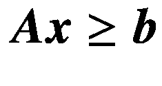

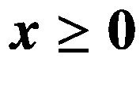

## 标准形式到规范形式的转换

标准形式可以通过将等式约束改写为不等式约束来转换为规范形式。


上式等价于：

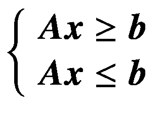

因此，规范型中的不等式约束如下：

![$$ \left[\begin{array}{c}\boldsymbol{A}\\ {}-\boldsymbol{A}\end{array}\right]\boldsymbol{x}\ge \left[\begin{array}{c}\boldsymbol{b}\\ {}-\boldsymbol{b}\end{array}\right] $$](images/500382_1_En_10_Chapter/500382_1_En_10_Chapter_TeX_Equar.png)

## 规范形式到标准形式的转换

同样地，通过引入一个 *p* 维的松弛向量变量 `y`，可以将规范型转换为标准型，满足：

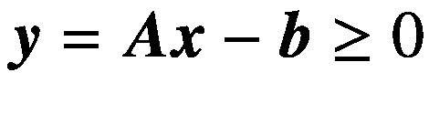

原始向量变量 `x` 可以分解为正向部分 `x+` ≥ 0 和负向部分 `x-` ≥ 0。

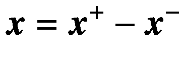

令：

![$$ \hat{\boldsymbol{x}}=\left[\begin{array}{c}{\boldsymbol{x}}^{+}\\ {}{\boldsymbol{x}}^{-}\\ {}\boldsymbol{y}\end{array}\right] $$](images/500382_1_En_10_Chapter/500382_1_En_10_Chapter_TeX_IEq16.png), ![$$ \hat{\boldsymbol{c}}=\left[\begin{array}{c}\boldsymbol{c}\\ {}-\boldsymbol{c}\\ {}\mathbf{0}\end{array}\right] $$](images/500382_1_En_10_Chapter/500382_1_En_10_Chapter_TeX_IEq17.png), ![$$ \hat{\boldsymbol{A}}=\left[\boldsymbol{A}\kern0.5em -\boldsymbol{A}\kern0.5em -{\boldsymbol{I}}_{\boldsymbol{p}}\right] $$](images/500382_1_En_10_Chapter/500382_1_En_10_Chapter_TeX_IEq18.png)

那么，在标准型下的等价 LP 问题如下：

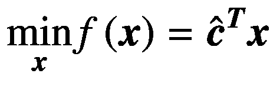

满足约束条件，

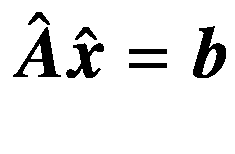

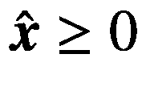

## Java 实现：`LPCanonicalProblem1` 类

NM Dev 类 `LPCanonicalProblem1` 用于构造规范型的 LP 问题。该类的签名如下：

```java
public class LPCanonicalProblem1 extends LPProblemImpl1 {

    /**
     * 构造规范型下的线性规划问题。
     *
     * @param c 目标函数
     * @param A 系数矩阵 A，用于约束条件 A * x &ge; b（大于等于约束）
     * @param b 值向量 b，用于约束条件 A * x &ge; b（大于等于约束）
     */
    public LPCanonicalProblem1(
        Vector c,
        Matrix A,
        Vector b
    );

    /**
     * 构造规范型下的线性规划问题。
     *
     * @param cost    目标函数
     * @param greater 一组大于等于约束的集合
     */
    public LPCanonicalProblem1(
        Vector cost,
        LinearGreaterThanConstraints greater
    );

    /**
     * 将线性规划问题从第二规范型转换为第一规范型。
     *
     * @param problem 一个在第二规范型下的线性规划问题
     */
    public LPCanonicalProblem1(LPCanonicalProblem2 problem);

    /**
     * 获取线性规划问题的大于等于约束。
     *
     * @return 大于等于约束
     */
    public LinearGreaterThanConstraints getGreaterThanConstraints();

}
```

## 代码示例

以下代码片段构造了相同的规范型 LP 问题：

```java
// 构造规范型 1 下的 LP 问题
LPCanonicalProblem1 problem2
    = new LPCanonicalProblem1(
          new DenseVector(new double[]{-1.0, -1.0, 0, 0}), // c
          new DenseMatrix( // A
              new double[][]{
                  {7, 1, 1, 0},
                  {-1, 1, 0, 1},
                  {-7, -1, -1, 0},
                  {1, -1, 0, -1}
              }),
          new DenseVector(new double[]{15.0, 1.0, -15.0, -1.0}) // b
      );

System.out.println(problem2);
```

输出如下：

```
min. objective:
[-1.000000, -1.000000, 0.000000, 0.000000]
less-than-or-equal-to inequalities:
4x4
[,1] [,2] [,3] [,4]
[1,] -7.000000, -1.000000, -1.000000, -0.000000,
[2,] 1.000000, -1.000000, -0.000000, -1.000000,
[3,] 7.000000, 1.000000, 1.000000, -0.000000,
[4,] -1.000000, 1.000000, -0.000000, 1.000000,  * x <=
[-15.000000, -1.000000, 15.000000, 1.000000]
equalities:
free variables:
```

## 使用 LPCanonicalProblem2 构造规范型 LP 问题

这与之前以标准型构造的输出相同。

NM Dev 提供了另一个类`LPCanonicalProblem2`，用于使用小于等于不等式约束来构造规范型 LP 问题。


这满足以下条件：


以下代码片段构造了之前展示的相同 LP 问题：

```
// 构造规范型 2 下的 LP 问题

LPCanonicalProblem2 problem3
= new LPCanonicalProblem2(
    new DenseVector(new double[]{-1.0, -1.0, 0, 0}), // c
    new DenseMatrix( // A
        new double[][]{
            {-7, -1, -1, 0},
            {1, -1, 0, -1},
            {7, 1, 1, 0},
            {-1, 1, 0, 1}
        }),
    new DenseVector(new double[]{-15.0, -1.0, 15.0, 1.0}) // b
);
System.out.println(problem3);
```

输出如下：

```
min. objective:
[-1.000000, -1.000000, 0.000000, 0.000000]
less-than-or-equal-to inequalities:
4x4
[,1] [,2] [,3] [,4]
[1,] -7.000000, -1.000000, -1.000000, 0.000000,
[2,] 1.000000, -1.000000, 0.000000, -1.000000,
[3,] 7.000000, 1.000000, 1.000000, 0.000000,
[4,] -1.000000, 1.000000, 0.000000, 1.000000,  * x <=
[-15.000000, -1.000000, 15.000000, 1.000000]
equalities:
free variables:
```

### 示例二

再举一个例子，以下代码片段构造了这个 LP 问题：

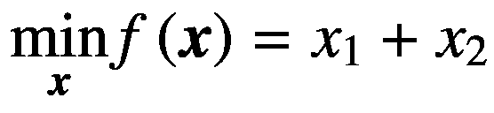

满足约束条件，

![$$ \left[\begin{array}{cc}1&amp; 1\\ {}1&amp; 2\\ {}0&amp; 3\end{array}\right]\left[\begin{array}{c}{x}_1\\ {}{x}_2\end{array}\right]\le \left[\begin{array}{c}150\\ {}170\\ {}180\end{array}\right] $$](images/500382_1_En_10_Chapter/500382_1_En_10_Chapter_TeX_Equbb.png)


```
// 构造规范型 2 下的 LP 问题

LPCanonicalProblem2 problem4
= new LPCanonicalProblem2(
    new DenseVector(new double[]{1.0, 1.0}), // c
    new DenseMatrix( // A
        new double[][]{
            {1, 1},
            {1, 2},
            {0, 3}
        }),
    new DenseVector(new double[]{150, 170, 180}) // b
);
System.out.println(problem4);
```

输出如下：

```
min. objective:
[1.000000, 1.000000]
less-than-or-equal-to inequalities:
3x2
[,1] [,2]
[1,] 1.000000, 1.000000,
[2,] 1.000000, 2.000000,
[3,] 0.000000, 3.000000,  * x <=
[150.000000, 170.000000, 180.000000]
equalities:
free variables:
```

图 10-5 绘制了这些约束条件。可行域以彩色显示。

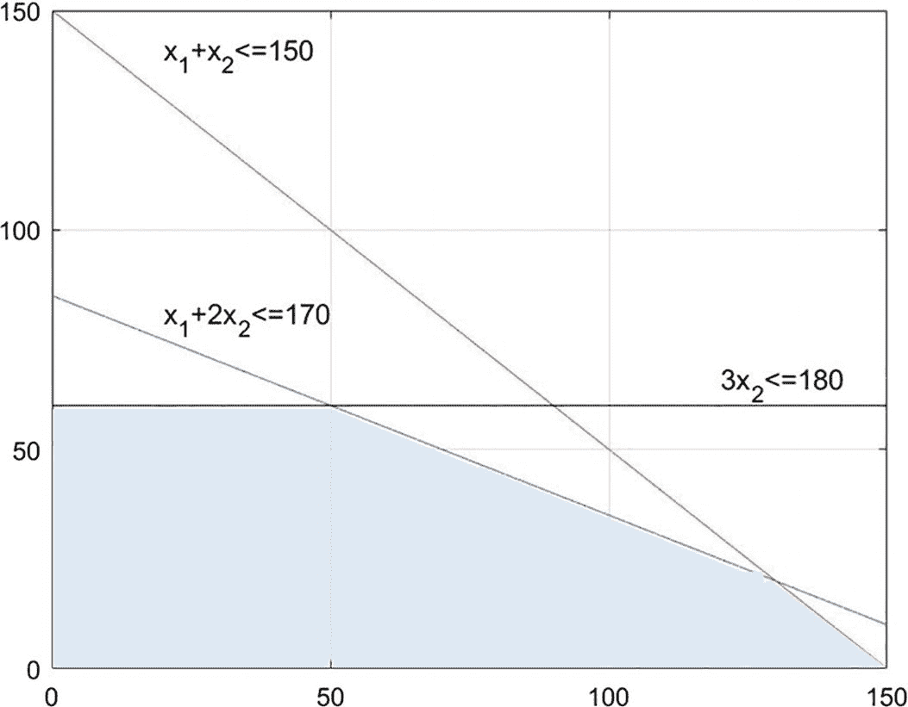

### 图 10-5

一个规范型的线性规划问题

好的，作为高级文档工程师和翻译员，我将严格遵循您提供的注意事项和示例，将给定的英文文本翻译成中文。

### 10.2.2 一阶必要条件

在数学优化中，拉格朗日乘数法是一种在等式约束下寻找函数局部最大值和最小值的策略。它是一种用于极值的一阶导数检验。它将目标函数的梯度与等式约束的梯度关联起来。

假设我们想要求解：


服从于，

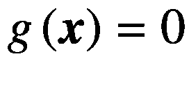

我们构造拉格朗日函数，这是一个关于 `x` 和 `λ` 的函数：

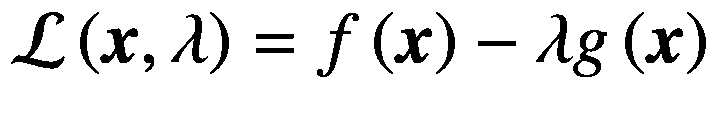

对应于原始约束优化的解 `x*` 总是拉格朗日函数的一个鞍点。因此，我们有：

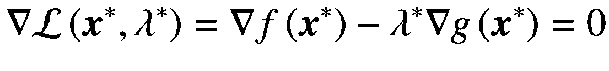

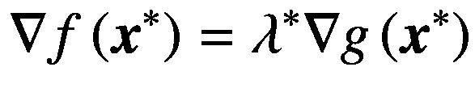

例如，假设我们想要求解：

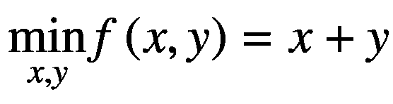

服从于，

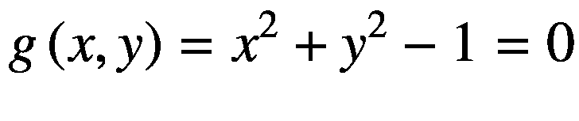

可行集是单位圆，`f` 的等高线是对角线（斜率为-1）。图 10-6 用图形展示了最小值发生在 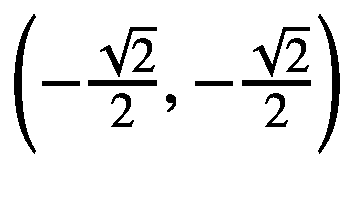 处。

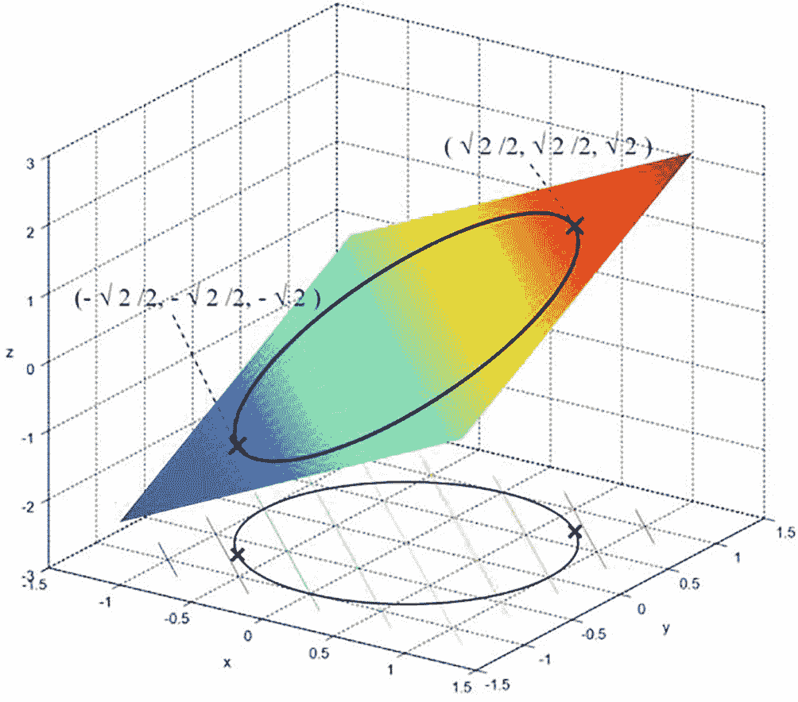

### 图 10-6

一个具有等式约束的最小化问题

应用拉格朗日乘数法，我们得到：

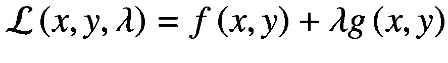

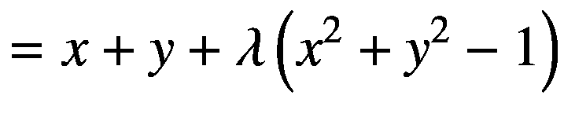

梯度如下：

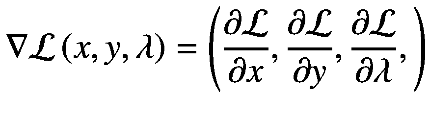

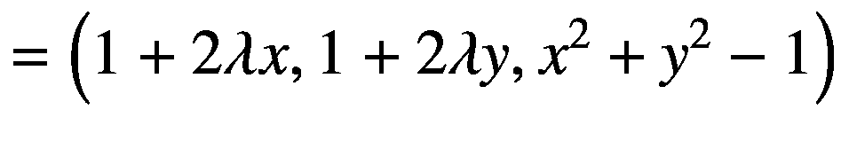

求解 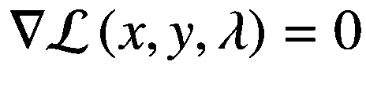 得到：

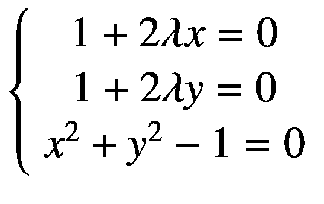

或者等价地，

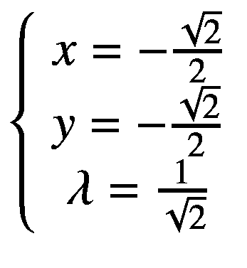

因此，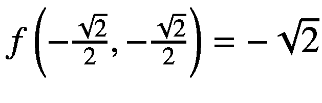 是最小值。

Karush-Kuhn-Tucker (KKT) 条件将拉格朗日乘数法推广到也考虑不等式约束的情况。类似于拉格朗日方法，约束最小化（最大化）问题被重写为一个拉格朗日函数，其最优点是一个鞍点，即，在选择变量域上的全局最小值（最大值）和在乘子域上的全局最小值（最大值）。KKT 条件表明，如果 `x*` 是以下问题的局部极小点：


服从于，


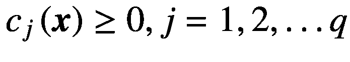

则存在拉格朗日乘子 `λ*` 和 `μ*`，使得以下拉格朗日函数：

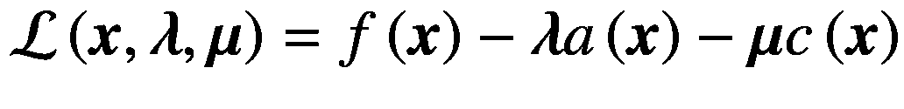

在 `x*` 处有一个鞍点。也就是说，


或者，

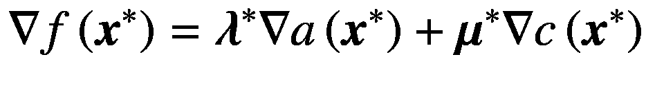

此外，

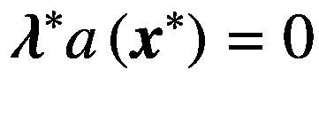


并且，


因此，对于非活跃约束 `cj` > 0， 必须为 0。

例如，为简单起见，假设优化问题没有等式约束，只有一个不等式约束。如果极小点 `x*` 位于由 `c[1]` 定义的可行域 `R` 内部，则 `c[1]` 是一个非活跃约束。。否则，如果极小点位于 `c[1]` 的边界上，即 `c1` = 0，则 。。`f` 和 `c` 的梯度必须指向朝向 `R` 内部的同一方向，如图 10-7 所示。


### 图 10-7

`x*` 是位于不等式约束边界上的一个极小点

### 10.2.3 单纯形法

将 KKT 条件应用于标准形式的线性规划问题，如下所示：


约束条件为，


我们得到：


以及


一个直接观察结果是，解`x*`不可能位于可行域的内部。如果它在内部，则不存在有效约束，即`μ* = 0`。那么我们将得到以下关系：


*n*维向量`c`将位于由`A^T`的*p*列张成的*p*维子空间中。由于*p* < *n*，除非解位于边界上，否则这种情况极不可能发生。因此，线性规划问题的任何解往往都位于可行域的边界上，即由不等式约束所定义的边缘上。

此外，如果候选解位于可行域的边界上，我们可以简单地沿该边界移动以减小目标函数值。换句话说，从边界上的一个候选解开始，我们可以沿着边缘向下滑动以找到更小的值，直到抵达该边缘的端点，即一个顶点。请参见图 10-8。


### 图 10-8 线性规划问题的解必须位于顶点上

对于图 10-8 中的示例，假设我们从`v[1]`开始。我们可以沿着函数值减小的方向（向左）移动。当到达顶点`v[2]`时，我们切换到另一条边缘，并继续沿着函数值减小的方向向下滑动至`v[3]`，最终到达`v[4]`。`v[4]`是边缘终点的顶点。从这个顶点移动到另一条边缘不再使函数值减小。事实上，我们已经找到了最小值点`v[4] = (0, 0)`。很容易看出`x[1] + x[2] = 0 + 0 = 0`是该问题的解。

可以证明，对于标准形式的线性规划问题，如果目标函数在可行域内有最小值，那么它（至少）会在其中一个顶点上取得该值。由于顶点数量有限，这将问题简化为有限的计算量。原则上，我们可以检查所有顶点处的值来找到最小值。


### 图 10-9 一个线性不等式系统定义了一个多面体作为可行域。单纯形算法从一个起始顶点开始，沿着多面体的边缘移动，直到到达最优解的顶点

还可以证明，如果一个顶点不是目标函数的最小点，那么存在一条包含该顶点的边缘，使得目标函数值在沿着离开该顶点的边缘上是严格递减的。如果该边缘是有限的，那么该边缘连接到另一个顶点，在该顶点处目标函数值更小；否则，目标函数在该边缘上无下界，且线性规划问题无解。单纯形方法应用了这一见解，沿着多面体（由约束条件定义的可行域）的边缘行走，到达目标函数值越来越小的顶点。这一过程持续进行，直到达到最小值或访问到一条无界边缘（由此断定问题无解）。该算法总会终止，因为多面体的顶点数量是有限的。此外，由于我们总是在同一方向（目标函数的方向）上在顶点之间跳跃，我们希望所访问的顶点数量会很少。

对于标准形式的线性规划问题，如下所示：


约束条件为，


可以通过引入松弛变量`x[B]`将其转换为标准形式，如下所示：


（此处我们将原始变量`x`记为`x[N]`。）

等价的线性规划问题标准形式如下：


约束条件为，


这里，`N = {1, 2, ..., n}`是原始变量的索引集合，`B = {n + 1, ..., n + m}`是松弛变量的索引集合。

我们将用以下表格来表示线性规划问题的标准形式：


我们解读这个表格的方式是：最左侧一列是依赖变量（或基本变量），最上面一行是独立变量（或非基本变量）。示例如下：


压缩形式的表格如下：


Ferris, Mangasarian, & Wright (2007) 提供了以下示例：


满足约束条件：


各约束条件的松弛变量如下：


NM Dev 类 `SimplexTable` 用于构建线性规划问题的单纯形表。示例如下：

```java
import org.nmdev.linear.Solver;
import org.nmdev.linear.standardform.SimplexTable;

public class Main {
    public static void main(String[] args) {
        // 定义线性规划问题：最小化 3x1 - 6x2
        // 满足约束条件：
        // x1 + 2x2 >= -1
        // 2x1 + x2 >= 0
        // x1 - x2 >= -1
        // x1 - 4x2 >= -13
        // -4x1 + x2 >= -23
        // x1, x2 >= 0
        double[] c = {3, -6};
        double[][] A = {
            {1, 2},
            {2, 1},
            {1, -1},
            {1, -4},
            {-4, 1}
        };
        double[] b = {-1, 0, -1, -13, -23};

        // 使用NM Dev的SimplexTable来构建标准形式并求解
        SimplexTable simplex = new SimplexTable(c, A, b, Solver.MINIMIZE);
        double[] solution = simplex.solve();

        // 输出最优解
        System.out.println("Optimal solution:");
        System.out.println("x1 = " + solution[0]);
        System.out.println("x2 = " + solution[1]);
        System.out.println("Minimum value = " + (-simplex.getOptimalValue()));
    }
}
```

// 构造一个线性规划问题

```
LPCanonicalProblem1 problem

= new LPCanonicalProblem1(

new DenseVector(3., -6.), // c

new DenseMatrix( // A

new double[][]{

{1, 2},

{2, 1},

{1, -1},

{1, -4},

{-4, 1}

}),

new DenseVector(-1., 0, -1, -13, -23) // b

);

SimplexTable tableau = new SimplexTable(problem);

System.out.println(tableau);
```

输出结果如下：

```
x,1               x,2              B,2147483647

x_slack,1         1.000000          2.000000         1.000000

x_slack,2         2.000000          1.000000        -0.000000

x_slack,3         1.000000         -1.000000         1.000000

x_slack,4         1.000000         -4.000000        13.000000

x_slack,5        -4.000000          1.000000        23.000000

COST,2147483647   3.000000         -6.000000         0.000000
```

在此初始表中，`x,1` 表示 *x*[1]，`x,2` 表示 *x*[2]。五个 `x_slack` 变量是五个不等式约束的松弛变量。参见图 10-10。


**图 10-10** 顶点是约束条件的交点（Ferris, Mangasarian, & Wright, 2007）

可行域多面体中的每个顶点，都是通过 *n* 个相应约束条件定义的 *n* 个超平面的交点。图 10-8 展示了这些顶点作为约束交点的情形。可以证明，这等价于将所有 *n* 个非基变量设为 0，即 ***x***[***N***] ***=*** **0**。例如，前面显示的初始表对应于坐标原点的顶点，此时所有原始变量均为 0，即 ***x*** = ***x***[***N***] ***=*** **0**。要使这个 ***x*** 可行（不违反任何约束），则 ***x***[***B***] 中的松弛变量 ***=*** **− b** 必须非负。也就是说，***b ≤*** **0**。在这种情况下，目标值 *f*(**0**) = 0。

要检查另一个（相邻的）顶点，我们可以将一个非基变量与一个基变量互换，实际上是将一个非基变量从 0 增加到正值，同时将一个基变量设为 0。例如，我们需要从 ***x =*** (*x*[1], *x*[2]) ***=*** (0, 0) 移动到下一个顶点。由于标准线性规划问题中变量的非负约束，我们只能增加变量的值。例如，我们可以尝试增加 *x*[1]。


此时，目标值变为：


增加 *x*[1] 实际上会增加 *f*，这与我们的目标正好相反。因此，我们可以尝试：


对于这个选择，我们得到：


选择一个非基变量（即主元列）的过程称为定价（pricing）。主元列被称为进基变量（entering variable），因为它“进入”基变量。

要确定哪个基变量与进基变量互换，我们需要检查增加进基变量对每个基变量的影响。对于本例，我们得到：


我们希望使 *λ* 尽可能大，以最大程度地减少目标函数值，但它不能过大，以免某些基变量变为负值而违反约束。非负约束转化为以下条件：


在不违反任何约束的情况下，*λ* 可以取的最大非负值是 *λ* = 1。此外，我们观察到阻断变量（即如果我们将 *λ* 增加到超过其极限 1 时将变为负值的变量）是 *x*[5]。因此，我们选择 *x*[5] 作为主元行。

选择一个基变量（即主元行）的过程称为比值测试（ratio test）。主元行被称为离基变量（leaving variable），因为它“离开”基变量成为非基变量，并取值 0。

我们使用 Jordan 消去法在表中交换 *x*[5]（第 3 行）和 *x*[2]（第 2 列）。对于一个线性系统，Jordan 消去法是一种将一个自变量与一个因变量互换的操作。考虑这个简单的例子：


要反转 *x* 和 *y* 的角色，我们可以写出下式：


我们可以将这个想法推广到多变量情况，其中自变量 ***x*** ∈ *ℝ*^(*n*)，因变量 ***y*** ∈ *ℝ*^(*m*)。更具体地说，假设我们有：


等价地，在表格形式中，假设我们有：


将第 *r* 行（*y*[*r*]）与第 *s* 列（*x*[*s*]）互换，意味着我们用 *y*[*r*] 来表示 *x*[*s*]，而保持其他 *x*[*i*] 不变。这可以通过求解一个关于 *x*[*s*] 的线性方程组来完成。得到的表格如下所示：

![$$ {\displaystyle \begin{array}{ccccccccc}&amp; &amp; {x}_1&amp; \dots &amp; {x}_{s-1}&amp; {y}_r&amp; {x}_{s+1}&amp; \dots &amp; {x}_n\\ {}{y}_1&amp; =&amp; {B}_{11}&amp; \dots &amp; &amp; {B}_{1s}&amp; &amp; \dots &amp; {B}_{1n}\\ {}\vdots &amp; &amp; \vdots &amp; &amp; &amp; \vdots &amp; &amp; &amp; \vdots \\ {}{y}_{r-1}&amp; &amp; &amp; &amp; &amp; &amp; &amp; &amp; \\ {}{x}_s&amp; =&amp; {B}_{r1}&amp; &amp; &amp; {B}_{rs}&amp; &amp; &amp; {B}_{rn}\\ {}{y}_{r+1}&amp; &amp; &amp; &amp; &amp; &amp; &amp; &amp; \\ {}\vdots &amp; &amp; \vdots &amp; &amp; &amp; \vdots &amp; &amp; &amp; \vdots \\ {}{y}_m&amp; =&amp; {B}_{m1}&amp; &amp; &amp; {B}_{ms}&amp; &amp; &amp; {B}_{mn}\end{array}} $$](img/500382_1_En_10_Chapter_TeX_Equdd.png)

此代码执行 Jordan 变换，在我们的示例中将第 3 行（`x`[5]）与第 2 列（`x`[2]）进行交换。

```
tableau = tableau.swap(3, 2);

System.out.println(tableau);
```

输出如下：

```
6x3
```

初始单纯形表：

```
x,1                x_slack,3          B,2147483647

x_slack,1         3.000000          -2.000000           3.000000

x_slack,2         3.000000          -1.000000           1.000000

x,2               1.000000          -1.000000           1.000000

x_slack,4        -3.000000           4.000000           9.000000

x_slack,5        -3.000000          -1.000000          24.000000

COST,2147483647  -3.000000           6.000000          -6.000000
```

目标函数值从 0 降至 -6。通过重复定价和比值检验过程，我们将测试下一个顶点，直到找到最优解（或证明无解）。请注意，单纯形表的最后一行包含当前非基变量的系数，它表示该变量每增加一个单位时 `f` 的减少量。因此，一条经验法则是：在定价过程中选择系数最负的列。在我们的示例中，下一个将是 `x`[1]（系数为 -3）。

此代码执行将第 4 行（`x`[6]）与第 1 列（`x`[1]）进行交换。

```
tableau = tableau.swap(4, 1);

System.out.println(tableau);
```

输出如下：

```
6x3

x_slack,4          x_slack,3            B,2147483647

x_slack,1        -1.000000           2.000000             12.000000

x_slack,2        -1.000000           3.000000             10.000000

x,2              -0.333333           0.333333              4.000000

x,1              -0.333333           1.333333              3.000000

x_slack,5         1.000000          -5.000000             15.000000

COST,2147483647   1.000000           2.000000            -15.000000
```

## 线性规划问题的求解阶段

现在，最后一行中的所有系数均为正值。我们可以从单纯形表的最后一列读出该线性规划问题的解。


这种单纯形算法可以高效地求解线性规划问题。它是一种迭代方法，不断更新可行点（可行域中的一个顶点），直到达到最优解。它通过对对应于约束方程线性系统的矩阵执行线性变换来找到下一个顶点。因此，求解一个线性规划问题通常包含两个阶段。第一阶段是找到一个满足所有约束条件的可行起始点。也就是说，找到一个最后一列非负的单纯形表。在前面的示例中，如果线性规划问题是标准形式的，这意味着原点（`x` = `0`）满足所有约束条件。第二阶段从一个可行的单纯形表开始，应用一系列线性变换，直到找到最优单纯形表为止。

### 第一阶段线性规划问题

为了找到一个可行的起始点，我们将先求解一个相关的线性规划问题，称为第一阶段线性规划问题。对于这个第一阶段问题，应该很容易确定一个初始可行点，并且它的解应该能给我们提供原问题的一个可行点。具体来说，给定一个标准线性规划问题，如下所示：


约束条件为：


我们可以通过引入一个人工变量 `x`[0] 和松弛变量 `x`[`n` + `i`] 来构造第一阶段线性规划问题，具体如下：


约束条件为：


### 第一阶段问题的性质

首先，目标函数是下方有界的，因此最小解为 `f` = `x`[0] = 0。其次，第一阶段线性规划问题存在一个明显的可行点，如下所示：


以及：


那么松弛变量如下：


因此，`x`[`B`] ≥ `0`，满足所有约束条件。

第三，如果原问题存在可行点 ，那么点  对于第一阶段问题是可行的，因为 `x`[`B`] ≥ `0`。

第四，如果  是第一阶段的解，那么  是原问题的一个可行点。因为满足：


我们得到：


这满足了原问题中的所有约束条件。

最后，如果 (`x`[0], `x`) 是第一阶段的解，且 `x`[0] > 0，那么原问题必定不可行。

### 应用示例

我们可以使用前面描述的单纯形法求解第一阶段问题。NM Dev 类 `FerrisMangasarianWrightPhase1` 实现了这个第一阶段过程，通过旋转相关第一阶段问题的单纯形表，从一个不可行表中找到一个可行表。示例如下：


约束条件为：


```
// 构造一个 LP 问题
LPProblemImpl1 problem = new LPProblemImpl1(
    new DenseVector(4.0, 5.0), // c
    new LinearGreaterThanConstraints(
        new DenseMatrix( // A
            new double[][]{
                {1.0, 1.0},
                {1.0, 2.0},
                {4.0, 2.0},
                {-1.0, -1.0},
                {-1.0, 1.0}
            }),
        new DenseVector(-1.0, 1.0, 8.0, -3.0, 1.0)), // b
    null, // 小于约束
    null, // 等式约束
    null); // 盒约束
SimplexTable table0 = new SimplexTable(problem);
System.out.println("原始问题的单纯形表：");
System.out.println(table0);
FerrisMangasarianWrightPhase1 phase1
```

= new `FerrisMangasarianWrightPhase1`(table0);

`SimplexTable` table1 = phase1.process();

`System.out.println("第一阶段问题的单纯形表：")`;

`System.out.println(table1)`;

`System.out.printf("最小值 = %f%n", table1.minimum())`;

`System.out.printf("最小点 = %s%n", table1.minimizer())`;

```

输出如下：

```

tableau for the original problem:

6x3

x,1               x,2              B,2147483647

x_slack,1          1.000000          1.000000         1.000000

x_slack,2          1.000000          2.000000        -1.000000

x_slack,3          4.000000          2.000000        -8.000000

x_slack,4         -1.000000         -1.000000         3.000000

x_slack,5         -1.000000          1.000000        -1.000000

COST,2147483647    4.000000          5.000000         0.000000

tableau for the phase 1 problem:

6x3

x_slack,3         x_slack,5        B,2147483647

x_slack,1          0.333333          0.333333         4.000000

x_slack,2          0.500000          1.000000         4.000000

x,2                0.166667          0.666667         2.000000

x_slack,4         -0.333333         -0.333333         0.000000

x,1                0.166667         -0.333333         1.000000

COST,2147483647    1.500000          2.000000        14.000000

minimum = 14.000000

minimizer = [1.000000, 2.000000]

```

我们已经找到了原问题的一个可行点，`x` = (1, 2)。原问题的最小值 `f`(`x`) = 14。

在 NM Dev 中，单纯形求解器实现了 `LPSimplexSolver` 接口。

```
public interface LPSimplexSolver extends LPSolver {
    /**
     * 在单纯形表上通过单纯形算法求解一个 LP 问题
     *
     * @param table 对应 LP 问题的初始单纯形表
     * @return 一个 LP 解
     * @throws Exception 当出现错误时
     */
    public LPSimplexSolution solve(SimplexTable table) throws Exception;
}
```

`LPTwoPhaseSolver` 类实现了本节描述的两阶段算法。它接收 `LPProblem` 形式的 LP 问题，并以 `LPSimplexSolution` 形式输出解。类签名如下：

```
public class LPTwoPhaseSolver implements LPSimplexSolver {
    private class Solution implements LPSimplexSolution {
        ……
    }

    private final LPSimplexSolver solver;// 一个规范 LP 求解器

    /**
     * 构造一个 LP 求解器来求解 LP 问题。
     *
     * @param solver 一个规范 LP 求解器
     */
    public LPTwoPhaseSolver(LPSimplexSolver solver) {
        this.solver = solver;
    }

    /**
     * 构造一个 LP 求解器来求解 LP 问题。
     */
    public LPTwoPhaseSolver() {
        this(new LPCanonicalSolver());
    }

    @Override
    public LPSimplexSolution solve(SimplexTable table) throws LPInfeasible, Exception {
        return new Solution(table);
    }

    @Override
    public LPSimplexSolution solve(LPProblem problem) throws LPInfeasible, Exception {
        return solve(new SimplexTable(problem));
    }
}
```

继续前面的例子，下面的代码使用两阶段算法求解了该 LP 问题：

```
// 构造一个 LP 问题
LPProblemImpl1 problem = new LPProblemImpl1(
    new DenseVector(4.0, 5.0), // c
    new LinearGreaterThanConstraints(
        new DenseMatrix( // A
            new double[][]{
                {1.0, 1.0},
                {1.0, 2.0},
                {4.0, 2.0},
                {-1.0, -1.0},
                {-1.0, 1.0}
            }),
        new DenseVector(-1.0, 1.0, 8.0, -3.0, 1.0)), // b
    null, // 小于约束
    null, // 等式约束
    null); // 盒约束

// 构造该 LP 问题的单纯形表
SimplexTable table0 = new SimplexTable(problem);
System.out.println("问题的单纯形表：");
System.out.println(table0);

// 使用两阶段算法求解该 LP 问题
LPTwoPhaseSolver solver = new LPTwoPhaseSolver();
LPBoundedMinimizer solution
    = (LPBoundedMinimizer) solver.solve(problem).minimizer();
System.out.printf("最小值 = %f%n", solution.minimum());
System.out.printf("最小点 = %s%n", solution.minimizer());
```

输出如下：

```
simplex tableau for the problem:

6x3

x,1               x,2                 B,2147483647

x_slack,1         1.000000          1.000000            1.000000

x_slack,2         1.000000          2.000000           -1.000000

x_slack,3         4.000000          2.000000           -8.000000

x_slack,4        -1.000000         -1.000000            3.000000

x_slack,5        -1.000000          1.000000           -1.000000

COST,2147483647   4.000000          5.000000            0.000000

minimum = 14.000000

minimizer = [1.000000, 2.000000]
```

结果表明`f`(1, 2) = 14 确实是原问题的解。

另一个例子，下面的代码求解了 Chen, Batson, & Dang (2009) 中的这个 LP 问题：


满足约束条件，


```java
// 构造一个 LP 问题

LPProblemImpl1 problem = new LPProblemImpl1(

new DenseVector(-5.0, 2.0), // c

new LinearGreaterThanConstraints(

new DenseMatrix( // A1

new double[][]{

{1.0, 3.0}}),

new DenseVector(9.0)), // b1

new LinearLessThanConstraints(

new DenseMatrix( // A2

new double[][]{

{-1.0, 2.0},

{3.0, 2.0}}),

new DenseVector(5.0, 19.0)), // b2

null,

null);

// 构造该 LP 问题的单纯形表

SimplexTable table0 = new SimplexTable(problem);

System.out.println("问题的单纯形表：");

System.out.println(table0);

// 使用两阶段算法求解该 LP 问题

LPTwoPhaseSolver solver = new LPTwoPhaseSolver();

LPMinimizer solution = solver.solve(problem).minimizer();

System.out.printf("最小值 = %f%n", solution.minimum());

System.out.printf("最小点 = %s%n", solution.minimizer());
```

输出如下：

```
simplex tableau for the problem:

4x3

x,1             x,2                    B,2147483647

x_slack,1            1.000000        3.000000              -9.000000

x_slack,2            1.000000       -2.000000               5.000000

x_slack,3           -3.000000       -2.000000              19.000000

COST,2147483647     -5.000000        2.000000               0.000000

minimum = -25.571429

minimizer = [5.571429, 1.142857]
```

最优解为 。

再举一个例子，下面的代码求解了 Ferris, Mangasarian, & Wright (2007) 中的这个 LP 问题。


满足约束条件，


```java
// 构造一个线性规划问题

LPProblemImpl1 problem = new LPProblemImpl1(

new DenseVector(2.0, -1.0), // 目标函数系数 c

new LinearGreaterThanConstraints(

new DenseMatrix( // 不等式约束矩阵 A1

new double[][]{

{1.0, 0.0}

}),

new DenseVector(-6.0)), // 不等式约束右侧 b1

null,

new LinearEqualityConstraints(

new DenseMatrix( // 等式约束矩阵 A2

new double[][]{

{-1.0, 0.0} // b2

}),

new DenseVector(-4.0)),

new BoxConstraints(

2,

new BoxConstraints.Bound(

2,

Double.NEGATIVE_INFINITY,

Double.POSITIVE_INFINITY)) // x2 无约束

);

// 为线性规划问题构造单纯形表

SimplexTable table0 = new SimplexTable(problem);

System.out.println("该问题的单纯形表：");

System.out.println(table0);

// 使用两阶段算法求解线性规划问题

LPTwoPhaseSolver solver = new LPTwoPhaseSolver();

LPUnboundedMinimizer solution

= (LPUnboundedMinimizer) solver.solve(problem).minimizer();

System.out.printf("最小值 = %f%n", solution.minimum());

System.out.printf("最小化点 = %s%n", solution.minimizer());

System.out.printf("v = %s%n", minimizer.v());
```

输出结果如下：

```
simplex tableau for the problem:

3x3

x,1              FREE,2             B,2147483647

x_slack,1            1.000000         0.000000           6.000000

EQUALITY,1          -1.000000         0.000000           4.000000

COST,2147483647      2.000000        -1.000000           0.000000

minimum = -Infinity

minimizer = [0.000000, 1.000000]

v = [0.000000, 1.000000]
```

结果显示该问题无下界。

再举一个例子，以下代码求解了 Ferris、Mangasarian 和 Wright (2007) 中的线性规划问题：


满足约束条件：


```java
// 构造一个线性规划问题

LPProblemImpl1 problem = new LPProblemImpl1(

new DenseVector(2.0, -1.0), // 目标函数系数 c

new LinearGreaterThanConstraints(

new DenseMatrix( // 不等式约束矩阵 A

new double[][]{{1.0, 0.0}}),

new DenseVector(6.0)), // 不等式约束右侧 b

null,

new LinearEqualityConstraints(

new DenseMatrix(

new double[][]{

{-1.0, 0.0}}), // 等式约束矩阵 A
```


# 线性规划求解代码与结果

以下是构建一个简单的线性规划问题并使用两阶段法求解的代码片段。

```java
new DenseVector(-4.0)), // 等式约束右侧 b

new BoxConstraints(
    2,
    new BoxConstraints.Bound(
        2,
        Double.NEGATIVE_INFINITY,
        Double.POSITIVE_INFINITY)) // x2 无约束
);

// 为线性规划问题构造单纯形表
SimplexTable table0 = new SimplexTable(problem);
System.out.println("该问题的单纯形表：");
System.out.println(table0);

// 使用两阶段算法求解线性规划问题
LPTwoPhaseSolver solver = new LPTwoPhaseSolver();
LPMinimizer minimizer = solver.solve(problem).minimizer();
```

执行上述代码后，输出结果如下：

```
simplex tableau for the problem:
3x3
x,1                 FREE,2              B,2147483647
x_slack,1           1.000000            0.000000            -6.000000
EQUALITY,1         -1.000000            0.000000             4.000000
COST,2147483647     2.000000           -1.000000             0.000000
```

然而，在运行过程中抛出了异常，表明该问题可能不可行。完整的异常堆栈如下：

```
Exception in thread "main" dev.nm.solver.multivariate.constrained.convex.sdp.socp.qp.lp.exception.LPInfeasible
	at dev.nm.solver.multivariate.constrained.convex.sdp.socp.qp.lp.simplex.FerrisMangasarianWrightPhase1.process(FerrisMangasarianWrightPhase1.java:81)
	at dev.nm.solver.multivariate.constrained.convex.sdp.socp.qp.lp.simplex.solver.LPTwoPhaseSolver$Solution.(LPTwoPhaseSolver.java:64)
	at dev.nm.solver.multivariate.constrained.convex.sdp.socp.qp.lp.simplex.solver.LPTwoPhaseSolver$Solution.(LPTwoPhaseSolver.java:45)
	at dev.nm.solver.multivariate.constrained.convex.sdp.socp.qp.lp.simplex.solver.LPTwoPhaseSolver.solve(LPTwoPhaseSolver.java:104)
	at dev.nm.solver.multivariate.constrained.convex.sdp.socp.qp.lp.simplex.solver.LPTwoPhaseSolver.solve(LPTwoPhaseSolver.java:109)
	at dev.nm.nmj.Chapter10.lp_solver_3(Chapter10.java:108)
	at dev.nm.nmj.Chapter10.main(Chapter10.java:75)
```


注意，该程序抛出了一个 `LPInfeasible` 异常。这在第一阶段即检测到该问题不可行。

## 10.2.4 单纯形法的代数形式

在前一节中，我们讨论了单纯形法的几何意义。我们也可以将该算法纳入第 10.1.1 节的一般优化框架中。给定一个顶点 `x[k]`（非退化，意味着它恰好有 `n` 条边或 `n` 个有效约束），如果 `A[ak + 1]` 与 `A[ak]` 恰好相差一行，则顶点 `x[k + 1]` 称为与 `x[k]` 相邻。

![$$ {\boldsymbol{A}}_{\boldsymbol{a}\boldsymbol{k}}=\left[\begin{array}{c}{\boldsymbol{a}}_{\boldsymbol{j}\mathbf{1}}^{\boldsymbol{T}}\\ {}{\boldsymbol{a}}_{\boldsymbol{j}\mathbf{2}}^{\boldsymbol{T}}\\ {}\boldsymbol{\vdots}\\ {}{\boldsymbol{a}}_{\boldsymbol{j}\boldsymbol{n}}^{\boldsymbol{T}}\end{array}\right] $$](images/500382_1_En_10_Chapter/500382_1_En_10_Chapter_TeX_Equeb.png)

其中 `a[ji]^T` 是第 `ji` 个约束的系数。与 `A[ak]` 相关联的是有效约束的索引集合。


其中 `ji` 表示原始变量中的一个索引。

换句话说，如果 `I[k]` 和 `I[k+1]` 恰好有 (`n` - 1) 个相同的成员，则 `x[k]` 和 `x[k + 1]` 是相邻的。对于顶点 `x[k]`，单纯形算法检查 `x[k]` 是否是一个最小化点。如果不是，它会找到一个相邻的 `x[k + 1]`，该点能给出更小的目标函数值。如果最小化点存在且顶点数量有限，则单纯形算法总能在有限次迭代内找到解。

KKT 条件表明，存在一个 `λ[k]` ∈ `ℝ^n` 使得：


并且如果满足以下条件，则 `x[k]` 是一个最小化点：


换言之，`x[k]` 不是最小化点当且仅当 `λ[k]` 中至少有一个分量（例如第 `l` 个分量 `(λ[k])[l]`）为负。即：


在我们的一般优化算法中，下一个（且相邻的）顶点由下式给出：


可以证明，一个可行的下降方向 `d[k]` 具有以下特征：

`A[ak]d[k] >= 0`, `c^T d[k] < 0`

为了找到边 `d[k]`，我们求解以下方程：


其中 `e[l]` 是第 `l` 个坐标向量（即 `n` × `n` 单位矩阵的第 `l` 列）。

于是，我们得到：

## 10.3 二次规划

二次规划（QP）是在线性约束下最小化二次目标函数的问题。它在量化金融等领域有重要应用。此外，它常被用于求解其他更通用的非线性约束优化问题中的子问题，例如序列二次规划。该问题通常表述如下：


约束条件为：


其中，对于 `n` 个变量有 `p` 个线性约束，`A` ∈ `ℝ^(p × n)`。我们通常假设矩阵 `A` 是对称的、满秩的且半正定的，即 `A ≽ 0`。

如果海森矩阵 `H ≽ 0` 是半正定的，那么该问题是一个凸优化问题。该问题可以在（弱）多项式时间内求解。否则，该问题是 NP 困难的。对于一个非凸问题，可能存在多个驻点和局部极小值。事实上，即使 `H` 只有一个负特征值，该问题也是强 NP 困难的。

QP 的一个重要应用是现代投资组合理论。假设我们希望分配一笔资金购买 `n` 只股票，并持有一年。尽管一年后每只股票的确切回报是未知的，但我们可以将股票 `i` 的年回报率 `r[i]` 建模为一个随机变量，例如正态分布。即：


由于股票并非完全独立，它们往往会同涨同跌。它们是相关的。股票 `i` 和股票 `j` 之间的相关性如下：

![$$ {\rho}_{ij}=\frac{\mathrm{E}\left[\left({r}_i-{\mu}_i\right)\left({r}_j-{\mu}_j\right)\right]}{\sigma_i{\sigma}_j} $$](images/500382_1_En_10_Chapter/500382_1_En_10_Chapter_TeX_Equer.png)

投资者的决策是决定将资金的多少比例或权重 `w[i]` 投入到每只股票中，以构建其投资组合。那么，投资组合的预期回报如下：

![$$ \mathrm{E}\left[R\right]=\mathrm{E}\left[\sum \limits_{i=1}^n{w}_i{r}_i\right]=\sum \limits_{i=1}^n{w}_i\mathrm{E}\left[{r}_i\right]=\sum \limits_{i=1}^n{w}_i{\mu}_i={\boldsymbol{w}}^{\boldsymbol{T}}\boldsymbol{\mu} $$](images/500382_1_En_10_Chapter/500382_1_En_10_Chapter_TeX_Eques.png)

投资组合的方差如下：

![$$ Var\left[R\right]=\mathrm{E}\left[{\left(R-\mathrm{E}\left[R\right]\right)}²\right]=\sum \limits_{i=1}^n\sum \limits_{j=1}^n{w}_i{w}_j{\sigma}_i{\sigma}_j{\rho}_{ij}={\boldsymbol{w}}^{\boldsymbol{T}}\boldsymbol{\Sigma} \boldsymbol{w} $$](images/500382_1_En_10_Chapter/500382_1_En_10_Chapter_TeX_Equet.png)

其中 `Σ` 是 `n` × `n` 的对称半正定协方差矩阵，定义如下：


马科维茨提出，投资者应找到一个权重分配，使得在风险（由投资组合方差衡量）最小化的同时，投资组合的预期回报最大化。这实质上建立了一个如下的 QP 问题：


约束条件为：


所有权重的总和为 100%。我们还可以施加其他约束，例如每只股票的最低权重为 0%。这表示不允许卖空。这些不等式约束可以写成如下形式：


`λ` > 0 被称为风险厌恶系数。对风险更为保守、旨在最小化风险的投资者会选择较小的 `λ`。另一方面，更激进的投资者，追求更高的预期回报并能承受可能出现的更大回撤，则会选择较大的 `λ`。改变 `λ` 会得到不同的投资组合（不同的权重），这些组合满足在特定的 `λ` 下，不存在另一个具有更高预期回报但具有相同回报标准差（即风险）的投资组合。这些最优投资组合（针对不同的 `λ`）的集合共同绘制出了我们所说的有效前沿。见图 10-11。


**Figure 10-11**

投资组合的有效前沿

### 10.3.1 仅含等式约束的凸二次规划问题

让我们从一个可以解析求解的简单凸二次规划问题开始。一个仅含等式约束的凸二次规划问题表述如下：


约束条件为：


其中 `H ≽ 0`，`A ≽ 0`，`A ∈ ℝ^(p × n)`，`A` 对称且满秩，且 `p` < `n`。

可以证明，解 `x` 具有如下形式：


其中 `V[r]` 由 `V` 的最后 `n` − `p` 列组成。`V` 来自 `A = UΣV^T` 的奇异值分解。`A^+` 是 `A` 的 Moore-Penrose 逆。

使用这种解的形式，该问题可以重述为一个等效的无约束最小化问题，如下所示：


其中：


如果 `H ≻ 0` 是正定的，那么 `Ĥ ≻ 0` 也是正定的。问题的唯一全局最小化器如下：


其中 `ϕ^∗` 是线性系统的解：


如果 `H ≽ 0` 是半正定的，那么 `Ĥ` 要么是正定的，要么是半正定的。如果 `Ĥ ≻ 0` 是正定的，那么 `x^∗` 是问题的唯一全局最小化器。如果 `Ĥ ≽ 0` 是半正定的，那么有两种可能性。如果 `p̂` 可以表示为 `Ĥ` 的列的线性组合，那么 `f(x)` 有无限多个全局最小化器。否则，没有最小化器。

让我们用 Antoniou & Lu (2007) 中的以下二次规划问题来说明这个方法：


约束条件为：


![$$\boldsymbol{A}=\left[0\kern0.5em 1\kern0.5em 1\right]$$](images/500382_1_En_10_Chapter/500382_1_En_10_Chapter_TeX_IEq42.png), `b` = 1

矩阵形式的目标函数如下：


![$$\boldsymbol{H}=\left[\begin{array}{ccc}1& 0& 0\\ {}0& 1& 0\\ {}0& 0& 0\end{array}\right]\succcurlyeq 0$$](images/500382_1_En_10_Chapter/500382_1_En_10_Chapter_TeX_Equfj.png)

![$$\boldsymbol{p}=\left[\begin{array}{c}2\\ {}1\\ {}-1\end{array}\right]$$](images/500382_1_En_10_Chapter/500382_1_En_10_Chapter_TeX_Equfk.png)

对 `A` 进行奇异值分解得到：

![$${\boldsymbol{V}}_{\boldsymbol{r}}=\left[\kern0.5em \begin{array}{cc}1& 0\\ {}0& \frac{\sqrt{2}}{2}\\ {}0& -\frac{\sqrt{2}}{2}\end{array}\right]$$](images/500382_1_En_10_Chapter/500382_1_En_10_Chapter_TeX_Equfl.png)

![$${\mathbf{A}}^{+}=\left[\begin{array}{c}0\\ {}0.5\\ {}0.5\end{array}\right]$$](images/500382_1_En_10_Chapter/500382_1_En_10_Chapter_TeX_Equfm.png)

因此，我们得到：

![$$\hat{\boldsymbol{H}}={\boldsymbol{V}}_r^T\boldsymbol{H}{\boldsymbol{V}}_r=\left[\begin{array}{cc}1& 0\\ {}0& \frac{\sqrt{2}}{2}\end{array}\right]\succ 0$$](images/500382_1_En_10_Chapter/500382_1_En_10_Chapter_TeX_Equfn.png)

唯一的全局极小点如下：


![$$=\left[\kern0.75em \begin{array}{cc}1& 0\\ {}0& \frac{\sqrt{2}}{2}\\ {}0& -\frac{\sqrt{2}}{2}\end{array}\ \right]\times \left[\ \begin{array}{c}-2\\ {}-3.5355\end{array}\ \right]+\left[\ \begin{array}{c}0\\ {}0.5\\ {}0.5\end{array}\ \right]\left[1\right]=\left[\ \begin{array}{c}-2\\ {}-2\\ {}3\end{array}\right]$$](images/500382_1_En_10_Chapter/500382_1_En_10_Chapter_TeX_Equfp.png)

在 NM Dev 中，`QuadraticFunction` 类用于构造如下形式的二次函数：


该类的签名如下：

```

public class QuadraticFunction extends AbstractRealScalarFunction {

/**
 * 构造如下形式的二次函数: \(f(x) = \frac{1}{2} \times x'Hx + x'p + c\)。
 *
 * @param H 一个对称、半正定矩阵
 * @param p 一个向量
 * @param c 一个常数
 */
public QuadraticFunction(Matrix H, Vector p, double c);

/**
 * 构造如下形式的二次函数: \(f(x) = \frac{1}{2} \times x'Hx + x'p\)。
 *
 * @param H 一个对称、半正定矩阵
 * @param p 一个向量
 */
public QuadraticFunction(Matrix H, Vector p);

/**
 * 拷贝构造函数。
 *
 * @param f 一个二次函数
 */
public QuadraticFunction(QuadraticFunction f);

public ImmutableMatrix Hessian();

public ImmutableVector p();

@Override
public Double evaluate(Vector z);

@Override
public String toString();
}
```

`QPSimpleMinimizer`类是一个工具类，它包含一组用于求解无约束QP问题和仅含等式约束的QP问题的工具函数。这两个问题都可以解析求解。以下代码重现了前面的示例：

```java
//构造仅含等式约束的QP问题
DenseMatrix H = new DenseMatrix(
    new double[][]{
        {1, 0, 0},
        {0, 1, 0},
        {0, 0, 0}
    });
DenseVector p = new DenseVector(2, 1, -1);
QuadraticFunction f = new QuadraticFunction(H, p);
System.out.println("minimizing:");
System.out.println(f);
// 等式约束
DenseMatrix A = new DenseMatrix(
    new double[][]{
        {0, 1, 1}
    });
DenseVector b = new DenseVector(1.);
LinearEqualityConstraints Aeq = new LinearEqualityConstraints(A, b);
// 求解仅含等式约束的QP问题
QPSolution soln = QPSimpleMinimizer.solve(f, Aeq);
Vector x = soln.minimizer();
double fx = f.evaluate(x);
System.out.printf("f(%s) = %f%n", x, fx);
System.out.printf("is unique = %b%n", soln.isUnique());
```

输出如下：

```
minimizing:
1/2 * x'3x3
[,1] [,2] [,3]
[1,] 1.000000, 0.000000, 0.000000,
[2,] 0.000000, 1.000000, 0.000000,
[3,] 0.000000, 0.000000, 0.000000, x + x'[2.000000, 1.000000, -1.000000]
f([-2.000000, -2.000000, 3.000000] ) = -5.000000
is unique = true
```

NM Dev 计算出了相同的最优解 $${\boldsymbol{x}}^{\ast}=\left[\begin{array}{c}-2\\ {}-2\\ {}3\end{array}\right]$$ 和最小值 −5。

### 10.3.2 严格凸QP问题的有效集方法

一般而言，一个QP问题可以表述如下：

$$\underset{\boldsymbol{x}}{\min }f\left(\boldsymbol{x}\right)=\frac{1}{2}{\boldsymbol{x}}^{\boldsymbol{T}}\boldsymbol{Hx}+{\boldsymbol{x}}^{\boldsymbol{T}}\boldsymbol{p}$$

服从于：

$$\boldsymbol{Ax}\boldsymbol{\ge}\boldsymbol{b}$$

其中 ***A*** ∈ *R*^(*p* × *n*)。

不失一般性，我们省略等式约束，因为它们可以像第 10.3.1 节那样被消去。

在极小点 ***x*** 处的 Karush-Kuhn-Tucker (KKT) 条件由下式给出：

$$\boldsymbol{Hx}+\boldsymbol{p}-{\boldsymbol{A}}^{\boldsymbol{T}}\boldsymbol{\mu} =\mathbf{0}$$
$$\left({\boldsymbol{a}}_{\boldsymbol{i}}^{\boldsymbol{T}}\boldsymbol{x}-{b}_i\right){\mu}_i=0,i=1,2,\dots, p$$
$${\mu}_i\ge 0,i=1,2,\dots, p$$

假设解 ***x***^(***∗***) 位于可行域的内部。（与解必须在边界上的LP不同，QP问题的解可以在可行域内部。）那么我们有：

$$\boldsymbol{A}{\boldsymbol{x}}^{\ast}-\boldsymbol{b}>0$$

这意味着：

$${\boldsymbol{\mu}}^{\ast}=\mathbf{0}$$

于是我们有：

$$\boldsymbol{H}{\boldsymbol{x}}^{\ast}+\boldsymbol{p}=\mathbf{0}$$

唯一的全局极小点 ***x***^(***∗***) 是这个线性方程组的解，如下所示：

$${\boldsymbol{x}}^{\ast}=-{\boldsymbol{H}}^{-\mathbf{1}}\boldsymbol{p}$$

#### 10.3.2.1 原始有效集法

如果解 `x*` 不是内点，而是位于可行域的边界上，那么下一个搜索方向是将当前迭代点 `x` 处的有效约束视为一组等式约束，同时忽略其他约束。这就是用于求解一般凸二次规划问题的有效集法。

设 `x[k]` 是第 `k` 次迭代中的一个可行迭代点。设 `J[k]` 为有效约束的索引集，即那些满足 `a_i^T x - b_i = 0` 的约束，该集合称为有效集。如同第 10.1.1 节中一般优化算法所述，下一次迭代如下：

```
x_{k+1} = x_k + d = x_k + \alpha_k d_k
```

如果满足以下条件，则在 `x[k]` 处有效的约束在 `x[k+1]` 处依然有效：

```
a_j^T x_{k+1} - b_j = 0, j ∈ J[k]
```

将 `a_j^T` 乘以下一次迭代方程的两边，得到：

```
a_j^T d_k = 0, j ∈ J[k]
```

在 `x[k] + d` 处的目标函数如下：

```
f_k(d) = (1/2) d^T H d + d^T g_k + c_k
```

其中

```
g_k = p + H x_k
```

且 `c[k]` 是一个常数。

有效集法中的一个主要步骤是求解以下仅包含等式约束的二次规划子问题，如下所示：

```
min_{d} \hat{f}(d) = (1/2) d^T H d + d^T g_k
```

## 原始有效集算法

**步骤 1**

从一个可行的初始点`x[0]`开始。

确定初始有效集`J[0]`。

使用`J[0]`中的有效约束，将矩阵`A_a0`构造成`A`的一个子矩阵。

设置`k = 0`。

**步骤 2**

计算`g[k] = p + H x[k]`。

使用`g[k]`检查`d[k]`是否为零。如果`d[k]`不为零，则转到步骤 4。

**步骤 3**

(`d[k] = 0`)

使用`A_ak^T \hat{\mu} = g[k]`求解`\hat{\mu}`。

如果`\hat{\mu} ≥ 0`，则输出`x[k]`作为解并终止。

否则，将拥有最负拉格朗日乘子的索引从`J[k]`中移除。

**步骤 4**

(`d[k] ≠ 0`)

使用仅包含等式约束的子二次规划问题求解`d[k]`。

**步骤 5**

计算`a[k]`。

```
\alpha_k = min { 1, min_{i ∉ J_k, a_i^T d_k < 0} (b_i - a_i^T x_k) / (a_i^T d_k) }
```

设置`x[k+1] = x[k] + \alpha[k] d[k]`。

**步骤 6**

如果`\alpha[k] < 1`，则通过将步骤 5 中产生最小值的索引添加到`J[k]`来构建`J[k+1]`。

否则，令`J[k] = J[k+1]`。

**步骤 7**

设置`k = k + 1`。

从步骤 2 开始重复。

---

考虑 Nocedal & Wright (2006) 中的这个示例问题：

```
min_{x} q(x) = (x_1 - 1)² + (x_2 - 2.5)²
```

约束条件如下：

```
{ x_1 - 2x_2 + 2 ≥ 0
  -x_1 - 2x_2 + 6 ≥ 0
  -x_1 + 2x_2 + 2 ≥ 0
  x_1 ≥ 0
  x_2 ≥ 0 }
```

我们可以将问题写成矩阵形式。

```
min_{x} f(x) = (1/2) x^T H x + x^T p
```

满足约束条件：

```
A x ≥ b
```

其中

```
H = [ 2  0
      0  2 ]
p = [ -2
      -5 ]
A = [  1  -2
      -1  -2
      -1   2
       1   0
       0   1 ]
b = [ -2
      -6
      -2
       0
       0 ]
```

（注意，这两种形式具有不同的常数项，但它们与解无关。）

从图形上看，我们有图 10-12。


**图 10-12** 一个二次规划问题

图 10-12 展示了可行域、边界、目标函数的等值线以及约束标签`a[i]`。

假设我们的初始迭代点是`x⁰ = [2, 0]^T`（此处上标表示迭代次数，下标表示分量）。该顶点有两个有效约束`a[3]`和`a[5]`。`a[3] x⁰ = a[5] x⁰ = 0`。工作集为`J[0] = {3, 5}`。二次规划子问题的解是`d⁰ = 0`。我们需要求解 KKT 条件中的拉格朗日乘子，以检查它是否为极小点。

```
[ -1  2
   0  1 ] [ \hat{\mu}_1
           \hat{\mu}_2 ] = [ 2
                            -5 ]
```

也就是说，我们得到以下等式：

![$$\left[\begin{array}{c}{\hat{\mu}}_3\\ {}{\hat{\mu}}_5\end{array}\right]=\left[\begin{array}{c}-2\\ {}-1\end{array}\right]$$](images/500382_1_En_10_Chapter/500382_1_En_10_Chapter_TeX_Equgo.png)

这不满足非负性要求，意味着尚未找到最小值。我们从工作集中移除约束 3`a[3]`，因为它的拉格朗日乘子的绝对值最大。

在下一轮迭代`k = 1`时，当前工作集为`J[1] = {5}`。`x¹ = x⁰ = [2, 0]^T`，因为上一轮迭代并未移动搜索点。`d¹ = [-1, 0]^T`。步长公式给出`α[1] = 1`。新的迭代点为`x² = [1, 0]^T`。

在下一轮迭代`k = 2`时，`x² = [1, 0]^T`。`d² = 0`。。我们将`a[5]`从工作集中移除。工作集现在为空，`J[1] = {}`。

在下一轮迭代`k = 3`时，`x³ = [1, 0]^T`，因为`d² = 0`。由于工作集为空，QP 子问题变为无约束问题。求解该问题得到`d³ = [0, 2.5]^T`。步长公式给出`α[3] = 0.6`。新的迭代点为`x⁴ = [1, 1.5]^T`。

在下一轮迭代`k = 4`时，`x⁴ = [1, 1.5]^T`。存在一个阻塞约束`a[1]`。第一个约束被添加到工作集中，`J[4] = {1}`。`d⁴ = [0.4, 0.2]^T`。`α[4] = 1`。新的迭代点为`x⁵ = [1.4, 1.7]^T`。工作集保持不变。

在下一轮迭代`k = 5`时，`x⁵ = [1.4, 1.7]^T`。`d⁵ = 0`。检查 KKT 条件得到。已找到最小值点。结果如下：

![$${\boldsymbol{x}}^{\ast}=\left[\begin{array}{c}1.4\\ {}1.7\end{array}\right]$$](images/500382_1_En_10_Chapter/500382_1_En_10_Chapter_TeX_Equgp.png)

以下 NM Dev 代码用于求解此 QP 问题：

```java
// 构造一个二次函数
Matrix H = new DenseMatrix(new double[][]{
{2, 0},
{0, 2}
});
Vector p = new DenseVector(new double[]{-2, -5});
QuadraticFunction f = new QuadraticFunction(H, p);

// 构造线性不等式约束
Matrix A = new DenseMatrix(new double[][]{
{1, -2},
{-1, -2},
{-1, 2},
{1, 0},
{0, 1}
});
Vector b = new DenseVector(new double[]{-2, -6, -2, 0, 0});
LinearGreaterThanConstraints greater
= new LinearGreaterThanConstraints(A, b);// x >= 0

// 构造 QP 问题
QPProblem problem = new QPProblem(f, null, greater);

// 构造原始有效集求解器
double epsion = Math.sqrt(PrecisionUtils.autoEpsilon(problem.f().Hessian()));
QPPrimalActiveSetMinimizer solver1
= new QPPrimalActiveSetMinimizer(
epsion, // 精度
Integer.MAX_VALUE // 最大迭代次数
);

// 使用原始有效集方法求解 QP 问题
QPPrimalActiveSetMinimizer.Solution solution1 = solver1.solve(problem);
solution1.search(new DenseVector(2., 0.));

// 打印输出解
System.out.println("minimizer = " + solution1.minimizer().minimizer());
System.out.println("minimum = " + solution1.minimum());
```

输出如下所示：

```
x_0 = [2.000000, 0.000000]
J_0
```

# 优化迭代示例

以下是迭代过程中的数据：

`active: [3, 5]; inactive: []`

`g_0 = [2.000000, -5.000000]`
`d_0 = [0.000000, 0.000000]`
`mu = [-2.000000, -1.000000]`
`x_1 = [2.000000, 0.000000]`
`J_1`

`active: [5]; inactive: [3]`

`g_1 = [2.000000, -5.000000]`
`d_1 = [-1.000000, 0.000000]`
`a = 1.000000`
`x_2 = [1.000000, 0.000000]`
`J_2`

`active: [5]; inactive: [3]`

`g_2 = [0.000000, -5.000000]`
`d_2 = [0.000000, 0.000000]`
`mu = [-5.000000]`
`x_3 = [1.000000, 0.000000]`
`J_3`

`active: []; inactive: [3, 5]`

`g_3 = [0.000000, -5.000000]`
`d_3 = [-0.000000, 2.500000]`
`a = 0.600000`
`x_4 = [1.000000, 1.500000]`
`J_4`

`active: [1]; inactive: [3, 5]`

`g_4 = [0.000000, -2.000000]`
`d_4 = [0.400000, 0.200000]`
`a = 1.000000`
`x_5 = [1.400000, 1.700000]`
`J_5`

`active: [1]; inactive: [3, 5]`

`g_5 = [0.800000, -1.600000]`
`d_5 = [0.000000, 0.000000]`
`mu = [0.800000]`
`minimizer = [1.400000, 1.700000]`
`minimum = -6.450000000000001`

```
```

同样，我们有 `f(1.4, 1.7) = -6.45`。建议你将上述输出与我们之前讨论的迭代轨迹进行比较。

#### 10.3.2.2 对偶有效集法

对偶性是一种用于求解与原始问题（我们称之为原始问题）相关的某个问题的技术。这个相关的问题称为对偶问题。对偶问题中的参数是原始问题的拉格朗日乘子。在不等式约束的数量远大于 `x` 的维度的情况下，求解对偶问题以找到拉格朗日乘子，然后找到原始问题的 `x^(*)` 会更容易。具体来说，设 `x^(*)`、`λ^(*)`、`μ^(*)` 分别是一个约束优化问题（如 KKT 条件所描述）的最小值点以及两个拉格朗日乘子。它们求解如下所示的对偶问题：


约束条件为：


此外，我们还有：


用于求解 QP 问题的对偶有效集方法本质上是上一节中的有效集方法，但应用于 QP 问题的对偶形式。QP 问题的对偶形式如下：


约束条件为：


在确定其对偶最小值点 `μ^(*)` 之后，可以根据 KKT 条件得到原始问题的最小值点，如下所示：


即：


求解对偶问题相较于求解原始问题存在一些优势。

*   任何分量非负的向量，例如 `μ[0] = 0`，都可以很容易地作为可行初始点。
*   问题中的约束矩阵是 `p × p` 的单位矩阵。因此，对偶问题始终满足非退化假设。
*   该问题仅包含有界不等式约束，这显著降低了算法所需的计算成本。

在 NM Dev 中，类 `QPDualActiveSetMinimizer` 将 QP 问题转换为其对偶问题，然后应用有效集方法。以下代码使用对偶有效集方法求解同一个问题：

```java

// 构建二次函数

Matrix H = new DenseMatrix(new double[][]{

{2, 0},

{0, 2}

});

Vector p = new DenseVector(new double[]{-2, -5});

QuadraticFunction f = new QuadraticFunction(H, p);

// 构建线性不等式约束

Matrix A = new DenseMatrix(new double[][]{

{1, -2},

{-1, -2},

{-1, 2},

{1, 0},

{0, 1}

});

Vector b = new DenseVector(new double[]{-2, -6, -2, 0, 0});

LinearGreaterThanConstraints greater

= new LinearGreaterThanConstraints(A, b);// x >= 0

// 构建 QP 问题

QPProblem problem = new QPProblem(f, null, greater);

// 构建原始有效集求解器

double epsion = Math.sqrt(PrecisionUtils.autoEpsilon(problem.f().Hessian()));

QPPrimalActiveSetMinimizer solver1

= new QPPrimalActiveSetMinimizer(

epsion, // 精度

Integer.MAX_VALUE // 最大迭代次数

);

// 使用原始有效集方法求解 QP 问题

QPPrimalActiveSetMinimizer.Solution solution1 = solver1.solve(problem);

solution1.search(new DenseVector(2., 0.));

// 输出解

System.out.println(solution1.minimizer().minimizer());

System.out.println(solution1.minimum());

// 使用对偶有效集方法求解 QP 问题
```

# 对偶有效集方法求解器与半正定规划

我们仅将求解器从：

```java
QPPrimalActiveSetMinimizer solver1
    = new QPPrimalActiveSetMinimizer(
        epsion, // 精度
        Integer.MAX_VALUE // 最大迭代次数
    );
// 使用原始有效集方法求解 QP 问题
QPPrimalActiveSetMinimizer.Solution solution1 = solver1.solve(problem);
```

改为：

```java
QPDualActiveSetMinimizer solver2
    = new QPDualActiveSetMinimizer(
        epsion, // 精度
        Integer.MAX_VALUE); // 最大迭代次数

QPDualActiveSetMinimizer.Solution solution2 = solver2.solve(problem);
```

我们甚至无需为对偶有效集求解器提供初始猜测。

输出结果如下：

```
x_0 = [0.000000, 0.000000, 0.000000, 0.000000, 0.000000]
J_0
= active: [1, 2, 3, 4, 5]; inactive: []
g_0 = [-2.000000, 0.000000, 6.000000, 1.000000, 2.500000]
d_0 = [0.000000, 0.000000, 0.000000, 0.000000, 0.000000]
mu = [-2.000000, 0.000000, 6.000000, 1.000000, 2.500000]
x_1 = [0.000000, 0.000000, 0.000000, 0.000000, 0.000000]
J_1
= active: [2, 3, 4, 5]; inactive: [1]
g_1 = [-2.000000, 0.000000, 6.000000, 1.000000, 2.500000]
d_1 = [0.800000, 0.000000, 0.000000, 0.000000, 0.000000]
a = 1.000000
x_2 = [0.800000, 0.000000, 0.000000, 0.000000, 0.000000]
J_2
= active: [2, 3, 4, 5]; inactive: [1]
g_2 = [0.000000, 1.200000, 4.000000, 1.400000, 1.700000]
d_2 = [0.000000, 0.000000, 0.000000, 0.000000, 0.000000]
mu = [1.200000, 4.000000, 1.400000, 1.700000]
minimizer = [1.400000, 1.700000]
minimum = -6.450000000000001
```

该结果与我们使用原始有效集方法得到的结果一致。

## 半正定规划

半正定规划（SDP）是凸优化的一个子领域，其关注的是在半正定矩阵锥与仿射空间的交集中优化线性目标函数。半正定矩阵是指特征值非负的对称矩阵。SDP 是一个日益受到关注的领域，原因有以下几点。运筹学和组合优化中的许多实际问题都可以建模或近似为 SDP 问题。在自动控制理论中，SDP 被用于线性矩阵不等式的相关场景。一些量子查询复杂度问题也已用 SDP 的形式表述。此外，所有线性规划（如 LP 和 QP）都可以重新表述为 SDP。向量不等式约束被替换为矩阵不等式约束。图 10-13 展示了凸规划及其子领域的层次结构。


*图 10-13* 凸规划的层次结构

### 10.4.1 原始 SDP 问题与对偶 SDP 问题

设 `S^n` 为实对称 `n × n` 矩阵空间。`S^n` 上的标准内积定义如下：


原始 SDP 问题定义如下：


满足约束条件：

`A[i] · X = b[i]`，对于 `i = 1, 2, ..., p`

`X ≽ 0`

其中 `C`、`X`、`A[i]` 属于 `S^n`。`X` 是半正定矩阵。

一个示例 SDP 问题如下：


满足约束条件：


![X = [[x_11, x_12, x_13], [x_21, x_22, x_23], [x_31, x_32, x_33]] ≽ 0](images/500382_1_En_10_Chapter/500382_1_En_10_Chapter_TeX_Equhc.png)

写成矩阵形式，该问题如下：

![min [[1, 2, 3], [2, 9, 0], [3, 0, 7]] · [[x_11, x_12, x_13], [x_12, x_22, x_23], [x_13, x_23, x_33]]](images/500382_1_En_10_Chapter/500382_1_En_10_Chapter_TeX_Equhd.png)

满足约束条件：

![{[[1, 0, 1], [0, 3, 7], [1, 7, 5]] · [[x_11, x_12, x_13], [x_12, x_22, x_23], [x_13, x_23, x_33]] = 11, [[0, 2, 8], [2, 6, 0], [8, 0, 4]] · [[x_11, x_12, x_13], [x_12, x_22, x_23], [x_13, x_23, x_33]] = 19}](images/500382_1_En_10_Chapter/500382_1_En_10_Chapter_TeX_Equhe.png)

该 SDP 问题看起来与 LP 问题非常相似。请注意，现在涉及的决策变量是一个矩阵 `X`，而不是一个向量。同样，正如 `x ≥ 0` 意味着 `n` 个分量中的每一个都必须非负一样，`X ≽ 0` 意味着 `n` 个特征值中的每一个都必须非负。

在 NM Dev 中，`SDPPrimalProblem` 类用于构造原始形式的 SDP 问题。该类签名如下：

```java
public class SDPPrimalProblem { // TODO: 转换为 SDPDualProblem; 实现 ConstrainedOptimProblem

    /**
     * 构造一个原始 SDP 问题。
     *
     * \[
     * \min_x \mathbf{c'x} \textrm{, s.t., } \\
     * \mathbf{Ax} = \mathbf{b}, \mathbf{x} \geq \mathbf{0}
     * \]
     *
     * @param C \(C\)
     * @param A \(A\)
     */
    public SDPPrimalProblem(SymmetricMatrix C, SymmetricMatrix[] A);

    /**
     * 获取系统的维度，即 x 的维度，即变量数量。
     *
     * @return 系统的维度
     */
    public int n();

    /**
     * 获取 b 的大小。
     *
     * @return b 的大小
     */
    public int p();
}
```

```markdown
## 原始问题构造

以下代码构造了前述示例中的原始问题：

```java
// 原始 SDP 矩阵
SymmetricMatrix C
= new SymmetricMatrix(
    new double[][]{
        {1},
        {2, 9},
        {3, 0, 7}
    });

SymmetricMatrix A1
= new SymmetricMatrix(
    new double[][]{
        {1},
        {0, 3},
        {1, 7, 5}
    });

SymmetricMatrix A2
= new SymmetricMatrix(
    new double[][]{
        {0},
        {2, 6},
        {8, 0, 4}
    });

// 构造原始 SDP 问题
SDPPrimalProblem primal
= new SDPPrimalProblem(
    C,
    new SymmetricMatrix[]{A1, A2}
);
```

## 对偶问题形式

如果 `C = diag(c)` 且 `A[i] = diag(a[i])` 都是对角矩阵，那么该问题可以立即简化为标准形式的 LP 问题。标准形式 LP 问题的对偶问题如下：


满足约束条件：


其中 `s` 是一个松弛变量。

类似地，相对于原始 SDP 问题的对偶 SDP 问题如下：


满足约束条件：


`S ≽ 0`

其中 `S` 是一个松弛变量。

该示例的对偶问题如下：


满足约束条件：

![y_1 [[1, 0, 1], [0, 3, 7], [1, 7, 5]] + y_2 [[0, 2, 8], [2, 6, 0], [8, 0, 4]] + S = [[1, 2, 3], [2, 9, 0], [3, 0, 7]]](images/500382_1_En_10_Chapter/500382_1_En_10_Chapter_TeX_Equhm.png)

`S ≽ 0`

或者，可写作如下形式：


满足约束条件：

![[[1 - 1y_1 - 0y_2, 2 - 0y_1 - 2y_2, 3 - 1y_1 - 8y_2], [2 - 0y_1 - 2y_2, 9 - 3y_1 - 6y_2, 0 - 7y_1 - 0y_2], [3 - 1y_1 - 8y_2, 0 - 7y_1 - 0y_2, 7 - 5y_1 - 4y_2]] ≽ 0](images/500382_1_En_10_Chapter/500382_1_En_10_Chapter_TeX_Equhp.png)

`≽ 0`

观察和使用对偶形式通常更容易，因为变量是 `p` 个乘数 `y[i]`。

## 对偶问题类定义

NM Dev 类 `SDPDualProblem` 用于构造对偶形式的 SDP 问题。该类签名如下：

```java
public class SDPDualProblem extends ConstrainedOptimProblemImpl1 {
    /**
     * 构造一个对偶 SDP 问题。
     *
     * @param b \(b\)
     * @param C \(C\)
     * @param A \(A\)
     */
    public SDPDualProblem(
        final Vector b,
        final SymmetricMatrix C,
        final SymmetricMatrix[] A
    );

    /**
     * 获取方阵 C 和 As 的维度。
     *
     * @return 矩阵的维度
     */
    public int n();

    /**
     * 获取系统的维度，即 p = y 的维度，即变量数量。
     *
     * @return 系统的维度
     */
    public int p();

    /**
     * 获取 b。
     *
     * @return b
     */
    public ImmutableVector b();

    /**
     * 获取 C。
     *
     * @return C
     */
    public SymmetricMatrix C();

    /**
     * 获取 Ai。
     *
     * @param i A 的索引，从 1 开始计数
     * @return Ai
     */
    public SymmetricMatrix A(int i);
}
```

### 对偶问题示例

继续我们的示例，以下代码构造了对偶问题：

```java
// 对偶 SDP 向量和矩阵
Vector b = new DenseVector(11., 19.);
// 构造原始 SDP 问题
SDPDualProblem dual
= new SDPDualProblem(
    b,
    C,
    new SymmetricMatrix[]{A1, A2}
);
```

## 10.4.2 中心路径

半定规划（SDP）问题的 Karush-Kuhn-Tucker（KKT）条件指出，若且唯若存在矩阵`S* ∈ S^n`和向量`y* ∈ ℝ^p`满足以下方程组时，矩阵`X*`是原问题的一个极小值点：


`X* ≽ 0`，`S* ≽ 0`。

可以证明 KKT 条件的解存在。原问题的解为`{X*, y_i*, S*}`。同时可以证明`{y_i*, S*}`是对偶问题的一个极大值点，因此也是其解。所以，这个解被称为原始-对偶解。

中心路径在内点算法的构建中起着至关重要的作用。对于 SDP 问题，中心路径由一组解`{X(τ), y(τ), S(τ)}`构成，满足以下方程组：


`X(τ) ≽ 0`，`S(τ) ≽ 0`。

除了`τI`这一项，这几乎就是 KKT 条件的解。

沿中心路径的差异或对偶间隙`δ`可按如下方式计算：

![$$ \delta \left[\boldsymbol{X}\left(\tau \right),\boldsymbol{y}\left(\tau \right)\right]=\boldsymbol{C}\bullet \boldsymbol{X}\left(\tau \right)-{\boldsymbol{b}}^{\boldsymbol{T}}\boldsymbol{y}\left(\tau \right) $$](images/500382_1_En_10_Chapter/500382_1_En_10_Chapter_TeX_Equhy.png)

![$$ =\left[\sum \limits_{i=1}^p\boldsymbol{y}\left(\tau \right){\boldsymbol{A}}_i+\boldsymbol{S}\left(\tau \right)\right]\bullet \boldsymbol{X}\left(\tau \right)-{\boldsymbol{b}}^{\boldsymbol{T}}\boldsymbol{y}\left(\tau \right) $$](images/500382_1_En_10_Chapter/500382_1_En_10_Chapter_TeX_Equhz.png)


如果我们可以通过追踪`τ`趋近于 0 来消除这个间隙，那么中心路径就会趋近于 SDP 问题的一个解。见图 10-14。


**图 10-14** 内点算法的中心路径

换言之，

![$$ \underset{\tau \to 0}{\lim}\delta \left[\boldsymbol{X}\left(\tau \right),\boldsymbol{y}\left(\tau \right)\right]=0 $$](images/500382_1_En_10_Chapter/500382_1_En_10_Chapter_TeX_Equic.png)

此外，我们还有：


原始-对偶解为`{X*, y_i*, S*}`。

内点算法的发展旨在通过跟随问题的中心路径，生成收敛到原始-对偶解的迭代序列。对于每个`τ > 0`，`X(τ)`和`{y(τ), S(τ)}`分别位于原问题和对偶问题可行区域的内部。这种方法被称为路径跟踪算法。

## 10.4.3 原始-对偶路径跟踪法

我们首先定义一些运算和符号。给定矩阵`K`、`M`、`N`属于`ℝ^(n × n)`，一般非对称克罗内克积定义如下：

`M ⊗ N = [[m11*N, ..., m1n*N], [⋮, ⋱, ⋮], [mn1*N, ..., mnn*N]]`

运算`svec(K)`将对称矩阵`K = {k[ij]}`转换为维度为`n * (n + 1) / 2`的向量，具体如下：

`svec(K) = [k11, √2*k12, ..., √2*k1n, k22, √2*k23, ..., √2*k2n, ..., knn]^T`

对称克罗内克积由以下恒等式定义：

`(M ⊙ N) * svec(K) = svec[ (1/2) * (N * K * M^T + M * K * N^T) ]`

对于矩阵变量，有时将矩阵表示为向量并对其进行操作会更方便。运算`nevc(K)`将`K`中的列堆叠起来形成一个向量。

在牛顿法中，我们从一组给定的`{X, y, S}`开始，并寻找增量`ΔX`、`Δy`、`ΔS`，其中`ΔX`和`ΔS`是对称的，使得`{ΔX, Δy, ΔS}`满足以下线性化方程：

`Σ(i=1 to p) Δy_i * A_i + ΔS = C - S - Σ(i=1 to p) y_i * A_i`

`A_i • ΔX = b_i - A_i • X`

`X * ΔS + ΔS * X + ΔX * S + S * ΔX = 2τ * I - X * S - S * X`

最后一个方程可以用对称克罗内克积表示：

`(X ⊙ I) * svec(ΔS) + (S ⊙ I) * svec(ΔX) = svec[ τ * I - (1/2) * (X * S + S * X) ]`

为简单起见，我们定义如下：

```
svec(ΔX) = Δx
svec(ΔS) = Δs
S ⊙ I = E
X ⊙ I = F
svec[ τ * I - (1/2) * (X * S + S * X) ] = r_c
```

最后一个方程用这些符号表示如下：

`E * Δx + F * Δs = r_c`

此外，我们定义：

```
A = [ [svec(A1)]^T; [svec(A2)]^T; ... ; [svec(Ap)]^T ]
x = svec(X)
y = [y1, y2, ..., yp]^T
Δy = [Δy1, Δy2, ..., Δyp]^T
r_p = b - A * x
r_d = svec( C - S - mat(A^T * y) )
```

其中`mat()`是`svec()`的逆运算。

根据这些符号，线性化系统可以写成：

```
{ A^T * Δy + Δs = r_d
  A * Δx = r_p }
```

或者用简洁的形式表示：

`J * [Δx; Δy; Δs] = [r_d; r_p; r_c]`

其中：

```
J = [ 0, A^T, I; A, 0, 0; E, 0, F ]
```

Antoniou & Lu (2007) 提供了求解 SDP 问题的内点算法细节如下：

**求解 SDP 问题的原始-对偶路径跟踪算法**

**步骤 1**

输入问题为`A[i]`（`1 ≤ i ≤ p`）、`b ∈ ℝ^p`、`C ∈ ℝ^(n × n)`，以及一个严格可行的初始点集`{X[0], y[0], S[0]}`，该点集满足可行性约束，并且`X[0] ≻ 0`、`S[0] ≻ 0`。

选择一个标量`σ ∈ [0, 1)`。

设置迭代计数器`k = 0`，并初始化对偶间隙`δ[k]`的容差`ε`。

**步骤 2**

计算以下内容：

`δ_k = (X_k • S_k) / n`

**步骤 3**

如果`δ[k] ≤ ε`，则输出解`{X[k], y[k], S[k]}`并停止。

否则，设置以下内容：

`τ_k = σ * (X_k • S_k) / n`

**步骤 4**

求解以下系统：

`J * [Δx; Δy; Δs] = [r_d; r_p; r_c]`

其解如下：

```
Δx = -E^(-1) * [ F * (r_d - A^T * Δy) - r_c ]
Δs = r_d - A^T * Δy
```


其中`M`是 Schur 补矩阵，由下式给出：


将解`{Δx, Δy, Δs}`转换为`{ΔX, Δy, ΔS}`，其中`ΔX = mat(Δx)`，`ΔS = mat(Δs)`。

**步骤 5**

选择一个参数`γ ∈ (0, 1)`，并按如下方式确定参数`α`和`β`：


其中：


**步骤 6**

设置如下：


令`k = k + 1`，并从**步骤 2**重复。

Antoniou 和 Lu (2007) 提供了以下示例。求标量`y[1]`、`y[2]`、`y[3]`，使得下式的最大特征值最小化：


![$$ {\boldsymbol{A}}_0=\left[\begin{array}{ccc}2&amp; -0.5&amp; -0.6\\ {}-0.5&amp; 2&amp; 0.4\\ {}-0.6&amp; 0.4&amp; 3\end{array}\right] $$](images/500382_1_En_10_Chapter/500382_1_En_10_Chapter_TeX_Equjr.png)

![$$ {\boldsymbol{A}}_1=\left[\begin{array}{ccc}0&amp; 1&amp; 0\\ {}1&amp; 0&amp; 0\\ {}0&amp; 0&amp; 0\end{array}\ \right] $$](images/500382_1_En_10_Chapter/500382_1_En_10_Chapter_TeX_Equjs.png)

![$$ {\boldsymbol{A}}_2=\left[\begin{array}{ccc}0&amp; 0&amp; 1\\ {}0&amp; 0&amp; 0\\ {}1&amp; 0&amp; 0\end{array}\right] $$](images/500382_1_En_10_Chapter/500382_1_En_10_Chapter_TeX_Equjt.png)

![$$ {\boldsymbol{A}}_3=\left[\begin{array}{ccc}0&amp; 0&amp; 0\\ {}0&amp; 0&amp; 1\\ {}0&amp; 1&amp; 0\end{array}\ \right] $$](images/500382_1_En_10_Chapter/500382_1_En_10_Chapter_TeX_Equju.png)

该问题可表述为（对偶）SDP 问题。


受限于：


`S ≽ 0`

并且：

![$$ \boldsymbol{b}={\left[0\ 0\ 0\ 1\right]}^T $$](images/500382_1_En_10_Chapter/500382_1_En_10_Chapter_TeX_Equjy.png)

![$$ \boldsymbol{y}={\left[{y}_1\ {y}_2\ {y}_3\ {y}_4\right]}^T $$](images/500382_1_En_10_Chapter/500382_1_En_10_Chapter_TeX_Equjz.png)


`-y[4]`是矩阵`F`的最大特征值。

容易验证，初始点`{X[0], y[0], S[0]}`如下：


![$$ {\boldsymbol{y}}_0={\left[0.2\ 0.2\ 0.2-4\right]}^T $$](images/500382_1_En_10_Chapter/500382_1_En_10_Chapter_TeX_Equkd.png)

![$$ {\boldsymbol{S}}_0=\left[\begin{array}{ccc}2&amp; 0.3&amp; 0.4\\ {}0.3&amp; 2&amp; -0.6\\ {}0.4&amp; -0.6&amp; 1\end{array}\right] $$](images/500382_1_En_10_Chapter/500382_1_En_10_Chapter_TeX_Equke.png)

对于该原始-对偶问题，该初始点是严格可行的。

矩阵`A`如下：

![$$ \boldsymbol{A}=\left[\ \begin{array}{ccc}0&amp; \sqrt{2}&amp; 0\\ {}0&amp; 0&amp; \sqrt{2}\\ {}\begin{array}{c}0\\ {}1\end{array}&amp; \begin{array}{c}0\\ {}0\end{array}&amp; \begin{array}{c}0\\ {}0\end{array}\end{array}\kern1em \begin{array}{ccc}0&amp; 0&amp; 0\\ {}0&amp; 0&amp; 0\\ {}\begin{array}{c}0\\ {}1\end{array}&amp; \begin{array}{c}\sqrt{2}\\ {}0\end{array}&amp; \begin{array}{c}0\\ {}1\end{array}\end{array}\right] $$](images/500382_1_En_10_Chapter/500382_1_En_10_Chapter_TeX_Equkf.png)

我们设置、`γ = 0.9`、`ε = 0.001`。

该算法经过四次迭代后返回解`{X^(∗), y^(∗), S^(∗)}`，我们有：

![$$ {\boldsymbol{y}}^{\ast}=\left[\begin{array}{c}0.392921\\ {}0.599995\\ {}\begin{array}{c}-0.399992\\ {}-3.000469\end{array}\end{array}\right] $$](images/500382_1_En_10_Chapter/500382_1_En_10_Chapter_TeX_Equkg.png)

矩阵`F`的最大特征值为 3。

在 NM Dev 中，类`PrimalDualPathFollowingMinimizer`实现了此原始-对偶路径跟踪算法。以下代码解决了之前的 SDP 问题：

```


## 10.5 二阶锥规划

二阶锥规划（SOCP）问题是一类凸优化问题，其目标是在仿射线性流形与二阶锥笛卡尔积的交集上最小化一个线性函数。SOCP 广泛应用于工程、控制和金融领域的鲁棒优化与组合优化。线性规划、凸二次规划以及许多其他线性问题都可以表述为 SOCP 问题。另一方面，半定规划将 SOCP 作为其特例。与线性规划、二次规划和半定规划问题类似，SOCP 问题可以通过内点法在多项式时间内求解。这些方法求解 SOCP 问题每次迭代所需的计算量大于求解线性规划和二次规划问题，但小于求解规模和结构相似的半定规划问题。尽管 SOCP 问题可以作为半定规划问题求解，但由于数值稳定性和计算复杂度的原因，我们通常不这样做。

### 10.5.1 SOCP 问题

锥 ∁ 是一个集合，满足若 `x` ∈ ∁，则对于任意标量 α ≥ 0，有 α`x` ∈ ∁。根据定义，锥总是无界的。一个凸锥 `K` 是一个凸集，满足若 `x` ∈ `K`，则对于任意标量 α ≥ 0，有 α`x` ∈ `K`。图 10-15 展示了 `ℝ³` 中的一个凸锥。


*图 10-15 一个凸锥*

并非所有锥都是凸的。例如，以下一维锥就不是凸的（见图 10-16）：

`y = |x|`


*图 10-16 一个非凸锥*

点 (−2, 2) 和 (2, 2) 的中点 (0, 2) 不在该曲线上。

范数锥定义如下：

`C = { (x, t) | ||x|| ≤ t, x ∈ ℝ^(n-1), t ∈ ℝ }`

二阶锥是欧几里得空间的范数锥。其定义如下：

`K = { [t; u] | ||u|| ≤ t, u ∈ ℝ^(n-1), t ∈ ℝ }`

图 10-17 展示了维度为 1、2、3 的二阶锥。


*图 10-17 维度为 1、2 和 3 的二阶锥 (Antoniou & Lu, 2007)*

原始 SOCP 问题表述如下：

`min Σ (c_i^T x_i) for i=1 to q`

满足约束条件：

`Σ (A_i^T x_i) = b` for i=1 to q

`x_i ∈ K_i`, i = 1, ..., q

其中 `c_i ∈ ℝ^(n_i)`，`x_i ∈ ℝ^(n_i)`，`A_i ∈ ℝ^(m × n_i)`，`b` ∈ `ℝ^m`。

`K_i` 是一个维度为 `n[i]` 的二阶锥。SOCP 问题中的每个变量向量 `x[i]` 都被约束在一个二阶锥 `K_i` 中。

SOCP 问题的对偶形式表述如下：

`max b^T y`

满足约束条件：

`A_i^T y + s_i = c_i`

`s_i ∈ K_i`, i = 1, ..., q

其中 `y ∈ ℝ^m`，`𝒔_i ∈ ℝ^{n_i}`。

若令

`𝒙 = -𝒚`

`𝑨̂_iᵀ = [𝒃_iᵀ; 𝑨_iᵀ]`

`𝒄̂_i = [d_i; 𝒄_i]`

此处 `𝒃_i ∈ ℝ^m`，且 `d_i` 为标量，则 SOCP 问题的对偶形式可写作标准形式，如下所示：

`min 𝒃ᵀ𝒙`

满足约束条件：

`‖𝑨_iᵀ𝒙 + 𝒄_i‖ ≤ 𝒃_iᵀ𝒙 + d_i`

NM Dev 类 `SOCPGeneralConstraint` 实现了标准形式的约束条件。该类的签名如下：

```java
public class SOCPGeneralConstraint {
    private final Matrix A;
    private final Vector c;
    private final Vector b;
    private final double d;

    /**
     * 构造一个 SOCP 通用约束条件。
     *
     * @param A A
     * @param c c
     * @param b b
     * @param d d
     */
    public SOCPGeneralConstraint(
```

```java
// 定义一个具有矩阵和向量的SDP问题

SymmetricMatrix A0
= new SymmetricMatrix(
    new double[][]{
        {2},
        {-0.5, 2},
        {-0.6, 0.4, 3}
    });

SymmetricMatrix A1
= new SymmetricMatrix(
    new double[][]{
        {0},
        {1, 0},
        {0, 0, 0}
    });

SymmetricMatrix A2
= new SymmetricMatrix(
    new double[][]{
        {0},
        {0, 0},
        {1, 0, 0}
    });

SymmetricMatrix A3
= new SymmetricMatrix(
    new double[][]{
        {0},
        {0, 0},
        {0, 1, 0}
    });

SymmetricMatrix A4 = A3.ONE();
SymmetricMatrix C = A0.scaled(-1.);
Vector b = new DenseVector(0., 0., 0., 1.);

// 构建一个SDP问题
SDPDualProblem problem
= new SDPDualProblem(
    b,
    C,
    new SymmetricMatrix[]{A1, A2, A3, A4});

// 初始可行点
DenseMatrix X0
= new DenseMatrix(
    new double[][]{
        {1. / 3., 0., 0.},
        {0., 1. / 3., 0.},
        {0., 0., 1. / 3.}
    });

Vector y0 = new DenseVector(0.2, 0.2, 0.2, -4.);

DenseMatrix S0
= new DenseMatrix(
    new double[][]{
        {2, 0.3, 0.4},
        {0.3, 2, -0.6},
        {0.4, -0.6, 1}
    });

// 初始中心路径
CentralPath path0 = new CentralPath(X0, y0, S0);

// 求解SDP问题
PrimalDualPathFollowingMinimizer solver
= new PrimalDualPathFollowingMinimizer(
    0.9, // γ
    0.001); // ε

IterativeSolution solution = solver.solve(problem);
CentralPath path = solution.search(path0);

//教科书中的解精确到epsilon
//更改epsilon会改变答案
// 原始解
System.out.println("X = ");
System.out.println(path.X);

// 对偶解
System.out.println("y = ");
System.out.println(path.y);
System.out.println("S = ");
System.out.println(path.S);
```

输出如下：

```
X =

3x3

[,1] [,2] [,3]
[1,] 0.000552, -0.000000, -0.000000,
[2,] -0.000000, 0.000552, 0.000000,
[3,] -0.000000, 0.000000, 0.998896,

y =

[0.392921, 0.599995, -0.399992, -3.000469]

S =

3x3

[,1] [,2] [,3]
[1,] 1.000469, 0.107079, 0.000005,
[2,] 0.107079, 1.000469, -0.000008,
[3,] 0.000005, -0.000008, 0.000469,
```

## SOCP 等式约束

NM Dev 还通过 `SOCPLinearEquality` 类支持 SOCP 等式约束。
`𝑨ᵀ𝒙 = 𝒄`

该类的签名如下：

```java
public class SOCPLinearEquality {
    private final Matrix A;
    private final Vector c;

    public SOCPLinearEquality(Matrix A, Vector c) {
        assertTrue(
                A.nCols() == c.size(),
                "A.nCols() (%d) == c.size() (%d)",
                A.nCols(), c.size()
        );
        this.A = A;
        this.c = c;
    }

    /**
     * @return 矩阵 A
     */
    public Matrix A() {
        return A;
    }

    /**
     * @return 向量 c
     */
    public Vector c() {
        return c;
    }
}
```

## SOCP 通用问题

NM Dev 类 `SOCPGeneralProblem` 用于构建标准形式的 SOCP 问题。该类签名如下：

```java
public class SOCPGeneralProblem extends SOCPDualProblem {
    /**
     * 拷贝构造函数。
     *
     * @param that 另一个 {@linkplain SOCPGeneralProblem} 对象
     */
    public SOCPGeneralProblem(SOCPGeneralProblem that);

    /**
     * 构建一个通用的二阶锥规划问题。最小化
     * \[
     * f^' x
     * \]
     * 满足 SOCP 约束条件
     * \[
     * \lVert A_i x + b_i \rVert_2 \leq c_i^T x + d_i,\quad i = 1,\dots,m
     * \]
     *
     * @param f           f
     * @param constraints SOCP 约束条件
     */
    public SOCPGeneralProblem(
            Vector f,
            SOCPGeneralConstraint[] constraints
    );

    /**
     * 构建一个通用的二阶锥规划问题。最小化
     * \[
     * f^' x
     * \]
     * 满足 SOCP 约束条件
     * \[
     * \lVert A_i x + b_i \rVert_2 \leq c_i^T x + d_i,\quad i = 1,\dots,m
     * \]
     *
     * @param f           f
     * @param constraints SOCP 约束条件
     */
    public SOCPGeneralProblem(
            Vector f,
            List constraints
    );
}
```

这种标准形式的 SOCP 实际上与工程和科学中的许多凸规划问题（例如量化金融）有直接联系。

## 投资组合优化

我们在第 10.3 节中将经典的现代投资组合理论表述为一个二次规划问题。
`min_{𝒙} λ 𝒙ᵀ𝚺𝒙 - 𝒙ᵀ𝝁`

满足约束条件：
`Σᵢ₌₁ⁿ x_i = 1`
`𝒙 ≥ 0`

在实际应用中，我们可能会添加其他约束条件以匹配真实的交易场景。假设你是一家大型银行，想要出售一大笔股票。你不想简单地将股票抛售到市场上，这会导致价格急剧下跌，进而不利于你的出售。你会希望在重新平衡大规模股票投资组合时最小化市场冲击。股票的市场冲击通常建模为与股票成交量的 3/2 次方成正比。最小化市场冲击的约束条件通常表述如下：
`Σⱼ₌₁ⁿ (m_j |x_j|^(3/2)) ≤ t₂`

其中 `m_j` 是股票的市场冲击系数；`x_j` 是股票成交量、头寸或权重；`t₂` 是可接受容忍度的常数。

由于包含 3/2 次方项，这不是一个线性约束条件。然而，它可以被表述为一个 SOCP 约束条件，并且投资组合优化问题可以表述为并求解为一个 SOCP 问题。

令 `𝒙̄ = |𝒙|`，市场冲击项被转化为如下形式：
`Σⱼ₌₁ⁿ (m_j (x̄_j)^(3/2)) ≤ t₂`

通过引入变量 `𝒚 = 𝒙 + 𝒘⁰`（`𝒘⁰` 代表上一次或原始的股票头寸，`𝒙` 代表调整量或交易量，`𝒚` 代表新的股票头寸）、`𝜶` 和 `𝜷`，上述不等式等价于：

```
{ Σⱼ₌₁ⁿ β_j ≤ t₂
{ |y_j - w_j⁰| ≤ x̄_j
{ m_j (x̄_j)^(3/2) ≤ β_j
```

这些约束条件可以进一步转化为：

```
{ Σⱼ₌₁ⁿ β_j ≤ t₂
{ y_j - w_j⁰ ≤ x̄_j
{ -y_j + w_j⁰ ≤ x̄_j
{ (x̄_j)^(3/2) ≤ β_j / m_j
```

因此，我们得到：

```
{ ‖0‖₂ ≤ t₂ - Σⱼ₌₁ⁿ β_j
{ ‖0‖₂ ≤ x̄_j - (y_j - w_j⁰)
{ ‖0‖₂ ≤ x̄_j - (-y_j + w_j⁰)
{ (x̄_j)^(3/2) ≤ β_j / m_j
```

最后一个不等式 `(x̄_j)^(3/2) ≤ β_j / m_j` 等价于：

`(x̄_j)^(3/2) ≤ β_j / m_j, x̄_j ≥ 0`


由于可以从其他约束条件中推导得出，因此可以将它们从约束系统中删除。之前的约束条件可以改写为：


综合所有约束条件，市场冲击的约束系统如下：

![$$\left\{\begin{array}{c}{\left\Vert 0\right\Vert}_2\le {t}_2-\sum \limits_{j=1}^n{\beta}_j\\ {}{\left\Vert 0\right\Vert}_2\le {\overline{x}}_j-\left({y}_j-{w}_j⁰\right)\\ {}{\left\Vert 0\right\Vert}_2\le {\overline{x}}_j-\left(-{y}_j+{w}_j⁰\right)\\ {}{\left\Vert \left(\begin{array}{c}{\overline{x}}_{\boldsymbol{j}}\\ {}\ \frac{\beta_j}{2{m}_j}-\frac{s_j}{2}\end{array}\right)\right\Vert}_2\le \frac{\beta_j}{2{m}_j}+\frac{s_j}{2}\\ {}{\left\Vert \left(\begin{array}{c}{s}_{\boldsymbol{j}}\\ {}\frac{1-{\overline{x}}_{\boldsymbol{j}}}{2}\ \end{array}\right)\right\Vert}_2\le \frac{1+{\overline{x}}_{\boldsymbol{j}}}{2}\end{array}\right.$$](img/500382_1_En_10_Chapter_TeX_Equlh.png)

接着，标准形式的 SOCP（二阶锥规划）约束如下：

![$$\left\{\begin{array}{c}{\left\Vert 0\right\Vert}_2\le {t}_2-\sum \limits_{j=1}^n{\beta}_j\Longleftrightarrow {\left\Vert {\boldsymbol{A}}_{\mathbf{1}}^{\boldsymbol{T}}\boldsymbol{z}+{\boldsymbol{C}}_{\mathbf{1}}\right\Vert}_2\le {\boldsymbol{b}}_{\mathbf{1}}^{\boldsymbol{T}}\boldsymbol{z}+{d}_1\\ {}{\boldsymbol{A}}_{\mathbf{1}}^{\boldsymbol{T}}={\mathbf{0}}_{\mathbf{1}\times \boldsymbol{n}},{\boldsymbol{C}}_{\mathbf{1}}=\mathbf{0},{\boldsymbol{b}}_{\mathbf{1}}=\left(\begin{array}{c}-{\mathbf{1}}_{n\times 1}\\ {}\mathbf{1}\end{array}\right),{d}_1=0,\boldsymbol{z}=\left(\begin{array}{c}\boldsymbol{\beta} \\ {}{t}_2\end{array}\right)\ \end{array}\right.$$](img/500382_1_En_10_Chapter_TeX_Equli.png)

以及如下：

![$$\left\{\begin{array}{c}{\left\Vert 0\right\Vert}_2\le {\overline{x}}_j-\left({y}_j-{w}_j⁰\right)\Longleftrightarrow {\left\Vert {\boldsymbol{A}}_{\mathbf{2},\boldsymbol{j}}^{\boldsymbol{T}}\boldsymbol{z}+{\boldsymbol{C}}_{\mathbf{2},\boldsymbol{j}}\right\Vert}_2\le {\boldsymbol{b}}_{\mathbf{2},\boldsymbol{j}}^{\boldsymbol{T}}\boldsymbol{z}+{d}_{2,j}\\ {}{\boldsymbol{A}}_{\mathbf{2},\boldsymbol{j}}^{\boldsymbol{T}}={\mathbf{0}}_{\mathbf{1}\times \mathbf{2}\boldsymbol{n}},{\boldsymbol{C}}_{\mathbf{2},\boldsymbol{j}}=\mathbf{0},{\boldsymbol{b}}_{\mathbf{2},\boldsymbol{j}}=\left(\begin{array}{c}-{\boldsymbol{e}}_j\\ {}{\boldsymbol{e}}_j\end{array}\right),{d}_{2,j}={w}_j⁰,\boldsymbol{z}=\left(\begin{array}{c}\boldsymbol{y}\\ {}\overline{x}\end{array}\right)\end{array}\right.$$](img/500382_1_En_10_Chapter_TeX_Equlj.png)

![$$\left\{\begin{array}{c}{\left\Vert 0\right\Vert}_2\le {\overline{x}}_j-\left(-{y}_j+{w}_j⁰\right)\Longleftrightarrow {\left\Vert {\boldsymbol{A}}_{\mathbf{3},\boldsymbol{j}}^{\boldsymbol{T}}\boldsymbol{z}+{\boldsymbol{C}}_{\mathbf{3},\boldsymbol{j}}\right\Vert}_2\le {\boldsymbol{b}}_{\mathbf{3},\boldsymbol{j}}^{\boldsymbol{T}}\boldsymbol{z}+{d}_{3,j}\\ {}{\boldsymbol{A}}_{\mathbf{3},\boldsymbol{j}}^{\boldsymbol{T}}={\mathbf{0}}_{\mathbf{1}\times \mathbf{2}\boldsymbol{n}},{\boldsymbol{C}}_{\mathbf{3},\boldsymbol{j}}=\mathbf{0},{\boldsymbol{b}}_{\mathbf{3},\boldsymbol{j}}=\left(\begin{array}{c}{\boldsymbol{e}}_j\\ {}{\boldsymbol{e}}_j\end{array}\right),{d}_{3,j}=-{w}_j⁰,\boldsymbol{z}=\left(\begin{array}{c}\boldsymbol{y}\\ {}\overline{x}\end{array}\right)\end{array}\right.$$](img/500382_1_En_10_Chapter_TeX_Equlk.png)

其中 `e[j]` 是一个 `n` 维向量，其第 `j` 个分量为 1，其余分量为 0。

此外，我们还有以下内容：

![$$\left\{\begin{array}{c}{\left\Vert \left(\begin{array}{c}{\overline{x}}_{\boldsymbol{j}}\\ {}\ \frac{\beta_j}{2{m}_j}-\frac{s_j}{2}\end{array}\right)\right\Vert}_2\le \frac{\beta_j}{2{m}_j}+\frac{s_j}{2}\Longleftrightarrow {\left\Vert {\boldsymbol{A}}_{\mathbf{4},\boldsymbol{j}}^{\boldsymbol{T}}\boldsymbol{z}+{\boldsymbol{C}}_{\mathbf{4},\boldsymbol{j}}\right\Vert}_2\le {\boldsymbol{b}}_{\mathbf{4},\boldsymbol{j}}^{\boldsymbol{T}}\boldsymbol{z}+{d}_{4,j}\\ {}{\boldsymbol{A}}_{\mathbf{4},\boldsymbol{j}}^{\boldsymbol{T}}=\left(\begin{array}{ccc}{{\boldsymbol{e}}_j}^{\boldsymbol{T}}&amp; {\mathbf{0}}_{\mathbf{1}\times \boldsymbol{n}}&amp; {\mathbf{0}}_{\mathbf{1}\times \boldsymbol{n}}\\ {}{\mathbf{0}}_{\mathbf{1}\times \boldsymbol{n}}&amp; \frac{1}{2{m}_j}{{\boldsymbol{e}}_j}^{\boldsymbol{T}}&amp; -\frac{1}{2}{{\boldsymbol{e}}_j}^{\boldsymbol{T}}\end{array}\right),{\boldsymbol{C}}_{\mathbf{4},\boldsymbol{j}}={\mathbf{0}}_{\mathbf{2}\times \mathbf{1}},{\boldsymbol{b}}_{\mathbf{4},\boldsymbol{j}}=\left(\begin{array}{c}{\mathbf{0}}_{\boldsymbol{n}\times \mathbf{1}}\\ {}\frac{1}{2{m}_j}{\boldsymbol{e}}_j\\ {}\frac{1}{2}{\boldsymbol{e}}_j\end{array}\right),{d}_{4,j}=0,\boldsymbol{z}=\left(\begin{array}{c}\overline{x}\\ {}{\beta}_j\\ {}\boldsymbol{s}\end{array}\right)\end{array}\right.$$](img/500382_1_En_10_Chapter_TeX_Equll.png)

![$$ \left\{\begin{array}{c}{\left\Vert \left(\begin{array}{c}{s}_{\boldsymbol{j}}\\ {}\frac{1-{\overline{x}}_{\boldsymbol{j}}}{2}\ \end{array}\right)\right\Vert}_2\le \frac{1+{\overline{x}}_{\boldsymbol{j}}}{2}\Longleftrightarrow {\left\Vert {\boldsymbol{A}}_{\mathbf{5},\boldsymbol{j}}^{\boldsymbol{T}}\boldsymbol{z}+{\boldsymbol{C}}_{\mathbf{5},\boldsymbol{j}}\right\Vert}_2\le {\boldsymbol{b}}_{\mathbf{5},\boldsymbol{j}}^{\boldsymbol{T}}\boldsymbol{z}+{d}_{5,j}\\ {}{\boldsymbol{A}}_{\mathbf{5},\boldsymbol{j}}^{\boldsymbol{T}}=\left(\begin{array}{cc}{\mathbf{0}}_{\mathbf{1}\times \boldsymbol{n}}&amp; {{\boldsymbol{e}}_j}^{\boldsymbol{T}}\\ {}-\frac{1}{2}{{\boldsymbol{e}}_j}^{\boldsymbol{T}}&amp; {\mathbf{0}}_{\mathbf{1}\times \boldsymbol{n}}\end{array}\right),{\boldsymbol{C}}_{\mathbf{5},\boldsymbol{j}}=\left(\begin{array}{c}\mathbf{0}\\ {}\frac{1}{2}\end{array}\right),{\boldsymbol{b}}_{\mathbf{5},\boldsymbol{j}}=\left(\begin{array}{c}\frac{1}{2}{\boldsymbol{e}}_j\\ {}{\mathbf{0}}_{\boldsymbol{n}\times \mathbf{1}}\end{array}\right),{d}_{5,j}=\frac{1}{2},\boldsymbol{z}=\left(\begin{array}{c}\overline{x}\\ {}\boldsymbol{s}\end{array}\right)\end{array}\right. $$](img/500382_1_En_10_Chapter_TeX_Equlm.png)

NM Dev 类 `MarketImpact1` 针对高级投资组合优化实现了这一 SOCP 约束。其类签名如下：

```java
```

# MarketImpact1 类定义

```java
public class MarketImpact1 extends SOCPPortfolioConstraint {

    /**
     * 构建一个市场冲击项。
     *
     * @param w_0 初始持仓
     * @param m   市场冲击参数
     */
    public MarketImpact1(Vector w_0, Vector m);

}
```

前面的示例展示了如何将非线性约束转换为标准形式的一组 SOCP 约束。类似的技术也可应用于其他非线性约束。`NM FinTech` 当前支持的其他 `SOCPPortfolioConstraint` 约束如下：

* `SOCPMaximumLoan`：股票允许的最大借款额度
* `SOCPNoTradingList1`：不允许交易的股票黑名单
* `SOCPSectorExposure`：行业允许的最大风险敞口
* `SOCPSectorNeutrality`：行业中性投资组合
* `SOCPSelfFinancing`：自融资投资组合
* `SOCPZeroValue`：零成本投资组合

您可以在 `NM FinTech` 软件包中找到更多信息：

```
tech.nmfin.portfoliooptimization
```

或者，请访问网站：

[https://nmfin.tech/](https://nmfin.tech/)

### 10.5.2 SOCP 问题的原始-对偶方法

令：

![$$ \boldsymbol{c}={\left[{\hat{\boldsymbol{c}}}_{\mathbf{1}}\ {\hat{\boldsymbol{c}}}_{\mathbf{2}}\dots {\hat{\boldsymbol{c}}}_{\boldsymbol{q}}\right]}^{\boldsymbol{T}} $$](images/500382_1_En_10_Chapter/500382_1_En_10_Chapter_TeX_Equln.png)

![$$ \boldsymbol{x}={\left[{\boldsymbol{x}}_{\mathbf{1}}\ {\boldsymbol{x}}_{\mathbf{2}}\dots {\boldsymbol{x}}_{\boldsymbol{q}}\right]}^{\boldsymbol{T}} $$](images/500382_1_En_10_Chapter/500382_1_En_10_Chapter_TeX_Equlo.png)

![$$ \boldsymbol{s}={\left[{\boldsymbol{s}}_{\mathbf{1}}\ {\boldsymbol{s}}_{\mathbf{2}}\dots {\boldsymbol{s}}_{\boldsymbol{q}}\right]}^{\boldsymbol{T}} $$](images/500382_1_En_10_Chapter/500382_1_En_10_Chapter_TeX_Equlp.png)

![$$ \boldsymbol{A}={\left[{\hat{\boldsymbol{A}}}_{\mathbf{1}}{\hat{\boldsymbol{A}}}_{\mathbf{2}}\dots {\hat{\boldsymbol{A}}}_{\boldsymbol{q}}\right]}^T $$](images/500382_1_En_10_Chapter/500382_1_En_10_Chapter_TeX_Equlq.png)


其中， 是二阶锥， 表示一个其元素为 `x = [x[1] x[2] ... x[q]]^T` 且满足  的二阶锥。那么，原始 SOCP 问题可以写成如下形式：


满足约束条件：


或者，其在对偶形式下表示为：


满足约束条件：


因此，`x` 与 (`s`, `y`) 之间的对偶间隙如下：


对于原始-对偶解 ，KKT 条件如下：


假设经过第 *k* 次迭代后，向量集合为 (`x[k]`, `s[k]`, `y[k]`)。下一次更新如下：


其中 `α[k]` 是一个正标量。

(`Δx`, `Δs`, `Δy`) 通过求解如下方程组得到：


其中

![$$ \boldsymbol{e}={\left[1\ 1\dots 1\right]}^T $$](images/500382_1_En_10_Chapter/500382_1_En_10_Chapter_TeX_Equme.png)

`X = diag {X[1], ..., X[q]}`, ![$$ {\boldsymbol{X}}_1=\left[\begin{array}{cc}{t}_i&amp; {\boldsymbol{u}}_{\boldsymbol{i}}^{\boldsymbol{T}}\\ {}{\boldsymbol{u}}_{\boldsymbol{i}}&amp; {t}_i{\boldsymbol{I}}_{\boldsymbol{i}}\end{array}\right] $$](images/500382_1_En_10_Chapter/500382_1_En_10_Chapter_TeX_IEq76.png)


`σ` 是一个小的正标量。`I[i]` 是一个 `n[i] − 1` 的单位矩阵。可以看出，向量集合 (`x[k]`, `s[k]`, `y[k]`) 经过更新，使得新的向量集合 (`x[k+1]`, `s[k+1]`, `y[k+1]`) 能够更好地逼近 KKT 条件，从而获得更小的对偶间隙。

Antoniou & Lu (2007) 提供了求解 SOCP 问题的内点算法细节，如下所示。

#### SOCP 问题的原始-对偶内点算法

##### 步骤 1

输入问题规格 `{A, b, c}`，参数 `q` 和 `{n[i]}`，其中 `i = 1, 2, ..., q`，以及容差 `ε`。

在可行域内部输入初始向量集合 (`x[0]`, `s[0]`, `y[0]`)。

设置 ，`σ = 10^(−5)`。

设置迭代计数器 `k = 0`。

##### 步骤 2

求解 (`Δx`, `Δs`, `Δy`)。

##### 步骤 3

选择 `α[k]`。

##### 步骤 4

更新 (`x[k+1]`, `s[k+1]`, `y[k+1]`) = (`x[k]`, `s[k]`, `y[k]`) + `α[k]`(`Δx`, `Δs`, `Δy`)。

##### 步骤 5

计算以下值：


如果 `δ[k+1] ≤ ε`，则输出解 (`x*`, `s*`, `y*`) = (`x[k+1]`, `s[k+1]`, `y[k+1]`) 并停止。

否则，设置 `k = k + 1` 并重复步骤 2。

Antoniou & Lu (2007) 提供了以下示例来演示该算法：


约束条件为：

![$$ {\left[{\left({x}_1-{x}_3\right)}²+{\left({x}_2-{x}_4\right)}²\right]}^{1/2}\le \delta $$](images/500382_1_En_10_Chapter/500382_1_En_10_Chapter_TeX_Equmj.png)

我们首先将问题写成标准形式。设：

![$$ \boldsymbol{x}={\left[\delta {x}_1\kern0.5em {x}_2\kern0.5em {x}_3\kern0.5em {x}_4\right]}^T $$](images/500382_1_En_10_Chapter/500382_1_En_10_Chapter_TeX_Equmm.png)

SOCP 问题可以写成如下形式：


约束条件为：


其中

![$$ \boldsymbol{b}={\left[1\kern0.5em 0\kern0.5em 0\kern0.5em 0\kern0.5em 0\right]}^T $$](images/500382_1_En_10_Chapter/500382_1_En_10_Chapter_TeX_Eqump.png)

![$$ {\boldsymbol{A}}_{\mathbf{1}}^{\boldsymbol{T}}=\left[\begin{array}{ccc}0&amp; -1&amp; 0\\ {}0&amp; 0&amp; 1\end{array}\kern1em \begin{array}{cc}1&amp; 0\\ {}0&amp; -1\end{array}\right] $$](images/500382_1_En_10_Chapter/500382_1_En_10_Chapter_TeX_Equmq.png)

![$$ {\boldsymbol{A}}_{\mathbf{2}}^{\boldsymbol{T}}=\left[\begin{array}{ccc}0&amp; 0.5&amp; 0\\ {}0&amp; 0&amp; 1\end{array}\kern1em \begin{array}{cc}0&amp; 0\\ {}0&amp; -0\end{array}\right] $$](images/500382_1_En_10_Chapter/500382_1_En_10_Chapter_TeX_Equmr.png)

![$$ {\boldsymbol{A}}_{\mathbf{3}}^{\boldsymbol{T}}=\left[\begin{array}{ccc}0&amp; 0&amp; 0\\ {}0&amp; 0&amp; 0\end{array}\kern1em \begin{array}{cc}-0.7071&amp; -0.7071\\ {}-0.3536&amp; 0.3536\end{array}\right] $$](images/500382_1_En_10_Chapter/500382_1_En_10_Chapter_TeX_Equms.png)


![$$ {\boldsymbol{c}}_{\mathbf{1}}=\mathbf{0},{\boldsymbol{c}}_{\mathbf{2}}=\left[\begin{array}{c}-0.5\\ {}0\end{array}\right],{\boldsymbol{c}}_{\mathbf{3}}=\left[\begin{array}{c}4.2426\\ {}-0.7071\end{array}\right] $$](images/500382_1_En_10_Chapter/500382_1_En_10_Chapter_TeX_Equmu.png)


为了生成一个初始的严格可行向量集 `x[0]`, `s[0]`, `y[0]`，我们尝试以下方法：

![$$ \left[{x}_1\kern0.5em {x}_2\kern0.5em {x}_3\kern0.5em {x}_4\right]=\left[\begin{array}{cccc}1.5&amp; 0.5&amp; 2.5&amp; 4\end{array}\right] $$](images/500382_1_En_10_Chapter/500382_1_En_10_Chapter_TeX_Equmw.png)

![$$ {\boldsymbol{y}}_{\mathbf{0}}={\left[\beta \kern0.5em -1.5\kern0.5em -0.5\kern0.5em -2.5\kern0.5em -4\right]}^T $$](images/500382_1_En_10_Chapter/500382_1_En_10_Chapter_TeX_Equmx.png)

其中 `β` 是一个标量，用于确保 `s[0]` 是一个内点。

![$$ {\boldsymbol{s}}_{\mathbf{0}}=\boldsymbol{c}-{\boldsymbol{A}}^{\boldsymbol{T}}\boldsymbol{y}={\left[\beta \kern0.5em 1\kern0.5em 3.5\kern0.5em 0\kern0.5em 0\kern0.5em 1\kern0.5em 0.25\kern0.5em 0.5\kern0.5em 1\kern0.5em -0.3535\kern0.5em -0.1767\right]}^T $$](images/500382_1_En_10_Chapter/500382_1_En_10_Chapter_TeX_Equmy.png)

当 `n[1] = 5`, `n[2] = 3`, `n[3] = 3` 时，选择 `β = 3.7` 可以保证 `s[0]` 是一个内点。由此得到：

![$$ {\boldsymbol{y}}_{\mathbf{0}}={\left[3.7\kern0.5em -1.5\kern0.5em -0.5\kern0.5em -2.5\kern0.5em -4\right]}^T $$](images/500382_1_En_10_Chapter/500382_1_En_10_Chapter_TeX_Equmz.png)

![$$ {\boldsymbol{s}}_{\mathbf{0}}={\left[3.7\kern0.5em 1\kern0.5em 3.5\kern0.5em 0\kern0.5em 0\kern0.5em 1\kern0.5em 0.25\kern0.5em 0.5\kern0.5em 1\kern0.5em -0.3535\kern0.5em -0.1767\right]}^T $$](images/500382_1_En_10_Chapter/500382_1_En_10_Chapter_TeX_Equna.png)

![$$ {\boldsymbol{x}}_{\mathbf{0}}={\left[1\kern0.5em 0\kern0.5em 0\kern0.5em 0\kern0.5em 0\kern0.5em 0.1\kern0.5em 0\kern0.5em 0\kern0.5em 0.1\kern0.5em 0\kern0.5em 0\right]}^T $$](images/500382_1_En_10_Chapter/500382_1_En_10_Chapter_TeX_Equnb.png)

设置 `ε = 10^(−4)`，算法在 15 次迭代后返回一个解。

![$$ {\boldsymbol{y}}^{\ast}={\left[-1.707791\kern0.5em -2.044005\kern0.5em -0.852730\kern1em \begin{array}{cc}-2.544838&amp; -2.485646\end{array}\right]}^T $$](images/500382_1_En_10_Chapter/500382_1_En_10_Chapter_TeX_Equnc.png)

NM Dev 类 `PrimalDualInteriorPointMinimizer` 实现了此算法。以下代码求解了前面的示例问题：

// 问题规格

```java
// the problem specifications

Vector b = new DenseVector(1., 0., 0., 0., 0.);

Matrix A1t
= new DenseMatrix(
new double[][]{
{0, -1, 0, 1, 0},
{0, 0, 1, 0, -1}
});

Matrix A2t
= new DenseMatrix(
new double[][]{
{0, 0.5, 0, 0, 0},
{0, 0, 1, 0, 0}
});

Matrix A3t
= new DenseMatrix(
new double[][]{
{0, 0, 0, -0.7071, -0.7071},
{0, 0, 0, -0.3536, 0.3536}
});

Vector b1 = b;
Vector b2 = b.ZERO();
Vector b3 = b.ZERO();
Vector c1 = new DenseVector(2);//zero
Vector c2 = new DenseVector(-0.5, 0.);
Vector c3 = new DenseVector(4.2426, -0.7071);

double[] d = new double[]{0., 1, 1};

// 构造标准形式的SOCP问题
SOCPGeneralProblem problem
= new SOCPGeneralProblem(
b,
Arrays.asList(
new SOCPGeneralConstraint(A1t.t(), c1, b1, d[0]),
new SOCPGeneralConstraint(A2t.t(), c2, b2, d[1]),
new SOCPGeneralConstraint(A3t.t(), c3, b3, d[2])
)
);

// 一个初始严格可行点
Vector x0 = new DenseVector(1, 0, 0, 0.1, 0, 0, 0.1, 0, 0);
Vector s0 = new DenseVector(3.7, 1, -3.5, 1, 0.25, 0.5, 1, -0.35355, -0.1767);
Vector y0 = new DenseVector(-3.7, -1.5, -0.5, -2.5, -4);
PrimalDualSolution initial = new PrimalDualSolution(x0, s0, y0);

// 求解SOCP问题
PrimalDualInteriorPointMinimizer solver
= new PrimalDualInteriorPointMinimizer(0.00001, 20);
IterativeSolution solution
= solver.solve(problem);
solution.search(initial);

// 原始解
System.out.println("X = ");
System.out.println(solution.minimizer().x);

// 对偶解
System.out.println("y = ");
System.out.println(solution.minimizer().y);
System.out.println("S = ");
System.out.println(solution.minimizer().s);
System.out.println("minimum = " + solution.minimum());
```

输出如下：

```
X =

[1.000000, -0.292607, 0.956232, 1.121095, -0.585213, -0.956232, 1.288558, -0.883070, 0.938384]

y =

[-1.707796, -2.043378, -0.853136, -2.544339, -2.485799]

S =

[1.707796, 0.500961, -1.632663, 1.000000, 0.521689, 0.853136, 1.000000, 0.685789, -0.727800]

minimum = -1.7077862121401681
```

截至 2014 年 1 月 9 日，这个 SOCP 求解器在解决一个大型投资组合优化问题时，测试了多达 6000 个变量和 26000 个约束条件。它花了五分钟返回结果。

## 10.6 一般非线性优化问题

最一般的优化问题类别是目标函数和约束条件均为非线性的情况。解决这类问题有多种方法，例如第 11 章中的罚函数法。在本节中，我们将介绍序列二次规划（SQP）方法。当目标函数和约束条件均二次连续可微时，它是解决一般约束问题的最有效方法之一。SQP 适用于小型和大型问题，并且非常适合处理具有显著非线性的问题。SQP 方法可被视为无约束优化中牛顿法的推广，因为它通过最小化问题的二次模型来寻找远离当前点的步长。

### 10.6.1 仅含等式约束的 SQP 问题

考虑以下优化问题：

```
min_x f(x)
```

受约束于，

`a_i(x) = 0, i = 1, ..., p`

其中 `f` 和 `a_i` 是连续函数，并且具有连续的一阶和二阶偏导数。假设可行域非空，且 `p ≤ n`。最小化的一阶必要条件由拉格朗日乘子法给出，如下所示：

```
L(x, λ) = f(x) - Σ_{i=1}^p λ_i a_i(x)
```

```
∇L(x*, λ*) = 0
```

假设我们有第 *k* 次迭代的集合 `{x[k], λ[k]}`，并假设它足够接近解 `{x*, λ*}`，我们希望找到一个增量 `{δ_x, δ_λ}`，使得下一次迭代更接近最优点。使用泰勒级数，我们得到以下结果：

```
∇L(x_{k+1}, λ_{k+1}) ≈ ∇L(x_k, λ_k) + ∇²L(x_k, λ_k) [ δ_x ]

                                           [ δ_λ ]
```

如果 `∇L(x_{k+1}, λ_{k+1}) = 0`，则 `{x[k+1], λ[k+1]}` 是 `{x*, λ*}` 的更好近似。也就是说，我们得到以下结果：

```
∇²L(x_k, λ_k) [ δ_x ] = -∇L(x_k, λ_k)

              [ δ_λ ]
```

我们可以用拉格朗日函数的海森矩阵 `W`（对应于 `{x, λ} = {x[k], λ[k]}`）和雅可比矩阵 `A`（对应于 `x = x[k]`）来重写此方程。

```
[ W_k   -A_k^T ] [ δ_x ] = [ A_k^T λ_k - g_k ]

[ -A_k    0    ] [ δ_λ ]   [     a_k        ]
```

其中

```
W_k = ∇²_x f(x_k) - Σ_{i=1}^p (λ_k)_i ∇²_x a_i(x_k)
```

```
A_k = [ ∇^T_x a_1(x_k) ]

      [ ∇^T_x a_2(x_k) ]

      [      ...       ]

      [ ∇^T_x a_p(x_k) ]
```

```
g_k = ∇_x f(x_k)
```

```
a_k = [ a_1(x_k)  a_2(x_k)  ...  a_p(x_k) ]
```

# 序列二次规划（SQP）算法

## 算法基本原理

如果 `W[k]` ≻ 0 且 `A[k]` 满秩，则方程的解 ![\left[\begin{array}{c}{\delta}_{\boldsymbol{x}}\\ {}{\delta}_{\boldsymbol{\lambda}}\end{array}\right]](images/500382_1_En_10_Chapter/500382_1_En_10_Chapter_TeX_IEq79.png) 存在。为了计算 `δ[x]`，我们可以将矩阵方程展开如下：


这两个方程本质上是关于 `δ[x]` 的二次规划（QP）问题的一阶必要条件。也就是说，我们可以得到如下形式：


服从约束条件：


这是一个仅含等式约束的二次规划问题，可通过第 `10.3.1` 节的算法求解。一旦求得 `δ[x]`，下一个迭代点如下所示：


`λ[k + 1]`、`W[k + 1]`、`g[k + 1]`、`A[k + 1]` 可通过前述方程计算得出。我们重复此过程，直至算法收敛，即 ‖`δ[x]`‖ 足够小。这种反复求解二次规划子问题的迭代方法被称为**序列二次规划（Sequential Quadratic Programming，SQP）**。本质上，SQP 所做的是迭代地最小化拉格朗日函数  的二阶近似，而非函数 `f(x)` 本身。

## 实例求解

Antoniou & Lu (2007) 讨论了以下实例：


服从约束条件：


令 ![{\boldsymbol{x}}_{\boldsymbol{k}}={\left[{x}_1\kern0.5em {x}_2\kern0.5em {x}_3\right]}^T](images/500382_1_En_10_Chapter/500382_1_En_10_Chapter_TeX_IEq81.png) 且 ![{\lambda}_{\boldsymbol{k}}={\left[{\lambda}_1\kern0.5em {\lambda}_2\right]}^T](images/500382_1_En_10_Chapter/500382_1_En_10_Chapter_TeX_IEq82.png)，我们得到如下表达式：

![{\boldsymbol{g}}_k=\left[\begin{array}{c}-4{x}_1³-2{x}_1{x}_2²-2{x}_1{x}_3²\\ {}-8{x}_2³-2{x}_1²{x}_2\\ {}-4{x}_3³-2{x}_1²{x}_3\end{array}\right]](images/500382_1_En_10_Chapter/500382_1_En_10_Chapter_TeX_Equnu.png)

![{\boldsymbol{A}}_k=\left[\begin{array}{ccc}4{x}_1³&amp; 4{x}_2³&amp; 4{x}_3³\\ {}16{x}_1&amp; 28{x}_2&amp; 14{x}_3\end{array}\right]](images/500382_1_En_10_Chapter/500382_1_En_10_Chapter_TeX_Equnv.png)

![{\boldsymbol{a}}_k=\left[\begin{array}{c}{x}_1⁴+{x}_2⁴+{x}_3⁴-25\\ {}8{x}_1²+14{x}_2²+7{x}_3²-56\end{array}\right]](images/500382_1_En_10_Chapter/500382_1_En_10_Chapter_TeX_Equnw.png)

取 ![{\boldsymbol{x}}_{\boldsymbol{k}}={\left[3\kern0.5em 1.5\kern0.5em 3\right]}^T](images/500382_1_En_10_Chapter/500382_1_En_10_Chapter_TeX_IEq83.png) 且 ![{\lambda}_{\boldsymbol{k}}={\left[-1\kern0.5em -1\right]}^T](images/500382_1_En_10_Chapter/500382_1_En_10_Chapter_TeX_IEq84.png)，该算法求得解为：

![{\boldsymbol{x}}^{\ast}=\left[\begin{array}{c}1.874065\\ {}-0.465820\\ {}1.884720\end{array}\right]](images/500382_1_En_10_Chapter/500382_1_En_10_Chapter_TeX_Equnx.png)


## NM Dev中的实现

NM Dev 中的 `SQPActiveSetOnlyEqualityConstraint1Minimizer` 类实现了该算法，用于求解仅含等式约束的序列二次规划问题。以下示例代码求解了上述实例：

```java
// 目标函数
RealScalarFunction f = new RealScalarFunction() {
    @Override
    public Double evaluate(Vector x) {
        double x1 = x.get(1);
        double x2 = x.get(2);
        double x3 = x.get(3);
        double fx = -pow(x1, 4.);
        fx -= 2. * pow(x2, 4.);
        fx -= pow(x3, 4.);
        fx -= pow(x1 * x2, 2.);
        fx -= pow(x1 * x3, 2.);
        return fx;
    }

    @Override
    public int dimensionOfDomain() {
        return 3;
    }

    @Override
    public int dimensionOfRange() {
        return 1;
    }
};

// 等式约束
```


```java
EqualityConstraints equality_constraints = new GeneralEqualityConstraints(
    new RealScalarFunction() {
        @Override
        public Double evaluate(Vector x) {
            double x1 = x.get(1);
            double x2 = x.get(2);
            double x3 = x.get(3);
            double fx = pow(x1, 4.);
            fx += pow(x2, 4.);
            fx += pow(x3, 4.);
            fx -= 25.;
            return fx; // a1
        }
        @Override
        public int dimensionOfDomain() { return 3; }
        @Override
        public int dimensionOfRange() { return 1; }
    },
    new RealScalarFunction() {
        @Override
        public Double evaluate(Vector x) {
            double x1 = x.get(1);
            double x2 = x.get(2);
            double x3 = x.get(3);
            double fx = 8\. * pow(x1, 2.);
            fx += 14\. * pow(x2, 2.);
            fx += 7\. * pow(x3, 2.);
            fx -= 56.;
            return fx; // a2
        }
        @Override
        public int dimensionOfDomain() { return 3; }
        @Override
        public int dimensionOfRange() { return 1; }
    }
);
// 构造一个 SQP 求解器
SQPActiveSetOnlyEqualityConstraint1Minimizer solver = new SQPActiveSetOnlyEqualityConstraint1Minimizer(
    (RealScalarFunction f1, EqualityConstraints equal) -> {
        SQPASEVariation2 impl = new SQPASEVariation2(100., 0.01, 10);
        impl.set(f1, equal);
        return impl;
    },
    1e-8, // epsilon，阈值
    20   // 最大迭代次数
);
// 求解 SQP 问题
IterativeSolution solution = solver.solve(f, equality_constraints);
Vector x = solution.search(
    new DenseVector(3., 1.5, 3.), // x0
    new DenseVector(-1., -1.)    // λ0
);
double fx = f.evaluate(x);
System.out.println("x = " + x);
System.out.println("fx = " + fx);
```

输出结果如下：
```
x = [1.874065, -0.465820, 1.884720]
fx = -38.28482786994784
```


请注意，该问题存在多个解。改变参数将得到不同的解。另一个解如下：

![{\boldsymbol{x}}^{\ast}=\left[\begin{array}{c}1.874065\\ {}0.465820\\ {}1.884720\end{array}\right]](images/500382_1_En_10_Chapter/500382_1_En_10_Chapter_TeX_Equnz.png)

## 10.6.2 带不等式约束的 SQP 问题

我们可以将之前的算法扩展到不等式约束的情况。考虑如下一般优化问题：


满足约束条件：

`cj ≥ 0`，`i = 1, 2, ... q`

我们假设`f`和`{c[j]}`是二次可微的。再次使用相同的思想，对于第`k`次迭代点`{x[k], μ[k]}`，找到下一个迭代点的增量`{δ[x], δ[μ]}`，如下所示：


使其满足近似 KKT 条件：


利用泰勒展开，我们得到：


结合最后两个方程，可以得到：

![$$ {\mu}_{k+1}\left[{c}_j\left({\boldsymbol{x}}_k\right)+{\delta}_{\boldsymbol{x}}^T{\nabla}_{\boldsymbol{x}}{c}_j\left({\boldsymbol{x}}_k\right)\right]=0 $$](images/500382_1_En_10_Chapter/500382_1_En_10_Chapter_TeX_Equoj.png)

拉格朗日函数定义如下：


因此，我们有：


其中，`A[k]`是在点`x[k]`处约束条件的雅可比矩阵，即：

![$$ {\boldsymbol{A}}_k=\left[\begin{array}{c}{\nabla}_{\boldsymbol{x}}^T{c}_1\left({\boldsymbol{x}}_k\right)\\ {}\vdots \\ {}{\nabla}_{\boldsymbol{x}}^T{c}_q\left({\boldsymbol{x}}_k\right)\end{array}\right] $$](images/500382_1_En_10_Chapter/500382_1_En_10_Chapter_TeX_Equoo.png)

使用这些符号表示，近似 KKT 条件可以写成：


其中：

![$$ {\boldsymbol{c}}_k={\left[{c}_1\left({\boldsymbol{x}}_k\right)\kern0.5em {c}_2\left({\boldsymbol{x}}_k\right)\kern0.5em \dots \kern0.5em {c}_q\left({\boldsymbol{x}}_k\right)\right]}^T $$](images/500382_1_En_10_Chapter/500382_1_En_10_Chapter_TeX_Equot.png)

这些近似 KKT 条件正是以下 QP 问题的精确 KKT 条件：


满足约束条件：


然后，在求解 QP 子问题得到`δ[x]`后，有：


SQP 算法迭代地求解 QP 子问题，直到解收敛。

`Antoniou & Lu (2007)` 讨论了此 SQP 示例。

![$$ \underset{\boldsymbol{x}}{\min }f\left(\boldsymbol{x}\right)=\frac{1}{2}\left[{\left({x}_1-{x}_3\right)}²+{\left({x}_2-{x}_4\right)}²\right] $$](images/500382_1_En_10_Chapter/500382_1_En_10_Chapter_TeX_Equox.png)

满足约束条件：

![$$ \left\{\begin{array}{c}{c}_1\left(\boldsymbol{x}\right)=-\left[{x}_1\kern0.5em {x}_2\right]\left[\begin{array}{cc}\frac{1}{4}&amp; 0\\ {}0&amp; 1\end{array}\right]\left[\begin{array}{c}{x}_1\\ {}{x}_2\end{array}\right]+\left[\begin{array}{cc}{x}_1&amp; {x}_2\end{array}\right]\left[\begin{array}{c}\frac{1}{2}\\ {}0\end{array}\right]+\frac{3}{4}\ge 0\\ {}{c}_2\left(\boldsymbol{x}\right)=-\frac{1}{8}\left[\begin{array}{cc}{x}_3&amp; {x}_4\end{array}\right]\left[\begin{array}{cc}5&amp; 3\\ {}3&amp; 5\end{array}\right]\left[\begin{array}{c}{x}_3\\ {}{x}_4\end{array}\right]+\left[\begin{array}{cc}{x}_3&amp; {x}_4\end{array}\right]\left[\begin{array}{c}\frac{11}{2}\\ {}\frac{13}{2}\end{array}\right]-\frac{35}{2}\ge 0\end{array}\right. $$](images/500382_1_En_10_Chapter/500382_1_En_10_Chapter_TeX_Equoy.png)

其中

![$$ \boldsymbol{x}=\left[\begin{array}{c}{x}_1\\ {}{x}_2\\ {}{x}_3\\ {}{x}_4\end{array}\right] $$](images/500382_1_En_10_Chapter/500382_1_En_10_Chapter_TeX_Equoz.png)

由于目标函数和约束条件都是二次的，黑塞矩阵`Y[k]`与`x[k]`无关，其表达式如下：

![$$ {\boldsymbol{Y}}_k=\left[\begin{array}{cccc}1+\frac{\mu_1}{2}&amp; 0&amp; -1&amp; 0\\ {}0&amp; 1+2{\mu}_1&amp; 0&amp; -1\\ {}-1&amp; 0&amp; 1+\frac{5{\mu}_2}{4}&amp; \frac{3{\mu}_2}{4}\\ {}0&amp; -1&amp; \frac{3{\mu}_2}{4}&amp; 1+\frac{5{\mu}_2}{4}\end{array}\right]\succ 0 $$](images/500382_1_En_10_Chapter/500382_1_En_10_Chapter_TeX_Equpa.png)

我们使用以下初始值：

![$$ {\boldsymbol{x}}_0=\left[\begin{array}{c}1.0\\ {}0.5\\ {}2.0\\ {}3.0\end{array}\right] $$](images/500382_1_En_10_Chapter/500382_1_En_10_Chapter_TeX_Equpb.png)

以及：

![$$ {\boldsymbol{\mu}}_0=\left[\begin{array}{c}1\\ {}1\end{array}\right] $$](images/500382_1_En_10_Chapter/500382_1_En_10_Chapter_TeX_Equpc.png)

求解过程如下：

![$$ {\boldsymbol{x}}^{\ast}=\left[\begin{array}{c}2.044750\\ {}0.852716\\ {}2.544913\\ {}2.485633\end{array}\right] $$](images/500382_1_En_10_Chapter/500382_1_En_10_Chapter_TeX_Equpd.png)

以及

![$$ {\boldsymbol{\mu}}^{\ast}=\left[\begin{array}{c}0.957480\\ {}1.100145\end{array}\right] $$](images/500382_1_En_10_Chapter/500382_1_En_10_Chapter_TeX_Equpe.png)

NM Dev 中的 `SQPActiveSetOnlyInequalityConstraintMinimizer` 类实现了该算法，用于求解仅含不等式约束的 SQP 问题。以下代码用于求解前文示例问题：

```
```

## // 目标函数

```java
RealScalarFunction f = new RealScalarFunction() {

@Override

public Double evaluate(Vector x) {

double x1 = x.get(1);

double x2 = x.get(2);

double x3 = x.get(3);

double x4 = x.get(4);

double fx = (x1 - x3) * (x1 - x3);

fx += (x2 - x4) * (x2 - x4);

fx /= 2;

return fx;

}

@Override

public int dimensionOfDomain() {

return 4;

}

@Override

public int dimensionOfRange() {

return 1;

}

};
```

## // 不等式约束

```java
GreaterThanConstraints greater

= new GeneralGreaterThanConstraints(

// c1

new RealScalarFunction() {

@Override

public Double evaluate(Vector x) {

double x1 = x.get(1);

double x2 = x.get(2);

double x3 = x.get(3);

double x4 = x.get(4);

Matrix x12

= new DenseMatrix(

new double[]{

x1, x2},

2, 1);

Matrix A

= new DenseMatrix(

new double[][]{

{0.25, 0},

{0, 1}

});

Matrix B = new DenseMatrix(

new double[]{

0.5, 0},

2, 1);

Matrix FX = x12.t().multiply(A).multiply(x12);

FX = FX.scaled(-1);

FX = FX.add(x12.t().multiply(B));

double fx = FX.get(1, 1);

fx += 0.75;

return fx;

}

@Override

public int dimensionOfDomain() {

return 4;

}

@Override

public int dimensionOfRange() {

return 1;

}

},

// c2

new RealScalarFunction() {

@Override

public Double evaluate(Vector x) {

double x1 = x.get(1);

double x2 = x.get(2);

double x3 = x.get(3);

double x4 = x.get(4);

Matrix x34

= new DenseMatrix(

new double[]{

x3, x4},

2, 1);

Matrix A

= new DenseMatrix(

new double[][]{

{5, 3},

{3, 5}

});

Matrix B

= new DenseMatrix(

new double[]{

11. / 2, 13. / 2},

2, 1);

Matrix FX = x34.t().multiply(A).multiply(x34);

FX = FX.scaled(-1. / 8);

FX = FX.add(x34.t().multiply(B));

double fx = FX.get(1, 1);

fx += -35. / 2;

return fx;

}

@Override

public int dimensionOfDomain() {

return 4;

}

@Override

public int dimensionOfRange() {

return 1;

}

});
```

```java
/**

* 待办事项：将第二个精度参数设为 0 能得到更好的最小化解；

* 那么一般情况下如何选择精度参数？

*/
```

## // 构建一个 SQP 求解器

```java
SQPActiveSetOnlyInequalityConstraintMinimizer solver

= new SQPActiveSetOnlyInequalityConstraintMinimizer(

1e-7, // epsilon1

1e-3, // epsilon2

10 // 最大迭代次数

);
```

## // 求解 SQP 问题

```java
IterativeSolution solution = solver.solve(f, greater);

Vector x = solution.search(

new DenseVector(1., 0.5, 2., 3.), // x0

new DenseVector(1., 1.)); // μ0

double fx = f.evaluate(x);
```

## // 打印解

```java
System.out.println("x = " + x);

System.out.println("fx = " + fx);
```

输出结果如下：

```
x = [2.044833, 0.852724, 2.545007, 2.485578]
fx = 1.4581925507489448
```


