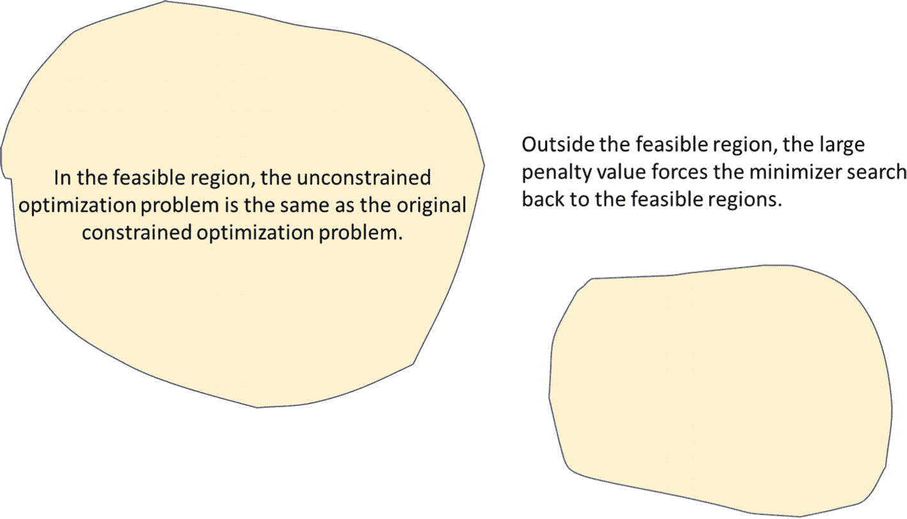
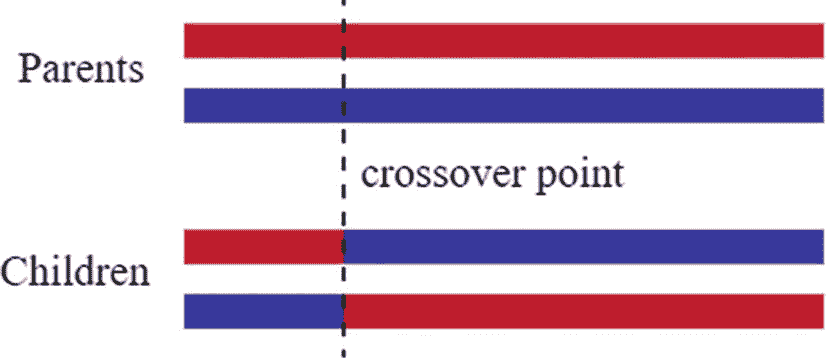
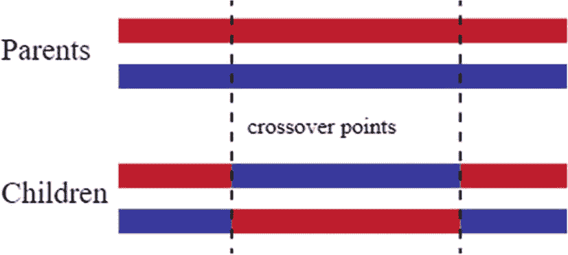
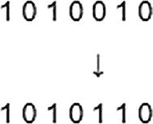
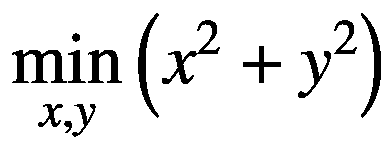
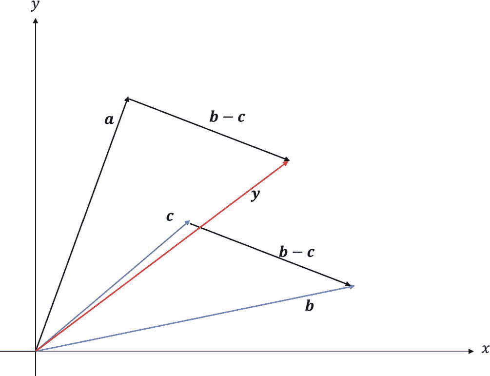
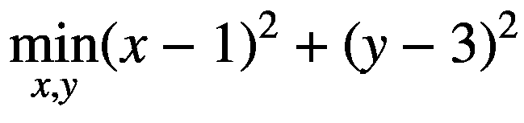
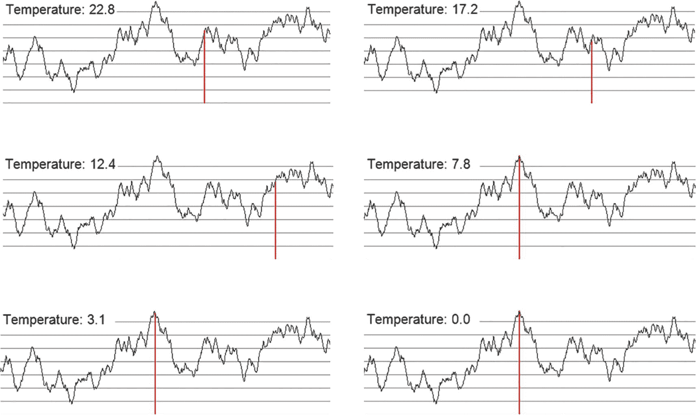

# 11. 启发式算法

在计算机科学和数学优化中，启发式算法是一种过程，旨在当我们在前几章讨论的经典方法（`LP`、`QP`、`SOCP`、`SDP`、`SQP`）失效、过于缓慢、不可行或不适用时，为优化问题找到足够好的解。当问题规模过大（例如，超出有限计算能力）、信息不完整或不完美（例如，缺乏用于剪枝的结构）、目标函数复杂（例如，不可微）或约束条件困难（基于规则的约束、例外情况）时，这种情况尤为常见。启发式算法通常通过使用`临时规则`排除大量候选解来加速计算。等价地，它只搜索解空间的一个子集，否则该空间会因过大而无法完全枚举或探索。这些临时规则通常对求解的问题以及因此产生的解空间做出假设。它们可能会或可能不会排除真正的解。尽管这些临时规则通常未经证明或给出其性质，但在实践中，启发式算法通常能为许多原本无法解决的问题返回良好可用的解，例如旅行商问题这一类 `NP` 完全问题。

经典优化算法旨在寻找全局最优解，并且它们通常是迭代且确定性的。相比之下，启发式算法中的临时规则通常是实验性的。它们旨在高效地探索搜索空间，以找到足够好的解。它们通常利用一定的随机性来探索搜索空间，因此找到的解依赖于所生成的一组随机变量。这些临时规则算法涵盖范围广泛，从简单的局部搜索过程（例如，爬山算法）到复杂的学习过程（例如，遗传算法）。

在组合优化问题中，例如旅行商问题，候选解的搜索空间随问题规模的增长速度超过指数级。类似地，高维问题也面临维数灾难。针对这些问题，使用穷举法或解析法寻找最优解是不可行的。而启发式算法可以在庞大的可行解集中进行搜索，以较少的计算量找到近似解，优于其他穷举优化算法（例如模拟退火算法）。

## 11.1 罚函数法

罚函数法是一种将带约束优化问题转化为无约束优化问题的方法，其核心思想是将约束条件转化为惩罚项。当解位于可行域内时，惩罚项为零；当解位于可行域外时，惩罚项为正。我们通常为惩罚项分配一个较大的正数`M`作为系数，称为惩罚因子，以确保原问题的约束条件得到满足。这种方法在可行域内部进行搜索，约束边界如同墙壁一般。如果当前解远离约束边界，惩罚项的值很小，表明解位于可行域内。无约束优化问题`F(x, M)`与原约束优化问题`f(x)`一致。否则，惩罚项的值趋近于无穷大，表明解违反了某些约束条件。这个等价的无约束优化问题原则上可以通过任何无约束优化器求解，例如我们在第 9 章讨论的那些方法。`NM Dev` 默认使用 `BFGS` 最小化器 `BFGSMinimizer`。参见图 11-1。



**图 11-1** 罚函数法

为了搜索最优解`x*`，我们可以从可行域或不可行域中的初始猜测开始。如果从可行域开始，约束边界就像墙壁一样，我们不会离开可行域。当当前解远离约束边界时，惩罚函数值非常小；否则，惩罚函数值接近无穷大，阻止解离开可行域。然而，为大规模问题实例找到可行解可能是 `NP` 难的，因此使得这种方法无法应用。或者，我们可以从任何地方（包括不可行域）开始搜索，然后逐步移向可行域。这样就不需要初始可行解作为先决条件。

考虑一个一般的约束优化问题，如下所示：

```
min f(x)   s.t.
x
```

# 罚函数法

`h_i(x) = 0`，`i ∈ E = {1, 2, …, m}`
`g_j(x) ≤ 0`，`j ∈ I = {1, 2, …, n}`

`{h_i(x)}`是等式约束，`{g_j(x)}`是不等式约束。我们可以通过惩罚任何违反约束的行为，将问题转化为等价的非约束优化问题。罚函数法的一般形式如下：

`F(x) = f(x) + M(H + G)`

`F(x)`是新的目标函数。`H`和`G`是惩罚项，它们分别是约束`{h_i(x)}`和`{g_j(x)}`的函数。`M`是惩罚因子。

将等式约束`{h_i(x)}`转化为惩罚项`H`的一种方法是求其绝对值之和。具体来说，我们有：

`H = Σ p_i |h_i(x)|`   （`i = 1` 到 `m`）

`{p_i}`是分配给每个等式约束的权重。

NM Dev 类 `AbsoluteErrorPenalty` 从一组等式约束构建这样一个惩罚函数。其签名如下：

```
/**

 * 从一组等式约束构建绝对值惩罚函数。

 *

 * @param constraints 一组等式约束

 * @param weights     分配给这些约束的权重

 */

public AbsoluteErrorPenalty(EqualityConstraints constraints, double[] weights)
```

Courant 罚函数是将等式约束`{h_i(x)}`转化为惩罚项`H`的另一种方法。它对平方值求和。具体来说，我们有：

`H = Σ p_i |h_i(x)|²`   （`i = 1` 到 `m`）

`{p_i}`是分配给每个等式约束的权重。

NM Dev 类 `CourantPenalty` 从一组等式约束构建一个 Courant 惩罚函数。其签名如下：

```
/**

 * 从一组等式约束构建 CourantPenalty 惩罚函数。

 *

 * @param constraints 一组等式约束

 * @param weights     分配给这些约束的权重

 */

public CourantPenalty(EqualityConstraints constraints, double[] weights)
```

Fletcher 罚函数是将不等式约束`{g_j(x)}`转化为惩罚项`G`的一种方法。它对大于 0 的平方误差求和。具体来说，我们有：

`H = Σ q_j max(g_j(x), 0)²`   （`j = 1` 到 `n`）

`{q_j}`包含分配给每个不等式约束的权重。

NM Dev 类 `FletcherPenalty` 从一组“小于”约束构建一个 Fletcher 惩罚函数。（大于约束可以通过取反符号转换为小于约束。）其签名如下：

```
/**

 * 从一组小于不等式约束构建 Fletcher 惩罚函数。

 *

 * @param constraints 一组小于不等式约束

 * @param weights     分配给这些约束的权重

 */

public FletcherPenalty(LessThanConstraints constraints, double[] weights)
```

尽管罚函数法在理论上是可行的，但它存在一个缺点：惩罚因子`M`的值难以估计。如果太小，返回的解可能不可行，违反约束条件。如果太大，并且最优解位于（或接近）可行域的边界，搜索过程将很快被推入可行域内部，而不会返回到接近可行域边界的位置。一个大的惩罚因子会在搜索过程初期阻碍对不可行域的探索。它还会导致严重的数值误差，即使解存在也可能无法找到。

这个缺点可以通过以下迭代过程来改善。首先，我们从一个较小但仍然足够大的正数`M`开始，找到`F(x, M)`的最优解`x*`。如果`x*`不满足原约束优化问题的约束条件，我们就增加`M`（例如，将其乘以 10）。重复这个过程，直到`x*`满足原约束优化问题的约束条件。

在 NM Dev 中，类 `PenaltyMethodMinimizer` 实现了罚函数法。以下代码求解了此约束优化问题：

`min (x + 1)² + (y + 1)²`   约束条件
`x, y`
`y = 0`
`x ≥ 1`

```
RealScalarFunction f = new AbstractBivariateRealFunction() {
@Override
public double evaluate(double x, double y) {
// f = (x+1)² + (y+1)²
return (x + 1) * (x + 1) + (y + 1) * (y + 1);
}
};
RealScalarFunction c1 = new AbstractBivariateRealFunction() {
@Override
public double evaluate(double x, double y) {
// y = 0
return y;
}
};
RealScalarFunction c2 = new AbstractBivariateRealFunction() {
@Override
public double evaluate(double x, double y) {
// x >= 1
return 1 - x;
}
};
ConstrainedOptimProblemImpl1 problem
= new ConstrainedOptimProblemImpl1(
f,
new GeneralEqualityConstraints(c1), // y = 0
new GeneralLessThanConstraints(c2)); // x >= 1
double M = 1e30; // the penalty factor
PenaltyMethodMinimizer optim
= new PenaltyMethodMinimizer(
PenaltyMethodMinimizer.DEFAULT_PENALTY_FUNCTION_FACTORY,
M,
// the solver to solve the equivalent unconstrained optimization problem
new BFGSMinimizer(false, 1e-8, 200)
);
IterativeSolution soln = optim.solve(problem);
Vector xmin = soln.search( // the minimizer
new DenseVector(new double[]{0, 0}) // an initial guess
);
double fxmin = f.evaluate(xmin); // the mimimum
System.out.println(String.format("f(%s) = %f", xmin, fxmin));
// alternatively
System.out.println(String.format("f(%s) = %f", soln.minimizer(), soln.minimum()));
```

输出结果如下：

```
f([1.000000, 0.000000] ) = 5.000000
f([1.000000, 0.000000] ) = 5.000000
```

`PenaltyFunctionFactory DEFAULT_PENALTY_FUNCTION_FACTORY` 根据等式约束和不等式约束构造惩罚项。它对等式约束使用 `CourantPenalty`，对不等式约束使用 `FletcherPenalty`。如果我们希望以不同于默认实现的方式构造惩罚项，可以使用自定义的 `PenaltyFunctionFactory`。

# 遗传算法

遗传算法（GA）是一种模仿自然界生物进化规律的元启发式算法。它是一种模拟达尔文生物进化过程中自然选择和遗传变异的计算模型。该算法通过数学和计算机模拟操作，将对优化问题最优解的搜索转化为类似于生物进化中染色体基因的交叉、变异和选择的过程。与经典优化算法相比，在解决大规模复杂问题时，GA 可能用更短的时间返回解。GA 已广泛应用于组合优化、机器学习、信号处理、自适应控制等领域。遗传算法由密歇根大学安娜堡分校的约翰·霍兰德教授及其学生在 20 世纪 70 年代初推广开来。他还引入了一个用于预测下一代质量的规范化框架，即霍兰德模式定理。

# 遗传算法

遗传算法的一个经典应用是函数优化。GA 已在许多复杂函数上进行了测试：连续和离散、凸和凹、低维和高维、单峰和多峰函数。对于某些难以用其他优化方法求解的、具有许多复杂约束的非线性、不可微、多峰、多目标函数优化问题，GA 可能会给出更好的结果。此外，随着现代问题规模以及组合优化问题搜索空间的迅速增大，通过枚举法寻找最优解变得困难。对于此类复杂问题，实践者往往满足于满意解而非最优解。事实证明，GA 是寻求满意解最有效的工具之一，尤其适用于 NP 难的组合优化问题。例如，GA 已成功应用于解决旅行商问题、背包问题、装箱问题、图划分问题等。值得一提的是，工业优化公司 `NM Optim Limited` ([`https://nmoptim.com/`](https://nmoptim.com/)) 已经为钢铁制造工厂构建了一个使用遗传算法处理许多复杂且特定约束的作业车间调度系统。

从数学上讲，遗传算法从一个优化问题的候选解种群开始。每个候选解都被编码，以便能够评估其适应度（对优化问题的价值），并且编码可以被改变（变异）或与另一个候选解混合（交叉）以产生新的候选解（新编码）。通过迭代，种群进化产生下一代候选解，直到达到满意的适应度水平或产生了最大世代数。基本的 GA 框架如下。

## 编码

遗传算法不能直接处理或操作问题的候选解，例如作业调度。我们必须首先设计一种 GA 可以操作的解的表示形式，称为编码或染色体。每个候选解的标准表示形式或染色体是一个由 0 和 1 组成的位数组或位串。编码策略需要满足这些要求，才能使 GA 搜索有效。

-   **完整性**：问题空间中的所有候选解都可以表示为 GA 空间中的染色体。

-   **可靠性**：GA 空间中的染色体对应于问题空间中的所有候选解。

-   **非冗余性**：候选解对应的染色体是一一对应的关系。

## 适应度函数

# 进化论中的适应度

进化论中的生存适应度（Survival fitness）指生物体对环境的适应程度及其繁殖后代的能力。它是衡量候选解优劣的指标。在优化问题中，适应度是表示我们优化问题目标函数（objective function）程度的数值。需要注意的是，适应度函数（值）与目标函数（值）并不相同，尽管它们正相关。通常，我们需要在目标函数值与适应度函数值之间建立映射关系。候选解的适应度值需要进行比较和排序。适应度也是候选解被（随机）选中进行变异和交叉的基础，因此它必须是一个正数（用于计算被选中的概率）且具有边界。遗传算法（Genetic Algorithm，GA）在搜索和进化过程中通常不需要其他外部信息，仅使用适应度函数来评估候选解的优劣。适应度函数的设计对于遗传算法的成功运行至关重要，它应满足以下条件：

- 单值、连续、非负、有界
- 合理且一致
- 易于计算
- 通用性强

## 初始种群

遗传算法从一个由个体候选解组成的初始种群开始迭代。种群规模取决于问题的性质，但通常包含几百或几千个可能的个体。通常，初始种群是随机生成的，并且应合理地覆盖整个可能的解空间（搜索空间）。有时，解可能会被“播种”在最优解可能出现的位置。典型的初始设置策略如下：

1. 利用对问题的一些了解，尝试大致了解解空间的分布或范围。初始种群应根据最优解所在的先验分布进行分布。
2. 首先随机生成一定数量的个体；然后从中选出最佳个体，并将其添加到初始种群中。重复此过程，直到初始种群中的个体数量达到预定规模。

### 操作流程

遗传算法的基本操作流程如下：

1. **初始化**：设置进化计数器`t=0`，最大进化代数`T`，并随机生成`M`个个体作为初始种群`P(0)`。
2. **评估**：计算种群`P(t)`中每个个体的适应度。
3. **选择**：对种群应用选择算子。选择的目的是通过交叉和变异将优良的染色体（基因）传递给下一代。
4. **交叉**：对种群应用交叉算子，通过配对两个选中的个体，为下一代生成新的候选解。
5. **变异**：对种群应用变异算子，通过改变选中个体表示中某些位点的基因，为下一代生成新的候选解。下一代种群为`P(t+1)`。
6. **终止条件**：如果`t=T`，则将进化过程中获得的最佳适应度的个体作为最优解返回，计算终止。或者，当最佳个体的适应度达到给定阈值，或种群适应度不再改善时，计算停止。进化代数通常设置为 100 到 500 代。

三个主要的遗传操作是选择、交叉和变异。

### 选择

选择操作是从种群中挑选优良个体并淘汰低劣个体。该操作确保下一代能够继承优良基因，同时避免不良基因。这是一种爬山搜索。选择基于个体的适应度。个体的适应度越好，其被选中的概率越高（但不保证一定会被选中）。请注意，适应度较差的个体也可能被选中，尽管概率较低。这是为了确保种群的多样性，并避免陷入局部最优解。常用的选择算子有适应度比例法、随机遍历抽样法和局部选择法。

## 交叉

生物基因的重组（也包括变异）在自然生物的进化中起着核心作用。同样，遗传算法中的关键操作是候选解表示或编码的交叉算子。交叉算子替换并重组两个父代个体的（随机）部分结构，以生成两个新个体。对于位数组，流行的交叉方法包括单点交叉、两点交叉和 `k` 点交叉以及均匀交叉。

在单点交叉中，在两个父代染色体上随机选择一个点，并指定为“交叉点”。该点右侧的位在两个父代染色体之间进行交换。这会产生两个子代，每个子代都携带来自两个父代的一些遗传信息。见图 11-2。



**图 11-2 单点交叉**

在两点交叉中，从父代染色体中随机选择两个交叉点。位于两个交叉点之间的位在两个父代生物体之间进行交换。这相当于用不同的交叉点执行两次单点交叉。该策略可以推广到任意正整数`k`的 `k` 点交叉，即选择 `k` 个交叉点。见图 11-3。



**图 11-3 两点交叉**

在均匀交叉中，通常每一位以相等的概率从任一父代中选择。有时也会使用其他混合比例，导致子代从一个父代继承的遗传信息多于另一个父代。

### 变异

遗传算法引入变异有两个目的。第一个目的是确保遗传算法染色体种群在代际间的遗传多样性。变异会改变染色体中的一个或多个基因值，使其脱离初始状态。解可能与其父代完全不同，从而使遗传算法可能找到更好的解。变异根据预定的变异概率在进化过程中发生。该概率应设置得较低。如果设置得过高，搜索将退化为原始的随机搜索。

第二个目的是在接近最优解时控制局部搜索。当遗传算法通过交叉算子处于最优解附近时，由变异算子引起的局部随机搜索可以加速向最优解的收敛。在这种情况下，变异概率应该较小；否则，接近最优解的建筑块（building blocks）会被变异破坏。另一方面，为了逃离局部最优解并保持种群多样性，变异概率应取较大值，以防止染色体之间变得过于相似，从而减缓甚至停止向全局最优解的收敛。

根据编码方式的不同，定义变异算子的方法多种多样。一个经典例子是，基因序列中任意一个比特位以一定概率从原始状态发生翻转。实现变异算子的常用方法是对序列中的每个比特位生成一个随机变量。该随机变量决定该比特位是否会被翻转。这种基于生物点突变的变异过程，称为单点变异。其他类型还包括逆序变异和浮点变异。当基因编码受到约束时（例如在排列问题中），变异形式则包括交换、逆序和打乱。见图 11-4。



**图 11-4 比特串变异。比特位在随机位置翻转**

在 `NM Dev` 中，`GeneticAlgorithm` 类和 `Chromosome` 接口提供了一个框架，用于实现自定义的遗传算法。`GeneticAlgorithm` 允许用户定义种群的初始化方式以及终止条件。实际上，该类中的大多数方法都是受保护的，这意味着用户可以重写它们以提供不同的实现。其签名如下：

```java
public abstract class GeneticAlgorithm {

  /**

   * 初始化第一代种群。

   *

   * @return 第一代种群

   */

  protected abstract List getFirstGeneration();

  /**

   * 这是收敛判据。

   *

   * @return 若搜索已收敛则返回 {@code true}

   */

  protected abstract boolean isConverged();

  /**

   * 运行遗传算法。

   */

  public void run() {

    population.addAll(getFirstGeneration());

    for (; !isConverged();) {

      step();

    }

  }

  /**

   * 运行遗传算法的一步：生成下一代染色体池。
```

```markdown
/**
 * @return `true`
 */
protected Object step();

/**
 * 生成一个子代染色体。
 *
 * 此实现先应用交叉算子，再应用变异算子。
 *
 * @param `i` 一个索引，范围从 0 到 (种群大小 - 1)
 * @return 一个子代染色体
 */
protected Chromosome getChild(int i);

/**
 * 选取一个染色体用于变异/交叉。
 *
 * 此实现从种群中均匀随机选择。
 *
 * @return 一个染色体
 */
protected Chromosome getOne();

/**
 * 使用父代和子代染色体池填充下一代。
 *
 * 此实现从父代和子代中选择最优的染色体。
 *
 * @param `parents` 父代染色体池
 * @param `children` 子代染色体池
 * @return 下一代种群
 */
protected List getNextGeneration(List parents, List children);

/**
 * 获取种群池的大小，即染色体的数量。
 *
 * @return 种群大小
 */
protected int nPopulation();

/**
 * 获取在填充下一代之前的子代数量。
 *
 * 在此实现中，该数量与种群大小（即父代数量）相同。
 *
 * @return 子代数量
 */
protected int nChildren();

/**
 * 获取第 `i` 个最优染色体。
 *
 * @param `i` 一个索引
 * @return 第 `i` 个最优染色体
 */
protected Chromosome getBest(int i);

/**
 * 为种群池分配空间。
 *
 * @param `size` 种群大小
 * @return 一个种群池
 */
protected static ArrayList getNewPool(int size);
```

对于任何特定的优化问题，用户需要通过实现 `Chromosome` 接口来定义编码、相关的交叉算子和变异算子。由于遗传算法的实现通常会在多核环境中运行以提升性能，因此确保染色体操作的实现是线程安全的，并且可以并行运行，这一点至关重要。其签名如下：

```java
public interface Chromosome extends Comparable {
  /**
   * 这是适应度，用于判断该染色体的优劣。
   *
   * @return 适应度
   */
  public double fitness();

  /**
   * 通过变异构造一个 {@code Chromosome}。
   *
   * @return 一个变异后的染色体
   */
  public Chromosome mutate();

  /**
   * 通过对一对染色体进行交叉构造一个 {@code Chromosome}。
   *
   * @param that 另一个染色体
   * @return 一个交叉后的染色体
   */
  public Chromosome crossover(Chromosome that);
}
```

例如，NM Dev 实现了求解器 `SimpleGridMinimizer`，它使用此遗传算法框架来最小化一个多元实值函数（从 $\mathbb{R}^n$ 到 $\mathbb{R}^1$）。该优化器不使用被优化函数的梯度，这意味着它不要求优化问题可微——这与梯度下降法、拟牛顿法等经典优化方法的要求不同。因此，它也可以用于处理那些不连续、含噪声、随时间变化或带有临时约束的优化问题。

`SimpleGridMinimizer` 从一个均匀分布于解空间中的初始猜测种群开始。然后，它将这些个体配对，进行交叉和变异以搜索最优解。具体来说，候选解的编码就是 $\mathbb{R}^n$ 中的一个向量。

```java
public abstract class RealScalarFunctionChromosome implements Chromosome {
  private Double fx = null;
  private final RealScalarFunction f;
  private final ImmutableVector x; // 编码
}
```

交叉算子是对两个个体取中点。变异算子是对向量添加一个小的随机扰动。即如下所示：

```java
/**
 * {@code SimpleCell} 实现了这两种遗传操作。
 *
 * 变异：通过对适应度进行扰动（缩放）百分比来实现；
 * 交叉：对两个细胞取中点（平均值）。
 */
public class SimpleCell extends RealScalarFunctionChromosome {
  protected SimpleCell(RealScalarFunction f, Vector x) {
    super(f, x);
  }

  /**
   * 通过在邻域内随机扰动实现变异。
   *
   * @return 一个突变后的染色体
   */
  @Override
  public Chromosome mutate() {
    final double offset = 1 - rate;
    final double width = 2 * rate;
    Vector z = new DenseVector(x());
    for (int i = 1; i <= z.size(); ++i) {
      double rand = uniform.nextDouble();
      double u = offset + rand * width;
      z.set(i, z.get(i) * u);
    }
    return getSimpleCell(f(), z);
  }

  /**
   * 通过取中点实现交叉。
   *
   * @param other 另一个染色体
   * @return 一个杂交后的染色体
   */
  @Override
  public Chromosome crossover(Chromosome other) {
    SimpleCell that = (SimpleCell) other;
    Vector z = this.x().add(that.x()).scaled(0.5);
    return getSimpleCell(f(), z);
  }
}
```

以下代码使用此特定的遗传算法实现来最小化以下函数：



```java
// 待最小化的目标函数
RealScalarFunction f
= new AbstractBivariateRealFunction() {
@Override
public double evaluate(double x, double y) {
return x * x + y * y; // x² + y²
}
};
// 均匀随机数生成器
RandomLongGenerator rng = new UniformRNG();
rng.seed(123456798L);
// 构建遗传算法求解器实例
SimpleGridMinimizer solver
= new SimpleGridMinimizer(
// 定义编码、交叉和变异算子
() -> new SimpleCellFactory(
0.1, // 收敛速率
rng),
rng, // 遗传算法的随机数源
1e-15, // 精度参数
500, // 最大迭代次数
500 // 无改进情况下的最大迭代次数
);
// 运行求解器解决优化问题
IterativeSolution soln
= solver.solve(new C2OptimProblemImpl(f));
Vector xmin = soln.search(new Vector[]{ // 最小值点
// 边界：[-10, 10], [-10, 10]
new DenseVector(-10.0, 10.0),
new DenseVector(10.0, -10.0),
new DenseVector(10.0, 10.0),
```

```markdown
## 11.2.1 差分进化

差分进化（DE）算法是遗传算法的一种特殊实现，用于优化多元实值函数。其主要创新在于其差分变异算子。设 `CR` ∈ [0, 1] 为交叉概率，`F` ∈ [0, 2] 为差分权重。对于每个个体 **x**，差分变异算子随机选取三个互不相同的候选解 **a**、**b**、**c**，并执行以下操作：

1.  随机选取一个索引 `R` ∈ {1, …, `n`}，其中 `n` 为目标函数的维度。
2.  按如下方式计算新个体 **y** = (`y`[1], …, `y`[`n`])：
    1.  对于每个索引 `i` ∈ {1, …, `n`}，随机生成一个服从均匀分布的随机数 `r`[`i`] ~ `U`(0, 1)。
    2.  如果 `r`[`i`] < `CR` 或 `i` = `R`，则 `y`[`i`] = `a`[`i`] + `F` × (`b`[`i`] − `c`[`i`])；否则 `y`[`i`] = `x`[`i`]。

在每个索引位置上，如果发生变异，新候选解等于一个随机向量加上两个随机向量的差分的加权和——这正是其被称为差分进化的原因。注意，索引 `R` 处的位置总是被线性组合替代。详见图 11-5。



**图 11-5** 差分变异

DE 参数 `CR`、`F` 以及种群规模的选择会对优化性能产生重大影响。因此，如何选取能带来良好性能的 DE 参数一直是大量研究的主题。经验法则建议 `CR` = 0.9 且 `F` = 0.8。

以下 NM Dev 代码解决了一个带整数约束的优化问题。整数规划问题通常难以用经典算法求解，是当前活跃的研究课题。此例展示了遗传算法的强大通用性，以及它如何处理困难约束。



```java
// 待最小化的目标函数
RealScalarFunction f
= new AbstractBivariateRealFunction() {
    @Override
    public double evaluate(double x, double y) {
        return (x - 1) * (x - 1) + (y - 3) * (y - 3); // (x - 1)² + (y - 3)²
    }
};

// 构建整数规划问题
final IPProblem problem
// x 和 y 均需为整数
= new IPProblemImpl1(f, null, null, new int[]{1, 2}, 0);

// 均匀随机数生成器
final RandomLongGenerator rng = new UniformRNG();
rng.seed(123456798L);

// 构建遗传算法求解器实例
DEOptim solver = new DEOptim(
    () -> new IntegralConstrainedCellFactory(
        new Rand1Bin(0.5, 0.5, rng), // DE 算子
        new IntegralConstrainedCellFactory.SomeIntegers(problem)), // 指定整数约束
    rng, // 均匀随机数生成器
    1e-15, // 精度参数
    100, // 最大迭代次数
    20 // 无改进情况下的最大迭代次数
);

IterativeSolution soln = solver.solve(problem);
Vector xmin = soln.search(new Vector[]{
    // 边界：[-10, 10], [-10, 10]
    new DenseVector(-10.0, 10.0),
    new DenseVector(10.0, -10.0),
    new DenseVector(10.0, 10.0),
    new DenseVector(-10.0, -10.0)
});

double fxmin = f.evaluate(xmin); // 最小值
System.out.println(String.format("f(%s) = %f", xmin, fxmin));
```

输出结果如下：

```
f([1.000000, 3.000000] ) = 0.000000
```

类 `Rand1Bin` 是 Price、Storn 和 Lampinen（2005）提出的 DE 算子实现。这些算子包括：

*   差分变异：将缩放的随机采样向量差累加到第三个向量上
*   交叉：执行均匀交叉（离散重组）

## 11.3 模拟退火算法

模拟退火算法（SA）是一种用于寻找全局最优解的元启发式算法，其灵感来源于冶金学中的退火过程。退火是指将材料加热到高温，然后让其缓慢冷却。这使得粒子在高温下能够自由移动以重新排列，并在低温下趋于稳定。模拟退火可用于解决经典算法失效的复杂计算优化问题。尽管它通常只能得到全局最小值的近似解，但对于许多实际问题而言，这通常已经足够。

SA 的核心思想是冷却调度表或温度退火计划。在搜索初期温度较高时，SA 更容易接受较差的解作为下一个候选解。随着温度缓慢降低，接受较差解的概率也随之降低。接受较差的解有助于进行更广泛的全局最优解搜索，例如跳出局部最小值。

图 11-6 展示了模拟退火如何搜索最大值。这里的目标是到达最高点。然而，由于存在许多局部最大值，仅使用简单的爬山算法是不够的。通过缓慢降低温度，最终找到了全局最大值。请注意，搜索过程在初期范围很广，而当温度接近 0 时，搜索则基本保持在最大值附近。



图 11-6 模拟退火

一般来说，SA 算法的基础版本工作流程如下。温度从一个初始正值逐渐降低到零。在每个时间步，算法随机选择一个接近当前解的解，评估其质量，并根据与温度相关的概率来决定是否移动到/接受该解——选择更好解的概率保持正值，选择更差解的概率则趋近于零。当温度趋近于 0 时，算法渐近地趋向于爬山搜索。用算法表示，为了最小化函数 `f`，流程如下：

1.  设 `s` = `s`[0] 为初始状态。
2.  对于 `k` = 0 到 `k`[`max`]（最大迭代次数），执行：
    1.  温度 `T` = `T`(`k`) 是根据冷却或退火计划确定的 `k` 的函数。
    2.  随机选取 `s` 的一个邻近解 `s`[`new`]。
    3.  根据接受概率 `P`(`f`(`s`), `f`(`s`[`new`]), `T`) 来决定是否接受 `s`[`new`]。该概率是 `f`(`s`)、`f`(`s`[`new`]) 和 `T` 的函数。如果 `f`(`s`[`new`]) < `f`(`s`)，则总是接受这个新的、更优的解。
3.  输出最终状态 `s`。

在 NM Dev 中，`SimulatedAnnealingMinimizer` 类提供了一个用于实现自定义模拟退火算法的框架。其签名如下：

```
/**
 * 构造一个新实例。
 *
 * @param temperatureFunction 一个函数，对于给定的迭代次数 i，返回 T_i，即温度水平。该函数必须单调递增。
 * @param probabilityFunction 给出在给定温度下状态转移的接受概率。
 * @param annealingFunction   提议下一个状态。
 * @param markovLength        每次迭代（每个温度）尝试状态改变的次数。
 * @param stopCondition       {@linkplain StopCondition} 停止条件。
 * @param uniform             用于控制算法随机元素的随机数生成器。
 */
public SimulatedAnnealingMinimizer(
    TemperatureFunction temperatureFunction,
    AnnealingFunction annealingFunction,
```

温度函数 `TemperatureFunction` 定义了模拟退火中使用的温度调度表。通常，用于提议分布（生成候选解）的温度可能与用于确定接受概率的温度不同。其签名如下：

```java
public interface TemperatureFunction {

    /**
     * 获取时间 t 的接受温度 \(T^A_t\)。
     *
     * @param t 获取温度的时间点，或退火参数，与重新退火前的迭代次数相同。
     * @return 时间 t 的接受温度。
     */
    public double acceptanceTemperature(int t);

    /**
     * 获取时间 t 的访问温度 \(T^V_t\)。
     *
     * @param t 获取温度的时间点，或退火参数，与重新退火前的迭代次数相同。
     * @return 时间 t 的访问温度。
     */
    public double visitingTemperature(int t);
}
```

用于解释模拟退火的物理类比假设，冷却速率足够低，使得当前状态的概率分布始终接近热力学平衡。不幸的是，松弛时间（即温度变化后等待平衡恢复所需的时间）在很大程度上取决于能量/目标函数的“地形”以及当前温度。在模拟退火算法中，松弛时间还以非常复杂的方式取决于下一个候选解是如何生成的。因此，理想的冷却速率无法预先确定，需要针对每个问题凭经验进行调整。NM Dev 实现了多种温度函数，如下所示：

- `BoltzTemperatureFunction`：`T[k] = T[0] / ln k`
- `ExpTemperatureFunction`：`T[k] = 0.95^k * T[0]`
- `FastTemperatureFunction`：`T[k] = T[0] / k`
- `GSATemperatureFunction`

退火函数 `AnnealingFunction`，或称带温度的提议函数，根据当前状态和温度给出下一个候选解或下一个状态。其签名如下：

```java
public interface AnnealingFunction {

    /**
     * 给定当前状态和温度，获取下一个候选解。
     *
     * @param currentState 系统的当前状态。
     * @param temperature  系统的当前温度。
     * @return 下一个候选解。
     */
    public Vector nextProposal(Vector currentState, double temperature);
}
```

我们必须考虑到，经过模拟退火算法的几次迭代后，当前状态的能量预计会远低于随机状态。因此，一般规则是，应使生成器偏向于那些目标状态的能量可能与当前状态能量相似的候选移动。这种启发式方法倾向于排除“非常好”和“非常差”的候选移动。然而，前者通常比后者少得多，因此这种启发式方法通常非常有效。NM Dev 实现了多种退火函数，如下所示：

- `BoltzAnnealingFunction`：步长与温度的平方根成正比，方向均匀随机。
- `FastAnnealingFunction`：步长与温度成正比，方向均匀随机。步长的平方大小等于温度。
- `GSAAnnealingFunction`
- `BoxGSAAnnealingFunction`

带温度的接受概率函数 `TemperedAcceptanceProbabilityFunction` 用于计算下一个状态转移将被接受的概率。其签名如下：

```java
public interface TemperedAcceptanceProbabilityFunction {
    /**
     * Compute the probability that the next state transition will be accepted.
     *
     * @param currentState   the current state of the system
     * @param energyCurrent  the energy in the current state
     * @param proposedState  the proposed next state of the system
     * @param energyProposed the energy in the proposed state
     * @param temperature    the current temperature
     * @return the acceptance probability
     */
    public double acceptanceProbability(
        Vector currentState,
        double energyCurrent,
        Vector proposedState,
        double energyProposed,
        double temperature);
}
```

以下代码演示了如何使用模拟退火求解器来最小化一个复杂函数：

```java
// 要最小化的目标函数
final RealScalarFunction f = new AbstractRealScalarFunction(2) {
    @Override
    public Double evaluate(Vector x) {
        double x1 = x.get(1);
        double x2 = x.get(2);
        // (4 - 2.1*x(1)² + x(1)⁴/3)*x(1)²
        double term1 = (4.0 - 2.1 * Math.pow(x1, 2.0) + Math.pow(x1, 4.0) / 3.0) * Math.pow(x1, 2.0);
        // x(1)*x(2)
        double term2 = x1 * x2;
        // (-4 + 4*x(2)²)*x(2)²
        double term3 = (-4.0 + 4.0 * Math.pow(x2, 2.0)) * Math.pow(x2, 2.0);
        return term1 + term2 + term3;
    }
};

// 构建一个优化问题
final OptimProblem problem = new OptimProblem() {
    @Override
    public RealScalarFunction f() {
        return f;
    }

    @Override
    public int dimension() {
        return 2;
    }
};

// 经过 5000 次迭代后停止
StopCondition stopCondition = new AfterIterations(5000);

// 一个模拟退火求解器实例
IterativeMinimizer solver = new GeneralizedSimulatedAnnealingMinimizer(
        2, // 目标函数的维度
        stopCondition
);
IterativeSolution soln = solver.solve(problem);

Vector x0 = new DenseVector(0.5, 0.5); // 初始猜测
Vector xmin = soln.search(x0);
double fxmin = f.evaluate(xmin); // 最小值
System.out.println(String.format("f(%s) = %f", xmin, fxmin));
```

输出如下：

```
f([-0.089836, 0.712655] ) = -1.031628
```

有时候，回到一个明显更优的解，而不是始终从当前状态出发，效果会更好。这个过程被称为模拟退火的`重启`。重启决策可以基于多种标准。其中值得注意的包括：基于固定步数重启、基于当前能量与迄今为止获得的最佳能量相比是否过高重启、随机重启等。

#