# 12. 基础统计学
统计学是数学的一个分支，研究数据的收集、整理、分析、解释和呈现。该研究领域使用两大类统计方法：描述性统计汇总并描述样本数据的属性；推断性统计则对总体进行推断和预测。总体是我们想要研究并得出结论的全部数据集合，包括已知和未知、可观测和不可观测的。总体的一组样本是我们拥有（观测到的）数据的总体子集。总体不会改变。样本集则根据我们收集数据的方式而变化。每次收集数据时，样本集都可能不同。样本量总是小于总体量，且总是有限的。总体量可能很大，甚至无穷。推断性统计通过样本的描述性统计来推断总体的特征。例如，要估算整个宇宙中的星系数量，我们取望远镜（比如哈勃望远镜）拍摄的部分天空图像。然后，利用这一小片天空与整个宇宙的比例，来估算宇宙中的星系数量。这种采样和推断过程是统计分析的核心。我们正是这样估算宇宙中的原子数、地球上的奶牛数量（我们通常不会逐一清点并命名 15 亿头奶牛），以及许多其他我们并未全部观测（即拥有数据）的测量值。统计学几乎应用于所有科学学科，如物理科学和社会科学，以及商业、人文学科、政府和制造业。

NM Dev 库拥有大量用于数据分析的统计工具。它涵盖了描述性统计、多种单变量和多变量概率分布、回归分析、时间序列分析、多变量分析、数据过滤、假设检验、随机数生成、模拟等。这些将是我们在后续几章中要讨论的主题。

### 12.1 随机变量
随机变量的概念是统计学的基础。说统计学这门数学学科本质上就是研究随机变量，可能（大概）也不算错。一个非随机变量，例如 `x = 1`，是一个每次观测时都取相同值（本例中为 `1`）的变量。它始终不变。相比之下，随机变量每次观测或采样时可能取不同的值。在观测之前，我们不知道它会取什么值。假设我们将一次抛硬币的正面（`H`）记为 `1`，反面（`T`）记为 `0`。那么，代表抛硬币结果的随机变量 `X`，每次抛硬币（或采样）时可以是 `1` 或 `0`。假设我们抛五次硬币，得到 {`H`, `H`, `T`, `T`, `H`}。那么此次实验中 `X` 的样本是 {`x[1] = 1`, `x[2] = 1`, `x[3] = 0`, `x[4] = 0`, `x[5] = 1`}。每个样本或观测值可能根据实验结果是不同的值。

更正式地说，随机变量 `X` 是一个函数，它将一个域（称为样本空间 Ω）中的结果映射到某些实数（值域 `E`）。结果 `ω ∈ Ω` 可能取决于一些不可预测的物理过程。在抛硬币的例子中，结果是 Ω = {`H`, `T`}，随机变量 `X` 将其映射到 `E = {1, 0}`。

此外，随机变量有一个概率分布 `P`，它指定了随机变量取某个或某些值的概率。这个概率等于结果恰好是与这些值对应的事件的可能性。例如，对于一枚均匀的硬币，以下三个量是相等的：`X = 1` 的概率记作 `P(X = 1)`，或者结果是 `H` 的可能性，即 50%。一个离散随机变量只取有限个或可数无限个值，例如抛硬币例子中的 `{1, 0}`。离散随机变量的概率分布称为概率质量函数。一枚均匀硬币的随机变量和概率质量函数如下：

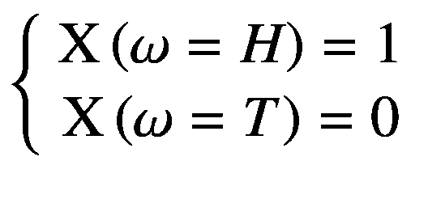

以及：

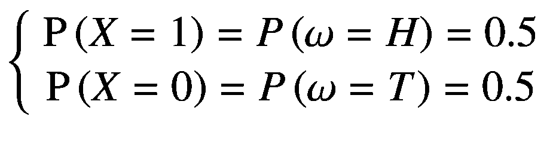

图 12-1 展示了样本空间 Ω、随机变量值域 `E`（与概率函数的定义域相同）、随机变量 `X` 以及概率 `P` 之间的关系。

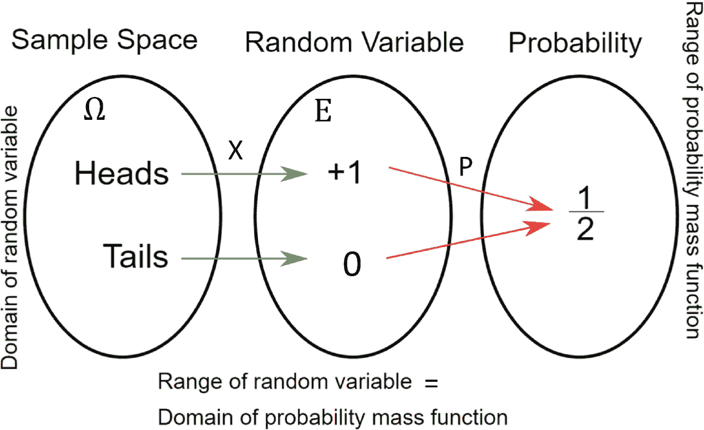

**图 12-1**  
均匀硬币抛掷的随机变量

### 12.2 样本统计量
给定随机变量 `X` 的一组样本 (`x[1]`, `x[2]`, …, `x[n]`)，我们可以使用样本统计量或描述性统计量来描述这组数据的统计特性。其中一些衡量数据的集中趋势（或位置），例如均值。另一些衡量样本的变异性（或离散程度），例如方差。还有一些突出变量之间的潜在关系，例如协方差。当然还有其他类型的统计量。需要注意的是，样本统计量不一定等于总体相应的统计量。但如果样本量 `n` 足够大，它们可能是很好的近似值。

在 NM Dev 中，所有从数据集或样本计算统计量的类都继承自 `Statistic` 接口。其签名如下：

```java
/**
 * 一个统计量（单数）是对样本某个属性（例如，其算术平均值）的单一度量。
 * 它通过将函数（统计算法）应用于一个样本（即一组数据）来计算。
 *
 * @author Haksun Li
 * @see Wikipedia:
 * 统计量
 */
public interface Statistic {
    /**
     * 获取该统计量的值。
     *
     * @return 统计量
     */
    public double value();

    /**
     * 获取样本的大小。
     *
     * @return 样本大小
     */
    public long N();

    /**
     * 使用更多数据重新计算统计量，如果可以的话，尽量增量计算。
     *
     * @param data 新数据项的数组
     */
    public void addData(double... data);
}
```

函数 `value()` 计算统计量。函数 `N()` 返回样本大小。

#### 12.2.1 均值
最简单的样本统计量是样本均值，或称为算术平均值、数据的平均数，记为 。它衡量数据集的集中位置。它是所有样本的总和除以样本大小或计数。在数学上，样本均值定义如下：

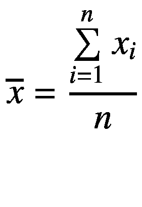

大数定律表明，如果样本是从总体 `X` 中随机抽取的，该总体的均值或期望为 `E(X) = μ`（且方差有限），那么样本均值会收敛于总体均值。即：

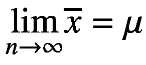

例如，对于样本 `X = {2, 3, 3, 1}`，其样本均值如下：

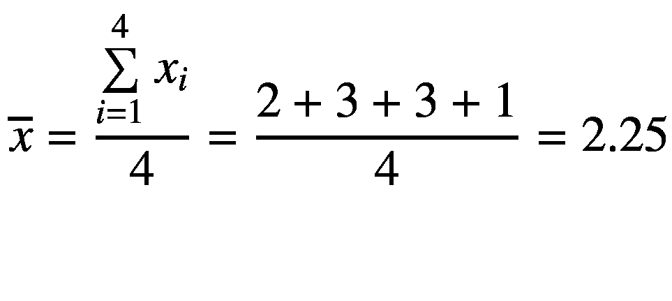

在 NM Dev 中，`Mean` 类计算数据集的样本均值。以下代码计算上述示例：

```java
// 样本数据集
double[] X1 = new double[]{2, 3, 3, 1};

// 计算数据集的均值
Mean mean = new Mean(X1);

System.out.println("样本大小 = " + mean.N());
System.out.println("样本均值 = " + mean.value());
```

输出结果如下：

```
样本大小 = 4
样本均值 = 2.25
```

## 12.2 加权均值与方差

### 12.2.2 加权均值

样本均值假设每个数据点对最终平均值的贡献相等。加权样本均值则允许某些数据点的贡献大于其他数据点。也就是说，每个数据点可以有不同权重 `w[i]`。在数学上，加权样本均值定义如下：

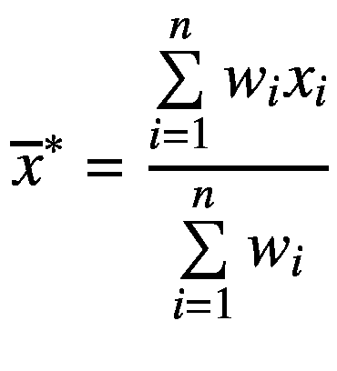

假设某学生各科成绩为 `X = {82, 94, 90, 83, 87}`，各科学分为 `W = {1, 4, 8, 4, 4}`。那么总成绩（即加权样本均值）为：

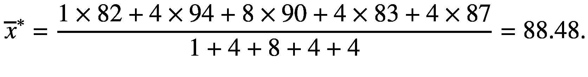

在 NM Dev 中，`WeightedMean` 类计算数据集的加权样本均值。以下代码计算上述示例的加权样本均值：

```java
// 样本数据集
double[] X2 = new double[]{82, 94, 90, 83, 87};
double[] W2 = new double[]{1, 4, 8, 4, 4};

// 计算数据集的均值
WeightedMean weighted_mean = new WeightedMean(
        X2, // 数据
        W2  // 权重
);

System.out.println("样本大小 = " + mean.N());
System.out.println("加权样本均值 = " + weighted_mean.value());
```

输出结果如下：

```
样本大小 = 4
加权样本均值 = 88.47619047619048
```

### 12.2.3 方差

样本方差衡量一组数字与其平均值之间的离散程度。换句话说，它是离差的程度，即数据的分散程度。在估计的上下文中，估计量可以被视为一个随机变量。估计量的样本均值就是估计值。那么，估计量的样本方差就反映了估计的不确定性。例如，如果我们对温度进行五次测量，那么样本均值就是温度的测量值；样本方差则是我们测量结果的不确定性程度。请参见图 12-2。

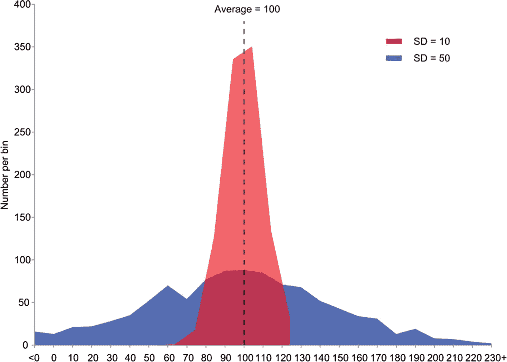

**图 12-2** 具有相同均值但不同方差的两个样本

图 12-2 显示了两个具有相同样本均值但不同样本方差的样本。红色样本的均值为 100，方差为 100（标准差 = 10），而蓝色样本的均值为 100，方差为 2500（标准差 = 50）。很明显，蓝色样本中的数据比红色样本分散得多。蓝色数据离均值更远。

在数学上，样本方差定义如下：

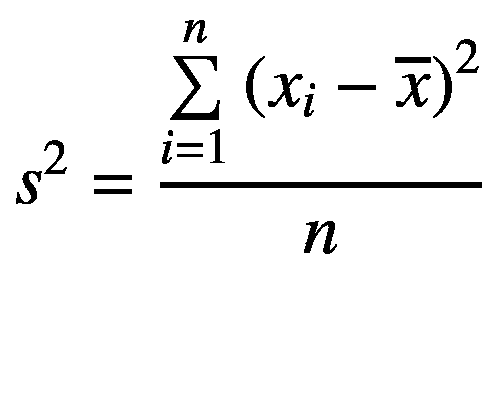

此外，无偏版本如下：

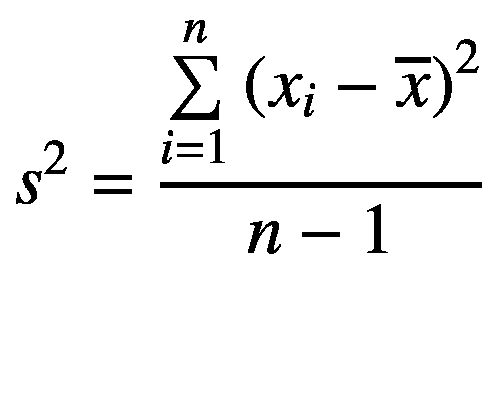

样本标准差 `s` 是样本方差的平方根。从公式中可以很容易看出，样本方差是数据与样本均值之间距离平方的平均值。

对于样本 `X = {2, 3, 3, 1}`，样本方差如下：

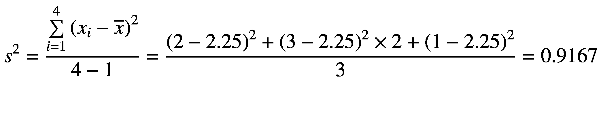

样本标准差如下：

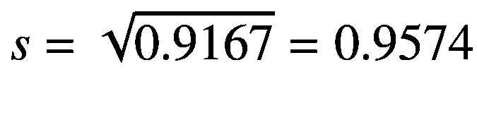

在 NM Dev 中，`Variance` 类计算数据集的样本方差。以下代码计算上述示例的样本方差：

```java
// 样本数据集
double[] X3 = {2, 3, 3, 1};

// 计算有偏和无偏的方差及标准差
Variance var1 = new Variance(X3, false); // 有偏
System.out.println("样本标准差（有偏） = " + var1.standardDeviation());
System.out.println("样本方差（有偏） = " + var1.value());

Variance var2 = new Variance(X3, true); // 无偏
System.out.println("样本标准差（无偏） = " + var2.standardDeviation());
System.out.println("样本方差（无偏） = " + var2.value());
```

输出结果如下：

```
样本标准差（有偏） = 0.9574271077563381
样本方差（有偏） = 0.9166666666666666
样本标准差（无偏） = 0.9574271077563381
样本方差（无偏） = 0.9166666666666666
```

### 12.2.4 加权方差

类似地，样本集的加权样本方差可定义如下：

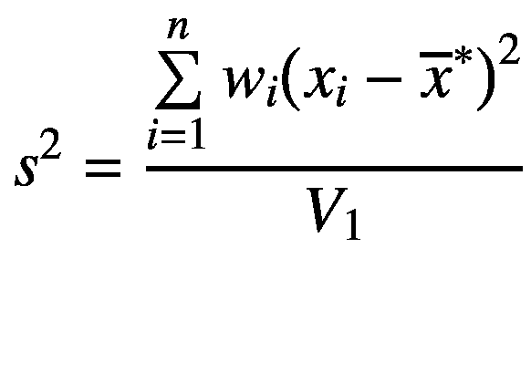

其无偏版本如下：

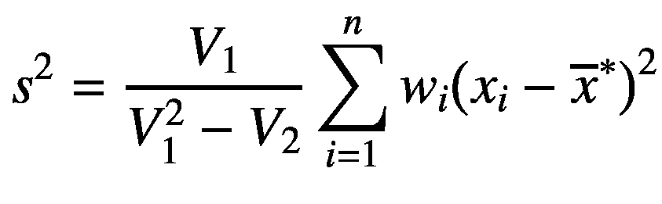

其中：

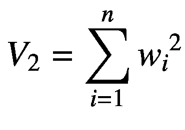

在 NM Dev 中，`WeightedVariance` 类用于计算数据集的加权样本方差。以下代码计算了第 12.2.2 节中学生成绩示例的加权样本方差：

```java
// the sample data set
double[] X2 = new double[]{82, 94, 90, 83, 87};
double[] W2 = new double[]{1, 4, 8, 4, 4};

// compute the biased and unbiased vairances and standard deviations
WeightedVariance wvar1 = new WeightedVariance(
        X2, // the data
        W2, // the weights
        false); // biased
System.out.println("sample weighted standard deviation (biased) = " + wvar1.stdev());
System.out.println("sample weighted variance (biased) = " + wvar1.value());

WeightedVariance wvar2 = new WeightedVariance(
        X2, // the data
        W2, // the weights
        false); // unbiased
System.out.println("sample standard deviation (unbiased) = " + wvar2.stdev());
System.out.println("sample variance (unbiased) = " + wvar2.value());
```

输出结果如下：

```
sample weighted standard deviation (biased) = 3.849787225030045
sample weighted variance (biased) = 14.820861678004535
```

```markdown
### 12.2.5 偏度

样本偏度是衡量数据分布关于其均值不对称程度的指标。偏度值可为正值、零或负值。对于单峰分布（只有一个峰值的分布），负偏度通常表示分布的左侧尾部更长，正偏度则表示右侧尾部更长。偏度值为零意味着均值两侧的尾部总体平衡。对称分布总是具有零偏度。但非对称分布也可能如此，例如一侧尾部又长又细，而另一侧尾部又短又粗。参见图 12-3。

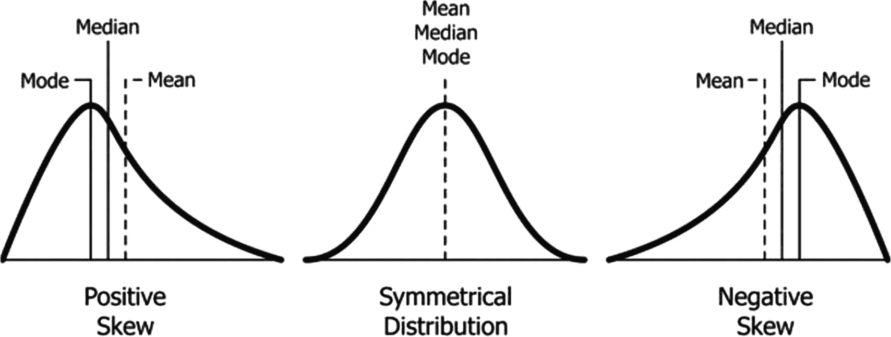
图 12-3 与单峰分布的均值/中位数/众数相关的偏度示例

数学上，样本偏度（或称 Fisher-Pearson 偏度系数）定义如下：

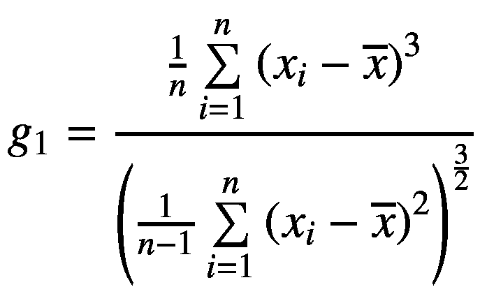

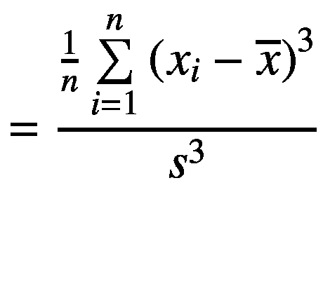

其中 *s* 是使用 *n* 而非 (*n* − 1) 计算得出的样本标准差。

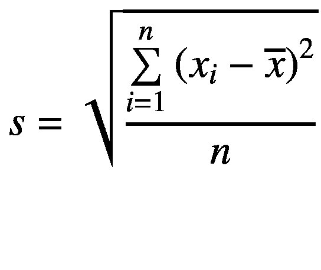

调整后的 Fisher-Pearson 偏度系数定义如下：

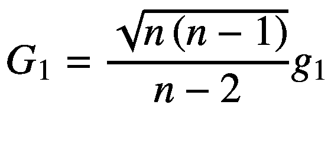

对于样本 *X* = {1, 1, 2, 1, 2, 3, 2, 1, 0} 和样本均值 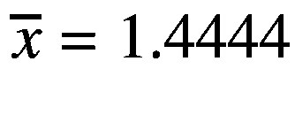，样本偏度如下：

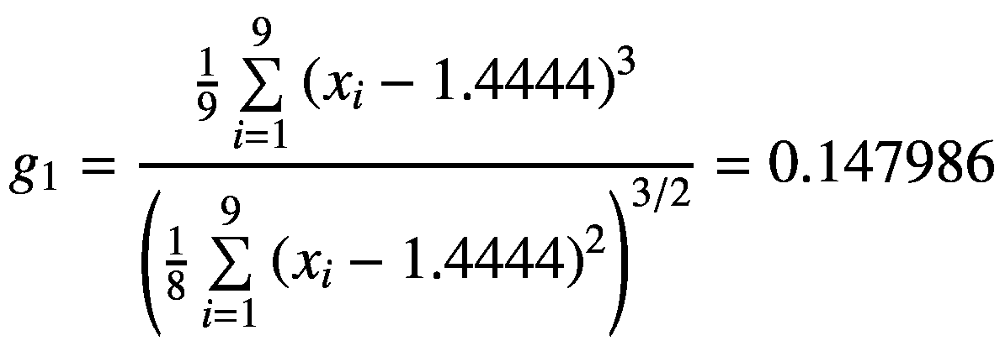

在 NM Dev 中，`Skewness` 类用于计算数据集的样本偏度。以下代码计算了前述示例的样本偏度：

```
// the sample data set
double[] X4 = {1, 1, 1, 1, 2, 2, 2, 3, 0};
// compute the skewness of the data set
Skewness skewness = new Skewness(X4);
System.out.println("sample mean = " + skewness.mean());
System.out.println("sample standard deviation = " + sqrt(skewness.variance()));
System.out.println("sample skewness = " + skewness.value());
```

输出结果如下：

```
sample mean = 1.4444444444444444
sample standard deviation = 0.8819171036881968
sample skewness = 0.14798608996128484
```
```

### 12.2.6 峰度

样本峰度是衡量分布“尾部”程度的指标。标准正态分布的峰度为 3。通常将分布的峰度与此值进行比较。峰度小于 3 的分布称为**薄尾分布**。这意味着与正态分布相比，该分布产生的异常值更少且极端程度更低。薄尾分布的一个例子是均匀分布，它不产生异常值。峰度大于 3 的分布称为**重尾分布**或**厚尾分布**。厚尾分布的一个例子是拉普拉斯分布，其尾部渐近趋近于零的速度比高斯分布慢，因此比正态分布产生更多的异常值。通常，我们使用**超值峰度**，其定义为峰度 *κ* 减 3，以便与标准正态分布进行比较。数学上，样本超值峰度定义如下：

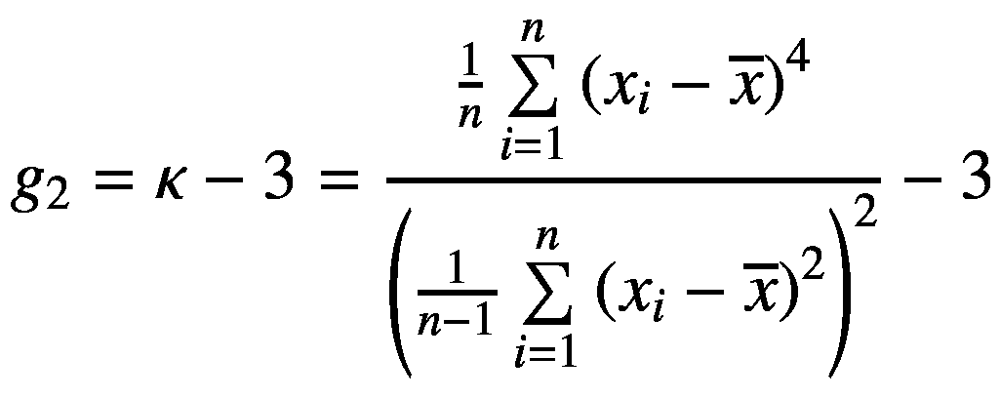

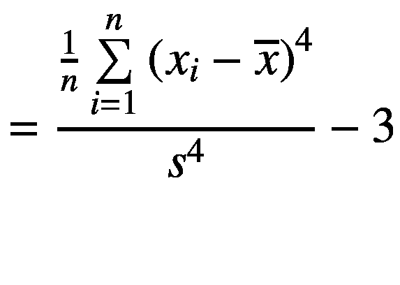

1986 年，Moors 给出了峰度的一种解释。z 分数定义如下：

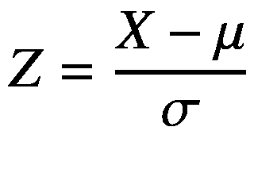

其中 `X` 是随机变量，`μ` 是均值，`σ` 是标准差。z 分数将随机变量或数据标准化，使其单位以 `σ` 的倍数表示。z 分数通常用于比较不同分布的随机变量，从而使它们具有“相同”的单位。

根据峰度的定义和恒等式，我们得到：

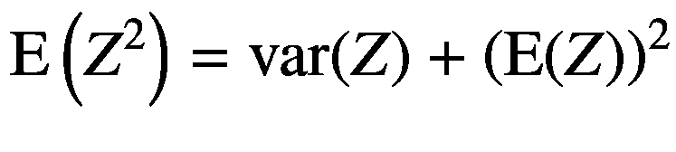

![$$ \kappa =\mathrm{E}\left({Z}⁴\right)=\operatorname{var}\left({Z}²\right)+{\left[\mathrm{E}\left({Z}²\right)\right]}² $$](images/500382_1_En_12_Chapter/500382_1_En_12_Chapter_TeX_Equx.png)

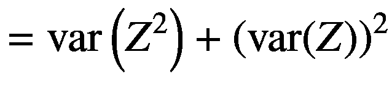

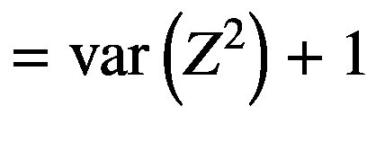

现在可以将峰度视为衡量 `Z`² 围绕其期望值的离散程度的指标。或者，也可以将其视为衡量 `Z` 围绕 +1 和 -1 的离散程度的指标。`κ` 在对称的两点分布中达到最小值。就原始变量 `X` 而言，峰度是衡量 `X` 围绕两个值 `μ` ± `σ` 的离散程度的指标。

在以下两种情况下，`κ` 具有较高值：
*   概率质量集中在均值附近，并且分布偶尔会产生远离均值的大值。
*   概率质量集中在分布的尾部。

图 12-4 显示了低峰度和高峰度的差异。左侧分布的峰度大于右侧分布，因为左侧分布的数据扩散（或分散）到更广的范围，即存在更多的异常值和极端样本。

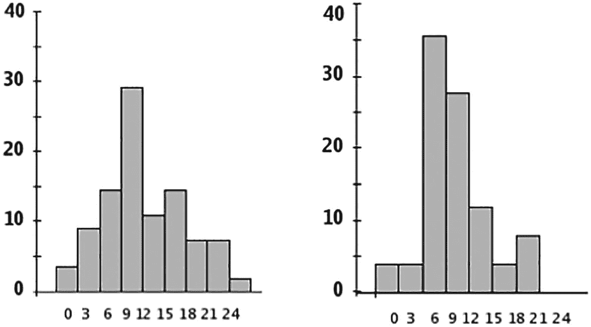

图 12-4：厚尾分布与薄尾分布

对于样本 `X` = {1, 1, 2, 1, 2, 3, 2, 1, 0}，样本峰度如下：

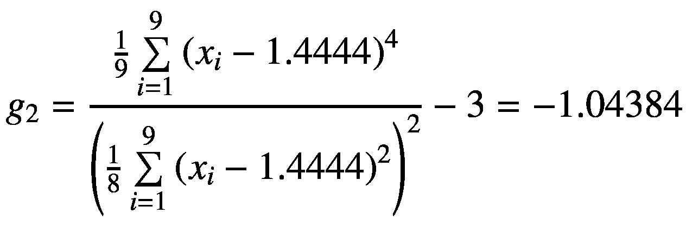

在 NM Dev 中，类 `Kurtosis` 计算数据集的样本峰度。以下代码计算前面示例的样本峰度：

```java
// the sample data set
double[] X4 = {1, 1, 1, 1, 2, 2, 2, 3, 0};
// compute the kurtosis of the data set
Kurtosis kurtosis = new Kurtosis(X4);
System.out.println("sample mean = " + kurtosis.mean());
System.out.println("sample standard deviation = " + sqrt(kurtosis.variance()));
System.out.println("sample kurtosis = " + kurtosis.value());
```

输出如下：

```
sample mean = 1.4444444444444444
sample standard deviation = 0.8819171036881968
sample kurtosis = -1.043839758125472
```

### 12.2.7 矩

均值、方差、偏度和峰度是通过特定（非线性）方式组合数据来审视数据的方法。我们可以将这些概念推广到更高阶的矩。在数学上，对于所有 `k`，`k` 阶原始样本矩的定义如下：

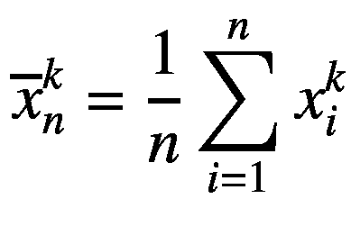

不难看出，一阶样本矩就是样本均值。

可以证明，对于任意样本容量 `n`，原始样本矩的期望值等于总体的 `k` 阶原始矩（如果该矩存在）。因此，它是一个无偏估计量。

`k` 阶中心样本矩的定义如下：

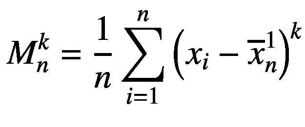

其中，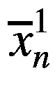 或简写为 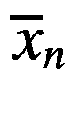 是均值或一阶原始样本矩。

不难看出，一阶样本中心矩 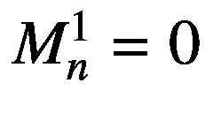。

同时，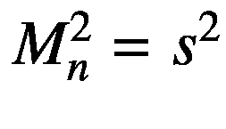 是未调整的样本方差。

高阶矩是指四阶以上的矩。与方差、偏度和峰度一样，这些高阶统计量是数据的非线性组合。它们可用于描述或估计形状参数。矩的阶数越高，估计就越困难，因为要获得同等质量的估计，需要更大的样本量。这是由于高阶矩消耗了过多的自由度。此外，它们可能难以理解。解释高阶矩的一种方法是根据低阶矩来讨论它们。例如，四阶矩（峰度）可以解释为“尾部与肩部在导致离散程度方面的相对重要性”（给定离散程度，高峰度对应厚尾，而低峰度对应宽肩）。五阶矩可以解释为衡量“尾部与中心（众数、肩部）在导致偏斜方面的相对重要性”。（给定偏度，高五阶矩对应厚尾且众数变动小，而低五阶矩对应肩部变动更大。）

在 NM Dev 中，`Moments` 类用于计算数据集的样本矩。示例如下：

```java
// 计算数据集的矩
Moments moments = new Moments(6); // 计算到 6 阶矩
// 使用 R 语言中的 rexp 函数生成的数据，λ = 1
moments.addData(new double[]{
    1.050339964176429, 0.906121669295144, 0.116647826876888,
    4.579895872370673, 1.714264543643022, 0.436467861756682,
```

### 12.2.8 中心矩计算示例

以下是计算中心矩的代码示例及其输出：

```java
System.out.println("样本容量 = " + moments.N());
System.out.println("1 阶中心矩 = " + moments.centralMoment(1)); // 结果正常
System.out.println("2 阶中心矩 = " + moments.centralMoment(2)); // 结果正常
System.out.println("3 阶中心矩 = " + moments.centralMoment(3)); // 结果有偏差，数据不足
System.out.println("4 阶中心矩 = " + moments.centralMoment(4)); // 结果偏差很大，数据不足
System.out.println("5 阶中心矩 = " + moments.centralMoment(5)); // 结果无意义，数据不足
System.out.println("6 阶中心矩 = " + moments.centralMoment(6)); // 结果无意义，数据不足
```

输出如下：

```
样本容量 = 10
1 阶中心矩 = 1.3117147406005016
2 阶中心矩 = 1.422300520892388
3 阶中心矩 = 3.217342528890056
4 阶中心矩 = 11.708334307448762
5 阶中心矩 = 36.97401011137275
6 阶中心矩 = 122.20276981014138
```

### 12.2.8 排名

排名是一组项目之间的顺序关系，对于任意两个项目，第一个要么“排名高于”、要么“排名低于”、要么“排名等于”第二个。如果排名可以出现平局，则称为弱序；如果没有平局，则称为全序。通过将详细的度量标准简化为一系列序数，排名使得根据特定标准评估复杂信息成为可能。例如，互联网搜索引擎可以根据对页面相关性的估计对找到的页面进行排名，从而使用户能够快速选择他们可能想看到的页面。在统计学中，排名是对数据进行转换，使得在对数据进行排序时，为数据分配数值或序数值。例如，假设观测到数值数据 3.4、5.1、2.6 和 7.3。对这些数据项进行排序后，它们的排名分别是 2、3、1 和 4。再举一个例子，有序数据 `hot`、`cold`、`warm` 将被替换为 3、1、2。在这些示例中，排名是按升序分配给值的。（在某些其他情况下，会使用降序排名。）

在 `NM Dev` 中，`Rank` 类用于对一组数据进行排名。它返回值的样本排名。平局（即相等的值）和缺失值可以通过多种方式处理。`FIRST` 方法会在每个索引集（平局集合）内按递增顺序排列，类似地，`LAST` 方法按递减顺序排列。`RANDOM` 方法将这些值随机排序，而默认的 `AVERAGE` 方法则用它们的均值替换，`MAX` 和 `MIN` 分别用它们的最大值和最小值替换，后者是典型的体育排名方式。`AS_26` 方法遵循 `Freeman`（1970）的方法打破平局。它会对每个重复项的排名加 0.5。这是我们的默认实现。

示例如下：

```java
double[] x = new double[]{3, 1, 4, 1, 5, 9, 2, 6, 5, 3, 5};
System.out.println("原始数据: " + Arrays.toString(x));
Rank rank = new Rank(x, Rank.TiesMethod.AS_26); // 默认实现
System.out.println("AS_26 排名: " + Arrays.toString(rank.ranks()));
rank = new Rank(x, Rank.TiesMethod.AVERAGE);
System.out.println("AVERAGE 排名: " + Arrays.toString(rank.ranks()));
rank = new Rank(x, Rank.TiesMethod.FIRST);
System.out.println("FIRST 排名: " + Arrays.toString(rank.ranks()));
rank = new Rank(x, Rank.TiesMethod.LAST);
System.out.println("LAST 排名: " + Arrays.toString(rank.ranks()));
rank = new Rank(x, Rank.TiesMethod.MAX);
System.out.println("MAX 排名: " + Arrays.toString(rank.ranks()));
rank = new Rank(x, Rank.TiesMethod.MIN);
System.out.println("MIN 排名: " + Arrays.toString(rank.ranks()));
rank = new Rank(x, Rank.TiesMethod.RANDOM);
System.out.println("RANDOM 排名: " + Arrays.toString(rank.ranks()));
```

输出如下：

```
AS_26 排名: [4.5, 1.5, 6.0, 1.5, 8.0, 11.0, 3.0, 10.0, 8.0, 4.5, 8.0]
AVERAGE 排名: [4.5, 1.5, 6.0, 1.5, 8.0, 11.0, 3.0, 10.0, 8.0, 4.5, 8.0]
FIRST 排名: [4.0, 1.0, 6.0, 2.0, 7.0, 11.0, 3.0, 10.0, 8.0, 5.0, 9.0]
LAST 排名: [5.0, 2.0, 6.0, 1.0, 9.0, 11.0, 3.0, 10.0, 8.0, 4.0, 7.0]
MAX 排名: [5.0, 2.0, 6.0, 2.0, 9.0, 11.0, 3.0, 10.0, 9.0, 5.0, 9.0]
MIN 排名: [4.0, 1.0, 6.0, 1.0, 7.0, 11.0, 3.0, 10.0, 7.0, 4.0, 7.0]
RANDOM 排名: [4.0, 1.0, 6.0, 2.0, 9.0, 11.0, 3.0, 10.0, 7.0, 5.0, 8.0]
```

#### 12.2.8.1 分位数

*Q*-分位数是指将有限且有序的数据集划分成 *q* 个（近似）等大小子集的值。分位数是标记连续子集之间边界的数据值。共有 *q* − 1 个 *q*-分位数，每个分位数对应一个满足 0 < *k* < *q* 的整数 *k*。将数据视为来自某个随机变量的样本时，随机变量的第 *k* 个 *q*-分位数是指满足以下条件的值 *x*：样本或随机变量小于 *x* 的概率至多为 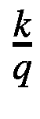，且样本或随机变量大于 *x* 的概率至多为 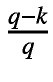。最小观测值对应概率 0，最大观测值对应概率 1。

分位数也可应用于连续分布（见第 12.3 节和 12.3.1 节），这提供了一种将顺序统计量推广到连续变量的方法。当随机变量的累积分布函数已知时，*q*-分位数就是将分位数函数（累积分布函数的反函数，CDF）应用于值集 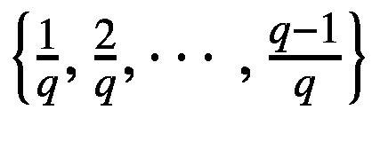 的结果。

在 NM Dev 中，`Quantile` 类用于计算数据集的分位数。Hyndman 和 Fan（1996 年）描述了九种不同的分位数定义和实现。简要说明如下。默认实现是 `APPROXIMATELY_MEDIAN_UNBIASED`。

1. `INVERSE_OF_EMPIRICAL_CDF`：经验分布函数的反函数。
2. `INVERSE_OF_EMPIRICAL_CDF_WITH_AVERAGING_AT_DISCONTINUITIES`：在间断点处取平均的经验分布函数的反函数。
3. `NEAREST_EVEN_ORDER_STATISTICS`：最邻近的偶数阶统计量，如 SAS 中的实现。
4. `LINEAR_INTERPOLATION_OF_EMPIRICAL_CDF`：经验 CDF 的线性插值。
5. `MIDWAY_THROUGH_STEPS_OF_EMPIRICAL_CDF`：一种分段线性函数，其节点位于经验 CDF 阶梯的中间位置。
6. `MINITAB_SPSS`：Minitab 和 SPSS 中的定义。
7. `S`：S 语言中的定义。
8. `APPROXIMATELY_MEDIAN_UNBIASED`：所得的分位数估计值近似为中位数无偏，不受样本分布的影响。
9. `APPROXIMATELY_UNBIASED_IF_DATA_IS_NORMAL`：如果样本呈正态分布，所得的分位数估计值对于期望顺序统计量近似无偏。

示例如下：

```java
double[] x = new double[]{0, 1, 2, 3, 3, 3, 6, 7, 8, 9}; // with repeated observations

double[] qs = new double[]{1e-10, 0.1, 0.15, 0.2, 0.3, 0.4, 0.5, 0.6, 0.7, 0.8, 0.9, 0.95, 1.}; // quantiles

System.out.println("APPROXIMATELY_MEDIAN_UNBIASED");

Quantile stat1 = new Quantile(

x,

Quantile.QuantileType.APPROXIMATELY_MEDIAN_UNBIASED

);

System.out.println("number of samples = " + stat1.N());

for (double q : qs) {

System.out.println(String.format("Q(%f) = %f", q, stat1.value(q)));

}

System.out.println("NEAREST_EVEN_ORDER_STATISTICS");

Quantile stat2 = new Quantile(

x,

Quantile.QuantileType.NEAREST_EVEN_ORDER_STATISTICS);

System.out.println("number of samples = " + stat2.N());

for (double q : qs) {

System.out.println(String.format("Q(%f) = %f", q, stat2.value(q)));

}
```

输出如下：

```
APPROXIMATELY_MEDIAN_UNBIASED

number of samples = 10

Q(0.000000) = 0.000000

Q(0.100000) = 0.366667

Q(0.150000) = 0.883333

Q(0.200000) = 1.400000

Q(0.300000) = 2.433333

Q(0.400000) = 3.000000

Q(0.500000) = 3.000000

Q(0.600000) = 4.600000

Q(0.700000) = 6.566667

Q(0.800000) = 7.600000

Q(0.900000) = 8.633333

Q(0.950000) = 9.000000

Q(1.000000) = 9.000000

NEAREST_EVEN_ORDER_STATISTICS

number of samples = 10

Q(0.000000) = 0.000000

Q(0.100000) = 0.000000

Q(0.150000) = 1.000000

Q(0.200000) = 1.000000

Q(0.300000) = 2.000000

Q(0.400000) = 3.000000

Q(0.500000) = 3.000000

Q(0.600000) = 3.000000

Q(0.700000) = 6.000000

Q(0.800000) = 7.000000

Q(0.900000) = 8.000000

Q(0.950000) = 9.000000

Q(1.000000) = 9.000000
```

#### 12.2.8.2 中位数

数据集的中位数定义为：不超过一半的数据值大于它，同时不超过一半的数据值小于它。虽然算术平均数常被用来报告集中趋势，但它不是一个稳健的统计量，意味着它容易受到异常值（远大于或远小于大多数值的数值）的显著影响。对于偏态分布，例如收入分布（少数人的收入远高于大多数人），算术平均数可能与人们理解的“中间值”不符，而像中位数这样的稳健统计量则能更好地描述集中趋势。在数学上，中位数就是第 50 百分位分位数，即 `Q(0.5)`。见图 12-5。

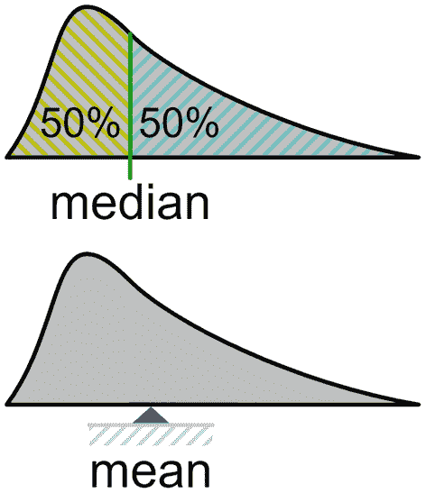

图 12-5

概率分布的中位数与均值对比

示例如下：

```java
double[] x = new double[]{0, 1, 2, 3, 3, 3, 6, 7, 8, 9}; // with repeated observations

System.out.println("APPROXIMATELY_MEDIAN_UNBIASED");

Quantile stat1 = new Quantile(

x,

Quantile.QuantileType.APPROXIMATELY_MEDIAN_UNBIASED

);

System.out.println("the median = " + stat1.value(0.5));

System.out.println("NEAREST_EVEN_ORDER_STATISTICS");

Quantile stat2 = new Quantile(

x,

Quantile.QuantileType.NEAREST_EVEN_ORDER_STATISTICS);

System.out.println("the median = " + stat2.value(0.5));
```

输出如下：

```
APPROXIMATELY_MEDIAN_UNBIASED

the median = 3.0

NEAREST_EVEN_ORDER_STATISTICS

the median = 3.0
```

#### 12.2.8.3 最大值和最小值

最大值是数据集中的最大值，最小值是数据集中的最小值。在数学上，它们分别等价于第 100 百分位分位数和最小分位数（比如 `1e-10` 百分位分位数），即 `Q(1)` 和 `Q(1e-10)`。但结果可能受所使用的插值方法影响。在 NM Dev 中，分别使用 `Max` 和 `Min` 类来计算最大值和最小值。示例如下：

```java
// 示例代码
```

```markdown
double[] x = new double[]{0, 1, 2, 3, 3, 3, 6, 7, 8, 9}; // with repeated observations

`System.out.println("APPROXIMATELY_MEDIAN_UNBIASED");`

`Quantile stat1 = new Quantile(`
`x,`
`Quantile.QuantileType.APPROXIMATELY_MEDIAN_UNBIASED`
`);`

`System.out.println("the 100% quantile = " + stat1.value(1.));`
`System.out.println("the maximum = " + new Max(x).value());`
`System.out.println("NEAREST_EVEN_ORDER_STATISTICS");`

`Quantile stat2 = new Quantile(`
`x,`
`Quantile.QuantileType.NEAREST_EVEN_ORDER_STATISTICS);`
`System.out.println("the 1e-10 quantile = " + stat2.value(1e-10));`
`System.out.println("the minimun = " + new Min(x).value());`

```
输出如下：

APPROXIMATELY_MEDIAN_UNBIASED

the 100% quantile = 9.0

the maximum = 9.0

NEAREST_EVEN_ORDER_STATISTICS

the 1e-10 quantile = 0.0

the minimun = 0.0
```

### 12.2.9 协方差

协方差是衡量两个样本或两个随机变量联合变异性的指标。如果一个样本/变量的大值对应另一个样本/变量的大值，且小值之间也如此（即变量趋向于表现出相似行为），则协方差为正。见图 12-6。

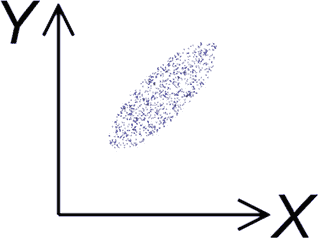

图 12-6 正协方差

在相反情况下，当一个样本/变量的大值通常对应另一个样本/变量的小值时（即变量趋向于表现出相反行为），协方差为负。见图 12-7。

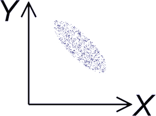

图 12-7 负协方差

类似地，如果一个样本/变量的值无法预测另一个样本/变量的值，则协方差为零。见图 12-8。

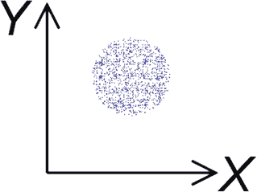

图 12-8 零协方差

因此，协方差的符号显示了变量之间线性关系的趋势。协方差的幅值不易解释，因为它未经归一化，故取决于变量的量级。然而，协方差的归一化版本（称为相关系数）则通过其幅值显示线性关系的强度。

#### 12.2.9.1 样本协方差

从数学上讲，两个样本 `X` 和 `Y` 的样本协方差如下：

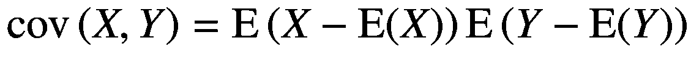

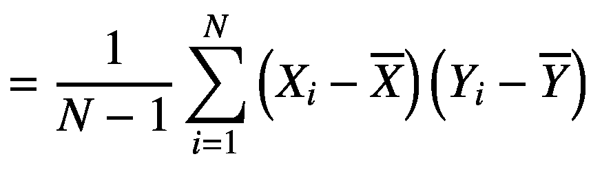

`$\overline{X}$` 是 `X` 的样本均值。`$\overline{Y}$` 是 `Y` 的样本均值。此处我们使用 `N - 1` 而非 `N` 作为分母，以使估计量无偏，因为在计算中我们使用了样本均值而非总体均值。若总体均值已知，则无偏估计量如下：

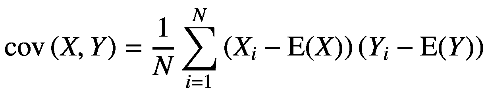

样本方差是协方差的一个特例，此时两个样本/变量相同（即一个变量的值始终等于另一个变量）：

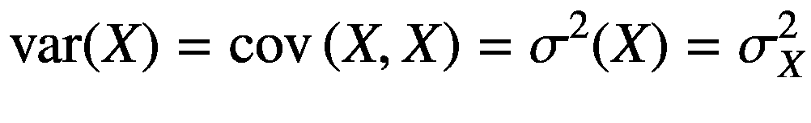

样本标准差是 `var(X)` 的平方根。

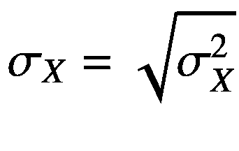

#### 12.2.9.2 相关性

两个样本的相关系数定义为协方差除以它们标准差的乘积。样本相关性也称为斯皮尔曼秩相关。它本质上是协方差的归一化度量，因此结果始终介于 -1 和 1 之间。与协方差本身一样，该度量只能反映变量之间的线性相关性，而忽略了许多其他类型的关系或相关性。见图 12-9。

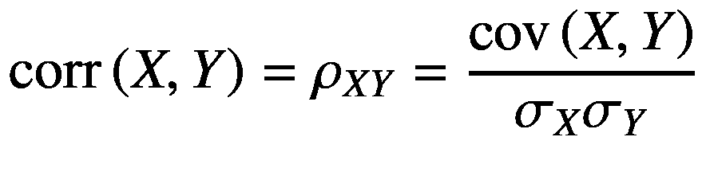


图 12-9 不同相关系数值的散点图示例

在 NM Dev 中，类 `SpearmanRankCorrelation` 计算两个样本集之间的样本相关性。示例如下：

```
// 样本数据集
double[] X5 = new double[]{106, 86, 100, 101, 99, 103, 97, 113, 112, 110};
double[] X6 = new double[]{7, 0, 27, 50, 28, 29, 20, 12, 6, 17};

// 计算数据集的样本相关性
System.out.println("样本相关性 = " + new SpearmanRankCorrelation(X5, X6).value());
```

输出如下：

```
样本相关性 = -0.17575757575757575
```

#### 12.2.9.3 协方差矩阵与相关矩阵

对于两个以上的样本，协方差矩阵是一个方阵，用于给出每对样本之间的协方差。任何协方差矩阵都是对称且半正定的。其主对角线上的元素是各个样本的方差。直观上，协方差矩阵将方差的概念推广到了多个维度。例如，二维空间中随机样本集合的变异无法完全用单一数值来刻画，而`x`和`y`方向上的方差也未能包含所有必要信息；需要一个包含协方差和方差的 2×2 矩阵，才能完整描述这种二维变异。

从数学上讲，对于由多个变量的随机样本组成的列向量`X` = (`X[1]`, `X[2]`, ⋯, `X[n]`)^(`T`)，其中每个变量都具有有限方差和期望值`E(X[i])`，那么协方差矩阵`Σ[X]`是一个矩阵，其(`i`, `j`)项为协方差`cov(X[i], X[j])`。即：


其对角线元素为 。

类似地，相关矩阵是一个矩阵，其(`i`, `j`)项为相关系数 。其对角线元素均为 1。相关矩阵必然是对称且半正定的矩阵。此外，如果没有任何一个变量的所有值恰好可由其他变量的值的线性函数生成，那么相关矩阵就是严格正定的。

例如，假设我们有五个数据集：

`X[1]` = {1.4022225, –0.2230975,0.6939930,0.6939930,0.6939930, –2.5275280}

`X[2]` = {–0.04625344,0.91561987,1.94611387,0.18818663, –0.10749210,0.64942255}

`X[3]` = {1.26176112,1.17086252, –0.82939259, –0.29040783,3.27376532,0.07506224}

`X[4]` = {–1.8394428,0.2282348,1.0905923,0.6937185,0.5141217, –1.0787524}

`X[5]` = {0.7182637,0.0690674,0.1458883,0.4664052,0.7691778,1.6217606}

样本协方差如下：

![$$ {\boldsymbol{\Sigma}}_{\boldsymbol{X}}=\left[\begin{array}{ccccc}1.891462&amp; -0.094053&amp; 0.665669&amp; 0.176962&amp; -0.487023\\ {}-0.094053&amp; 0.600273&amp; -0.742584&amp; 0.404512&amp; -0.173547\\ {}0.665669&amp; -0.742584&amp; 2.167306&amp; -0.250672&amp; 0.085099\\ {}0.176962&amp; 0.404512&amp; -0.250672&amp; 1.301751&amp; -0.385892\\ {}-0.487023&amp; -0.173547&amp; 0.085099&amp; -0.385892&amp; 0.317301\end{array}\right] $$](images/500382_1_En_12_Chapter/500382_1_En_12_Chapter_TeX_Equal.png)

请注意，每个样本集（或每个变量）按列排列。共有五列，对应五个变量。每个集合有六个样本/观测值/数值。每行是五个变量的一次观测。例如，一行中的数值，如 {1.4022225, −0.04625344, 1.26176112, −1.8394428, 0.7182637}，被认为是同时观测到的。因此，数值的顺序至关重要。所得的协方差矩阵是一个 5×5 的矩阵。

在 NM Dev 中，`SampleCovariance`类用于计算数据集的样本协方差。以下代码重现了前面的例子：

```
// each column is a sample set; there are 5 data sets

Matrix X7 = new DenseMatrix(new double[][]{

{1.4022225, -0.04625344, 1.26176112, -1.8394428, 0.7182637},

{-0.2230975, 0.91561987, 1.17086252, 0.2282348, 0.0690674},

{0.6939930, 1.94611387, -0.82939259, 1.0905923, 0.1458883},

{0.6939930, 0.18818663, -0.29040783, 0.6937185, 0.4664052},

{0.6939930, -0.10749210, 3.27376532, 0.5141217, 0.7691778},

{-2.5275280, 0.64942255, 0.07506224, -1.0787524, 1.6217606}

});

// compute the sample covariance of the data sets

Matrix cov = new SampleCovariance(X7); // a 5x5 matrix

System.out.println("sample covariance =\n");

System.out.println(cov);

```

输出如下：

```
sample covariance =

5x5

[,1] [,2] [,3] [,4] [,5]

[1,] 1.891462, -0.094053, 0.665669, 0.176962, -0.487023,

[2,] -0.094053, 0.600273, -0.742584, 0.404512, -0.173547,

[3,] 0.665669, -0.742584, 2.167306, -0.250672, 0.085099,

[4,] 0.176962, 0.404512, -0.250672, 1.301751, -0.385892,

[5,] -0.487023, -0.173547, 0.085099, -0.385892, 0.317301,
```

#### 12.2.9.4 Ledoit-Wolf 线性收缩

本节内容参考 Ledoit & Wolf (2004) 的研究，该研究针对协方差矩阵提出了一种比样本协方差更优的估计量。许多实际（而非教科书式）问题都需要估计协方差矩阵及其逆矩阵，此时矩阵维度 `p` 相对于样本量 `n` 而言较大。例如：从大量股票中选取均值-方差有效投资组合、对大规模截面数据进行广义最小二乘（GLS）回归、以及在矩条件数量众多的广义矩方法中选择最优权重矩阵。在这些情况下，通常使用的样本协方差矩阵估计量表现不佳。当矩阵维度 `p` 大于可用观测数量 `n` 时（`p / n > 1`），样本协方差矩阵甚至不可逆。这种情况经常发生，例如在估计 3000 只股票的协方差矩阵时，我们没有足够的数据用于估计。十年数据仅有 2500 个交易日，甚至只有 120 个月。估计出的日度或月度协方差矩阵不可逆，所有需要计算逆矩阵的投资组合优化算法都将失败。

当比值 `p / n < 1` 不可忽略时，样本协方差矩阵虽然可逆，但可能在数值上呈现病态。（若矩阵的条件数非常大，则称该矩阵为病态矩阵。实际上，这种矩阵近乎奇异，其逆矩阵的计算或线性方程组的求解容易产生巨大数值误差。不可逆矩阵的条件数等于无穷大。）这意味着求逆会急剧放大估计误差。对于大的 `p`，很难找到足够大的 `n` 使 `p / n` 趋近于 0，因此开发一种适用于大规模协方差矩阵的良好条件估计量至关重要。

如果我们不计代价地想要一个良好条件的估计量，我们可以对协方差矩阵施加一些特定的结构约束，使其变得条件良好，例如对角性、稀疏性、图模型或因子模型。但在缺乏关于矩阵真实结构的先验信息时，这种特定结构通常会被错误设定，导致最终估计量偏差过大，与真实的协方差矩阵几乎毫无相似之处。在 (Ledoit & Wolf, 2004) 之前，不存在既条件良好又比样本协方差矩阵更精确的估计量。

2003 年，Ledoit & Wolf (2003, 2004) 提出了一种渐近兼具这两种性质的估计量。获得良好条件结构化估计量的一种方法是施加所有方差相等且所有协方差为零的条件。他们推荐的估计量是这个结构化估计量与样本协方差矩阵的加权平均。这种估计量确保样本协方差矩阵与结构化估计量的加权平均比两者中任何一个都更精确。这种新的估计方法倾向于将最极端的系数向更中心的数值拉动（因此称为收缩），从而系统性地在关键之处减少估计误差。

大量研究表明：（i）即使观测值和变量数量非常少，新估计量通常也比样本协方差矩阵精确得多；（ii）一旦变量和观测值数量达到至少十个，它基本上与有限样本决策理论中提出的某些估计量一样精确，或者显著更精确；（iii）它比真实协方差矩阵的条件更好；（iv）当观测值和变量数量至少为 20 时，一般渐近性质能很好地近似有限样本行为。图 12-10 比较了线性收缩协方差矩阵 `S*` 与样本协方差矩阵 `Σ` 的条件数（衡量矩阵对数据微小变化的不稳定程度；数值越小越好）。


**图 12-10** Ledoit-Wolf (2004) 矩阵与样本协方差矩阵的条件数对比（来源：Ledoit & Wolf, 2004）

在 NM Dev 中，`LedoitWolf2004` 类用于计算这种线性收缩协方差矩阵估计量。示例如下：

```java
/*
 * 以下是 MSFT、YHOO、GOOG、AAPL、MS、XOM 从
 * 2012 年 8 月 20 日到 2013 年 1 月 15 日的股票收益率（即 100 天的收益率）。
 */
Matrix X = new DenseMatrix(new double[][]{
{0.001968, 0.000668, -0.008926, -0.013668, 0.004057, -0.005492},
{-0.008511, -0.003340, 0.011456, 0.019523, -0.002020, 0.002991},
{-0.009244, -0.003351, -0.000561, -0.009327, -0.024291, -0.004703},
{0.009997, 0.003362, 0.002704, 0.000879, 0.004149, 0.008413},
{0.004289, -0.004692, -0.013866, 0.018797, -0.002066, -0.003543},
{-0.001971, -0.008754, 0.011999, -0.001308, 0.004831, 0.004129},
{0.000658, 0.008152, 0.015888, -0.001965, 0.014423, -0.002284},
{-0.010855, -0.011456, -0.009200, -0.014260, 0.006093, -0.007899},
{0.016628, -0.001363, 0.005002, 0.002073, 0.006729, 0.001154},
{-0.014066, 0.016382, -0.005912, 0.014617, 0.033422, -0.002075},
{0.000000, 0.013432, -0.000470, -0.007025, 0.010996, 0.002426},
{0.031520, 0.001325, 0.027442, 0.009023, 0.036468, 0.019011},
{-0.012544, 0.007280, 0.009651, 0.006165, 0.051235, 0.010403},
{-0.007492, -0.007227, -0.007619, -0.026013, -0.027598, -0.004924},
{0.002297, 0.003309, -0.012244, -0.003244, 0.038647, 0.001574},
{-0.000327, 0.015831, -0.001893, 0.013914, 0.009884, -0.000786},
{0.005241, 0.012987, 0.021943, 0.019693, 0.027634, 0.018766},
{0.008798, 0.010897, 0.005156, 0.012164, 0.019048, 0.011802},
{0.000000, -0.005707, 0.000423, 0.012294, -0.024189, -0.004252},
{-0.000969, 0.014668, 0.011690, 0.003043, -0.009577, -0.002847},
{-0.004203, -0.003143, 0.012836, 0.000272, -0.003413, -0.011748},
{0.012662, -0.004414, 0.000852, -0.004850, -0.020548, 0.010443},
{-0.008015, -0.003167, 0.008062, 0.001999, -0.007576, 0.004398},
{-0.013251, 0.016518, 0.020968, -0.013287, -0.002349, -0.000438},
{-0.012774, -0.020000, -0.000294, -0.024969, -0.025898, -0.001533},
{-0.007299, -0.004464, 0.005740, -0.012409, -0.010272, -0.005594},
{-0.000334, 0.027546, 0.004035, 0.024254, 0.025031, 0.006287},
{-0.013039, -0.003741, -0.002644, -0.020863, -0.005956, -0.003836},
{-0.009146, -0.009387, 0.009649, -0.011565, 0.002996, 0.003851},
{0.005812, 0.006949, -0.006288, 0.002910, 0.007168, -0.000877},
{0.006798, 0.016939, 0.007279, 0.015343, 0.007117, -0.000219},
{0.005739, 0.003701, 0.007279, -0.006927, 0.025913, 0.005706},
{-0.006042, -0.011063, -0.000521, -0.021318, 0.001722, 0.003492},
{-0.002364, -0.003729, -0.012779, -0.022090, -0.002865, 0.001414},
{-0.016926, -0.011229, -0.018144, -0.003636, -0.005747, -0.005863},
});
```

```
{-0.010331, -0.001262, 0.000632, 0.007963, 0.002890, -0.012014},

{-0.001044, 0.005685, 0.009294, -0.020000, 0.026513, 0.001548},

{0.008708, -0.002513, -0.008956, 0.002575, -0.030882, -0.001545},

{0.010704, -0.012594, -0.005062, 0.008008, 0.025492, 0.005306},

{-0.000683, 0.015306, 0.005020, 0.023692, 0.006780, 0.009567},

{0.003419, 0.010678, 0.014489, -0.007977, 0.034792, 0.010892},

{-0.003066, -0.005594, -0.080067, -0.018576, -0.037961, 0.000970},

{-0.029050, -0.010000, -0.019007, -0.036030, -0.014656, -0.014209},

{-0.022527, -0.004419, -0.004576, 0.039666, -0.004577, 0.000437},

{0.001801, 0.057070, 0.002475, -0.032607, -0.019540, -0.021829},

{-0.005392, -0.007199, -0.004483, 0.005667, 0.004103, -0.003347},

{-0.000723, 0.003625, 0.000679, -0.011824, -0.004670, 0.006158},

{0.011935, 0.010837, -0.003851, -0.009097, -0.003519, 0.002114},

{0.011794, 0.002978, 0.007628, -0.014370, 0.022955, 0.005996},

{0.034264, 0.006532, 0.010716, 0.002059, 0.013234, 0.004746},

{-0.000683, 0.009440, 0.000480, -0.033090, 0.009654, -0.014501},

{0.004443, 0.015196, -0.007210, 0.013550, -0.001687, 0.004013},

{0.007826, 0.005181, -0.001816, -0.003024, 0.024789, 0.010769},

{-0.026334, -0.004009, -0.021416, -0.038263, -0.085761, -0.031415},

{-0.009015, -0.008626, -0.022230, -0.036290, -0.006615, -0.012588},

{0.000700, 0.001160, 0.016465, 0.017313, 0.005448, 0.001608},

{-0.021329, 0.014484, 0.004329, -0.007732, 0.009633, 0.001261},

{-0.032154, 0.019417, -0.010287, 0.000129, -0.014908, -0.009734},

{-0.009228, -0.001120, -0.009863, -0.011089, -0.026029, -0.004626},

{-0.006706, 0.003365, -0.008107, -0.020973, 0.010566, 0.000813},

{-0.005251, -0.001677, -0.000124, 0.003919, -0.004920, 0.003599},

{0.007919, 0.027996, 0.032495, 0.072108, 0.021014, 0.014112},

{-0.000748, -0.006536, 0.002634, -0.008520, -0.010291, -0.001939},

{0.008985, 0.008772, -0.006120, 0.001408, -0.006116, 0.005829},

{0.027829, 0.009239, 0.003154, 0.017447, 0.011077, 0.012271},

{-0.011191, 0.010232, -0.010210, 0.031549, 0.010956, -0.005276},

{-0.011318, 0.009062, 0.014460, -0.008057, 0.001204, -0.014331},

{0.010340, -0.001057, 0.019323, -0.003146, 0.015033, 0.008586},

{-0.014985, -0.002115, 0.012023, 0.011013, -0.001185, 0.000227},

{-0.012245, -0.005299, 0.009366, -0.006923, 0.000593, 0.000227},

{-0.007137, -0.011721, -0.004468, 0.001555, -0.023711, -0.006013},

{-0.002270, 0.020485, -0.006070, -0.017639, 0.008500, -0.004794},

{0.011377, -0.002113, -0.004645, -0.064357, 0.022276, 0.006193},

{0.002250, 0.016411, 0.004812, 0.015683, -0.014134, 0.003078},

{-0.010101, 0.000000, -0.010013, -0.025565, 0.013740, 0.006818},

{0.018141, 0.011979, 0.001768, -0.006432, 0.002357, -0.002144},

{0.014105, 0.004632, 0.016720, 0.021838, 0.043504, 0.006560},

{-0.002928, -0.007172, 0.000976, -0.004415, -0.002817, 0.005169},

{-0.004772, -0.001548, 0.007369, -0.017273, 0.005650, -0.009726},

{-0.011066, 0.014987, -0.001053, -0.037569, 0.014045, -0.005645},

{0.010817, 0.002546, 0.026811, 0.017733, 0.026593, 0.008969},

{0.016974, -0.003555, 0.000402, 0.029046, 0.031840, 0.007764},

{-0.009071, -0.001019, -0.001331, -0.014216, -0.001569, -0.012506},

{0.013548, 0.004592, 0.003125, -0.008702, 0.009429, 0.005088},

{-0.008309, -0.017268, -0.009317, -0.004600, -0.018163, -0.018675},

{-0.014208, 0.015504, -0.008566, 0.001617, 0.001586, -0.003554},

{-0.007391, -0.004071, -0.000888, -0.013784, -0.003694, 0.001726},

{0.003723, 0.001533, -0.003640, 0.004016, -0.005826, -0.002412},

{-0.015208, -0.005102, -0.008892, -0.010620, -0.007991, -0.020262},

{0.006026, 0.020513, 0.010528, 0.044310, 0.026853, 0.017039},

{0.034070, 0.009045, 0.022435, 0.031682, 0.026151, 0.024957},

{-0.013396, -0.014940, 0.000581, -0.012622, -0.002039, -0.001804},

{-0.018716, 0.004044, 0.019760, -0.027855, 0.031154, 0.004630},

{-0.001870, -0.023162, -0.004363, -0.005882, -0.019316, -0.011578},

{-0.005245, 0.013402, -0.001973, 0.002691, -0.007576, 0.006255}
```

进入`/path.to/xxx`目录，找到`xxx.json`。

在表达式`cvar = avar + bvar`中，加法运算符（`+`）将`avar`与`bvar`相加，得到它们的和`cvar`

在`List.of(arg0, arg1, arg2)`中，`List`接口的工厂方法`of()`接受一系列的元素，返回包含它们的只读列表。

之后我们这样调用`cmd`命令：`cmd arg0 arg1 arg2`。

```
if (condVar > someVal) {console.log("xxx")}
```

我们可以看出，Ledoit-Wolf 线性收缩协方差矩阵与样本协方差矩阵存在显著差异。

## Ledoit-Wolf 非线性收缩

本节内容依据 Ledoit & Wolf (2012) 的研究。在对真实协方差矩阵结构缺乏进一步了解的情况下，迄今为止最成功的方法可以说是收缩估计。通过对样本协方差矩阵和单位矩阵的倍数进行加权平均，将样本协方差矩阵向单位矩阵收缩，这等价于将样本特征值线性收缩至其组均值，同时保留样本特征向量。这种方法之所以有效，是因为样本协方差矩阵中的样本特征值存在这样的规律：最大的样本特征值系统性偏高，而最小的则系统性偏低。线性收缩方法通过将最大特征值向下拉、最小特征值向上推，使其向所有样本特征值的组均值靠拢，从而修正了这种偏差。换句话说，它对所有样本特征值应用了相同的收缩强度，无论其位置如何。例如，如果线性收缩强度为 0.5，那么每个样本特征值都会向所有样本特征值的组均值移动一半的距离。

根据具体情况，相对于样本协方差矩阵的改进可能非常巨大，也可能微乎其微。当  较大且/或总体特征值彼此接近时，线性收缩能够实现相对于样本协方差矩阵的大部分潜在改进。在相反的情况下，即当  较小且/或总体特征值分散时，线性收缩相对于样本协方差矩阵几乎没有任何改进。

Ledoit & Wolf (2016, 2015, 2012) 研究背后的直觉是，当高阶效应过于显著时，一阶近似无法提供足够的改进。改进的方法是升级为协方差矩阵的非线性收缩估计。我们不再对所有样本特征值施加相同的收缩强度，而是对每个样本特征值给予个性化的收缩强度。这种估计量有潜力在渐近意义上至少匹配 Ledoit & Wolf (2004) 的线性收缩估计量，并且通常表现更好，特别是在线性收缩相对于样本协方差矩阵未能带来足够改进的情况下。事实上，就有限样本性能而言，线性收缩估计量很少优于非线性收缩估计量。只有在线性收缩估计量已经（接近）最优时才会出现这种情况。然而，正如模拟所示，在这种情况下，相对于非线性收缩估计量的优势非常小。在大多数情况下，线性收缩估计量远非最优，此时非线性收缩能够提供显著的有限样本改进，即使对于像 `p` = 30 这样低的矩阵维度也是如此。由于高阶效应的大小取决于无法观测的总体协方差矩阵，因此，先验地将默认使用非线性收缩总是更安全的。参见图 12-11。


**图 12-11** 协方差矩阵的非线性与线性收缩估计量性能比较。

图 12-11 以平均损失相对改进百分比（PRIAL）为指标，比较了协方差矩阵的非线性和线性收缩估计量的性能。非线性收缩估计量不仅显著优于线性收缩估计量和样本协方差矩阵，而且它在渐近上等价于一个 Oracle 估计量（一个仅在我们拥有关于真实总体的所有信息时才能观测到的估计量）。

在 NM Dev 中，`LedoitWolf2016` 类用于计算这种非线性收缩协方差矩阵估计量。示例如下：

```java
/*

* 以下是 MSFT、YHOO、GOOG、AAPL、MS、XOM 从 2012 年 8 月 20 日到 2013 年 1 月 15 日（即 100 天的收益率）的股票收益率数据。

*

* 情况 1 n>>p

* n=100, p=6

*/

Matrix X = new DenseMatrix(new double[][]{

{0.001968, 0.000668, -0.008926, -0.013668, 0.004057, -0.005492},

{-0.008511, -0.003340, 0.011456, 0.019523, -0.002020, 0.002991},

{-0.009244, -0.003351, -0.000561, -0.009327, -0.024291, -0.004703},

{0.009997, 0.003362, 0.002704, 0.000879, 0.004149, 0.008413},

{0.004289, -0.004692, -0.013866, 0.018797, -0.002066, -0.003543},

{-0.001971, -0.008754, 0.011999, -0.001308, 0.004831, 0.004129},

{0.000658, 0.008152, 0.015888, -0.001965, 0.014423, -0.002284},

{-0.010855, -0.011456, -0.009200, -0.014260, 0.006093, -0.007899},

{0.016628, -0.001363, 0.005002, 0.002073, 0.006729, 0.001154},

{-0.014066, 0.016382, -0.005912, 0.014617, 0.033422, -0.002075},

{0.000000, 0.013432, -0.000470, -0.007025, 0.010996, 0.002426},

{0.031520, 0.001325, 0.027442, 0.009023, 0.036468, 0.019011},

{-0.012544, 0.007280, 0.009651, 0.006165, 0.051235, 0.010403},

{-0.007492, -0.007227, -0.007619, -0.026013, -0.027598, -0.004924},

{0.002297, 0.003309, -0.012244, -0.003244, 0.038647, 0.001574},

{-0.000327, 0.015831, -0.001893, 0.013914, 0.009884, -0.000786},

{0.005241, 0.012987, 0.021943, 0.019693, 0.027634, 0.018766},

{0.008798, 0.010897, 0.005156, 0.012164, 0.019048, 0.011802},

{0.000000, -0.005707, 0.000423, 0.012294, -0.024189, -0.004252},

{-0.000969, 0.014668, 0.011690, 0.003043, -0.009577, -0.002847},

{-0.004203, -0.003143, 0.012836, 0.000272, -0.003413, -0.011748},

{0.012662, -0.004414, 0.000852, -0.004850, -0.020548, 0.010443},

{-0.008015, -0.003167, 0.008062, 0.001999, -0.007576, 0.004398},

{-0.013251, 0.016518, 0.020968, -0.013287, -0.002349, -0.000438},

{-0.012774, -0.020000, -0.000294, -0.024969, -0.025898, -0.001533},

{-0.007299, -0.004464, 0.005740, -0.012409, -0.010272, -0.005594},

{-0.000334, 0.027546, 0.004035, 0.024254, 0.025031, 0.006287},

{-0.013039, -0.003741, -0.002644, -0.020863, -0.005956, -0.003836},

{-0.009146, -0.009387, 0.009649, -0.011565, 0.002996, 0.003851},

{0.005812, 0.006949, -0.006288, 0.002910, 0.007168, -0.000877},

{0.006798, 0.016939, 0.007279, 0.015343, 0.007117, -0.000219},

{0.005739, 0.003701, 0.007279, -0.006927, 0.025913, 0.005706},

{-0.006042, -0.011063, -0.000521, -0.021318, 0.001722, 0.003492},

{-0.002364, -0.003729, -0.012779, -0.022090, -0.002865, 0.001414},

{-0.016926, -0.011229, -0.018144, -0.003636, -0.005747, -0.005863},
```

```
{-0.010331, -0.001262, 0.000632, 0.007963, 0.002890, -0.012014},
{-0.001044, 0.005685, 0.009294, -0.020000, 0.026513, 0.001548},
{0.008708, -0.002513, -0.008956, 0.002575, -0.030882, -0.001545},
{0.010704, -0.012594, -0.005062, 0.008008, 0.025492, 0.005306},
{-0.000683, 0.015306, 0.005020, 0.023692, 0.006780, 0.009567},
{0.003419, 0.010678, 0.014489, -0.007977, 0.034792, 0.010892},
{-0.003066, -0.005594, -0.080067, -0.018576, -0.037961, 0.000970},
{-0.029050, -0.010000, -0.019007, -0.036030, -0.014656, -0.014209},
{-0.022527, -0.004419, -0.004576, 0.039666, -0.004577, 0.000437},
{0.001801, 0.057070, 0.002475, -0.032607, -0.019540, -0.021829},
{-0.005392, -0.007199, -0.004483, 0.005667, 0.004103, -0.003347},
{-0.000723, 0.003625, 0.000679, -0.011824, -0.004670, 0.006158},
{0.011935, 0.010837, -0.003851, -0.009097, -0.003519, 0.002114},
{0.011794, 0.002978, 0.007628, -0.014370, 0.022955, 0.005996},
{0.034264, 0.006532, 0.010716, 0.002059, 0.013234, 0.004746},
{-0.000683, 0.009440, 0.000480, -0.033090, 0.009654, -0.014501},
{0.004443, 0.015196, -0.007210, 0.013550, -0.001687, 0.004013},
{0.007826, 0.005181, -0.001816, -0.003024, 0.024789, 0.010769},
{-0.026334, -0.004009, -0.021416, -0.038263, -0.085761, -0.031415},
{-0.009015, -0.008626, -0.022230, -0.036290, -0.006615, -0.012588},
{0.000700, 0.001160, 0.016465, 0.017313, 0.005448, 0.001608},
{-0.021329, 0.014484, 0.004329, -0.007732, 0.009633, 0.001261},
{-0.032154, 0.019417, -0.010287, 0.000129, -0.014908, -0.009734},
{-0.009228, -0.001120, -0.009863, -0.011089, -0.026029, -0.004626},
{-0.006706, 0.003365, -0.008107, -0.020973, 0.010566, 0.000813},
{-0.005251, -0.001677, -0.000124, 0.003919, -0.004920, 0.003599},
{0.007919, 0.027996, 0.032495, 0.072108, 0.021014, 0.014112},
{-0.000748, -0.006536, 0.002634, -0.008520, -0.010291, -0.001939},
{0.008985, 0.008772, -0.006120, 0.001408, -0.006116, 0.005829},
{0.027829, 0.009239, 0.003154, 0.017447, 0.011077, 0.012271},
{-0.011191, 0.010232, -0.010210, 0.031549, 0.010956, -0.005276},
{-0.011318, 0.009062, 0.014460, -0.008057, 0.001204, -0.014331},
{0.010340, -0.001057, 0.019323, -0.003146, 0.015033, 0.008586},
{-0.014985, -0.002115, 0.012023, 0.011013, -0.001185, 0.000227},
{-0.012245, -0.005299, 0.009366, -0.006923, 0.000593, 0.000227},
{-0.007137, -0.011721, -0.004468, 0.001555, -0.023711, -0.006013},
{-0.002270, 0.020485, -0.006070, -0.017639, 0.008500, -0.004794},
{0.011377, -0.002113, -0.004645, -0.064357, 0.022276, 0.006193},
{0.002250, 0.016411, 0.004812, 0.015683, -0.014134, 0.003078},
{-0.010101, 0.000000, -0.010013, -0.025565, 0.013740, 0.006818},
{0.018141, 0.011979, 0.001768, -0.006432, 0.002357, -0.002144},
{0.014105, 0.004632, 0.016720, 0.021838, 0.043504, 0.006560},
{-0.002928, -0.007172, 0.000976, -0.004415, -0.002817, 0.005169},
{-0.004772, -0.001548, 0.007369, -0.017273, 0.005650, -0.009726},
{-0.011066, 0.014987, -0.001053, -0.037569, 0.014045, -0.005645},
{0.010817, 0.002546, 0.026811, 0.017733, 0.026593, 0.008969},
{0.016974, -0.003555, 0.000402, 0.029046, 0.031840, 0.007764},
{-0.009071, -0.001019, -0.001331, -0.014216, -0.001569, -0.012506},
{0.013548, 0.004592, 0.003125, -0.008702, 0.009429, 0.005088},
{-0.008309, -0.017268, -0.009317, -0.004600, -0.018163, -0.018675},
{-0.014208, 0.015504, -0.008566, 0.001617, 0.001586, -0.003554},
{-0.007391, -0.004071, -0.000888, -0.013784, -0.003694, 0.001726},
{0.003723, 0.001533, -0.003640, 0.004016, -0.005826, -0.002412},
{-0.015208, -0.005102, -0.008892, -0.010620, -0.007991, -0.020262},
{0.006026, 0.020513, 0.010528, 0.044310, 0.026853, 0.017039},
{0.034070, 0.009045, 0.022435, 0.031682, 0.026151, 0.024957},
{-0.013396, -0.014940, 0.000581, -0.012622, -0.002039, -0.001804},
{-0.018716, 0.004044, 0.019760, -0.027855, 0.031154, 0.004630},
{-0.001870, -0.023162, -0.004363, -0.005882, -0.019316, -0.011578},
{-0.005245, 0.013402, -0.001973, 0.002691, -0.007576, 0.006255},
```

```markdown
以下是 MSFT、YHOO、GOOG、AAPL、MS、XOM 从 2012 年 8 月 20 日到 2013 年 1 月 15 日（即 100 天的收益率）的股票收益率数据。

```java
Matrix X = new DenseMatrix(new double[][]{
{0.005650, -0.017294, 0.006573, -0.015629, -0.001527, -0.003843},
{-0.008989, -0.017081, 0.004552, 0.012396, 0.036697, 0.010892},
{0.013983, 0.015798, -0.002009, -0.006132, -0.008358, 0.005724},
{0.002236, 0.007258, -0.022622, -0.035653, -0.004958, -0.000335},
{0.011900, 0.004632, 0.002323, -0.031550, 0.017937, -0.000558}
});

LedoitWolf2016.Result result1
= new LedoitWolf2016().estimate(X);

// Ledoit-Wolf 非线性收缩协方差矩阵
Matrix S_nlShrunk = result1.getShrunkCovarianceMatrix();

System.out.println("Ledoit-Wolf-2016 非线性收缩协方差矩阵为：");
System.out.println(S_nlShrunk);

LedoitWolf2004.Result result2
= new LedoitWolf2004(false).compute(X); // 使用有偏样本（如 Wolf 的代码）

// Ledoit-Wolf 线性收缩协方差矩阵
Matrix S_lshrunk = result2.getCovarianceMatrix();

System.out.println("Ledoit-Wolf-2004 线性收缩协方差矩阵为：");
System.out.println(S_lshrunk);

// 相同的协方差矩阵
Matrix S = new SampleCovariance(X);
System.out.println("样本协方差 =");
System.out.println(S);
}
```

```
{-0.022527, -0.004419, -0.004576, 0.039666, -0.004577, 0.000437},
{0.001801, 0.057070, 0.002475, -0.032607, -0.019540, -0.021829},
{-0.005392, -0.007199, -0.004483, 0.005667, 0.004103, -0.003347},
{-0.000723, 0.003625, 0.000679, -0.011824, -0.004670, 0.006158},
{0.011935, 0.010837, -0.003851, -0.009097, -0.003519, 0.002114},
{0.011794, 0.002978, 0.007628, -0.014370, 0.022955, 0.005996},
{0.034264, 0.006532, 0.010716, 0.002059, 0.013234, 0.004746},
{-0.000683, 0.009440, 0.000480, -0.033090, 0.009654, -0.014501},
{0.004443, 0.015196, -0.007210, 0.013550, -0.001687, 0.004013},
{0.007826, 0.005181, -0.001816, -0.003024, 0.024789, 0.010769},
{-0.026334, -0.004009, -0.021416, -0.038263, -0.085761, -0.031415},
{-0.009015, -0.008626, -0.022230, -0.036290, -0.006615, -0.012588},
{0.000700, 0.001160, 0.016465, 0.017313, 0.005448, 0.001608},
{-0.021329, 0.014484, 0.004329, -0.007732, 0.009633, 0.001261},
{-0.032154, 0.019417, -0.010287, 0.000129, -0.014908, -0.009734},
{-0.009228, -0.001120, -0.009863, -0.011089, -0.026029, -0.004626},
{-0.006706, 0.003365, -0.008107, -0.020973, 0.010566, 0.000813},
{-0.005251, -0.001677, -0.000124, 0.003919, -0.004920, 0.003599},
{0.007919, 0.027996, 0.032495, 0.072108, 0.021014, 0.014112},
{-0.000748, -0.006536, 0.002634, -0.008520, -0.010291, -0.001939},
{0.008985, 0.008772, -0.006120, 0.001408, -0.006116, 0.005829},
{0.027829, 0.009239, 0.003154, 0.017447, 0.011077, 0.012271},
{-0.011191, 0.010232, -0.010210, 0.031549, 0.010956, -0.005276},
{-0.011318, 0.009062, 0.014460, -0.008057, 0.001204, -0.014331},
{0.010340, -0.001057, 0.019323, -0.003146, 0.015033, 0.008586},
{-0.014985, -0.002115, 0.012023, 0.011013, -0.001185, 0.000227},
{-0.012245, -0.005299, 0.009366, -0.006923, 0.000593, 0.000227},
{-0.007137, -0.011721, -0.004468, 0.001555, -0.023711, -0.006013},
{-0.002270, 0.020485, -0.006070, -0.017639, 0.008500, -0.004794},
{0.011377, -0.002113, -0.004645, -0.064357, 0.022276, 0.006193},
{0.002250, 0.016411, 0.004812, 0.015683, -0.014134, 0.003078},
{-0.010101, 0.000000, -0.010013, -0.025565, 0.013740, 0.006818},
{0.018141, 0.011979, 0.001768, -0.006432, 0.002357, -0.002144},
{0.014105, 0.004632, 0.016720, 0.021838, 0.043504, 0.006560},
{-0.002928, -0.007172, 0.000976, -0.004415, -0.002817, 0.005169},
{-0.004772, -0.001548, 0.007369, -0.017273, 0.005650, -0.009726},
{-0.011066, 0.014987, -0.001053, -0.037569, 0.014045, -0.005645},
{0.010817, 0.002546, 0.026811, 0.017733, 0.026593, 0.008969},
{0.016974, -0.003555, 0.000402, 0.029046, 0.031840, 0.007764},
{-0.009071, -0.001019, -0.001331, -0.014216, -0.001569, -0.012506},
{0.013548, 0.004592, 0.003125, -0.008702, 0.009429, 0.005088},
{-0.008309, -0.017268, -0.009317, -0.004600, -0.018163, -0.018675},
{-0.014208, 0.015504, -0.008566, 0.001617, 0.001586, -0.003554},
{-0.007391, -0.004071, -0.000888, -0.013784, -0.003694, 0.001726},
{0.003723, 0.001533, -0.003640, 0.004016, -0.005826, -0.002412},
{-0.015208, -0.005102, -0.008892, -0.010620, -0.007991, -0.020262},
{0.006026, 0.020513, 0.010528, 0.044310, 0.026853, 0.017039},
{0.034070, 0.009045, 0.022435, 0.031682, 0.026151, 0.024957},
{-0.013396, -0.014940, 0.000581, -0.012622, -0.002039, -0.001804},
{-0.018716, 0.004044, 0.019760, -0.027855, 0.031154, 0.004630},
{-0.001870, -0.023162, -0.004363, -0.005882, -0.019316, -0.011578},
{-0.005245, 0.013402, -0.001973, 0.002691, -0.007576, 0.006255},
{0.005650, -0.017294, 0.006573, -0.015629, -0.001527, -0.003843},
{-0.008989, -0.017081, 0.004552, 0.012396, 0.036697, 0.010892},
{0.013983, 0.015798, -0.002009, -0.006132, -0.008358, 0.005724},
{0.002236, 0.007258, -0.022622, -0.035653, -0.004958, -0.000335},
{0.011900, 0.004632, 0.002323, -0.031550, 0.017937, -0.000558}
});
```

```cpp
/*
* 来自 Wolf 的实现（`http://www.econ.uzh.ch/faculty/wolf/publications.html#9`）：
* `phi` = 4.11918014563813e-06
* `rho` = 2.59272437810913e-06
* `gamma` = 1.64807384775746e-08
* `kappa` = 9.26205927972248e+01
* `shrinkage` = 9.26205927972248e-01
*/
```

# Ledoit-Wolf 协方差估计

```
sigma =
     1e-4 *
     1.515632920116000 0.485389976957753 0.569819071905581 0.832527350192132 0.847148840587289
     0.397609074332363
     0.485389976957753 1.385321425539000 0.536232629487419 0.789078831932216 0.788206205379818
     0.348026133393798
     0.569819071905581 0.536232629487419 1.821791453675000 0.934388133855881 0.952823814063320
     0.422051935833047
     0.832527350192132 0.789078831932216 0.934388133855881 3.948763689179000 1.349588317003072
     0.628591706535889
     0.847148840587289 0.788206205379818 0.952823814063320 1.349588317003072 3.907173836600000
     0.644231481562656
     0.397609074332363 0.348026133393798 0.422051935833047 0.628591706535889 0.644231481562656
     0.792958306075000
*/
```

`LedoitWolf2004.Result result = new LedoitWolf2004(false).compute(X);` // 使用有偏样本（如 Wolf 的代码）

// Ledoit-Wolf 线性收缩协方差矩阵
`Matrix S_lshrunk = result.getCovarianceMatrix();`
`System.out.println("Ledoit-Wolf-2004 线性收缩协方差矩阵为：");`
`System.out.println(S_lshrunk);`

// 相同的协方差矩阵
`Matrix S = new SampleCovariance(X);`
`System.out.println("样本协方差 =");`
`System.out.println(S);`

输出如下：

```
Ledoit-Wolf-2016 非线性收缩协方差矩阵为：

6x6

[,1] [,2] [,3] [,4] [,5] [,6]
[1,] 0.000153, 0.000025, 0.000048, 0.000063, 0.000088, 0.000061,
[2,] 0.000025, 0.000141, 0.000031, 0.000052, 0.000057, 0.000015,
[3,] 0.000048, 0.000031, 0.000192, 0.000096, 0.000125, 0.000048,
[4,] 0.000063, 0.000052, 0.000096, 0.000390, 0.000118, 0.000080,
[5,] 0.000088, 0.000057, 0.000125, 0.000118, 0.000386, 0.000105,
[6,] 0.000061, 0.000015, 0.000048, 0.000080, 0.000105, 0.000083,

Ledoit-Wolf-2004 线性收缩协方差矩阵为：

6x6

[,1] [,2] [,3] [,4] [,5] [,6]
[1,] 0.000152, 0.000049, 0.000057, 0.000083, 0.000085, 0.000040,
[2,] 0.000049, 0.000139, 0.000054, 0.000079, 0.000079, 0.000035,
[3,] 0.000057, 0.000054, 0.000182, 0.000093, 0.000095, 0.000042,
[4,] 0.000083, 0.000079, 0.000093, 0.000395, 0.000135, 0.000063,
[5,] 0.000085, 0.000079, 0.000095, 0.000135, 0.000391, 0.000064,
[6,] 0.000040, 0.000035, 0.000042, 0.000063, 0.000064, 0.000079,

样本协方差矩阵 =

6x6

[,1] [,2] [,3] [,4] [,5] [,6]
[1,] 0.000153, 0.000028, 0.000050, 0.000065, 0.000091, 0.000063,
[2,] 0.000028, 0.000140, 0.000036, 0.000053, 0.000057, 0.000016,
[3,] 0.000050, 0.000036, 0.000184, 0.000101, 0.000132, 0.000050,
[4,] 0.000065, 0.000053, 0.000101, 0.000399, 0.000122, 0.000083,
[5,] 0.000091, 0.000057, 0.000132, 0.000122, 0.000395, 0.000109,
[6,] 0.000063, 0.000016, 0.000050, 0.000083, 0.000109, 0.000080,
```

## 12.3 概率分布

概率分布是一种数学函数，它为实验的不同可能结果赋予发生的概率。例如，抛掷一枚均匀硬币的概率分布，分别对正面赋予 0.5（50%），对反面赋予 0.5（50%）。概率分布由累积分布函数严格定义。实值随机变量 `X` 的累积分布函数（CDF），在 `x` 处求值，是指 `X` 取小于或等于 `x` 的值的概率。其数学表达式为：


抛掷一枚均匀硬币的 CDF，将正面标记为 0，反面标记为 1，是一个阶跃函数，如下所示：


见图 12-12。


图 12-12：均匀硬币抛掷的累积分布函数

随机变量可以是连续的，它在实数轴上的一个区间或区间集合（具有不可数范围）内取任意数值。图 12-13 展示了几种正态分布的 CDF。我们看到，对于 `μ = 0`（均值为 0）的正态分布，从该概率分布中抽取一个样本，其值小于（或大于）0 的概率是 0.5。


图 12-13：正态分布的累积分布函数

对于连续随机变量，使用概率密度函数（PDF）来描述通常更直观。


`f_X(x)` 是随机变量等于样本值 `x` 的相对可能性。相对可能性越大，我们观察到这个样本（而非另一个样本）的可能性就越大。对于连续随机变量，绝对可能性始终为 0。图 12-14 展示了图 12-13 中累积分布函数所对应的概率密度函数。


图 12-14：正态分布的概率密度函数

随机变量的值落在某个特定区域内的概率，就是该区域在 PDF 曲线下的面积，即 PDF 在该区域上的积分。其数学表达式为：


特别地，我们有如下关系（见图 12-15）：


图 12-15：概率密度曲线下的面积（左）等于累积分布函数的值（右）

随机变量概率分布的分位数函数，用于指定随机变量的值，使得变量小于或等于该值的概率等于给定的概率。它也被称为逆累积分布函数。数学上，分位数函数 `Q` 返回满足下式的值 `x`：


或者等价地，


`inf` 是下确界算子，用于给出集合中不大于所有元素的最大元素，也称为最大下界。

一般来说，几乎必然地，我们有：


因此，我们得到了累积分布函数的反函数。这里我们捕捉到这样一个事实：分位数函数返回的是所有 CDF 值超过`u`（对于连续分布）的那些`x`值中的最小值。

在 NM Dev 中，单变量概率函数的实现继承自`ProbabilityDistribution`接口。这种实现不仅指定了 CDF 和 PDF，还指定了分布的描述性统计量（例如均值和方差）以及其他信息。其签名如下：

```java
public interface ProbabilityDistribution {
    /**
     * 获取此分布的均值。
     *
     * @return 均值
     * @see Wikipedia: 期望值
     */
    public double mean();

    /**
     * 获取此分布的中位数。
     *
     * @return 中位数
     * @see Wikipedia: 中位数
     */
    public double median();

    /**
     * 获取此分布的方差。
     *
     * @return 方差
     * @see Wikipedia: 方差
     */
    public double variance();

    /**
     * 获取此分布的偏度。
     *
     * @return 偏度
     * @see Wikipedia: 偏度
     */
    public double skew();

    /**
     * 获取此分布的 excess 峰度。
     *
     * @return excess 峰度
     * @see Wikipedia: 峰度
     */
    public double kurtosis();

    /**
     * 获取此分布的熵。
     *
     * @return 熵
     * @see Wikipedia: 熵 (信息论)
     */
    public double entropy();

    /**
     * 获取累积概率 F(x) = Pr(X &le; x)。
     *
     * @param x x
     * @return F(x) = Pr(X &le; x)
     * @see Wikipedia: 累积分布函数
     */
    public double cdf(double x);

    /**
     * 获取分位数，即累积分布函数的反函数。
     * 该值是随机抽样中，以 u×100% 的概率低于此值的数值。
     * F-1(u) = x，使得 Pr(X &le; x) = u。
     * 该函数可能并非总是存在。
     *
     * @param u {@code u}，分位数
     * @return F-1(u)
     * @see Wikipedia: 分位数函数
     */
    public double quantile(double u);

    /**
     * 密度函数，若存在，则为 F 的导数。它描述了样本空间中每个点的概率密度。f(x) = dF(X) / dx。
     * 该函数可能并非总是存在。
     * 对于离散情况，此为概率质量函数。它给出了离散随机变量恰好等于某个值的概率。
     *
     * @param x x
     * @return f(x)
     * @see Wikipedia: 概率密度函数, Wikipedia: 概率质量函数
     */
    public double density(double x);

    /**
     * 矩生成函数是 etX 的期望值。即，E(etX)。
     * 该函数可能并非总是存在。
     *
     * @param t t
     * @return E(exp(tX))
     * @see Wikipedia: 矩生成函数
     */
    public double moment(double t);
}
```

### 12.3.1 矩

随机变量 `X` 的概率分布的均值或期望值，记为 `E(X)`，是加权样本均值或加权平均的推广。对于离散概率分布，它是权重等于各值概率质量的加权平均。


直观上，它是 `X` 大量独立实现的算术平均值。对于具有 PDF `f(x)` 的连续概率分布，其均值定义如下：


均值可能不存在或不是有限的。对于某些概率分布，均值是无限的（`∞` 或 `−∞`），而对于其他分布，均值则未定义。

概率分布的方差定义如下：


一般来说，概率分布的 `标准化矩` 是经过归一化的矩（通常是高阶中心矩）。归一化通常是用标准差的一个表达式进行除法，使得矩具有尺度不变性。这样做的好处是，此类标准化矩仅在除变异性之外的其他属性上有所不同，从而易于比较不同概率分布的形态。在数学上，`k` 阶标准化矩定义如下：


其中

![$$ {\mu}_k=\mathrm{E}\left[{\left(X-\mu \right)}^k\right]={\int}_{-\infty}^{\infty }{\left(x-\mu \right)}^kf(x) dx $$](images/500382_1_En_12_Chapter/500382_1_En_12_Chapter_TeX_Equaz.png)

且

![$$ {\sigma}^k={\left(\sqrt{\mathrm{E}\left[{\left(X-\mu \right)}²\right]}\right)}^k $$](images/500382_1_En_12_Chapter/500382_1_En_12_Chapter_TeX_Equba.png)

标准化矩是无量纲数。第一个标准化矩为零，因为一阶中心矩始终为零。第二个标准化矩为一，因为二阶中心矩等于方差 `σ²`。

概率分布的偏度，`γ = μ̃_3`，是第三标准化矩。它是分布不对称性的度量。任何对称分布的三阶中心矩（若定义）均为零。左偏分布（分布的左侧尾部更长）具有负偏度。右偏分布（分布的右侧尾部更长）具有正偏度。

概率分布的峰度，`κ = μ̃_4`，是第四标准化矩。它与方差相同的正态分布相比，衡量分布尾部的厚重程度。由于它是四次方的期望，四阶中心矩（若定义）始终非负；除了点分布外，它始终严格为正并且可能无界。如果分布具有厚尾，则峰度会很高（称为尖峰态）；反之，薄尾分布（例如均匀分布等有界分布）具有低峰度（称为低峰态）。

实值随机变量的矩生成函数是其概率分布的另一种规范表示。与概率密度函数或累积分布函数类似，矩生成函数（如果存在）也唯一地定义了一个概率分布。顾名思义，矩生成函数可用于计算分布的矩：关于 0 的 `第 n 阶矩` 等于矩生成函数在 0 处的 `第 n 阶导数`。从数学上讲，随机变量 `X` 的矩生成函数定义如下：

![$$ {M}_x(t)=\mathrm{E}\left[{e}^{tX}\right] $$](images/500382_1_En_12_Chapter/500382_1_En_12_Chapter_TeX_Equbb.png)

也就是说，该函数是对随机变量 `e^(tX)`（其中 `t ∈ ℝ`）的期望值。如果积分不收敛，则矩生成函数不存在。

矩生成函数之所以如此命名，是因为它可用于计算分布的矩。对 `e^(tX)` 进行泰勒展开可得：


因此，我们有：

![$$ {M}_x(t)=\mathrm{E}\left[{e}^{tX}\right] $$](images/500382_1_En_12_Chapter/500382_1_En_12_Chapter_TeX_Equbd.png)


其中 `m[n]` 是 `第 n 阶矩`。对 `Mx` 关于 `t` 求导 `i` 次，并令 `t = 0`，即可得到关于原点 `i` 阶矩 `m[i]`。

对于通过随机变量的线性变换定义的分布，其矩生成函数存在特别简单的结果（如果存在的话）。具体来说，如果随机变量 `X` 具有矩生成函数 `MX`，则 `αX + β` 的矩生成函数如下：

![$$ {M}_{\alpha X+\beta }(t)=\mathrm{E}\left[{e}^{t\left( aX+\beta \right)}\right]={e}^{\beta t}{M}_X\left(\alpha t\right) $$](images/500382_1_En_12_Chapter/500382_1_En_12_Chapter_TeX_Equbg.png)

此外，如果 `S[n]` 是由 `{a[i]}` 加权的随机变量 `{X[i]}` 的线性组合，如下所示：


那么 `S[n]` 的矩生成函数如下：


### 12.3.2 正态分布

最重要的分布（或许）是正态分布或高斯分布。许多自然过程（如热扩散）都服从正态分布。此外，中心极限定理指出，对于一个具有有限均值和方差的随机变量，其多个样本（观测值）的平均值本身也是一个随机变量，且随着样本数量的增加，该平均值的分布收敛于正态分布。因此，作为许多独立测量值之和的物理量（例如测量误差），其分布通常近似于正态分布。

从数学上讲，假设 `{X[1], ⋯, X[n]}` 是一列独立同分布的随机变量，且 `E(X[i]) = μ`，`Var(X[i]) = σ² < ∞`。那么当 `n` 趋近于无穷大时，随机变量 `√n(X̄_n - μ)` 依分布收敛于均值为 0、方差为 `σ²` 的正态分布，即 `N(0, σ²)`。


均值为 `μ`、方差为 `σ²` 的正态分布，记为 `N(μ, σ²)`，其概率密度函数如下：


图 12-16 给出了一个示例。


**图 12-16**：正态分布的概率密度函数

累积分布函数如下：

![$$ F(x)=\frac{1}{2}\left[1+\operatorname{erf}\left(\frac{x-\mu }{\sigma \sqrt{2}}\right)\right] $$](images/500382_1_En_12_Chapter/500382_1_En_12_Chapter_TeX_Equbl.png)

图 12-17 给出了一个示例。


**图 12-17**：正态分布的累积分布函数

分位数函数如下：


均值如下：


方差如下：


偏度如下：


超额峰度如下：


矩生成函数如下：


NM Dev 类 `NormalDistribution` 实现了正态分布。以下是一个示例：

```
```

Java 代码与输出示例：

```java
NormalDistribution dist = new NormalDistribution(0., 1.);
System.out.println("mean = " + dist.mean());
System.out.println("median = " + dist.median());
System.out.println("variance = " + dist.variance());
System.out.println("skew = " + dist.skew());
System.out.println("kurtosis = " + dist.kurtosis());
System.out.println("entropy = " + dist.entropy()); // Math.log(2 * Math.PI * Math.E)

double[] xs = new double[]{
    -1000000, -10000, -1000, -100, -10, -1, -0.1, -0.01, -0.001, -0.0001,
    0, 0.0001, 0.001, 0.01, 0.1, 1, 2, 3, 10, 100, 1000
};

for (double x : xs) {
    System.out.println(String.format("F(%f) = %f", x, dist.cdf(x)));
}

for (double x : xs) {
    System.out.println(String.format("f(%f) = %f", x, dist.density(x)));
}

boolean allEquals = true;
for (double u = 0.000001; u < 1; u *= 1.1) {
    if (Math.abs(dist.cdf(dist.quantile(u)) - u) > 1e-9) {
        allEquals = false;
    }
}
System.out.println("F(Q(u)) = u for all u = " + allEquals);
```

输出结果：

```
mean = 0.0
median = 0.0
variance = 1.0
skew = 0.0
kurtosis = 0.0
entropy = 2.8378770664093453
F(-1000000.000000) = 0.000000
F(-10000.000000) = 0.000000
F(-1000.000000) = 0.000000
F(-100.000000) = 0.000000
F(-10.000000) = 0.000000
F(-1.000000) = 0.158655
F(-0.100000) = 0.460172
F(-0.010000) = 0.496011
F(-0.001000) = 0.499601
F(-0.000100) = 0.499960
F(0.000000) = 0.500000
F(0.000100) = 0.500040
F(0.001000) = 0.500399
F(0.010000) = 0.503989
F(0.100000) = 0.539828
F(1.000000) = 0.841345
F(2.000000) = 0.977250
F(3.000000) = 0.998650
F(10.000000) = 1.000000
F(100.000000) = 1.000000
F(1000.000000) = 1.000000
f(-1000000.000000) = 0.000000
f(-10000.000000) = 0.000000
f(-1000.000000) = 0.000000
f(-100.000000) = 0.000000
f(-10.000000) = 0.000000
f(-1.000000) = 0.241971
f(-0.100000) = 0.396953
f(-0.010000) = 0.398922
f(-0.001000) = 0.398942
f(-0.000100) = 0.398942
f(0.000000) = 0.398942
f(0.000100) = 0.398942
f(0.001000) = 0.398942
f(0.010000) = 0.398922
f(0.100000) = 0.396953
f(1.000000) = 0.241971
f(2.000000) = 0.053991
f(3.000000) = 0.004432
f(10.000000) = 0.000000
f(100.000000) = 0.000000
f(1000.000000) = 0.000000
F(Q(u)) = u for all u = true
```

### 12.3.3 对数正态分布

对数正态分布是一种连续概率分布，其随机变量的对数服从正态分布。因此，如果随机变量 `X` 服从对数正态分布，那么 `Y` = ln `X` 服从正态分布。等价地，如果 `Y` 服从正态分布，那么 `Y` 的指数函数 `X` = exp (`Y`) 服从对数正态分布。服从对数正态分布的随机变量只取正实数值。在精密科学和工程科学以及医学、经济学和金融学中，它是一个方便且有用的模型。著名的布莱克-舒尔斯模型假设股票收益率服从对数正态分布。

数学上，一个正随机变量 `X` 服从对数正态分布 `X`~Lognormal(`μ`, `σ`²)，如果 ln `X`~`N`(`μ`, `σ`²)。

设 `φ`(`x`) 和 Φ(`x`) 分别是标准正态分布 `N`(0, 1) 的概率密度函数和累积分布函数。那么 `X`~Lognormal(`μ`, `σ`²) 的概率密度函数如下：


图 12-18 显示了一个示例。


图 12-18

对数正态分布的概率密度函数；`μ` 相同但 `σ` 不同

累积分布函数如下：


`erfc` 是一个特殊函数，称为互补误差函数。

图 12-19 显示了一个示例。


图 12-19

对数正态分布的累积分布函数；`μ` 相同但 `σ` 不同

分位数函数如下：


*Q*Φ 是标准正态分布的分位数函数。

均值如下：


方差如下：

![$$ Var(X)=\left[\exp \left({\sigma}²\right)-1\right]\exp \left(2\mu +{\sigma}²\right) $$](images/500382_1_En_12_Chapter/500382_1_En_12_Chapter_TeX_Equby.png)

偏度如下：

![$$ \gamma =\left[\exp \left({\sigma}²\right)+2\right]\sqrt{\exp \left({\sigma}²\right)-1} $$](images/500382_1_En_12_Chapter/500382_1_En_12_Chapter_TeX_Equbz.png)

超额峰度如下：


矩生成函数如下：


NM Dev 类 `LogNormalDistribution` 实现了对数正态分布。下面是一个示例：

```
LogNormalDistribution dist = new LogNormalDistribution(
        1., // mean
        2.  // variance
);

System.out.println("mean = " + dist.mean());
System.out.println("median = " + dist.median());
System.out.println("variance = " + dist.variance());
System.out.println("skew = " + dist.skew());
System.out.println("kurtosis = " + dist.kurtosis());
System.out.println("entropy = " + dist.entropy());

double[] xs = new double[]{
    -1000000, -10000, -1000, -100, -10, -1, -0.1, -0.01, -0.001, -0.0001,
    0, 0.0001, 0.001, 0.01, 0.1, 1, 2, 3, 10, 100, 1000};
for (double x : xs) {
    System.out.println(String.format("F(%f) = %f", x, dist.cdf(x)));
}
for (double x : xs) {
    System.out.println(String.format("f(%f) = %f", x, dist.density(x)));
}

boolean allEquals = true;
for (double u = 0.000001; u < 1; u *= 1.1) {
    if (Math.abs(dist.cdf(dist.quantile(u)) - u) > 1e-9) {
        allEquals = false;
    }
}
System.out.println("F(Q(u)) = u for all u = " + allEquals);
```

输出如下：

```
mean = 20.085536923187668
median = 2.718281828459045
variance = 21623.03700131398
skew = 414.359343300147
kurtosis = 9220556.977307005
entropy = 3.112085713764618
F(-1000000.000000) = 0.000000
F(-10000.000000) = 0.000000
F(-1000.000000) = 0.000000
F(-100.000000) = 0.000000
F(-10.000000) = 0.000000
F(-1.000000) = 0.000000
F(-0.100000) = 0.000000
F(-0.010000) = 0.000000
F(-0.001000) = 0.000000
F(-0.000100) = 0.000000
F(0.000000) = 0.000000
F(0.000100) = 0.000000
F(0.001000) = 0.000038
F(0.010000) = 0.002535
F(0.100000) = 0.049339
F(1.000000) = 0.308538
F(2.000000) = 0.439031
F(3.000000) = 0.519662
F(10.000000) = 0.742571
F(100.000000) = 0.964273
F(1000.000000) = 0.998431
f(-1000000.000000) = 0.000000
```


f(-10000.000000) = 0.000000

f(-1000.000000) = 0.000000

f(-100.000000) = 0.000000

f(-10.000000) = 0.000000

f(-1.000000) = 0.000000

f(-0.100000) = 0.000000

f(-0.010000) = 0.000000

f(-0.001000) = 0.000000

f(-0.000100) = 0.000000

f(0.000000) = 0.000000

f(0.000100) = 0.004369

f(0.001000) = 0.080387

f(0.010000) = 0.392917

f(0.100000) = 0.510235

f(1.000000) = 0.176033

f(2.000000) = 0.098569

f(3.000000) = 0.066410

f(10.000000) = 0.016135

f(100.000000) = 0.000393

f(1000.000000) = 0.000003

F(Q(u)) = u for all u = true

### 12.3.4 指数分布

泊松过程是一系列离散事件的模型，其中事件在任何时刻或在任何等长的时间区间内发生的概率相同，但事件发生的确切时间是随机的。事件的到达，以及事件发生前的等待时间，与之前的所有事件和信息都无关。因此，该过程被认为是`无记忆`的。例如，根据历史数据，我们知道新客户的平均到达率为 `λ` = 每小时 10 人，但下一位客户到达的时间完全是随机的，并且与之前的任何客户都无关。客户到达过程可以建模为泊松过程。

更抽象地说，在图 12-20 中，从状态 0 开始的过程可以在随机时间跳转到下一个增量状态。我们不知道它具体何时会发生，因为它是随机的。但我们知道它可以在任何时间以相等的概率发生。


图 12-20：一个从 0 开始的泊松点过程，其中增量以速率 `λ` 连续且独立地发生

泊松过程被定义为一个随机过程，它满足以下条件：

1. `N(0) = 0`。
2. 增量 `{N(t[n+1]) - N(t[n])}` 是独立的随机变量。
3. 独立同分布随机增量的均值为 `E(N(t[n+1]) - N(t[n])) = λ(t[n+1] - t[n])`。

`λ` 被称为强度，是单位时间内发生的期望到达次数。

事件之间的随机时间或下一次跳转之前的随机时间称为`等待时间`。其分布由具有速率参数 `λ` 的指数分布决定。

从数学上讲，一个非负随机变量 `X` 服从指数分布 `X ~ Exp(λ)` 当且仅当它具有以下概率密度函数（PDF）：


图 12-21 显示了一个示例。


图 12-21：指数分布的概率密度函数

其累积分布函数（CDF）如下：


图 12-22 显示了一个示例。


图 12-22：指数分布的累积分布函数

我们可以从 CDF 推导出指数分布的一个重要性质，即`无记忆性`。具体示例如下：


`s` 是无关的。当 `T` 被解释为相对于某个初始时间的事件发生的等待时间时，这个关系意味着，如果 `T` 以在初始时间段 `s` 内未观察到该事件为条件，则剩余等待时间的分布与原始无条件分布相同。例如，如果一个事件在 30 秒后仍未发生，那么该事件至少再需要 10 秒才会发生的条件概率，等于在初始时间之后超过 10 秒观察到该事件的无条件概率。

分位数函数如下：


均值如下：


方差如下：


偏度如下：


超额峰度如下：


矩生成函数如下：


NM Dev 类 `ExponentialDistribution` 实现了指数分布。示例如下：

```java
ExponentialDistribution dist = new ExponentialDistribution(
    1.0 // lambda = 1.
);
System.out.println("mean = " + dist.mean());
System.out.println("median = " + dist.median());
System.out.println("variance = " + dist.variance());
System.out.println("skew = " + dist.skew());
System.out.println("kurtosis = " + dist.kurtosis());
System.out.println("entropy = " + dist.entropy());

double[] xs = new double[]{
    -1000000, -10000, -1000, -100, -10, -1, -0.1, -0.01, -0.001, -0.0001,
    0, 0.0001, 0.001, 0.01, 0.1, 1, 2, 3, 10, 100, 1000};
for (double x : xs) {
    System.out.println(String.format("F(%f) = %f", x, dist.cdf(x)));
}
for (double x : xs) {
    System.out.println(String.format("f(%f) = %f", x, dist.density(x)));
}
boolean allEquals = true;
```


# 12.3.5 泊松分布

虽然泊松过程中事件之间的等待时间受指数分布支配，但事件的数量则受泊松分布支配。换句话说，泊松分布是一种离散概率分布，它表达了在已知恒定平均发生率且与上次事件发生时间无关的条件下，在固定时间间隔内发生给定数量事件的概率。请注意，与我们目前讨论的其他连续概率分布不同，泊松分布是一种离散概率分布。它“计数”事件发生的次数。

例如，一个呼叫中心每天 24 小时平均每小时接到 180 个电话。这些电话是相互独立的；接到一个电话并不会改变下一个电话何时到来的概率。在任何一分钟内接到的电话数量服从泊松分布：最可能的数字是 2 和 3，但 1 和 4 也很可能，并且有很小的概率为零，也有非常小的概率为 10。另一个例子是，在给定的观测周期内，从放射源发生的衰变事件的数量。

一个离散随机变量 `X` 被认为具有参数 `λ > 0` 的泊松分布，如果其概率质量函数 (PMF) 由下式给出：


其中 `k = 0, 1, 2, …` 是发生次数。

对于图 12-23 中的示例，`k` 是发生次数。`λ` 是预期的发生率。纵轴是在给定 `λ` 的情况下 `k` 次发生发生的概率。该函数仅在 `k` 的整数值处有定义；连接线仅为视觉引导。


**图 12-23**
泊松分布的概率质量函数

累积分布函数 (CDF) 如下：


`⌊k⌋` 是向下取整函数，即小于或等于 `k` 的最大整数。

对于图 12-23 中的示例，横轴是指标 `k`，即发生次数。CDF 在 `k` 的整数点处不连续，在其他地方是平坦的，因为服从泊松分布的变量只取整数值。见图 12-24。


**图 12-24**
泊松分布的累积概率函数

分位函数没有封闭形式，但可以通过使用 CDF 搜索最大的 `k` 来计算，使得 `F(k) < q`。

均值如下：


方差如下：


偏度如下：


超额峰度如下：


矩生成函数如下：

![$$ M_X(t) = \exp[\lambda(e^t - 1)] $$](images/500382_1_En_12_Chapter/500382_1_En_12_Chapter_TeX_Equcu.png)

NM Dev 类 `PoissonDistribution` 实现了泊松分布。示例如下：

```
PoissonDistribution dist = new PoissonDistribution(
        2. // lambda = 2.
);
System.out.println("mean = " + dist.mean());
System.out.println("median = " + dist.median());
System.out.println("variance = " + dist.variance());
System.out.println("skew = " + dist.skew());
System.out.println("kurtosis = " + dist.kurtosis());
System.out.println("entropy = " + dist.entropy());

double[] ks = new double[]{
        0, 1, 2, 3, 4, 5};
for (double k : ks) {
    System.out.println(String.format("F(%f) = %f", k, dist.cdf(k)));
}
for (double k : ks) {
    System.out.println(String.format("f(%f) = %f", k, dist.density(k)));
}
for (double u = 0.1; u < 1d; u += 0.1) {
    double x = dist.quantile(u);
    System.out.println(String.format("Q(%f) = %f", u, x));
}
for (double u = 0.000001; u < 1d; u += 0.1) {
    double x = dist.quantile(u);
    double v = dist.cdf(x);
    if (Math.abs(v - u) > 1e-9) {
        allEquals = false;
    }
}
System.out.println("F(Q(u)) = u for all u = " + allEquals);
```

输出如下：

```
mean = 2.0
median = 2.0
variance = 2.0
skew = 0.7071067811865475
kurtosis = 0.5
entropy = 1.7048826437056113
F(0.000000) = 0.135335
F(1.000000) = 0.406006
F(2.000000) = 0.676676
F(3.000000) = 0.857123
F(4.000000) = 0.947347
F(5.000000) = 0.983436
f(0.000000) = 0.135335
f(1.000000) = 0.270671
f(2.000000) = 0.270671
f(3.000000) = 0.180447
f(4.000000) = 0.090224
f(5.000000) = 0.036089
Q(0.100000) = 0.000000
Q(0.200000) = 0.000000
Q(0.300000) = 0.000000
Q(0.400000) = 1.000000
Q(0.500000) = 1.000000
Q(0.600000) = 2.000000
Q(0.700000) = 2.000000
Q(0.800000) = 3.000000
Q(0.900000) = 4.000000
F(Q(u)) = u for all u = true
```

### 12.3.6 二项分布

参数为`n`和`p`的二项分布是描述一系列`n`次独立试验中成功次数的离散概率分布，每次试验均有“是”或“否”两种结果：“是/成功”（概率为`p`）或“否/失败”（概率为`q = 1 − p`）。单次的成功/失败试验也被称为伯努利试验，而一系列布尔结果则被称为伯努利过程。对于单次试验，即`n = 1`，二项分布就是伯努利分布。例如，抛一次均匀硬币，`n = 1`，`p = 0.5`。

二项分布常用于对从一个大小为`N`的总体中有放回地抽取大小为`n`的样本中的成功次数进行建模。如果抽样是无放回的，则每次抽取并不独立，因此得到的分布是超几何分布，而非二项分布。不过，当`N`远大于`n`时，二项分布仍是一个良好的近似，并被广泛使用。

二项分布与泊松分布在某种程度上相似，因为它们都在特定范围内衡量某种随机事件（或“成功”）发生的次数。然而，它们的不同之处在于，二项分布计算的是离散试验中的离散发生次数，而泊松分布计算的是连续域中的离散发生次数。也就是说，在二项分布中，你有固定数量的`n`次“尝试”，每次尝试成功的概率为`p`。而在泊松分布中，你实际上有无限次尝试，但每次成功的概率趋近于无穷小。换言之，给定参数为`n`和`p`的二项分布，若令`n → ∞`且`p → 0`，同时使得`np → λ`，则该分布趋近于参数为`λ`的泊松分布。因此，泊松分布可以看作是二项分布的一个极限形式。

由于这种极限行为，泊松分布常用于对可能发生大量次数、但发生概率很小的稀有事件进行建模。也就是说，它适用于那些本应由`n`非常大且`p`很小的二项分布来更恰当表示的情形，特别是当`n`和`p`的确切值未知时，例如百年一遇的洪水。

总之，如果给定单位时间内事件发生的平均概率，并要求计算给定时间内发生`n`次事件的概率，则应使用泊松分布。另一方面，如果给定事件发生的确切概率，并要求计算在`n`次试验中该事件发生`k`次的概率，则应使用二项分布。

此外，如果`n`足够大，则二项随机变量`X`可以很好地用正态分布来近似。即`X ~ N(np, np(1 − p))`。等价地，标准化随机变量`z = (x - μ) / σ`服从标准正态分布`N(0, 1)`。

如果随机变量`X`服从参数为`n ∈ ℕ`和`p ∈ [0, 1]`的二项分布，我们记作`X ~ B(n, p)`。在`n`次独立伯努利试验中恰好获得`k`次成功的概率由概率质量函数（PMF）给出：

```
f(k | n, p) = Pr(k | n, p) = Pr(X = k) = (n choose k) * p^k * (1-p)^(n-k)
```

其中`k = 0, 1, 2, …, n`。

这里`(n choose k) = n! / (k! (n - k)!)`是二项式系数，也是该分布名称的由来。该公式可理解如下：`k`次成功发生的概率为`p^k`，`n − k`次失败发生的概率为`(1 − p)^(n − k)`。然而，这`k`次成功可以出现在`n`次试验中的任意位置，并且将`k`次成功分布到`n`次试验的序列中共有`(n choose k)`种不同的方式。

图 12-25 展示了一个示例。


累积分布函数（CDF）如下：

```
F(k | n, p) = Pr(X ≤ k) = Σ_{i=0}^{k} (n choose i) * p^i * (1-p)^(n-i)
```

图 12-26 展示了一个示例。


分位数函数没有封闭形式，但可以通过使用 CDF 搜索满足`F(k) < q`的最大`k`来计算。

均值如下：

```
E(X) = np
```

方差如下：

```
Var(X) = npq
```

偏度如下：

```
γ = (q - p) / sqrt(npq)
```

超额峰度如下：

```
κ = (1 - 6pq) / (npq)
```

矩生成函数如下：

```
M_X(t) = (q + p * e^t)^n
```

NM Dev 库中的`BinomialDistribution`类实现了二项分布。示例如下：

```java
BinomialDistribution dist = new BinomialDistribution(
    20, // n
    0.7 // p
);
System.out.println("mean = " + dist.mean());
System.out.println("median = " + dist.median());
System.out.println("variance = " + dist.variance());
System.out.println("skew = " + dist.skew());
System.out.println("kurtosis = " + dist.kurtosis());
System.out.println("entropy = " + dist.entropy());
double[] ks = DoubleUtils.seq(0., 20., 1.); // a sequence of numbers from 0 to 20
for (double k : ks) {
    System.out.println(String.format("F(%f) = %f", k, dist.cdf(k)));
}
for (double k : ks) {
    System.out.println(String.format("f(%f) = %f", k, dist.density(k)));
}
for (double u = 0.1; u < 1d; u += 0.1) {
    double x = dist.quantile(u);
    System.out.println(String.format("Q(%f) = %f", u, x));
}
```

输出如下：

```
mean = 14.0
median = 14.0
variance = 4.200000000000001
skew = -0.19518001458970657
kurtosis = -0.06190476190476189
entropy = 3.0822902491263404
F(0.000000) = 0.000000
F(1.000000) = 0.000000
F(2.000000) = 0.000000
F(3.000000) = 0.000001
F(4.000000) = 0.000006
F(5.000000) = 0.000043
F(6.000000) = 0.000261
F(7.000000) = 0.001279
F(8.000000) = 0.005138
F(9.000000) = 0.017145
F(10.000000) = 0.047962
F(11.000000) = 0.113331
F(12.000000) = 0.227728
F(13.000000) = 0.391990
```

### 12.3.7 t 分布

学生 t 分布（或简称 t 分布）是当样本量较小且总体标准差未知时，从独立同分布的正态总体中抽取的样本均值相对于真实均值的概率分布。具体来说，假设集合 `*x*[1], …, *x*[*n*]` 来自一个均值 `μ` 已知、方差未知的正态分布；则该样本的 `t` 值（一种标准化值）定义如下：


其中  是样本均值，`s` 是无偏样本标准差（分母为 `n` − 1），用于替代真实的总体标准差 `σ`。`t` 是随机变量，因为  和 `s` 都是随机的。随机变量 `t` 服从自由度为 `υ` = `n` − 1 的 t 分布。

t 分布在许多广泛使用的统计分析中发挥着作用，包括用于评估两个样本均值之间差异的统计显著性的学生 t 检验（即两个均值在统计上是否显著不同）、构建两个总体均值之差的置信区间，以及线性回归分析。学生 t 分布也出现在正态族数据的贝叶斯分析中。

从数学上讲，随机变量 `X` 服从 t 分布当且仅当其概率密度函数如下所示：


其中 `υ` 是自由度，Γ 是伽马函数。

图 12-27 展示了一个示例。


`图 12-27` t 分布（红色）与正态分布（蓝色）对比

t 分布是对称且钟形的，与正态分布类似。然而，t 分布的尾部更重，这意味着它更容易产生远离其均值的数据点。当自由度趋近于无穷时，t 分布收敛于正态分布。即：


这服从均值为 0、方差为 1 的标准正态分布。

其累积分布函数如下：


其中 `I` 是正则化不完全贝塔函数，`t` > 0，且满足以下条件：


图 12-28 展示了一个示例。


`图 12-28` t 分布的累积概率函数

当自由度 `υ` = 1、2、4 时，t 分布的分位数函数有简单的公式。具体如下：


`sign` 函数在参数为正数时返回 `1`，为负数时返回 `-1`，否则返回 `0`。

通常情况下，分位数函数如下：


其中  是正则化不完全 Beta 函数的逆函数，其两个形状参数均为 。

均值如下：

```
F(14.000000) = 0.583629
F(15.000000) = 0.762492
F(16.000000) = 0.892913
F(17.000000) = 0.964517
F(18.000000) = 0.992363
F(19.000000) = 0.999202
F(20.000000) = 1.000000
f(0.000000) = 0.000000
f(1.000000) = 0.000000
f(2.000000) = 0.000000
f(3.000000) = 0.000001
f(4.000000) = 0.000005
f(5.000000) = 0.000037
f(6.000000) = 0.000218
f(7.000000) = 0.001018
f(8.000000) = 0.003859
f(9.000000) = 0.012007
f(10.000000) = 0.030817
f(11.000000) = 0.065370
f(12.000000) = 0.114397
f(13.000000) = 0.164262
f(14.000000) = 0.191639
f(15.000000) = 0.178863
f(16.000000) = 0.130421
f(17.000000) = 0.071604
f(18.000000) = 0.027846
f(19.000000) = 0.006839
f(20.000000) = 0.000798
Q(0.100000) = 11.000000
Q(0.200000) = 12.000000
Q(0.300000) = 13.000000
Q(0.400000) = 14.000000
Q(0.500000) = 14.000000
Q(0.600000) = 15.000000
Q(0.700000) = 15.000000
Q(0.800000) = 16.000000
Q(0.900000) = 17.000000
Q(1.000000) = 20.000000
```

# 12.3.8 t 分布

方差如下：

，否则无定义。

偏度如下：

`γ` = 0，`ν` > 3，否则无定义。

超额峰度如下：

，否则无定义。

矩母函数无定义。

NM Dev 类 `TDistribution` 实现了 t 分布。示例如下：

```java
TDistribution dist = new TDistribution(4.5); // degree of freedom = 4.5
System.out.println("mean = " + dist.mean());
System.out.println("median = " + dist.median());
System.out.println("variance = " + dist.variance());
System.out.println("skew = " + dist.skew());
System.out.println("kurtosis = " + dist.kurtosis());
System.out.println("entropy = " + dist.entropy());
double[] ks = DoubleUtils.seq(0., 20., 1.); // a sequence of numbers from 0 to 20
for (double k : ks) {
System.out.println(String.format("F(%f) = %f", k, dist.cdf(k)));
}
for (double k : ks) {
System.out.println(String.format("f(%f) = %f", k, dist.density(k)));
}
boolean allEquals = true;
for (double u = 0.1; u < 0.99; u += 0.001) {
if (Math.abs(dist.cdf(dist.quantile(u)) - u) > 1e-9) {
allEquals = false;
}
}
System.out.println("F(Q(u)) = u for all u = " + allEquals);
```

输出如下：

```
mean = 0.0
median = 0.0
variance = 1.8
skew = 0.0
kurtosis = 12.0
entropy = 1.6515357247574647
F(0.000000) = 0.500000
F(1.000000) = 0.815997
F(2.000000) = 0.945871
F(3.000000) = 0.982810
F(4.000000) = 0.993618
F(5.000000) = 0.997262
F(6.000000) = 0.998679
F(7.000000) = 0.999301
F(8.000000) = 0.999602
F(9.000000) = 0.999759
F(10.000000) = 0.999847
F(11.000000) = 0.999899
F(12.000000) = 0.999931
F(13.000000) = 0.999952
F(14.000000) = 0.999965
F(15.000000) = 0.999974
F(16.000000) = 0.999981
F(17.000000) = 0.999985
F(18.000000) = 0.999989
F(19.000000) = 0.999991
F(20.000000) = 0.999993
f(0.000000) = 0.000000
f(1.000000) = 0.217424
f(2.000000) = 0.065675
f(3.000000) = 0.018403
f(4.000000) = 0.005834
f(5.000000) = 0.002144
f(6.000000) = 0.000897
f(7.000000) = 0.000417
f(8.000000) = 0.000211
f(9.000000) = 0.000115
f(10.000000) = 0.000066
f(11.000000) = 0.000040
f(12.000000) = 0.000025
f(13.000000) = 0.000016
f(14.000000) = 0.000011
f(15.000000) = 0.000008
f(16.000000) = 0.000005
f(17.000000) = 0.000004
f(18.000000) = 0.000003
f(19.000000) = 0.000002
f(20.000000) = 0.000002
F(Q(u)) = u for all u = true
```

# 12.3.9 卡方分布

缩放后的样本均值（即 `k` 个独立正态随机变量之和）服从 t 分布，而 `k` 个独立标准正态随机变量的平方和则服从卡方分布（也称为 χ² 分布）。该分布有时被称为中心卡方分布，是更一般的非中心卡方分布的一个特例。卡方分布是推断统计学中应用最广泛的概率分布之一，尤其在假设检验和置信区间构建中。它也常用于检验观测分布与理论分布拟合优度的常见卡方检验。参见第 12.4 节。

数学上，如果集合 `{Z[1], …, Z[k]}` 中的每个变量都是独立的、标准正态随机变量，那么它们的平方和（如下所示）：


服从自由度为 `k` 的卡方分布。这通常记为 `Q` ~ `χ²(k)` 或 。卡方分布有一个参数：一个正整数 `k`，用于指定自由度（即被求和的随机变量 `Z[i]` 的数量）。

此外，样本方差 `S²` 服从缩放后的卡方分布。


等价地，我们有以下关系：


卡方分布的概率密度函数（PDF）如下：


其中  是 Gamma 函数。

图 12-29 展示了一个示例。


**图 12-29** — 卡方分布的概率密度函数

累积分布函数（CDF）如下：


其中`γ(s, t)`是下不完全 Gamma 函数，`P(s, t)`是正则化不完全 Gamma 函数。

图 12-30 展示了一个示例。


图 12-30 — 卡方分布的累积分布函数

分位数函数是正则化不完全 Gamma 函数的逆函数。


均值如下：


方差如下：


偏度如下：


超额峰度如下：


矩母函数如下：


NM Dev 类`ChiSquareDistribution`实现了卡方分布。以下是一个示例：

```java
ChiSquareDistribution dist = new ChiSquareDistribution(
1.5 // 自由度
);
System.out.println("mean = " + dist.mean());
System.out.println("median = " + dist.median());
System.out.println("variance = " + dist.variance());
System.out.println("skew = " + dist.skew());
System.out.println("kurtosis = " + dist.kurtosis());
System.out.println("entropy = " + dist.entropy());
double[] xs = new double[]{
0, 0.0001, 0.001, 0.01, 0.1, 1, 2, 3, 10, 100, 1000};
for (double x : xs) {
System.out.println(String.format("F(%f) = %f", x, dist.cdf(x)));
}
for (double x : xs) {
System.out.println(String.format("f(%f) = %f", x, dist.density(x)));
}
boolean allEquals = true;
for (double u = 0.1; u < 1; u += 0.01) {
double q = dist.quantile(u);
if (Math.abs(dist.cdf(q) - u) > 1e-9) {
allEquals = false;
}
}
System.out.println("F(Q(u)) = u for all u = " + allEquals);
```

输出如下：

```
mean = 1.5
median = 1.5
variance = 3.0
skew = 2.309401076758503
kurtosis = 8.0
entropy = 1.3749629120446232
F(0.000000) = 0.000000
F(0.000100) = 0.000647
F(0.001000) = 0.003637
F(0.010000) = 0.020415
F(0.100000) = 0.112622
F(1.000000) = 0.527937
F(2.000000) = 0.739980
F(3.000000) = 0.852400
F(10.000000) = 0.996474
F(100.000000) = 1.000000
F(1000.000000) = 1.000000
f(0.000000) = Infinity
f(0.000100) = 4.852013
f(0.001000) = 2.727260
f(0.010000) = 1.526765
f(0.100000) = 0.820784
f(1.000000) = 0.294304
f(2.000000) = 0.150104
f(3.000000) = 0.082266
f(10.000000) = 0.001839
f(100.000000) = 0.000000
f(1000.000000) = 0.000000
F(Q(u)) = u for all u = true
```

### 12.3.9 F-分布

缩放后的样本均值（即 `t` 值）服从 `t` 分布，而缩放后的样本方差之比则服从 `F`-分布。实际上，一个自由度为`d[1]`的卡方分布随机变量与另一个自由度为`d[2]`的卡方分布随机变量之比服从自由度为(`d[1]`, `d[2]`)的 `F`-分布，记作`F(d[1], d[2])`。即：


此外，样本方差`S²`服从卡方分布。


那么，两个样本的样本方差之比`S1² / S2²`以及缩放后的样本方差之比`(S1² / σ1²) / (S2² / σ2²)`都服从 `F`-分布。此外，对于自由度为`ν`的随机变量`t`，`t²`服从 `F`-分布`F(1, ν)`。

如果一个随机变量`X`服从参数为`d[1] > 0`和`d[2] > 0`的 `F`-分布，我们记作`X ~ F(d[1], d[2])`。其概率密度函数（PDF）如下：


其中`B`是 Beta 函数。

图 12-31 展示了一个示例。


图 12-31 — F-分布的概率密度函数

其累积分布函数（CDF）如下：


其中`I`是正则化不完全 Beta 函数。

图 12-32 展示了一个示例。


图 12-32 — F-分布的累积分布函数

其分位数函数如下：


其中 `I⁻¹ = I⁻¹(q; d1/2, d2/2)` 是形状参数为 `d1/2` 和 `d2/2` 的正则化不完全 Beta 函数的逆函数。

其均值如下：


其方差如下：


其偏度如下：


其超额峰度如下：


F-分布的矩生成函数不存在。

NM Dev 类 `FDistribution` 实现了 F-分布。以下是一个示例：

```
FDistribution dist = new FDistribution(100.5, 10); // 自由度 = {100.5, 10}
System.out.println("mean = " + dist.mean());
System.out.println("variance = " + dist.variance());
System.out.println("skew = " + dist.skew());
System.out.println("kurtosis = " + dist.kurtosis());
double[] ks = DoubleUtils.seq(0., 20., 1.); // 从 0 到 20 的序列
for (double k : ks) {
    System.out.println(String.format("F(%f) = %f", k, dist.cdf(k)));
}
for (double k : ks) {
    System.out.println(String.format("f(%f) = %f", k, dist.density(k)));
}
boolean allEquals = true;
for (double u = 0.1; u < 1; u += 0.01) {
    double q = dist.quantile(u);
    if (Math.abs(dist.cdf(q) - u) > 1e-9) {
        allEquals = false;
    }
}
System.out.println("F(Q(u)) = u for all u = " + allEquals);
```

输出如下：

```
mean = 1.25
variance = 0.5622927031509121
skew = 3.4666421524967395
kurtosis = 39.05282344040168
F(0.000000) = 0.000000
F(1.000000) = 0.448778
F(2.000000) = 0.886374
F(3.000000) = 0.970125
F(4.000000) = 0.989870
F(5.000000) = 0.995874
F(6.000000) = 0.998080
F(7.000000) = 0.999013
F(8.000000) = 0.999452
F(9.000000) = 0.999676
F(10.000000) = 0.999799
F(11.000000) = 0.999870
F(12.000000) = 0.999913
F(13.000000) = 0.999940
F(14.000000) = 0.999958
F(15.000000) = 0.999969
F(16.000000) = 0.999977
F(17.000000) = 0.999983
F(18.000000) = 0.999987
F(19.000000) = 0.999990
F(20.000000) = 0.999992
f(0.000000) = 0.000000
f(1.000000) = 0.836572
f(2.000000) = 0.168807
f(3.000000) = 0.035722
f(4.000000) = 0.009923
f(5.000000) = 0.003404
f(6.000000) = 0.001365
f(7.000000) = 0.000616
f(8.000000) = 0.000304
f(9.000000) = 0.000162
f(10.000000) = 0.000091
f(11.000000) = 0.000054
f(12.000000) = 0.000034
f(13.000000) = 0.000021
f(14.000000) = 0.000014
f(15.000000) = 0.000010
f(16.000000) = 0.000007
f(17.000000) = 0.000005
f(18.000000) = 0.000003
f(19.000000) = 0.000003
f(20.000000) = 0.000002
F(Q(u)) = u for all u = true
```

### 12.3.10 瑞利分布

瑞利分布是一种用于非负值随机变量的连续概率分布。它本质上是一个具有两个自由度的卡方分布。例如，`X = sqrt(X1² + X2²)` 服从瑞利分布，其中 `X1` 和 `X2` 是两个正态分布，而 `X1²` 和 `X2²` 是两个卡方分布。

当向量的总体幅度与其方向分量相关时，通常可以观察到瑞利分布。瑞利分布自然出现的一个例子是在二维空间分析风速时。假设每个分量不相关，且服从等方差、零均值的正态分布，那么总体风速（向量幅度）将具有瑞利分布的特性。第二个例子是在随机复数的情况下，其实部和虚部独立同分布于等方差、零均值的正态分布。在这种情况下，复数的绝对值服从瑞利分布。

另一种可能性是 `X = sigma * sqrt(-2 * ln(U))`，其中 `U` 是一个均匀分布的随机变量，它服从参数为 `sigma` 的瑞利分布。

概率密度函数如下：

`f(x | sigma) = (x / sigma²) * exp(-x² / (2 * sigma²)), x >= 0`

其中 `sigma` 是分布的尺度参数。

图 12-33 显示了一个示例。


`图 12-33` – 瑞利分布的概率密度函数

累积分布函数如下：

`F(x | sigma) = 1 - exp(-x² / (2 * sigma²)), x >= 0`

图 12-34 显示了一个示例。


`图 12-34` – 瑞利分布的累积分布函数

分位数函数如下：

`Q(q) = sigma * sqrt(-2 * ln(1 - q))`

均值如下：

`E(X) = sigma * sqrt(pi / 2)`

方差如下：

`Var(X) = ((4 - pi) / 2) * sigma²`

偏度如下：

`gamma = (2 * sqrt(pi) * (pi - 3)) / (4 - pi)^(3/2)`

超额峰度如下：

`kappa = -(6 * pi² - 24 * pi + 16) / (4 - pi)²`

矩生成函数如下：

`M_X(t) = 1 + sigma * t * exp((sigma² * t²) / 2) * sqrt(pi / 2) * (erf(sigma * t / sqrt(2)) + 1)`

NM Dev 类 `RayleighDistribution` 实现了瑞利分布。示例如下：

### 瑞利分布示例

```java
RayleighDistribution dist = new RayleighDistribution(
    2 // sigma = 2
);
System.out.println("mean = " + dist.mean());
System.out.println("median = " + dist.median());
System.out.println("variance = " + dist.variance());
System.out.println("skew = " + dist.skew());
System.out.println("kurtosis = " + dist.kurtosis());
System.out.println("entropy = " + dist.entropy());
double[] xs = new double[]{
    0, 0.0001, 0.001, 0.01, 0.1, 1, 2, 3, 10, 100, 1000};
for (double x : xs) {
    System.out.println(String.format("F(%f) = %f", x, dist.cdf(x)));
}
for (double x : xs) {
    System.out.println(String.format("f(%f) = %f", x, dist.density(x)));
}
boolean allEquals = true;
for (double u = 0.000001; u < 1; u += 0.00001) {
    if (Math.abs(dist.cdf(dist.quantile(u)) - u) > 1e-9) {
        allEquals = false;
    }
}
System.out.println("F(Q(u)) = u for all u = " + allEquals);
```

输出结果如下：

```
mean = 2.5066282746310002
median = 2.3548200450309493
variance = 1.7168146928204138
skew = 0.6311106578189364
kurtosis = 0.2450893006876391
entropy = 1.635181422730739
F(0.000000) = 0.000000
F(0.000100) = 0.000000
F(0.001000) = 0.000000
F(0.010000) = 0.000012
F(0.100000) = 0.001249
F(1.000000) = 0.117503
F(2.000000) = 0.393469
F(3.000000) = 0.675348
F(10.000000) = 0.999996
F(100.000000) = 1.000000
F(1000.000000) = 1.000000
f(0.000000) = 0.000000
f(0.000100) = 0.000025
f(0.001000) = 0.000250
f(0.010000) = 0.002500
f(0.100000) = 0.024969
f(1.000000) = 0.220624
f(2.000000) = 0.303265
f(3.000000) = 0.243489
f(10.000000) = 0.000009
f(100.000000) = 0.000000
f(1000.000000) = 0.000000
F(Q(u)) = u for all u = true
```

### 12.3.11 伽马分布

伽马分布是一个包含两个参数的连续概率分布族。指数分布和卡方分布是伽马分布的特例。通常有两种不同的参数化形式：

- 形状参数 `k` > 0 和尺度参数 `θ` > 0

- 形状参数 `α` = `k` > 0 和逆尺度参数 `β = 1/θ` > 0，称为速率参数

采用 `k` 和 `θ` 的参数化形式在计量经济学和其他某些应用领域更为常见，例如伽马分布常被用于对等待时间建模。举例来说，直到失效的等待时间是一个随机变量，经常用伽马分布来建模。NM Dev 使用这种 `k` 和 `θ` 的参数化形式。

采用 `α` 和 `β` 的参数化形式在贝叶斯统计中更为常见，其中伽马分布被用作各种逆尺度（速率）参数的共轭先验分布，例如指数分布或泊松分布的 `λ`，或者伽马分布本身的 `β`。

一个随机变量 `X` 服从形状参数为 `k`、尺度参数为 `θ` 的伽马分布，记作：

`X ~ Γ(k, θ)`

其概率密度函数如下：

`f(x | k, θ) = (x^(k-1) * exp(-x/θ)) / (θ^k * Γ(k))`

其中 `Γ(k)` 是在 `k` 处计算的伽马函数。

图 12-35 展示了一个示例。


**图 12-35** 伽马分布的概率密度函数

其累积分布函数如下：

`f(x | k, θ) = γ(k, x/θ) / Γ(k)`

图 12-36 展示了一个示例。


**图 12-36** 伽马分布的累积分布函数

其分位函数如下：

`Q(q) = θ * P^(-1)(k, q)`

其中 `P^(-1)` 是正则化不完全伽马函数的反函数。

其期望值如下：

`E(X) = kθ`

其方差如下：

`Var(X) = kθ²`

其偏度如下：

`γ = 2 / √k`

其超额峰度如下：

`κ = 6 / k`

其矩生成函数如下：

`M_X(t) = (1 - θt)^(-k), t < 1/θ`

NM Dev 中的 `GammaDistribution` 类实现了伽马分布。示例如下：

```java
GammaDistribution dist = new GammaDistribution(
1., // k = 1
2. // theta = 2
);
System.out.println("mean = " + dist.mean());
System.out.println("variance = " + dist.variance());
System.out.println("skew = " + dist.skew());
System.out.println("kurtosis = " + dist.kurtosis());
double[] xs = new double[]{
0, 0.0001, 0.001, 0.01, 0.1, 1, 2, 3, 10, 100, 1000};
for (double x : xs) {
System.out.println(String.format("F(%f) = %f", x, dist.cdf(x)));
}
for (double x : xs) {
System.out.println(String.format("f(%f) = %f", x, dist.density(x)));
}
boolean allEquals = true;
for (double u = 0.001; u < 0.999; u += 0.001) {
double Q = dist.quantile(u);
double Fu = dist.cdf(Q);
if (Math.abs(u - Fu) > 1e-9) {
allEquals = false;
}
}
System.out.println("F(Q(u)) = u for all u = " + allEquals);
```

输出结果如下：

## 12.3.12 贝塔分布

贝塔分布是一族连续概率分布，定义在单位区间`[0, 1]`上，由两个正形状参数`α`和`β`参数化，这两个参数作为随机变量的指数出现，并控制分布的形状。贝塔分布已被用于模拟各种学科中限于有限长度区间的随机变量的行为。在贝叶斯推断中，贝塔分布是伯努利分布、二项分布、负二项分布和几何分布的共轭先验概率分布。贝塔分布是百分比和比例随机行为的合适模型。

具有参数`α`和`β`的贝塔分布的随机变量`X`表示如下：


其概率密度函数如下：


其中`B(α, β)`是贝塔函数。

图 12-37 显示了一个示例。


图 12-37

贝塔分布的概率密度函数

其累积分布函数如下：


其中`B(x | α, β)`是不完全贝塔函数，`I_x(α, β)`是正则化不完全贝塔函数。

图 12-38 显示了一个示例。


图 12-38

贝塔分布的累积分布函数

分位数函数是正则化不完全贝塔函数的逆函数。


其均值如下：


其方差如下：


其偏度如下：


其超额峰度如下：

![$$ \kappa =\frac{6\left[{\left(\alpha -\beta \right)}²\left(\alpha +\beta +1\right)-\alpha \beta \left(\alpha +\beta +2\right)\right]}{\alpha \beta \left(\alpha +\beta +1\right)\left(\alpha +\beta +3\right)} $$](images/500382_1_En_12_Chapter/500382_1_En_12_Chapter_TeX_Equfk.png)

其矩生成函数如下：


NM Dev 类 `BetaDistribution` 实现了贝塔分布。下面是一个示例：

```java
BetaDistribution dist = new BetaDistribution(
0.5, // alpha = 0.5
1.5 // beta = 1.5
);
System.out.println("mean = " + dist.mean());
System.out.println("variance = " + dist.variance());
System.out.println("skew = " + dist.skew());
System.out.println("kurtosis = " + dist.kurtosis());
double[] xs = new double[]{
0, 0.0001, 0.001, 0.01, 0.1, 1, 2, 3};
for (double x : xs) {
System.out.println(String.format("F(%f) = %f", x, dist.cdf(x)));
}
for (double x : xs) {
System.out.println(String.format("f(%f) = %f", x, dist.density(x)));
}
boolean allEquals = true;
for (double u = 0.001; u < 1; u += 0.001) {
if (Math.abs(u - dist.cdf(dist.quantile(u))) > 1e-9) {
allEquals = false;
}
}
System.out.println("F(Q(u)) = u for all u = " + allEquals);
```

输出如下：

```
mean = 2.0
variance = 4.0
skew = 2.0
kurtosis = 6.0
F(0.000000) = 0.000000
F(0.000100) = 0.000050
F(0.001000) = 0.000500
F(0.010000) = 0.004988
F(0.100000) = 0.048771
F(1.000000) = 0.393469
F(2.000000) = 0.632121
F(3.000000) = 0.776870
F(10.000000) = 0.993262
F(100.000000) = 1.000000
F(1000.000000) = 1.000000
f(0.000000) = 0.500000
f(0.000100) = 0.499975
f(0.001000) = 0.499750
f(0.010000) = 0.497506
f(0.100000) = 0.475615
f(1.000000) = 0.303265
f(2.000000) = 0.183940
f(3.000000) = 0.111565
f(10.000000) = 0.003369
f(100.000000) = 0.000000
f(1000.000000) = 0.000000
F(Q(u)) = u for all u = true
```

请注意，该分布未在单位区间`[0, 1]`之外定义，并且概率密度在`x = 0`处趋于无穷大。

威布尔分布
一个非负随机变量具有形状参数 `λ` > 0 和 `k` > 0 的威布尔分布，当且仅当其概率密度函数（PDF）如下所示：


图 12-39 展示了一个示例。


图 12-39 威布尔的概率密度函数

其累积分布函数（CDF）如下所示：


图 12-40 展示了一个示例。


图 12-40 威布尔分布的累积分布函数

其分位数函数如下所示：


其均值如下所示：


`Γ` 是伽马函数。

其方差如下所示：

![$$ Var(X)={\lambda}²\left[\Gamma \left(1+\frac{1}{2}\right)-{\left(\Gamma \left(1+\frac{1}{k}\right)\right)}²\right] $$](images/500382_1_En_12_Chapter/500382_1_En_12_Chapter_TeX_Equfq.png)

其偏度如下所示：


其超额峰度如下所示：


其矩生成函数如下所示：


NM Dev 类 `WeibullDistribution` 实现了威布尔分布。以下是一个示例：

```java
WeibullDistribution dist = new WeibullDistribution(
    1, // lambda, the scale parameter = 1
    1  // the shape parameter = 1
);
System.out.println("mean = " + dist.mean());
System.out.println("variance = " + dist.variance());
System.out.println("skew = " + dist.skew());
System.out.println("kurtosis = " + dist.kurtosis());
System.out.println("entropy = " + dist.entropy());
double[] xs = new double[]{
    0, 0.0001, 0.001, 0.01, 0.1, 1, 2, 3};
for (double x : xs) {
    System.out.println(String.format("F(%f) = %f", x, dist.cdf(x)));
}
for (double x : xs) {
    System.out.println(String.format("f(%f) = %f", x, dist.density(x)));
}
boolean allEquals = true;
for (double u = 0.001; u < 1; u += 0.001) {
    if (Math.abs(u - dist.cdf(dist.quantile(u))) > 1e-9) {
        allEquals = false;
    }
}
System.out.println("F(Q(u)) = u for all u = " + allEquals);
```

输出结果如下：

```
mean = 1.0
variance = 1.0
skew = 1.9999999999999973
kurtosis = 6.0000000000000036
entropy = 1.0
F(0.000000) = 0.000000
F(0.000100) = 0.000100
F(0.001000) = 0.001000
F(0.010000) = 0.009950
F(0.100000) = 0.095163
F(1.000000) = 0.632121
F(2.000000) = 0.864665
F(3.000000) = 0.950213
f(0.000000) = 1.000000
f(0.000100) = 0.999900
f(0.001000) = 0.999000
f(0.010000) = 0.990050
f(0.100000) = 0.904837
f(1.000000) = 0.367879
f(2.000000) = 0.135335
f(3.000000) = 0.049787
F(Q(u)) = u for all u = true
```

## 经验分布
我们目前讨论的概率分布都是基于模型的参数分布。这些分布的形状由少数几个（形状）参数决定。基于模型或参数的分布需要对数据集或生成过程的底层统计性质有所了解或做出假设。例如，我们可以假设原子衰变率服从指数分布，股票价格服从对数正态分布。然而，有时很难证明这种假设的合理性，甚至很难找到一个参数分布来描述数据。

相比之下，经验分布不需要对数据集的统计性质有任何先验知识。其形状完全由数据集本身决定。当我们无法证明或拟合一个足够精确的参数分布时，经验分布非常有用。当样本不足或缺乏数据的理论基础时，就可能出现这种情况。

具体来说，经验累积分布函数是一个阶梯函数，在每个 `n` 个数据点处跳升 `1/n`。其在随机变量任意指定值处的函数值，等于小于或等于该指定值的观测值所占的比例。经验分布函数是对生成样本点的累积分布函数的一个估计。根据格利文科-坎泰利定理，它以概率 1 收敛于该潜在分布。

数学上，设 `X[1], ..., X[n]` 是独立同分布的实随机变量，具有相同的累积分布函数 `F(x)`。则经验累积分布函数定义为：


其中 `1[A]` 是事件 `A` 的指示函数。当条件或事件满足时，其值为 1。在此情况下，条件是 `X[i] ≤ x`。`Fn(x)` 是 `F(x)` 的无偏估计量。

例如，在图 12-41 中，那条平滑曲线渐近地接近 0 和 1 的高度但并不达到，它是标准正态分布的真实累积分布函数。底部的短横线表示从该分布中抽取的特定样本中的观测值。阶梯函数的水平步（包含每一步的最左侧点，但不包含最右侧点）构成了该样本的经验分布函数。
 图 12-41

经验分布与正态分布对比

样本量为 `n` 的经验分布的分位数函数满足：如果 `nq` 不是整数，则 `q` 分位数是唯一的，且等于第  个样本，其中  是小于或等于 `nq` 的最大整数。


如果 `nq` 是整数，则 `q` 分位数不唯一，而是任何满足如下条件的实数 `x`：


均值是总体分布均值的无偏估计量：


方差如下所示：


偏度是样本偏度。  
超额峰度是样本超额峰度。

NM Dev 类 `EmpiricalDistribution` 计算数据集的经验分布。以下是一个示例：

```java
// 数据集
double[] X = new double[]{0, 1, 2, 3, 4, 5, 6, 7, 8, 99};
// 根据数据集构建经验分布
EmpiricalDistribution dist = new EmpiricalDistribution(X);
System.out.println("均值 = " + dist.mean());
System.out.println("方差 = " + dist.variance());
System.out.println("偏度 = " + dist.skew());
System.out.println("峰度 = " + dist.kurtosis());
double[] xs = new double[]{
0, 0.0001, 0.001, 0.01, 0.1, 1, 2, 3};
for (double x : xs) {
System.out.println(String.format("F(%f) = %f", x, dist.cdf(x)));
}
for (double x : xs) {
System.out.println(String.format("f(%f) = %f", x, dist.density(x)));
}
boolean allEquals = true;
for (double u = 0.1; u < 1; u += 0.1) {
double q = dist.quantile(u);
double cdf = dist.cdf(q);
if (Math.abs(u - cdf) > 1e-9) {
allEquals = false;
}
}
System.out.println("对于所有 u，F(Q(u)) = u 恒成立 = " + allEquals);
```

输出如下：

```
均值 = 13.5
方差 = 909.1666666666666
偏度 = 2.2456049365721427
峰度 = 3.478017579042259
F(0.000000) = 0.100000
F(0.000100) = 0.100000
F(0.001000) = 0.100000
F(0.010000) = 0.100000
F(0.100000) = 0.100000
F(1.000000) = 0.200000
F(2.000000) = 0.300000
F(3.000000) = 0.400000
f(0.000000) = 0.100000
f(0.000100) = 0.000000
f(0.001000) = 0.000000
f(0.010000) = 0.000000
f(0.100000) = 0.000000
f(1.000000) = 0.100000
f(2.000000) = 0.100000
f(3.000000) = 0.100000
对于所有 u，F(Q(u)) = u 恒成立 = true
```

# 12.4 多元概率分布

给定定义在概率空间上的多个随机变量 `{X[1], ⋯, X[n]}`，它们的联合概率分布是一种概率分布，用于给出每个 `X[i]` 落在为该变量指定的任何特定范围或离散值集合内的概率，即 `P(X[1] ∈ x[1], ⋯, X[n] ∈ x[n])`。在仅有两个离散随机变量 `X` 和 `Y` 的情况下，它指的是 `X = x[1]` 取某个值且 `Y = y[1]` 同时取某个值的概率。这被称为双变量分布，但该概念可推广到任意数量的随机变量和连续变量，从而形成多元概率分布。

联合概率分布可以通过联合累积分布函数或联合概率密度函数（对于连续变量）或联合概率质量函数（对于离散变量，参见第 12.3.3.4 节）来表示。

这些函数又可用于寻找另外两种分布类型。边缘分布给出任何单个变量在特定范围内的概率，而其他变量可取任意值。条件概率分布则给出任一变量子集在特定条件下（即其他变量取特定值时）的概率。

例如，假设两个罐子中红球的数量都是蓝球的两倍。再假设从每个罐子中随机抽取一个球，两次抽取相互独立。设 `A` 和 `B` 分别为与第一个和第二个罐子抽取结果相关的离散随机变量。从任一罐子中抽到红球的概率是 `2/3`，抽到蓝球的概率是 `1/3`。联合概率分布如下表所示：

|       | A = 红 | A = 蓝 | P(B), 边缘 |
|-------|---------|----------|----------------|
| B = 红   | (2/3)(2/3)=4/9 | (1/3)(2/3)=2/9 | 4/9+2/9=2/3 |
| B = 蓝  | (2/3)(1/3)=2/9 | (1/3)(1/3)=1/9 | 2/9+1/9=1/3 |
| P(A), 边缘 | 4/9+2/9=2/3 | 2/9+1/9=1/3 |       |

四个内部单元格分别显示了两次抽取结果特定组合的概率。这些概率共同构成了联合概率分布。在任何单元格中，特定组合发生的概率（由于抽取相互独立）等于 `A` 的指定结果概率与 `B` 的指定结果概率的乘积。这四个单元格中的概率之和为 1，这对于概率分布总是成立的。

此外，最后一行和最后一列分别给出了 `A` 和 `B` 的边缘概率分布。例如，对于 `A`，其第一个单元格给出了无论 `B` 取何值，`A` 为红色的概率之和，即 `2/3`。因此，`A` 的边缘概率分布给出了 `A` 在不受 `B` 影响下的无条件概率，位于表格的边缘。同样地，`B` 为蓝色的边缘概率，在 `A` 取所有值上求和后为 `1/3`。

数学上，对于 `n` 个随机变量 `{X[1], ⋯, X[n]}`，将其视为随机向量 `X = (X[1], ⋯, X[n])^T`，其联合 CDF 如下：


在只有两个随机变量 `X` 和 `Y` 的情况下，联合 CDF 简化为：


右侧表示随机变量 `X` 取值小于等于 `x` 且 `Y` 取值小于等于 `y` 的概率。

# 连续随机变量的联合概率密度函数

连续随机变量的联合概率密度函数定义为联合累积分布函数对所有变量各求一次偏导的结果，如下所示：


对于两个随机变量 `X` 和 `Y`，联合概率密度函数简化为如下形式：


这等价于：


`fY | X` 是在给定 `X` 条件下 `Y` 的条件概率密度函数。`fX` 是 `X` 的边缘概率密度函数。`fX | Y` 是在给定 `Y` 条件下 `X` 的条件概率密度函数。`fY` 是 `Y` 的边缘概率密度函数。

区分 `X` 和 `Y` 的联合概率分布（多元分布）与每个变量各自的概率分布（单变量分布）十分重要。随机变量的单个概率分布被称为其边缘概率分布。通常，`X` 的边缘概率分布可由 `X` 与其他随机变量的联合概率分布确定。例如，若随机变量 `X` 和 `Y` 的联合概率密度函数为 `fX, Y`，则定义边缘分布的 `X` 和 `Y` 的边缘概率密度函数由下式给出：


第一个积分是对特定 `X = x` 下 `(X, Y)` 范围内所有点，并对所有 `y` 求和。第二个积分是对 `Y = y` 下 `(X, Y)` 范围内所有点，并对所有 `x` 求和。

例如，图 12-42 展示了一个二元正态分布中抽取的随机样本（黑点）。图中同时显示了边缘概率密度函数。


图 12-42 二元正态分布的随机样本

## NM Dev 中的实现

在 NM Dev 中，单变量概率函数的实现继承自 `MultivariateProbabilityDistribution` 接口。此类实现不仅指定了分布的累积分布函数和概率密度函数，还提供了描述性统计量（如均值和方差）等信息。其接口签名如下：

```
public interface MultivariateProbabilityDistribution {
/**
* 获取累积概率 F(x) = Pr(X ≤ x)。
*
* @param x x
* @return F(x) = Pr(X ≤ x)
*/
public double cdf(Vector x);
/**
* 密度函数（若存在），即 F 的导数。它描述了样本空间中每个点的概率密度。
*
* f(x) = dF(X) / dx
*
* 该函数不一定总是存在。
*
* 对于离散情况，此为概率质量函数。它给出离散随机变量恰好等于某个值的概率。
*
* @param x x
* @return f(x)
*/
public double density(Vector x);
/**
* 获取该分布的均值。
*
* @return 均值
*/
public Vector mean();
/**
* 获取该分布的众数。
*
* @return 众数
*/
public Vector mode();
/**
* 获取该分布的协方差矩阵。
*
* @return 协方差
*/
public Matrix covariance();
/**
* 获取该分布的熵。
*
* @return 熵
* @see
* 维基百科：
* 熵（信息论）
*/
public double entropy();
/**
* 矩生成函数是 etX 的期望值。即
*
* E(etX)
*
* 该函数不一定总是存在。
*
* @param t t
* @return E(exp(tX))
* @see
* 维基百科：
* 矩生成函数
*/
public double moment(Vector t);
}
```

请注意，对于多元分布，某些成员函数可能不支持。

## 12.4.1 多元正态分布

多元正态分布、多元高斯分布或联合正态分布是一维（单变量）正态分布向更高维度的推广。它通常用于描述（至少近似地）任何一组（可能）相关的实值随机变量，这些变量各自围绕一个均值聚集。

一个 `k` 维随机向量 `X = (X[1], ⋯, X[k])^(T)` 被称为标准正态随机向量，如果它的所有分量都是独立的、均值为零且方差为 1 的标准正态分布。即，对所有 `i`，有 `X[i]~N(0, 1)`。

一个 `k` 维随机向量 `X = (X[1], ⋯, X[k])^(T)` 具有多元正态分布，记为 `X~N(μ, Σ)`，当且仅当存在一个标准正态随机向量 `Z ∈ ℝ^(l)`，一个向量 `μ ∈ ℝ^(k)`，以及一个矩阵 `A ∈ ℝ^(k × l)`，使得下式成立：


矩阵 `Σ = AA^(T)` 是随机变量 `{X[i]}` 的协方差矩阵。

可以证明，如果 `X~N(μ, Σ)`，则其分量的每一线性组合 `Y = a[1]X[1] + … + a[k]X[k]` 都服从正态分布。也就是说，对于任意常数向量 `a ∈ ℝ^(k)`，随机变量 `Y = a^(T)X` 具有单变量正态分布。

给定均值 `μ` 和正定协方差矩阵 `Σ`，多元正态分布的概率密度函数如下：


如果 `Σ` 是一个 1×1 矩阵（即单个实数），则上述方程简化为单变量正态分布的方程。

对于两个随机变量 `X` 和 `Y` 的情况，向量 `[XY]^(T)` 的联合概率密度函数如下：

![$$ f\left(x,y\right)=\frac{1}{2\pi {\sigma}_X{\sigma}_Y\sqrt{1-{\rho}²}}\exp \left(-\frac{1}{2\left(1-{\rho}²\right)}\left[{\left(\frac{x-{\mu}_X}{\sigma_X}\right)}²-2\rho \left(\frac{x-{\mu}_X}{\sigma_X}\right)\left(\frac{y-{\mu}_Y}{\sigma_Y}\right)+{\left(\frac{y-{\mu}_Y}{\sigma_Y}\right)}²\right]\right) $$](images/500382_1_En_12_Chapter/500382_1_En_12_Chapter_TeX_Equgi.png)

其中 `ρ` 是 `X` 和 `Y` 之间的相关系数，且 `σ[X]` > 0，`σ[Y]` > 0。在更一般的多元正态概率密度函数中，我们有：

 以及 

例如，图 12-43 展示了来自具有以下参数的二元正态分布的样本点：


图 12-43 一个二元正态分布

 以及 

图中还显示了两个边缘分布、一维直方图和 3σ椭圆。

均值如下：


方差如下：


矩生成函数如下：


NM Dev 类 `MultivariateNormalDistribution` 实现了多元正态分布。以下是一个示例：

```java
System.out.println("构造一个 3 维多元标准正态分布");
MultivariateProbabilityDistribution mvnorm1
= new MultivariateNormalDistribution(
3 // 维度
);
System.out.println("均值 = " + mvnorm1.mean());
System.out.println("方差 = " + mvnorm1.covariance());
Vector x1 = new DenseVector(0.0, 0.0, 0.0);
System.out.println(String.format("f(%s) = %f", x1, mvnorm1.density(x1)));
x1 = new DenseVector(1.0, 0.0, 0.0);
System.out.println(String.format("f(%s) = %f", x1, mvnorm1.density(x1)));
x1 = new DenseVector(0.0, 0.5, 0.0);
System.out.println(String.format("f(%s) = %f", x1, mvnorm1.density(x1)));
x1 = new DenseVector(0.0, 0.0, 0.3);
System.out.println(String.format("f(%s) = %f", x1, mvnorm1.density(x1)));
x1 = new DenseVector(1.0, 0.5, 0.0);
System.out.println(String.format("f(%s) = %f", x1, mvnorm1.density(x1)));
x1 = new DenseVector(0.0, 0.5, 0.3);
System.out.println(String.format("f(%s) = %f", x1, mvnorm1.density(x1)));
x1 = new DenseVector(1.0, 0.0, 0.3);
System.out.println(String.format("f(%s) = %f", x1, mvnorm1.density(x1)));
x1 = new DenseVector(1.0, 0.5, 0.3);
System.out.println(String.format("f(%s) = %f", x1, mvnorm1.density(x1)));
System.out.println("构造一个 2 维多元正态分布");
DenseVector mu = new DenseVector(1.0, 2.0);
DenseMatrix sigma = new DenseMatrix(new double[][]{{4.0, 2.0}, {2.0, 3.0}});
MultivariateProbabilityDistribution mvnorm2
= new MultivariateNormalDistribution(mu, sigma);
System.out.println("均值 = " + mvnorm2.mean()); // 与 mu 相同
System.out.println("方差 = " + mvnorm2.covariance()); // 与 sigma 相同
Vector x2 = new DenseVector(0.3, 0.4);
System.out.println(String.format("f(%s) = %f", x2, mvnorm2.density(x2)));
x2 = new DenseVector(0.4, 0.3);
System.out.println(String.format("f(%s) = %f", x2, mvnorm2.density(x2)));
```

输出如下：

```text
mean = [0.000000, 0.000000, 0.000000]
variance = 3x3
[,1] [,2] [,3]
[1,] 1.000000, 0.000000, 0.000000,
[2,] 0.000000, 1.000000, 0.000000,
[3,] 0.000000, 0.000000, 1.000000,
f([0.000000, 0.000000, 0.000000] ) = 0.063494
f([1.000000, 0.000000, 0.000000] ) = 0.038511
f([0.000000, 0.500000, 0.000000] ) = 0.056033
f([0.000000, 0.000000, 0.300000] ) = 0.060700
f([1.000000, 0.500000, 0.000000] ) = 0.033986
f([0.000000, 0.500000, 0.300000] ) = 0.053567
f([1.000000, 0.000000, 0.300000] ) = 0.036816
f([1.000000, 0.500000, 0.300000] ) = 0.032490
构造一个 2 维多元正态分布
mean = [1.000000, 2.000000]
variance = 2x2
[,1] [,2]
[1,] 4.000000, 2.000000,
[2,] 2.000000, 3.000000,
f([0.300000, 0.400000] ) = 0.035812
f([0.400000, 0.300000] ) = 0.032955
```

### 12.4.2 多元 t 分布

多元 t 分布是一元（单变量）t 分布向更高维度的推广。对于一个 `p` 维 t 分布，假设 `y ~ N(0, Sigma)` 是一个多元正态分布，`u ~ ChiSquare(v)` 是一个自由度为 `v` 的卡方分布，并且我们有一个 `p` × `p` 的正定尺度矩阵 `Sigma`，使得 `y / sqrt(u / v) = x - mu`，那么随机向量 `x` 服从多元 t 分布。

其概率密度函数（PDF）如下：

```
f(x | v, mu, Sigma) = Gamma((v + p) / 2) / (Gamma(v / 2) * v^(p/2) * pi^(p/2) * |Sigma|^(1/2)) * [1 + (1/v) * (x - mu)^T * Sigma^(-1) * (x - mu)]^(-(v + p) / 2)
```

均值如下：
`E(X) = mu`，`v` > 1；否则未定义。

方差如下：
`Var(X) = v / (v - 2) * Sigma`，`v` > 2；否则未定义。

偏度为 0。

NM Dev 类 `MultivariateTDistribution` 实现了多元 t 分布。示例如下：

```java
int p = 2; // 维度
Vector mu = new DenseVector(1., 2.); // 均值
Matrix Sigma = new DenseMatrix(p, p).ONE(); // 尺度矩阵
int v = 1; // 自由度
MultivariateTDistribution t
= new MultivariateTDistribution(v, mu, Sigma);
Vector x = new DenseVector(1.23, 4.56);
System.out.println(String.format("f(%s) = %f", x, t.density(x)));
v = 2;
t = new MultivariateTDistribution(v, mu, Sigma);
x = new DenseVector(1.23, 4.56);
System.out.println(String.format("f(%s) = %f", x, t.density(x)));
v = 3;
t = new MultivariateTDistribution(v, mu, Sigma);
x = new DenseVector(1.23, 4.56);
System.out.println(String.format("f(%s) = %f", x, t.density(x)));
v = 4;
t = new MultivariateTDistribution(v, mu, Sigma);
x = new DenseVector(1.23, 4.56);
System.out.println(String.format("f(%s) = %f", x, t.density(x)));
v = 5;
t = new MultivariateTDistribution(v, mu, Sigma);
x = new DenseVector(1.23, 4.56);
System.out.println(String.format("f(%s) = %f", x, t.density(x)));
v = 6;
t = new MultivariateTDistribution(v, mu, Sigma);
x = new DenseVector(1.23, 4.56);
System.out.println(String.format("f(%s) = %f", x, t.density(x)));
```

输出如下：

```
f([1.230000, 4.560000] ) = 0.007587
f([1.230000, 4.560000] ) = 0.008595
f([1.230000, 4.560000] ) = 0.008674
f([1.230000, 4.560000] ) = 0.008537
f([1.230000, 4.560000] ) = 0.008351
f([1.230000, 4.560000] ) = 0.008167
```

### 12.4.3 多元 Beta 分布

多元 beta 分布，通常被称为 Dirichlet 分布，是一元（单变量）beta 分布向更高维度的推广。其概率密度函数返回的是当 `K` 个竞争事件各自被观察到 `a[i]` 次时，这些事件的概率为 `x[i]` 的信念。

阶数为 `K` ≥ 2，参数为 `a[1]`, …, `a[K]` 的 Dirichlet 分布，其概率密度函数如下所示：

```
f(x1, ..., xK | a1, ..., aK) = (1 / B(a)) * prod_{i=1}^K x_i^(a_i - 1)
```

其中 `sum_{i=1}^K x_i = 1`，且对于所有 `i`，有 `x[i]` ≥ 0。

归一化常数是多元 beta 函数，可以用伽马函数表示，如下所示：

```
B(a) = prod_{i=1}^K Gamma(a_i) / Gamma(sum_{i=1}^K a_i)
```

图 12-44 展示了一个示例。


**图 12-44** Dirichlet 分布的概率密度函数

NM Dev 类 `DirichletDistribution` 实现了 Dirichlet 分布。示例如下：

```java
// 参数
double[] a = new double[]{1, 2, 3, 4, 5};
DirichletDistribution dist = new DirichletDistribution(a);
Vector x = new DenseVector(0.1, 0.2, 0.3, 0.2, 0.2);
System.out.println(String.format("f(%s) = %f", x, dist.density(x)));
```

输出如下：

```
f([0.100000, 0.200000, 0.300000, 0.200000, 0.200000] ) = 69.742633
```

### 12.4.4 多项分布

多项分布是二项分布在高维空间中的推广。二项分布给出了一系列二元结果实验中成功（及失败）次数的概率，而多项分布则给出了一个 `k` 面骰子投掷 `n` 次后每个面出现次数的概率。换句话说，对于 `n` 次独立试验，每次试验恰好导致 `k` 个类别中的一个成功，且每个类别具有给定的固定成功概率，多项分布给出了各个类别成功次数任意特定组合的概率。当 `k` 为 2 且 `n` 为 1 时，多项分布就是伯努利分布。当 `k` 为 2 且 `n` 大于 1 时，它就是二项分布。当 `k` 大于 2 且 `n` 为 1 时，它就是分类分布。

从数学上讲，我们有 `k` 个可能的互斥结果，对应的概率为 `p[1]`, …, `p[k]`，以及 `n` 次独立试验。由于这 `k` 个结果互斥且必然发生一个，因此对于 `i` = 1, …, `k`，有 `p[i]` ≥ 0，并且

$$
\sum_{i=1}^k{p}_i=1
$$

如果随机变量 `{X[i]}` 表示第 `i` 个结果在 `n` 次试验中被观察到的次数，则随机向量 `X` = (`X[1]`, …, `X[k]`)^(T) 服从参数为 `n` 和 `p` 的多项分布，其中 `p` = (`p[1]`, …, `p[k]`)。虽然各次试验是独立的，但结果 `X` 是相互依赖的，因为它们必须加起来等于 `n`，即

$$
\sum_{i=1}^k{x}_i=n
$$

多项分布是一种离散概率分布。其概率质量函数描述了 `k` 个事件同时发生的联合概率。

$$
{p}_{X_1,\dots, {X}_k}\left({x}_1,\dots, {x}_k\right)=\mathrm{P}\left({X}_1={x}_1\wedge \dots \wedge {X}_k={x}_k\right)
$$

所有结果的总和等于 1。

$$
\sum \limits_i\sum \limits_j\dots \sum \limits_n\mathrm{P}\left({X}_1={x}_{1i},\dots, {X}_k={x}_{kn}\right)=1
$$

## 多项分布

该多项分布的概率质量函数给出了从一个袋子中抽取 `n` 个 `k` 种不同颜色球（每次抽取后放回）的概率。相同颜色的球视为等同。


均值如下：


方差和协方差如下：


矩母函数如下：


假设我们将 100 个球放入 3 个箱子，每个箱子的成功概率分别为 0.1、0.2 和 0.7。那么每个箱子中恰好有 10、20 和 70 个球的概率为 0.013279。见图 12-45。


图 12-45 多项分布，`k` = 3，`n` = 100

NM Dev 类 `MultinomialDistribution` 实现了多项分布。以下代码实现了前述示例：

```java
// k = 3, 3 个成功概率各为
double[] prob = new double[]{0.1, 0.2, 0.7};
int n = 100;
MultinomialDistribution dist = new MultinomialDistribution(n, prob);
// n 次试验的一个结果
Vector x = new DenseVector(new double[]{10, 20, 70});
System.out.println(String.format("f(%s) = %f", x, dist.density(x)));
```

输出如下：

```
f([10.000000, 20.000000, 70.000000] ) = 0.013279
```

## 12.5 假设检验

统计假设检验是一种统计推断方法。假设检验用于评估样本数据是否支持我们称之为假设的数据解释。假设是布尔型的，要么是肯定要么是否定。例如，我们可能想要检验以下内容：
- 数据服从正态分布。
- 关于总体参数的某个假设为真。
- 两个样本来自同一个总体分布。

假设检验背后的思想是：假设（零）假设为真，评估我们观察到该数据的可能性。如果该可能性很低，我们就说结果具有统计显著性，足以"拒绝零假设"。否则，我们就"无法拒绝零假设"。统计推断提供了一种替代方法来"证明"某事。我们可能无法通过从一组公理逐步使用演绎逻辑推理直到得出结论的方式来证明上帝的存在。但我们可以用统计方法证明上帝的存在。至少，我们可以无法拒绝"上帝存在"这个零假设。

通过假设检验并不意味着零假设为真。它仅仅意味着没有足够的证据表明它很可能是错误的。结果不具备统计显著性。事实上，使用假设检验可能会犯两种类型的推断错误。第一类错误是指零假设实际上为真，但我们却拒绝了它。这也被称为假阳性。这种情况可能发生在我们观测到的数据是极端值（不太可能发生但确实发生了）。第二类错误是指零假设为假，但我们未能拒绝它。这也被称为假阴性。例如，一种药物无效，但根据数据我们认为它是有效的。

再举一个例子，假设我们怀疑一枚硬币有偏差，旋转它时正面朝上的概率低于 50%。为了验证这个怀疑，我们进行了一项实验，旋转硬币 100 次，得到 37 次正面和 63 次反面。观察到的正面比例为 `37/100 = 37%`。对于这组数据，我们有两种可能的解释：
- 零假设（`H_0`）：数据仅仅是随机波动的反映。旋转硬币时正面朝上的真实概率是 `p = 0.5`。
- 备择假设（`H_1`）如下：旋转硬币时正面朝上的真实概率是 `p < 0.5`。

注意，零假设和备择假设必须互斥。如果我们无法拒绝零假设，就接受备择假设来解释数据。

让我们来回答这个问题："零假设是否为数据提供了一个合理的解释？" 首先，我们需要设计一个检验统计量来衡量数据与假设零假设为真时期望值之间的差异。在我们的例子中，如果零假设为真，那么正面朝上的次数（以及正面朝上的比例）服从参数 `p = 0.5` 和 `υ = 100` 的二项分布。该分布的标准差等于 0.05。可以使用以下代码进行计算：

```java
int n = 100;
BinomialDistribution dist2 = new BinomialDistribution(
    n,
    0.5 // p
);
double stdev = sqrt(dist2.variance()) / n;
System.out.println("standard deviation = " + stdev);
```

输出结果如下：

```
standard deviation = 0.05
```

因此，观测比例（37%）与真实比例（50%）之间差异的标准化 z 分数如下：
`z = (0.37 - 0.5) / 0.05 = -2.6`

我们可以看到，如果零假设为真，那么这个 z 分数异常地负，处于正态分布的极端一侧。查标准正态分布的累积分布函数（CDF）可知，z 分数为 −2.6 的概率是 0.004661188023718749（p 值），发生的概率低于 0.5%。以下代码计算了 z 分数和 p 值。

```java
double z_score = (0.37 - 0.5) / stdev;
System.out.println("z-score = " + z_score);
double p_value = new NormalDistribution() // default ctor for standard normal distribution
    .cdf(z_score);
System.out.println("p-value = " + p_value);
```

输出结果如下：

```
z-score = -2.6
p-value = 0.004661188023718749
```

换句话说，如果零假设为真，那么我们观察到该数据（37%的正面朝上）的概率极低。零假设对我们的数据提供了一个很差的解释。因此，我们拒绝零假设，接受备择假设。实际情况可能是这枚硬币有偏差，旋转它时正面朝上的概率低于 50%。（参见图 12-46。）


**图 12-46** 假设检验的拒绝域

这个例子说明了进行假设检验的一般步骤。

### 假设检验的步骤


**图 12-47** 假设检验的步骤

1. 收集数据和/或进行实验。

2. 陈述零假设（`H_0`）和备择假设（`H_1`）。零假设本身不涉及数据。它是关于总体参数或数值特征的一个陈述。我们检验该参数的有效性。备择假设是零假设的互斥否定版本。

3. 设计一个合适的检验和检验统计量 `T`。推导在零假设和相关假设下检验统计量的分布。通常使用正态分布和 t 分布。

4. 选择一个显著性水平 `α`，这是一个概率阈值，低于该阈值时拒绝零假设。常见的值有 5%（统计显著）和 1%（统计极显著）。

5. 根据观测值计算检验统计量 `T` 的观测值 `t̂`。计算 p 值。这是在零假设下，抽样得到一个至少与观测值一样极端的检验统计量的概率（该事件的最大概率）。

6. 当且仅当 p 值小于（或等于）显著性水平阈值 `α` 时，拒绝零假设，支持备择假设。（参见图 12-47。）

NM Dev 提供了广泛的假设检验，用于检验总体分布、总体参数以及比较潜在的总体分布。所有假设检验的实现都继承自抽象类 `HypothesisTest`。其签名如下：

`public abstract class HypothesisTest`类定义了一系列用于假设检验的抽象方法。该类提供了获取检验统计量、p 值、原假设和备择假设描述等基本功能。

```java
/**
 * 获取检验统计量。
 *
 * @return 检验统计量
 * @see 维基百科: 检验统计量
 */
public abstract double statistics();

/**
 * 获取检验统计量的 p 值。
 *
 * @return p 值
 * @see 维基百科: P 值
 */
public abstract double pValue();

/**
 * 获取原假设的描述。
 *
 * @see 维基百科: 原假设
 * @return 原假设描述
 */
public abstract String getNullHypothesis();

/**
 * 获取备择假设的描述。
 *
 * @return 备择假设描述
 * @see 维基百科: 备择假设
 */
public abstract String getAlternativeHypothesis();

/**
 * 获取观察数据的组数。
 *
 * @return 观察数据的组数
 */
public int nGroups() {
    return k;
}

/**
 * 获取观察数据的总数。
 *
 * @return 观察数据的总数
 */
public int nObs() {
    return N;
}

/**
 * 使用 p 值检查在给定的显著性水平下是否可以拒绝原假设。
 * 即，在原假设成立的情况下，观察到当前数据的概率很小。
 *
 * @param alpha 检验的显著性水平
 * @return {@code true} 如果根据 p 值拒绝了原假设
 */
public boolean isNullRejected(double alpha) {
    return pValue() < alpha;
}
```

以下类表示单侧检验的 p 值。顾名思义，检验统计量的方向是已知的。该 p 值定义为在原假设为真的情况下，观察到检验统计量至少与观测值一样极端的概率。对于连续分布，它由互补累积分布函数（生存函数）给出。对于离散分布，我们还需要加上观测到临界值的概率。

```java
/**
 * 获取单侧检验的 p 值。即，在原假设为真的情况下，
 * 观察到检验统计量至少与观测临界值一样极端的概率。
 * 对于连续分布，由互补累积分布函数（生存函数）给出。
 * 对于离散分布，还需要加上观测到临界值的概率。
 *
 * @param F 一个单变量分布
 * @param x 临界值
 * @return 临界值的 p 值
 */
public static double oneSidedPvalue(ProbabilityDistribution F, double x) {
    if (F instanceof EmpiricalDistribution) {
        return 1.0 - F.cdf(x) + F.density(x);
    }
    return 1.0 - F.cdf(x);
}
```

## 12.5.1 分布检验

NM Dev 支持大量假设检验，用于评估数据样本是否来自特定分布（例如正态分布），或者两个样本是否具有相同的总体分布。

### 12.5.1.1 正态性检验

存在多种假设检验用于评估样本是否服从正态分布。它们具有不同的功效和局限性，例如对样本量上限的要求。

#### Shapiro-Wilk 检验

最好的正态性检验是 Shapiro-Wilk 检验，适用于样本量不超过 5000 个数据点且没有太多相同值的情况。Shapiro-Wilk 检验的原假设是样本 `x[1]`, …, `x[n]` 来自正态分布总体。其检验统计量如下：


其中 `x[(i)]`（下标索引 `i` 用括号括起来；不要与 `x[i]` 混淆）是第 `i` 个顺序统计量。要找到顺序统计量，我们需要对样本进行排序，并找出样本中第 `i` 个最小的数。 是样本均值。

系数 `a[i]` 由下式给出：


其中 `C` 是一个向量范数，如下所示：


向量 `m` 由来自标准正态分布的独立同分布随机变量的顺序统计量的期望值构成。`V` 是这些正态顺序统计量的协方差矩阵。

`W` 服从 Shapiro-Wilk 分布，该分布在算法 AS R94 (Anon., 1995) 中实现。

NM Dev 类 `ShapiroWilk` 实现了 Shapiro-Wilk 检验。以下是一个示例：

```java
double[] sample = new double[]{-1.7, -1, -1, -.73, -.61, -.5, -.24, .45, .62, .81, 1, 5};
ShapiroWilk test = new ShapiroWilk(sample);
System.out.println("H0: " + test.getNullHypothesis());
System.out.println("H1: " + test.getAlternativeHypothesis());
System.out.println("test statistics = " + test.statistics());
System.out.println("p-value = " + test.pValue());
System.out.println("is null rejected at 5% = " + test.isNullRejected(0.05));
```

输出结果如下：

```
H0: the samples come from a normally distributed population
H1: the samples do not come from a normally distributed population
test statistics = 0.7818521311977514
p-value = 0.005868730248429044
is null rejected at 5% = true
```

对于这个样本，在 5% 的显著性水平下拒绝了原假设。因此，接受备择假设，即该样本不服从正态分布。

#### Jarque-Bera 检验

Jarque-Bera 检验是一种拟合优度检验，用于检验样本数据的偏度和峰度是否与正态分布匹配。正态分布的偏度和超额峰度都等于零。如果任何一个值远离零，则表明数据不服从正态分布。

检验统计量 `JB` 定义如下：


其中 `n` 是观测值数量（通常为自由度），`S` 是样本偏度，`K` 是样本峰度。

如果数据来自正态分布，`JB` 统计量渐近地服从自由度为 2 的卡方分布，因此该统计量可用于检验数据是否来自正态分布。原假设是偏度为零且超额峰度为零的联合假设。正如 `JB` 的定义所示，任何与此的偏差都会增加 `JB` 统计量。

对于小样本，卡方近似过于敏感，常常在原假设为真时拒绝它。此外，p 值的分布偏离均匀分布，变成右偏的单峰分布，尤其对于小的 p 值。这导致较大的第一类错误率。存在更强大的正态性检验。

NM Dev 类 `JarqueBera` 实现了 Jarque-Bera 检验。以下是一个示例：

# 达戈斯蒂诺检验

达戈斯蒂诺检验是一种比雅克-贝拉检验更强大的正态性检验方法，它也是衡量偏离正态分布的拟合优度指标。该检验基于样本峰度和偏度的变换，结合了偏度检验和峰度检验。偏度检验用于判断数据的偏度是否在统计上显著异于零，其检验统计量为 `z_s²`。同样，峰度检验用于判断数据的超额峰度是否在统计上显著异于零，其检验统计量为 `z_k²`。达戈斯蒂诺检验基于以下原理：当数据服从正态分布时，检验统计量 `T = z_s² + z_k²` 服从自由度为 2 的卡方分布。该检验通常不应用于样本量小于 20 的数据集。原假设如下：偏度和超额峰度均为 0。备择假设如下：偏度或超额峰度中至少有一个不为 0。

NM Dev 类 `DAgostino` 实现了达戈斯蒂诺检验。示例如下：

```java
double[] samples = new double[]{
    39, 35, 33, 33, 32, 30, 30, 30, 28, 28,
    27, 27, 27, 27, 27, 26, 26, 26, 26, 26,
    26, 25, 25, 25, 25, 25, 25, 24, 24, 24,
    24, 24, 23, 23, 23, 23, 23, 23, 23, 23,
    23, 23, 23, 23, 23, 22, 22, 22, 22, 21,
    21, 21, 21, 21, 21, 21, 20, 20, 19, 19,
    18, 16
};
DAgostino test = new DAgostino(samples);
System.out.println("H0: " + test.getNullHypothesis());
System.out.println("H1: " + test.getAlternativeHypothesis());
System.out.println("skewness test statistics " + test.Z1());
System.out.println("p-value for skewness test = " + test.pvalueZ1());
System.out.println("kurtosis test statistics " + test.Z2());
System.out.println("test statistics = " + test.statistics());
System.out.println("p-value = " + test.pValue());
System.out.println("is null rejected at 5% = " + test.isNullRejected(0.05));
```

输出如下：

```
H0: both the skewness and the excess kurtosis are 0
H1: either the skewness or the excess kurtosis is non-zero
skewness test statistics 3.1816798934083783
p-value for skewness test = 0.001464235568704897
kurtosis test statistics 2.328055257751046
test statistics = 15.542928227261438
p-value = 4.2159555092358136E-4
is null rejected at 5% = true
```

# 利利福斯检验

利利福斯检验用于检验原假设，即数据来自一个均值与方差均由样本估计得到的正态分布总体。检验统计量是经验分布与假设正态分布之间的最大绝对差值。由于假设的累积分布函数使用了基于数据的均值和方差估计值，因此检验统计量的“零分布”（即在原假设为真时的概率分布）在随机意义上小于原假设指定了一个特定正态分布时的分布（这就是利利福斯分布产生的原因）。

该检验步骤如下：
1.  首先，根据数据估计总体均值和总体方差。
2.  然后，找出经验分布函数与具有估计均值和估计方差的正态分布累积分布函数之间的最大差异。
3.  最后，评估该最大差异是否足够大以具有统计显著性，从而拒绝原假设。我们使用利利福斯分布来确定拒绝域。

NM Dev 类 `Lilliefors` 实现了利利福斯检验。在本实现中，我们首先使用 `Dallal` & `Wilkinson (1986)` 中的公式计算 `p` 值，该公式仅在 `p` 值小于 0.1 时被认为可靠。当此 `p` 值大于 0.1 时，我们再次使用修正统计量的分布 `(Stephens, 1974)` 计算 `p` 值。示例如下：

```java
double[] sample = new double[]{-1.7, -1, -1, -.73, -.61, -.5, -.24, .45, .62, .81, 1, 5};
Lilliefors test = new Lilliefors(sample);
System.out.println("H0: " + test.getNullHypothesis());
System.out.println("H1: " + test.getAlternativeHypothesis());
System.out.println("test statistics = " + test.statistics());
System.out.println("p-value = " + test.pValue());
System.out.println("is null rejected at 5% = " + test.isNullRejected(0.05));
```

输出如下：

```
H0: the samples come from a normally distributed population
H1: the samples do not come from a normally distributed population
test statistics = 0.23353570622938402
p-value = 0.0696831488554199
is null rejected at 5% = false
```

## 12.5.1.2 柯尔莫哥洛夫检验

柯尔莫哥洛夫-斯米尔诺夫检验（K-S 检验或 KS 检验）有两种版本。单样本 KS 检验比较样本的经验分布函数与参考分布的累积分布函数之间的距离（如利利福斯检验）。双样本 KS 检验比较两个样本的经验分布函数之间的距离。该统计量的零分布是在零假设下计算的，零假设为样本来自参考分布（单样本情况）或样本来自同一分布（双样本情况）。见图 12-48。


图 12-48

单样本柯尔莫哥洛夫-斯米尔诺夫统计量示意图。平滑线为参考 CDF，阶梯线为经验 CDF，黑色箭头为 K-S 统计量。

单样本柯尔莫哥洛夫-斯米尔诺夫统计量如下：


其中，`$$ \underset{x}{\sup } $$` 是经验分布函数 `F_n` 与累积分布函数 `F(x)` 之间距离集合的上确界。直观上，该统计量取所有 `x` 值上两个分布函数之间的最大绝对差值。根据格里文科-坎特利定理，如果样本来自分布 `F(x)`，那么当 `n` 趋于无穷时，`D[n]` 几乎必然收敛于 0。在实践中，该统计量需要相对较大的数据点数量（与其他拟合优度准则如安德森-达林检验统计量相比）才能正确拒绝零假设。如果 `F(x)` 的参数是根据数据确定的，例如利利福斯检验中的样本均值和样本方差，那么使用柯尔莫哥洛夫-斯米尔诺夫分布确定的临界值将是无效的。

双样本柯尔莫哥洛夫-斯米尔诺夫检验用于评估两个一维概率分布是否存在差异。双样本 KS 统计量如下：


其中，`F_{1,n}` 和 `F_{2,m}` 分别是第一个和第二个样本的经验分布函数，`$$ \underset{x}{\sup } $$` 是上确界函数。

双样本 KS 检验是比较两个样本最有用且最通用的非参数方法之一，因为它对两个样本经验累积分布函数在位置和形状上的差异都敏感。见图 12-49。


图 12-49

双样本柯尔莫哥洛夫-斯米尔诺夫统计量示意图。平滑线和阶梯线各对应一个经验分布函数，黑色箭头为双样本 KS 统计量。

柯尔莫哥洛夫-斯米尔诺夫检验可以修改为拟合优度检验。在检验分布正态性的特殊情况下，样本会被标准化并与标准正态分布进行比较。这等同于将参考分布的均值和方差设置为样本估计值，并且已知使用这些值来定义特定的参考分布会改变检验统计量的零分布（参见利利福斯检验）。多项研究发现，即使在这种修正形式下，该检验在检验正态性方面的功效也低于夏皮罗-威尔克检验或安德森-达林检验。然而，这些其他检验也有自身的缺点。例如，夏皮罗-威尔克检验已知在大样本或包含许多相同值的样本中效果不佳。

NM Dev 类 `KolmogorovSmirnov1Sample` 和 `KolmogorovSmirnov2Samples` 实现了单样本和双样本柯尔莫哥洛夫-斯米尔诺夫检验。示例如下：

```java
// one-sample KS test
KolmogorovSmirnov1Sample test1 = new KolmogorovSmirnov1Sample(
new double[]{ // with duplicates
1.2142038235675114, 0.8271665834857130, -2.2786245743283295, 0.8414895245471727,
-1.4327682855296735, -0.2501807766164897, -1.9512765152306415, 0.6963626117638846,
0.4741320101265005, 1.2142038235675114
},
new NormalDistribution(),
KolmogorovSmirnov.Side.TWO_SIDED // options are: TWO_SIDED, GREATER, LESS
);
System.out.println("H0: " + test1.getNullHypothesis());
System.out.println("test statistics = " + test1.statistics());
System.out.println("p-value = " + test1.pValue());
System.out.println("is null rejected at 5% = " + test1.isNullRejected(0.05));
// two-sample KS test
KolmogorovSmirnov2Samples test2 = new KolmogorovSmirnov2Samples(
new double[]{ // x = rnorm(10)
1.2142038235675114, 0.8271665834857130, -2.2786245743283295, 0.8414895245471727,
-1.4327682855296735, -0.2501807766164897, -1.9512765152306415, 0.6963626117638846,
0.4741320101265005, -1.2340784297133520
},
new double[]{ // x = rnorm(15)
1.7996197748754565, -1.1371109188816089, 0.8179707525071304, 0.3809791236763478,
0.1644848304811257, 0.3397412780581336, -2.2571685407244795, 0.4137315314876659,
0.7318687611171864, 0.9905218801425318, -0.4748590846019594, 0.8882674167954235,
1.0534065683777052, 0.2553123235884622, -2.3172807717538038},
KolmogorovSmirnov.Side.GREATER // options are: TWO_SIDED, GREATER, LESS
);
System.out.println("H0: " + test2.getNullHypothesis());
System.out.println("test statistics = " + test2.statistics());
System.out.println("p-value = " + test2.pValue());
System.out.println("is null rejected at 5% = " + test2.isNullRejected(0.05));
```

输出如下：

```
H0: the true distribution function of sample is equal to the hypothesized distribution function
test statistics = 0.2822971133259847
p-value = 0.4028859117233684
is null rejected at 5% = false
H0: the true distribution function of sample is greater than the distribution function of the other sample
test statistics = 0.2666666666666667
p-value = 0.4259925874001307
is null rejected at 5% = false
```

#### 12.5.1.3 安德森-达令检验

安德森-达令多样本检验用于检验多个样本是否来自同一分布，该分布无需事先指定。该检验会生成两个统计量和两个 p 值。`T[kN]` 和 `p[kN]` 是在不存在结观测值时的统计量和 p 值。`T[akN]` 和 `p[akN]` 是当分布为离散型或连续型数据被分组时，针对结观测值采用的替代统计量和 p 值。在这两种情况下，可能存在结观测值。

NM Dev 库中的 `AndersonDarling` 类实现了安德森-达令多样本检验。示例如下：

### 12.5.1.4 克拉默·冯·米塞斯检验

双样本克拉默·冯·米塞斯检验是另一种用于比较两个样本，评估它们是否来自同一总体分布的检验方法。

NM Dev 库中的 `CramerVonMises2Samples` 类实现了双样本克拉默·冯·米塞斯检验。示例如下：

```
// 样本数据
double[] x1 = new double[]{-0.54289848, 0.08999578, -1.77719573, -0.67991860, -0.65741590, -0.25776164, 1.02024626, 1.26434300, 0.51068476, -0.23998229};
double[] x2 = new double[]{1.7053818, 1.0260726, 1.7695157, 1.5650577, 1.4945107, 1.8593791, 2.1760302, -0.9728721, 1.4208313, 1.5892663};
CramerVonMises2Samples test = new CramerVonMises2Samples(x1, x2);
System.out.println("H0: " + test.getNullHypothesis());
System.out.println("H1: " + test.getAlternativeHypothesis());
System.out.println("test statistics = " + test.statistics());
System.out.println("p-value = " + test.pValue());
System.out.println("is null rejected at 5% = " + test.isNullRejected(0.05));
```

输出结果如下：

```
H0: the two samples are drawn from the same distribution
H1: the two samples are not drawn from the same distribution
test statistics = 1.1450000000000002
p-value = 0.0010713596423332916
is null rejected at 5% = true
```

### 12.5.1.5 皮尔逊卡方检验

皮尔逊卡方独立性检验用于评估列联表（一个矩阵）中两个变量的成对观测值是否相互独立。原假设是这两个变量在统计上相互独立。

例如，假设我们想找出上课是否有助于通过考试（比如澳大利亚英才班的那些测试）。我们会在如下所示的列联表中记录出勤/缺勤与通过/未通过的关系：

|   | 通过 | 未通过 | 总计 |
| --- | --- | --- | --- |
| 出勤 | 25 | 6 | 31 |
| 缺勤 | 8 | 15 | 23 |
| 总计 | 33 | 21 | 54 |

如果变量确实相互独立，我们预计会得到如下公平的结果：

|   | 通过 | 未通过 | 总计 |
| --- | --- | --- | --- |
| 出勤 | `31*33/54 = 18.94` | `31*21/54 = 12.06` | 31 |
| 缺勤 | `23*33/54 = 14.06` | `23*21/54 = 8.94` | 23 |
| 总计 | 33 | 21 | 54 |

检验统计量如下：


其中 `O[ij]` 是某个单元格中的观测频数，`E[ij]` 是假设独立性原假设下的期望频数。该检验统计量是对所有行（`r`）和列（`c`）求和。它本质上是将平方偏差之和除以期望频数，以对所有单元格中大数和小数进行归一化处理。注意，当且仅当所有单元格的 `O[ij] = E[ij]` 时，`χ² = 0`。

当样本量较小且列联表不平衡时，`χ²` 服从费希尔精确分布。否则，当样本量较大且列联表平衡时，我们使用卡方分布，这是费希尔精确分布的渐近分布。

NM Dev 库中的 `ChiSquareIndependenceTest` 类实现了皮尔逊卡方独立性检验。以下代码针对前面的示例进行计算：

# 卡方独立性检验与 T 检验

## 12.5.1 卡方独立性检验

### 12.5.1.1 示例：通过/未通过与上课/未上课

下面的代码计算一个 `ChiSquareIndependenceTest`，并打印假设、检验统计量、p 值和是否拒绝原假设的结论。

```java
// 出勤/缺勤与通过/未通过的计数
Matrix counts = new DenseMatrix(new double[][]{
{25, 6},
{8, 15}
});
ChiSquareIndependenceTest test1
= new ChiSquareIndependenceTest(
counts,
0,
// 渐近分布是卡方分布
ChiSquareIndependenceTest.Type.ASYMPTOTIC
);
Matrix expected = ChiSquareIndependenceTest.getExpectedContingencyTable(
new int[]{31, 23}, // 行和
new int[]{33, 21} // 列和
);
System.out.println("期望频数:");
System.out.println(expected);
System.out.println("H0: " + test1.getNullHypothesis());
System.out.println("H1: " + test1.getAlternativeHypothesis());
System.out.println("test statistics = " + test1.statistics());
System.out.println("p-value = " + test1.pValue());
System.out.println("is null rejected at 5% = " + test1.isNullRejected(0.05));
ChiSquareIndependenceTest test2
= new ChiSquareIndependenceTest(
counts,
100000,// 计算费希尔精确分布的模拟次数
ChiSquareIndependenceTest.Type.EXACT // 使用费希尔精确分布
);
System.out.println("p-value = " + test2.pValue());
System.out.println("is null rejected at 5% = " + test2.isNullRejected(0.05));
```

输出结果如下：

```
the expected frequencies:
2x2
[,1] [,2]
[1,] 18.944444, 12.055556,
[2,] 14.055556, 8.944444,
H0: the two random variables in the contingency table are independent
H1: the two random variables in the contingency table are not independent
test statistics = 9.835886413726527
p-value = 0.0017113979062570728
is null rejected at 5% = true
p-value = 6.500000000000436E-4
is null rejected at 5% = true
```

使用卡方分布作为渐近分布时，p 值为 `0.0017`。使用费希尔精确分布时，p 值为 `0.0006`。无论哪种情况，在 5%的显著性水平下都可以放心地拒绝原假设。我们得出结论：上课对考试通过与否毫无影响的可能性非常小。或者说，上课与通过考试很可能存在关联。所以，不要逃课！

## 12.5.2 秩检验

NM Dev 支持一系列假设检验，用于评估两个样本是否具有相同的总体均值、中位数和变异性。

### 12.5.2.1 T 检验（T-Test）

`t` 检验为两个独立同分布的正态总体均值是否相等提供了精确检验，这两个总体方差未知但相等。韦尔奇 `t` 检验则适用于数据正态但方差可能不同的情况，属于近似精确检验。当用于单样本时，该检验可用于将样本均值与假设均值进行比较。对于中等大小的样本和单尾检验，`t` 检验对正态性假设的适度偏离相对稳健。在样本足够大时，`t` 检验渐近趋近于 `z` 检验，即使数据严重偏离正态分布也依然稳健。然而，如果数据严重非正态且样本量较小，`t` 检验可能会给出误导性结果。

NM Dev 类 `T` 同时实现了等方差 `t` 检验和方差不相等时的韦尔奇 `t` 检验。示例如下：

```java
// t 检验
T test1 = new T(
new double[]{1, 3, 5, 2, 3, 5},
new double[]{2, 5, 6, 4, 9, 8},
true, // 假设方差相等
4 // 原假设中的假设均值差 = 4
);
System.out.println("H0: " + test1.getNullHypothesis());
System.out.println("H1: " + test1.getAlternativeHypothesis());
System.out.println("检验统计量 = " + test1.statistics());
System.out.println("第一组均值 = " + test1.mean1());
System.out.println("第二组均值 = " + test1.mean2());
System.out.println("p 值 = " + test1.pValue());
System.out.println("p 值（右侧） = " + test1.rightOneSidedPvalue());
System.out.println("p 值（左侧） = " + test1.leftOneSidedPvalue());
System.out.println(String.format("95%% 置信区间 = (%f, %f)", test1.leftConfidenceInterval(0.95), test1.rightConfidenceInterval(0.95)));
System.out.println("97.5%% 置信区间 = " + Arrays.toString(test1.confidenceInterval(0.975)));
System.out.println("是否在 5%显著性水平下拒绝原假设 = " + test1.isNullRejected(0.05));
// 韦尔奇 t 检验
T test2 = new T(
new double[]{1, 3, 5, 2, 3, 5},
new double[]{2, 5, 6, 4, 9, 8},
false, // 假设方差不相等
4 // 原假设中的假设均值差 = 4
);
System.out.println("检验统计量 = " + test2.statistics());
System.out.println("p 值 = " + test2.pValue());
System.out.println("p 值（右侧） = " + test2.rightOneSidedPvalue());
System.out.println("p 值（左侧） = " + test2.leftOneSidedPvalue());
System.out.println(String.format("95%% 置信区间 = (%f, %f)", test2.leftConfidenceInterval(0.95), test2.rightConfidenceInterval(0.95)));
System.out.println("97.5%% 置信区间 = " + Arrays.toString(test2.confidenceInterval(0.975)));
System.out.println("是否在 5%显著性水平下拒绝原假设 = " + test2.isNullRejected(0.05));
```

输出结果如下：

### 12.5.2.2 单因素方差分析（One-Way ANOVA）

```
H0: 均值相等
H1: 均值不相等
检验统计量 = -5.239739845279477
第一组均值 = 3.1666666666666665
第二组均值 = 5.666666666666667
p 值 = 3.7894052596908147E-4
p 值（右侧） = 0.9998105297370155
p 值（左侧） = 1.8947026298454073E-4
95% 置信区间 = (-0.251606, -4.748394)
97.5%% 置信区间 = [-5.26404992720365, 0.26404992720364895]
是否在 5%显著性水平下拒绝原假设 = true
检验统计量 = -5.239739845279477
p 值 = 6.816159267755681E-4
p 值（右侧） = 0.9996591920366122
p 值（左侧） = 3.4080796338778404E-4
95% 置信区间 = (-0.205769, -4.794231)
97.5%% 置信区间 = [-5.339736444764696, 0.33973644476469556]
是否在 5%显著性水平下拒绝原假设 = true
```

第一组的均值为 3.17，第二组的均值为 5.67。假设方差相等的 `t` 检验在 5%显著性水平下拒绝了均值差为 4 的原假设。假设方差不等的韦尔奇 `t` 检验同样拒绝了原假设。

单因素方差分析用于检验多个组的均值是否相等。ANOVA 的优势在于它比双样本 `t` 检验更具优越性。进行多次双样本 `t` 检验会增加犯第一类错误的概率。因此，ANOVA 在比较三个或更多均值时非常有用。

NM Dev 类 `OneWayANOVA` 实现了单因素方差分析。示例如下：

```java
double[][] samples = new double[4][];
samples[0] = new double[]{1.3, 5.4, 7.6, 7.2, 3.5};
samples[1] = new double[]{2.7, 5.21, 6.3, 4.4, 9.8, 10.24};
samples[2] = new double[]{-2.3, -5.3, -4.33, -5.4};
samples[3] = new double[]{0.21, 0.34, 0.27, 0.86, 0.902, 0.663};
OneWayANOVA test = new OneWayANOVA(samples);
System.out.println("H0: " + test.getNullHypothesis());
System.out.println("H1: " + test.getAlternativeHypothesis());
System.out.println("检验统计量 = " + test.statistics());
System.out.println("p 值 = " + test.pValue());
System.out.println("是否在 5%显著性水平下拒绝原假设 = " + test.isNullRejected(0.05));
```

输出结果如下：

```
H0: 所有 k 个总体均值相等
H1: 至少两个均值不相等
检验统计量 = 23.708487028327358
p 值 = 2.629604777371064E-6
是否在 5%显著性水平下拒绝原假设 = true
```

### 12.5.2.3 克鲁斯卡尔-沃利斯检验（Kruskal-Wallis Test）

克鲁斯卡尔-沃利斯检验是一种用于检验各组总体中位数是否相等的非参数方法。它与将数据替换为秩次的单因素方差分析完全一致。作为一种非参数方法，克鲁斯卡尔-沃利斯检验不假设总体服从正态分布，而与之类似的单因素方差分析则有此假设。但该检验确实假设除中位数差异外，每组的分布形状和尺度相同。

NM Dev 类 `KruskalWallis` 实现了克鲁斯卡尔-沃利斯检验。示例如下：

```java
double[][] samples = new double[4][];
samples[0] = new double[]{1, 1, 7.6, 7.2, 3.5};
samples[1] = new double[]{2, 2, 6.3, 4.4, 9.8, 10.24};
samples[2] = new double[]{-9, -9, -4.33, -5.4};
samples[3] = new double[]{0.21, 0.21, 0.21, 0.86, 0.902, 0.663};
KruskalWallis test = new KruskalWallis(samples);
System.out.println("H0: " + test.getNullHypothesis());
System.out.println("H1: " + test.getAlternativeHypothesis());
System.out.println("检验统计量 = " + test.statistics());
System.out.println("p 值 = " + test.pValue());
System.out.println("是否在 5%显著性水平下拒绝原假设 = " + test.isNullRejected(0.05));
```

输出结果如下：

```
H0: 所有总体中位数相等
H1: 至少两个中位数不相等
检验统计量 = 16.873233311589477
p 值 = 7.504596408127728E-4
是否在 5%显著性水平下拒绝原假设 = true
```

### 12.5.2.4 Wilcoxon 符号秩检验

Wilcoxon 符号秩检验（单样本情况）用于检验分布的中位数是否等于一个假设的中位数，而（双样本情况）则用于检验两组的中位数是否相等。与 `t` 检验不同，Wilcoxon 符号秩检验不假设总体的任何分布形式。Wilcoxon 秩和统计量是所有满足 `y` 不大于 `x` 的配对 `{(x, y) | y ≤ x}` 的数量。该统计量的取值在 0 到 `MN` 之间，其中 `M` 是组 1 的观测数，`N` 是组 2 的观测数。该检验统计量服从 Wilcoxon 秩和分布，参见 `WilcoxonRankSumDistribution` 类。

NM Dev 库中的 `WilcoxonSignedRank` 类实现了 Wilcoxon 符号秩检验。示例如下：

```java
double[] sample1 = new double[]{1.3, 5.4, 7.6, 7.2, 3.5};
double[] sample2 = new double[]{2.7, 5.2, 6.3, 4.4, 9.8};
WilcoxonSignedRank test = new WilcoxonSignedRank(
sample1, sample2,
2, // 分布对称性所围绕的假设中位数 mu
true // 使用精确的 Wilcoxon 秩和分布，而非正态分布
);
System.out.println("H0: " + test.getNullHypothesis());
System.out.println("H1: " + test.getAlternativeHypothesis());
System.out.println("test statistics = " + test.statistics());
System.out.println("p-value = " + test.pValue());
System.out.println("p-value, right sided = " + test.rightOneSidedPvalue());
System.out.println("p-value, left sided = " + test.leftOneSidedPvalue());
System.out.println("is null rejected at 5% = " + test.isNullRejected(0.05));
```

输出结果如下：

```
H0: the medians are equal (by offset mu)
H1: the medians are different (not by mu)
test statistics = 2.0
p-value = 0.1875
p-value, right sided = 0.9375
p-value, left sided = 0.09375
is null rejected at 5% = false
```

### 12.5.2.5 Siegel-Tukey 检验

Siegel-Tukey 检验用于检验两组数据中是否有一组比另一组倾向于具有更分散的值。换句话说，该检验判断两组数据中的一组是否倾向于在（顺序尺度的）中心两侧（有时向右，有时向左）移动。原假设为两组的方差和中位数相等。备择假设为一组的方差大于另一组。

# 12.5 非参数检验

## 12.5.1 Siegel-Tukey 检验

假设有两组数据 `A` 和 `B`，第一组有 `n` 个观测，第二组有 `m` 个观测（因此总观测数为 `N` = `n` + `m`）。如果将所有 `N` 个观测按升序排列，则预期在两组之间没有差异的情况下（遵循原假设 `H0`），两组的值会随机混合或排序。这意味着在极端（高和低）得分的秩中，`A` 组和 `B` 组的值分布相似。例如，如果 `A` 组更倾向于极端值（备择假设 `H1`），那么来自 `A` 组的观测在低值或高值区域的比例会更高，而在中心区域的比例会降低。该检验统计量服从 Wilcoxon 秩和分布，参见 `WilcoxonRankSumDistribution` 类。

NM Dev 库中的 `SiegelTukey` 类实现了 Siegel-Tukey 检验。示例如下：

```java
double[] sample1 = new double[]{4, 16, 48, 51, 66, 98};
double[] sample2 = new double[]{33, 62, 84, 85, 88, 93, 97};
SiegelTukey test = new SiegelTukey(
sample1,
sample2,
0, // 假设的平均差异 true
// 使用精确的 Wilcoxon 秩和分布，而非正态分布
);
System.out.println("H0: " + test.getNullHypothesis());
System.out.println("H1: " + test.getAlternativeHypothesis());
System.out.println("test statistics = " + test.statistics());
System.out.println("p-value = " + test.pValue());
System.out.println("p-value, right sided = " + test.rightOneSidedPvalue());
System.out.println("p-value, left sided = " + test.leftOneSidedPvalue());
System.out.println("is null rejected at 5% = " + test.isNullRejected(0.05));
```

输出结果如下：

```
H0: the two samples have the same variability and median
H1: the two samples have different variabilities
test statistics = 16.0
p-value = 0.5337995337995338
p-value, right sided = 0.7773892773892773
p-value, left sided = 0.2668997668997669
is null rejected at 5% = false
```

## 12.5.2 Van der Waerden 检验

Van der Waerden 检验将标准的 Kruskal-Wallis 单因素方差分析中的秩转换为标准正态分布的分位数。这些转换后的值称为正态得分，检验就是基于这些正态得分计算的。对于单因素模型，最常用的非参数检验是 Kruskal-Wallis 检验。Kruskal-Wallis 检验基于数据的秩。Van der Waerden 检验的优点是：当正态性假设确实满足时，它能提供标准方差分析的高效率；而当正态性假设不满足时，它又具有 Kruskal-Wallis 检验的稳健性。

NM Dev 库中的 `VanDerWaerden` 类实现了 Van der Waerden 检验。示例如下：

```java
double[][] samples = new double[3][];
samples[0] = new double[]{8, 10, 9, 10, 9};
samples[1] = new double[]{7, 8, 5, 8, 5};
samples[2] = new double[]{4, 8, 7, 5, 7};
VanDerWaerden test = new VanDerWaerden(samples);
System.out.println("H0: " + test.getNullHypothesis());
System.out.println("H1: " + test.getAlternativeHypothesis());
System.out.println("test statistics = " + test.statistics());
System.out.println("p-value = " + test.pValue());
System.out.println("is null rejected at 5% = " + test.isNullRejected(0.05));
```

输出结果如下：

```
H0: all population distribution functions are identical
H1: at least two samples do not come from the same distribution
test statistics = 8.512005836094222
p-value = 0.014178863374360917
is null rejected at 5% = true
```

# 12.6 马尔可夫模型

马尔可夫模型是一种随机模型，用于描述一系列可能的状态。在该模型中，下一个状态的概率仅依赖于当前状态，而与历史无关，因此具有无记忆性（不记住过去任何信息）。马尔可夫模型在贝叶斯统计学、热力学、统计力学、物理学、化学、经济学、金融学、信号处理、信息论和语音处理等领域有广泛的应用。马尔可夫过程是称为马尔可夫链蒙特卡洛（`MCMC`）的一般随机模拟方法的基础，该方法用于模拟来自复杂概率分布的采样。

## 12.6.1 离散时间马尔可夫链

最简单的马尔可夫模型是离散时间马尔可夫链（`DTMC`）。它在离散时间步长上转移状态，且状态数量有限或可数。下一状态的概率仅取决于当前状态，而与过去的任何信息无关。数学上，假设有一系列随机变量 `X[0]`, `X[1]`, `X[2]`, … 满足马尔可夫性质，那么我们有如下关系（见图 12-50）：


图 12-50 一个具有三个状态的离散时间马尔可夫链

例如，在图 12-50 中，我们可以将股票市场分为三种不同的状态：低波动、中波动和高波动。市场明天可能保持在同一（低波动）状态（概率为 40%），但也可能转移到其他状态，如中波动状态（概率为 20%）或高波动状态（概率为 40%）。转移概率（由箭头和数字表示）是指过程从一个状态转移到另一个状态的概率。需要注意的是，从某个状态出发并停留在同一状态（指向自身的箭头）的转移概率之和必须为 1。转移概率通常用随机矩阵来描述，该矩阵列出了从每个状态（行）转移到其他各个状态（列）的概率。图 12-50 中 `DTMC` 的随机矩阵如下：


该矩阵与初始状态的初始概率共同完整地描述了一个时齐的 `DTMC`。系统在未来第 `n` 步处于特定状态的概率可以被计算出来。例如，我们可以计算观测到状态序列 `Q = {s[3], s[1], s[1], s[1]}` 的概率。系统从状态 `s[3]` 开始（概率为 1）。


在第三步中，我们利用了马尔可夫性质来简化条件概率。具体来说，马尔可夫性质表述如下：


在量化金融中，马尔可夫性质与有效市场假说的弱形式是一致的，该假说认为市场的未来价格不取决于任何历史价格。历史价格无法预测未来。

一个 DTMC 可以永远在状态之间转移。它生成的状态序列是一个随机数（整数）序列。一个具有随机矩阵 `A` 的 DTMC 存在一个平稳分布 `π`，当且仅当 `πA = π`。平稳分布是指当时间趋于无穷时，我们在各个状态中找到系统的概率。

NM Dev 类 `SimpleMC` 实现了一个时齐的 DTMC。例如，以下代码实现了前面提到的三状态马尔可夫链：

```
// 转移概率的随机矩阵
Matrix A = new DenseMatrix(new double[][]{
{0.4, 0.2, 0.4},
{0.3, 0.2, 0.5},
{0.25, 0.25, 0.5}
});
// 从状态 3 开始
Vector I = new DenseVector(0., 0., 1.);
SimpleMC MC = new SimpleMC(I, A);
Vector PI = SimpleMC.getStationaryProbabilities(A);
System.out.println("平稳分布 = " + PI);
// 模拟接下来的 9 步
System.out.println("时间 0 = " + 3);
for (int i = 1; i < 10; ++i) {
    int state = MC.nextState();
    System.out.println(String.format("时间 %d = %d", i, state));
}
```

输出结果如下：

```
平稳分布 = [0.307263, 0.223464, 0.469274]
时间 0 = 3
时间 1 = 3
时间 2 = 3
时间 3 = 3
时间 4 = 3
时间 5 = 3
时间 6 = 1
时间 7 = 2
时间 8 = 2
时间 9 = 1
```

平稳分布是指当时间趋于无穷时，我们在各个状态中找到系统的概率。在这个例子中，有 47% 的概率会发现系统处于该马尔可夫链的状态 3。

### 12.6.2 隐马尔可夫模型

隐马尔可夫模型（HMM）是一种随机过程，其底层过程是一个关于状态的马尔可夫链，但你无法看到系统处于哪个状态，因此它是隐藏的。你能看到的是观测值。每个隐藏状态都关联着一个（不同的）观测值概率分布。见图 12-51。


图 12-51

股票市场的隐马尔可夫模型

例如，扩展图 12-51 中的例子，市场可以处于三种状态中的任何一种：低波动、中波动和高波动。每种状态下股票的日收益率服从均值为零但波动率不同的正态分布，其中 。注意，每种状态都会生成相同的收益率范围 (−∞, +∞)，但概率不同。我们无法确切地知道市场在任意时刻处于哪种状态。我们不仅不知道（隐藏的）状态，也不知道模型的参数 `λ`，例如转移概率和 。我们观测到的以及我们拥有的全部信息就是历史收益率，即观测序列 `Ω`（以及 HMM 的结构）。

关于 HMM，我们可能会问三个问题。第一，似然度问题。给定参数 `λ` 和观测序列 `Ω`，我们能否计算出观测到这个特定序列 `Pr(Ω | λ)` 的似然度？第二，解码问题。给定参数 `λ` 和观测序列 `Ω`，我们能否确定最可能的隐藏状态序列 `Q`？第三，学习问题。给定观测序列 `Ω` 和 HMM 的结构，我们能否学习出 `λ`？

#### 12.6.2.1 似然问题

在给定模型 `λ` 的参数后，我们想要计算特定观测序列或输出序列 `Ω` 的概率。最直观的方法就是将所有可能的状态序列上观测到 `Ω` 的概率加起来。即，


第一项是在给定隐藏状态序列 `Q` 的条件下观测到 `Ω` 的概率；第二项是在给定 HMM 参数 `λ` 的条件下出现该隐藏状态序列的概率。对于第一项，我们有以下公式：


`Pr(ω[t]| q[t], λ)` 表示在时刻 `t` 处于状态 `q[t]` 时观测到 `ω[t]` 的概率。这个概率由每个状态对应的概率分布给出。在我们图 12-51 的例子中，它是由状态 `q[t]`（系统在时刻 `t` 所处的状态）中的正态分布给出的。

对于第二项，我们有以下公式：


这仅仅是初始状态概率 `π_{q_1}`（从状态 `q[1]` 开始）与转移概率的乘积。

然而，这种朴素的方法在计算上并不可行，因为路径的数量呈指数级增长。我们需要一种更高效的方法。

将前向概率 `αt` 定义为：到时刻 `t` 为止的部分观测序列，且系统在时刻 `t` 处于状态 `s[i]` 的概率。即，


这可以通过前向归纳法计算。首先初始化第一步，如下所示：


其中 `bi` 是在状态 `i` 下观测到 `ω[1]` 的概率。它由该状态的概率分布给出。在我们的例子中，它由正态分布给出。（由于在我们的数学表达中 `ω` 是离散的，这里使用具有概率质量函数的离散概率分布可能更容易理解。但思路是相同的。）请参阅图 12-52。


图 12-52

前向算法

归纳步骤表明，`αt + 1` 是所有之前的 `αt` 之和，然后转移到状态 `j`。即，

![$$ {\alpha}_{t+1}(i)=\left[\sum \limits_{j=1}^N{\alpha}_t(i){a}_{ij}\right]{b}_i\left({\omega}_{t+1}\right) $$](images/500382_1_En_12_Chapter/500382_1_En_12_Chapter_TeX_Equhr.png)

其中 `N` 是 HMM 中的状态数，`a[ij]` 是从状态 `i` 到状态 `j` 的转移概率。

最后，在给定 `λ` 的条件下观测到 `Ω` 的概率，就是所有状态对应的所有 `α[T]` 之和。


例如，考虑一个村庄，所有村民要么健康要么发烧，并且只有村里的医生能判断每个人是否发烧。医生通过询问病人的感觉来诊断发烧。村民们可能回答他们感觉正常、头晕或发冷。

医生认为，病人的健康状况构成一个离散马尔可夫链。有两种状态：健康（Healthy）和发烧（Fever），但医生无法直接观察到它们；它们对医生是隐藏的。每天，根据病人的健康状况，病人有一定概率告诉医生他感觉正常、发冷或头晕。

观测值（正常、发冷或头晕）以及隐藏状态（健康、发烧）构成了一个隐马尔可夫模型（HMM），可以如图 12-53 所示表示。


图 12-53

村民健康状况的隐马尔可夫模型

NM Dev 类 `DiscreteHMM` 实现了一个离散隐马尔可夫模型，类 `ForwardBackwardProcedure` 执行前向-后向算法来计算前向和后向概率。例如，以下代码实现了上述的两状态 HMM：

```
// 两个状态的初始概率
DenseVector PI = new DenseVector(
new double[]{0.6, 0.4}
);
// 转移概率
DenseMatrix A = new DenseMatrix(new double[][]{
{0.7, 0.3},
{0.4, 0.6}
});
// 观测概率; 两个状态对应 3 种可能结果
DenseMatrix B = new DenseMatrix(new double[][]{
{0.5, 0.4, 0.1},
{0.1, 0.3, 0.6}
});
// 构建一个 HMM
DiscreteHMM hmm = new DiscreteHMM(PI, A, B);
// 实际观测值
double[] observations = new double[]{1, 2, 3};
// 运行前向-后向算法
ForwardBackwardProcedure fb = new ForwardBackwardProcedure(hmm, observations);
for (int t = 1; t <= observations.length; ++t) {
System.out.println(String.format(
"时刻 %d 时，每个状态的*缩放后*前向概率 alpha: %s",
t,
fb.scaledAlpha(t)
));
}
```

输出如下：

```
时刻 1 时，每个状态的*缩放后*前向概率 alpha: [0.882353, 0.117647]
时刻 2 时，每个状态的*缩放后*前向概率 alpha: [0.725522, 0.274478]
时刻 3 时，每个状态的*缩放后*前向概率 alpha: [0.212128, 0.787872]
```

#### 12.6.2.2 解码问题

给定模型参数 `λ` 和观测序列 `Ω`，滤波问题是计算系统在序列末尾处于某个状态的概率，即 `Pr(q[T] = s[i] | λ, Ω)`。该问题可以使用前述的前向算法高效求解。

平滑问题与滤波问题类似，但它计算的是系统在序列中间某个时刻处于某个状态的概率，换句话说，即 `Pr(q[t] = s[i] | λ, Ω)`。

定义后向概率 `βt` 为系统在时刻 `t` 处于状态 `s[i]`，并且从该时刻之后直到时刻 `t` 的部分观测值出现的概率。即：


这可以通过后向归纳法计算。初始化最后一个时间步，如图 12-54 所示。


图 12-54 后向算法

归纳步骤表明，`βt` 是所有从状态 `i` 转移到下一个时间步 `βt + 1` 并在所有路径中观测到 `ω[t + 1]` 的可能路径之和。即：


最后，给定观测值 `Ω` 和参数 `λ`，系统在时刻 `t` 处于状态 `i` 的概率如下：


在每个时刻 `t`，不考虑状态序列发生概率的情况下，最可能的状态如下：

![$$ {q}_t=\underset{1\le i\le N}{\mathrm{argmax}}\left[{\gamma}_t(i)\right] $$](images/500382_1_En_12_Chapter/500382_1_En_12_Chapter_TeX_Equia.png)

最可能的隐藏状态序列，即寻找所有可能状态序列中的最大值，可以使用维特比算法求解。定义系统经过这些状态、在时刻 `t` 到达状态 `s[i]` 并生成观测值的最大概率：

![$$ {\delta}_t(i)=\max \left[\Pr \left({q}_1,{q}_2|\cdots |{q}_t={s}_i|{\omega}_0|\cdots |{\omega}_t|\lambda \right)\right] $$](images/500382_1_En_12_Chapter/500382_1_En_12_Chapter_TeX_Equib.png)

初始化：


递归：

![$$ {\delta}_t(j)=\underset{i}{\max}\left[{\delta}_{t-1}(i){a}_{ij}{b}_j\left({\omega}_t\right)\right] $$](images/500382_1_En_12_Chapter/500382_1_En_12_Chapter_TeX_Equie.png)

此处 `δt` 是产生前 `t` 个观测值且以状态 `j` 为最终状态的最可能状态序列 `q[1]`、`q[2]`、⋯、`q[t]` 的概率。

![$$ {\psi}_t=\underset{i}{\mathrm{argmax}}\left[{\delta}_{t-1}(i){a}_{ij}\right] $$](images/500382_1_En_12_Chapter/500382_1_En_12_Chapter_TeX_Equif.png)

其中 `ψ[t]` 是在时刻 `t` 选择的、能使 `δt` 最大化的状态。

终止：


NM Dev 类 `Viterbi` 实现了维特比算法。以下代码延续了图 12-54 中的示例：

```java
// the initial probabilities for 2 states
DenseVector PI = new DenseVector(
new double[]{0.6, 0.4}
);
// the transition probabilities
DenseMatrix A = new DenseMatrix(new double[][]{
{0.7, 0.3},
{0.4, 0.6}
});
// the observation probabilities; 3 possible outcomes for 2 states
DenseMatrix B = new DenseMatrix(new double[][]{
{0.5, 0.4, 0.1},
{0.1, 0.3, 0.6}
});
// construct an HMM
DiscreteHMM hmm = new DiscreteHMM(PI, A, B);
// the realized observations
double[] observations = new double[]{1, 2, 3};
// run the Viterbi algorithm to find the most likely sequence of hidden states
Viterbi viterbi = new Viterbi(hmm);
int[] viterbi_states = viterbi.getViterbiStates(observations);
System.out.println("the Viterbi states: " + Arrays.toString(viterbi_states));
```

输出如下：

```
the Viterbi states: [1, 1, 2]
```

### 12.6.2.3 学习问题

隐马尔可夫模型中的参数学习任务是在给定输出序列 `Ω` 的情况下，找到最佳的状态转移概率 `A` 和概率分布参数 `λ`。该任务通常是基于给定的输出序列集推导 HMM 参数的最大似然估计。也就是说，我们的目标是找到使 `Pr(Ω | λ)` 最大化的 `λ`。对于任何 `λ`，我们都可以计算出 `Pr(Ω | λ)`。这个问题变成了一个多变量无约束优化问题。原则上，任何优化算法（例如 Nelder-Mead 算法）都可以解决它。然而，在实践中，存在收敛性和效率问题。目前已知没有易于处理的算法可以精确解决此问题，但可以使用 Baum-Welch 算法有效推导出局部最大似然估计。Baum-Welch 算法是期望最大化算法（EM 算法）的一个特例。它利用前向-后向算法来计算期望步骤中的统计量。见图 12-55。


**图 12-55** Baum-Welch 算法

`ξt` 定义为：在给定模型 `λ` 和观测序列 `Ω` 的条件下，在时间 `t` 处于状态 `s[i]`，且在时间 `t + 1` 处于状态 `s[j]` 的概率。即：


我们可以用前向概率和后向概率来表示它。


因此，我们可以得到：


对时间 `t` 上的 `γt` 求和即为状态 `s[i]` 被访问的次数。对时间 `t` 上的 `ξt` 求和即为系统从状态 `s[i]` 转移到状态 `s[j]` 的次数。我们现在可以按如下方式估计模型参数 `λ`：

- `π̂_i = γ₁(i)`，初始状态概率
- `â_{ij} = (Σ_{t=1}^{T-1} ξ_t(i, j)) / (Σ_{t=1}^{T-1} γ_t(i))`，转移概率
- `b̂_j(vₖ) = (Σ_{t=1, ω_t = vₖ}^{T-1} γ_t(j)) / (Σ_{t=1}^{T-1} γ_t(i))`，对于离散观测，在状态 `s[j]` 下观测条件概率

NM Dev 类 `BaumWelch` 实现了 Baum-Welch 算法。以下代码根据从原始 HMM 随机生成的样本学习了图 12-53 中的 HMM：

### 生成与学习隐马尔可夫模型

```java
// 从一个 HMM 生成观测序列
// 两个状态的初始概率
DenseVector PI = new DenseVector(
new double[]{0.6, 0.4}
);
// 转移概率
DenseMatrix A = new DenseMatrix(new double[][]{
{0.7, 0.3},
{0.4, 0.6}
});
// 观测概率；2 个状态有 3 种可能的结果
DenseMatrix B = new DenseMatrix(new double[][]{
{0.5, 0.4, 0.1},
{0.1, 0.3, 0.6}
});
// 构建一个 HMM1
DiscreteHMM model = new DiscreteHMM(PI, A, B);
model.seed(1234507890L, 1234507891L);
// 生成观测值
int T = 10000;
HmmInnovation[] innovations = new HmmInnovation[T];
int[] states = new int[T];
int[] observations = new int[T];
for (int t = 0; t < T; ++t) {
    innovations[t] = model.next();
    states[t] = innovations[t].state();
    observations[t] = (int) innovations[t].observation();
}
System.out.println("观测值: ");
for (int t = 1; t <= 100; ++t) {
    System.out.print(observations[t] + ", ");
    if (t % 20 == 0) {
        System.out.println("");
    }
}
System.out.println("");
// 从观测值学习 HMM
DenseVector PI_0 = new DenseVector(new double[]{0.5, 0.5}); // 初始猜测
DenseMatrix A_0 = new DenseMatrix(new double[][]{ // 初始猜测
    {0.5, 0.5},
    {0.5, 0.5}
});
DenseMatrix B_0 = new DenseMatrix(new double[][]{ // 初始猜测
    {0.60, 0.20, 0.20},
    {0.20, 0.20, 0.60}
});
DiscreteHMM model_0 = new DiscreteHMM(PI_0, A_0, B_0);  // 初始猜测
// 训练
int nIterations = 40;
for (int i = 1; i <= nIterations; ++i) {
    model_0 = BaumWelch.train(observations, model_0);
}
// 训练结果
System.out.println("估计的转移概率: ");
System.out.println(model_0.A()); // 应接近 A
System.out.println("(观测)条件概率: ");
System.out.println(model_0.B());  // 应接近 B
```

### 输出与讨论

```
观测值:
2, 3, 3, 3, 3, 2, 1, 3, 2, 2, 2, 1, 2, 3, 3, 2, 2, 2, 2, 3,
1, 2, 3, 2, 2, 3, 2, 1, 3, 1, 1, 2, 2, 1, 2, 2, 2, 3, 1, 1,
3, 3, 1, 1, 3, 2, 3, 1, 3, 3, 2, 2, 2, 1, 3, 3, 1, 1, 2, 3,
3, 3, 3, 2, 1, 1, 1, 2, 1, 1, 3, 2, 3, 1, 1, 2, 1, 1, 3, 3,
1, 1, 1, 2, 2, 2, 1, 3, 2, 3, 2, 1, 1, 1, 3, 3, 1, 2, 2, 1,
估计的转移概率:
2x2
[,1] [,2]
[1,] 0.701488, 0.298512,
[2,] 0.336808, 0.663192,
(观测)条件概率:
2x3
[,1] [,2] [,3]
[1,] 0.500569, 0.428947, 0.070485,
[2,] 0.130704, 0.271811, 0.597485,
```

训练后的 HMM 参数与原始参数相近，精确到前两位小数。

### 混合隐马尔可夫模型

我们到目前为止的公式假设了离散条件概率。采用连续概率密度函数（例如正态分布）的公式类似，但计算更复杂。这些被称为混合隐马尔可夫模型（mixture HMM）。观测值是连续的，并遵循连续分布。NM Dev 类 `MixtureHMM` 实现了混合 HMM。要学习它们的参数，我们需要推导出各自的要在 EM 算法中使用的最大似然函数。E 步骤根据观测值和当前参数估计值计算条件期望。M 步骤根据估计参数和数据集最大化对数似然函数。重复这两个步骤，直到满足某个收敛标准。然而，它们的解可能甚至不是解析的，例如 t 分布。

NM Dev 支持一系列混合分布，例如：
- `NormalMixtureDistribution`
- `LogNormalMixtureDistribution`
- `ExponentialMixtureDistribution`
- `PoissonMixtureDistribution`
- `GammaMixtureDistribution`
- `BetaMixtureDistribution`
- `BinomialMixtureDistribution`

NM Dev 类 `MixtureHMMEM` 实现了 EM 算法来学习混合 HMM。以下代码演示了学习一个具有正态混合分布的 HMM，该模型用于图 12-50 中三种体制下的每日股票收益率。

```java
// 初始概率
`Vector` `PI0` = new `DenseVector`(new double[]{0., 0., 1.});
// 转移概率
`Matrix` `A0` = new `DenseMatrix`(new double[][]{
    {0.4, 0.2, 0.4},
    {0.3, 0.2, 0.5},
    {0.25, 0.25, 0.5}
});
// 条件正态分布
`NormalMixtureDistribution.Lambda[]` `lambda0` = new `NormalMixtureDistribution.Lambda`[]{
    new `NormalMixtureDistribution.Lambda`(0., .5), // (mu, sigma)
    new `NormalMixtureDistribution.Lambda`(0., 1.), // 中等波动率
    new `NormalMixtureDistribution.Lambda`(0., 2.5) // 高波动率
};
// 原始 HMM：一个包含 3 种状态的日股票收益模型
`MixtureHMM` `model0` = new `MixtureHMM`(`PI0`, `A0`, new `NormalMixtureDistribution`(`lambda0`));
`model0`.seed(1234567890L);
// 从 HMM 生成观测序列
int T = 10000;
`HmmInnovation[]` `innovations` = new `HmmInnovation`[T];
double[] `observations` = new double[T];
for (int t = 0; t < T; ++t) {
    `innovations`[t] = `model0`.next();
    `observations`[t] = `innovations`[t].observation();
}
`System.out.println`("观测值: ");
for (int t = 1; t <= 100; ++t) {
    `System.out.print`(`observations`[t] + ", ");
    if (t % 20 == 0) {
        `System.out.println`("");
    }
}
`System.out.println`("");
// 从观测值学习 HMM
`MixtureHMM` `model1`
    = new `MixtureHMMEM`(`observations`, `model0`, 1e-5, 20); // 使用真实参数作为初始估计
`Matrix` `A1` = `model1`.A();
`NormalMixtureDistribution.Lambda[]` `lambda1`
    = ((`NormalMixtureDistribution`) `model1`.getDistribution()).getParams();
`System.out.println`("原始转移概率");
`System.out.println`(`A0`);
`System.out.println`("学习到的转移概率");
`System.out.println`(`A1`);
for (int i = 0; i < `lambda0`.length; ++i) {
    `System.out.println`(`String.format`("比较 mu: %f vs %f", `lambda0`[i].mu, `lambda1`[i].mu));
    `System.out.println`(`String.format`("比较 sigma: %f vs %f", `lambda0`[i].sigma, `lambda1`[i].sigma));
}
```

输出结果如下：

```
观测值:
0.6667426768019611, -0.32352325221978717, 3.694903034165229, -1.3008707225256613, 0.07691232606090105, -1.0668653899699068, 1.2547831047356035, -0.3246773249494731, -3.1233208370458296, 0.07292920944831502, -0.11620867976390438, -0.09177918144492855, 1.061260530481548, 3.7632206619139903, 0.8109245344429039, -1.0456473967986801, 0.023362246470829524, 0.7787930654317092, -2.576397166364735, -0.0467834253483496,
3.503162408902286, 1.1028762361945696, 0.18432457538929753, -0.15602885867240143, 0.2860555006413944, 0.5199262544700902, 3.289672039992487, 0.3423964725249409, 1.4075325491240163, 4.10317186600716, 0.4828282434224251, 0.25452361143844454, 0.5712599275796462, -2.5704804292527013, 0.33450861675375654, -2.8531667206093934, -3.0936506692640764, -0.15973644756612507, -0.47277685283533033, 0.0707131186690788,
-1.7796825533737028, 0.9864117126346634, 0.2939922129246895, -2.5399726513271608, -2.6290623371098096, 0.25314785052888766, -0.18575291314328318, -0.7946029274675578, 0.23552969611536276, 2.9897693796241063, 0.5660684741804526, -0.6527078440547278, -0.5004832349155411, -0.2704637817979793, -0.6025767412479524, 0.5771268464391458, -0.24208449949682542, -0.02819954652010102, -2.486386056973469, -3.441724309397634,
-0.4133398692983409, 0.31129502315376223, -0.04193184097521976, -1.0182212276190052, -0.3671837409753249, 0.536533989621346, 3.462093125207502, -2.461234362203126, -2.3392296163644772, -0.47516934718702636, -0.11730581631252934, -0.4265784970780354, -0.8615577291928018, 6.920251345713026, 1.76323228509548, -2.6811368060909544, -1.5171036957836417, -4.899485440536609, -3.610116084182736, 0.33601950735980296,
-0.5835341423322717, 2.6648103130978678, 0.10317758590238832, 0.19254522009732306, -2.2919311524559345, -2.7407736539634344, 0.17291860725525898, 0.18227164156727216, -0.5643594075632472, -0.035583544387142646, -0.09409631532976256, -0.025219030831549336, 0.4529864965098783, -0.8837144318482597, -0.12251468831918433, -0.31744262647741256, 5.209863176061461, -2.474241618649255, 0.1755140184813729, 0.2368171868332689,
原始转移概率
3x3
[,1] [,2] [,3]
[1,] 0.400000, 0.200000, 0.400000,
[2,] 0.300000, 0.200000, 0.500000,
[3,] 0.250000, 0.250000, 0.500000,
学习到的转移概率
3x3
[,1] [,2] [,3]
[1,] 0.413363, 0.192624, 0.394012,
[2,] 0.291749, 0.191727, 0.516524,
[3,] 0.262275, 0.245234, 0.492491,
比较 mu: 0.000000 vs -0.006115
比较 sigma: 0.500000 vs 0.509837
比较 mu: 0.000000 vs 0.036859
比较 sigma: 1.000000 vs 0.952345
比较 mu: 0.000000 vs 0.000615
比较 sigma: 2.500000 vs 2.559295
```

从输出中可以看出，EM 算法从日股票收益中很好地学习了真实的 HMM，三个状态的方差也匹配得相当不错。

## 12.7 主成分分析

考虑一个激励性的例子：如图 12-56 所示，在 XY 平面上绘制（例如，实验）数据。我们发现两个变量`X`和`Y`具有相当高的相关性。当`X`较大时，`Y`也往往较大。同样，当`X`较小时，`Y`也往往较小。实际上，`Y`可以近似为`X`的线性函数。如果我们只记录`X`，就能足够好地估计`Y`。无需同时记录两者，仅记录`X`就足够了。我们本质上将二维数据“压缩”到了一维空间。这便是降维的基本原理。


图 12-56：XY 平面上的数据

如果我们旋转 XY 平面的坐标轴，使得大多数点落在或接近新的 x 轴`x'`上（如图 12-57 所示），就能更清楚地看到这种降维效果。我们实际上不需要记录`y'`，因为它们都接近 0，位于一个狭窄的带内。我们只需要记录`x'`，因为它们可以在很大范围内取许多值。数据主要沿`x'`轴分布，这也是方差最大的地方。寻找一个新的坐标系，使得大部分方差仅落在轴的一个小子集上，有助于降低维度、滤除噪声、识别数据的重要部分以及发现模式。这正是主成分分析的基本原理。


图 12-57：旋转后 XY 平面上的数据

Jon（2003）给出了另一个现实生活中的例子，来说明我们为何以及如何进行 PCA。在实验物理学中，我们经常需要对一个现象进行多次测量。图 12-58 显示，我们使用三台相机捕捉一个连接在弹簧上的球的运动。在我们理解一个现象之前，不一定知道如何进行测量。我们可能简单地将相机放置在方便且有空间的地方。每台相机从其视角记录一系列`x`和`y`坐标。每张快照中共有六个坐标。

![$$ \boldsymbol{X}=\left[\begin{array}{c}{x}_A\\ {}{y}_A\\ {}{x}_B\\ {}{y}_B\\ {}{x}_C\\ {}{y}_C\end{array}\right] $$](images/500382_1_En_12_Chapter/500382_1_En_12_Chapter_TeX_Equio.png)


图 12-58：测量连接在弹簧上的球的运动

我们可以收集数千个这样的坐标用于分析。然而，在事后了解了弹簧的工作方式后，我们知道这六个坐标的数据很难分析，并且它们掩盖了弹簧运动的整体图景，而弹簧实际上只在一个方向上运动。是否可能“变换”数据，使得主要成分易于可视化？从数学上讲，我们希望找到一个坐标变换或基变换，使得新的坐标能够反映弹簧来回弹跳的那个维度。也就是说，找到一个基变换矩阵`P`，使得：

其中 `PX = Y`，这里 `X` 是去均值后的数据（在 PCA 中，我们总是首先对每个因子或行 `x[i]` 减去均值）；`Y` 是新基下的新坐标。更多细节请参见第 2 章。

为了找到 `P`，我们需要施加一些条件来证明 `P` 是一个好的基变换。例如，我们希望新坐标系中的 `Y` 满足：

- 每个新轴上的方差最大化。
- 任意一对变量之间的协方差最小化，例如为 0。

这两个条件基本上是说 `Y` 的协方差矩阵应该是一个对角矩阵。也就是说，对角元素（方差）最大化，非对角元素（协方差）为 0。在数学上，我们有：

$$ {\boldsymbol{S}}_{\boldsymbol{Y}}=\frac{1}{n-1}\boldsymbol{Y}{\boldsymbol{Y}}^T $$

$$ =\frac{1}{n-1}\left(\boldsymbol{PX}\right){\left(\boldsymbol{PX}\right)}^T $$

$$ =\frac{1}{n-1}\boldsymbol{PX}{\boldsymbol{X}}^T\boldsymbol{P} $$

注意，`A = XX^T` 是 `X` 的协方差矩阵（在移除样本均值和缩放因子之后）。它是对称的，因此可以对角化。存在一个特征向量矩阵 `E` 和一个对角矩阵 `D`，使得：

$$ \boldsymbol{A}=\boldsymbol{ED}{\boldsymbol{E}}^T $$

假设我们选择基变换 `P = E^T`，则有：

$$ {\boldsymbol{S}}_{\boldsymbol{Y}}=\frac{1}{n-1}\boldsymbol{P}{\boldsymbol{P}}^T\boldsymbol{D}{\boldsymbol{P}}^T\boldsymbol{P} $$

$$ =\frac{1}{n-1}\boldsymbol{P}{\boldsymbol{P}}^{-1}\boldsymbol{D}{\boldsymbol{P}}^{-1}\boldsymbol{P} $$，因为 `P` 是标准正交的

$$ =\frac{1}{n-1}\boldsymbol{D} $$

显然，`P = E^T` 将 `S[Y]` 对角化。这就是对 `X` 进行 PCA，以产生坐标变换 `P`，从而得到 `Y`。

我们也可以使用 SVD 进行 PCA。对于去均值后的数据（减去样本均值的数据）`X`，存在标准正交基 `U` 和 `V` 以及一个对角矩阵 `Σ`，使得：

$$ \boldsymbol{X}=\boldsymbol{U}\boldsymbol{\Sigma } {\boldsymbol{V}}^T $$

等价地，

$$ {\boldsymbol{U}}^T\boldsymbol{X}=\boldsymbol{\Sigma} {\boldsymbol{V}}^T $$

这里我们再次得到基变换如下：

$$ \boldsymbol{P}={\boldsymbol{U}}^T $$

以及新坐标如下：

$$ \boldsymbol{Y}=\boldsymbol{\Sigma} {\boldsymbol{V}}^T $$

`U` 是张成一个 `n` 维空间的标准正交向量集；`V` 是张成一个 `m` 维空间的标准正交向量集。这种 SVD 或 PCA 将 `n` 维空间投影到 `m` 维空间，从而实现降维。我们通常按降序排列 `Σ` 中的对角元素，以便可以选择截断不重要的奇异值。这将进一步降低投影空间的维度。回到图 12-58 中的弹簧示例，我们希望找到能旋转坐标系的 `P`，使得大多数数据位于一个（新的）x 轴上。此外，我们只保留一个最重要的奇异值，并截断其他五个以去除噪声。这将数据的维度从 6 降到了 1。这样，我们就可以轻松地可视化和分析弹簧沿直线来回运动的过程。

NM Dev 支持通过特征分解和 SVD 两种方式来进行 PCA。所有实现都继承自接口 `PCA`。其签名如下：

```java
public interface PCA {
    /**
     * 获取原始数据中的观测值数量；样本大小。
     *
     * @return nObs，原始数据中的观测值数量
     */
    public int nObs();
    /**
     * 获取原始数据中的变量数量。
     *
     * @return nFactors，原始数据中的变量数量
     */
    public int nFactors();
    /**
     * 获取被减去的样本均值。
     *
     * @return 原始数据中每个变量的样本均值
     */
    public Vector mean();
    /**
     * 获取应用于每个变量的缩放值。
     *
     * @return 原始数据中每个变量的缩放值
     */
    public Vector scale();
    /**
     * 获取用于 PCA 的（可能经过中心化和/或缩放后的）数据矩阵 X。
     *
     * @return （可能经过中心化和/或缩放后的）数据矩阵 X
     */
    public Matrix X();
    /**
     * 获取主成分的标准差（即相关矩阵或协方差矩阵特征值的平方根）。
     *
     * @return 主成分的标准差
     */
    public Vector sdPrincipalComponents();
    /**
     * 获取第 i 个主成分的标准差。
     *
     * @param i 索引，从 1 开始计数
     * @return 第 i 个主成分的标准差
     */
    public double sdPrincipalComponent(int i);
    /**
     * 获取变量载荷矩阵。载荷矩阵各列的符号是任意的。
     *
     * @return 变量载荷矩阵
     */
    public Matrix loadings();
    /**
     * 获取第 i 个主成分的载荷向量。
     *
     * @param i 索引，从 1 开始计数
     * @return 第 i 个主成分的载荷向量
     */
    public Vector loading(int i);
    /**
     * 获取每个主成分所解释的总体方差比例。
     *
     * @return 每个主成分所解释的总体方差比例
     */
    public Vector proportionVar();
    /**
     * 获取第 i 个主成分所解释的总体方差比例。
     *
     * @param i 索引，从 1 开始计数
     * @return 第 i 个主成分所解释的总体方差比例
     */
    public double proportionVar(int i);
    /**
     * 获取主成分所解释的总体方差累计比例。
     *
     * @return 主成分所解释的总体方差累计比例
     */
    public Vector cumulativeProportionVar();
    /**
     * 获取提供的数据在主成分上的得分。得分矩阵各列的符号是任意的。
     *
     * @return 提供的数据在主成分上的得分
     */
    public Matrix scores();
}
```

例如，以下代码在 R 中对美国逮捕数据（`USArrests`）进行 PCA 分析。（该数据集随本书源代码提供。）

## PCA分析

使用特征值分解对数据进行 PCA 分析：
```java
// 使用特征值分解对数据进行 PCA 分析
PCA pca = new PCAbyEigen(
    USArrests, // 以矩阵形式呈现的数据集
    false // 使用协方差矩阵而非相关矩阵
);
// 因子数量
int p = pca.nFactors();
// 观测值数量
int n = pca.nObs();
Vector mean = pca.mean();
Vector scale = pca.scale();
Vector sdev = pca.sdPrincipalComponents();
Matrix loadings = pca.loadings();
Vector proportion = pca.proportionVar();
Vector cumprop = pca.cumulativeProportionVar();
Matrix scores = pca.scores();
System.out.println("因子数量 = " + p);
System.out.println("观测值数量 = " + n);
System.out.println("均值: " + mean);
System.out.println("缩放值: " + scale);
// 标准差相差一个 sqrt(50 / 49) 因子，
// 因为我们在样本协方差矩阵中使用了除数 (nObs - 1)
System.out.println("标准差: " + sdev);
// 载荷矩阵各列的符号是任意的。
System.out.println("载荷: ");
System.out.println(loadings);
// 每个维度的方差比例
System.out.println("方差比例: " + proportion);
System.out.println("方差累计比例: " + cumprop);
System.out.println("得分: ");
System.out.println(scores);
```

输出如下：
```
因子数量 = 4
观测值数量 = 50
均值: [7.788000, 170.760000, 65.540000, 21.232000]
缩放值: [1.000000, 1.000000, 1.000000, 1.000000]
标准差: [83.732400, 14.212402, 6.489426, 2.482790]
载荷:
4x4
[,1] [,2] [,3] [,4]
[1,] -0.041704, 0.044822, 0.079891, 0.994922,
[2,] -0.995221, 0.058760, -0.067570, -0.038938,
[3,] -0.046336, -0.976857, -0.200546, 0.058169,
[4,] -0.075156, -0.200718, 0.974081, -0.072325,
方差比例: [0.965534, 0.027817, 0.005800, 0.000849]
方差累计比例: [0.965534, 0.993352, 0.999151, 1.000000]
```

PCA 将数据的维度从 4 维降至 1 维或 2 维。第一主成分解释了 96.6%的数据变异。前两个主成分解释了 99%的数据变异。我们可以安全地截断最后两个成分。

以下代码使用 SVD 解决相同的问题：
```java
// 使用 SVD 对数据进行 PCA 分析
PCA pca = new PCAbySVD(
    USArrests // 以矩阵形式呈现的数据集
);
// 因子数量
int p = pca.nFactors();
// 观测值数量
int n = pca.nObs();
Vector mean = pca.mean();
Vector scale = pca.scale();
Vector sdev = pca.sdPrincipalComponents();
Matrix loadings = pca.loadings();
Vector proportion = pca.proportionVar();
Vector cumprop = pca.cumulativeProportionVar();
System.out.println("因子数量 = " + p);
System.out.println("观测值数量 = " + n);
System.out.println("均值: " + mean);
System.out.println("缩放值: " + scale);
// 标准差相差一个 sqrt(50 / 49) 因子，
// 因为我们在样本协方差矩阵中使用了除数 (nObs - 1)
System.out.println("标准差: " + sdev);
// 载荷矩阵各列的符号是任意的。
System.out.println("载荷: ");
System.out.println(loadings);
// 每个维度的方差比例
System.out.println("方差比例: " + proportion);
System.out.println("方差累计比例: " + cumprop);
```

输出如下：
```
因子数量 = 4
观测值数量 = 50
均值: [7.788000, 170.760000, 65.540000, 21.232000]
缩放值: [4.355510, 83.337661, 14.474763, 9.366385]
标准差: [1.574878, 0.994869, 0.597129, 0.416449]
载荷:
4x4
[,1] [,2] [,3] [,4]
[1,] 0.535899, -0.418181, -0.341233, 0.649228,
[2,] 0.583184, -0.187986, -0.268148, -0.743407,
[3,] 0.278191, 0.872806, -0.378016, 0.133878,
[4,] 0.543432, 0.167319, 0.817778, 0.089024,
方差比例: [0.620060, 0.247441, 0.089141, 0.043358]
方差累计比例: [0.620060, 0.867502, 0.956642, 1.000000]
```

## 12.8 因子分析

因子分析用于通过较少数量的未观测变量（称为因子）来解释一组相关变量或观测值。例如，十个观测变量的变化可能主要反映了两个未观测（潜在）变量的变化。观测变量被建模为未观测因子的线性组合加上“误差”项。与 PCA 类似，它有助于降低数据的维度。在处理大型数据集时，因子分析常用于生物学、心理测量学、人格理论、市场营销、产品管理、运筹学和金融等领域。

这个概念最好通过一个例子来说明。假设一位心理学家假设存在两种智力：语言智力和数学智力，且这两种智力均无法直接观测。为了寻找该假设的证据，心理学家收集了 1000 名学生在 10 个不同学术领域的考试成绩。该假设认为，对于每个学术领域，学生的成绩是其语言智力和数学智力的线性组合。虽然每个学生都有自己的语言智力和数学智力，但这两个因子的系数对所有人都是相同的。这些系数称为因子载荷。一个因子的因子载荷量化了观测变量与该因子相关的程度（权重）。例如，该假设可能预测学生在天文学上的成绩如下：

`{10 × 学生的语言智力} + {6 × 学生的数学智力}`

数字 10 和 6 是与天文学相关的因子载荷。其他学科可能有不同的因子载荷。

两个假设具有相同语言和数学智力、因此预测成绩也相同的学生，可能在物理学和其他学科上取得不同的分数。预测值与实际值（观测值）之间的这种差异称为误差。

可观测的数据是 1000 名学生的 10 项成绩，总共 10,000 个数字。未观测的因子值（每个学生 2 个，共 2,000 个数字）和因子载荷通过因子分析从数据中估计得出。

我们可以用数学语言写出这些关系。对于学生 *i*，他在 10 个学科中的标准化 z 分数（我们使用 z 分数是为了使所有变量的量级具有可比性）可以建模如下：

$$
\begin{array}{c}
{z}_{1,i}={l}_{1,1}{F}_{1,i}+{l}_{1,2}{F}_{2,i}+{\varepsilon}_{1,i} \\
\vdots \\
{z}_{10,i}={l}_{10,1}{F}_{1,i}+{l}_{10,2}{F}_{2,i}+{\varepsilon}_{10,i}
\end{array}
$$

或者，更简洁地，可以写成：

$$
{z}_{a,i}=\sum \limits_{p=1}²{l}_{a,1}{F}_{p,i}+{\varepsilon}_{a,i}
$$

其中 `F[1, i]` 是学生 `i` 的语言智力，`F[2, i]` 是学生 `i` 的数学智力，`l[a, p]` 是第 `p` = 1, 2 个因子在第 `a` 个学科上的因子载荷。见图 12-59。


**图 12-59** 因子分析的几何解释

从几何角度来看，数据（`z[a, i]`）、因子（`F[p, i]`）和误差（`ε[a, i]`）可以看作是 `N` 维欧几里得空间（样本空间）中的向量，分别表示为 `z[a]`、`F[j]` 和 `ε[a]`。由于数据已标准化，数据向量是单位长度的（`‖z[a]‖ = 1`）。因子向量在该空间中定义了一个 `k` 维线性子空间（即一个超平面），数据向量正交投影到该超平面上。在前面的例子中，超平面是一个由两个因子向量定义的二维平面，如图 12-59 所示。因子分析的目标是找到一个在某种意义上与数据“最佳拟合”的超平面。因此，只要定义该超平面的因子向量是独立的并且位于该超平面内，如何选择它们并不重要。

一般来说，对于所有学生的所有学科，用矩阵符号表示如下：

$$ Z= LF+\varepsilon $$

NM Dev 类 `FactorAnalysis` 实现了因子分析过程，以根据 `Z`（或 `X`）来找到 `L`、`F` 和 `ε`。下面是一个例子：

```java
// 隐藏因子的数量
int nFactors = 3;
FactorAnalysis factor_analysis
= new FactorAnalysis(
R_data,
nFactors,
FactorAnalysis.ScoringRule.THOMSON // 指定评分规则
);
System.out.println("观测数 = " + factor_analysis.nObs());
System.out.println("变量数 = " + factor_analysis.nVariables());
System.out.println("因子数 = " + factor_analysis.nFactors());
// 协方差矩阵
Matrix S = factor_analysis.S();
System.out.println("协方差矩阵:");
System.out.println(S);
FAEstimator estimators = factor_analysis.getEstimators(700);
double fitted = estimators.logLikelihood();
System.out.println("拟合的对数似然 = " + fitted);
Vector uniqueness = estimators.psi();
System.out.println("唯一性 = " + uniqueness);
int dof = estimators.dof();
System.out.println("自由度 = " + dof);
// 因子载荷
Matrix loadings = estimators.loadings();
System.out.println("因子载荷:");
System.out.println(loadings);
double testStats = estimators.statistics();
System.out.println("检验统计量 = " + testStats);
double pValue = estimators.pValue();
System.out.println("p 值 = " + pValue);
Matrix scores = estimators.scores();
System.out.println("得分:");
System.out.println(scores);
```

输出如下：

```
观测数 = 18
变量数 = 6
因子数 = 3
协方差矩阵:
6x6
[,1] [,2] [,3] [,4] [,5] [,6]
[1,] 1.000000, 0.939308, 0.512887, 0.432031, 0.466495, 0.408608,
[2,] 0.939308, 1.000000, 0.412444, 0.408428, 0.436393, 0.432611,
[3,] 0.512887, 0.412444, 1.000000, 0.877075, 0.512887, 0.432031,
[4,] 0.432031, 0.408428, 0.877075, 1.000000, 0.432031, 0.432326,
[5,] 0.466495, 0.436393, 0.512887, 0.432031, 1.000000, 0.947345,
[6,] 0.408608, 0.432611, 0.432031, 0.432326, 0.947345, 1.000000,
拟合的对数似然 = 0.475515649954116
唯一性 = [0.005000, 0.100900, 0.005000, 0.224053, 0.084290, 0.005000]
自由度 = 0
因子载荷:
6x3
[,1] [,2] [,3]
[1,] 0.943840, 0.181926, 0.266614,
[2,] 0.904720, 0.234836, 0.159479,
[3,] 0.235639, 0.209603, 0.946344,
[4,] 0.179976, 0.242255, 0.827568,
[5,] 0.242107, 0.880640, 0.285599,
[6,] 0.192766, 0.958837, 0.196209,
检验统计量 = 5.785440407775078
p 值 = -1.0
得分:
18x3
[,1] [,2] [,3]
[1,] -0.896511, -0.924689, 0.936376,
[2,] -0.861396, -0.926617, 0.924255,
[3,] -0.900730, -0.925772, 0.950364,
[4,] -0.993305, -0.251413, 0.808659,
[5,] -0.896511, -0.924689, 0.936376,
[6,] -0.741151, 0.720108, -0.783533,
[7,] -0.706036, 0.718180, -0.795654,
[8,] -0.745370, 0.719025, -0.769545,
[9,] -0.802830, 1.391456, -0.923371,
[10,] -0.741151, 0.720108, -0.783533,
[11,] 0.916893, -0.925056, -0.830334,
[12,] 0.952008, -0.926984, -0.842455,
[13,] 0.912674, -0.926140, -0.816346,
[14,] 0.820099, -0.251780, -0.958051,
[15,] 0.916893, -0.925056, -0.830334,
[16,] 0.426454, 2.035689, 1.282442,
[17,] 1.464788, 1.290102, 0.547953,
[18,] 1.875185, 0.313530, 1.946731,
```

## 12.9 协方差选择

本节内容遵循 d'Aspremont (2011) 的研究。协方差矩阵是建模协变量和理解变量间关系的基础，也是投资组合优化（需要协方差矩阵的逆）等众多算法中的关键信息。为了深入理解为何估计协方差矩阵如此困难，我们以要估计 3000 只股票（约等于纽交所上市股票数量）的协方差矩阵为例。该协方差矩阵是一个 3000 × 3000 的矩阵。由于对称性，自由元素的个数如下：

$$ \frac{3000²+3000}{2}=4,504,500 $$

换句话说，我们需要估计约 450 万个参数！鉴于有限的数据集，这似乎远超可行性。对于 10 年的数据，仅有 2500 个交易日。对于 100 年的数据（不确定我们是否真有那么久远且完整的记录），也仅有 25000 个交易日，这还是（错误地）假设股票协方差在过去 100 年内保持不变的情况下。

从真实数据中估计协方差矩阵通常是困难的。关于这个主题已有大量研究。第 12.2.9.4 节和第 12.2.9.5 节中的收缩方法是一种实现方式。另一种流行的方法是给协方差矩阵施加结构，例如将协方差矩阵逆矩阵中的元素设为零。后一种方法被称为协方差选择。

# 逆协方差矩阵与条件独立性

逆协方差矩阵中的零对应模型中条件独立的变量。这种方法不仅可以同时获得协方差矩阵的稳健估计，或许更重要的是，还能发现底层图模型中的结构。这种权衡是在解矩阵 `X` 的对数似然与其逆矩阵中的零元素数量（即模型结构）之间做出的，可以用以下问题来形式化：


其中我们选择一个协方差矩阵 `X`。`Card(X)` 是 `X` 的基数，即 `X` 中非零系数的数量，而 `ρ > 0` 是一个控制似然性与结构之间权衡的参数。

## 求解方法

求解这个惩罚最大似然估计问题，既可以通过隐式减少参数数量来提高估计过程的稳定性，又可以直观地凸显基础模型中的结构。不幸的是，基数惩罚使得这个问题在数值上非常难以求解。`d'Aspremont` (2011) 描述了一种解决方案，即放松 `Card(X)` 惩罚项，转而用 `X` 系数的（凸）`L1` 范数来求解以下问题。


涉及 `X` 条目绝对值之和的惩罚项充当了基数的代理：函数  可以被视作在超立方体上进行秩最小化时，`Card(X)` 的最大凸下界。它也被常用于回归和变量选择过程，例如 `LASSO`。

## 金融应用

在多元高斯分布中，逆协方差矩阵中的零值表明，在给定所有其他变量的条件下，某些变量是条件独立的。这具有明确的金融解释：逆协方差矩阵反映了资产价格动态中特质成分之间的独立关系。

`图 12-60` 展示了美国互换利率的最终依赖关系网络，即图模型。在此图中，变量（节点）之间当且仅当存在条件依赖时，才通过一条边连接。这是根据样本逆协方差矩阵中零元素的模式推断出的图模型。


`图 12-60` 根据样本逆协方差矩阵中零元素模式推断出的条件依赖网络

`图 12-61` 展示了相同的图，但这次使用了惩罚参数 `ρ = 0.1` 的惩罚协方差估计。请注意，在惩罚估计中，利率按期限聚类。该图清晰地揭示了互换利率呈曲线运动。


`图 12-61` 使用惩罚协方差估计的条件依赖网络

## NM Dev 实现

NM Dev 类 `CovarianceSelectionLASSO` 实现了这种协方差选择的 `LASSO` 方法。以下是一个示例：

```
// 从标准正态分布生成随机样本
StandardNormalRNG rnorm = new StandardNormalRNG();
rnorm.seed(1234567890L);
int nRows = 50;
int nCols = 10;
Matrix X = new DenseMatrix(nRows, nCols);
for (int i = 1; i <= nRows; ++i) {
    for (int j = 1; j <= nCols; ++j) {
        X.set(i, j, rnorm.nextDouble());
    }
}
// 样本协方差矩阵
Matrix S = new SampleCovariance(X);
System.out.println("样本协方差:");
System.out.println(S);
Matrix S_inv = new Inverse(S);
System.out.println("样本逆协方差:");
System.out.println(S_inv);
// 惩罚参数
double rho = 0.03;
CovarianceSelectionProblem problem
    = new CovarianceSelectionProblem(S, rho);
CovarianceSelectionLASSO lasso
    = new CovarianceSelectionLASSO(problem, 1e-5);
Matrix sigma = lasso.covariance();
System.out.println("估计的 sigma:");
System.out.println(sigma);
System.out.println("逆 sigma:");
Matrix sigma_inv = lasso.inverseCovariance();
System.out.println(sigma_inv);
```

输出如下：

## 样本协方差矩阵
10x10
```
[,1] [,2] [,3] [,4] [,5] [,6] [,7] [,8] [,9] [,10]
[1,] 1.257573, -0.268311, -0.004012, 0.016913, 0.165132, -0.141960, -0.120079, -0.160693, -0.004260, -0.020667,
[2,] -0.268311, 0.967782, -0.095157, 0.024637, -0.072037, 0.247739, 0.087125, 0.104371, 0.027777, -0.120613,
[3,] -0.004012, -0.095157, 1.054483, -0.265138, -0.052141, -0.060283, 0.183169, 0.019140, -0.153415, -0.249564,
[4,] 0.016913, 0.024637, -0.265138, 1.349217, 0.198557, 0.152614, -0.241012, -0.312265, 0.129352, -0.005313,
[5,] 0.165132, -0.072037, -0.052141, 0.198557, 0.757638, 0.051643, -0.104339, -0.155671, -0.057254, -0.049277,
[6,] -0.141960, 0.247739, -0.060283, 0.152614, 0.051643, 1.040272, -0.062670, -0.145262, -0.054679, -0.032205,
[7,] -0.120079, 0.087125, 0.183169, -0.241012, -0.104339, -0.062670, 1.010590, 0.215534, 0.096810, -0.236964,
[8,] -0.160693, 0.104371, 0.019140, -0.312265, -0.155671, -0.145262, 0.215534, 1.265944, 0.165415, 0.042200,
[9,] -0.004260, 0.027777, -0.153415, 0.129352, -0.057254, -0.054679, 0.096810, 0.165415, 0.819512, -0.059635,
[10,] -0.020667, -0.120613, -0.249564, -0.005313, -0.049277, -0.032205, -0.236964, 0.042200, -0.059635, 0.903708,
```

## 样本协方差逆矩阵
10x10
```
[,1] [,2] [,3] [,4] [,5] [,6] [,7] [,8] [,9] [,10]
[1,] 0.889463, 0.204701, 0.024410, 0.040368, -0.159001, 0.093188, 0.082792, 0.084561, -0.031126, 0.064997,
[2,] 0.204701, 1.220477, 0.158580, -0.010523, 0.089933, -0.266324, -0.053575, -0.099297, 0.020385, 0.198650,
[3,] 0.024410, 0.158580, 1.139158, 0.169159, 0.065688, 0.019023, -0.114823, 0.004253, 0.223593, 0.326010,
[4,] 0.040368, -0.010523, 0.169159, 0.898154, -0.177519, -0.076864, 0.156986, 0.189060, -0.179432, 0.059589,
[5,] -0.159001, 0.089933, 0.065688, -0.177519, 1.459253, -0.061742, 0.069285, 0.068113, 0.121494, 0.125836,
[6,] 0.093188, -0.266324, 0.019023, -0.076864, -0.061742, 1.075471, 0.046224, 0.113329, 0.065587, 0.017503,
[7,] 0.082792, -0.053575, -0.114823, 0.156986, 0.069285, 0.046224, 1.175381, -0.123063, -0.130119, 0.274742,
[8,] 0.084561, -0.099297, 0.004253, 0.189060, 0.068113, 0.113329, -0.123063, 0.925784, -0.191756, -0.089434,
[9,] -0.031126, 0.020385, 0.223593, -0.179432, 0.121494, 0.065587, -0.130119, -0.191756, 1.366450, 0.136669,
[10,] 0.064997, 0.198650, 0.326010, 0.059589, 0.125836, 0.017503, 0.274742, -0.089434, 0.136669, 1.317651,
```

## 估计的`sigma`矩阵
10x10
```
[,1] [,2] [,3] [,4] [,5] [,6] [,7] [,8] [,9] [,10]
[1,] 1.257573, -0.003607, -0.000000, 0.000088, 0.004447, -0.000108, -0.000000, -0.000003, -0.000000, 0.000000,
[2,] -0.003607, 0.967782, -0.000000, -0.000000, -0.000013, 0.029033, 0.000000, 0.000000, 0.000000, 0.000000,
[3,] -0.000000, -0.000000, 1.054483, -0.000000, -0.000000, -0.000000, 0.000564, 0.000001, -0.021276, -0.019718,
[4,] 0.000088, -0.000000, -0.000000, 1.349217, 0.035708, -0.000000, -0.000054, -0.038336, -0.000377, 0.000001,
[5,] 0.004447, -0.000013, -0.000000, 0.035708, 0.757638, -0.000000, -0.000001, -0.001014, -0.000010, 0.000000,
[6,] -0.000108, 0.029033, -0.000000, -0.000000, -0.000000, 1.040272, -0.000000, 0.000000, -0.000000, 0.000000,
[7,] -0.000000, 0.000000, 0.000564, -0.000054, -0.000001, -0.000000, 1.010590, 0.001605, 0.000004, -0.011437,
[8,] -0.000003, 0.000000, 0.000001, -0.038336, -0.001014, 0.000000, 0.001605, 1.265944, 0.012436, -0.000018,
[9,] -0.000000, 0.000000, -0.021276, -0.000377, -0.000010, -0.000000, 0.000004, 0.012436, 0.819512, 0.000398,
[10,] 0.000000, 0.000000, -0.019718, 0.000001, 0.000000, 0.000000, -0.011437, -0.000018, 0.000398, 0.903708,
```

## `sigma`逆矩阵
10x10
```
[,1] [,2] [,3] [,4] [,5] [,6] [,7] [,8] [,9] [,10]
[1,] 0.795208, 0.002964, 0.000000, 0.000072, -0.004671, 0.000000, 0.000000, 0.000000, 0.000000, -0.000000,
[2,] 0.002964, 1.034168, 0.000000, -0.000000, 0.000000, -0.028863, -0.000000, -0.000000, -0.000000, -0.000000,
[3,] 0.000000, 0.000000, 0.949216, -0.000000, 0.000000, 0.000000, -0.000296, -0.000242, 0.024637, 0.020696,
[4,] 0.000072, -0.000000, -0.000000, 0.742735, -0.034976, 0.000000, 0.000004, 0.022464, -0.000000, -0.000000,
[5,] -0.004671, 0.000000, 0.000000, -0.034976, 1.321568, 0.000000, 0.000000, -0.000000, -0.000000, -0.000000,
[6,] 0.000000, -0.028863, 0.000000, 0.000000, 0.000000, 0.962092, 0.000000, -0.000000, 0.000000, -0.000000,
[7,] 0.000000, -0.000000, -0.000296, 0.000004, 0.000000, 0.000000, 0.989665, -0.001255, -0.000000, 0.012519,
[8,] 0.000000, -0.000000, -0.000242, 0.022464, -0.000000, -0.000000, -0.001255, 0.790724, -0.011995, 0.000000,
[9,] 0.000000, -0.000000, 0.024637, -0.000000, -0.000000, 0.000000, -0.000000, -0.011995, 1.221060, -0.000000,
[10,] -0.000000, -0.000000, 0.020696, -0.000000, -0.000000, -0.000000, 0.012519, 0.000000, -0.000000, 1.107162,
```

我们可以看到，经过惩罚的协方差矩阵（及其逆矩阵）比样本协方差矩阵（及其逆矩阵）更接近单位矩阵（这是合理的，因为数据是独立同分布的标准正态分布），这凸显了样本协方差矩阵存在的问题，以及 LASSO 协方差选择方法的有效性。

Sustik & Ben (2012) 提出了一种比原始 LASSO 实现快得多的实现方法。图 12-62 展示了各种 LASSO 实现之间的基准测试对比。


**图 12-62**  GLASSOFAST 与 GLASSO 的对比

NM Dev 类 `CovarianceSelectionGLASSOFAST` 实现了这种快速协方差选择的 LASSO 算法。示例如下：

```java
// generate random samples from standard normal distribution
StandardNormalRNG rnorm = new StandardNormalRNG();
rnorm.seed(1234567890L);
int nRows = 50;
int nCols = 10;
Matrix X = new DenseMatrix(nRows, nCols);
for (int i = 1; i <= nRows; ++i) {
    for (int j = 1; j <= nCols; ++j) {
        X.set(i, j, rnorm.nextDouble());
    }
}
// sample covariance matrix
Matrix S = new SampleCovariance(X);
System.out.println("sample covariance:");
System.out.println(S);
Matrix S_inv = new Inverse(S);
System.out.println("inverse sample covariance:");
System.out.println(S_inv);
// the penalty parameter
double rho = 0.03;
CovarianceSelectionProblem problem
        = new CovarianceSelectionProblem(S, rho);
long time1 = System.currentTimeMillis();
CovarianceSelectionLASSO lasso
        = new CovarianceSelectionLASSO(problem, 1e-5);
Matrix sigma = lasso.covariance();
time1 = System.currentTimeMillis() - time1;
System.out.println("estimated sigma:");
System.out.println(sigma);
System.out.println("inverse sigma:");
Matrix sigma_inv = lasso.inverseCovariance();
System.out.println(sigma_inv);
long time2 = System.currentTimeMillis();
CovarianceSelectionGLASSOFAST lasso2 = new CovarianceSelectionGLASSOFAST(problem);
Matrix sigma2 = lasso2.covariance();
time2 = System.currentTimeMillis() - time2;
System.out.println("CovarianceSelectionLASSO took " + time1 + " millisecs");
System.out.println("CovarianceSelectionGLASSOFAST took " + time2 + " millisecs ");
```

输出如下：

```text
CovarianceSelectionLASSO took 542 millisecs
CovarianceSelectionGLASSOFAST took 9 millisecs
```

显然，`GLASSOFAST` 比经典的 LASSO 实现快数个数量级。

# 随机数与模拟

随机数或随机变量是随机过程的结果，其结果不具有确定性。我们只能事后（即事件发生后）获知该变量的确切值。例如，骰子的下一次投掷是随机的，我们只有在掷出后才能知道点数。抛硬币也是随机的，我们只有在结果出现后才能知晓。另一种理解随机变量的方式是观察它揭示的信息。例如，虽然班级中某个学生的考试成绩是固定的，但对我们而言，在查看成绩前它是未知或不确定的，因此具有随机性。我们只有在信息可用后才能知道测试分数。因此，许多应用和物理现象之所以具有随机性，要么是因为其本质，要么是由于不确定性或信息不可用。随机数的研究是统计学的核心。

生成随机数的方法有很多，这些方法被称为随机数生成器（RNG）。RNG 最重要的特性是生成独立同分布（i.i.d.）的随机数。也就是说，下一个生成的随机数与之前生成的任何随机数无关，唯一的共同点是它们来自同一概率分布。

真正的随机数是利用物理现象生成的，例如抛硬币、掷骰子、电子元件的噪声、核裂变和放射性衰变。这类 RNG 被称为物理随机数生成器。它们成本高昂且难以集成到计算机中。要使用计算机生成真正的随机数，我们可以计算例如：一段时间内的计算次数、系统时间的误差以及声卡的噪声。在实践中，我们不使用真正的随机数，因为生成成本太高。更重要的是，它们不可重复。在模拟中，我们常常需要重复相同的随机数序列，以使计算和实验可重复。此外，调试一个可重现的问题远比调试一个每次都在变化的问题容易得多。

伪随机数生成器是一种旨在生成无规律伪随机数序列的算法。需要明确的是，该序列并非真正的随机，而是完全由一组较小的初始值决定。知道生成算法和状态后，就可以预测下一个值。这些“看似”随机的值是以确定性方式生成的。另一方面，它们具有较长的周期性，即需要经过很长的序列后才会重复相同的模式。它们在统计特性上模拟了真实的随机数。一个好的伪 RNG（或简称为 RNG）实现必须速度快，因为我们常常需要在应用程序中生成数百万、数十亿甚至更多的随机数。此外，我们可以通过检查 RNG 生成随机数的均匀性、随机性和独立性来评估其质量。

## 均匀随机数生成器

最简单的 RNG 是一类均匀 RNG。它们按照均匀分布生成介于 0 和 1（含）之间的随机数。也就是说，介于 0 和 1（含）之间的任何数字被选中的概率相等。它们是所有其他更复杂 RNG（例如从高斯分布、贝塔分布和伽马分布等概率分布中采样的 RNG）的构建基础。更复杂的分布通常是对均匀分布进行变换得到的。

### 线性同余法

用于均匀分布的经典且最著名的伪随机数生成算法是线性同余生成器（LCG）系列。它们首先生成整数，然后将其缩放至单位区间内。该理论相对容易理解，实现简单且速度快，尤其适用于支持通过存储位截断实现模运算的计算机硬件。

当两个整数 A 和 B 除以自然数 M 后余数相同时，称它们关于模 M 同余。示例如下：


461 除以 7 余数为 6；55 除以 7 余数也为 6。因此，461 和 55 关于模 7 同余。我们写作：

461≡55 mod 7

LCG 由以下递推关系定义：


`X[n]` 是随机数序列。

`m`，0 < `m`，是模数。

`a`，0 < `a` < `m`，是乘数。

0 ≤ `c` < `m`，是增量，也称为偏移量。

`X[0]`，0 ≤ `X[0]` < `m`，是起始值。

给定起始值 `X[0]`，我们可以持续运行递推关系来生成随机数序列。假设参数选择得当，随机性质量良好。所有可能的整数最终都会出现。序列的最大周期为 `m`。然而，LCG 的质量很大程度上取决于所选参数。它可能会产生短周期甚至非随机的数（高度序列相关）。我们通常不会手动挑选这些参数。

莱默随机数生成器是参数的一种流行选择。它将 `m` 设置为素数或素数的幂，且 `c` = 0。例如，NM Dev 默认使用 `m` = 2147483563 和 `a` = 40014。

LCG 的一个问题是其周期对于某些应用来说可能太小。创建具有更大周期的 LCG 的一种方法是组合多个 LCG。组合 LCG 的输出等效于单个 LCG 的输出，该单个 LCG 的模数等于各组件生成器模数的乘积，周期等于各组件周期的最小公倍数。

在 NM Dev 中，我们有一系列随机数生成器。随机数生成器的签名如下所示。`seed` 方法将 RNG 初始化为随机序列的起始点。`nextDouble` 方法根据特定 RNG 的属性生成下一个随机数。

```
public interface Seedable {
/**
* 为随机数/向量/场景生成器设定种子，以产生可重复的实验。
*
* @param seeds 种子值
*/
public void seed(long... seeds);
}
public interface RandomNumberGenerator extends Seedable {
/**
* 获取下一个随机 {@code double} 值。
*
* @return 下一个随机数
*/
public double nextDouble();
}
```

以下代码使用各种 LCG 生成多个随机数序列。`nextLong` 方法为 LCG 生成整数；`nextDouble` 方法生成介于 0 和 1 之间的双精度浮点数。

```java
System.out.println("generate randome numbers using an Lehmer RNG:");
RandomLongGenerator rng1 = new Lehmer();
rng1.seed(1234567890L);
generateIntAndPrint(rng1, 10);
double[] arr = generate(rng1, 10);
print(arr);
System.out.println("generate randome numbers using an LEcuyer RNG:");
RandomLongGenerator rng2 = new LEcuyer();
rng2.seed(1234567890L);
generateIntAndPrint(rng2, 10);
arr = generate(rng2, 10);
print(arr);
System.out.println("generate randome numbers using a composite LCG:");
RandomLongGenerator rng3 = new CompositeLinearCongruentialGenerator(
        new LinearCongruentialGenerator[]{
                (LinearCongruentialGenerator) rng1,
                (LinearCongruentialGenerator) rng2
        }
);
rng3.seed(1234567890L);
generateIntAndPrint(rng3, 10);
arr = generate(rng3, 10);
print(arr);
```

输出结果如下：

```
generate randome numbers using an Lehmer RNG:
[1435150771, 264992611, 1287986023, 14695885, 1778129691, 1803529921, 261124279, 1119365911, 242889263, 1607847107]
[0.9693015489683634, 0.6321804200929291, 0.06732959846175084, 0.12655284849786763, 0.8856797936757945, 0.591264143240383, 0.8434276206844243, 0.9128140665540452, 0.34205909356243114, 0.15256980711986945]
generate randome numbers using an LEcuyer RNG:
[931800788, 1315300572, 50110053, 1984090886, 1233048435, 1852047791, 1666959172, 802962765, 288962461, 1436549801]
[0.5579439720874392, 0.8760583083499495, 0.27437038918694967, 0.8951008789684162, 0.9749086084658786, 0.5236797712387888, 0.5190309786792058, 0.07284812912011898, 0.947280622528531, 0.9903890099331686]
generate randome numbers using a composite LCG:
[1435150771, 264992611, 1287986023, 14695885, 1778129691, 1803529921, 261124279, 1119365911, 242889263, 1607847107]
[0.9693015115049681, 0.6321803956592273, 0.06732959585946947, 0.12655284360661437, 0.8856797594443706, 0.5912641203880907, 0.8434275880860421, 0.9128140312738847, 0.34205908034188587, 0.15256980122306366]
```

请注意，`LCG` 生成的是整数。为了从均匀分布中采样，它们将这些整数缩放到单位区间内。

通过使用相同的种子，本例中的 `1234567890L`，代码始终生成相同的随机数序列。这对于我们希望反复执行同一随机实验的场景非常重要，例如，在调试或计算 `π` 时获取相同的数值。一般而言，在包含多个 `RNG` 的应用程序中，它们都应共享同一个底层均匀 `RNG`。换句话说，一个应用程序应该只有一个且仅有一个均匀 `RNG`，无论它使用了多少个其他 `RNG`。该均匀 `RNG` 接收一个种子，并且应该仅在应用程序启动时播种一次，并在其整个生命周期内保持不变。

`CompositeLinearCongruentialGenerator` 的签名如下：

```java
/**
 * 通过一些更简单、模数更小的生成器构造一个线性同余生成器。
 *
 * @param rng 更简单、模数更小的线性同余生成器数组
 */
public CompositeLinearCongruentialGenerator(LinearCongruentialGenerator[] rng)
```

### 13.1.2 梅森旋转算法

线性同余方法的一个问题是，其周期对于某些应用来说可能太小，例如 `2³²`。即使我们使用组合 `LCG` 将几个生成器结合起来，这个周期仍然很小。因此，`LCG` 适用于只需要几千个随机数的小型应用，但不适用于需要数百万个随机数的场景。相比之下，常用的梅森旋转算法（`MT`）`RNG`，即 `MT19937`，其周期为 `2¹⁹⁹³⁷ − 1`（Matsumoto & Nishimura，1998）。此外，`MT` `RNG` 具有良好的统计随机性。`MT19937` 是使用最广泛的通用 `RNG`。

以下代码在 114 毫秒内使用 `MT19937` 生成了 100 万个随机数：

```java
RandomLongGenerator rng = new MersenneTwister();
long startTime = System.nanoTime();
int N = 1_000_000;
for (int i = 0; i < N; ++i) {
    rng.nextDouble();
}
long endTime = System.nanoTime();
long duration = (endTime - startTime);
double ms = (double) duration / 1_000_000.; // 除以 1000000 得到毫秒数
System.out.println(String.format("took MT19937 %f milliseconds to generate %d random numbers", ms, N));
```

输出结果如下：

```
took MT19937 114.543900 milliseconds to generate 1000000 random numbers
```

## 13.2 从概率分布中采样

随机数生成广泛应用于游戏、赌博、密码学、仿真以及许多其他需要产生不可预测结果的领域。一些物理现象本质上是随机的，例如抛硬币、放射性衰变、粒子位置以及量子领域的一切事物。仿真和蒙特卡洛方法已被证明在解决没有其他已知解决方案的难题方面非常有效。它们广泛应用于科学的各个分支，并建立在随机数生成的基础之上。因此，我们经常需要对某个过程或系统的随机性进行建模。换句话说，我们希望生成能够模拟系统概率特性的随机数。例如，我们希望编写一个程序来模拟抛掷 100 枚硬币的实验，并统计每次实验中硬币正面的数量。我们需要根据 50-50 的概率分布生成大量随机数 `{正面 = 0, 反面 = 1}`。我们将这种随机数生成称为从概率分布中进行采样。

随机变量 `X` 是一个可以取不同值的变量。在你观测它之前，你并不知道它会取什么值（信息被揭示）。这与确定性变量（例如 `x = 1`）相反，后者始终只能取一个值。每次你“查看”一个随机变量，就是对该随机变量的一次采样。例如，抛硬币的结果就是一个随机变量。在你掷出硬币之前，你并不知道它是正面还是反面。抛掷硬币 10 次会给出 10 次观测值或样本，例如 `{x[1] = 1, x[2] = 1, x[3] = 0, ⋯, x[10] = 0}`。每个样本都来自一枚公平硬币的概率分布。

概率分布是一个数学函数，它给出了实验中不同可能结果发生的概率。例如，抛一枚公平硬币的概率分布为：正面概率 0.5（50%），反面概率 0.5（50%）。概率分布由累积分布函数正式定义。一个实值随机变量 `X` 的累积分布函数（`CDF`），在 `x` 处的取值，是 `X` 取一个小于或等于 `x` 值的概率。数学上，我们有如下定义（见图 13-1）：

`F_X(x) = P(X ≤ x)`


**图 13-1** – 公平硬币抛掷的累积分布函数

抛掷一枚公平硬币的 `CDF`，将正面标记为 0，反面标记为 1，如下所示：

`F_X(x) = { 0.5, x=0; 1, x=1 }`

图 13-2 展示了几种正态分布的 `CDF`。我们可以看到，对于 `μ = 0`（均值为 0）的正态分布，从该概率分布中获取一个值小于（或大于）0 的样本的概率为 0.5。


**图 13-2** – 正态分布的累积分布函数

对于连续随机变量，使用概率密度函数（`PDF`）来描述通常更直观。

`f_X(x) = d/dx F_X(x)`

### 概率分布与采样

`f(x)` 是随机变量等于样本值 `x` 的相对似然性。相对似然性越大，我们越可能看到该样本而不是另一个样本。对于连续随机变量，绝对似然性始终为 0。随机变量的值落在某个区域内的概率，等于该区域在概率密度函数（`PDF`）曲线下的面积，即 `PDF` 在该区域上的积分。

我们已在第 13.1 节中讨论了如何从均匀分布中采样。本节将讨论从任意概率分布中采样的方法。

### 13.2.1 逆变换采样

## 13.2.1 逆变换采样

逆变换采样是一种方法，它利用任意概率分布的累积分布函数（CDF）来随机生成该分布的样本。该方法从均匀分布`y`（取值范围在 0 到 1 之间）中取一个随机数，将其解释为一个概率，然后返回分布`F(x)`定义域内满足`F(x) ≤ y`的最大数`x`。换句话说，它计算的是逆函数。对于图 13-3 中的例子，一个均匀随机数产生了四个样本：`U1`，`U2^a`，`U2^b`，`U2^c`。来自概率分布`F(x)`的对应样本是`Fx^{-1}(U1)`和三个`Fx^{-1}(U2)`。


**图 13-3** 逆变换采样示意图

`NM Dev`有一个用于执行逆变换采样的类。其签名如下：

```
/**
* Constructs a random number generator to sample from a distribution.
*
* @param distribution the distribution to sample from
* @param uniform      a uniform random number generator
*/
public InverseTransformSampling(
ProbabilityDistribution distribution,
RandomLongGenerator uniform)
```

瑞利分布的 CDF 如下所示：

为了构建一个用于瑞利分布的随机数生成器（RNG），我们只需将其概率分布传递给`InverseTransformSampling`（见图 13-4）。


**图 13-4** 瑞利分布的 CDF

```
/**
* Constructs a random number generator to sample from the Rayleigh
* distribution.
*
* @param sigma the standard deviation
*/
public RayleighRNG(double sigma) {
super(new dev.nm.stat.distribution.univariate.RayleighDistribution(sigma));
}
```

从计算角度看，该方法涉及计算分布的分位数函数，即累积分布函数的逆函数。这就是此方法名称中包含“逆（inverse）”的原因。不幸的是，对于许多分布而言，当难以或不可能计算其 PDF 的积分或 CDF 的逆函数时，这种方法在计算上效率低下或不可行。逆变换采样对于稀有事件效率不高。对于概率接近 0 的事件，即`P(X ∈ A) ≈ 0`，需要接近无限多的均匀样本才能采样到它们。

## 13.2.2 接受-拒绝采样

假设我们要从 PDF`f(x)`中采样。我们在一个大矩形板上绘制该 PDF。我们随机且均匀地向板子上投掷飞镖。移除那些落在曲线下方面积之外的飞镖。剩下的飞镖将均匀分布在曲线下方的区域内，这些飞镖的`x`位置将根据随机变量的密度分布。这是因为曲线最高处为飞镖提供了最大的落点空间，因而概率密度也最大。


**图 13-5** 接受-拒绝的概念图：接受曲线下方的点，拒绝曲线上方的点

这个想法可以扩展到提议分布不是均匀分布（即矩形板）的情况，而是任何我们知道如何采样的分布。提议分布需要至少和目标分布一样高，以完全包络后者。否则，我们想要采样的曲线区域中有些部分将永远无法到达。这种接受-拒绝算法也适用于更高维度的 PDF。

假设我们要从目标 PDF`f(x)`中采样。我们希望提议分布 PDF`g(x)`满足以下条件：

*   对于任意`x`，`f(x) <= M * g(x)`。

*   `g(x)`易于采样。

*   `g(x)`的形状应与`f(x)`相似。

拒绝方法如下：

1.  从提议分布`g(x)`中采样，得到`x[i]`，即`x[i] ~ g(x)`。

2.  从均匀分布中采样，得到`u[i] ~ U(a, b)`。

3.  如果`u[i] <= f(x[i]) / (M * g(x[i]))`，则接受`x[i]`作为有效样本；否则拒绝它。

4.  重复步骤 1 到 3，直到我们对样本集满意为止。

该算法的一个缺点是，在找到一个有效样本之前，可能会产生大量不需要的样本。在高维情况下，这个问题更加严重，使得该方法在该情境下效率低下且不实用。

## 13.2.3 从单变量分布中采样

逆变换采样和接受-拒绝采样是通用的方法，适用于（几乎）所有概率分布，但它们速度较慢。对于某些特定的概率分布，有专门且更快的采样方法。`NM Dev`有一套庞大的随机数生成器，可以从一些最流行的概率分布中采样：高斯/正态分布、贝塔分布、伽马分布、指数分布、泊松分布、伯努利分布、二项分布、瑞利分布、威布尔分布等。其中一些分布（如正态分布）有多种实现。

### 13.2.3.1 高斯分布或正态分布

最重要的概率分布或许就是高斯分布或正态分布了。自然界中有许多现象，要么本身就是正态分布，要么近似服从正态分布，要么就被假定为正态分布。扩散粒子在经历一段时间后的位置完全服从正态分布。一系列抛硬币结果中正面朝上的次数近似服从正态分布。股票收益对数的变化被假定为正态分布。其应用在金融、物理、生物学、统计学等领域无处不在。

从数学上看，正态分布有许多优良性质。它们具有对称性、单峰性、无限可微性、完全由前两个矩（均值和方差）决定、最大熵性、不相关性蕴含独立性以及可加性。或许使正态分布在统计学中占据核心地位的是中心极限定理，该定理指出：当样本量趋于无穷时，样本均值的分布趋向于正态分布。换言之，任何样本值的均值（或总和），例如测量值和误差，都近似服从正态分布。参见图 13-6。


**图 13-6** 正态分布的概率密度函数

正态分布的概率密度函数如下：


参数`μ`是分布的均值或期望，参数`σ`是标准差。分布的方差是`σ²`。服从高斯分布的随机变量`X`被称为正态分布，记为`X` ~ `N(μ, σ²)`。正态分布的均值`μ`决定其位置，标准差`σ`决定分布的幅度。当`μ = 0`且`σ = 1`时，该正态分布为标准正态分布。

NM Dev 提供了多种实现来生成随机正态样本。它们是`Zignor2005` (Doornik, 2005)、`Ziggurat2000` (Marsaglia & Tsang, 2000)、`MarsagliaBray1964` (G. & Bray) 和`BoxMuller` (Box & Muller, 1958)。默认情况下，我们使用`Zignor2005`。

以下代码片段是生成标准正态样本和正态样本的示例：

### 13.2.3.2 Beta 分布

Beta 分布是一族在单位区间 `[0, 1]` 上定义的连续概率分布，由控制分布形状的两个正形状参数 `α` 和 `β` 参数化。Beta 分布已被用于在众多学科中建模被限制在有限长度区间内的随机变量的行为。Beta 分布的概率密度函数如下：


`B(α, β)` 是 Beta 函数。服从参数为 `α` 和 `β` 的 Beta 分布的随机变量 `X` 记作 `X` ~ `Be(α, β)`。


图 13-7 Beta 分布的概率密度函数

NM Dev 提供了多种实现来生成随机 Beta 样本。它们是 `Cheng1978` (Cheng, 1978) 和 `VanDerWaerden1969` (van der Waerden)。默认情况下，我们使用 `Cheng1978`。类 `Cheng1978` 是一种用于生成 Beta 变量的新拒绝方法。该方法在理论上和通过计算机计时都与先前发布的方法进行了比较。结果表明，该方法在速度和编程简洁性上优于先前的方法，特别是对于参数值的“困难”组合。具体来说，如果 `X` 和 `Y` 独立，且 `X` ~ `Γ(α, θ)`，`Y` ~ `Γ(β, θ)`，则 。要从 Beta 分布中采样，我们可以生成 ，其中 `X` 是参数为 `Γ(α, 1)` 的 Gamma 变量，`Y` 是参数为 `Γ(β, 1)` 的独立 Gamma 变量。

以下代码片段生成了 `α = 0.1`，`β = 0.2` 的 Beta 变量：

```
final int size = 1_000_000;
final double alpha = 0.1;
final double beta = 0.2;
RandomBetaGenerator rng = new Cheng1978(alpha, beta, new UniformRNG());
rng.seed(1234567890L);
double[] x = new double[size];
for (int i = 0; i < size; ++i) {
    x[i] = rng.nextDouble();
}
// 计算样本统计量
Mean mean = new Mean(x);
Variance var = new Variance(x);
Skewness skew = new Skewness(x);
Kurtosis kurtosis = new Kurtosis(x);
// 计算理论统计量
ProbabilityDistribution dist = new BetaDistribution(alpha, beta);
// 比较样本统计量与理论统计量
printStats(dist, mean, var, skew, kurtosis);
```

输出结果如下：

```
theoretical mean = 0.333333, sample mean = 0.333402
theoretical var = 0.170940, sample var = 0.171025
theoretical skew = 0.701066, sample skew = 0.700741
theoretical kurtosis = -1.304348, sample kurtosis = -1.305287
```

我们可以看到，样本统计量与根据概率分布函数分析计算得到的理论值吻合良好。

构造函数的签名如下：

```
/**
* 构造一个随机数生成器，用于从 Beta 分布中采样。
*
* @param aa      自由度
* @param bb      自由度
* @param uniform 一个均匀随机数生成器
*/
public Cheng1978(double aa, double bb, RandomLongGenerator uniform)
```

### 13.2.3.3 Gamma 分布

Gamma 分布是一个包含两个参数的连续概率分布族。指数分布、Erlang 分布和卡方分布都是 Gamma 分布的特例。这两个参数分别是形状参数 *k* 和尺度参数 *θ*。Gamma 分布常用于对等待时间进行建模。例如，在寿命测试中，死亡前的等待时间是一个随机变量，通常用 Gamma 分布建模。Gamma 分布也用于对保险索赔金额和降雨量进行建模。这意味着总保险索赔和水库中累积的降雨量是通过 Gamma 过程建模的。在肿瘤学中，癌症发病率的年龄分布通常遵循 Gamma 分布，而形状和尺度参数分别预测驱动事件的数量以及它们之间的时间间隔。在神经科学中，Gamma 分布常用于描述尖峰间期的分布。在细菌基因表达中，组成型表达蛋白的拷贝数通常遵循 Gamma 分布，其中尺度参数和形状参数分别是每个细胞周期的平均爆发次数和单个 mRNA 在其生命周期内产生的平均蛋白质分子数量。

使用 `MersenneTwister` 和 `Zignor2005` 的示例代码如下：

```
RandomLongGenerator uniform = new MersenneTwister();
uniform.seed(1234567890L);
RandomStandardNormalGenerator rng1 = new Zignor2005(uniform); // mean = 0, stdev = 1
int N = 1000;
double[] arr1 = new double[N];
for (int i = 0; i < N; ++i) {
    arr1[i] = rng1.nextDouble();
}
// 检查随机样本的统计量
Variance var1 = new Variance(arr1);
System.out.println(
    String.format(
        "mean = %f, stdev = %f",
        var1.mean(),
        var1.standardDeviation()));
NormalRNG rng2 = new NormalRNG(1., 2., rng1); // mean = 1, stdev = 2
double[] arr2 = new double[N];
for (int i = 0; i < N; ++i) {
    arr2[i] = rng2.nextDouble();
}
// 检查随机样本的统计量
Variance var2 = new Variance(arr2);
System.out.println(
    String.format(
        "mean = %f, stdev = %f",
        var2.mean(),
        var2.standardDeviation()));
```

输出结果如下：

```
mean = 0.011830, stdev = 1.009379
mean = 0.940225, stdev = 2.037228
```

样本的统计量与传递给 RNG 构造函数的分布参数相匹配。

`Zignor2005` 和 `NormalRNG` 的构造函数签名如下：

```
/**
* 构造一个改进的 Ziggurat 随机正态生成器。
*
* @param uniform 一个均匀随机数生成器
*/
public Zignor2005(RandomLongGenerator uniform)
/**
* 构造一个随机数生成器，用于从正态分布中采样。
*
* @param mean  均值
* @param sigma 标准差
* @param rnorm 一个标准随机正态数生成器
*/
public NormalRNG(double mean, double sigma, RandomStandardNormalGenerator rnorm)
```

标准正态 RNG `Zignor2005` 接收一个均匀 RNG 作为输入，在我们的示例中为 `MersenneTwister`。然后，正态 RNG 接收一个标准正态 RNG 和分布参数作为输入。请注意，我们在一个应用程序中仅对均匀 RNG 进行一次播种。

## Gamma 分布与泊松分布

参数 `α` = `k` 称为形状参数，而 `β = 1/θ` 称为逆尺度参数。Gamma 分布的概率密度函数如下：

`f(x|β, α) = (β^α * x^(α-1) * e^(-βx)) / Γ(α), x>0`

`Γ(α)` 是 Gamma 函数。服从参数为 `α` 和 `β` 的 Gamma 分布的随机变量 `X` 记作 `X~Γ(α, β)`。见图 13-8。


**图 13-8** Gamma 分布的概率密度函数

NM Dev 提供了多种生成随机 Gamma 样本的实现。它们是 `InverseTransformSamplingGammaRNG`（逆变换采样，效率较低），`MarsagliaTsang2000`（Marsaglia & Tsang, 2000），`XiTanLiu2010a` 和 `XiTanLiu2010b`（Xi, Tan, & Liu），以及 `KunduGupta2007`（Kundu & Gupta, 2007）。默认情况下，我们使用 `KunduGupta2007`。当形状参数介于 0 和 1 之间时，它使用一种便捷的方法，通过广义指数分布来生成 Gamma 变量。

下面的代码片段生成 `k` = 0.1, `θ` = 1 的 Gamma 变量：

```java
final int size = 1_000_000;
final double k = 0.1;
final double theta = 1;
KunduGupta2007 rng = new KunduGupta2007(k, theta, new UniformRNG());
rng.seed(1234567895L);
double[] x = new double[size];
for (int i = 0; i < size; ++i) {
    x[i] = rng.nextDouble();
}
// compute the sample statistics
Mean mean = new Mean(x);
Variance var = new Variance(x);
Skewness skew = new Skewness(x);
Kurtosis kurtosis = new Kurtosis(x);
// compute the theoretial statistics
ProbabilityDistribution dist = new GammaDistribution(k, theta);
// compute the theoretial statistics
printStats(dist, mean, var, skew, kurtosis);
```

输出如下：

```
theoretical mean = 0.100000, sample mean = 0.102555
theoretical var = 0.100000, sample var = 0.102297
theoretical skew = 6.324555, sample skew = 6.303562
theoretical kurtosis = 60.000000, sample kurtosis = 60.330271
```

我们可以看到，样本统计量与根据概率分布函数解析计算出的理论值匹配良好。

构造函数的签名如下：

```java
/**
 * 构造一个用于从 Gamma 分布中采样的随机数生成器。
 *
 * @param k       形状参数
 * @param theta   尺度参数
 * @param uniform 一个均匀随机数生成器
 */
public KunduGupta2007(double k, double theta, RandomLongGenerator uniform)
```

### 13.2.3.4 Poisson 分布

泊松过程是一系列离散事件，其中事件之间的平均时间是已知的，但下一个事件发生的确切时间是随机的。一个事件的发生与之前的事件是独立的；也就是说，事件之间的等待时间是无记忆的（马尔可夫性）。例如，一个呼叫中心平均每小时接听 180 个电话，全天 24 小时如此。这些电话是相互独立的；接听一个电话并不会改变下一个电话何时到达的概率。在任何一分钟内接到的电话数量遵循泊松概率分布：最可能出现的数字是 2 和 3，但出现 1 和 4 的可能性也很大，出现 0 的概率很小，出现 10 的可能性则非常小。另一个例子是在给定的观察期内，从放射源发生的衰变事件的数量。如果事件数量在每个固定时间间隔内有一个已知的平均值，并且与自上一个事件以来的时间无关，那么泊松分布的概率质量函数给出了在固定时间间隔内观察到 `k` 个随机事件的概率。概率质量函数的形式如下：

`P(X=k) = (λ^k * e^(-λ)) / k!, k=0,1,…`

泊松分布的参数 `λ` 是单位时间内随机事件的平均数量。泊松分布的期望和方差均为 `λ`。请注意，与我们之前看到的所有分布不同，泊松分布是一个离散分布。`X` 取整数值。


**图 13-9** 泊松分布的概率质量函数

在 NM Dev 中，泊松 RNG 类是 `Knuth1969`。下面的代码片段生成 `λ` = 1 的泊松变量：

```java
final int N = 10_000;
double lambda = 1;
RandomNumberGenerator rng = new Knuth1969(lambda);
rng.seed(123456789L);
double[] x = new double[N];
for (int i = 0; i < N; ++i) {
    x[i] = rng.nextDouble();
}
// compute the sample statistics
Mean mean = new Mean(x);
Variance var = new Variance(x);
Skewness skew = new Skewness(x);
Kurtosis kurtosis = new Kurtosis(x);
// compute the theoretial statistics
PoissonDistribution dist = new PoissonDistribution(lambda);
// compute the theoretial statistics
printStats(dist, mean, var, skew, kurtosis);
```

输出如下：

```
theoretical mean = 1.000000, sample mean = 1.013300
theoretical var = 1.000000, sample var = 1.022225
theoretical skew = 1.000000, sample skew = 1.000960
theoretical kurtosis = 1.000000, sample kurtosis = 0.990813
```

我们可以看到，样本统计量与根据概率分布函数解析计算出的理论值匹配良好。

构造函数的签名如下：

```java
/**
 * 构造一个用于从泊松分布中采样的随机数生成器。
 *
 * @param lambda  形状参数
 * @param uniform 一个均匀随机数生成器
 */
public Knuth1969(double lambda, RandomLongGenerator uniform)
```

#### 13.2.3.5 指数分布

泊松分布描述的是某个区间内事件发生的次数，而指数分布描述的则是泊松过程中事件之间的时间间隔。它是针对随机时间的分布，也是伽马分布的一个特例。指数分布的例子有很多，例如放射性粒子衰变前的时间、接到下一个电话前的等待时间，以及在信用风险模型中贷款违约前的时间。

`λ > 0` 被称为速率参数。它表示单位时间内事件发生的平均次数。随机时间范围为 `[0, ∞)`。如果一个随机变量 `X` 服从指数分布，则记作 `X ~ E(λ)`。其概率密度函数如下（图 13-10）：

 

图 13-10 指数分布的概率密度函数

我们可以通过逆变换采样法生成指数分布变量。NM Dev 实现了一个更高效的算法 `Ziggurat2000Exp` (Marsaglia & Tsang, 2000)。下面的代码片段生成了 `lambda = 1` 的标准指数分布变量。注意，`Ziggurat2000Exp` 使用默认构造函数，并且不接受参数。

```
int size = 500_000;
RandomExpGenerator rng = new Ziggurat2000Exp();
rng.seed(634641070L);
double[] x = new double[size];
for (int i = 0; i < size; ++i) {
    x[i] = rng.nextDouble();
}
// 计算样本统计量
Mean mean = new Mean(x);
Variance var = new Variance(x);
Skewness skew = new Skewness(x);
Kurtosis kurtosis = new Kurtosis(x);
// 计算理论统计量
ProbabilityDistribution dist = new ExponentialDistribution();
// 计算理论统计量
printStats(dist, mean, var, skew, kurtosis);
```

输出结果如下：

```
theoretical mean = 1.000000, sample mean = 1.000983
theoretical var = 1.000000, sample var = 0.996058
theoretical skew = 2.000000, sample skew = 1.958222
theoretical kurtosis = 6.000000, sample kurtosis = 5.489008
```

我们可以看到，样本统计量与根据概率分布函数通过解析计算得出的理论值吻合得很好。

要生成非标准的指数分布变量，我们可以先生成标准指数分布变量，然后对其进行缩放。或者，我们可以直接使用以 `lambda` 为参数的 `InverseTransformSamplingExpRNG`。其签名如下：

```
/**
* 构造一个随机数生成器，用于使用逆变换采样法从指数分布中采样。
*
* @param lambda 速率参数
*/
public InverseTransformSamplingExpRNG(double lambda)
```

### 13.2.4 从多元分布中采样

NM Dev 支持对某些高维多元分布生成随机向量。每个样本是一个数字向量，而不仅仅是一个数字。这些分布包括但不限于以下内容（因为我们一直在扩展该库）：

*   高维盒子区域上的多元均匀分布
*   高维单位超球面上的多元均匀分布
*   多元正态分布
*   多项分布

随机向量生成器 `RandomVectorGenerator` 的签名如下：

```
public interface RandomVectorGenerator extends Seedable {
    /**
    * 获取下一个随机向量。
    *
    * @return 下一个随机向量
    */
    public double[] nextVector();
}
```

每次调用 `nextVector` 都会生成一个 `double[]` 形式的向量样本。

#### 13.2.4.1 盒子上的多元均匀分布

`UniformDistributionOverBox` 类是一个随机向量生成器，它在一个高维超立方体或盒子内均匀地生成样本。它接受一个一维均匀随机数生成器和盒子的维度作为输入。其签名如下：

```
/**
* 构造一个随机向量生成器，用于在盒子区域内均匀采样点。
*
* @param uniform 一个均匀随机数生成器
* @param bounds  可行的盒子区域
*/
public UniformDistributionOverBox(
    RandomLongGenerator uniform,
    RealInterval... bounds
)
```


图 13-11 不同维度的立方体

下面展示了如何使用随机采样来计算圆的周长与直径之比，即 `pi`。其原理是：向一个包含圆形的单位板 `x ∈ [-1, 1]`, `y ∈ [-1, 1]` 上随机投掷飞镖。正方形的面积为 1，圆的面积为 `pi/4`。也就是说，落在圆内的飞镖数量 `N[0]` 与落在整个板上的飞镖数量 `N` 之比为：


我们由此求解 `pi`。以下代码实现了该过程：

```
private void compute_Pi() {
    final int N = 1_000_000;
    RandomVectorGenerator rvg
        = new UniformDistributionOverBox(
            new RealInterval(-1., 1.), // 一个单位正方形盒子
            new RealInterval(-1., 1.));
    int N0 = 0;
    for (int i = 0; i < N; i++) {
        double[] xy = rvg.nextVector();
        double x = xy[0], y = xy[1];
        if (x * x + y * y <= 1.) { // 检查点是否在圆内
            N0++;
        }
    }
    double pi = 4\. * N0 / N;
    System.out.println("pi = " + pi);
}
```

输出结果如下：

```
pi = 3.139588
```

#### 13.2.4.2 超球面上的多元均匀分布

`HypersphereRVG` 类是一个随机向量生成器，它在一个高维超球体的表面上均匀地生成样本。它接受球体维度和一个一维标准正态随机数生成器作为输入。其签名如下：

```
/**
* 构造一个超球面 RVG，用于生成均匀随机点。
*
* @param dimension 超球面的维度
* @param rnorm     要使用的标准正态随机数生成器
*/
public HypersphereRVG(int dimension, RandomStandardNormalGenerator rnorm)
```

#### 13.2.4.3 多元正态分布

多元正态分布、多元高斯分布或联合正态分布是一维（单变量）正态分布向更高维度的推广。一种定义是：如果一个随机向量的 *k* 个分量的每一个线性组合都具有单变量正态分布，则该随机向量称为 *k* 元正态分布。根据多维中心极限定理，多元正态分布通常（至少近似地）用于描述任意一组（可能）相关的实值随机变量，这些变量各自聚集在一个均值附近。

如果实随机向量 ***X*** = (*X*[1], ⋯, *X*[*k*])^(*T*) 的每个分量 *X*[*i*] 本身是单变量标准正态分布且彼此独立，则称其为（多元）标准正态随机向量。也就是说，对所有 *i*，有 *X*[*i*]~*N*(0, 1)。可以证明，任何多元正态向量都可以写成 *k* 维向量 *μ* 与一个缩放后的多元标准正态向量之和。也就是说，***X***~*N*(***μ***, **Σ**) 当且仅当存在 ***μ*** ∈ *ℝ*^(*k*) 和 ***A*** ∈ *ℝ*^(*kxl*)，使得 ***X*** = ***AZ*** + ***μ***，其中 *Z* 是多元标准正态向量。***μ*** 是 *k* 维均值向量，**Σ** 是各分量的 *k* × *k* 协方差矩阵。请参见图 13-12。


图 13-12 二维正态分布的概率密度函数

多元正态分布的概率密度函数如下：


在 NM Dev 中，`NormalRVG` 类用于从多元正态分布中采样。以下代码片段生成相关的多元正态变量：

```java
// 均值
Vector mu = new DenseVector(new double[]{-2., 2.});
// 协方差矩阵
Matrix sigma = new DenseMatrix(new double[][]{
{1., 0.5},
{0.5, 1.}
});
NormalRVG rvg = new NormalRVG(mu, sigma);
rvg.seed(1234567890L);
final int size = 10_000;
double[][] x = new double[size][];
Mean mean1 = new Mean();
Mean mean2 = new Mean();
for (int i = 0; i < size; ++i) {
    double[] v = rvg.nextVector();
    mean1.addData(v[0]);
    mean2.addData(v[1]);
    x[i] = v;
}
System.out.println(String.format("X_1 的均值 = %f", mean1.value()));
System.out.println(String.format("X_2 的均值 = %f", mean2.value()));
Matrix X = new DenseMatrix(x);
SampleCovariance cov = new SampleCovariance(X);
System.out.println(String.format("样本协方差 = %s", cov.toString()));
```

输出结果如下：

```
X_1 的均值 = -2.007342
X_2 的均值 = 1.995800
样本协方差 = 2x2
[,1] [,2]
[1,] 1.003598, 0.496158,
[2,] 0.496158, 1.012381,
```

样本均值和样本协方差矩阵与实际输入的参数匹配得相当好。

`NormalRVG` 构造函数的签名如下：

```java
/**
 * 构造一个多元正态随机向量生成器。
 *
 * @param mu      均值
 * @param sigma   协方差矩阵
 * @param epsilon 精度参数：当 |x| &le; &epsilon; 时，视为 0
 * @param rnorm   随机标准正态数生成器
 */
public NormalRVG(
    final Vector mu,
    final Matrix sigma,
    final double epsilon,
    final RandomStandardNormalGenerator rnorm
)
```

### 13.2.4.4 多项分布

多项分布根据各箱子的概率将 `n` 个物品分配到 `k` 个箱子中。输出随机向量统计每个箱子中的物品数量，总数为 `n`。当 `k` = 2 且 `n` = 1（将一个物品放入两个箱子）时，它就是伯努利分布。输出结果是 (0, 1) 或 (1, 0)。这类似于投掷一次（不一定均匀的）硬币，得到正面或反面。当 `k` = 2 且 `n` > 1（将 `n` 个物品放入 2 个箱子）时，它就是二项分布。这类似于将同一枚硬币投掷 `n` 次并统计正面（或反面）的次数。对于固定的有限 `k`，`X` 中的第 `i` 个分量表示在总共 `n` 个物品中，第 `i` 个箱子中的物品数量。

多项分布的概率质量函数如下：


在 NM Dev 中，`MultinomialRVG` 类用于从多项分布中采样。以下代码片段将 10,000 个物品放入两个箱子中，概率分别为 70% 和 30%：

```java
MultinomialRVG rvg
= new MultinomialRVG(100_000, new double[]{0.7, 0.3}); // 箱子 0 概率 70%，箱子 1 概率 30%
double[] bin = rvg.nextVector();
double total = 0;
for (int i = 0; i < bin.length; ++i) {
    total += bin[i];
}
double bin0 = bin[0] / total; // 箱子 0 百分比
double bin1 = bin[1] / total; // 箱子 1 百分比
System.out.println(String.format("箱子 0 %% = %f, 箱子 1 %% = %f", bin0, bin1));
```

输出结果如下：

```
箱子 0 % = 0.702410, 箱子 1 % = 0.297590
```

样本百分比与输入中每个箱子的个体概率匹配得相当好。

`MultinomialRVG` 构造函数的签名如下：

```java
/**
 * 构造一个多项随机向量生成器。
 *
 * @param N       一个整数 N，指定在典型多项实验中放入 K 个箱子的总物品数
 * @param prob    长度为 K 的数值非负向量，指定 K 个箱子的概率
 * @param uniform 均匀随机数生成器
 */
public MultinomialRVG(int N, double[] prob, RandomLongGenerator uniform)
```

### 13.2.5 重采样方法

可视化经验分布的一种方法如下。给定一组样本，经验分布将`1/N`的概率分配给每个样本。然后以`1/N`的概率，从该集合中随机抽取一个样本作为下一个随机变量。集合中出现频率较高的项更容易被抽中，因此具有更高的概率质量。罕见的项则不易被抽中，在输出中出现的频率也会更低。本质上，我们是从样本集中进行抽样以生成新样本。我们可以推广这种重采样思想，一次抽取多个项。一次性抽取多个项相对于经验分布方法的一个重要优势是，前者还考虑了样本之间的序列相关性，而后者则假设数据集中的所有样本是独立同分布的。换句话说，通过重采样方法生成的变量不仅具有与真实分布相似的概率分布，还具有相似的序列相关性（样本之间的时间依赖性）。当系统的真实概率分布未知时，重采样方法是一种常用的、进行统计估计和统计推断的非参数方法。

在 NM Dev 中，重采样类实现了此接口。每次调用 `newResample()` 方法都会基于原始样本集生成一个新样本块。

```java
public interface Resampler extends Seedable {
/**
 * 从原始样本中获取一个重采样。
 *
 * 此方法必须是线程安全的，这一点非常重要，以便重采样可以并行运行。
 *
 * @return 一个重采样，例如，一个自助法样本
 */
public double[] newResample();
}
```

#### 13.2.5.1 自助法

自助法是从给定样本集（通常称为训练集）中进行有放回的均匀抽样。当选取一个样本块时，它就成为随机数生成器的输出。相同的样本被“放回”训练集，并可被再次选取。自助法的基本思想是，关于真实概率分布 `J` 的总体的推断，可以通过使用经验分布 `Ĵ` 计算推断来近似。由于我们知道 `Ĵ`，因此可以衡量使用重采样数据对 `Ĵ` 进行推断的准确性。如果 `Ĵ` 是 `J` 的合理近似，那么就可以反过来推断对 `J` 进行推断的质量。

更具体地说，假设我们想要估计全球人口的平均身高。我们无法测量全球所有人。相反，我们只抽取其中极小的一部分进行测量。假设样本大小为 `N`；也就是说，我们测量了 `N` 个人的身高。根据这单一一个样本，我们只能得到均值的单一估计值。为了推断总体情况，我们需要对所计算的均值的变异性有一定的感知。最简单的自助法包括获取原始身高数据集（训练集），并从中抽样形成一个同样大小为 `N` 的新样本（称为重采样或自助法样本）。自助法样本通过有放回抽样从原始数据中获取（例如，我们可能从 `[150, 155, 160, 165, 170]` 中“重采样”五次，得到 `[155, 170, 165, 165, 150]`）。如果 `N` 足够大，出于所有实际目的，它与训练集完全相同的概率几乎为零。这个过程重复大量次数（通常为 1,000 或 10,000 次）。对于每个自助法样本，我们计算其均值（每个都称为一个自助法估计值）。现在，我们可以创建一个自助法均值的直方图。该直方图提供了样本均值分布形状的估计，据此我们可以回答关于均值在不同重采样之间变化程度的问题。此处针对均值描述的方法，几乎可以应用于任何其他统计量或估计量。


**图 13-13** 自助法均值的直方图

以下代码片段实现了前面估计平均身高的示例：

```java
// 来自真实总体的样本
double[] sample = new double[]{150., 155., 160., 165., 170.};
CaseResamplingReplacement boot = new CaseResamplingReplacement(sample);
boot.seed(1234567890L);
int B = 1000;
double[] means = new double[B];
for (int i = 0; i < B; ++i) {
    double[] resample = boot.newResample();
    means[i] = new Mean(resample).value();
}
// 总体均值的估计量
double mean = new Mean(means).value();
// 估计量的方差；受限于样本大小（无论 B 多大）
double var = new Variance(means).value();
System.out.println(
    String.format("mean = %f, variance of the estimated mean = %f",
        mean,
        var));
```

或者，`BootstrapEstimator` 提供了一个便捷的封装类来重写此示例，如下所示：

```java
// 来自真实总体的样本
double[] sample = new double[]{150., 155., 160., 165., 170.};
CaseResamplingReplacement boot = new CaseResamplingReplacement(sample);
boot.seed(1234567890L);
int B = 1000;
BootstrapEstimator estimator
    = new BootstrapEstimator(boot, () -> new Mean(), B);
System.out.println(
    String.format("mean = %f, variance of the estimated mean = %f",
        estimator.value(),
        estimator.variance()));
```

输出如下：

```
mean = 159.976000, variance of the estimated mean = 9.286711
```

估计的总体平均身高为 159.976，其精度（以估计均值的方差衡量）为 9.2867。请注意，此方差是估计值的方差，而不是总体身高的方差。

我们在本例中使用的自助法重采样器是 `CaseResamplingReplacement` 类。其签名如下：

```java
/**
 * 构建一个自助法样本生成器。这是经典的有放回自助法。
 *
 * @param sample 原始样本。
 */
public CaseResamplingReplacement(double[] sample)
```

`BootstrapEstimator` 的签名如下：

```java
/**
 * 构建一个自助法估计量。
 *
 * @param bootstrap 自助法方法和样本
 * @param factory   统计量
 * @param B        自助法复制的次数
 */
public BootstrapEstimator(
    Resampler bootstrap,
    StatisticFactory factory,
    int B
)
```

一般来说，在自助法重采样次数相同的情况下，增大训练集的大小 `N` 可以提高精度。增加自助法重采样次数 `B` 可以改善估计量的估计，但不会提高精度。在每次重采样中，一个样本被选中的概率是 `1/N`，因此不被选中的概率是 `1 - 1/N`。在所有 `B` 次中均未被选中的概率，即从未出现在任何重采样集中的概率，是 `(1 - 1/N)^B`。当训练集大小和重采样次数都趋于无穷大时，该概率将趋近于 `e^(-1) = 0.368`。换句话说，使用朴素的有放回个案重采样方法，训练集中的原始数据集大约只有 63.2% 会出现在重采样中。

### 13.2.5.2 Politis-White-Patton 方法

`NM Dev` 还实现了基于《自相关自举的自动块长选择》（Politis & White, 2004）及其勘误《自相关自举的自动块长选择更正》（Politis, White, & Patton, 2009）的自举方法。Politis-White-Patton 自举方法生成序列的重采样，即具有序列相关性或时间依赖性的数据序列，与简单的有放回案例重采样方法相比，它能更好地模拟训练数据。例如，任何给定模式的出现次数更接近原始序列中的次数。以下代码示例通过以概率 `q` 保留上一个值，并以概率 `1 - q` 改变上一个值，构建了一个序列相关序列（由 0 和 1 组成）。然后，对于给定模式（例如 `{1, 0, 1, 0, 1}`），它比较了该模式在训练序列与不同自举重采样序列中的出现次数。

# 13.3 方差缩减

假设我们想要估计随机变量 *X* 的统计量 *Z*。我们需要生成大量的 *X*[1], ⋯, *X*[*n*]，然后对于每个 *X*[*i*] 计算统计量 *Z*[*i*]，从而得到 *Z*[1], ⋯, *Z*[*n*]。那么估计量如下所示：


这种方法称为蒙特卡洛模拟。由于这种计算基于随机性的本质，每个随机样本都伴随着一个限制结果精度的方差。中心极限定理指出，当 *n* → ∞ 时， 收敛于一个以真实均值 *z* 和标准误差  为特征的正态分布。这意味着标准误差（即逆精度）以  的速率趋近于 0。为了使估计量的精度提高一倍，我们需要将随机样本数量增加 4 倍。例如，对于第 13.2.4.1 节中的 `compute_Pi` 代码，使用 1,000,000 个样本时精度为 2 位小数。要将精度提高一倍，我们需要 4,000,000 个样本。这需要生成大量的样本点。

方差缩减是一种在相同计算工作量（例如使用的随机样本数量）下提高估计量精度的技术。`NM Dev` 提供了一套开箱即用的方差缩减技术，我们可以使用它们来提高估计器的精度。

## 13.3.1 公共随机数

当我们想要比较两个或更多估计量时，公共随机数是一种流行且有用的方差缩减技术。更具体地说，我们想要估计以下内容：


如果我们分别使用两个独立的随机数流序列来生成 `f` 和 `g`，即如下所示：


那么，估计量 `d` 的方差是 `f` 和 `g` 方差的和：


如果我们对两个估计量使用相同的随机数流序列，即 `X_1,i = X_2,i = X_i`，那么：

![$$ \hat{d}=\frac{1}{n}\sum \limits_{i=1}^n[f\left({X}_{i}\right)-g\left({X}_{i}\right)] $$](img/500382_1_En_13_Chapter_TeX_Equv.png)

其方差为：


只要 `f` 和 `g` 是正相关的，`Var(f-g)` 就会小于 `Var(f) + Var(g)`。公共随机数通过减少估计量差值的方差来提高精度。

我们可以使用 `CommonRandomNumberGenerator` 来为所有需要的随机数生成器设置相同的种子，或者使用 `RandomNumberGeneratorFactory` 来确保它们使用同一个基础生成器。

**示例 13.3.1.1**
我们比较两种方法（使用简单自举和使用 `PattonPolitisWhite2009` 块自举）估计序列匹配模式次数的期望值。我们使用公共随机数来减少 `mean` 估计量之间差异的方差。

```java
final int N = 10000;
final double q = 0.70; // 保留上一个值的概率
UniformRNG uniformRNG = new UniformRNG();
uniformRNG.seed(1234567890L);
// 生成一个具有序列相关性的 0 和 1 随机序列
final double[] sample = new double[N];
sample[0] = uniformRNG.nextDouble() > 0.5 ? 1 : 0;
for (int i = 1; i < N; ++i) {
    sample[i] = uniformRNG.nextDouble() < q ? sample[i - 1] : 1 - sample[i - 1];
}
// 简单有放回案例重采样方法
CaseResamplingReplacement simpleBoot
    = new CaseResamplingReplacement(sample, uniformRNG);
Mean countInSimpleBootstrap = new Mean();
RandomNumberGenerator rlg = new Ziggurat2000Exp();
rlg.seed(1234567890L);
// 使用平稳块的 Patton-Politis-White 方法
PattonPolitisWhite2009 stationaryBlock
    = new PattonPolitisWhite2009(
        sample,
        PattonPolitisWhite2009ForObject.Type.STATIONARY,
        uniformRNG,
        rlg);
Mean countInStationaryBlockBootstrap = new Mean();
// 使用循环块的 Patton-Politis-White 方法
PattonPolitisWhite2009 circularBlock
    = new PattonPolitisWhite2009(
        sample,
        PattonPolitisWhite2009ForObject.Type.CIRCULAR,
        uniformRNG,
        rlg);
Mean countInCircularBlockBootstrap = new Mean();
// 更改此行以使用不同的模式
final double[] pattern = new double[]{1, 0, 1, 0, 1};
final int B = 10000;
for (int i = 0; i < B; ++i) {
    // 统计该模式在序列中的出现次数
    int numberOfMatches = match(simpleBoot.newResample(), pattern);
    countInSimpleBootstrap.addData(numberOfMatches);
    // 统计该模式在序列中的出现次数
    numberOfMatches = match(stationaryBlock.newResample(), pattern);
    countInStationaryBlockBootstrap.addData(numberOfMatches);
    // 统计该模式在序列中的出现次数
    numberOfMatches = match(circularBlock.newResample(), pattern);
    countInCircularBlockBootstrap.addData(numberOfMatches);
}
// 比较使用不同自举方法得到的模式出现次数
int countInSample = match(sample, pattern);
System.out.println("样本中匹配的模式次数: " + countInSample);
System.out.println("简单自举中匹配的模式次数: " + countInSimpleBootstrap.value());
System.out.println("平稳块自举中匹配的模式次数: " + countInStationaryBlockBootstrap.value());
System.out.println("循环块自举中匹配的模式次数: " + countInCircularBlockBootstrap.value());
```

输出结果如下：

```
matched patterns in sample: 39
matched patterns in simple bootstrap: 316.8101000000013
matched patterns in stationary block bootstrap: 45.09940000000004
matched patterns in circular block bootstrap: 44.1490999999999
```

在原始训练序列中，模式 `{1, 0, 1, 0, 1}` 出现了 39 次。使用简单的有放回案例重采样方法得到的自举序列结果偏差很大（316 次）。而使用 Politis-White-Patton 方法得到的自举序列结果则与原始训练序列接近，分别为 45 次和 44 次。

类 `PattonPolitisWhite2009` 的签名如下：

```
/**
 * 构造一个块自举样本生成器。块长度自动选择。
 *
 * @param sample  原始样本
 * @param type    块自举的类型，可以是
 *                {@linkplain Type#STATIONARY} 或
 *                {@linkplain Type#CIRCULAR}
 * @param uniform 一个并发的随机长整数生成器
 * @param rng     一个并发的随机指数生成器
 */
public PattonPolitisWhite2009(
    double[] sample,
    PattonPolitisWhite2009ForObject.Type type,
    RandomLongGenerator uniform,
    RandomNumberGenerator rng
)
```

# 公共随机数与对偶变量法


那么我们有：


假设`X[1, i]`和`X[2, i]`是正相关的；那么我们有：


如果我们进一步假设`f`和`g`都是单调非递减的，那么正的`Cov(X[1], X[2])`意味着正的`Cov(f(X[1]), g(X[2]))`。因此，估计量的方差得以减小。


以下代码计算了：


```java
final UnivariateRealFunction f
= new AbstractUnivariateRealFunction() {
@Override
public double evaluate(double x) {
double fx = 2\. - Math.sin(x) / x;
return fx;
}
};
final UnivariateRealFunction g
= new AbstractUnivariateRealFunction() {
@Override
public double evaluate(double x) {
double gx = Math.exp(x * x) - 0.5;
return gx;
}
};
RandomLongGenerator X1 = new UniformRNG();
X1.seed(1234567890L);
CommonRandomNumbers crn0
= new CommonRandomNumbers(
f,
g,
X1,
new AbstractUnivariateRealFunction() { // 另一个独立的均匀随机数生成器
final RandomLongGenerator X2 = new UniformRNG();
{
X2.seed(246890123L);
}
@Override
public double evaluate(double x) {
return X2.nextDouble();
}
});
Estimator estimator0 = crn0.estimate(100_000);
System.out.println(
String.format("d = %f, variance = %f",
estimator0.mean(),
estimator0.variance()));
CommonRandomNumbers crn1
= new CommonRandomNumbers(f, g, X1); // 对 f 和 g 使用相同的 X1
Estimator estimator1 = crn1.estimate(100_000);
System.out.println(
String.format("d = %f, variance = %f",
estimator1.mean(),
estimator1.variance()));
```

输出如下：

```
d = 0.091698, variance = 0.227836
d = 0.090606, variance = 0.182244
```

两个CRN估计量中`d`都≈0.091。第二个CRN估计量使用了相关（实际上是相同）的随机数序列`X[1]`，其精度（方差更小）高于第一个使用了两个独立随机数流`X[1]`和`X[2]`的CRN估计量。请注意，CRN在某些情况下可能不适用，或者如果`Cov(f(X[1]), g(X[2]))` < 0，其表现可能会更差。

`CommonRandomNumbers`类的一个构造函数的签名如下：

```java
/**
* 估计 \(E(f(X_1) - g(X_2))\)，其中 f 和 g 是
* 均匀随机变量的函数。我们设定 X2 = X1。
*
* @param f  第一个系统
* @param g  第二个系统
* @param X1 一个均匀随机数生成器
*/
public CommonRandomNumbers(
UnivariateRealFunction f,
UnivariateRealFunction g,
RandomLongGenerator X1
)
```

## 13.3.2 对偶变量法

对偶变量法是一种通过在观测对之间引入负相关性来减少方差的技术。一般而言，我们有：


如果`X`和`Y`之间的相关性`ρ[XY]`为负，那么(`X` + `Y`)的方差将小于它们各自方差之和，从而实现方差缩减。一种实现方法是，对于获得的每个样本路径`{ε[1], ⋯, ε[n]}`，我们创建其对偶路径`{-ε[1], ⋯, -ε[n]}`。这实际上使样本数量翻倍，并减少了样本路径的方差，从而提高精度。

以下代码计算了积分`I={\int}_0¹\frac{1}{1+x} dx=\ln 2`：

```java
UnivariateRealFunction f
= new AbstractUnivariateRealFunction() {
@Override
public double evaluate(double x) {
double fx = 1\. / (1\. + x);
return fx;
}
};
RandomLongGenerator uniform = new UniformRNG();
uniform.seed(1234567894L);
AntitheticVariates av
= new AntitheticVariates(
f,
uniform,
AntitheticVariates.REFLECTION);
Estimator estimator = av.estimate(1500);
System.out.println(
String.format(
"mean = %f, variance = %f",
estimator.mean(),
estimator.variance()));
```

输出如下：

```
mean = 0.693158, variance = 0.000595
```

方差为0.0006。而使用朴素方法，方差将是0.00255。

`AntitheticVariates`类的一个构造函数的签名如下：

### 13.3.3 控制变量法

控制变量法是一种方差缩减技术，它利用已知量估计值中误差的信息来减少未知量估计值的误差。更具体地说，假设我们要估计 `μ`，且统计量为 `m`，因此 `E(m) = μ`。假设我们有另一个统计量 `t`，且已知 `E(t) = τ`。我们可以使用 `t` 来帮助估计 `μ`。如下所示：


那么对于任意 `c`，`m^∗` 也是 `μ` 的一个估计量，因为 `E(m^∗) = E(m) = μ`。`m^∗` 的方差如下：


`m^∗` 的方差最小化，如下所示：


，即 `m` 与 `t` 之间的相关性。 的值越大，实现的方差缩减就越多。

以下代码示例再次计算了前一示例中的同一个积分：


它使用了这个已知积分，如下所示：


我们得到：


`u[i]` 是来自均匀分布的样本。

```
UnivariateRealFunction f
= new AbstractUnivariateRealFunction() {
@Override
public double evaluate(double x) {
double fx = 1\. / (1\. + x);
return fx;
}
};
UnivariateRealFunction g
= new AbstractUnivariateRealFunction() {
@Override
public double evaluate(double x) {
double gx = 1\. + x;
return gx;
}
};
RandomLongGenerator uniform = new UniformRNG();
uniform.seed(1234567891L);
ControlVariates cv
= new ControlVariates(f, g, 1.5, -0.4773, uniform);
ControlVariates.Estimator estimator = cv.estimate(1500);
System.out.println(
String.format(
"mean = %f, variance = %f, b = %f",
estimator.mean(),
estimator.variance(),
estimator.b()));
```

输出如下：

```
mean = 0.692015, variance = 0.000601, b = -0.472669
```

方差为 0.0006。而使用朴素方法方差为 0.00255。对于此问题，使用控制变量法的结果与使用对偶变量法的结果相似。

类 `ControlVariates` 的构造函数的签名如下：

```
/**
* 估计 \(E(f(X_1))\)，其中 f 是随机变量的函数。
*
* @param f  要评估其期望的随机函数
* @param g  具有已知值的随机函数
* @param Eg g 的期望值
* @param c  系数
* @param X  随机数生成器
*/
public ControlVariates(
UnivariateRealFunction f,
UnivariateRealFunction g,
double Eg,
double c,
RandomNumberGenerator X
)
```

### 13.3.4 重要性采样

重要性采样是使用蒙特卡洛模拟来估计概率分布属性的一项重要策略，但仅使用从与目标分布不同的分布生成的样本。重要性采样的核心思想是，模拟中输入随机变量的某些值对正在计算的积分（或平均值）的影响比其他值更大。如果通过更频繁地采样来强调这些“重要”值，则可以减少估计量的方差。因此，重要性采样的基本方法是选择一个能“鼓励”重要值的分布。如果在模拟中直接使用这种“有偏”的分布，就会导致有偏的估计量。然而，模拟输出会被加权，以校正使用有偏分布带来的影响。这确保了新的重要性采样估计量是无偏的。

假设我们要计算函数 `f(x)` 在目标分布 `P` 下的期望。如果从 `P` 中采样，使用蒙特卡洛方法会得到以下计算结果：

![$$ {E}_{x\sim P}\left[f(x)\right]={\int}_x^NP(x)f(x) dx\approx \frac{1}{N}\sum \limits_{x_i\sim P,i=1}^Nf\left({x}_i\right) $$](images/500382_1_En_13_Chapter/500382_1_En_13_Chapter_TeX_Equak.png)

但是，如果我们无法轻松或高效地从 `P` 中采样，则无法进行此求和。我们可以尝试找到另一个我们知道如何从中采样的分布 `P'` 来进行积分。测度或概率分布的变换公式如下：

![$$ {E}_{x\sim P}\left[f(x)\right]={\int}_x^Nf(x)P(x) dx $$](images/500382_1_En_13_Chapter/500382_1_En_13_Chapter_TeX_Equal.png)


![$$ ={E}_{x\sim {P}^{\prime }}\left[\frac{P}{P^{\prime }}f(x)\right] $$](images/500382_1_En_13_Chapter/500382_1_En_13_Chapter_TeX_Equan.png)


# 重要性采样

## 基本概念

数学表述是，我们现在从 `P'` 中采样 `x[i]`，并且对于每个 `f(x[i])`，我们需要将输出乘以  来校正偏差。

## 简单示例

这是一个简单的例子。假设我们要计算恒等函数 `f(x) = x` 在正态分布（均值=1，标准差=1）`N[0] = N(0, 1)` 下的积分。我们不从标准正态分布中采样，而是从另一个均值=1、标准差=0.5 的正态分布 `N[1] = N(0, 0.5)` 中采样。对于从 `N[1]` 中抽取的每个样本 `x[i]`，我们计算校正后的输出并取平均值。


更具体地说，假设我们从 `N[1]` 中抽取了两次样本，得到了 1.09 和 2.36。计算过程如下：


## 更复杂的示例

我们可以进一步扩展这个例子，来计算标准正态函数 `ϕ(x)` 在 0 到 1 之间的积分。即，


一种实现方法是，从标准正态分布 `N[0]` 中采样 `x^(s)`，并且只保留那些满足 `x^(s) ∈ [0, 1]` 的样本，而拒绝其他样本。其均值如下：

![$$ {I}_0=\frac{\sum \limits_{s=1}^S{x}^s\bullet \mathbf{1}\left({x}^s\in \left[0,1\right]\right)}{\mathbf{1}\left({x}^s\in \left[0,1\right]\right)} $$](images/500382_1_En_13_Chapter/500382_1_En_13_Chapter_TeX_Equas.png)

如果大部分样本被拒绝（即 `1`(`x`^(`s`) ∈ [0, 1]) ≪ `S`），这种计算效率很低。

另一种方法是，我们从均匀分布中抽样，并令 `g(x) = 1`（若 `x^(s) ∈ [0, 1]`）。权重计算如下：


均值如下：


没有样本被拒绝。以下代码片段解决了这个示例：

```
UnivariateRealFunction h = new AbstractUnivariateRealFunction() {
@Override
public double evaluate(double x) {
return x; // the identity function
}
};
UnivariateRealFunction w = new AbstractUnivariateRealFunction() {
private final Gaussian phi = new Gaussian();
private final StandardCumulativeNormal N = new CumulativeNormalMarsaglia();
private final double I = N.evaluate(1) - N.evaluate(0);
@Override
public double evaluate(double x) {
double w = phi.evaluate(x) / I; // the weight
return w;
}
};
RandomNumberGenerator rng = new UniformRNG();
rng.seed(1234567892L);
ImportanceSampling is = new ImportanceSampling(h, w, rng);
Estimator estimator = is.estimate(100000);
System.out.println(
String.format(
"mean = %f, variance = %f",
estimator.mean(),
estimator.variance()));
```

输出如下：

```
mean = 0.459671, variance = 0.047314
```

类 `ImportanceSampling` 的构造函数签名如下：

```
/**
* Uses importance sample to do Monte Carlo integration.
*
* @param h the function to integrate
* @param w the weight function or the change of measure
* @param G a uniform random number generator
*/
public ImportanceSampling(
UnivariateRealFunction h,
UnivariateRealFunction w,
RandomNumberGenerator G
)
```

## 另一个示例

我们举一个来自 (scratchapixel) 的示例，以展示重要性采样的有效性。如果我们能使用“匹配”分布而非均匀分布，那么效率会很高。假设我们想用蒙特卡洛模拟来计算这个积分。见图 13-14。


![$$ ={\left[-\cos (x)\right]}_0^{\frac{\pi }{2}} $$](images/500382_1_En_13_Chapter/500382_1_En_13_Chapter_TeX_Equaw.png)


**图 13-14** 使用两种不同概率密度函数进行重要性采样

我们有两种分布可供选择。

*   我们通常使用的均匀分布：

*   一种概率密度函数接近被积函数的分布：

使用均匀分布时，我们首先求累积分布函数的反函数。


`ξ`[0] 在单位区间上服从均匀分布。蒙特卡洛求和如下：


使用第二个分布时，我们同样先求累积分布函数的反函数。


`ξ[1]` 在单位区间上服从均匀分布。蒙特卡洛求和如下：


以下代码比较了这两种求和结果：

```
RandomNumberGenerator rng = new UniformRNG();
rng.seed(1234567892L);
int N = 16;
for (int n = 0; n < 10; ++n) {
float sumUniform = 0, sumImportance = 0;
for (int i = 0; i < N; ++i) {
double r = rng.nextDouble();
sumUniform += sin(r * PI * 0.5);
double xi = sqrt(r) * PI * 0.5;
sumImportance += sin(xi) / ((8 * xi) / (PI * PI));
}
sumUniform *= (PI * 0.5) / N;
sumImportance *= 1.f / N;
System.out.println(String.format("%f %f\n", sumUniform, sumImportance));
}
```

输出如下：


可以看出，在随机样本数量和随机值 `ξ[0]` = `ξ[1]` 相同的情况下，重要性采样技术显著降低了方差，并且收敛速度更快。


