# 排版后的内容

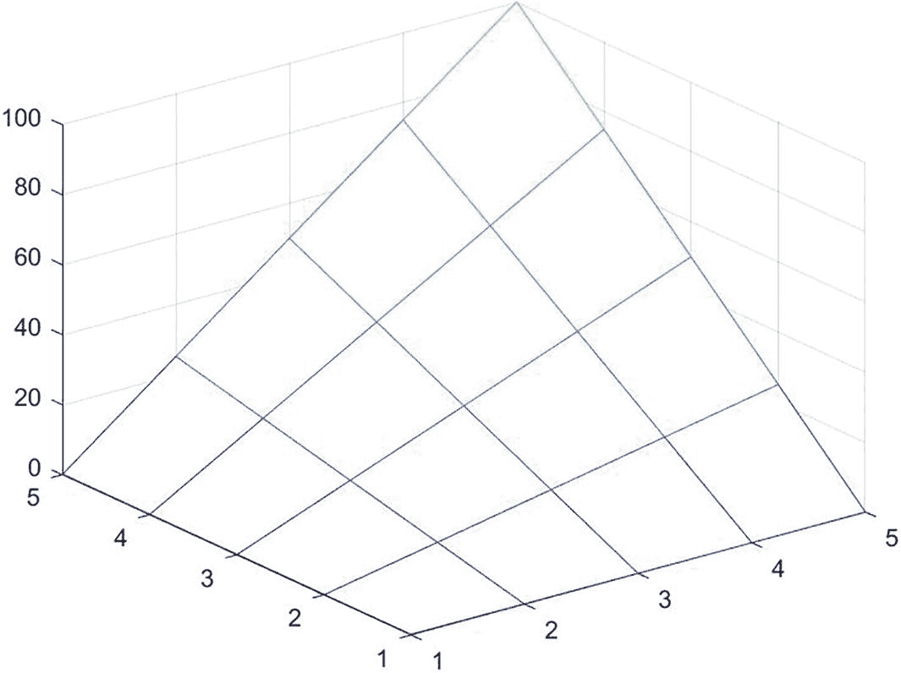
**图 8-7** 5×5 求解网格

```
u_1,1 = u(0.100000,0.100000): 4.000000
u_1,2 = u(0.100000,0.200000): 8.000000
u_2,1 = u(0.200000,0.100000): 8.000000
u_2,2 = u(0.200000,0.200000): 16.000000
u_3,3 = u(0.300000,0.300000): 36.000000
u_4,4 = u(0.400000,0.400000): 64.000000
u_5,5 = u(0.500000,0.500000): 100.000000
```

### 8.2.3 抛物型方程的数值解

考虑以下一维热方程：

`$$ \frac{\partial u}{\partial t}=a\frac{\partial²u}{\partial {x}²},a>0 $$`

这一偏微分方程最著名的应用、且改变了历史进程的，或许就是用于确定欧式期权价格的布莱克-舒尔斯方程。布莱克-舒尔斯方程催生了华尔街数万亿美元的衍生品业务。经过变量变换后，布莱克-舒尔斯方程可以写成以下形式：

`$$ \frac{\partial u}{\partial \tau }=\frac{\partial²u}{\partial {x}²} $$`

`τ` 是期权的到期时间，期权在 `τ` = 0 时到期。`x` 是期权所参考的标的股票的价格。初始条件（`E` 为期权的行权价）即为收益函数，如下所示：

`$$ u\left(0,x\right)=\max \left(x-E,0\right) $$`

边界条件表明，当股票变得一文不值时，该期权也同样如此。

`$$ u\left(\tau, 0\right)=0 $$`

当股价远高于行权价时，期权的表现就如同股票本身。

`$$ \underset{x\to \infty }{\lim }u\left(\tau, x\right)=x $$`

一种直接近似该偏微分方程的方法是：使用前向差分替换时间导数，并使用中心差分替换二阶导数。即：

`$$ \frac{u_j^{k+1}-{u}_j^k}{\Delta \tau }=\frac{u_{j+1}^k-2{u}_j^k+{u}_{j-1}^k}{{\left(\Delta x\right)}²} $$`

求解 `u_j^{k+1}`，我们得到（参见图 8-8）：

`$$ {u}_j^{k+1}=\alpha {u}_{j+1}^k+\left(1-2\alpha \right){u}_j^k+\alpha {u}_{j-1}^k $$`

`$$ \alpha =\frac{\Delta \tau }{{\left(\Delta x\right)}²} $$`

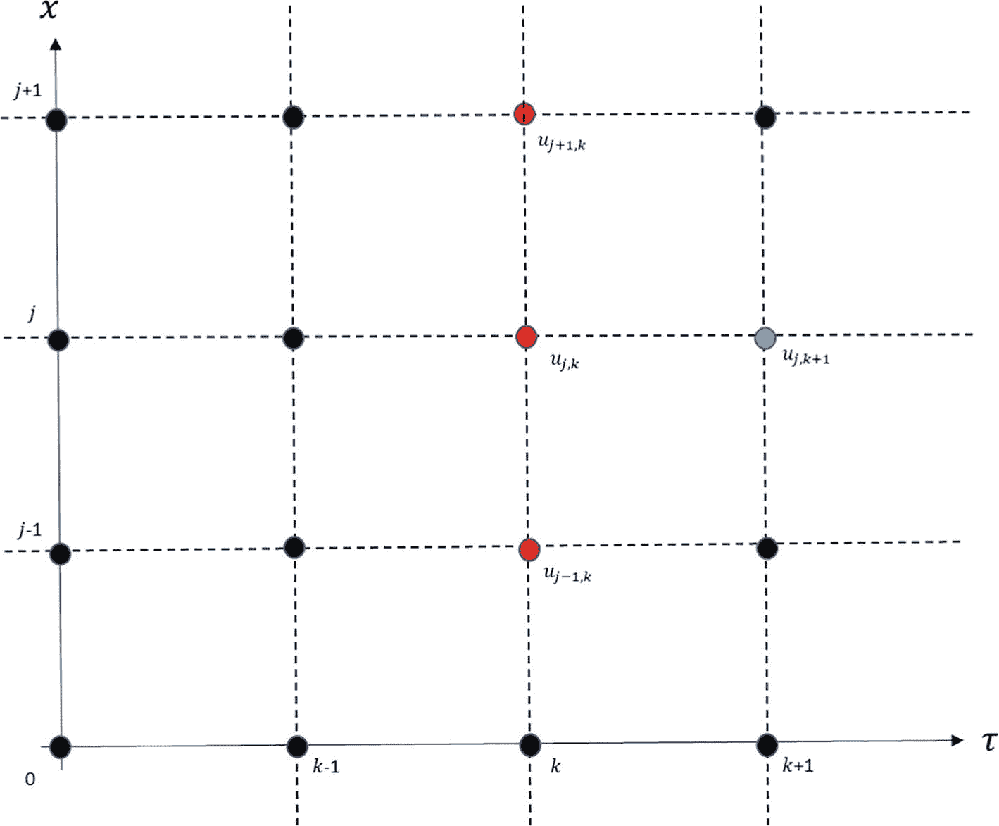
**图 8-8** 热方程的显式格式

这是一个显式公式，因为在时间步 `k` 时，我们已知所有 `j` 对应的 `u_j^k`。我们可以利用三个节点（红色）通过此公式显式地计算出 `u_j^{k+1}`（蓝色）。这种显式格式是条件稳定的。可以证明，仅当以下条件成立时它才是稳定的：

`$$ 0<\alpha \le \frac{1}{2} $$`

或者说，以下关系式成立：

`$$ 2\Delta \tau \le {\left(\Delta x\right)}² $$`

因此，如果我们想将 `x` 方向的节点数加倍，就需要将时间步长缩小为原来的四分之一。每个时间步的耗时是原来的两倍（因为 `x` 方向的节点数翻倍），而时间步的数量是原来的四倍。将 `x` 方向的节点数加倍，意味着求解时间会变为原来的八倍。

或者，我们可以使用后向差分来近似时间导数。差分方程的近似形式如下：

`$$ \frac{u_j^k-{u}_j^{k-1}}{\Delta \tau }=\frac{u_{j+1}^k-2{u}_j^k+{u}_{j-1}^k}{{\left(\Delta x\right)}²} $$`

将时间 `k` 的各项移到等号左侧并进行整理，我们得到（参见图 8-9）：

`$$ -\alpha {u}_{j-1}^k+\left(1+2\alpha \right){u}_j^k-\alpha {u}_{j+1}^k={u}_j^{k-1} $$`

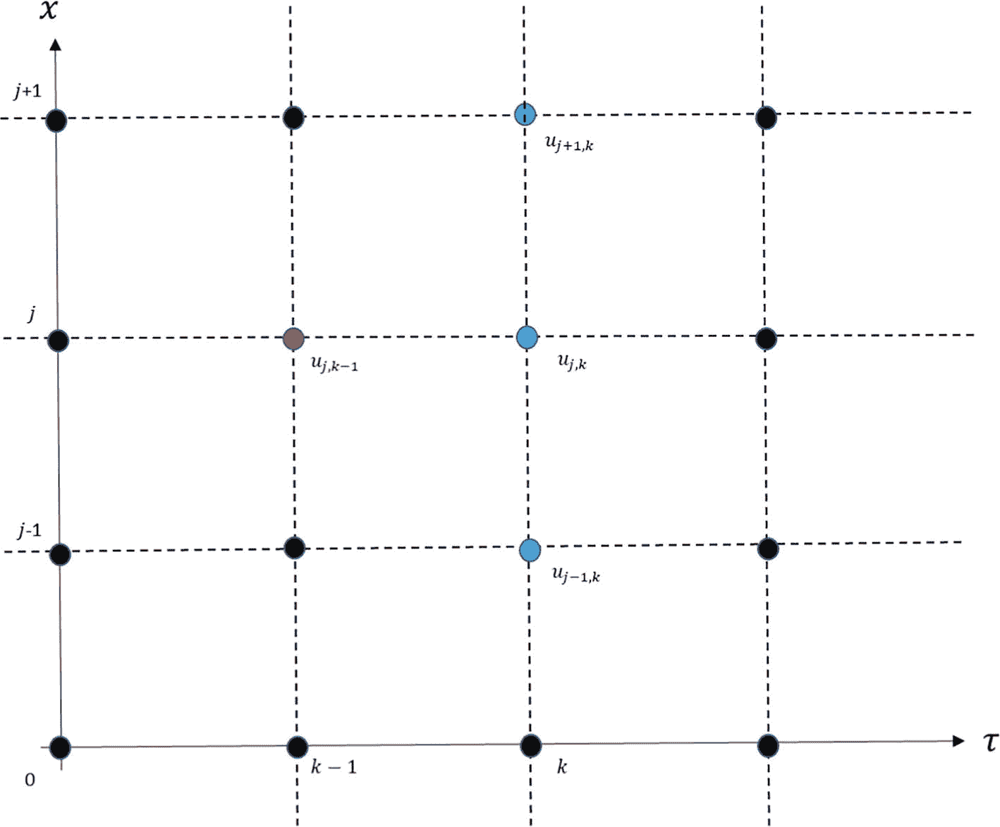
**图 8-9** 热方程的隐式格式

在下一个时间步长 `k` 处的（三个）值无法立即根据 `k` − 1 处的旧值计算得出。我们可以收集时间步长 `k` 和 `k` + 1 处的值，并将其写成线性方程组的形式。

`$$ \left[\begin{array}{ccccc}1+2\alpha & -\alpha & 0& \cdots & 0\\ {}-\alpha & 1+2\alpha & -\alpha & & 0\\ {}0& -\alpha & \ddots & \ddots & \\ {}\mathbf{\vdots}& & \ddots & \ddots & -\alpha \\ {}0& 0& & -\alpha & 1+2\alpha \end{array}\right]\kern0.5em \left[\begin{array}{c}{u}_{N^{-}+1}^k\\ {}\vdots \\ {}\begin{array}{c}{u}_0^k\\ {}\vdots \\ {}{u}_{N^{+}-1}^k\end{array}\end{array}\right] $$`

`$$ =\left[\begin{array}{c}{u}_{N^{-}+1}^{k-1}\\ {}\vdots \\ {}\begin{array}{c}{u}_0^{k-1}\\ {}\vdots \\ {}{u}_{N^{+}-1}^{k-1}\end{array}\end{array}\right]+\alpha \left[\begin{array}{c}{u}_{N^{-}}^k\\ {}0\\ {}\begin{array}{c}\vdots \\ {}0\\ {}{u}_{N^{+}}^k\end{array}\end{array}\right]=\left[\begin{array}{c}{b}_{N^{-}+1}^k\\ {}\vdots \\ {}\begin{array}{c}{b}_0^k\\ {}\vdots \\ {}{b}_{N^{+}-1}^k\end{array}\end{array}\right] $$`

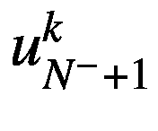、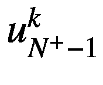、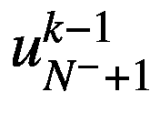、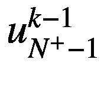、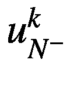 和 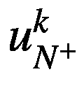 均来自边界条件。用矩阵形式可以写成：

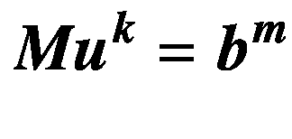

或者可以写成：

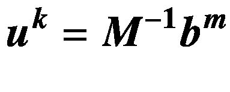

在实践中，我们几乎从不会计算逆矩阵，因为求逆矩阵的计算代价非常高昂，且容易产生舍入误差。通常使用计算量和存储量方面更高效的方法，例如 LU 分解、逐次超松弛法或高斯-赛德尔法。NM Dev 库已实现了所有这些方法。隐式有限差分算法是无条件稳定的。

克兰克-尼科尔森有限差分法在显式和隐式方法的基础上进一步改进，使其无条件稳定，且截断误差阶数为 *O*((∆*τ*)²)（而另外两种方法的截断误差阶数为 *O*(∆*τ*)）。克兰克-尼科尔森有限差分法取向前差分和向后差分近似的平均值。这两个方程的平均值如下：

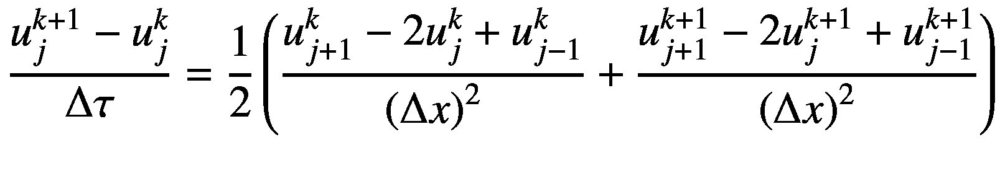

重新排列项，使时间步长 *k* + 1 的项在左边，时间步长 *k* 的项在右边，我们得到：

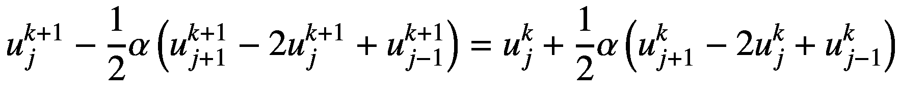

我们可以再次将这个线性方程组写成矩阵形式。

![$$ \left[\begin{array}{ccccc}1+\alpha &amp; -\frac{1}{2}\alpha &amp; 0&amp; \cdots &amp; 0\\ {}-\frac{1}{2}\alpha &amp; 1+\alpha &amp; -\frac{1}{2}\alpha &amp; &amp; 0\\ {}0&amp; -\frac{1}{2}\alpha &amp; \ddots &amp; \ddots &amp; \\ {}\mathbf{\vdots}&amp; &amp; \ddots &amp; \ddots &amp; -\frac{1}{2}\alpha \\ {}0&amp; 0&amp; &amp; -\frac{1}{2}\alpha &amp; 1+\alpha \end{array}\right]\kern0.5em \left[\begin{array}{c}{u}_{N^{-}+1}^{k+1}\\ {}\vdots \\ {}\begin{array}{c}{u}_0^{k+1}\\ {}\vdots \\ {}{u}_{N^{+}-1}^{k+1}\end{array}\end{array}\right] $$](images/500382_1_En_8_Chapter/500382_1_En_8_Chapter_TeX_Equbt.png)

![$$ =\left[\begin{array}{c}{Z}_{N^{-}+1}^k\\ {}\vdots \\ {}\begin{array}{c}{Z}_0^k\\ {}\vdots \\ {}{Z}_{N^{+}-1}^k\end{array}\end{array}\right]+\frac{1}{2}\alpha \left[\begin{array}{c}{u}_{N^{-}}^{k+1}\\ {}0\\ {}\begin{array}{c}\vdots \\ {}0\\ {}{u}_{N^{+}}^{k+1}\end{array}\end{array}\right] $$](images/500382_1_En_8_Chapter/500382_1_En_8_Chapter_TeX_Equbu.png)

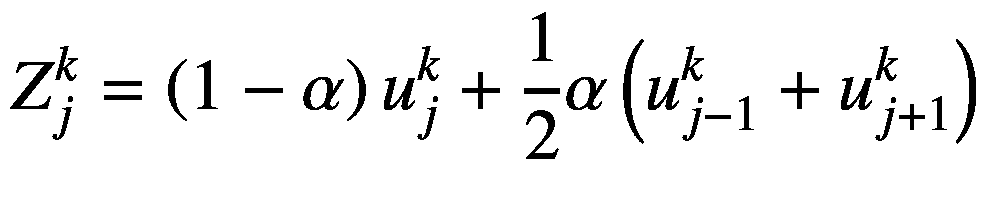

然后可以通过 SOR（NM Dev 中的默认方法）求解该系统。

例如，以下 NM Dev 代码使用克兰克-尼科尔森方法在区域 [0, 6000] × [0, 1] 上求解此热方程：

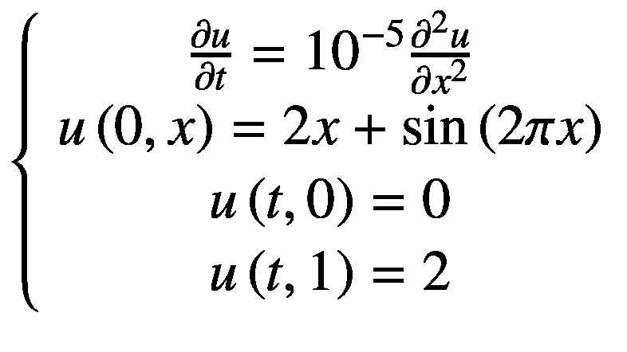

## 一维热方程求解示例

### 代码示例

以下代码创建并求解一个一维热方程问题。

```java
HeatEquation1D pde = new HeatEquation1D(
1e-5, // 热方程系数
1., 6000., // 求解域边界
new AbstractUnivariateRealFunction() {
@Override
public double evaluate(double x) {
return 2.0 * x + sin(2.0 * PI * x); // 初始条件
}
},
0., new AbstractUnivariateRealFunction() {
@Override
public double evaluate(double t) {
return 0.; // 在 x = 0 处的边界条件
}
},
0., new AbstractUnivariateRealFunction() {
@Override
public double evaluate(double t) {
return 2.; // 在 x = 6000 处的边界条件
}
});
// c_k 对于狄利克雷边界条件为 0
int m = 50;
int n = 39;
PDESolutionTimeSpaceGrid1D soln
= new CrankNicolsonHeatEquation1D().solve(pde, m, n);
int t = 0;
int x = 1;
System.out.println(String.format("u(%d,%d) = %f", t, x, soln.u(t, x)));
t = 0;
x = 16;
System.out.println(String.format("u(%d,%d) = %f", t, x, soln.u(t, x)));
t = 0;
x = 31;
System.out.println(String.format("u(%d,%d) = %f", t, x, soln.u(t, x)));
t = 15;
x = 1;
System.out.println(String.format("u(%d,%d) = %f", t, x, soln.u(t, x)));
t = 15;
x = 16;
System.out.println(String.format("u(%d,%d) = %f", t, x, soln.u(t, x)));
t = 15;
x = 31;
System.out.println(String.format("u(%d,%d) = %f", t, x, soln.u(t, x)));
t = 30;
x = 1;
System.out.println(String.format("u(%d,%d) = %f", t, x, soln.u(t, x)));
t = 30;
x = 16;
System.out.println(String.format("u(%d,%d) = %f", t, x, soln.u(t, x)));
t = 30;
x = 31;
System.out.println(String.format("u(%d,%d) = %f", t, x, soln.u(t, x)));
t = 45;
x = 1;
System.out.println(String.format("u(%d,%d) = %f", t, x, soln.u(t, x)));
t = 45;
x = 16;
System.out.println(String.format("u(%d,%d) = %f", t, x, soln.u(t, x)));
t = 45;
x = 31;
System.out.println(String.format("u(%d,%d) = %f", t, x, soln.u(t, x)));
```

上述代码的输出结果如下：

```
u(0,1) = 0.206434
u(0,16) = 1.387785
u(0,31) = 0.562312
u(15,1) = 0.126965
u(15,16) = 1.089188
u(15,31) = 1.064061
u(30,1) = 0.087867
u(30,16) = 0.942280
u(30,31) = 1.310920
u(45,1) = 0.068630
u(45,16) = 0.870001
u(45,31) = 1.432373
```

### 一维热方程相关类

类`HeatEquation1D`构造一个热方程问题。其签名如下：

```java
/**
 * 构造一个热方程问题。
 *
 * @param beta 方程中的 beta
 * @param a    感兴趣的区域 (0, a)
 * @param T    感兴趣的时间段 (0, T)
 * @param f    u 的初始条件，即 u(0,x)
 * @param c1   混合边界条件在 x=0 处的系数
 * @param g1   在 x=0 处的混合边界条件
 * @param c2   混合边界条件在 x=a 处的系数
 * @param g2   在 x=a 处的混合边界条件
 */
public HeatEquation1D(
    double beta,
    double a,
    double T,
    UnivariateRealFunction f,
    double c1,
    UnivariateRealFunction g1,
    double c2,
    UnivariateRealFunction g2)
```

类`CrankNicolsonHeatEquation1D`使用 Crank-Nicolson 有限差分算法求解一维热方程。其签名如下：

```java
/**
 * 求解给定的一维热方程。
 *
 * @param pde PDE 问题
 * @param M   时间轴上的网格点数量（不包括初始条件）
 * @param N   空间轴上的网格点数量（不包括两个边界）
 * @return 网格点上的解 u(t,x)
 */
public PDESolutionTimeSpaceGrid1D solve(
    final HeatEquation1D pde,
    final int M,
    final int N
)
```

## 二维热方程求解

此外，NM Dev 库支持求解二维热方程。其形式如下：

$$ \frac{\partial u}{\partial t}=\beta \left(\frac{\partial²u}{\partial {x}²}+\frac{\partial²u}{\partial {y}²}\right) $$

初始条件如下：

$$ u\left(0,x,y\right)=f\left(x,y\right) $$

边界条件如下：

$$ u\left(t,x,y\right)=g\left(t,x,y\right) $$

其中，(*x*, *y*) ∈ *δR*，*δR* 是表面 *R* 的边界。

### 二维热方程相关类

NM Dev 类`HeatEquation2D`构造这样一个对象。其签名如下：

```java
/**
 * 构造一个二维热方程问题。
 *
 * @param beta 方程中的 beta
 * @param T    感兴趣的时间段 (0, T)
 * @param a    x 轴方向区域的大小，x ∈ (0, a)
 * @param b    y 轴方向区域的大小，y ∈ (0, b)
 * @param f    u 的初始条件，即 u(0,x,y)
 * @param g    在 x=0, a 和 y=0, b 处的边界条件
 */
public HeatEquation2D(
    double beta,
    double T,
    double a,
    double b,
    BivariateRealFunction f,
    TrivariateRealFunction g
)
```

NM Dev 类`AlternatingDirectionImplicitMethod`使用交替方向隐式（ADI）方法求解二维热方程。ADI 方法背后的思想是将有限差分方程拆分为两个，一个隐式处理 *x* 导数，另一个隐式处理 *y* 导数。这允许在每一步通过 LU 分解求解对称的三对角线性方程组。解是在三维网格（时间以及 *x* 和 *y* 坐标）上计算的。ADI 是一种隐式方法，并且是无条件稳定的；它是一种二阶方法，截断误差阶为 *O*(∆*t*² + ∆*x*² + ∆*y*²)。

以下代码求解此示例 PDE 问题。

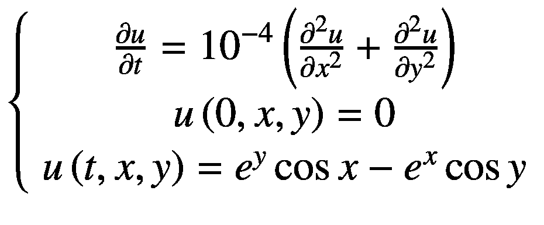

```
// 求解域
final double a = 4.0, b = 4.0;
// 时间域
final double T = 5000;
// 热方程系数
final double beta = 1e-4;
// 初始条件
final BivariateRealFunction f
    = new AbstractBivariateRealFunction() {
        @Override
        public double evaluate(double x1, double x2) {
            return 0.;
        }
    };
// 边界条件
final TrivariateRealFunction g
    = new AbstractTrivariateRealFunction() {
        @Override
        public double evaluate(double t, double x, double y) {
            return exp(y) * cos(x) - exp(x) * cos(y);
        }
    };
final HeatEquation2D PDE = new HeatEquation2D(beta, T, a, b, f, g);
AlternatingDirectionImplicitMethod adi
    = new AlternatingDirectionImplicitMethod(1e-5);
PDESolutionTimeSpaceGrid2D soln = adi.solve(PDE, 50, 39, 39);

int t = 50;
int x = 1;
int y = 1;
System.out.println(String.format("u(%d,%d,%d) = %f", t, x, y, soln.u(t, x, y)));

t = 50;
x = 1;
y = 16;
System.out.println(String.format("u(%d,%d,%d) = %f", t, x, y, soln.u(t, x, y)));

t = 50;
x = 1;
y = 31;
System.out.println(String.format("u(%d,%d,%d) = %f", t, x, y, soln.u(t, x, y)));

t = 50;
x = 16;
y = 1;
System.out.println(String.format("u(%d,%d,%d) = %f", t, x, y, soln.u(t, x, y)));

t = 50;
x = 16;
y = 16;
System.out.println(String.format("u(%d,%d,%d) = %f", t, x, y, soln.u(t, x, y)));

t = 50;
x = 16;
y = 31;
System.out.println(String.format("u(%d,%d,%d) = %f", t, x, y, soln.u(t, x, y)));

t = 50;
x = 31;
y = 1;
System.out.println(String.format("u(%d,%d,%d) = %f", t, x, y, soln.u(t, x, y)));

t = 50;
x = 31;
y = 16;
System.out.println(String.format("u(%d,%d,%d) = %f", t, x, y, soln.u(t, x, y)));

t = 50;
x = 31;
y = 31;
System.out.println(String.format("u(%d,%d,%d) = %f", t, x, y, soln.u(t, x, y)));
```

输出如下：

```
u(50,1,1) = -0.000000
u(50,1,16) = 4.771024
u(50,1,31) = 22.814937
u(50,16,1) = -4.771024
u(50,16,16) = -0.000000
u(50,16,31) = 2.415165
u(50,31,1) = -22.814937
u(50,31,16) = -2.415165
u(50,31,31) = -0.000000
```

类`AlternatingDirectionImplicitMethod`的签名如下：

```java
/**
 * 使用给定的精度参数构造 ADI 方法。默认情况下，使用多核并行计算以获得更高性能。
 *
 * @param epsilon 精度参数
 */
public AlternatingDirectionImplicitMethod(double epsilon)

/**
 * 求解给定的二维热方程问题，使用网格中三个轴（时间、x 和 y）上给定的点数。
 *
 * @param pde 热方程问题
 * @param m   时间轴上的网格点数量（不包括初始条件）
 * @param n   x 轴上的网格点数量（不包括边界）
 * @param p   y 轴上的网格点数量（不包括边界）
 * @return 解网格
 */
public PDESolutionTimeSpaceGrid2D solve(
    HeatEquation2D pde,
    final int m,
    final int n,
    final int p
)
```

脚注 1