# 9. 无约束优化

无约束优化是指在不限制变量取值的情况下，寻找使目标函数最小化或最大化的一个变量（或一组变量）。数学上可表述为：找到 `x`^∗ 使得函数 `f(x`^∗`)` 取最小值。

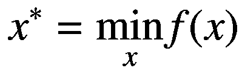

`x` 可以是标量（在 `ℝ`¹ 中）或向量（在 `ℝ`^`n` 中）。`f(x)` 始终为标量（在 `ℝ`¹ 中）。无约束优化在众多科学分支中都有应用。在金融领域，构建收益率曲线需要找到一组参数，以最小化债券理论价格与市场价格之间的差异。有约束优化问题也可以通过将其约束条件转换为等效无约束优化问题目标函数中的惩罚项，从而转化为无约束优化问题。此外，许多有约束优化求解器或算法都将求解无约束优化问题作为子问题。NM Dev 提供了一套优化器或最小化器，用于求解无约束优化问题，涵盖单变量和多变量问题，并且支持有无导数信息的情况。我们的实现及相应讨论主要基于 Antoniou & Lu (2007)。

## 9.1 暴力搜索

最简单且可能最容易理解的求解器是暴力搜索。即，我们只需遍历函数定义域内所有可能的 `x` 值，枚举所有可能的 `f(x)` 值。然后选择对应于最小 `f(x)` 的那个 `x` 值。可能存在多个解。然而，这种方法很少使用，因为它不切实际。一个要求是定义域必须是可枚举的。大多数实际优化问题都是在连续定义域（如实数域）上求解的。我们无法枚举无穷多个数。解决此问题的一种方法是离散化。我们从无限定义域中选取有限个点。例如，我们可以将单位区间 [0, 1] 离散化为 11 个离散值：0, 0.1, 0.2, …, 1.0。离散化最明显的缺点是，当所选点不包含最优答案时，我们很可能会得到一个次优解。事实上，如果定义域无界（如 (−∞, +∞)），如何选取包含解的点集并不明确。此外，除了极小规模的问题，其性能非常缓慢。假设我们要求解 10 个变量，那么问题的维度是 `n`¹⁰，其中 `n` 是为每个维度选择的离散点数量。问题的复杂度呈指数级增长。尽管如此，暴力搜索易于理解。因此我们首先从它开始。

以下 NM Dev 代码展示了一般情况下如何使用该库求解优化问题。假设我们要最小化函数 `f(x) = x`² − 4。

```
// 使用目标函数定义优化问题
OptimProblem problem = new OptimProblem() {
@Override
public int dimension() {
return 1;
}
@Override
public RealScalarFunction f() {
return new RealScalarFunction() {
// 目标函数
@Override
public Double evaluate(Vector v) {
double x = v.get(1);
Polynomial polynomial = new Polynomial(1, 0, -4); // f(x) = x² - 4
double fx = polynomial.evaluate(x);
return fx;
}
@Override
public int dimensionOfDomain() {
return 1;
}
@Override
public int dimensionOfRange() {
return 1;
}
};
}
};
// 设置要使用的求解器和解对象
DoubleBruteForceMinimizer solver = new DoubleBruteForceMinimizer(true);
BruteForceMinimizer.Solution soln = solver.solve(problem);
// 对于暴力搜索，我们需要显式枚举定义域中的值
List domain = new ArrayList();
domain.add(new DenseVector(-2.));
domain.add(new DenseVector(-1.));
domain.add(new DenseVector(0.)); // 最小值点
domain.add(new DenseVector(1.));
domain.add(new DenseVector(2.));
soln.setDomain(domain);
System.out.println(String.format("f(%s) = %f", soln.minimizer(), soln.min()));
```

输出结果如下：

```
f([0.000000] ) = -4.000000
```

在 NM Dev 中使用求解器解决优化问题需要以下几个步骤。

1. 通过实现 `OptimProblem` 接口来定义优化问题。我们在实现中给出目标函数。
2. 构造一个求解器，例如 `DoubleBruteForceMinimizer`。
3. 调用 `solve` 函数，使用优化问题从求解器构建一个 `Solution` 对象。换句话说，求解器对象是一个工厂，它为优化问题 `OptimProblem` 创建解 `Solution`。虽然求解器可以复用于其他问题，但一个解只对应一个问题。
4. 向 `Solution` 对象提供任何与问题相关的信息。在此处的暴力搜索案例中，我们需要提供一个待搜索的候选值列表。
5. 调用 `minimizer` 函数运行算法，计算最小值点 `x`^∗，或调用 `min` 函数返回函数 `f(x`^∗`)` 的最小值。

上述流程适用于 NM Dev 库中的所有求解器。所有 NM 求解器都执行最小化。要进行最大化，我们只需将目标函数乘以 -1 来取反。一般来说，`OptimProblem`、求解器和 `Solution` 的签名如下：

```java
public interface OptimProblem {
 /**
 * 获取变量的数量。
 *
 * @return 变量的数量。
 */
 public int dimension();
 /**
 * 获取目标函数。
 *
 * @return 目标函数
 */
 public RealScalarFunction f();
}
public interface MultivariateMinimizer> extends Minimizer {
 /**
 * 求解一个优化问题，例如 {@link OptimProblem}。
 *
 * @param problem 一个优化问题
 * @return 优化问题的解
 * @throws Exception 求解问题时出错
 */
 public S solve(P problem) throws Exception;
}
public interface MinimizationSolution {
 /**
 * 获取找到的（近似）最小值。
 *
 * @return 找到的（近似）最小值
 */
 public double minimum();
 /**
 * 获取最小化问题的最优解（解向量）。
 *
 * @return 最优解
 */
 public T minimizer();
}
```

`DoubleBruteForceMinimizer` 的签名如下：

```java
public DoubleBruteForceMinimizer(boolean isParallel);
@Override
public BruteForceMinimizer.Solution solve(OptimProblem problem) throws Exception
```

当 `isParallel` 标志设置为 `true` 时，代码将使用多线程并行执行搜索，在所有可用线程上搜索所有提供的域值。

暴力搜索可用于求解单变量优化问题（如前面的示例），也可用于求解多变量优化问题。以下是求解 *f*(*x*, *y*) = *x*² + *y*² 的示例。

```markdown
## 9.2 `C2OptimProblem`

对于大多数情况，`OptimProblem` 类设置起来有些困难，使用也不方便。C⁰ 函数是连续函数。C¹ 函数是光滑函数。C² 函数是连续、光滑且具有二阶导数的函数。它也被称为二阶可微函数。如果我们要优化这样的函数，`C2OptimProblemImpl` 提供了一个便捷的包装器来创建 `OptimProblem` 对象。其签名如下：

```java
/**
 * 构造一个具有目标函数的优化问题。
 * 如果需要，会使用数值梯度和数值海森矩阵。
 *
 * @param f 要最小化的目标函数
 */
public C2OptimProblemImpl(RealScalarFunction f)
```

我们可以使用大大简化的代码重写前面的示例。

对于单变量函数 `f(x) = x² - 4`，代码是这样的：

```java
// 设置要使用的求解器和解
DoubleBruteForceMinimizer solver = new DoubleBruteForceMinimizer(false);
BruteForceMinimizer.Solution soln
 = solver.solve(new C2OptimProblemImpl(new Polynomial(1, 0, -4))); // f(x) = x² - 4
// 对于暴力搜索，我们需要显式枚举域中的值
List domain = new ArrayList();
domain.add(new DenseVector(-2.));
domain.add(new DenseVector(-1.));
domain.add(new DenseVector(0.)); // 最优解
domain.add(new DenseVector(1.));
domain.add(new DenseVector(2.));
soln.setDomain(domain);
System.out.println(String.format("f(%s) = %f", soln.minimizer(), soln.min()));
```

输出如下：

```
f([0.000000] ) = -4.000000
```

对于多变量函数 `f(x, y) = x² + y²`，代码是这样的：

```java
DoubleBruteForceMinimizer bf = new DoubleBruteForceMinimizer(true);
BruteForceMinimizer.Solution soln = bf.solve(
 new C2OptimProblemImpl(
 new AbstractBivariateRealFunction() {
 @Override
 public double evaluate(double x, double y) {
 double fx = x * x + y * y;
 return fx;
 }
 }));
List domain = new ArrayList();
domain.add(new DenseVector(-2., -2.));
domain.add(new DenseVector(-1., -1.));
domain.add(new DenseVector(0., 0.)); // 最优解
domain.add(new DenseVector(1., 1.));
domain.add(new DenseVector(2., 2.));
soln.setDomain(domain);
System.out.println(String.format("f(%s) = %f", soln.minimizer(), soln.min()));
```

输出如下：

```
f([0.000000, 0.000000] ) = 0.000000
```

## 9.3 括号法

单变量方法用于求解单变量无约束优化问题。一个快速的单变量方法在优化中至关重要。多变量约束优化问题通常可以转化为等价的多变量无约束优化问题。求解多变量无约束优化问题通常涉及求解多个单变量无约束优化问题，例如线搜索。后续章节中讨论的许多多变量无约束优化算法都使用了线搜索。

一种最简单的单变量算法是括号搜索法。假设我们有一个包含极小值点的三点括号区间 `x[L] < x[a] < x[U]`，并且假设区间 `[x[L], x[U]]` 包含一个极小值点。我们根据某种区间划分方案计算第四个点 `x[b]`，从而形成两个重叠的子区间：`[x[L], x[a]]` 和 `[x[b], x[U]]`。选择包含新极小值点的那个更小子区间。重复此划分过程，直到收敛，即当所选子区间足够小时停止。该算法对于区间 `[x[L], x[U]]` 上的单峰函数最为有效。单峰函数是指从 `x[L]` 开始递增（或递减）直到某一点，然后向 `x[U]` 方向递减（递增）的函数。该函数在区间内恰好包含一个极小值点（或极大值点）。

考虑一个在区间 `[x[L], x[U]]` 内存在极小值点的单峰函数。该区间称为不确定区间。利用四个点 `f(x[L])`、`f(x[a])`、`f(x[b])` 和 `f(x[U])` 的函数值，我们能够确定这个极小值点的位置。二分法搜索指出：如果 `f(x[a]) < f(x[b])`，则 `x*` 位于区间 `x[L] < x* < x[b]` 内。这里存在两种可能性：要么 `x[L] < x* < x[b]`（如蓝色曲线所示），要么 `x[a] < x* < x[b]`（如橙色曲线所示）。综合这两种情况可得 `x[L] < x* < x[b]`。见图 9-1。

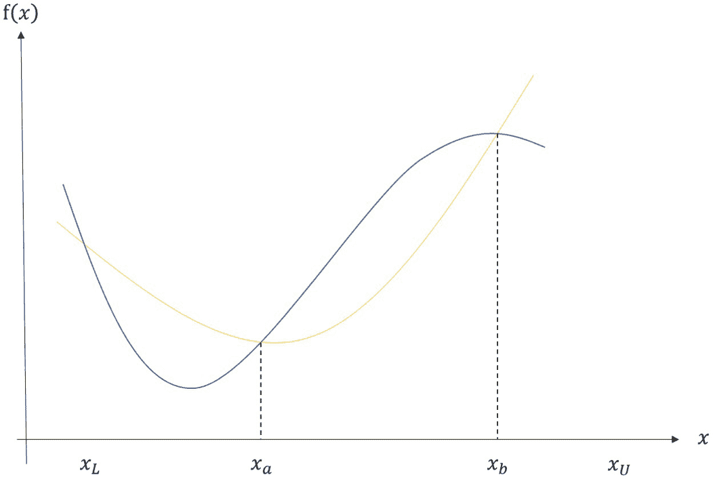

图 9-1

`x*` 在左侧区间

类似地，如果 `f(x[a]) > f(x[b])`，则我们有 `x[a] < x* < x[U]`，如图 9-2 所示。

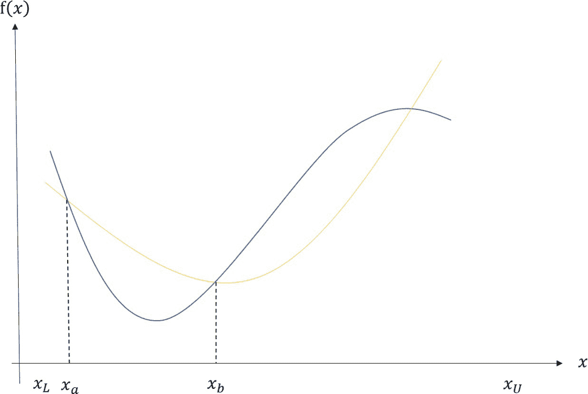

图 9-2

`x*` 在右侧区间

如果 `f(x[a]) = f(x[b])`，则我们有 `x[a] < x* < x[b]`。见图 9-3。

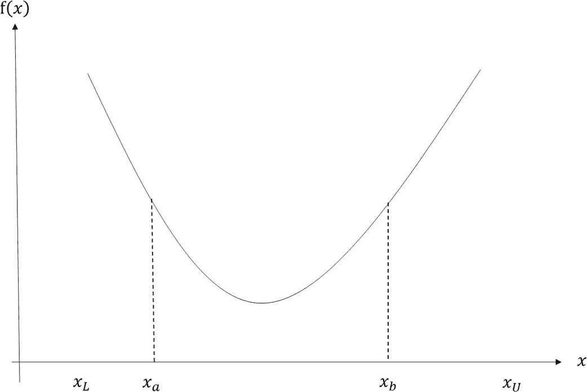

图 9-3

`x[a] < x* < x[b]`
```

一种简单的二分法搜索可以每次将区间大致二等分。这些（子）区间的大小呈指数级减小（每次迭代减半）。大约经过七次迭代后，区间大小将缩小到初始区间的 1% 以下。每次迭代需要计算两次函数值 `f(x[a])` 和 `f(x[b])`，因此总共需要进行 14 次函数评估。`NM Dev` 实现了两种更复杂的区间划分方案。

### 9.3.1 斐波那契搜索法

我们先对区间大小进行分析。为简单起见，假设左右子区间的长度相等。见图 9-4。

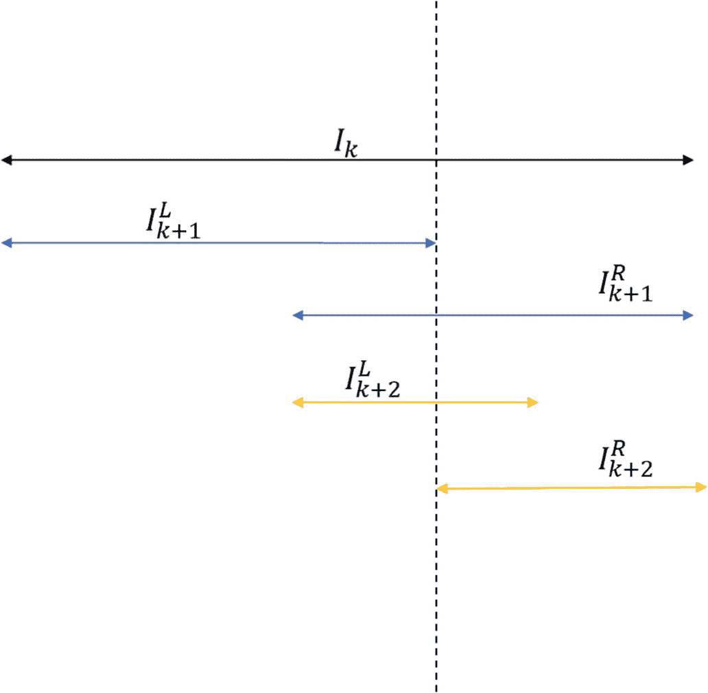

图 9-4

第 k、k+1、k+2 次迭代中的子区间

我们有以下关系：

```
I_{k+1} = I_{k+1}^L = I_{k+1}^R
```

```
I_k = I_{k+1}^L + I_{k+2}^R = I_{k+1} + I_{k+2}
```

对于 `n` 次迭代，我们有如下的递推关系：

```
I_1 = I_2 + I_3
```

```
I_2 = I_3 + I_4
```

```
...
```

```
I_n = I_{n+1} + I_{n+2}
```

这里有 `n` 个方程，假设 `I[1]` 已知。未知变量共有 `n + 2` 个。我们可以施加一个额外的条件来生成一系列区间。

特别地，如果我们假设最后一次迭代中的区间消失（即 `I[n + 2] = 0`），则会生成斐波那契数列。

求解上述方程组可得：

```
I_{n+1} = F_0 I_n
```

```
I_n = F_0 I_n
```

```
I_k = F_{n-k+1} I_n
```

```
I_1 = F_n I_n
```

其中

```
F_k = F_{k-1} + F_{k-2}, k >= 2
```

`F[k]` 是斐波那契数列的定义，即 {1, 1, 2, 3, 5, 8, 13, ...}。

例如，如果 `n = 11`，则 `F[n] = 144`。`I[n] = I[1] / F[n]`。`I[n]` 减小到 `I[1]` 的 0.69%。此外，通过选择左侧或右侧子区间，我们已有两个端点和一个位于其间的点，即 `{x[L], x[a], x[b]}` 或 `{x[a], x[b], x[U]}`。因此我们只需要再增加一个点，从而只需计算一次函数值。对于 11 次迭代，总共需要进行 14 次计算，而相比之下，简单的二分法搜索需要 22 次计算。

使用斐波那契数列的一个主要缺点是它需要预先知道 `n` 的值。如果希望 `x*` 达到某个预设精度，这是可行的。我们利用 `I[n] = I[1] / F[n]` 来确定 `n`。然而，如果希望 `f(x*)` 达到某个精度，我们事先无法知道 `n` 应该是多少。

### 9.3.2 黄金分割搜索

与斐波那契分割法不同，黄金分割搜索会持续迭代直至达到函数精度。其递推关系与斐波那契方法相同：`I[k] = I[k - 1] + I[k - 2]`。附加条件是保持两个相邻区间的比率恒定。

`I_k / I_{k+1} = K, ∀k`

利用这两个方程，我们可以解出`K`，如下所示：

`K² = K + 1`

`K = (1 + √5) / 2 ≈ 1.618034`

这个数被称为黄金比例。区间序列如下所示：

`{I_1, I_1/K, I_1/K², ..., I_1/K^(n-1)}`

这里给出一个例子：`{100, 61.8, 38.2, 23.6, 14.6, 9, …}`。这个过程可以继续进行，无需预先设定`n`。

我们可以比较黄金分割搜索与斐波那契搜索的效率。`F[n]`和`K`之间的关系是`F_n ≈ K^(n+1) / √5`。斐波那契搜索的不确定区间如下：

`Λ_F = I_n = I_1 / F_n ≈ (√5 / K^(n+1)) * I_1`

对于黄金分割搜索，其不确定区间如下：

`Λ_G = I_n = I_1 / K^(n+1)`

因此，我们得到以下关系：

`Λ_G / Λ_F = K² / √5 = 1.17`

所以，要达到与斐波那契搜索相同的精度，黄金分割搜索需要更多的迭代次数。斐波那契搜索效率更高，但黄金分割搜索无需预先知道`n`的值。

### 9.3.3 Brent 搜索

黄金分割搜索具有线性收敛速度。我们接下来要讨论的抛物线搜索的收敛速度为 1.325，因此效率更高。在每个包围区间内，我们再次选择三个点：`x[L] < x[m] < x[U]`。我们用一个二次多项式（即抛物线）来近似该区间内的函数。

`p(x) = a_0 + a_1*x + a_2*x²`

利用这三个点，我们可以通过求解一个包含三个线性方程的方程组来确定多项式的系数。`p(x)`的最小值点`x̄`可以通过求解其一阶导数为零轻松得到。

`x̄ = -a_1 / (2*a_2)`

根据泰勒展开式，`x̄`将足够接近`x∗`；事实上，如果函数是二次的，它将是精确的。通过检查`x̄`，我们可以拒绝`x[L]`或`x[U]`并保留`x̄`，从而选择一个新的区间。重复此过程，直到所有三个点都足够接近（`x∗`）。参见图 9-5。

图 9-5：曲线段的抛物线近似

虽然抛物线搜索具有超线性收敛速度，但它并不总是收敛（即使是对局部最小值也是如此）。例如，如果三个点共线，得到的抛物线是退化的，因此无法提供新的候选点。因此，这种方法很少单独使用。

`Brent` 方法结合了抛物线搜索和黄金分割搜索。`Brent` 方法在适用时（例如，没有两个点相同）使用抛物线搜索。当条件不满足时，它会切换回使用黄金分割搜索。换句话说，`Brent` 方法结合了两者的优点：超线性收敛速度和保证找到最小值。因此，在实践中，我们几乎总是默认使用 `Brent` 搜索来进行单变量优化。参见图 9-6。

图 9-6：对数伽马函数

以下 `NM Dev` 代码使用斐波那契搜索、黄金分割搜索和 `Brent` 搜索来求解对数伽马函数：

```
LogGamma logGamma = new LogGamma(); // 对数伽马函数
BracketSearchMinimizer solver1 = new FibonaccMinimizer(1e-8, 15);
UnivariateMinimizer.Solution soln1 = solver1.solve(logGamma);
double x_min_1 = soln1.search(0, 5);
System.out.println(String.format("f(%f) = %f", x_min_1, logGamma.evaluate(x_min_1)));
BracketSearchMinimizer solver2 = new GoldenMinimizer(1e-8, 15);
UnivariateMinimizer.Solution soln2 = solver2.solve(logGamma);
double x_min_2 = soln2.search(0, 5);
System.out.println(String.format("f(%f) = %f", x_min_2, logGamma.evaluate(x_min_2)));
BracketSearchMinimizer solver3 = new BrentMinimizer(1e-8, 10);
UnivariateMinimizer.Solution soln3 = solver3.solve(logGamma);
double x_min_3 = soln3.search(0, 5);
System.out.println(String.format("f(%f) = %f", x_min_3, logGamma.evaluate(x_min_3)));
```

输出如下：

```
f(1.463682) = -0.121484
f(1.460813) = -0.121486
f(1.461632) = -0.121486
```

它们的构造函数签名如下：

```markdown
/**
 * 使用斐波那契方法构造一个单变量极小化器。
 *
 * @param epsilon 精度参数：当一个数 |x| ≤ ε 时，视为 0
 * @param maxIterations 最大迭代次数
 */
public FibonaccMinimizer(double epsilon, int maxIterations)

/**
 * 使用黄金分割方法构造一个单变量极小化器。
 *
 * @param epsilon 精度参数：当一个数 |x| ≤ ε 时，视为 0
 * @param maxIterations 最大迭代次数
 */
public GoldenMinimizer(double epsilon, int maxIterations)

/**
 * 使用 Brent 算法构造一个单变量极小化器。
 *
 * @param epsilon 精度参数：当一个数 |x| ≤ ε 时，视为 0
 * @param maxIterations 最大迭代次数
 */
public BrentMinimizer(double epsilon, int maxIterations)

/**
 * 单变量极小化问题的解。
 */
public static interface Solution extends MinimizationSolution {
    /**
     * 在区间 [lower, upper] 内搜索最小值。
     *
     * @param lower 包含最小值的包围区间的下界
     * @param initial 初始猜测值
     * @param upper 包含最小值的包围区间的上界
     * @return 近似的极小点
     */
    public double search(double lower, double initial, double upper);

    /**
     * 在区间 [lower, upper] 内搜索最小值。
     *
     * @param lower 包含最小值的包围区间的下界
     * @param upper 包含最小值的包围区间的上界
     * @return 近似的极小点
     */
    public double search(double lower, double upper);
}

我们调用 `search` 方法来寻找单变量函数极小化问题的一个极小点。

## 9.4 最速下降法

寻找最小值的通用思路通常从一个初始点开始，然后调整某些参数来找到下一个（希望是）函数值更小的点。如果没有信息，盲目搜索的效率会很低。有两类信息非常有用：梯度 `g` 和海森矩阵 `H`。

最速下降算法是一类利用梯度和海森矩阵信息，沿着能使函数值下降最快的方向进行搜索的算法。我们首先讨论仅使用梯度信息的一阶方法。考虑以下优化问题：

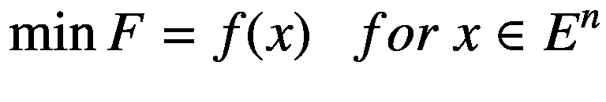

泰勒展开给出以下结果：

当 ∥`δ`∥ → 0 时，`F` + `ΔF` = `f(x + δ)` ≈ `f(x)` + `g^T δ` + `O(δ^T δ)`， `ΔF` ≈ `g^T δ`

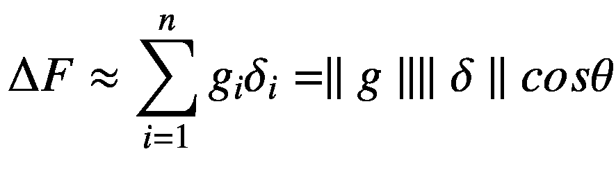

对于任意向量 `δ`，当 `θ = 0` 时 `ΔF` 最大，这意味着 `δ` 与 `g` 方向相同。当 `θ = π` 时 `ΔF` 最小，这意味着 `δ` 与 `g` 方向相反，或沿着 `-g` 方向。它们分别被称为最速上升方向和最速下降方向，如图 9-7 所示。

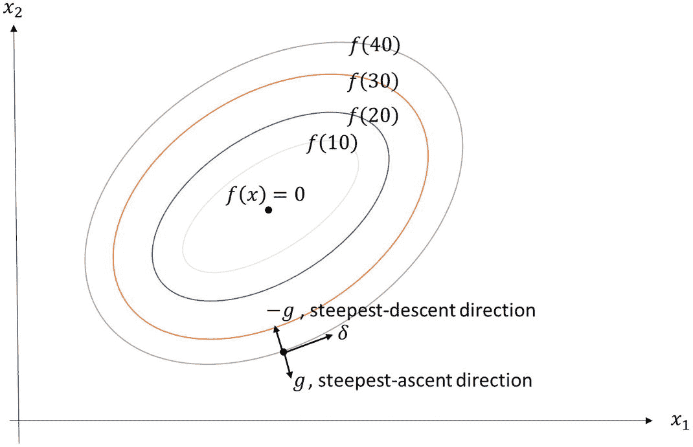
**图 9-7** 最速下降方向与最速上升方向

最速下降算法的一般框架如下：

1.  指定一个初始点 `x[0]` 和容差 `ε`。
2.  计算梯度 `g[k]`，并设置牛顿方向向量 `d[k] = -g[k]`。
3.  关于 `α` 最小化 `f(x[k] + α d[k])`，以计算增量 `α[k]`。
4.  设置下一个点 `x[k+1] = x[k] + α[k] d[k]`，并计算下一个函数值 `f[k+1] = f(x[k+1])`。
5.  如果 ∥`α[k] d[k]`∥ < `ε`，则：
    1.  完成。`x(*) = x[k+1]` 且 `f(x(*)) = f[k+1]`。
    2.  否则，重复步骤 2。

在步骤 3 中，可以使用单变量优化算法中的线搜索来计算 `α[k]`。在我们的实现中，我们使用了 `Fletcher` 的非精确线搜索方法。许多优化算法对线搜索的不精确性表现出相当高的容忍度。或者，`α[k]` 也可以通过解析方式计算。

以下 NM Dev 代码使用一阶最速下降法最小化该函数：

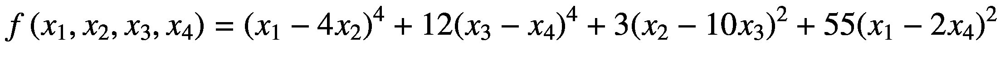
```

```
// 目标函数
// 全局最小值点位于 x = [0,0,0,0]
`RealScalarFunction` f = new `RealScalarFunction`() {
    @Override
    public Double evaluate(Vector x) {
        double x1 = x.get(1);
        double x2 = x.get(2);
        double x3 = x.get(3);
        double x4 = x.get(4);
        double result = pow(x1 - 4 * x2, 4);
        result += 12 * pow(x3 - x4, 4);
        result += 3 * pow(x2 - 10 * x3, 2);
        result += 55 * pow(x1 - 2 * x4, 2);
        return result;
    }
    @Override
    public int dimensionOfDomain() {
        return 4;
    }
    @Override
    public int dimensionOfRange() {
        return 1;
    }
};
// 梯度函数
`RealVectorFunction` g = new `RealVectorFunction`() {
    @Override
    public Vector evaluate(Vector x) {
        double x1 = x.get(1);
        double x2 = x.get(2);
        double x3 = x.get(3);
        double x4 = x.get(4);
        double[] result = new double[4];
        result[0] = 4 * pow(x1 - 4 * x2, 3) + 110 * (x1 - 2 * x4);
        result[1] = -16 * pow(x1 - 4 * x2, 3) + 6 * (x2 - 10 * x3);
        result[2] = 48 * pow(x3 - x4, 3) - 60 * (x2 - 10 * x3);
        result[3] = -48 * pow(x3 - x4, 3) - 220 * (x1 - 2 * x4);
        return new `DenseVector`(result);
    }
    @Override
    public int dimensionOfDomain() {
        return 4;
    }
    @Override
    public int dimensionOfRange() {
        return 4;
    }
};
`C2OptimProblem` problem = new `C2OptimProblemImpl`(f, g); // 仅使用梯度信息
`SteepestDescentMinimizer` firstOrderMinimizer
    = new `FirstOrderMinimizer`(
        `FirstOrderMinimizer.Method.IN_EXACT_LINE_SEARCH`, // `FirstOrderMinimizer.Method.ANALYTIC`
        1e-8,
    );
`IterativeSolution` soln = firstOrderMinimizer.solve(problem);
`Vector` xmin = soln.search(new `DenseVector`(new double[]{1, -1, -1, 1}));
double f_xmin = f.evaluate(xmin);
System.out.println(String.format("f(%s) = %f", xmin.toString(), f_xmin));
```

输出结果如下：

```
f([0.046380, 0.016330, 0.001634, 0.023189] ) = 0.000003
```

这大约需要 40,000 次迭代，速度非常慢。

`FirstOrderMinimizer` 的签名如下：

```
/**
 * 使用一阶方法构造一个多变量最小化器。
 *
 * @param method        执行线搜索的方法
 * @param epsilon       精度参数：当数值 |x| &le;
 *                      &epsilon; 时，视为 0
 * @param maxIterations 最大迭代次数
 */
public FirstOrderMinimizer(Method method, double epsilon, int maxIterations)
```

`Method` 指定是使用线搜索还是解析表达式来计算 `α[k]`。

### 9.4.1 牛顿-拉夫森方法

二阶方法除了使用梯度外，还利用（非奇异的）海森矩阵来确定最速下降框架中的方向向量 `d[k]` 和增量 `α[k]`，以加速收敛。牛顿-拉夫森方法将泰勒级数展开到二阶。设 `δ` 为 `x` 的变化量，我们有如下公式：

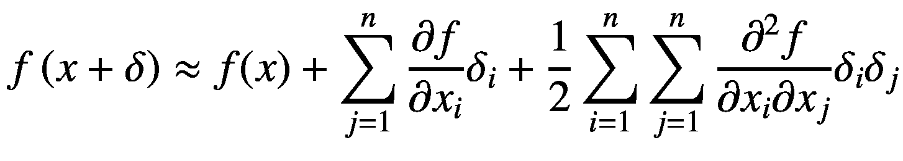

对 `f(x + δ)` 关于 `δ[k]` 求导以最小化 `f(x + δ)`，可得：

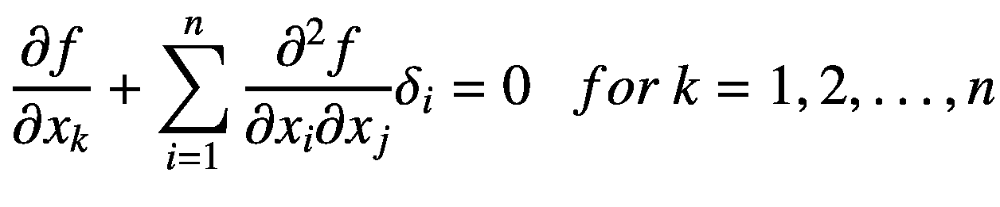

将其改写为矩阵形式如下：

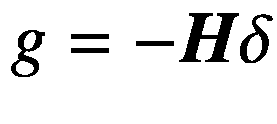

`x` 的最优变化量为：

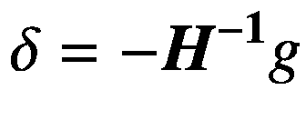

通过线搜索来计算沿该方向 `f(x)` 的最大减少量。下一个点 `x[k+1]` 为：

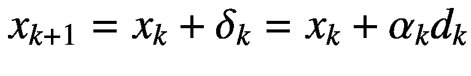

其中满足：

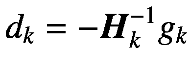

`α[k]` 是使 `f(x[k] + α * d[k])` 最小化的 `α`。

与一阶方法相比，牛顿-拉夫森方法利用海森矩阵信息来加速收敛，尤其是在接近最优解时。下面这段 NM Dev 代码使用牛顿-拉夫森方法最小化同一个函数：

## 牛顿-拉夫森方法

```java
// 目标函数
// 全局最小值点位于 x = [0,0,0,0]
RealScalarFunction f = new RealScalarFunction() {
@Override
public Double evaluate(Vector x) {
double x1 = x.get(1);
double x2 = x.get(2);
double x3 = x.get(3);
double x4 = x.get(4);
double result = pow(x1 - 4 * x2, 4);
result += 12 * pow(x3 - x4, 4);
result += 3 * pow(x2 - 10 * x3, 2);
result += 55 * pow(x1 - 2 * x4, 2);
return result;
}
@Override
public int dimensionOfDomain() {
return 4;
}
@Override
public int dimensionOfRange() {
return 1;
}
};
// 梯度函数
RealVectorFunction g = new RealVectorFunction() {
@Override
public Vector evaluate(Vector x) {
double x1 = x.get(1);
double x2 = x.get(2);
double x3 = x.get(3);
double x4 = x.get(4);
double[] result = new double[4];
result[0] = 4 * pow(x1 - 4 * x2, 3) + 110 * (x1 - 2 * x4);
result[1] = -16 * pow(x1 - 4 * x2, 3) + 6 * (x2 - 10 * x3);
result[2] = 48 * pow(x3 - x4, 3) - 60 * (x2 - 10 * x3);
result[3] = -48 * pow(x3 - x4, 3) - 220 * (x1 - 2 * x4);
return new DenseVector(result);
}
@Override
public int dimensionOfDomain() {
return 4;
}
@Override
public int dimensionOfRange() {
return 4;
}
};
C2OptimProblem problem = new C2OptimProblemImpl(f, g); // 使用数值海森矩阵
SteepestDescentMinimizer newtonRaphsonMinimizer
= new NewtonRaphsonMinimizer(
1e-8,

);
IterativeSolution soln = newtonRaphsonMinimizer.solve(problem);
Vector xmin = soln.search(new DenseVector(new double[]{1, -1, -1, 1}));
double f_xmin = f.evaluate(xmin);
System.out.println(String.format("f(%s) = %f", xmin.toString(), f_xmin));
```

输出结果如下：

```
f([0.000134, -0.000009, -0.000001, 0.000067] ) = 0.000000
```

值得指出的是，牛顿-拉夫森方法的收敛速度远快于一阶方法。它仅用 20 次迭代就能达到比 40,000 次迭代更好的精度。

`NewtonRaphsonMinimizer` 的签名如下：

```java
/**
* 使用牛顿-拉夫森方法构造一个多变量最小化器。
*
* @param epsilon       精度参数：当数值 |x| &le; &epsilon; 时，视为 0
* @param maxIterations 最大迭代次数
*/
public NewtonRaphsonMinimizer(double epsilon, int maxIterations)
```

### 9.4.2 高斯-牛顿法

高斯-牛顿法用于最小化如下形式的目标函数：

![$$ \boldsymbol{f}={\left[{f}_1(x)\kern0.5em {f}_2(x)\dots \dots \kern0.5em {f}_m(x)\right]}^T $$](images/500382_1_En_9_Chapter/500382_1_En_9_Chapter_TeX_Equae.png)

其解为一个点 `x`，使得所有 `fp` 同时归零。

我们可以构造一个实值函数 `F`，使得若 `F` 被最小化，则函数 `fp` 在最小二乘意义上也被最小化。

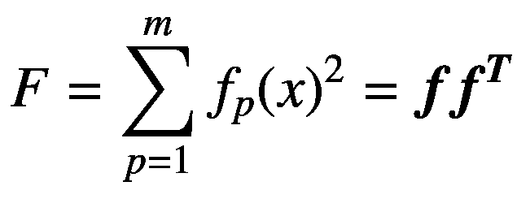

梯度的雅可比矩阵如下：

![$$ \mathbf{J}=\left[\begin{array}{ccc}\frac{\partial {f}_1}{\partial {x}_1}&amp; \cdots &amp; \frac{\partial {f}_m}{\partial {x}_1}\\ {}\vdots &amp; \ddots &amp; \vdots \\ {}\frac{\partial {f}_1}{\partial {x}_n}&amp; \cdots &amp; \frac{\partial {f}_m}{\partial {x}_n}\end{array}\right] $$](images/500382_1_En_9_Chapter/500382_1_En_9_Chapter_TeX_Equag.png)

对 `F` 关于 `x[i]` 求导，可得：

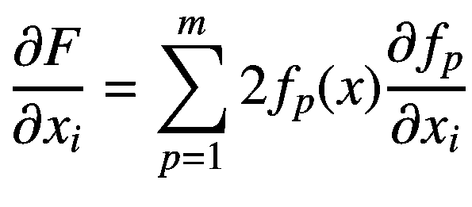

或者，以矩阵形式表示如下：

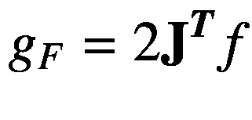

再次求导，可得：

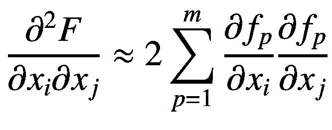

海森矩阵 `H[F]` 如下所示。它必须是非奇异且正定的。

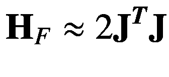

下一个点由以下递归关系给出：

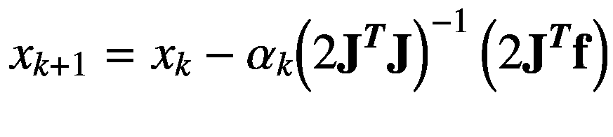

以下代码使用高斯-牛顿法求解相同的最小化问题：

# 目标函数与雅可比矩阵的定义

```
// 目标函数
// 全局最小值位于 x = [0,0,0,0]
RealVectorFunction f = new RealVectorFunction() {
@Override
public Vector evaluate(Vector x) {
double x1 = x.get(1);
double x2 = x.get(2);
double x3 = x.get(3);
double x4 = x.get(4);
double[] fx = new double[4];
fx[0] = pow(x1 - 4 * x2, 2);
fx[1] = sqrt(12) * pow(x3 - x4, 2);
fx[2] = sqrt(3) * (x2 - 10 * x3);
fx[3] = sqrt(55) * (x1 - 2 * x4);
return new DenseVector(fx);
}
@Override
public int dimensionOfDomain() {
return 4;
}
@Override
public int dimensionOfRange() {
return 4;
}
};
// 雅可比矩阵
RntoMatrix J = new RntoMatrix() {
@Override
public Matrix evaluate(Vector x) {
double x1 = x.get(1);
double x2 = x.get(2);
double x3 = x.get(3);
double x4 = x.get(4);
Matrix Jx = new DenseMatrix(4, 4);
double value = 2 * (x1 - 4 * x2);
Jx.set(1, 1, value);
value = -8 * (x1 - 4 * x2);
Jx.set(1, 2, value);
value = 2 * sqrt(12) * (x3 - x4);
Jx.set(2, 3, value);
Jx.set(2, 4, -value);
Jx.set(3, 2, sqrt(3));
Jx.set(3, 3, -10 * sqrt(3));
Jx.set(4, 1, sqrt(55));
Jx.set(4, 4, -2 * sqrt(55));
return Jx;
}
@Override
public int dimensionOfDomain() {
return 4;
}
@Override
public int dimensionOfRange() {
return 1;
}
};
```

`GaussNewtonMinimizer` `optim1 = new GaussNewtonMinimizer(1e-8, 10);`
`IterativeSolution` `soln = optim1.solve(f, J);// 解析梯度`
`Vector` `xmin = soln.search(new DenseVector(new double[]{1, -1, -1, 1}));`
`System.out.println(String.format("f(%s) = %s", xmin.toString(), f.evaluate(xmin).toString()));`

输出如下：

```
f([0.000007, -0.000000, -0.000000, 0.000003] ) = [0.000000, 0.000000, -0.000000, -0.000000]
```

高斯-牛顿法比牛顿-拉夫森法更高效。针对上述问题，前者大约需要 10 次迭代，而后者需要 20 次。

`GaussNewtonMinimizer` 的函数签名如下：

```
/**
* 使用高斯-牛顿法构造一个多变量最小化器。
*
* @param epsilon       一个精度参数：当数 |x| &le;
*                      &epsilon; 时，视为 0
* @param maxIterations 最大迭代次数
*/
public GaussNewtonMinimizer(double epsilon, int maxIterations)
```

## 9.5 共轭方向法

在最速下降法中，连续的搜索方向之间可能相关，也可能不相关。此外，它们完全由目标函数的局部性质（即梯度和海森矩阵）决定 (Hestenes & Stiefel, 1952)。另一方面，在共轭方向法中，连续的搜索方向之间存在严格的数学关系。共轭法最初是为求解具有以下目标函数的二次优化问题而开发的：

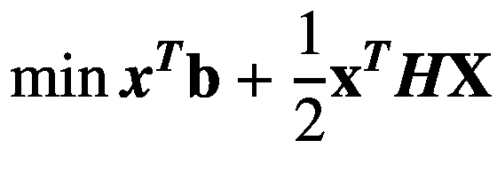

其中，对于一个 `n` 变量函数，`H` 是一个 `n` * `n` 的对称正定矩阵。

对于二次问题，搜索将在有限次迭代内收敛到最小值。此后，共轭法已被推广用于求解更一般的优化问题。

### 9.5.1 共轭方向

对于对称矩阵 `H`，一个有限的向量集合 `{d[0], d[1], ..., d[k]}` 被称为关于 `H` 共轭或 `H`-正交，如果对于所有 `i ≠ j` 均有 `d[i]^T Q d[j] = 0`。如果 `H` 是正定的，那么这些向量是线性无关的。如果 `H = I`，这些向量是正交的。

对于先前展示的二次型最小化问题，且当 `H` 是正定时，简单的微积分计算表明解是唯一的，并且可以通过求解一个线性方程组来解析计算。

```
H x* = b
```

由于共轭向量集合是线性无关的，因此它们张成了 *n* 维空间 *E*^*n*，`x*` 可以写成这些向量的线性组合形式。

```
x* = α0 d[0] + ... + αn-1 d[n-1]
```

两边同时乘以 `H`，再与 `d[i]` 取数量积得到下式：

```
αi = - (d[i]^T H x*) / (d[i]^T H d[i]) = - (d[i]^T b) / (d[i]^T H d[i])
```

或者等价地：

```
x* = Σ (i=0 to n-1) (d[i]^T b) / (d[i]^T H d[i]) * d[i]
```

`x*` 的这个展开式可以看作是逐步加上 `α[i] d[i]` 的一个求和过程或一个 *n* 步迭代过程。

**共轭方向定理**

设 `{d[i]}_ (i=0 to n-1)` 是一组非零的 `H`-正交向量。对于任意 `x[0] ∈ E^n`，根据下式生成的序列 `{x[i]}`：

```
x[k+1] = x[k] + αk d[k], k ≥ 0
```

结合下式：

```
αk = - (g[k]^T d[k]) / (d[k]^T H d[k])
```

以及下式：

```
g[k] = b + H x[k]
```

该序列在 *n* 步后收敛到 `Hx = b` 的唯一解 `x*`，即 `x[n] = x*`。

利用这个定理以及多种生成共轭向量的方法，可以设计出多种共轭方向方法。我们还需要将该定理推广以解决非二次型问题。共轭方向方法很好地契合了最速下降法的框架。它们的区别仅在于方向向量 `d[k]` 以及随之计算的步幅 `α[k]` 的方式不同。我们在这里使用共轭方向而不是最速下降方向。迭代地向 `x[k]` 添加增量 `α[k] d[k]` 以生成 `x[k+1]` 的思路是相同的。

### 9.5.2 共轭梯度法

Hestenes 和 Stiefel（1952）提出了共轭梯度法。在这种方法中，新方向是上一个方向与负梯度的加权和。

```
d[0] = -g[0] = -(b + H x[0])
```

```
d[k] = -g[k] + βk d[k-1]
```

```
g[k] = b + H x[k]
```

```
βk = (g[k]^T H d[k]) / (d[k]^T H d[k])
```

```
αk = - (g[k]^T d[k]) / (d[k]^T H d[k])
```

这种方法具有以下优点：

-  梯度是有限的，并且与所有之前的方向向量线性无关，除非找到了解。

-  计算新方向向量相对容易。

-  无需线搜索。

-  对于二次型问题，它在 *n* 步内收敛。

-  第一个方向与最速下降法相同，即 `d[0] = -g[0]`，并且它能带来首次较好的优化效果。

-  无需对 Hessian 矩阵求逆。

以下是其缺点：

-  必须提供、存储和操纵 Hessian 矩阵。

-  对于非二次型问题，收敛性无法保证。实际上，如果初始点远离最优解，搜索可能会游荡在某个次优区域，因为不可靠的方向会随着迭代次数增加而累积。正如我们稍后从代码示例中看到的，对于 Himmelblau 函数，共轭梯度法需要最多的迭代次数才能收敛。

### 9.5.3 Fletcher-Reeves 方法

Fletcher-Reeves 方法是共轭梯度法的一个变体。主要区别在于，`α[k]` 是通过最小化 `f(X + α[k] d[k])` 进行线搜索来计算的，并且 `d[k]` 是关于 `{d[0], d[1], ..., d[k]}` 的共轭方向，而不是最速下降方向或牛顿方向。因此，该算法与共轭梯度法的算法类似，但由于线搜索需要更多的计算量，这是一个缺点。然而，它有两个优点。

- 对于非二次型函数的最小化，这种修改效果更好，因为在远离解邻域的点上，沿着 `d[k]` 可以使 `f(x)` 获得更大的降低。
- 该算法不需要 Hessian 矩阵。

### 9.5.4 鲍威尔法

鲍威尔算法通过线性搜索生成一系列共轭方向。

设 `x_a*` 和 `x_b*` 是当以下凸二次函数：
```
f(x) = x^T b + 1/2 x^T H x
```
在方向 `d[a]` 和 `d[b]` 上关于 `α` 进行最小化时得到的极小点：
```
x = x_a + α d_a
```
以及如下形式：
```
x = x_b + α d_b
```
如果 `d[a] = d[b]`，则向量 `x_b* - x_a*` 与 `d[a]` 共轭。见图 9-8。

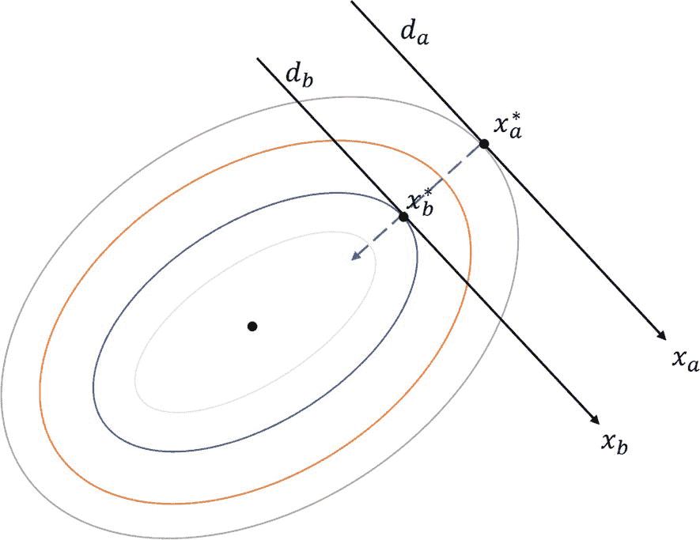

在该算法中，假设初始点 `x[00]` 和 `n` 个线性无关的方向 `{d[0], d[1], …, d[n]}`（通常取坐标方向），并在每次迭代中执行一系列线性搜索。在第一次迭代中，从点 `x[00]` 开始，依次沿方向 `{d[0], d[1], …, d[n]}` 对 `f(x)` 进行最小化，得到点 `x[01], x[02], …, x[0n]`。然后生成一个新方向 `d[0(n+1)]` 如下：
```
d[0(n+1)] = x[0n] - x[00]
```
并沿该方向对 `f(x)` 进行最小化，得到新点 `x[0(n+1)]`。方向更新如下（见图 9-9）：
```
d[11] = d[02]
d[12] = d[03]
…
d[1(n-1)] = d[0n]
d[1n] = d[0(n+1)]
```
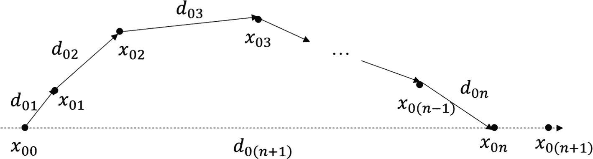

以点 `x[10] = x[0(n+1)]` 开始的第二次迭代重复相同过程。依次沿方向 `{d[11], d[12], …, d[1n]}` 对 `f(x)` 进行最小化，得到点 `x[11], x[12], …, x[1n]`。然后生成一个新方向 `d[1(n+1)]` 如下（见图 9-10）：
```
d[1(n+1)] = x[1n] - x[10]
```
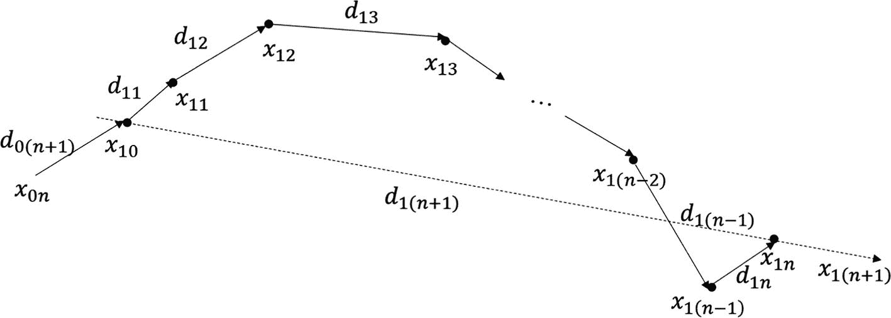

依此类推，每次新迭代会增加一个共轭方向并移除另一个方向，从而完成一次替换。由于每次迭代需要 `(n + 1)` 次线性搜索，鲍威尔法在 `n` 次迭代中共执行 `n(n + 1)` 次线性搜索。

鲍威尔法的优点在于无需提供、存储或操作 Hessian 矩阵，甚至不需要梯度。然而，该方法可能无法生成一组跨越 `E^n` 的线性无关方向，且算法可能不收敛到解。

### Zangwill 方法

Zangwill 算法是 Powell 算法的改进版本。其改进之处在于生成一组始终线性无关的共轭方向。因此，它消除了 Powell 算法中的缺点。

改进措施如下：首先，选择坐标方向集，使其行列式为 1。其次，将新方向归一化为单位长度。第三，方向替换必须确保方向向量矩阵的行列式为正且仍小于或等于 1。最后一项保证了方向向量始终线性无关。

以下代码用于最小化 Himmelblau 函数（见图 9-11）：
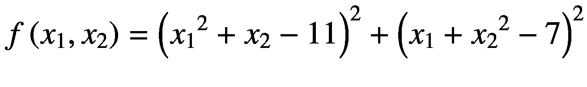
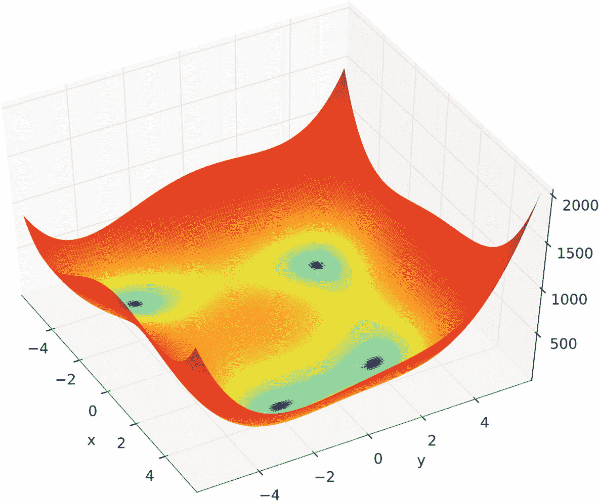
图 9-11 具有四个极小点的 Himmelblau 函数

### Himmelblau 函数

```java
/**
 * Himmelblau 函数：
 * f(x) = (x1² + x2 - 11)² + (x1 + x2² - 7)²
 */
RealScalarFunction f = new RealScalarFunction() {
    @Override
    public Double evaluate(Vector x) {
        double x1 = x.get(1);
        double x2 = x.get(2);
        double result = pow(x1 * x1 + x2 - 11, 2);
        result += pow(x1 + x2 * x2 - 7, 2);
        return result;
    }

    @Override
    public int dimensionOfDomain() {
        return 2;
    }

    @Override
    public int dimensionOfRange() {
        return 1;
    }
};

RealVectorFunction g = new RealVectorFunction() {
    @Override
    public Vector evaluate(Vector x) {
        double x1 = x.get(1);
        double x2 = x.get(2);
        double w1 = x1 * x1 + x2 - 11;
        double w2 = x1 + x2 * x2 - 7;
        double[] result = new double[2];
        result[0] = 4 * w1 * x1 + 2 * w2;
        result[1] = 2 * w1 + 4 * w2 * x2;
        return new DenseVector(result);
    }

    @Override
    public int dimensionOfDomain() {
        return 2;
    }

    @Override
    public int dimensionOfRange() {
        return 2;
    }
};

RntoMatrix H = new RntoMatrix() {
    @Override
    public Matrix evaluate(Vector x) {
        double x1 = x.get(1);
        double x2 = x.get(2);
        Matrix result = new DenseMatrix(2, 2);
        result.set(1, 1, 12 * x1 * x1 + 4 * x2 - 42);
        result.set(1, 2, 4 * (x1 + x2));
        result.set(2, 1, result.get(1, 2));
        result.set(2, 2, 4 * x1 + 12 * x2 * x2 - 26);
        return result;
    }

    @Override
    public int dimensionOfDomain() {
        return 2;
    }

    @Override
    public int dimensionOfRange() {
        return 1;
    }
};

C2OptimProblemImpl problem = new C2OptimProblemImpl(f, g, H);

ConjugateGradientMinimizer ConjugateGradientMinimizer
    = new ConjugateGradientMinimizer(1e-16, 40);
IterativeSolution soln1 = ConjugateGradientMinimizer.solve(problem);
Vector xmin1 = soln1.search(new DenseVector(new double[]{6, 6}));
double f_xmin1 = f.evaluate(xmin1);
System.out.println(String.format("f(%s) = %.16f", xmin1.toString(), f_xmin1));

ConjugateGradientMinimizer fletcherReevesMinimizer
    = new FletcherReevesMinimizer(1e-16, 20);
IterativeSolution soln2 = fletcherReevesMinimizer.solve(problem);
Vector xmin2 = soln2.search(new DenseVector(new double[]{6, 6}));
double f_xmin2 = f.evaluate(xmin2);
System.out.println(String.format("f(%s) = %.16f", xmin2.toString(), f_xmin2));

SteepestDescentMinimizer powellMinimizer
    = new PowellMinimizer(1e-16, 20);
IterativeSolution soln3 = powellMinimizer.solve(problem);
Vector xmin3 = soln3.search(new DenseVector(new double[]{6, 6}));
double f_xmin3 = f.evaluate(xmin3);
System.out.println(String.format("f(%s) = %.16f", xmin3.toString(), f_xmin3));

SteepestDescentMinimizer zangwillMinimizer
    = new ZangwillMinimizer(1e-16, 1e-16, 20);
IterativeSolution soln4 = zangwillMinimizer.solve(problem);
Vector xmin4 = soln4.search(new DenseVector(new double[]{6, 6}));
double f_xmin4 = f.evaluate(xmin4);
System.out.println(String.format("f(%s) = %.16f", xmin4.toString(), f_xmin4));
```

输出结果如下：
```
f([3.000000, 2.000000] ) = 0.0000000000013999
f([3.000002, 1.999998] ) = 0.0000000001278725
f([-2.805114, 3.131310] ) = 0.0000000007791914
f([-2.805117, 3.131311] ) = 0.0000000001359077
```

找到的两个极小点为 `(3, 2)` 和 `(−2.805118, 3.131312)`。

这些极小化器的签名如下：

```java
/**
 * 使用共轭梯度法构造一个多变量极小化器。
 *
 * @param epsilon       精度参数：当数 |x| &le;
 *                      &epsilon; 时，视其为 0
 * @param maxIterations 最大迭代次数
 */
public ConjugateGradientMinimizer(double epsilon, int maxIterations)

/**
 * 使用 Fletcher-Reeves 方法构造一个多变量极小化器。
 *
 * @param epsilon       精度参数：当数 |x| &le;
 *                      &epsilon; 时，视其为 0
 * @param maxIterations 最大迭代次数
 */
public FletcherReevesMinimizer(double epsilon, int maxIterations)

/**
 * 使用 Powell 方法构造一个多变量极小化器。
 *
 * @param epsilon       精度参数：当数 |x| &le;
 *                      &epsilon; 时，视其为 0
 * @param maxIterations 最大迭代次数
 */
public PowellMinimizer(double epsilon, int maxIterations)

/**
 * 使用 Zangwill 方法构造一个多变量极小化器。
 *
 * @param epsilon       精度参数：当数 |x| &le;
 *                      &epsilon; 时，视其为 0
 * @param epsilon2      精度参数，用于判断共轭方向之间是否存在线性相关
 * @param maxIterations 最大迭代次数
 */
public ZangwillMinimizer(double epsilon, double epsilon2, int maxIterations)
```

## 9.6 拟牛顿法

拟牛顿法是另一类不需要显式计算海森矩阵的算法框架。它建立在第 9.4.1 节中的牛顿法基础之上，不同之处在于其搜索方向基于一个 `n` × `n` 矩阵 `S`，该矩阵的作用与牛顿法中的海森矩阵逆矩阵相同。即：

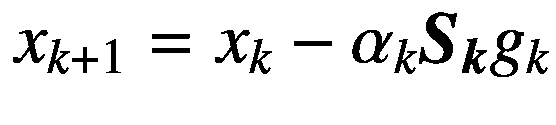

当 `S[k] = I` 时，该算法即为最速下降法。当 `S[k] = H^(-1)` 时，该算法即为牛顿法。当海森矩阵不可用时，`S` 根据现有数据推导得出，旨在近似 `H^(-1)`。事实上，可以证明，当 `S[k] = H^(-1)` 时，上述更新 `x[k+1]` 的算法收敛最快。拟牛顿法结合了最速下降法和共轭方向法的优点，并采用了有效的方向更新规则。它是本章讨论的所有方法中最高效的，并被广泛应用于众多实际应用中。

假设连续的 `x[k]` 之差如下：

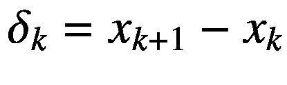

连续的梯度 `g[k]` 之差如下：

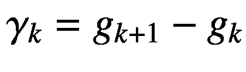

于是我们得到：

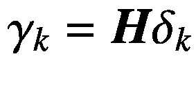

牛顿法按如下方式确定方向向量：

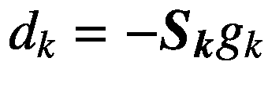

步长 `α[k]` 可以通过最小化以下函数的一维搜索来确定：

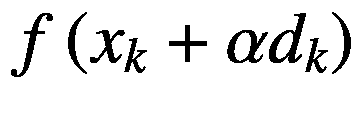

我们希望避免在每次迭代中计算诸如 `S[k] = H^(-1)` 这样的矩阵求逆，并检查 `S[k]` 是否正定。我们希望有一个简单的 `S[k+1]` 更新规则。

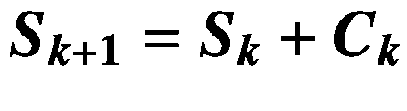

`C[k]` 是一个 `n` × `n` 的校正矩阵，可由现有数据计算得出。在任何 `C[k]` 的定义中，`S[k+1]` 必须满足以下三个性质：

- `S[k+1]γ[k] = δ[k]`。
- 向量序列 `{δ[0], δ[1], ⋯, δ[n-1]}` 必须是共轭方向。
- 一个正定的 `S[k]` 必须能产生一个正定的 `S[k+1]`。

第二个性质确保了共轭方向搜索的优良特性同样适用于拟牛顿搜索。第三个性质保证了每次迭代中方向向量的有效性。定义 `C[k]` 的方式有很多种，由此衍生出拟牛顿法的不同变体。在本节中，我们将根据它们计算 `C[k]` 或更新 `S[k]` 的方式，介绍几种变体。

### 9.6.1 秩一方法

秩一方法的特点在于校正矩阵 `C[k]` 的秩为 1。

假设：

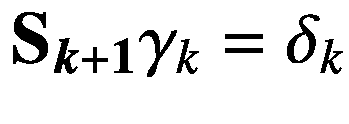

令：

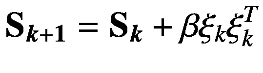

`ξ[k]` 是一个列向量，`β[k]` 是一个常数。校正矩阵 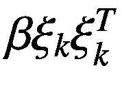 是对称的，并且秩为 1。将上述两个方程结合起来，我们得到：

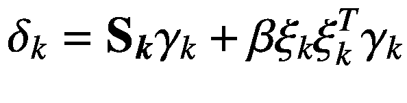

并且有：

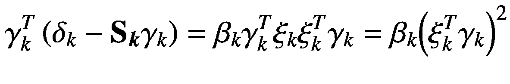

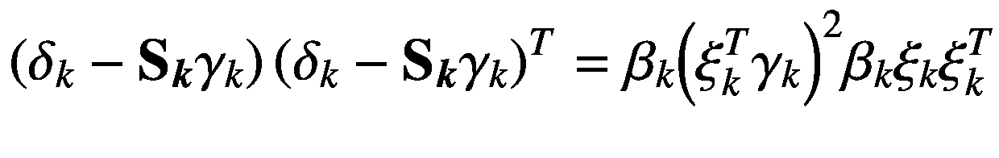

于是我们得到：

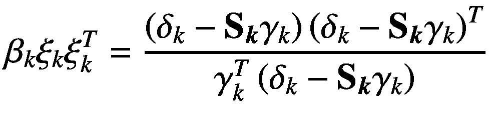

因此，我们有：


这种方法存在两个严重问题。首先，一个正定的 `S[k]` 可能无法产生正定的 `S[k+1]`。如果发生这种情况，下一个方向就不是一个好的方向。其次，校正公式中的分母可能趋近于零或等于零。如果发生这种情况，该方法会因 `S[k+1]` 未定义而失效。

### 9.6.2 戴维登-弗莱彻-鲍威尔方法

戴维登-弗莱彻-鲍威尔（DFP）方法与秩一方法类似，但它有一个重要优势：如果初始矩阵 `S[0]` 是正定的，那么后续的矩阵总是正定的。与秩一方法不同，该方法中每个新方向都是下降方向。

DFP 更新公式如下：


该校正项是一个秩为 2 的 `n` × `n` 对称矩阵。

### 9.6.3 布罗伊登-弗莱彻-戈德法布-香农方法

BFGS 更新公式如下：


BFGS 方法具有以下性质：
1. 当`k = n-1`时，`S[k+1]`与`H^(-1)`相等。
2. 方向`${δ[i]}_{i=1,2,...,n-1}`构成一个共轭集合。
3. 如果`S[k]`是正定的，则`S[k+1]`是正定的。
4. 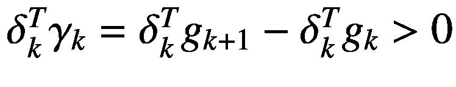。

BFGS 求解器是所有求解器中最好的。在许多数值方法无约束优化应用中，它被默认使用。

### 9.6.4 Huang 族方法（秩一法、DFP、BFGS、Pearson、McCormick）

Huang 更新公式是一个通用公式，涵盖了秩一法、DFP、BFGS、Pearson 和 McCormick 方法。其形式如下：


`θ`、`ϕ`、`φ`和`ω`是独立参数。

令`θ = 1`、`ϕ = -1`、`ψ = 1`、`ω = -1`，则得到秩一法公式。
令`θ = 1`、`ϕ = 0`、`ψ = 0`、`ω = 1`，则得到 DFP 公式。
令`ϕ/θ = (-γ_k δ_k^T) / (γ_k δ_k^T + γ_k^T S_k γ_k)`、`ψ = 1`、`ω = 0`，则得到 BFGS 公式。
令`θ = 1`、`ϕ = 0`、`ψ = 1`、`ω = 0`，则得到 McCormick 公式。

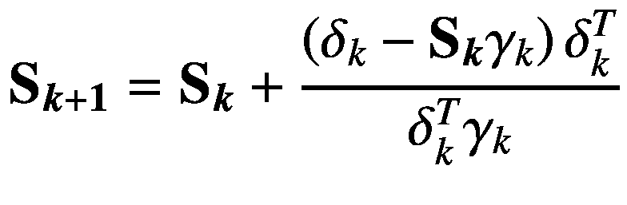

令`θ = 0`、`ϕ = 1`、`ψ = 0`、`ω = 1`，则得到 Pearson 公式。

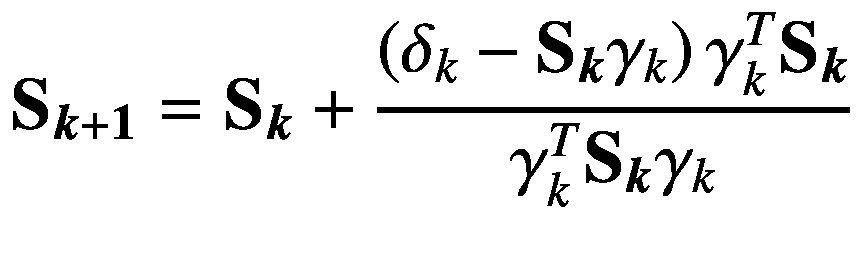

NM Dev 提供了一套拟牛顿方法。以下代码使用不同的拟牛顿方法求解图 9-11 中的 Himmelblau 函数：

```java
/**
* The Himmelblau function:
* f(x) = (x1² + x2 - 11)² + (x1 + x2² - 7)²
*/
RealScalarFunction f = new RealScalarFunction() {
@Override
public Double evaluate(Vector x) {
double x1 = x.get(1);
double x2 = x.get(2);
double result = pow(x1 * x1 + x2 - 11, 2);
result += pow(x1 + x2 * x2 - 7, 2);
return result;
}
@Override
public int dimensionOfDomain() {
return 2;
}
@Override
public int dimensionOfRange() {
return 1;
}
};
RealVectorFunction g = new RealVectorFunction() {
@Override
public Vector evaluate(Vector x) {
double x1 = x.get(1);
double x2 = x.get(2);
double w1 = x1 * x1 + x2 - 11;
double w2 = x1 + x2 * x2 - 7;
double[] result = new double[2];
result[0] = 4 * w1 * x1 + 2 * w2;
result[1] = 2 * w1 + 4 * w2 * x2;
return new DenseVector(result);
}
@Override
public int dimensionOfDomain() {
return 2;
}
@Override
public int dimensionOfRange() {
return 2;
}
};
C2OptimProblemImpl problem = new C2OptimProblemImpl(f, g);
QuasiNewtonMinimizer rankOneMinimizer = new RankOneMinimizer(1e-16, 15);
IterativeSolution soln1 = rankOneMinimizer.solve(problem);
Vector xmin = soln1.search(new DenseVector(new double[]{6, 6}));
double f_xmin = f.evaluate(xmin);
System.out.println(String.format("f(%s) = %.16f", xmin.toString(), f_xmin));
QuasiNewtonMinimizer dfpMinimizer = new DFPMinimizer(1e-16, 15);
IterativeSolution soln2 = dfpMinimizer.solve(problem);
xmin = soln2.search(new DenseVector(new double[]{6, 6}));
f_xmin = f.evaluate(xmin);
System.out.println(String.format("f(%s) = %.16f", xmin.toString(), f_xmin));
QuasiNewtonMinimizer bfgsMinimizer = new BFGSMinimizer(false, 1e-16, 15);
IterativeSolution soln3 = bfgsMinimizer.solve(problem);
xmin = soln3.search(new DenseVector(new double[]{6, 6}));
f_xmin = f.evaluate(xmin);
System.out.println(String.format("f(%s) = %.16f", xmin.toString(), f_xmin));
QuasiNewtonMinimizer huangMinimizer = new HuangMinimizer(0, 1, 0, 1, 1e-16, 15);
IterativeSolution soln4 = huangMinimizer.solve(problem);
xmin = soln4.search(new DenseVector(new double[]{6, 6}));
f_xmin = f.evaluate(xmin);
System.out.println(String.format("f(%s) = %.16f", xmin.toString(), f_xmin));
QuasiNewtonMinimizer pearsonMinimizer = new PearsonMinimizer(1e-16, 15);
IterativeSolution soln5 = pearsonMinimizer.solve(problem);
xmin = soln5.search(new DenseVector(new double[]{6, 6}));
f_xmin = f.evaluate(xmin);
System.out.println(String.format("f(%s) = %.16f", xmin.toString(), f_xmin));
```

输出结果如下：

```
f([3.000000, 2.000000] ) = 0.0000000000000000
f([3.000000, 2.000000] ) = 0.0000000000000000
f([3.000000, 2.000000] ) = 0.0000000000000000
f([3.000000, 2.000000] ) = 0.0000000000000000
f([3.000000, 2.000000] ) = 0.0000000000000000
```

拟牛顿方法看起来比任何一种共轭方向法都高效得多。它们的迭代次数少得多（15 次对 20 次），并且精度更高。

这些求解器的签名如下：

# 10. 约束优化

优化在数学的许多分支和工业应用中无处不在。例如，许多统计理论（如回归和最大似然估计）都被表述为优化问题。定量金融通过最大化投资组合的收益风险比来进行资产配置。在我们公司 NM Limited，我们构建数据驱动的决策系统，以帮助管理层做出科学的业务决策，而非临时性的。例如，为钢铁制造厂设计资源分配系统，以优化原材料、机器和人力使用；规划最佳邮件取送路线；以及安排车辆及班次的调度系统。

## 10.1 优化问题

通常，约束优化问题是指寻找满足以下条件的向量`x`^*^：

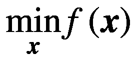

满足约束条件：

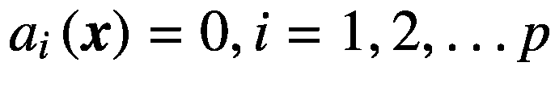

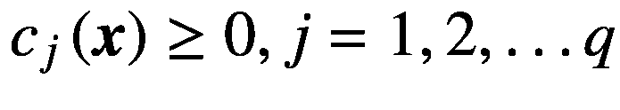

我们假设`ai`和`cj`是二次可微的连续函数。这些约束共同定义了优化问题的可行域`R`。也就是说，`x`^*^ ∈ `R`。假设该可行域是凸的。

凸集是一个集合，对于该集合中的任意两个点`x`和`y`，连接这两个点的任何线段`(1 − t)x + t*y*`都落在该集合内。图 10-1 展示了一个凸集的例子。

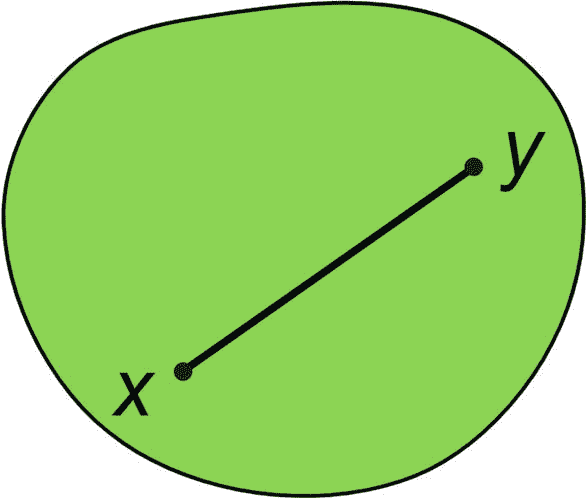

**图 10-1** 一个凸集

图 10-2 展示了一个非凸集的例子。

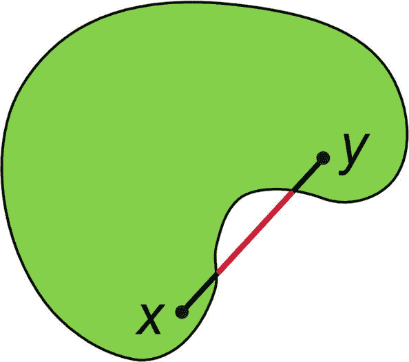

**图 10-2** 一个非凸集

以下是一个约束优化问题的示例：

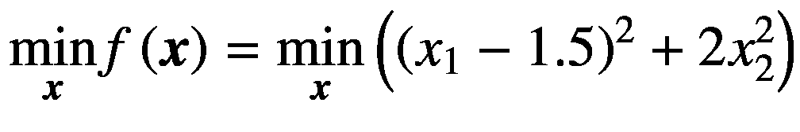

满足约束条件：


图 10-3 显示了由约束中两条曲线相交定义的可行域。


**图 10-3** 由约束定义的可行域

等高线图（虚线）表示了目标函数可以取到的（相同）值。（小于）不等式约束将解限制在抛物线曲线上方。等式约束要求解位于圆的圆周上。因此，可行域仅为抛物线曲线内部的圆弧 AB。点 B 处的圆点表示该圆弧上目标函数最小的解。

### 10.1.1 通用优化算法

通常，寻找优化问题的解是一个迭代过程（除非我们拥有其解析表达式，但通常我们并没有）。因此，我们从一个初始点或初始猜测开始并尝试它。如果它不奏效，我们尝试另一个点。任何数值优化算法的核心组成部分是我们如何选择下一个要尝试的点。在第`k`次迭代中，有两个因素决定搜索点：方向`d[k]`和该方向上的变化幅度`α[k]`。因此，下一个搜索点如下所示：


我们重复这个过程，直到满足收敛准则。这个准则可以是目标函数值的变化太小。


或者也可以是`x[k]`的变化太小。


### 10.1.2 约束

在 NM Dev 中，一组等式或不等式约束由一个实值多元函数列表表示。其接口是`Constraints`。该类的签名如下：

```
/**
* 使用秩一法构建多变量极小化器。
*
* @param epsilon       精度参数：当数字 |x| &le;
*                      &epsilon; 时，视为 0
* @param maxIterations 最大迭代次数
*/
public RankOneMinimizer(double epsilon, int maxIterations)
/**
* 使用 DFP 方法构建多变量极小化器。
*
* @param epsilon       精度参数：当数字 |x| &le;
*                      &epsilon; 时，视为 0
* @param maxIterations 最大迭代次数
*/
public DFPMinimizer(double epsilon, int maxIterations)
/**
* 使用 BFGS 方法构建多变量极小化器。
*
* @param epsilon          精度参数：当数字 |x| &le;
*                         &epsilon; 时，视为 0
* @param maxIterations    最大迭代次数
* @param isFletcherSwitch 指示是否使用 Fletcher 切换
*/
public BFGSMinimizer(boolean isFletcherSwitch, double epsilon, int maxIterations)
/**
* 使用 Huang 方法构建多变量极小化器。
*
* @param theta        Huang 公式中的 &theta;
* @param phi          Huang 公式中的 &phi;
* @param psi          Huang 公式中的 &psi;
* @param omega        Huang 公式中的 &omega;
* @param epsilon      精度参数：当数字 |x| &le;
*                     &epsilon; 时，视为 0
* @param maxIterations 最大迭代次数
*/
public HuangMinimizer(
double theta,
double phi,
double psi,
double omega,
double epsilon,
int maxIterations
)
/**
* 使用 Pearson 方法构建多变量极小化器。
*
* @param epsilon       精度参数：当数字 |x| &le;
*                      &epsilon; 时，视为 0
* @param maxIterations 最大迭代次数
*/
public PearsonMinimizer(double epsilon, int maxIterations)
```

# 等式约束

```java
public interface Constraints {
    /**
     * 获取约束函数列表。
     *
     * @return 约束函数列表
     */
    public List getConstraints();

    /**
     * 获取变量数量。
     *
     * @return 变量数量
     */
    public int dimension();

    /**
     * 获取约束数量。
     *
     * @return 约束数量
     */
    public int size();
}
```

## 等式约束的定义

等式约束的集合如下所示：


或者用向量形式表示如下：

![$$ a\left(\boldsymbol{x}\right)={\left[{a}_1\left(\boldsymbol{x}\right),{a}_2\left(\boldsymbol{x}\right),\dots, {a}_p\left(\boldsymbol{x}\right)\right]}^T=0 $$](images/500382_1_En_10_Chapter/500382_1_En_10_Chapter_TeX_Equj.png)

这定义了 `R^n` 中的一个超曲面。

如果点 `x` 满足约束条件，并且列向量 `∇a1`, `∇a2`, ..., `∇ap` 线性无关，则称点 `x` 为等式约束的**正则点**。也就是说，`x` 是一个解。


其雅可比矩阵如下所示：

![$$ {\mathbf{J}}_{\mathbf{e}}\left(\boldsymbol{x}\right)=\left[\nabla {a}_1\left(\boldsymbol{x}\right),\nabla {a}_2\left(\boldsymbol{x}\right),\dots, \nabla {a}_p\left(\boldsymbol{x}\right)\right] $$](images/500382_1_En_10_Chapter/500382_1_En_10_Chapter_TeX_Equl.png)

![$$ =\left[\begin{array}{ccc}\frac{d{a}_1}{d{x}_1}& \cdots & \frac{d{a}_1}{d{x}_n}\\ {}& \ddots & \\ {}\frac{d{a}_p}{d{x}_1}& & \frac{d{a}_p}{d{x}_n}\end{array}\right] $$](images/500382_1_En_10_Chapter/500382_1_En_10_Chapter_TeX_Equm.png)

该矩阵具有满行秩 `p`。

如果 `p > n`，则 `J_e` 不可能满行秩。此时不存在正则点。如果 `p = n`，则只存在有限个正则点，优化问题变得平凡。因此，我们通常假定 `p < n`。如果 `x` 是一组等式约束的正则点，则它定义了约束超曲面的一个切平面。

Antoniou & Lu (2007) 给出了以下示例：


其雅可比矩阵如下：

![$$ {\mathbf{J}}_{\mathbf{e}}\left(\boldsymbol{x}\right)=\left[\begin{array}{ccc}-1& 0& 1\\ {}2{x}_1-2& 2{x}_2& 0\end{array}\right] $$](images/500382_1_En_10_Chapter/500382_1_En_10_Chapter_TeX_Equo.png)

除了在点 `x = [1 0 x3]^T` 处（因其不满足约束条件）秩为 1 外，其他点处秩均为 2。任何其他点均为正则点。

## 在 NM Dev 中的实现

在 NM Dev 中，接口 `EqualityConstraints` 是一个标记，用于表示一组等式约束。其签名如下：

```java
public interface EqualityConstraints extends Constraints {
}
```

类 `GeneralEqualityConstraints` 实现了一组等式约束。该类签名如下：

```java
public class GeneralEqualityConstraints extends GeneralConstraints implements EqualityConstraints {
    /**
     * 从实值函数集合构造一个等式约束实例。
     *
     * @param constraints 等式约束
     */
    public GeneralEqualityConstraints(Collection constraints) {
        super(constraints);
    }

    /**
     * 从实值函数数组构造一个等式约束实例。
     *
     * @param constraints 等式约束
     */
    public GeneralEqualityConstraints(RealScalarFunction... constraints) {
        super(constraints);
    }
}
```

以下代码片段表示了上述示例：

```java
// 非线性约束
GeneralEqualityConstraints a
= new GeneralEqualityConstraints(
// 第一个等式约束
new AbstractRealScalarFunction(3) { // 定义域维度
    @Override
    public Double evaluate(Vector x) {
        double x1 = x.get(1);
        double x3 = x.get(3);
        double a1 = -x1 + x3 + 1;
        return a1;
    }
},
// 第二个等式约束
new AbstractRealScalarFunction(3) { // 定义域维度
    @Override
    public Double evaluate(Vector x) {
        double x1 = x.get(1);
        double x2 = x.get(2);
        double a2 = x1 * x1 + x2 * x2 - 2. * x1;
        return a2;
    }
}
);
```

## 线性等式约束

若所有等式约束均为线性，则可写为：


其中 `A` 是一个 `p` × `n` 矩阵，`b` 是一个 `p` × 1 向量。雅可比矩阵 `J_e` 与常数矩阵 `A` 相同。因此，如果 `rank(A) = p`，则线性系统 `A x = b` 的任何解都是正则点。否则，当 `rank(A) = p' < p` 时，有两种可能情况。

如果 ![$$ \operatorname{rank}\left(\left[\mathbf{A}\kern0.5em \mathbf{b}\right]\right)>p $$](images/500382_1_En_10_Chapter/500382_1_En_10_Chapter_TeX_IEq1.png)，则线性系统无解。需要仔细检查以消除矛盾。如果 ![$$ \operatorname{rank}\left(\left[\mathbf{A}\kern0.5em \mathbf{b}\right]\right)=\operatorname{rank}\left(\mathbf{A}\right)={p}^{\prime }<p $$](images/500382_1_En_10_Chapter/500382_1_En_10_Chapter_TeX_IEq2.png)，则可以将约束缩减为一个更小且等价的等式约束集合。


其中 `$\hat{\mathbf{A}}$` 是一个 *p*′ × *n* 矩阵，`$\hat{\boldsymbol{b}}$` 是一个 *p*′ × 1 向量。

一种方法是应用奇异值分解（SVD）对 **A** 进行分解。更多信息请参见第 2 章。我们可以将 **A** 分解如下：

$$
\mathbf{A}=\mathbf{UD}{\boldsymbol{V}}^{\boldsymbol{T}}
$$

其中 **U** 是一个 *p* × *p* 正交矩阵，**V** 是一个 *n* × *n* 正交矩阵。

$$
\mathbf{D}=\left[\begin{array}{cc}\hat{\boldsymbol{D}}& \mathbf{0}\\ {} \mathbf{0}& \mathbf{0}\end{array}\right]
$$

其中 `$\hat{\boldsymbol{D}}$` 包含所有正奇异值。

$$
\mathbf{A}=\mathbf{UD}{\boldsymbol{V}}^{\boldsymbol{T}}=\boldsymbol{U}\left[\begin{array}{c}\hat{\boldsymbol{A}}\\ {} \mathbf{0}\end{array}\right]
$$

$$
\hat{\boldsymbol{A}}=\hat{\boldsymbol{D}}{\left[{\boldsymbol{v}}_{\mathbf{1}},\dots, {\boldsymbol{v}}_{{\boldsymbol{p}}^{\prime }}\right]}^{\boldsymbol{T}}
$$

`$\boldsymbol{v}_\mathbf{i}$` 是 **V**^(**T**) 中的列。`$\hat{\boldsymbol{A}}$` 是一个 *p*^′ × *n* 矩阵。

$$
\left[\begin{array}{c}\hat{\boldsymbol{A}}\\ {} \mathbf{0}\end{array}\right]\boldsymbol{x}=\left[\begin{array}{c}\hat{\boldsymbol{b}}\\ {} \mathbf{0}\end{array}\right]
$$

`$\hat{\boldsymbol{b}}$` 是 **U**^(**T**)**b** 的前 *p*^′ 个元素。

以下代码片段复现了 Antoniou & Lu (2007) 中的示例 10.2：

$$
\left\{\begin{array}{c}{x}_1-2{x}_2+3{x}_3+2{x}_4=4\\ {} 2{x}_2-{x}_3=1\\ {} 2{x}_1-10{x}_2+9{x}_3+4{x}_4=5\end{array}\right.
$$

该线性系统的秩为 2，因此可约简。简化后的等式约束集合如下：

$$
\left\{\begin{array}{c}2.177001{x}_1-10.342933{x}_2+9.525469{x}_3+4.354003{x}_4=5.713540\\ {} 0.510554{x}_1+1.011800{x}_2+0.515208{x}_3+1.021108{x}_4=3.058670\end{array}\right.
$$

```java
/** 示例 10.2，第 270 页。实用优化：算法与
 * 工程应用。Andreas Antoniou，Wu-Sheng Lu */
// 线性约束
Matrix A = new DenseMatrix(new double[][]{
    {1, -2, 3, 2},
    {0, 2, -1, 0},
    {2, -10, 9, 4}
});
Vector b = new DenseVector(new double[]{4, 1, 5});
LinearEqualityConstraints A_eq
        = new LinearEqualityConstraints(A, b);
System.out.println("原始等式约束：");
System.out.println(A_eq);
// 进行 SVD 分解以简化等式约束
SVD svd = new SVD(A, true);
Matrix U = svd.U();
System.out.println("U = ");
System.out.println(U);
Matrix D = svd.D();
System.out.println("D = ");
System.out.println(D);
Matrix V = svd.V();
System.out.println("V = ");
System.out.println(V);
// 检查原始等式约束是否可简化
double epsilon = 1e-8; // 精度参数，小于该值视为 0
boolean isReducible = A_eq.isReducible(epsilon);
System.out.println(isReducible);
int r = MatrixMeasure.rank(
        A,
        epsilon
);
System.out.printf("A 的秩 = %d%n", r);
// 构造一组新的简化约束
LinearEqualityConstraints A_eq_hat
        = A_eq.getReducedLinearEqualityConstraints(epsilon);
System.out.println("简化后的等式约束：");
System.out.println(A_eq_hat);
```

输出结果如下：

```
原始等式约束：
3x4
[,1] [,2] [,3] [,4]
[1,] 1.000000, -2.000000, 3.000000, 2.000000,
[2,] 0.000000, 2.000000, -1.000000, 0.000000,
[3,] 2.000000, -10.000000, 9.000000, 4.000000,  * x =
[4.000000, 1.000000, 5.000000]
U =
3x3
[,1] [,2] [,3]
[1,] 0.271659, 0.800304, -0.534522,
[2,] -0.136451, 0.581828, 0.801784,
[3,] 0.952671, -0.144875, 0.267261,
D =
3x3
[,1] [,2] [,3]
[1,] 14.879768, 0.000000, 0.000000,
[2,] 0.000000, 1.610126, 0.000000,
[3,] 0.000000, 0.000000, 0.000000,
V =
4x3
[,1] [,2] [,3]
[1,] 0.146306, 0.317089, -0.936741,
[2,] -0.695100, 0.628398, 0.112540,
[3,] 0.640162, 0.319980, 0.225081,
[4,] 0.292612, 0.634179, 0.243290,
true
A 的秩 = 2
简化后的等式约束：
2x4
[,1] [,2] [,3] [,4]
[1,] 2.177001, -10.342933, 9.525469, 4.354003,
[2,] 0.510554, 1.011800, 0.515208, 1.021108,  * x =
[5.713540, 3.058670]
```

#### 10.1.2.2 不等式约束

不等式约束的形式如下：

# 不等式约束

与等式约束不同，不等式约束的数量`q`不必小于`n`。对于任何可行点$$\overline{\boldsymbol{x}}$$，存在两类不等式约束。满足`c[j](x) > 0`的约束集称为非活动约束，例如图 10-2 中的$$c_1(\overline{\boldsymbol{x}})$$和$$c_2(\overline{\boldsymbol{x}})$$。由于$$\overline{\boldsymbol{x}}$$处于它们的边界上，下一个搜索点不能朝违反这些约束的方向移动。因此，这些活动约束限制了$$\overline{\boldsymbol{x}}$$邻域内的可行域。另一方面，像$$c_3(\overline{\boldsymbol{x}})$$这样的非活动约束远离$$\overline{\boldsymbol{x}}$$，因此在$$\overline{\boldsymbol{x}}$$的一个足够小的邻域内，它们对可行域没有影响。见图 10-4。


## 大于型不等式约束

在 NM Dev 中，接口`GreaterThanConstraints`是一个标记，用于表示一组（大于型）不等式约束。其签名如下：

```java
public interface GreaterThanConstraints extends Constraints {
    /**
     * 将大于或等于约束转换为小于或等于约束。
     *
     * @return 等价的小于或等于约束
     */
    public LessThanConstraints toLessThanConstraints();
}
```

等价地，我们可以通过改变符号将不等式约束写成小于型不等式约束。即：

$$ c_j(\boldsymbol{x}) \le 0, j=1,2,\dots q $$

例如，以下代码片段构造了这个大于型不等式约束：

$$ x_2 - x_1^2 \ge 0 $$

```java
GeneralGreaterThanConstraints c_gr
    = new GeneralGreaterThanConstraints(
        new AbstractBivariateRealFunction() {
            @Override
            public double evaluate(double x1, double x2) {
                double c = x2 - x1 * x1;
                return c;
            }
        });
```

## 小于型不等式约束

接口`LessThanConstraints`是一个标记，用于表示一组小于型不等式约束。其签名如下：

```java
public interface LessThanConstraints extends Constraints {
    /**
     * 将小于或等于约束转换为大于或等于约束。
     *
     * @return 等价的大于或等于约束
     */
    public GreaterThanConstraints toGreaterThanConstraints();
}
```

类`GeneralGreaterThanConstraints`实现了一组大于型等式约束。该类的签名如下：

```java
public class GeneralGreaterThanConstraints
    extends GeneralConstraints
    implements GreaterThanConstraints {
    /**
     * 从一个实值函数集合构造一个大于或等于不等式约束的实例。
     *
     * @param constraints 大于或等于不等式约束
     */
    public GeneralGreaterThanConstraints(Collection constraints) {
        super(constraints);
    }
    /**
     * 从一个实值函数数组构造一个大于或等于不等式约束的实例。
     *
     * @param constraints 大于或等于不等式约束
     */
    public GeneralGreaterThanConstraints(RealScalarFunction... constraints) {
        super(constraints);
    }
    // ...
}
```

或者，我们可以使用`GeneralLessThanConstraints`类构造相同的约束。该类签名如下：

```java
public class GeneralLessThanConstraints
    extends GeneralConstraints
    implements LessThanConstraints {
    /**
     * 从一组实值函数构造小于等于不等式约束的实例。
     *
     * @param constraints 小于等于不等式约束
     */
    public GeneralLessThanConstraints(Collection constraints) {
        super(constraints);
    }
    /**
     * 从一组实值函数数组构造小于等于不等式约束的实例。
     *
     * @param constraints 小于等于不等式约束
     */
    public GeneralLessThanConstraints(RealScalarFunction... constraints) {
        super(constraints);
    }
    // ...
}
```

例如，相同的约束可以写成如下形式：

$$ x_1^2 - x_2 \le 0 $$

代码如下：

```java
GeneralLessThanConstraints c_less = new GeneralLessThanConstraints(
    new AbstractBivariateRealFunction() {
        @Override
        public double evaluate(double x1, double x2) {
            double c = x1 * x1 - x2;
            return c;
        }
    });
```

如果所有不等式约束都是线性的，如下所示：

$$ \boldsymbol{Ax} \ge \boldsymbol{b} $$

那么我们可以使用`LinearGreaterThanConstraints`类。该类签名如下：

```java
public class LinearGreaterThanConstraints
    extends LinearConstraints
    implements GreaterThanConstraints {
    /**
     * 构造一组线性大于等于约束。
     *
     * @param A 不等式系数
     * @param b 不等式值
     */
    public LinearGreaterThanConstraints(Matrix A, Vector b);

    @Override
    public LinearLessThanConstraints toLessThanConstraints();

    /**
     * 给定一组线性大于等于约束以及一组等式约束，
     * 找到一个满足约束的可行初始点。
     * 该实现求解参考文献中的公式 11.25。
     * 前 (n-1) 个条目构成一个可行初始点。
     * 最后一个条目是单点扰动。
     *
     * @param equal 一组线性等式约束
     * @return 一个可行初始点以及单点扰动（在同一向量中）
     */
    public Vector findFeasibleStart(LinearEqualityConstraints equal);
}
```

# 线性约束类示例

`@see`

"Jorge Nocedal, Stephen Wright, "p. 473," 数值优化."

"Andreas Antoniou, Wu-Sheng Lu, "公式 11.25, 二次与凸规划," 实用优化：算法与工程应用."

`getFeasibleInitialPoint(LinearEqualityConstraints equal)`

该方法给定一组线性大于等于约束，找到一个满足约束的可行初始点。该实现求解参考文献中的公式 11.25。前 `(n-1)` 个条目构成一个可行初始点，最后一个条目是单点扰动。

- **返回值**：一个可行初始点以及单点扰动（在同一向量中）。
- **`@see`**："Andreas Antoniou, Wu-Sheng Lu, "公式 11.25, 二次与凸规划," 实用优化：算法与工程应用."

`getFeasibleInitialPoint()`

该方法给定一组线性大于等于约束，找到一个满足约束的可行初始点。该实现求解参考文献中的公式 11.25。前 `(n-1)` 个条目构成一个可行初始点，最后一个条目是单点扰动。

- **返回值**：一个可行初始点以及单点扰动（在同一向量中）。
- **`@see`**："Andreas Antoniou, Wu-Sheng Lu, "公式 11.25, 二次与凸规划," 实用优化：算法与工程应用."

## 线性大于等于约束 (`LinearGreaterThanConstraints`)

例如，在现代投资组合优化中，我们通常对每只股票施加一个最小权重，例如 0%。这意味着不允许卖空。这个不等式约束可以写成：


以下代码表示这组约束：

```
// w_i >= 0 表示不允许卖空
Matrix A = new DenseMatrix(new double[][]{
    {1, 0, 0},
    {0, 1, 0},
    {0, 0, 1}
});
Vector b1 = new DenseVector(new double[]{0, 0, 0}); // 3 只股票
LinearGreaterThanConstraints no_short_selling1
        = new LinearGreaterThanConstraints(A, b1);// w >= 0
System.out.println(no_short_selling1);
```

输出如下：

```
3x3
[,1] [,2] [,3]
[1,] 1.000000, 0.000000, 0.000000,
[2,] 0.000000, 1.000000, 0.000000,
[3,] 0.000000, 0.000000, 1.000000,  * x >=
[0.000000, 0.000000, 0.000000]
```

或者，我们可以使用包装类 `LowerBoundConstraints` 来构造这样一组下界约束。

```
LowerBoundConstraints no_short_selling2
        = new LowerBoundConstraints(3, 0.);
System.out.println(no_short_selling2);
```

输出如下：

```
3x3
[,1] [,2] [,3]
[1,] 1.000000, 0.000000, 0.000000,
[2,] 0.000000, 1.000000, 0.000000,
[3,] 0.000000, 0.000000, 1.000000,  * x >=
[0.000000, 0.000000, 0.000000]
```

如果所有变量的下界都为 0，那么我们可以直接使用 `NonNegativityConstraints` 类。例如，以下代码片段构建了完全相同的禁止卖空约束：

```
NonNegativityConstraints no_short_selling3
        = new NonNegativityConstraints(3);
System.out.println(no_short_selling3);
```

输出如下：

```
3x3
[,1] [,2] [,3]
[1,] 1.000000, 0.000000, 0.000000,
[2,] 0.000000, 1.000000, 0.000000,
[3,] 0.000000, 0.000000, 1.000000,  * x >=
[0.000000, 0.000000, 0.000000]
```

## 线性小于等于约束 (`LinearLessThanConstraints`)

类似地，`LinearLessThanConstraints` 类表示线性小于等于约束。


该类签名如下：

```
public class LinearLessThanConstraints
        extends LinearConstraints
        implements LessThanConstraints {
    /**
     * 构造一组线性小于等于约束。
     *
     * @param A 小于等于不等式约束
     * @param b 小于等于不等式值
     */
    public LinearLessThanConstraints(Matrix A, Vector b) {
        super(A, b);
    }

    @Override
    public LinearGreaterThanConstraints toGreaterThanConstraints() {
        return new LinearGreaterThanConstraints(A().scaled(-1), b().scaled(-1));
    }

    /**
     * 给定一组线性小于等于约束以及一组等式约束，
     * 找到一个满足约束的可行初始点。
     * 该实现求解参考文献中的公式 11.25。
     * 前 (n-1) 个条目构成一个可行初始点。
     * 最后一个条目是单点扰动。
     *
     * @param equal 一组线性等式约束
     * @return 一个可行初始点以及单点扰动（在同一向量中）
     * @see "Andreas Antoniou, Wu-Sheng Lu, "公式 11.25, 二次与凸规划,"
     *      实用优化：算法与工程应用."
     */
    public Vector getFeasibleInitialPoint(LinearEqualityConstraints equal) {
        return this.toGreaterThanConstraints().getFeasibleInitialPoint(equal);
    }

    /**
     * 给定一组线性小于等于约束，
     * 找到一个满足约束的可行初始点。
     * 该实现求解参考文献中的公式 11.25。
     * 前 (n-1) 个条目构成一个可行初始点。
     * 最后一个条目是单点扰动。
     *
     * @return 一个可行初始点以及单点扰动（在同一向量中）
     * @see "Andreas Antoniou, Wu-Sheng Lu, "公式 11.25, 二次与凸规划,"
     *      实用优化：算法与工程应用."
     */
    public Vector getFeasibleInitialPoint() {
        return getFeasibleInitialPoint(null);
    }
}
```

例如，我们可能希望对投资组合中的每只股票施加最大权重，以避免过度集中。以下不等式约束确保没有股票占投资组合比重超过 20%：


对应代码片段如下：

```
// w_i = 0
System.out.println(maximum_exposure);
```

输出如下：

```
3x3
[,1] [,2] [,3]
[1,] 1.000000, 0.000000, 0.000000,
[2,] 0.000000, 1.000000, 0.000000,
[3,] 0.000000, 0.000000, 1.000000,  * x <=
[0.200000, 0.200000, 0.200000]
```

# 10.2 线性规划

线性规划（LP）在数学优化中非常重要。许多其他类型优化问题的算法都通过将 LP 问题作为子问题求解来实现。它广泛应用于商业、经济学和工程领域。使用 LP 模型的行业包括交通运输、能源、电信和制造业。实践证明，它在规划、路由、调度、分配和设计等各类问题的建模中非常有用。例如，管理层利用 LP 在有限资源下最大化利润和最小化成本。YouTube 使用 LP 来稳定视频。众所周知，LP 问题的最优解必须是可行域的一个顶点。虽然理论上我们可以使用暴力方法逐一检查所有顶点并加以比较，但这并非实用方法。一些大规模 LP 问题可能涉及多达 1200 万个变量。有许多高效算法可以解决 LP 问题。在本节中，我们将介绍基本的单纯形法，这是解决 LP 问题的主要方法。

## 10.2.1 线性规划问题

标准形式的 LP 问题表述如下：


并满足以下约束条件：


其中，`c ≠ 0` 是一个 `n × 1` 向量，`n` 是变量数量，`A` 是一个 `p × n` 矩阵，`p` 是约束条件数量，`b` 是一个 `p × 1` 向量。我们假设 `A` 是满秩的，即 `rank(A) = p < n`。目标函数 `f` 和所有约束条件均为线性函数。

对于固定的标量 `β`，`c^T x = β` 在 `n` 维欧几里得空间中定义了一个仿射（线性）流形。当 `n = 2` 时，它是一条直线。`c^T x = β[i]` 对于不同的 `β[i]` 表示一组平行线。这些线的法线是 `c`，因此 `c` 通常被称为目标函数的法向量。

在 `NM Dev` 中，我们可以使用 `LPStandardProblem` 类构建一个标准形式的 LP 问题。该类签名如下：

```java
public class LPStandardProblem extends LPProblemImpl1 {

    /**
     * 构造一个标准形式的线性规划问题。
     *
     * @param c     目标函数
     * @param equal 等式约束
     */
    public LPStandardProblem(Vector c, LinearEqualityConstraints equal);

}
```

例如，以下代码片段构建了此 LP 问题：


满足约束条件：

![$$ \left[\begin{array}{cccc}7&amp; 1&amp; 1&amp; 0\\ {}-1&amp; 1&amp; 0&amp; 1\end{array}\right]\left[\begin{array}{c}{x}_1\\ {}{x}_2\\ {}{x}_3\\ {}{x}_4\end{array}\right]=\left[\begin{array}{c}15\\ {}1\end{array}\right] $$](images/500382_1_En_10_Chapter/500382_1_En_10_Chapter_TeX_Equak.png)


```java
// 构建一个标准形式的 LP 问题
LPStandardProblem problem1 = new LPStandardProblem(
    new DenseVector(new double[]{-1.0, -1.0, 0, 0}), // c
    new LinearEqualityConstraints(
        new DenseMatrix( // A
            new double[][]{
                {7, 1, 1, 0},
                {-1, 1, 0, 1}
            }),
        new DenseVector(new double[]{15.0, 1.0}) // b
    ));
System.out.println(problem1);
```

输出如下：

```
min. objective:
[-1.000000, -1.000000, 0.000000, 0.000000]
less-than-or-equal-to inequalities:
4x4
    [,1]   [,2]   [,3]   [,4]
[1,] -7.000000, -1.000000, -1.000000, -0.000000,
[2,] 1.000000, -1.000000, -0.000000, -1.000000,
[3,] 7.000000, 1.000000, 1.000000, 0.000000,
[4,] -1.000000, 1.000000, 0.000000, 1.000000,  * x <=
[-15.000000, -1.000000, 15.000000, 1.000000]
equalities:
free variables:
```

# 线性规划问题的规范形式与标准形式

注意，该输出实际上是 LP 问题的规范形式。规范形式表述如下：


满足约束条件：


## 标准形式到规范形式的转换

标准形式可以通过将等式约束改写为不等式约束来转换为规范形式。


上式等价于：


因此，规范型中的不等式约束如下：

![$$ \left[\begin{array}{c}\boldsymbol{A}\\ {}-\boldsymbol{A}\end{array}\right]\boldsymbol{x}\ge \left[\begin{array}{c}\boldsymbol{b}\\ {}-\boldsymbol{b}\end{array}\right] $$](images/500382_1_En_10_Chapter/500382_1_En_10_Chapter_TeX_Equar.png)

## 规范形式到标准形式的转换

同样地，通过引入一个 *p* 维的松弛向量变量 `y`，可以将规范型转换为标准型，满足：


原始向量变量 `x` 可以分解为正向部分 `x+` ≥ 0 和负向部分 `x-` ≥ 0。


令：

![$$ \hat{\boldsymbol{x}}=\left[\begin{array}{c}{\boldsymbol{x}}^{+}\\ {}{\boldsymbol{x}}^{-}\\ {}\boldsymbol{y}\end{array}\right] $$](images/500382_1_En_10_Chapter/500382_1_En_10_Chapter_TeX_IEq16.png), ![$$ \hat{\boldsymbol{c}}=\left[\begin{array}{c}\boldsymbol{c}\\ {}-\boldsymbol{c}\\ {}\mathbf{0}\end{array}\right] $$](images/500382_1_En_10_Chapter/500382_1_En_10_Chapter_TeX_IEq17.png), ![$$ \hat{\boldsymbol{A}}=\left[\boldsymbol{A}\kern0.5em -\boldsymbol{A}\kern0.5em -{\boldsymbol{I}}_{\boldsymbol{p}}\right] $$](images/500382_1_En_10_Chapter/500382_1_En_10_Chapter_TeX_IEq18.png)

那么，在标准型下的等价 LP 问题如下：


满足约束条件，


## Java 实现：`LPCanonicalProblem1` 类

NM Dev 类 `LPCanonicalProblem1` 用于构造规范型的 LP 问题。该类的签名如下：

```java
public class LPCanonicalProblem1 extends LPProblemImpl1 {

    /**
     * 构造规范型下的线性规划问题。
     *
     * @param c 目标函数
     * @param A 系数矩阵 A，用于约束条件 A * x &ge; b（大于等于约束）
     * @param b 值向量 b，用于约束条件 A * x &ge; b（大于等于约束）
     */
    public LPCanonicalProblem1(
        Vector c,
        Matrix A,
        Vector b
    );

    /**
     * 构造规范型下的线性规划问题。
     *
     * @param cost    目标函数
     * @param greater 一组大于等于约束的集合
     */
    public LPCanonicalProblem1(
        Vector cost,
        LinearGreaterThanConstraints greater
    );

    /**
     * 将线性规划问题从第二规范型转换为第一规范型。
     *
     * @param problem 一个在第二规范型下的线性规划问题
     */
    public LPCanonicalProblem1(LPCanonicalProblem2 problem);

    /**
     * 获取线性规划问题的大于等于约束。
     *
     * @return 大于等于约束
     */
    public LinearGreaterThanConstraints getGreaterThanConstraints();

}
```

## 代码示例

以下代码片段构造了相同的规范型 LP 问题：

```java
// 构造规范型 1 下的 LP 问题
LPCanonicalProblem1 problem2
    = new LPCanonicalProblem1(
          new DenseVector(new double[]{-1.0, -1.0, 0, 0}), // c
          new DenseMatrix( // A
              new double[][]{
                  {7, 1, 1, 0},
                  {-1, 1, 0, 1},
                  {-7, -1, -1, 0},
                  {1, -1, 0, -1}
              }),
          new DenseVector(new double[]{15.0, 1.0, -15.0, -1.0}) // b
      );

System.out.println(problem2);
```

输出如下：

```
min. objective:
[-1.000000, -1.000000, 0.000000, 0.000000]
less-than-or-equal-to inequalities:
4x4
[,1] [,2] [,3] [,4]
[1,] -7.000000, -1.000000, -1.000000, -0.000000,
[2,] 1.000000, -1.000000, -0.000000, -1.000000,
[3,] 7.000000, 1.000000, 1.000000, -0.000000,
[4,] -1.000000, 1.000000, -0.000000, 1.000000,  * x <=
[-15.000000, -1.000000, 15.000000, 1.000000]
equalities:
free variables:
```

## 使用 LPCanonicalProblem2 构造规范型 LP 问题

这与之前以标准型构造的输出相同。

NM Dev 提供了另一个类`LPCanonicalProblem2`，用于使用小于等于不等式约束来构造规范型 LP 问题。


这满足以下条件：


以下代码片段构造了之前展示的相同 LP 问题：

```
// 构造规范型 2 下的 LP 问题

LPCanonicalProblem2 problem3
= new LPCanonicalProblem2(
    new DenseVector(new double[]{-1.0, -1.0, 0, 0}), // c
    new DenseMatrix( // A
        new double[][]{
            {-7, -1, -1, 0},
            {1, -1, 0, -1},
            {7, 1, 1, 0},
            {-1, 1, 0, 1}
        }),
    new DenseVector(new double[]{-15.0, -1.0, 15.0, 1.0}) // b
);
System.out.println(problem3);
```

输出如下：

```
min. objective:
[-1.000000, -1.000000, 0.000000, 0.000000]
less-than-or-equal-to inequalities:
4x4
[,1] [,2] [,3] [,4]
[1,] -7.000000, -1.000000, -1.000000, 0.000000,
[2,] 1.000000, -1.000000, 0.000000, -1.000000,
[3,] 7.000000, 1.000000, 1.000000, 0.000000,
[4,] -1.000000, 1.000000, 0.000000, 1.000000,  * x <=
[-15.000000, -1.000000, 15.000000, 1.000000]
equalities:
free variables:
```

### 示例二

再举一个例子，以下代码片段构造了这个 LP 问题：


满足约束条件，

![$$ \left[\begin{array}{cc}1&amp; 1\\ {}1&amp; 2\\ {}0&amp; 3\end{array}\right]\left[\begin{array}{c}{x}_1\\ {}{x}_2\end{array}\right]\le \left[\begin{array}{c}150\\ {}170\\ {}180\end{array}\right] $$](images/500382_1_En_10_Chapter/500382_1_En_10_Chapter_TeX_Equbb.png)


```
// 构造规范型 2 下的 LP 问题

LPCanonicalProblem2 problem4
= new LPCanonicalProblem2(
    new DenseVector(new double[]{1.0, 1.0}), // c
    new DenseMatrix( // A
        new double[][]{
            {1, 1},
            {1, 2},
            {0, 3}
        }),
    new DenseVector(new double[]{150, 170, 180}) // b
);
System.out.println(problem4);
```

输出如下：

```
min. objective:
[1.000000, 1.000000]
less-than-or-equal-to inequalities:
3x2
[,1] [,2]
[1,] 1.000000, 1.000000,
[2,] 1.000000, 2.000000,
[3,] 0.000000, 3.000000,  * x <=
[150.000000, 170.000000, 180.000000]
equalities:
free variables:
```

图 10-5 绘制了这些约束条件。可行域以彩色显示。


### 图 10-5

一个规范型的线性规划问题

好的，作为高级文档工程师和翻译员，我将严格遵循您提供的注意事项和示例，将给定的英文文本翻译成中文。

### 10.2.2 一阶必要条件

在数学优化中，拉格朗日乘数法是一种在等式约束下寻找函数局部最大值和最小值的策略。它是一种用于极值的一阶导数检验。它将目标函数的梯度与等式约束的梯度关联起来。

假设我们想要求解：


服从于，


我们构造拉格朗日函数，这是一个关于 `x` 和 `λ` 的函数：


对应于原始约束优化的解 `x*` 总是拉格朗日函数的一个鞍点。因此，我们有：


例如，假设我们想要求解：


服从于，


可行集是单位圆，`f` 的等高线是对角线（斜率为-1）。图 10-6 用图形展示了最小值发生在  处。


### 图 10-6

一个具有等式约束的最小化问题

应用拉格朗日乘数法，我们得到：


梯度如下：


求解  得到：


或者等价地，


因此， 是最小值。

Karush-Kuhn-Tucker (KKT) 条件将拉格朗日乘数法推广到也考虑不等式约束的情况。类似于拉格朗日方法，约束最小化（最大化）问题被重写为一个拉格朗日函数，其最优点是一个鞍点，即，在选择变量域上的全局最小值（最大值）和在乘子域上的全局最小值（最大值）。KKT 条件表明，如果 `x*` 是以下问题的局部极小点：


服从于，


则存在拉格朗日乘子 `λ*` 和 `μ*`，使得以下拉格朗日函数：


在 `x*` 处有一个鞍点。也就是说，


或者，


此外，


并且，


因此，对于非活跃约束 `cj` > 0， 必须为 0。

例如，为简单起见，假设优化问题没有等式约束，只有一个不等式约束。如果极小点 `x*` 位于由 `c[1]` 定义的可行域 `R` 内部，则 `c[1]` 是一个非活跃约束。。否则，如果极小点位于 `c[1]` 的边界上，即 `c1` = 0，则 。。`f` 和 `c` 的梯度必须指向朝向 `R` 内部的同一方向，如图 10-7 所示。


### 图 10-7

`x*` 是位于不等式约束边界上的一个极小点

### 10.2.3 单纯形法

将 KKT 条件应用于标准形式的线性规划问题，如下所示：


约束条件为，


我们得到：


以及


一个直接观察结果是，解`x*`不可能位于可行域的内部。如果它在内部，则不存在有效约束，即`μ* = 0`。那么我们将得到以下关系：


*n*维向量`c`将位于由`A^T`的*p*列张成的*p*维子空间中。由于*p* < *n*，除非解位于边界上，否则这种情况极不可能发生。因此，线性规划问题的任何解往往都位于可行域的边界上，即由不等式约束所定义的边缘上。

此外，如果候选解位于可行域的边界上，我们可以简单地沿该边界移动以减小目标函数值。换句话说，从边界上的一个候选解开始，我们可以沿着边缘向下滑动以找到更小的值，直到抵达该边缘的端点，即一个顶点。请参见图 10-8。


### 图 10-8 线性规划问题的解必须位于顶点上

对于图 10-8 中的示例，假设我们从`v[1]`开始。我们可以沿着函数值减小的方向（向左）移动。当到达顶点`v[2]`时，我们切换到另一条边缘，并继续沿着函数值减小的方向向下滑动至`v[3]`，最终到达`v[4]`。`v[4]`是边缘终点的顶点。从这个顶点移动到另一条边缘不再使函数值减小。事实上，我们已经找到了最小值点`v[4] = (0, 0)`。很容易看出`x[1] + x[2] = 0 + 0 = 0`是该问题的解。

可以证明，对于标准形式的线性规划问题，如果目标函数在可行域内有最小值，那么它（至少）会在其中一个顶点上取得该值。由于顶点数量有限，这将问题简化为有限的计算量。原则上，我们可以检查所有顶点处的值来找到最小值。


### 图 10-9 一个线性不等式系统定义了一个多面体作为可行域。单纯形算法从一个起始顶点开始，沿着多面体的边缘移动，直到到达最优解的顶点

还可以证明，如果一个顶点不是目标函数的最小点，那么存在一条包含该顶点的边缘，使得目标函数值在沿着离开该顶点的边缘上是严格递减的。如果该边缘是有限的，那么该边缘连接到另一个顶点，在该顶点处目标函数值更小；否则，目标函数在该边缘上无下界，且线性规划问题无解。单纯形方法应用了这一见解，沿着多面体（由约束条件定义的可行域）的边缘行走，到达目标函数值越来越小的顶点。这一过程持续进行，直到达到最小值或访问到一条无界边缘（由此断定问题无解）。该算法总会终止，因为多面体的顶点数量是有限的。此外，由于我们总是在同一方向（目标函数的方向）上在顶点之间跳跃，我们希望所访问的顶点数量会很少。

对于标准形式的线性规划问题，如下所示：


约束条件为，


可以通过引入松弛变量`x[B]`将其转换为标准形式，如下所示：


（此处我们将原始变量`x`记为`x[N]`。）

等价的线性规划问题标准形式如下：


约束条件为，


这里，`N = {1, 2, ..., n}`是原始变量的索引集合，`B = {n + 1, ..., n + m}`是松弛变量的索引集合。

我们将用以下表格来表示线性规划问题的标准形式：


我们解读这个表格的方式是：最左侧一列是依赖变量（或基本变量），最上面一行是独立变量（或非基本变量）。示例如下：


压缩形式的表格如下：


Ferris, Mangasarian, & Wright (2007) 提供了以下示例：


满足约束条件：


各约束条件的松弛变量如下：


NM Dev 类 `SimplexTable` 用于构建线性规划问题的单纯形表。示例如下：

```java
import org.nmdev.linear.Solver;
import org.nmdev.linear.standardform.SimplexTable;

public class Main {
    public static void main(String[] args) {
        // 定义线性规划问题：最小化 3x1 - 6x2
        // 满足约束条件：
        // x1 + 2x2 >= -1
        // 2x1 + x2 >= 0
        // x1 - x2 >= -1
        // x1 - 4x2 >= -13
        // -4x1 + x2 >= -23
        // x1, x2 >= 0
        double[] c = {3, -6};
        double[][] A = {
            {1, 2},
            {2, 1},
            {1, -1},
            {1, -4},
            {-4, 1}
        };
        double[] b = {-1, 0, -1, -13, -23};

        // 使用NM Dev的SimplexTable来构建标准形式并求解
        SimplexTable simplex = new SimplexTable(c, A, b, Solver.MINIMIZE);
        double[] solution = simplex.solve();

        // 输出最优解
        System.out.println("Optimal solution:");
        System.out.println("x1 = " + solution[0]);
        System.out.println("x2 = " + solution[1]);
        System.out.println("Minimum value = " + (-simplex.getOptimalValue()));
    }
}
```

// 构造一个线性规划问题

```
LPCanonicalProblem1 problem

= new LPCanonicalProblem1(

new DenseVector(3., -6.), // c

new DenseMatrix( // A

new double[][]{

{1, 2},

{2, 1},

{1, -1},

{1, -4},

{-4, 1}

}),

new DenseVector(-1., 0, -1, -13, -23) // b

);

SimplexTable tableau = new SimplexTable(problem);

System.out.println(tableau);
```

输出结果如下：

```
x,1               x,2              B,2147483647

x_slack,1         1.000000          2.000000         1.000000

x_slack,2         2.000000          1.000000        -0.000000

x_slack,3         1.000000         -1.000000         1.000000

x_slack,4         1.000000         -4.000000        13.000000

x_slack,5        -4.000000          1.000000        23.000000

COST,2147483647   3.000000         -6.000000         0.000000
```

在此初始表中，`x,1` 表示 *x*[1]，`x,2` 表示 *x*[2]。五个 `x_slack` 变量是五个不等式约束的松弛变量。参见图 10-10。


**图 10-10** 顶点是约束条件的交点（Ferris, Mangasarian, & Wright, 2007）

可行域多面体中的每个顶点，都是通过 *n* 个相应约束条件定义的 *n* 个超平面的交点。图 10-8 展示了这些顶点作为约束交点的情形。可以证明，这等价于将所有 *n* 个非基变量设为 0，即 ***x***[***N***] ***=*** **0**。例如，前面显示的初始表对应于坐标原点的顶点，此时所有原始变量均为 0，即 ***x*** = ***x***[***N***] ***=*** **0**。要使这个 ***x*** 可行（不违反任何约束），则 ***x***[***B***] 中的松弛变量 ***=*** **− b** 必须非负。也就是说，***b ≤*** **0**。在这种情况下，目标值 *f*(**0**) = 0。

要检查另一个（相邻的）顶点，我们可以将一个非基变量与一个基变量互换，实际上是将一个非基变量从 0 增加到正值，同时将一个基变量设为 0。例如，我们需要从 ***x =*** (*x*[1], *x*[2]) ***=*** (0, 0) 移动到下一个顶点。由于标准线性规划问题中变量的非负约束，我们只能增加变量的值。例如，我们可以尝试增加 *x*[1]。


此时，目标值变为：


增加 *x*[1] 实际上会增加 *f*，这与我们的目标正好相反。因此，我们可以尝试：


对于这个选择，我们得到：


选择一个非基变量（即主元列）的过程称为定价（pricing）。主元列被称为进基变量（entering variable），因为它“进入”基变量。

要确定哪个基变量与进基变量互换，我们需要检查增加进基变量对每个基变量的影响。对于本例，我们得到：


我们希望使 *λ* 尽可能大，以最大程度地减少目标函数值，但它不能过大，以免某些基变量变为负值而违反约束。非负约束转化为以下条件：


在不违反任何约束的情况下，*λ* 可以取的最大非负值是 *λ* = 1。此外，我们观察到阻断变量（即如果我们将 *λ* 增加到超过其极限 1 时将变为负值的变量）是 *x*[5]。因此，我们选择 *x*[5] 作为主元行。

选择一个基变量（即主元行）的过程称为比值测试（ratio test）。主元行被称为离基变量（leaving variable），因为它“离开”基变量成为非基变量，并取值 0。

我们使用 Jordan 消去法在表中交换 *x*[5]（第 3 行）和 *x*[2]（第 2 列）。对于一个线性系统，Jordan 消去法是一种将一个自变量与一个因变量互换的操作。考虑这个简单的例子：


要反转 *x* 和 *y* 的角色，我们可以写出下式：


我们可以将这个想法推广到多变量情况，其中自变量 ***x*** ∈ *ℝ*^(*n*)，因变量 ***y*** ∈ *ℝ*^(*m*)。更具体地说，假设我们有：


等价地，在表格形式中，假设我们有：


将第 *r* 行（*y*[*r*]）与第 *s* 列（*x*[*s*]）互换，意味着我们用 *y*[*r*] 来表示 *x*[*s*]，而保持其他 *x*[*i*] 不变。这可以通过求解一个关于 *x*[*s*] 的线性方程组来完成。得到的表格如下所示：

![$$ {\displaystyle \begin{array}{ccccccccc}&amp; &amp; {x}_1&amp; \dots &amp; {x}_{s-1}&amp; {y}_r&amp; {x}_{s+1}&amp; \dots &amp; {x}_n\\ {}{y}_1&amp; =&amp; {B}_{11}&amp; \dots &amp; &amp; {B}_{1s}&amp; &amp; \dots &amp; {B}_{1n}\\ {}\vdots &amp; &amp; \vdots &amp; &amp; &amp; \vdots &amp; &amp; &amp; \vdots \\ {}{y}_{r-1}&amp; &amp; &amp; &amp; &amp; &amp; &amp; &amp; \\ {}{x}_s&amp; =&amp; {B}_{r1}&amp; &amp; &amp; {B}_{rs}&amp; &amp; &amp; {B}_{rn}\\ {}{y}_{r+1}&amp; &amp; &amp; &amp; &amp; &amp; &amp; &amp; \\ {}\vdots &amp; &amp; \vdots &amp; &amp; &amp; \vdots &amp; &amp; &amp; \vdots \\ {}{y}_m&amp; =&amp; {B}_{m1}&amp; &amp; &amp; {B}_{ms}&amp; &amp; &amp; {B}_{mn}\end{array}} $$](img/500382_1_En_10_Chapter_TeX_Equdd.png)

此代码执行 Jordan 变换，在我们的示例中将第 3 行（`x`[5]）与第 2 列（`x`[2]）进行交换。

```
tableau = tableau.swap(3, 2);

System.out.println(tableau);
```

输出如下：

```
6x3
```

初始单纯形表：

```
x,1                x_slack,3          B,2147483647

x_slack,1         3.000000          -2.000000           3.000000

x_slack,2         3.000000          -1.000000           1.000000

x,2               1.000000          -1.000000           1.000000

x_slack,4        -3.000000           4.000000           9.000000

x_slack,5        -3.000000          -1.000000          24.000000

COST,2147483647  -3.000000           6.000000          -6.000000
```

目标函数值从 0 降至 -6。通过重复定价和比值检验过程，我们将测试下一个顶点，直到找到最优解（或证明无解）。请注意，单纯形表的最后一行包含当前非基变量的系数，它表示该变量每增加一个单位时 `f` 的减少量。因此，一条经验法则是：在定价过程中选择系数最负的列。在我们的示例中，下一个将是 `x`[1]（系数为 -3）。

此代码执行将第 4 行（`x`[6]）与第 1 列（`x`[1]）进行交换。

```
tableau = tableau.swap(4, 1);

System.out.println(tableau);
```

输出如下：

```
6x3

x_slack,4          x_slack,3            B,2147483647

x_slack,1        -1.000000           2.000000             12.000000

x_slack,2        -1.000000           3.000000             10.000000

x,2              -0.333333           0.333333              4.000000

x,1              -0.333333           1.333333              3.000000

x_slack,5         1.000000          -5.000000             15.000000

COST,2147483647   1.000000           2.000000            -15.000000
```

## 线性规划问题的求解阶段

现在，最后一行中的所有系数均为正值。我们可以从单纯形表的最后一列读出该线性规划问题的解。


这种单纯形算法可以高效地求解线性规划问题。它是一种迭代方法，不断更新可行点（可行域中的一个顶点），直到达到最优解。它通过对对应于约束方程线性系统的矩阵执行线性变换来找到下一个顶点。因此，求解一个线性规划问题通常包含两个阶段。第一阶段是找到一个满足所有约束条件的可行起始点。也就是说，找到一个最后一列非负的单纯形表。在前面的示例中，如果线性规划问题是标准形式的，这意味着原点（`x` = `0`）满足所有约束条件。第二阶段从一个可行的单纯形表开始，应用一系列线性变换，直到找到最优单纯形表为止。

### 第一阶段线性规划问题

为了找到一个可行的起始点，我们将先求解一个相关的线性规划问题，称为第一阶段线性规划问题。对于这个第一阶段问题，应该很容易确定一个初始可行点，并且它的解应该能给我们提供原问题的一个可行点。具体来说，给定一个标准线性规划问题，如下所示：


约束条件为：


我们可以通过引入一个人工变量 `x`[0] 和松弛变量 `x`[`n` + `i`] 来构造第一阶段线性规划问题，具体如下：


约束条件为：


### 第一阶段问题的性质

首先，目标函数是下方有界的，因此最小解为 `f` = `x`[0] = 0。其次，第一阶段线性规划问题存在一个明显的可行点，如下所示：


以及：


那么松弛变量如下：


因此，`x`[`B`] ≥ `0`，满足所有约束条件。

第三，如果原问题存在可行点 ，那么点  对于第一阶段问题是可行的，因为 `x`[`B`] ≥ `0`。

第四，如果  是第一阶段的解，那么  是原问题的一个可行点。因为满足：


我们得到：


这满足了原问题中的所有约束条件。

最后，如果 (`x`[0], `x`) 是第一阶段的解，且 `x`[0] > 0，那么原问题必定不可行。

### 应用示例

我们可以使用前面描述的单纯形法求解第一阶段问题。NM Dev 类 `FerrisMangasarianWrightPhase1` 实现了这个第一阶段过程，通过旋转相关第一阶段问题的单纯形表，从一个不可行表中找到一个可行表。示例如下：


约束条件为：


```
// 构造一个 LP 问题
LPProblemImpl1 problem = new LPProblemImpl1(
    new DenseVector(4.0, 5.0), // c
    new LinearGreaterThanConstraints(
        new DenseMatrix( // A
            new double[][]{
                {1.0, 1.0},
                {1.0, 2.0},
                {4.0, 2.0},
                {-1.0, -1.0},
                {-1.0, 1.0}
            }),
        new DenseVector(-1.0, 1.0, 8.0, -3.0, 1.0)), // b
    null, // 小于约束
    null, // 等式约束
    null); // 盒约束
SimplexTable table0 = new SimplexTable(problem);
System.out.println("原始问题的单纯形表：");
System.out.println(table0);
FerrisMangasarianWrightPhase1 phase1
```

= new `FerrisMangasarianWrightPhase1`(table0);

`SimplexTable` table1 = phase1.process();

`System.out.println("第一阶段问题的单纯形表：")`;

`System.out.println(table1)`;

`System.out.printf("最小值 = %f%n", table1.minimum())`;

`System.out.printf("最小点 = %s%n", table1.minimizer())`;

```

输出如下：

```

tableau for the original problem:

6x3

x,1               x,2              B,2147483647

x_slack,1          1.000000          1.000000         1.000000

x_slack,2          1.000000          2.000000        -1.000000

x_slack,3          4.000000          2.000000        -8.000000

x_slack,4         -1.000000         -1.000000         3.000000

x_slack,5         -1.000000          1.000000        -1.000000

COST,2147483647    4.000000          5.000000         0.000000

tableau for the phase 1 problem:

6x3

x_slack,3         x_slack,5        B,2147483647

x_slack,1          0.333333          0.333333         4.000000

x_slack,2          0.500000          1.000000         4.000000

x,2                0.166667          0.666667         2.000000

x_slack,4         -0.333333         -0.333333         0.000000

x,1                0.166667         -0.333333         1.000000

COST,2147483647    1.500000          2.000000        14.000000

minimum = 14.000000

minimizer = [1.000000, 2.000000]

```

我们已经找到了原问题的一个可行点，`x` = (1, 2)。原问题的最小值 `f`(`x`) = 14。

在 NM Dev 中，单纯形求解器实现了 `LPSimplexSolver` 接口。

```
public interface LPSimplexSolver extends LPSolver {
    /**
     * 在单纯形表上通过单纯形算法求解一个 LP 问题
     *
     * @param table 对应 LP 问题的初始单纯形表
     * @return 一个 LP 解
     * @throws Exception 当出现错误时
     */
    public LPSimplexSolution solve(SimplexTable table) throws Exception;
}
```

`LPTwoPhaseSolver` 类实现了本节描述的两阶段算法。它接收 `LPProblem` 形式的 LP 问题，并以 `LPSimplexSolution` 形式输出解。类签名如下：

```
public class LPTwoPhaseSolver implements LPSimplexSolver {
    private class Solution implements LPSimplexSolution {
        ……
    }

    private final LPSimplexSolver solver;// 一个规范 LP 求解器

    /**
     * 构造一个 LP 求解器来求解 LP 问题。
     *
     * @param solver 一个规范 LP 求解器
     */
    public LPTwoPhaseSolver(LPSimplexSolver solver) {
        this.solver = solver;
    }

    /**
     * 构造一个 LP 求解器来求解 LP 问题。
     */
    public LPTwoPhaseSolver() {
        this(new LPCanonicalSolver());
    }

    @Override
    public LPSimplexSolution solve(SimplexTable table) throws LPInfeasible, Exception {
        return new Solution(table);
    }

    @Override
    public LPSimplexSolution solve(LPProblem problem) throws LPInfeasible, Exception {
        return solve(new SimplexTable(problem));
    }
}
```

继续前面的例子，下面的代码使用两阶段算法求解了该 LP 问题：

```
// 构造一个 LP 问题
LPProblemImpl1 problem = new LPProblemImpl1(
    new DenseVector(4.0, 5.0), // c
    new LinearGreaterThanConstraints(
        new DenseMatrix( // A
            new double[][]{
                {1.0, 1.0},
                {1.0, 2.0},
                {4.0, 2.0},
                {-1.0, -1.0},
                {-1.0, 1.0}
            }),
        new DenseVector(-1.0, 1.0, 8.0, -3.0, 1.0)), // b
    null, // 小于约束
    null, // 等式约束
    null); // 盒约束

// 构造该 LP 问题的单纯形表
SimplexTable table0 = new SimplexTable(problem);
System.out.println("问题的单纯形表：");
System.out.println(table0);

// 使用两阶段算法求解该 LP 问题
LPTwoPhaseSolver solver = new LPTwoPhaseSolver();
LPBoundedMinimizer solution
    = (LPBoundedMinimizer) solver.solve(problem).minimizer();
System.out.printf("最小值 = %f%n", solution.minimum());
System.out.printf("最小点 = %s%n", solution.minimizer());
```

输出如下：

```
simplex tableau for the problem:

6x3

x,1               x,2                 B,2147483647

x_slack,1         1.000000          1.000000            1.000000

x_slack,2         1.000000          2.000000           -1.000000

x_slack,3         4.000000          2.000000           -8.000000

x_slack,4        -1.000000         -1.000000            3.000000

x_slack,5        -1.000000          1.000000           -1.000000

COST,2147483647   4.000000          5.000000            0.000000

minimum = 14.000000

minimizer = [1.000000, 2.000000]
```

结果表明`f`(1, 2) = 14 确实是原问题的解。

另一个例子，下面的代码求解了 Chen, Batson, & Dang (2009) 中的这个 LP 问题：


满足约束条件，


```java
// 构造一个 LP 问题

LPProblemImpl1 problem = new LPProblemImpl1(

new DenseVector(-5.0, 2.0), // c

new LinearGreaterThanConstraints(

new DenseMatrix( // A1

new double[][]{

{1.0, 3.0}}),

new DenseVector(9.0)), // b1

new LinearLessThanConstraints(

new DenseMatrix( // A2

new double[][]{

{-1.0, 2.0},

{3.0, 2.0}}),

new DenseVector(5.0, 19.0)), // b2

null,

null);

// 构造该 LP 问题的单纯形表

SimplexTable table0 = new SimplexTable(problem);

System.out.println("问题的单纯形表：");

System.out.println(table0);

// 使用两阶段算法求解该 LP 问题

LPTwoPhaseSolver solver = new LPTwoPhaseSolver();

LPMinimizer solution = solver.solve(problem).minimizer();

System.out.printf("最小值 = %f%n", solution.minimum());

System.out.printf("最小点 = %s%n", solution.minimizer());
```

输出如下：

```
simplex tableau for the problem:

4x3

x,1             x,2                    B,2147483647

x_slack,1            1.000000        3.000000              -9.000000

x_slack,2            1.000000       -2.000000               5.000000

x_slack,3           -3.000000       -2.000000              19.000000

COST,2147483647     -5.000000        2.000000               0.000000

minimum = -25.571429

minimizer = [5.571429, 1.142857]
```

最优解为 。

再举一个例子，下面的代码求解了 Ferris, Mangasarian, & Wright (2007) 中的这个 LP 问题。


满足约束条件，


```java
// 构造一个线性规划问题

LPProblemImpl1 problem = new LPProblemImpl1(

new DenseVector(2.0, -1.0), // 目标函数系数 c

new LinearGreaterThanConstraints(

new DenseMatrix( // 不等式约束矩阵 A1

new double[][]{

{1.0, 0.0}

}),

new DenseVector(-6.0)), // 不等式约束右侧 b1

null,

new LinearEqualityConstraints(

new DenseMatrix( // 等式约束矩阵 A2

new double[][]{

{-1.0, 0.0} // b2

}),

new DenseVector(-4.0)),

new BoxConstraints(

2,

new BoxConstraints.Bound(

2,

Double.NEGATIVE_INFINITY,

Double.POSITIVE_INFINITY)) // x2 无约束

);

// 为线性规划问题构造单纯形表

SimplexTable table0 = new SimplexTable(problem);

System.out.println("该问题的单纯形表：");

System.out.println(table0);

// 使用两阶段算法求解线性规划问题

LPTwoPhaseSolver solver = new LPTwoPhaseSolver();

LPUnboundedMinimizer solution

= (LPUnboundedMinimizer) solver.solve(problem).minimizer();

System.out.printf("最小值 = %f%n", solution.minimum());

System.out.printf("最小化点 = %s%n", solution.minimizer());

System.out.printf("v = %s%n", minimizer.v());
```

输出结果如下：

```
simplex tableau for the problem:

3x3

x,1              FREE,2             B,2147483647

x_slack,1            1.000000         0.000000           6.000000

EQUALITY,1          -1.000000         0.000000           4.000000

COST,2147483647      2.000000        -1.000000           0.000000

minimum = -Infinity

minimizer = [0.000000, 1.000000]

v = [0.000000, 1.000000]
```

结果显示该问题无下界。

再举一个例子，以下代码求解了 Ferris、Mangasarian 和 Wright (2007) 中的线性规划问题：


满足约束条件：


```java
// 构造一个线性规划问题

LPProblemImpl1 problem = new LPProblemImpl1(

new DenseVector(2.0, -1.0), // 目标函数系数 c

new LinearGreaterThanConstraints(

new DenseMatrix( // 不等式约束矩阵 A

new double[][]{{1.0, 0.0}}),

new DenseVector(6.0)), // 不等式约束右侧 b

null,

new LinearEqualityConstraints(

new DenseMatrix(

new double[][]{

{-1.0, 0.0}}), // 等式约束矩阵 A
```


# 线性规划求解代码与结果

以下是构建一个简单的线性规划问题并使用两阶段法求解的代码片段。

```java
new DenseVector(-4.0)), // 等式约束右侧 b

new BoxConstraints(
    2,
    new BoxConstraints.Bound(
        2,
        Double.NEGATIVE_INFINITY,
        Double.POSITIVE_INFINITY)) // x2 无约束
);

// 为线性规划问题构造单纯形表
SimplexTable table0 = new SimplexTable(problem);
System.out.println("该问题的单纯形表：");
System.out.println(table0);

// 使用两阶段算法求解线性规划问题
LPTwoPhaseSolver solver = new LPTwoPhaseSolver();
LPMinimizer minimizer = solver.solve(problem).minimizer();
```

执行上述代码后，输出结果如下：

```
simplex tableau for the problem:
3x3
x,1                 FREE,2              B,2147483647
x_slack,1           1.000000            0.000000            -6.000000
EQUALITY,1         -1.000000            0.000000             4.000000
COST,2147483647     2.000000           -1.000000             0.000000
```

然而，在运行过程中抛出了异常，表明该问题可能不可行。完整的异常堆栈如下：

```
Exception in thread "main" dev.nm.solver.multivariate.constrained.convex.sdp.socp.qp.lp.exception.LPInfeasible
	at dev.nm.solver.multivariate.constrained.convex.sdp.socp.qp.lp.simplex.FerrisMangasarianWrightPhase1.process(FerrisMangasarianWrightPhase1.java:81)
	at dev.nm.solver.multivariate.constrained.convex.sdp.socp.qp.lp.simplex.solver.LPTwoPhaseSolver$Solution.(LPTwoPhaseSolver.java:64)
	at dev.nm.solver.multivariate.constrained.convex.sdp.socp.qp.lp.simplex.solver.LPTwoPhaseSolver$Solution.(LPTwoPhaseSolver.java:45)
	at dev.nm.solver.multivariate.constrained.convex.sdp.socp.qp.lp.simplex.solver.LPTwoPhaseSolver.solve(LPTwoPhaseSolver.java:104)
	at dev.nm.solver.multivariate.constrained.convex.sdp.socp.qp.lp.simplex.solver.LPTwoPhaseSolver.solve(LPTwoPhaseSolver.java:109)
	at dev.nm.nmj.Chapter10.lp_solver_3(Chapter10.java:108)
	at dev.nm.nmj.Chapter10.main(Chapter10.java:75)
```


注意，该程序抛出了一个 `LPInfeasible` 异常。这在第一阶段即检测到该问题不可行。

## 10.2.4 单纯形法的代数形式

在前一节中，我们讨论了单纯形法的几何意义。我们也可以将该算法纳入第 10.1.1 节的一般优化框架中。给定一个顶点 `x[k]`（非退化，意味着它恰好有 `n` 条边或 `n` 个有效约束），如果 `A[ak + 1]` 与 `A[ak]` 恰好相差一行，则顶点 `x[k + 1]` 称为与 `x[k]` 相邻。

![$$ {\boldsymbol{A}}_{\boldsymbol{a}\boldsymbol{k}}=\left[\begin{array}{c}{\boldsymbol{a}}_{\boldsymbol{j}\mathbf{1}}^{\boldsymbol{T}}\\ {}{\boldsymbol{a}}_{\boldsymbol{j}\mathbf{2}}^{\boldsymbol{T}}\\ {}\boldsymbol{\vdots}\\ {}{\boldsymbol{a}}_{\boldsymbol{j}\boldsymbol{n}}^{\boldsymbol{T}}\end{array}\right] $$](images/500382_1_En_10_Chapter/500382_1_En_10_Chapter_TeX_Equeb.png)

其中 `a[ji]^T` 是第 `ji` 个约束的系数。与 `A[ak]` 相关联的是有效约束的索引集合。


其中 `ji` 表示原始变量中的一个索引。

换句话说，如果 `I[k]` 和 `I[k+1]` 恰好有 (`n` - 1) 个相同的成员，则 `x[k]` 和 `x[k + 1]` 是相邻的。对于顶点 `x[k]`，单纯形算法检查 `x[k]` 是否是一个最小化点。如果不是，它会找到一个相邻的 `x[k + 1]`，该点能给出更小的目标函数值。如果最小化点存在且顶点数量有限，则单纯形算法总能在有限次迭代内找到解。

KKT 条件表明，存在一个 `λ[k]` ∈ `ℝ^n` 使得：


并且如果满足以下条件，则 `x[k]` 是一个最小化点：


换言之，`x[k]` 不是最小化点当且仅当 `λ[k]` 中至少有一个分量（例如第 `l` 个分量 `(λ[k])[l]`）为负。即：


在我们的一般优化算法中，下一个（且相邻的）顶点由下式给出：


可以证明，一个可行的下降方向 `d[k]` 具有以下特征：

`A[ak]d[k] >= 0`, `c^T d[k] < 0`

为了找到边 `d[k]`，我们求解以下方程：


其中 `e[l]` 是第 `l` 个坐标向量（即 `n` × `n` 单位矩阵的第 `l` 列）。

于是，我们得到：

## 10.3 二次规划

二次规划（QP）是在线性约束下最小化二次目标函数的问题。它在量化金融等领域有重要应用。此外，它常被用于求解其他更通用的非线性约束优化问题中的子问题，例如序列二次规划。该问题通常表述如下：


约束条件为：


其中，对于 `n` 个变量有 `p` 个线性约束，`A` ∈ `ℝ^(p × n)`。我们通常假设矩阵 `A` 是对称的、满秩的且半正定的，即 `A ≽ 0`。

如果海森矩阵 `H ≽ 0` 是半正定的，那么该问题是一个凸优化问题。该问题可以在（弱）多项式时间内求解。否则，该问题是 NP 困难的。对于一个非凸问题，可能存在多个驻点和局部极小值。事实上，即使 `H` 只有一个负特征值，该问题也是强 NP 困难的。

QP 的一个重要应用是现代投资组合理论。假设我们希望分配一笔资金购买 `n` 只股票，并持有一年。尽管一年后每只股票的确切回报是未知的，但我们可以将股票 `i` 的年回报率 `r[i]` 建模为一个随机变量，例如正态分布。即：


由于股票并非完全独立，它们往往会同涨同跌。它们是相关的。股票 `i` 和股票 `j` 之间的相关性如下：

![$$ {\rho}_{ij}=\frac{\mathrm{E}\left[\left({r}_i-{\mu}_i\right)\left({r}_j-{\mu}_j\right)\right]}{\sigma_i{\sigma}_j} $$](images/500382_1_En_10_Chapter/500382_1_En_10_Chapter_TeX_Equer.png)

投资者的决策是决定将资金的多少比例或权重 `w[i]` 投入到每只股票中，以构建其投资组合。那么，投资组合的预期回报如下：

![$$ \mathrm{E}\left[R\right]=\mathrm{E}\left[\sum \limits_{i=1}^n{w}_i{r}_i\right]=\sum \limits_{i=1}^n{w}_i\mathrm{E}\left[{r}_i\right]=\sum \limits_{i=1}^n{w}_i{\mu}_i={\boldsymbol{w}}^{\boldsymbol{T}}\boldsymbol{\mu} $$](images/500382_1_En_10_Chapter/500382_1_En_10_Chapter_TeX_Eques.png)

投资组合的方差如下：

![$$ Var\left[R\right]=\mathrm{E}\left[{\left(R-\mathrm{E}\left[R\right]\right)}²\right]=\sum \limits_{i=1}^n\sum \limits_{j=1}^n{w}_i{w}_j{\sigma}_i{\sigma}_j{\rho}_{ij}={\boldsymbol{w}}^{\boldsymbol{T}}\boldsymbol{\Sigma} \boldsymbol{w} $$](images/500382_1_En_10_Chapter/500382_1_En_10_Chapter_TeX_Equet.png)

其中 `Σ` 是 `n` × `n` 的对称半正定协方差矩阵，定义如下：


马科维茨提出，投资者应找到一个权重分配，使得在风险（由投资组合方差衡量）最小化的同时，投资组合的预期回报最大化。这实质上建立了一个如下的 QP 问题：


约束条件为：


所有权重的总和为 100%。我们还可以施加其他约束，例如每只股票的最低权重为 0%。这表示不允许卖空。这些不等式约束可以写成如下形式：


`λ` > 0 被称为风险厌恶系数。对风险更为保守、旨在最小化风险的投资者会选择较小的 `λ`。另一方面，更激进的投资者，追求更高的预期回报并能承受可能出现的更大回撤，则会选择较大的 `λ`。改变 `λ` 会得到不同的投资组合（不同的权重），这些组合满足在特定的 `λ` 下，不存在另一个具有更高预期回报但具有相同回报标准差（即风险）的投资组合。这些最优投资组合（针对不同的 `λ`）的集合共同绘制出了我们所说的有效前沿。见图 10-11。


**Figure 10-11**

投资组合的有效前沿

### 10.3.1 仅含等式约束的凸二次规划问题

让我们从一个可以解析求解的简单凸二次规划问题开始。一个仅含等式约束的凸二次规划问题表述如下：


约束条件为：


其中 `H ≽ 0`，`A ≽ 0`，`A ∈ ℝ^(p × n)`，`A` 对称且满秩，且 `p` < `n`。

可以证明，解 `x` 具有如下形式：


其中 `V[r]` 由 `V` 的最后 `n` − `p` 列组成。`V` 来自 `A = UΣV^T` 的奇异值分解。`A^+` 是 `A` 的 Moore-Penrose 逆。

使用这种解的形式，该问题可以重述为一个等效的无约束最小化问题，如下所示：


其中：


如果 `H ≻ 0` 是正定的，那么 `Ĥ ≻ 0` 也是正定的。问题的唯一全局最小化器如下：


其中 `ϕ^∗` 是线性系统的解：


如果 `H ≽ 0` 是半正定的，那么 `Ĥ` 要么是正定的，要么是半正定的。如果 `Ĥ ≻ 0` 是正定的，那么 `x^∗` 是问题的唯一全局最小化器。如果 `Ĥ ≽ 0` 是半正定的，那么有两种可能性。如果 `p̂` 可以表示为 `Ĥ` 的列的线性组合，那么 `f(x)` 有无限多个全局最小化器。否则，没有最小化器。

让我们用 Antoniou & Lu (2007) 中的以下二次规划问题来说明这个方法：


约束条件为：


![$$\boldsymbol{A}=\left[0\kern0.5em 1\kern0.5em 1\right]$$](images/500382_1_En_10_Chapter/500382_1_En_10_Chapter_TeX_IEq42.png), `b` = 1

矩阵形式的目标函数如下：


![$$\boldsymbol{H}=\left[\begin{array}{ccc}1& 0& 0\\ {}0& 1& 0\\ {}0& 0& 0\end{array}\right]\succcurlyeq 0$$](images/500382_1_En_10_Chapter/500382_1_En_10_Chapter_TeX_Equfj.png)

![$$\boldsymbol{p}=\left[\begin{array}{c}2\\ {}1\\ {}-1\end{array}\right]$$](images/500382_1_En_10_Chapter/500382_1_En_10_Chapter_TeX_Equfk.png)

对 `A` 进行奇异值分解得到：

![$${\boldsymbol{V}}_{\boldsymbol{r}}=\left[\kern0.5em \begin{array}{cc}1& 0\\ {}0& \frac{\sqrt{2}}{2}\\ {}0& -\frac{\sqrt{2}}{2}\end{array}\right]$$](images/500382_1_En_10_Chapter/500382_1_En_10_Chapter_TeX_Equfl.png)

![$${\mathbf{A}}^{+}=\left[\begin{array}{c}0\\ {}0.5\\ {}0.5\end{array}\right]$$](images/500382_1_En_10_Chapter/500382_1_En_10_Chapter_TeX_Equfm.png)

因此，我们得到：

![$$\hat{\boldsymbol{H}}={\boldsymbol{V}}_r^T\boldsymbol{H}{\boldsymbol{V}}_r=\left[\begin{array}{cc}1& 0\\ {}0& \frac{\sqrt{2}}{2}\end{array}\right]\succ 0$$](images/500382_1_En_10_Chapter/500382_1_En_10_Chapter_TeX_Equfn.png)

唯一的全局极小点如下：


![$$=\left[\kern0.75em \begin{array}{cc}1& 0\\ {}0& \frac{\sqrt{2}}{2}\\ {}0& -\frac{\sqrt{2}}{2}\end{array}\ \right]\times \left[\ \begin{array}{c}-2\\ {}-3.5355\end{array}\ \right]+\left[\ \begin{array}{c}0\\ {}0.5\\ {}0.5\end{array}\ \right]\left[1\right]=\left[\ \begin{array}{c}-2\\ {}-2\\ {}3\end{array}\right]$$](images/500382_1_En_10_Chapter/500382_1_En_10_Chapter_TeX_Equfp.png)

在 NM Dev 中，`QuadraticFunction` 类用于构造如下形式的二次函数：


该类的签名如下：

```

public class QuadraticFunction extends AbstractRealScalarFunction {

/**
 * 构造如下形式的二次函数: \(f(x) = \frac{1}{2} \times x'Hx + x'p + c\)。
 *
 * @param H 一个对称、半正定矩阵
 * @param p 一个向量
 * @param c 一个常数
 */
public QuadraticFunction(Matrix H, Vector p, double c);

/**
 * 构造如下形式的二次函数: \(f(x) = \frac{1}{2} \times x'Hx + x'p\)。
 *
 * @param H 一个对称、半正定矩阵
 * @param p 一个向量
 */
public QuadraticFunction(Matrix H, Vector p);

/**
 * 拷贝构造函数。
 *
 * @param f 一个二次函数
 */
public QuadraticFunction(QuadraticFunction f);

public ImmutableMatrix Hessian();

public ImmutableVector p();

@Override
public Double evaluate(Vector z);

@Override
public String toString();
}
```

`QPSimpleMinimizer`类是一个工具类，它包含一组用于求解无约束QP问题和仅含等式约束的QP问题的工具函数。这两个问题都可以解析求解。以下代码重现了前面的示例：

```java
//构造仅含等式约束的QP问题
DenseMatrix H = new DenseMatrix(
    new double[][]{
        {1, 0, 0},
        {0, 1, 0},
        {0, 0, 0}
    });
DenseVector p = new DenseVector(2, 1, -1);
QuadraticFunction f = new QuadraticFunction(H, p);
System.out.println("minimizing:");
System.out.println(f);
// 等式约束
DenseMatrix A = new DenseMatrix(
    new double[][]{
        {0, 1, 1}
    });
DenseVector b = new DenseVector(1.);
LinearEqualityConstraints Aeq = new LinearEqualityConstraints(A, b);
// 求解仅含等式约束的QP问题
QPSolution soln = QPSimpleMinimizer.solve(f, Aeq);
Vector x = soln.minimizer();
double fx = f.evaluate(x);
System.out.printf("f(%s) = %f%n", x, fx);
System.out.printf("is unique = %b%n", soln.isUnique());
```

输出如下：

```
minimizing:
1/2 * x'3x3
[,1] [,2] [,3]
[1,] 1.000000, 0.000000, 0.000000,
[2,] 0.000000, 1.000000, 0.000000,
[3,] 0.000000, 0.000000, 0.000000, x + x'[2.000000, 1.000000, -1.000000]
f([-2.000000, -2.000000, 3.000000] ) = -5.000000
is unique = true
```

NM Dev 计算出了相同的最优解 $${\boldsymbol{x}}^{\ast}=\left[\begin{array}{c}-2\\ {}-2\\ {}3\end{array}\right]$$ 和最小值 −5。

### 10.3.2 严格凸QP问题的有效集方法

一般而言，一个QP问题可以表述如下：

$$\underset{\boldsymbol{x}}{\min }f\left(\boldsymbol{x}\right)=\frac{1}{2}{\boldsymbol{x}}^{\boldsymbol{T}}\boldsymbol{Hx}+{\boldsymbol{x}}^{\boldsymbol{T}}\boldsymbol{p}$$

服从于：

$$\boldsymbol{Ax}\boldsymbol{\ge}\boldsymbol{b}$$

其中 ***A*** ∈ *R*^(*p* × *n*)。

不失一般性，我们省略等式约束，因为它们可以像第 10.3.1 节那样被消去。

在极小点 ***x*** 处的 Karush-Kuhn-Tucker (KKT) 条件由下式给出：

$$\boldsymbol{Hx}+\boldsymbol{p}-{\boldsymbol{A}}^{\boldsymbol{T}}\boldsymbol{\mu} =\mathbf{0}$$
$$\left({\boldsymbol{a}}_{\boldsymbol{i}}^{\boldsymbol{T}}\boldsymbol{x}-{b}_i\right){\mu}_i=0,i=1,2,\dots, p$$
$${\mu}_i\ge 0,i=1,2,\dots, p$$

假设解 ***x***^(***∗***) 位于可行域的内部。（与解必须在边界上的LP不同，QP问题的解可以在可行域内部。）那么我们有：

$$\boldsymbol{A}{\boldsymbol{x}}^{\ast}-\boldsymbol{b}>0$$

这意味着：

$${\boldsymbol{\mu}}^{\ast}=\mathbf{0}$$

于是我们有：

$$\boldsymbol{H}{\boldsymbol{x}}^{\ast}+\boldsymbol{p}=\mathbf{0}$$

唯一的全局极小点 ***x***^(***∗***) 是这个线性方程组的解，如下所示：

$${\boldsymbol{x}}^{\ast}=-{\boldsymbol{H}}^{-\mathbf{1}}\boldsymbol{p}$$

#### 10.3.2.1 原始有效集法

如果解 `x*` 不是内点，而是位于可行域的边界上，那么下一个搜索方向是将当前迭代点 `x` 处的有效约束视为一组等式约束，同时忽略其他约束。这就是用于求解一般凸二次规划问题的有效集法。

设 `x[k]` 是第 `k` 次迭代中的一个可行迭代点。设 `J[k]` 为有效约束的索引集，即那些满足 `a_i^T x - b_i = 0` 的约束，该集合称为有效集。如同第 10.1.1 节中一般优化算法所述，下一次迭代如下：

```
x_{k+1} = x_k + d = x_k + \alpha_k d_k
```

如果满足以下条件，则在 `x[k]` 处有效的约束在 `x[k+1]` 处依然有效：

```
a_j^T x_{k+1} - b_j = 0, j ∈ J[k]
```

将 `a_j^T` 乘以下一次迭代方程的两边，得到：

```
a_j^T d_k = 0, j ∈ J[k]
```

在 `x[k] + d` 处的目标函数如下：

```
f_k(d) = (1/2) d^T H d + d^T g_k + c_k
```

其中

```
g_k = p + H x_k
```

且 `c[k]` 是一个常数。

有效集法中的一个主要步骤是求解以下仅包含等式约束的二次规划子问题，如下所示：

```
min_{d} \hat{f}(d) = (1/2) d^T H d + d^T g_k
```

## 原始有效集算法

**步骤 1**

从一个可行的初始点`x[0]`开始。

确定初始有效集`J[0]`。

使用`J[0]`中的有效约束，将矩阵`A_a0`构造成`A`的一个子矩阵。

设置`k = 0`。

**步骤 2**

计算`g[k] = p + H x[k]`。

使用`g[k]`检查`d[k]`是否为零。如果`d[k]`不为零，则转到步骤 4。

**步骤 3**

(`d[k] = 0`)

使用`A_ak^T \hat{\mu} = g[k]`求解`\hat{\mu}`。

如果`\hat{\mu} ≥ 0`，则输出`x[k]`作为解并终止。

否则，将拥有最负拉格朗日乘子的索引从`J[k]`中移除。

**步骤 4**

(`d[k] ≠ 0`)

使用仅包含等式约束的子二次规划问题求解`d[k]`。

**步骤 5**

计算`a[k]`。

```
\alpha_k = min { 1, min_{i ∉ J_k, a_i^T d_k < 0} (b_i - a_i^T x_k) / (a_i^T d_k) }
```

设置`x[k+1] = x[k] + \alpha[k] d[k]`。

**步骤 6**

如果`\alpha[k] < 1`，则通过将步骤 5 中产生最小值的索引添加到`J[k]`来构建`J[k+1]`。

否则，令`J[k] = J[k+1]`。

**步骤 7**

设置`k = k + 1`。

从步骤 2 开始重复。

---

考虑 Nocedal & Wright (2006) 中的这个示例问题：

```
min_{x} q(x) = (x_1 - 1)² + (x_2 - 2.5)²
```

约束条件如下：

```
{ x_1 - 2x_2 + 2 ≥ 0
  -x_1 - 2x_2 + 6 ≥ 0
  -x_1 + 2x_2 + 2 ≥ 0
  x_1 ≥ 0
  x_2 ≥ 0 }
```

我们可以将问题写成矩阵形式。

```
min_{x} f(x) = (1/2) x^T H x + x^T p
```

满足约束条件：

```
A x ≥ b
```

其中

```
H = [ 2  0
      0  2 ]
p = [ -2
      -5 ]
A = [  1  -2
      -1  -2
      -1   2
       1   0
       0   1 ]
b = [ -2
      -6
      -2
       0
       0 ]
```

（注意，这两种形式具有不同的常数项，但它们与解无关。）

从图形上看，我们有图 10-12。


**图 10-12** 一个二次规划问题

图 10-12 展示了可行域、边界、目标函数的等值线以及约束标签`a[i]`。

假设我们的初始迭代点是`x⁰ = [2, 0]^T`（此处上标表示迭代次数，下标表示分量）。该顶点有两个有效约束`a[3]`和`a[5]`。`a[3] x⁰ = a[5] x⁰ = 0`。工作集为`J[0] = {3, 5}`。二次规划子问题的解是`d⁰ = 0`。我们需要求解 KKT 条件中的拉格朗日乘子，以检查它是否为极小点。

```
[ -1  2
   0  1 ] [ \hat{\mu}_1
           \hat{\mu}_2 ] = [ 2
                            -5 ]
```

也就是说，我们得到以下等式：

![$$\left[\begin{array}{c}{\hat{\mu}}_3\\ {}{\hat{\mu}}_5\end{array}\right]=\left[\begin{array}{c}-2\\ {}-1\end{array}\right]$$](images/500382_1_En_10_Chapter/500382_1_En_10_Chapter_TeX_Equgo.png)

这不满足非负性要求，意味着尚未找到最小值。我们从工作集中移除约束 3`a[3]`，因为它的拉格朗日乘子的绝对值最大。

在下一轮迭代`k = 1`时，当前工作集为`J[1] = {5}`。`x¹ = x⁰ = [2, 0]^T`，因为上一轮迭代并未移动搜索点。`d¹ = [-1, 0]^T`。步长公式给出`α[1] = 1`。新的迭代点为`x² = [1, 0]^T`。

在下一轮迭代`k = 2`时，`x² = [1, 0]^T`。`d² = 0`。。我们将`a[5]`从工作集中移除。工作集现在为空，`J[1] = {}`。

在下一轮迭代`k = 3`时，`x³ = [1, 0]^T`，因为`d² = 0`。由于工作集为空，QP 子问题变为无约束问题。求解该问题得到`d³ = [0, 2.5]^T`。步长公式给出`α[3] = 0.6`。新的迭代点为`x⁴ = [1, 1.5]^T`。

在下一轮迭代`k = 4`时，`x⁴ = [1, 1.5]^T`。存在一个阻塞约束`a[1]`。第一个约束被添加到工作集中，`J[4] = {1}`。`d⁴ = [0.4, 0.2]^T`。`α[4] = 1`。新的迭代点为`x⁵ = [1.4, 1.7]^T`。工作集保持不变。

在下一轮迭代`k = 5`时，`x⁵ = [1.4, 1.7]^T`。`d⁵ = 0`。检查 KKT 条件得到。已找到最小值点。结果如下：

![$${\boldsymbol{x}}^{\ast}=\left[\begin{array}{c}1.4\\ {}1.7\end{array}\right]$$](images/500382_1_En_10_Chapter/500382_1_En_10_Chapter_TeX_Equgp.png)

以下 NM Dev 代码用于求解此 QP 问题：

```java
// 构造一个二次函数
Matrix H = new DenseMatrix(new double[][]{
{2, 0},
{0, 2}
});
Vector p = new DenseVector(new double[]{-2, -5});
QuadraticFunction f = new QuadraticFunction(H, p);

// 构造线性不等式约束
Matrix A = new DenseMatrix(new double[][]{
{1, -2},
{-1, -2},
{-1, 2},
{1, 0},
{0, 1}
});
Vector b = new DenseVector(new double[]{-2, -6, -2, 0, 0});
LinearGreaterThanConstraints greater
= new LinearGreaterThanConstraints(A, b);// x >= 0

// 构造 QP 问题
QPProblem problem = new QPProblem(f, null, greater);

// 构造原始有效集求解器
double epsion = Math.sqrt(PrecisionUtils.autoEpsilon(problem.f().Hessian()));
QPPrimalActiveSetMinimizer solver1
= new QPPrimalActiveSetMinimizer(
epsion, // 精度
Integer.MAX_VALUE // 最大迭代次数
);

// 使用原始有效集方法求解 QP 问题
QPPrimalActiveSetMinimizer.Solution solution1 = solver1.solve(problem);
solution1.search(new DenseVector(2., 0.));

// 打印输出解
System.out.println("minimizer = " + solution1.minimizer().minimizer());
System.out.println("minimum = " + solution1.minimum());
```

输出如下所示：

```
x_0 = [2.000000, 0.000000]
J_0
```

# 优化迭代示例

以下是迭代过程中的数据：

`active: [3, 5]; inactive: []`

`g_0 = [2.000000, -5.000000]`
`d_0 = [0.000000, 0.000000]`
`mu = [-2.000000, -1.000000]`
`x_1 = [2.000000, 0.000000]`
`J_1`

`active: [5]; inactive: [3]`

`g_1 = [2.000000, -5.000000]`
`d_1 = [-1.000000, 0.000000]`
`a = 1.000000`
`x_2 = [1.000000, 0.000000]`
`J_2`

`active: [5]; inactive: [3]`

`g_2 = [0.000000, -5.000000]`
`d_2 = [0.000000, 0.000000]`
`mu = [-5.000000]`
`x_3 = [1.000000, 0.000000]`
`J_3`

`active: []; inactive: [3, 5]`

`g_3 = [0.000000, -5.000000]`
`d_3 = [-0.000000, 2.500000]`
`a = 0.600000`
`x_4 = [1.000000, 1.500000]`
`J_4`

`active: [1]; inactive: [3, 5]`

`g_4 = [0.000000, -2.000000]`
`d_4 = [0.400000, 0.200000]`
`a = 1.000000`
`x_5 = [1.400000, 1.700000]`
`J_5`

`active: [1]; inactive: [3, 5]`

`g_5 = [0.800000, -1.600000]`
`d_5 = [0.000000, 0.000000]`
`mu = [0.800000]`
`minimizer = [1.400000, 1.700000]`
`minimum = -6.450000000000001`

```
```

同样，我们有 `f(1.4, 1.7) = -6.45`。建议你将上述输出与我们之前讨论的迭代轨迹进行比较。

#### 10.3.2.2 对偶有效集法

对偶性是一种用于求解与原始问题（我们称之为原始问题）相关的某个问题的技术。这个相关的问题称为对偶问题。对偶问题中的参数是原始问题的拉格朗日乘子。在不等式约束的数量远大于 `x` 的维度的情况下，求解对偶问题以找到拉格朗日乘子，然后找到原始问题的 `x^(*)` 会更容易。具体来说，设 `x^(*)`、`λ^(*)`、`μ^(*)` 分别是一个约束优化问题（如 KKT 条件所描述）的最小值点以及两个拉格朗日乘子。它们求解如下所示的对偶问题：


约束条件为：


此外，我们还有：


用于求解 QP 问题的对偶有效集方法本质上是上一节中的有效集方法，但应用于 QP 问题的对偶形式。QP 问题的对偶形式如下：


约束条件为：


在确定其对偶最小值点 `μ^(*)` 之后，可以根据 KKT 条件得到原始问题的最小值点，如下所示：


即：


求解对偶问题相较于求解原始问题存在一些优势。

*   任何分量非负的向量，例如 `μ[0] = 0`，都可以很容易地作为可行初始点。
*   问题中的约束矩阵是 `p × p` 的单位矩阵。因此，对偶问题始终满足非退化假设。
*   该问题仅包含有界不等式约束，这显著降低了算法所需的计算成本。

在 NM Dev 中，类 `QPDualActiveSetMinimizer` 将 QP 问题转换为其对偶问题，然后应用有效集方法。以下代码使用对偶有效集方法求解同一个问题：

```java

// 构建二次函数

Matrix H = new DenseMatrix(new double[][]{

{2, 0},

{0, 2}

});

Vector p = new DenseVector(new double[]{-2, -5});

QuadraticFunction f = new QuadraticFunction(H, p);

// 构建线性不等式约束

Matrix A = new DenseMatrix(new double[][]{

{1, -2},

{-1, -2},

{-1, 2},

{1, 0},

{0, 1}

});

Vector b = new DenseVector(new double[]{-2, -6, -2, 0, 0});

LinearGreaterThanConstraints greater

= new LinearGreaterThanConstraints(A, b);// x >= 0

// 构建 QP 问题

QPProblem problem = new QPProblem(f, null, greater);

// 构建原始有效集求解器

double epsion = Math.sqrt(PrecisionUtils.autoEpsilon(problem.f().Hessian()));

QPPrimalActiveSetMinimizer solver1

= new QPPrimalActiveSetMinimizer(

epsion, // 精度

Integer.MAX_VALUE // 最大迭代次数

);

// 使用原始有效集方法求解 QP 问题

QPPrimalActiveSetMinimizer.Solution solution1 = solver1.solve(problem);

solution1.search(new DenseVector(2., 0.));

// 输出解

System.out.println(solution1.minimizer().minimizer());

System.out.println(solution1.minimum());

// 使用对偶有效集方法求解 QP 问题
```

# 对偶有效集方法求解器与半正定规划

我们仅将求解器从：

```java
QPPrimalActiveSetMinimizer solver1
    = new QPPrimalActiveSetMinimizer(
        epsion, // 精度
        Integer.MAX_VALUE // 最大迭代次数
    );
// 使用原始有效集方法求解 QP 问题
QPPrimalActiveSetMinimizer.Solution solution1 = solver1.solve(problem);
```

改为：

```java
QPDualActiveSetMinimizer solver2
    = new QPDualActiveSetMinimizer(
        epsion, // 精度
        Integer.MAX_VALUE); // 最大迭代次数

QPDualActiveSetMinimizer.Solution solution2 = solver2.solve(problem);
```

我们甚至无需为对偶有效集求解器提供初始猜测。

输出结果如下：

```
x_0 = [0.000000, 0.000000, 0.000000, 0.000000, 0.000000]
J_0
= active: [1, 2, 3, 4, 5]; inactive: []
g_0 = [-2.000000, 0.000000, 6.000000, 1.000000, 2.500000]
d_0 = [0.000000, 0.000000, 0.000000, 0.000000, 0.000000]
mu = [-2.000000, 0.000000, 6.000000, 1.000000, 2.500000]
x_1 = [0.000000, 0.000000, 0.000000, 0.000000, 0.000000]
J_1
= active: [2, 3, 4, 5]; inactive: [1]
g_1 = [-2.000000, 0.000000, 6.000000, 1.000000, 2.500000]
d_1 = [0.800000, 0.000000, 0.000000, 0.000000, 0.000000]
a = 1.000000
x_2 = [0.800000, 0.000000, 0.000000, 0.000000, 0.000000]
J_2
= active: [2, 3, 4, 5]; inactive: [1]
g_2 = [0.000000, 1.200000, 4.000000, 1.400000, 1.700000]
d_2 = [0.000000, 0.000000, 0.000000, 0.000000, 0.000000]
mu = [1.200000, 4.000000, 1.400000, 1.700000]
minimizer = [1.400000, 1.700000]
minimum = -6.450000000000001
```

该结果与我们使用原始有效集方法得到的结果一致。

## 半正定规划

半正定规划（SDP）是凸优化的一个子领域，其关注的是在半正定矩阵锥与仿射空间的交集中优化线性目标函数。半正定矩阵是指特征值非负的对称矩阵。SDP 是一个日益受到关注的领域，原因有以下几点。运筹学和组合优化中的许多实际问题都可以建模或近似为 SDP 问题。在自动控制理论中，SDP 被用于线性矩阵不等式的相关场景。一些量子查询复杂度问题也已用 SDP 的形式表述。此外，所有线性规划（如 LP 和 QP）都可以重新表述为 SDP。向量不等式约束被替换为矩阵不等式约束。图 10-13 展示了凸规划及其子领域的层次结构。


*图 10-13* 凸规划的层次结构

### 10.4.1 原始 SDP 问题与对偶 SDP 问题

设 `S^n` 为实对称 `n × n` 矩阵空间。`S^n` 上的标准内积定义如下：


原始 SDP 问题定义如下：


满足约束条件：

`A[i] · X = b[i]`，对于 `i = 1, 2, ..., p`

`X ≽ 0`

其中 `C`、`X`、`A[i]` 属于 `S^n`。`X` 是半正定矩阵。

一个示例 SDP 问题如下：


满足约束条件：


![X = [[x_11, x_12, x_13], [x_21, x_22, x_23], [x_31, x_32, x_33]] ≽ 0](images/500382_1_En_10_Chapter/500382_1_En_10_Chapter_TeX_Equhc.png)

写成矩阵形式，该问题如下：

![min [[1, 2, 3], [2, 9, 0], [3, 0, 7]] · [[x_11, x_12, x_13], [x_12, x_22, x_23], [x_13, x_23, x_33]]](images/500382_1_En_10_Chapter/500382_1_En_10_Chapter_TeX_Equhd.png)

满足约束条件：

![{[[1, 0, 1], [0, 3, 7], [1, 7, 5]] · [[x_11, x_12, x_13], [x_12, x_22, x_23], [x_13, x_23, x_33]] = 11, [[0, 2, 8], [2, 6, 0], [8, 0, 4]] · [[x_11, x_12, x_13], [x_12, x_22, x_23], [x_13, x_23, x_33]] = 19}](images/500382_1_En_10_Chapter/500382_1_En_10_Chapter_TeX_Equhe.png)

该 SDP 问题看起来与 LP 问题非常相似。请注意，现在涉及的决策变量是一个矩阵 `X`，而不是一个向量。同样，正如 `x ≥ 0` 意味着 `n` 个分量中的每一个都必须非负一样，`X ≽ 0` 意味着 `n` 个特征值中的每一个都必须非负。

在 NM Dev 中，`SDPPrimalProblem` 类用于构造原始形式的 SDP 问题。该类签名如下：

```java
public class SDPPrimalProblem { // TODO: 转换为 SDPDualProblem; 实现 ConstrainedOptimProblem

    /**
     * 构造一个原始 SDP 问题。
     *
     * \[
     * \min_x \mathbf{c'x} \textrm{, s.t., } \\
     * \mathbf{Ax} = \mathbf{b}, \mathbf{x} \geq \mathbf{0}
     * \]
     *
     * @param C \(C\)
     * @param A \(A\)
     */
    public SDPPrimalProblem(SymmetricMatrix C, SymmetricMatrix[] A);

    /**
     * 获取系统的维度，即 x 的维度，即变量数量。
     *
     * @return 系统的维度
     */
    public int n();

    /**
     * 获取 b 的大小。
     *
     * @return b 的大小
     */
    public int p();
}
```

```markdown
## 原始问题构造

以下代码构造了前述示例中的原始问题：

```java
// 原始 SDP 矩阵
SymmetricMatrix C
= new SymmetricMatrix(
    new double[][]{
        {1},
        {2, 9},
        {3, 0, 7}
    });

SymmetricMatrix A1
= new SymmetricMatrix(
    new double[][]{
        {1},
        {0, 3},
        {1, 7, 5}
    });

SymmetricMatrix A2
= new SymmetricMatrix(
    new double[][]{
        {0},
        {2, 6},
        {8, 0, 4}
    });

// 构造原始 SDP 问题
SDPPrimalProblem primal
= new SDPPrimalProblem(
    C,
    new SymmetricMatrix[]{A1, A2}
);
```

## 对偶问题形式

如果 `C = diag(c)` 且 `A[i] = diag(a[i])` 都是对角矩阵，那么该问题可以立即简化为标准形式的 LP 问题。标准形式 LP 问题的对偶问题如下：


满足约束条件：


其中 `s` 是一个松弛变量。

类似地，相对于原始 SDP 问题的对偶 SDP 问题如下：


满足约束条件：


`S ≽ 0`

其中 `S` 是一个松弛变量。

该示例的对偶问题如下：


满足约束条件：

![y_1 [[1, 0, 1], [0, 3, 7], [1, 7, 5]] + y_2 [[0, 2, 8], [2, 6, 0], [8, 0, 4]] + S = [[1, 2, 3], [2, 9, 0], [3, 0, 7]]](images/500382_1_En_10_Chapter/500382_1_En_10_Chapter_TeX_Equhm.png)

`S ≽ 0`

或者，可写作如下形式：


满足约束条件：

![[[1 - 1y_1 - 0y_2, 2 - 0y_1 - 2y_2, 3 - 1y_1 - 8y_2], [2 - 0y_1 - 2y_2, 9 - 3y_1 - 6y_2, 0 - 7y_1 - 0y_2], [3 - 1y_1 - 8y_2, 0 - 7y_1 - 0y_2, 7 - 5y_1 - 4y_2]] ≽ 0](images/500382_1_En_10_Chapter/500382_1_En_10_Chapter_TeX_Equhp.png)

`≽ 0`

观察和使用对偶形式通常更容易，因为变量是 `p` 个乘数 `y[i]`。

## 对偶问题类定义

NM Dev 类 `SDPDualProblem` 用于构造对偶形式的 SDP 问题。该类签名如下：

```java
public class SDPDualProblem extends ConstrainedOptimProblemImpl1 {
    /**
     * 构造一个对偶 SDP 问题。
     *
     * @param b \(b\)
     * @param C \(C\)
     * @param A \(A\)
     */
    public SDPDualProblem(
        final Vector b,
        final SymmetricMatrix C,
        final SymmetricMatrix[] A
    );

    /**
     * 获取方阵 C 和 As 的维度。
     *
     * @return 矩阵的维度
     */
    public int n();

    /**
     * 获取系统的维度，即 p = y 的维度，即变量数量。
     *
     * @return 系统的维度
     */
    public int p();

    /**
     * 获取 b。
     *
     * @return b
     */
    public ImmutableVector b();

    /**
     * 获取 C。
     *
     * @return C
     */
    public SymmetricMatrix C();

    /**
     * 获取 Ai。
     *
     * @param i A 的索引，从 1 开始计数
     * @return Ai
     */
    public SymmetricMatrix A(int i);
}
```

### 对偶问题示例

继续我们的示例，以下代码构造了对偶问题：

```java
// 对偶 SDP 向量和矩阵
Vector b = new DenseVector(11., 19.);
// 构造原始 SDP 问题
SDPDualProblem dual
= new SDPDualProblem(
    b,
    C,
    new SymmetricMatrix[]{A1, A2}
);
```

## 10.4.2 中心路径

半定规划（SDP）问题的 Karush-Kuhn-Tucker（KKT）条件指出，若且唯若存在矩阵`S* ∈ S^n`和向量`y* ∈ ℝ^p`满足以下方程组时，矩阵`X*`是原问题的一个极小值点：


`X* ≽ 0`，`S* ≽ 0`。

可以证明 KKT 条件的解存在。原问题的解为`{X*, y_i*, S*}`。同时可以证明`{y_i*, S*}`是对偶问题的一个极大值点，因此也是其解。所以，这个解被称为原始-对偶解。

中心路径在内点算法的构建中起着至关重要的作用。对于 SDP 问题，中心路径由一组解`{X(τ), y(τ), S(τ)}`构成，满足以下方程组：


`X(τ) ≽ 0`，`S(τ) ≽ 0`。

除了`τI`这一项，这几乎就是 KKT 条件的解。

沿中心路径的差异或对偶间隙`δ`可按如下方式计算：

![$$ \delta \left[\boldsymbol{X}\left(\tau \right),\boldsymbol{y}\left(\tau \right)\right]=\boldsymbol{C}\bullet \boldsymbol{X}\left(\tau \right)-{\boldsymbol{b}}^{\boldsymbol{T}}\boldsymbol{y}\left(\tau \right) $$](images/500382_1_En_10_Chapter/500382_1_En_10_Chapter_TeX_Equhy.png)

![$$ =\left[\sum \limits_{i=1}^p\boldsymbol{y}\left(\tau \right){\boldsymbol{A}}_i+\boldsymbol{S}\left(\tau \right)\right]\bullet \boldsymbol{X}\left(\tau \right)-{\boldsymbol{b}}^{\boldsymbol{T}}\boldsymbol{y}\left(\tau \right) $$](images/500382_1_En_10_Chapter/500382_1_En_10_Chapter_TeX_Equhz.png)


如果我们可以通过追踪`τ`趋近于 0 来消除这个间隙，那么中心路径就会趋近于 SDP 问题的一个解。见图 10-14。


**图 10-14** 内点算法的中心路径

换言之，

![$$ \underset{\tau \to 0}{\lim}\delta \left[\boldsymbol{X}\left(\tau \right),\boldsymbol{y}\left(\tau \right)\right]=0 $$](images/500382_1_En_10_Chapter/500382_1_En_10_Chapter_TeX_Equic.png)

此外，我们还有：


原始-对偶解为`{X*, y_i*, S*}`。

内点算法的发展旨在通过跟随问题的中心路径，生成收敛到原始-对偶解的迭代序列。对于每个`τ > 0`，`X(τ)`和`{y(τ), S(τ)}`分别位于原问题和对偶问题可行区域的内部。这种方法被称为路径跟踪算法。

## 10.4.3 原始-对偶路径跟踪法

我们首先定义一些运算和符号。给定矩阵`K`、`M`、`N`属于`ℝ^(n × n)`，一般非对称克罗内克积定义如下：

`M ⊗ N = [[m11*N, ..., m1n*N], [⋮, ⋱, ⋮], [mn1*N, ..., mnn*N]]`

运算`svec(K)`将对称矩阵`K = {k[ij]}`转换为维度为`n * (n + 1) / 2`的向量，具体如下：

`svec(K) = [k11, √2*k12, ..., √2*k1n, k22, √2*k23, ..., √2*k2n, ..., knn]^T`

对称克罗内克积由以下恒等式定义：

`(M ⊙ N) * svec(K) = svec[ (1/2) * (N * K * M^T + M * K * N^T) ]`

对于矩阵变量，有时将矩阵表示为向量并对其进行操作会更方便。运算`nevc(K)`将`K`中的列堆叠起来形成一个向量。

在牛顿法中，我们从一组给定的`{X, y, S}`开始，并寻找增量`ΔX`、`Δy`、`ΔS`，其中`ΔX`和`ΔS`是对称的，使得`{ΔX, Δy, ΔS}`满足以下线性化方程：

`Σ(i=1 to p) Δy_i * A_i + ΔS = C - S - Σ(i=1 to p) y_i * A_i`

`A_i • ΔX = b_i - A_i • X`

`X * ΔS + ΔS * X + ΔX * S + S * ΔX = 2τ * I - X * S - S * X`

最后一个方程可以用对称克罗内克积表示：

`(X ⊙ I) * svec(ΔS) + (S ⊙ I) * svec(ΔX) = svec[ τ * I - (1/2) * (X * S + S * X) ]`

为简单起见，我们定义如下：

```
svec(ΔX) = Δx
svec(ΔS) = Δs
S ⊙ I = E
X ⊙ I = F
svec[ τ * I - (1/2) * (X * S + S * X) ] = r_c
```

最后一个方程用这些符号表示如下：

`E * Δx + F * Δs = r_c`

此外，我们定义：

```
A = [ [svec(A1)]^T; [svec(A2)]^T; ... ; [svec(Ap)]^T ]
x = svec(X)
y = [y1, y2, ..., yp]^T
Δy = [Δy1, Δy2, ..., Δyp]^T
r_p = b - A * x
r_d = svec( C - S - mat(A^T * y) )
```

其中`mat()`是`svec()`的逆运算。

根据这些符号，线性化系统可以写成：

```
{ A^T * Δy + Δs = r_d
  A * Δx = r_p }
```

或者用简洁的形式表示：

`J * [Δx; Δy; Δs] = [r_d; r_p; r_c]`

其中：

```
J = [ 0, A^T, I; A, 0, 0; E, 0, F ]
```

Antoniou & Lu (2007) 提供了求解 SDP 问题的内点算法细节如下：

**求解 SDP 问题的原始-对偶路径跟踪算法**

**步骤 1**

输入问题为`A[i]`（`1 ≤ i ≤ p`）、`b ∈ ℝ^p`、`C ∈ ℝ^(n × n)`，以及一个严格可行的初始点集`{X[0], y[0], S[0]}`，该点集满足可行性约束，并且`X[0] ≻ 0`、`S[0] ≻ 0`。

选择一个标量`σ ∈ [0, 1)`。

设置迭代计数器`k = 0`，并初始化对偶间隙`δ[k]`的容差`ε`。

**步骤 2**

计算以下内容：

`δ_k = (X_k • S_k) / n`

**步骤 3**

如果`δ[k] ≤ ε`，则输出解`{X[k], y[k], S[k]}`并停止。

否则，设置以下内容：

`τ_k = σ * (X_k • S_k) / n`

**步骤 4**

求解以下系统：

`J * [Δx; Δy; Δs] = [r_d; r_p; r_c]`

其解如下：

```
Δx = -E^(-1) * [ F * (r_d - A^T * Δy) - r_c ]
Δs = r_d - A^T * Δy
```


其中`M`是 Schur 补矩阵，由下式给出：


将解`{Δx, Δy, Δs}`转换为`{ΔX, Δy, ΔS}`，其中`ΔX = mat(Δx)`，`ΔS = mat(Δs)`。

**步骤 5**

选择一个参数`γ ∈ (0, 1)`，并按如下方式确定参数`α`和`β`：


其中：


**步骤 6**

设置如下：


令`k = k + 1`，并从**步骤 2**重复。

Antoniou 和 Lu (2007) 提供了以下示例。求标量`y[1]`、`y[2]`、`y[3]`，使得下式的最大特征值最小化：


![$$ {\boldsymbol{A}}_0=\left[\begin{array}{ccc}2&amp; -0.5&amp; -0.6\\ {}-0.5&amp; 2&amp; 0.4\\ {}-0.6&amp; 0.4&amp; 3\end{array}\right] $$](images/500382_1_En_10_Chapter/500382_1_En_10_Chapter_TeX_Equjr.png)

![$$ {\boldsymbol{A}}_1=\left[\begin{array}{ccc}0&amp; 1&amp; 0\\ {}1&amp; 0&amp; 0\\ {}0&amp; 0&amp; 0\end{array}\ \right] $$](images/500382_1_En_10_Chapter/500382_1_En_10_Chapter_TeX_Equjs.png)

![$$ {\boldsymbol{A}}_2=\left[\begin{array}{ccc}0&amp; 0&amp; 1\\ {}0&amp; 0&amp; 0\\ {}1&amp; 0&amp; 0\end{array}\right] $$](images/500382_1_En_10_Chapter/500382_1_En_10_Chapter_TeX_Equjt.png)

![$$ {\boldsymbol{A}}_3=\left[\begin{array}{ccc}0&amp; 0&amp; 0\\ {}0&amp; 0&amp; 1\\ {}0&amp; 1&amp; 0\end{array}\ \right] $$](images/500382_1_En_10_Chapter/500382_1_En_10_Chapter_TeX_Equju.png)

该问题可表述为（对偶）SDP 问题。


受限于：


`S ≽ 0`

并且：

![$$ \boldsymbol{b}={\left[0\ 0\ 0\ 1\right]}^T $$](images/500382_1_En_10_Chapter/500382_1_En_10_Chapter_TeX_Equjy.png)

![$$ \boldsymbol{y}={\left[{y}_1\ {y}_2\ {y}_3\ {y}_4\right]}^T $$](images/500382_1_En_10_Chapter/500382_1_En_10_Chapter_TeX_Equjz.png)


`-y[4]`是矩阵`F`的最大特征值。

容易验证，初始点`{X[0], y[0], S[0]}`如下：


![$$ {\boldsymbol{y}}_0={\left[0.2\ 0.2\ 0.2-4\right]}^T $$](images/500382_1_En_10_Chapter/500382_1_En_10_Chapter_TeX_Equkd.png)

![$$ {\boldsymbol{S}}_0=\left[\begin{array}{ccc}2&amp; 0.3&amp; 0.4\\ {}0.3&amp; 2&amp; -0.6\\ {}0.4&amp; -0.6&amp; 1\end{array}\right] $$](images/500382_1_En_10_Chapter/500382_1_En_10_Chapter_TeX_Equke.png)

对于该原始-对偶问题，该初始点是严格可行的。

矩阵`A`如下：

![$$ \boldsymbol{A}=\left[\ \begin{array}{ccc}0&amp; \sqrt{2}&amp; 0\\ {}0&amp; 0&amp; \sqrt{2}\\ {}\begin{array}{c}0\\ {}1\end{array}&amp; \begin{array}{c}0\\ {}0\end{array}&amp; \begin{array}{c}0\\ {}0\end{array}\end{array}\kern1em \begin{array}{ccc}0&amp; 0&amp; 0\\ {}0&amp; 0&amp; 0\\ {}\begin{array}{c}0\\ {}1\end{array}&amp; \begin{array}{c}\sqrt{2}\\ {}0\end{array}&amp; \begin{array}{c}0\\ {}1\end{array}\end{array}\right] $$](images/500382_1_En_10_Chapter/500382_1_En_10_Chapter_TeX_Equkf.png)

我们设置、`γ = 0.9`、`ε = 0.001`。

该算法经过四次迭代后返回解`{X^(∗), y^(∗), S^(∗)}`，我们有：

![$$ {\boldsymbol{y}}^{\ast}=\left[\begin{array}{c}0.392921\\ {}0.599995\\ {}\begin{array}{c}-0.399992\\ {}-3.000469\end{array}\end{array}\right] $$](images/500382_1_En_10_Chapter/500382_1_En_10_Chapter_TeX_Equkg.png)

矩阵`F`的最大特征值为 3。

在 NM Dev 中，类`PrimalDualPathFollowingMinimizer`实现了此原始-对偶路径跟踪算法。以下代码解决了之前的 SDP 问题：

```


## 10.5 二阶锥规划

二阶锥规划（SOCP）问题是一类凸优化问题，其目标是在仿射线性流形与二阶锥笛卡尔积的交集上最小化一个线性函数。SOCP 广泛应用于工程、控制和金融领域的鲁棒优化与组合优化。线性规划、凸二次规划以及许多其他线性问题都可以表述为 SOCP 问题。另一方面，半定规划将 SOCP 作为其特例。与线性规划、二次规划和半定规划问题类似，SOCP 问题可以通过内点法在多项式时间内求解。这些方法求解 SOCP 问题每次迭代所需的计算量大于求解线性规划和二次规划问题，但小于求解规模和结构相似的半定规划问题。尽管 SOCP 问题可以作为半定规划问题求解，但由于数值稳定性和计算复杂度的原因，我们通常不这样做。

### 10.5.1 SOCP 问题

锥 ∁ 是一个集合，满足若 `x` ∈ ∁，则对于任意标量 α ≥ 0，有 α`x` ∈ ∁。根据定义，锥总是无界的。一个凸锥 `K` 是一个凸集，满足若 `x` ∈ `K`，则对于任意标量 α ≥ 0，有 α`x` ∈ `K`。图 10-15 展示了 `ℝ³` 中的一个凸锥。


*图 10-15 一个凸锥*

并非所有锥都是凸的。例如，以下一维锥就不是凸的（见图 10-16）：

`y = |x|`


*图 10-16 一个非凸锥*

点 (−2, 2) 和 (2, 2) 的中点 (0, 2) 不在该曲线上。

范数锥定义如下：

`C = { (x, t) | ||x|| ≤ t, x ∈ ℝ^(n-1), t ∈ ℝ }`

二阶锥是欧几里得空间的范数锥。其定义如下：

`K = { [t; u] | ||u|| ≤ t, u ∈ ℝ^(n-1), t ∈ ℝ }`

图 10-17 展示了维度为 1、2、3 的二阶锥。


*图 10-17 维度为 1、2 和 3 的二阶锥 (Antoniou & Lu, 2007)*

原始 SOCP 问题表述如下：

`min Σ (c_i^T x_i) for i=1 to q`

满足约束条件：

`Σ (A_i^T x_i) = b` for i=1 to q

`x_i ∈ K_i`, i = 1, ..., q

其中 `c_i ∈ ℝ^(n_i)`，`x_i ∈ ℝ^(n_i)`，`A_i ∈ ℝ^(m × n_i)`，`b` ∈ `ℝ^m`。

`K_i` 是一个维度为 `n[i]` 的二阶锥。SOCP 问题中的每个变量向量 `x[i]` 都被约束在一个二阶锥 `K_i` 中。

SOCP 问题的对偶形式表述如下：

`max b^T y`

满足约束条件：

`A_i^T y + s_i = c_i`

`s_i ∈ K_i`, i = 1, ..., q

其中 `y ∈ ℝ^m`，`𝒔_i ∈ ℝ^{n_i}`。

若令

`𝒙 = -𝒚`

`𝑨̂_iᵀ = [𝒃_iᵀ; 𝑨_iᵀ]`

`𝒄̂_i = [d_i; 𝒄_i]`

此处 `𝒃_i ∈ ℝ^m`，且 `d_i` 为标量，则 SOCP 问题的对偶形式可写作标准形式，如下所示：

`min 𝒃ᵀ𝒙`

满足约束条件：

`‖𝑨_iᵀ𝒙 + 𝒄_i‖ ≤ 𝒃_iᵀ𝒙 + d_i`

NM Dev 类 `SOCPGeneralConstraint` 实现了标准形式的约束条件。该类的签名如下：

```java
public class SOCPGeneralConstraint {
    private final Matrix A;
    private final Vector c;
    private final Vector b;
    private final double d;

    /**
     * 构造一个 SOCP 通用约束条件。
     *
     * @param A A
     * @param c c
     * @param b b
     * @param d d
     */
    public SOCPGeneralConstraint(
```

```java
// 定义一个具有矩阵和向量的SDP问题

SymmetricMatrix A0
= new SymmetricMatrix(
    new double[][]{
        {2},
        {-0.5, 2},
        {-0.6, 0.4, 3}
    });

SymmetricMatrix A1
= new SymmetricMatrix(
    new double[][]{
        {0},
        {1, 0},
        {0, 0, 0}
    });

SymmetricMatrix A2
= new SymmetricMatrix(
    new double[][]{
        {0},
        {0, 0},
        {1, 0, 0}
    });

SymmetricMatrix A3
= new SymmetricMatrix(
    new double[][]{
        {0},
        {0, 0},
        {0, 1, 0}
    });

SymmetricMatrix A4 = A3.ONE();
SymmetricMatrix C = A0.scaled(-1.);
Vector b = new DenseVector(0., 0., 0., 1.);

// 构建一个SDP问题
SDPDualProblem problem
= new SDPDualProblem(
    b,
    C,
    new SymmetricMatrix[]{A1, A2, A3, A4});

// 初始可行点
DenseMatrix X0
= new DenseMatrix(
    new double[][]{
        {1. / 3., 0., 0.},
        {0., 1. / 3., 0.},
        {0., 0., 1. / 3.}
    });

Vector y0 = new DenseVector(0.2, 0.2, 0.2, -4.);

DenseMatrix S0
= new DenseMatrix(
    new double[][]{
        {2, 0.3, 0.4},
        {0.3, 2, -0.6},
        {0.4, -0.6, 1}
    });

// 初始中心路径
CentralPath path0 = new CentralPath(X0, y0, S0);

// 求解SDP问题
PrimalDualPathFollowingMinimizer solver
= new PrimalDualPathFollowingMinimizer(
    0.9, // γ
    0.001); // ε

IterativeSolution solution = solver.solve(problem);
CentralPath path = solution.search(path0);

//教科书中的解精确到epsilon
//更改epsilon会改变答案
// 原始解
System.out.println("X = ");
System.out.println(path.X);

// 对偶解
System.out.println("y = ");
System.out.println(path.y);
System.out.println("S = ");
System.out.println(path.S);
```

输出如下：

```
X =

3x3

[,1] [,2] [,3]
[1,] 0.000552, -0.000000, -0.000000,
[2,] -0.000000, 0.000552, 0.000000,
[3,] -0.000000, 0.000000, 0.998896,

y =

[0.392921, 0.599995, -0.399992, -3.000469]

S =

3x3

[,1] [,2] [,3]
[1,] 1.000469, 0.107079, 0.000005,
[2,] 0.107079, 1.000469, -0.000008,
[3,] 0.000005, -0.000008, 0.000469,
```

## SOCP 等式约束

NM Dev 还通过 `SOCPLinearEquality` 类支持 SOCP 等式约束。
`𝑨ᵀ𝒙 = 𝒄`

该类的签名如下：

```java
public class SOCPLinearEquality {
    private final Matrix A;
    private final Vector c;

    public SOCPLinearEquality(Matrix A, Vector c) {
        assertTrue(
                A.nCols() == c.size(),
                "A.nCols() (%d) == c.size() (%d)",
                A.nCols(), c.size()
        );
        this.A = A;
        this.c = c;
    }

    /**
     * @return 矩阵 A
     */
    public Matrix A() {
        return A;
    }

    /**
     * @return 向量 c
     */
    public Vector c() {
        return c;
    }
}
```

## SOCP 通用问题

NM Dev 类 `SOCPGeneralProblem` 用于构建标准形式的 SOCP 问题。该类签名如下：

```java
public class SOCPGeneralProblem extends SOCPDualProblem {
    /**
     * 拷贝构造函数。
     *
     * @param that 另一个 {@linkplain SOCPGeneralProblem} 对象
     */
    public SOCPGeneralProblem(SOCPGeneralProblem that);

    /**
     * 构建一个通用的二阶锥规划问题。最小化
     * \[
     * f^' x
     * \]
     * 满足 SOCP 约束条件
     * \[
     * \lVert A_i x + b_i \rVert_2 \leq c_i^T x + d_i,\quad i = 1,\dots,m
     * \]
     *
     * @param f           f
     * @param constraints SOCP 约束条件
     */
    public SOCPGeneralProblem(
            Vector f,
            SOCPGeneralConstraint[] constraints
    );

    /**
     * 构建一个通用的二阶锥规划问题。最小化
     * \[
     * f^' x
     * \]
     * 满足 SOCP 约束条件
     * \[
     * \lVert A_i x + b_i \rVert_2 \leq c_i^T x + d_i,\quad i = 1,\dots,m
     * \]
     *
     * @param f           f
     * @param constraints SOCP 约束条件
     */
    public SOCPGeneralProblem(
            Vector f,
            List constraints
    );
}
```

这种标准形式的 SOCP 实际上与工程和科学中的许多凸规划问题（例如量化金融）有直接联系。

## 投资组合优化

我们在第 10.3 节中将经典的现代投资组合理论表述为一个二次规划问题。
`min_{𝒙} λ 𝒙ᵀ𝚺𝒙 - 𝒙ᵀ𝝁`

满足约束条件：
`Σᵢ₌₁ⁿ x_i = 1`
`𝒙 ≥ 0`

在实际应用中，我们可能会添加其他约束条件以匹配真实的交易场景。假设你是一家大型银行，想要出售一大笔股票。你不想简单地将股票抛售到市场上，这会导致价格急剧下跌，进而不利于你的出售。你会希望在重新平衡大规模股票投资组合时最小化市场冲击。股票的市场冲击通常建模为与股票成交量的 3/2 次方成正比。最小化市场冲击的约束条件通常表述如下：
`Σⱼ₌₁ⁿ (m_j |x_j|^(3/2)) ≤ t₂`

其中 `m_j` 是股票的市场冲击系数；`x_j` 是股票成交量、头寸或权重；`t₂` 是可接受容忍度的常数。

由于包含 3/2 次方项，这不是一个线性约束条件。然而，它可以被表述为一个 SOCP 约束条件，并且投资组合优化问题可以表述为并求解为一个 SOCP 问题。

令 `𝒙̄ = |𝒙|`，市场冲击项被转化为如下形式：
`Σⱼ₌₁ⁿ (m_j (x̄_j)^(3/2)) ≤ t₂`

通过引入变量 `𝒚 = 𝒙 + 𝒘⁰`（`𝒘⁰` 代表上一次或原始的股票头寸，`𝒙` 代表调整量或交易量，`𝒚` 代表新的股票头寸）、`𝜶` 和 `𝜷`，上述不等式等价于：

```
{ Σⱼ₌₁ⁿ β_j ≤ t₂
{ |y_j - w_j⁰| ≤ x̄_j
{ m_j (x̄_j)^(3/2) ≤ β_j
```

这些约束条件可以进一步转化为：

```
{ Σⱼ₌₁ⁿ β_j ≤ t₂
{ y_j - w_j⁰ ≤ x̄_j
{ -y_j + w_j⁰ ≤ x̄_j
{ (x̄_j)^(3/2) ≤ β_j / m_j
```

因此，我们得到：

```
{ ‖0‖₂ ≤ t₂ - Σⱼ₌₁ⁿ β_j
{ ‖0‖₂ ≤ x̄_j - (y_j - w_j⁰)
{ ‖0‖₂ ≤ x̄_j - (-y_j + w_j⁰)
{ (x̄_j)^(3/2) ≤ β_j / m_j
```

最后一个不等式 `(x̄_j)^(3/2) ≤ β_j / m_j` 等价于：

`(x̄_j)^(3/2) ≤ β_j / m_j, x̄_j ≥ 0`


由于可以从其他约束条件中推导得出，因此可以将它们从约束系统中删除。之前的约束条件可以改写为：


综合所有约束条件，市场冲击的约束系统如下：

![$$\left\{\begin{array}{c}{\left\Vert 0\right\Vert}_2\le {t}_2-\sum \limits_{j=1}^n{\beta}_j\\ {}{\left\Vert 0\right\Vert}_2\le {\overline{x}}_j-\left({y}_j-{w}_j⁰\right)\\ {}{\left\Vert 0\right\Vert}_2\le {\overline{x}}_j-\left(-{y}_j+{w}_j⁰\right)\\ {}{\left\Vert \left(\begin{array}{c}{\overline{x}}_{\boldsymbol{j}}\\ {}\ \frac{\beta_j}{2{m}_j}-\frac{s_j}{2}\end{array}\right)\right\Vert}_2\le \frac{\beta_j}{2{m}_j}+\frac{s_j}{2}\\ {}{\left\Vert \left(\begin{array}{c}{s}_{\boldsymbol{j}}\\ {}\frac{1-{\overline{x}}_{\boldsymbol{j}}}{2}\ \end{array}\right)\right\Vert}_2\le \frac{1+{\overline{x}}_{\boldsymbol{j}}}{2}\end{array}\right.$$](img/500382_1_En_10_Chapter_TeX_Equlh.png)

接着，标准形式的 SOCP（二阶锥规划）约束如下：

![$$\left\{\begin{array}{c}{\left\Vert 0\right\Vert}_2\le {t}_2-\sum \limits_{j=1}^n{\beta}_j\Longleftrightarrow {\left\Vert {\boldsymbol{A}}_{\mathbf{1}}^{\boldsymbol{T}}\boldsymbol{z}+{\boldsymbol{C}}_{\mathbf{1}}\right\Vert}_2\le {\boldsymbol{b}}_{\mathbf{1}}^{\boldsymbol{T}}\boldsymbol{z}+{d}_1\\ {}{\boldsymbol{A}}_{\mathbf{1}}^{\boldsymbol{T}}={\mathbf{0}}_{\mathbf{1}\times \boldsymbol{n}},{\boldsymbol{C}}_{\mathbf{1}}=\mathbf{0},{\boldsymbol{b}}_{\mathbf{1}}=\left(\begin{array}{c}-{\mathbf{1}}_{n\times 1}\\ {}\mathbf{1}\end{array}\right),{d}_1=0,\boldsymbol{z}=\left(\begin{array}{c}\boldsymbol{\beta} \\ {}{t}_2\end{array}\right)\ \end{array}\right.$$](img/500382_1_En_10_Chapter_TeX_Equli.png)

以及如下：

![$$\left\{\begin{array}{c}{\left\Vert 0\right\Vert}_2\le {\overline{x}}_j-\left({y}_j-{w}_j⁰\right)\Longleftrightarrow {\left\Vert {\boldsymbol{A}}_{\mathbf{2},\boldsymbol{j}}^{\boldsymbol{T}}\boldsymbol{z}+{\boldsymbol{C}}_{\mathbf{2},\boldsymbol{j}}\right\Vert}_2\le {\boldsymbol{b}}_{\mathbf{2},\boldsymbol{j}}^{\boldsymbol{T}}\boldsymbol{z}+{d}_{2,j}\\ {}{\boldsymbol{A}}_{\mathbf{2},\boldsymbol{j}}^{\boldsymbol{T}}={\mathbf{0}}_{\mathbf{1}\times \mathbf{2}\boldsymbol{n}},{\boldsymbol{C}}_{\mathbf{2},\boldsymbol{j}}=\mathbf{0},{\boldsymbol{b}}_{\mathbf{2},\boldsymbol{j}}=\left(\begin{array}{c}-{\boldsymbol{e}}_j\\ {}{\boldsymbol{e}}_j\end{array}\right),{d}_{2,j}={w}_j⁰,\boldsymbol{z}=\left(\begin{array}{c}\boldsymbol{y}\\ {}\overline{x}\end{array}\right)\end{array}\right.$$](img/500382_1_En_10_Chapter_TeX_Equlj.png)

![$$\left\{\begin{array}{c}{\left\Vert 0\right\Vert}_2\le {\overline{x}}_j-\left(-{y}_j+{w}_j⁰\right)\Longleftrightarrow {\left\Vert {\boldsymbol{A}}_{\mathbf{3},\boldsymbol{j}}^{\boldsymbol{T}}\boldsymbol{z}+{\boldsymbol{C}}_{\mathbf{3},\boldsymbol{j}}\right\Vert}_2\le {\boldsymbol{b}}_{\mathbf{3},\boldsymbol{j}}^{\boldsymbol{T}}\boldsymbol{z}+{d}_{3,j}\\ {}{\boldsymbol{A}}_{\mathbf{3},\boldsymbol{j}}^{\boldsymbol{T}}={\mathbf{0}}_{\mathbf{1}\times \mathbf{2}\boldsymbol{n}},{\boldsymbol{C}}_{\mathbf{3},\boldsymbol{j}}=\mathbf{0},{\boldsymbol{b}}_{\mathbf{3},\boldsymbol{j}}=\left(\begin{array}{c}{\boldsymbol{e}}_j\\ {}{\boldsymbol{e}}_j\end{array}\right),{d}_{3,j}=-{w}_j⁰,\boldsymbol{z}=\left(\begin{array}{c}\boldsymbol{y}\\ {}\overline{x}\end{array}\right)\end{array}\right.$$](img/500382_1_En_10_Chapter_TeX_Equlk.png)

其中 `e[j]` 是一个 `n` 维向量，其第 `j` 个分量为 1，其余分量为 0。

此外，我们还有以下内容：

![$$\left\{\begin{array}{c}{\left\Vert \left(\begin{array}{c}{\overline{x}}_{\boldsymbol{j}}\\ {}\ \frac{\beta_j}{2{m}_j}-\frac{s_j}{2}\end{array}\right)\right\Vert}_2\le \frac{\beta_j}{2{m}_j}+\frac{s_j}{2}\Longleftrightarrow {\left\Vert {\boldsymbol{A}}_{\mathbf{4},\boldsymbol{j}}^{\boldsymbol{T}}\boldsymbol{z}+{\boldsymbol{C}}_{\mathbf{4},\boldsymbol{j}}\right\Vert}_2\le {\boldsymbol{b}}_{\mathbf{4},\boldsymbol{j}}^{\boldsymbol{T}}\boldsymbol{z}+{d}_{4,j}\\ {}{\boldsymbol{A}}_{\mathbf{4},\boldsymbol{j}}^{\boldsymbol{T}}=\left(\begin{array}{ccc}{{\boldsymbol{e}}_j}^{\boldsymbol{T}}&amp; {\mathbf{0}}_{\mathbf{1}\times \boldsymbol{n}}&amp; {\mathbf{0}}_{\mathbf{1}\times \boldsymbol{n}}\\ {}{\mathbf{0}}_{\mathbf{1}\times \boldsymbol{n}}&amp; \frac{1}{2{m}_j}{{\boldsymbol{e}}_j}^{\boldsymbol{T}}&amp; -\frac{1}{2}{{\boldsymbol{e}}_j}^{\boldsymbol{T}}\end{array}\right),{\boldsymbol{C}}_{\mathbf{4},\boldsymbol{j}}={\mathbf{0}}_{\mathbf{2}\times \mathbf{1}},{\boldsymbol{b}}_{\mathbf{4},\boldsymbol{j}}=\left(\begin{array}{c}{\mathbf{0}}_{\boldsymbol{n}\times \mathbf{1}}\\ {}\frac{1}{2{m}_j}{\boldsymbol{e}}_j\\ {}\frac{1}{2}{\boldsymbol{e}}_j\end{array}\right),{d}_{4,j}=0,\boldsymbol{z}=\left(\begin{array}{c}\overline{x}\\ {}{\beta}_j\\ {}\boldsymbol{s}\end{array}\right)\end{array}\right.$$](img/500382_1_En_10_Chapter_TeX_Equll.png)

![$$ \left\{\begin{array}{c}{\left\Vert \left(\begin{array}{c}{s}_{\boldsymbol{j}}\\ {}\frac{1-{\overline{x}}_{\boldsymbol{j}}}{2}\ \end{array}\right)\right\Vert}_2\le \frac{1+{\overline{x}}_{\boldsymbol{j}}}{2}\Longleftrightarrow {\left\Vert {\boldsymbol{A}}_{\mathbf{5},\boldsymbol{j}}^{\boldsymbol{T}}\boldsymbol{z}+{\boldsymbol{C}}_{\mathbf{5},\boldsymbol{j}}\right\Vert}_2\le {\boldsymbol{b}}_{\mathbf{5},\boldsymbol{j}}^{\boldsymbol{T}}\boldsymbol{z}+{d}_{5,j}\\ {}{\boldsymbol{A}}_{\mathbf{5},\boldsymbol{j}}^{\boldsymbol{T}}=\left(\begin{array}{cc}{\mathbf{0}}_{\mathbf{1}\times \boldsymbol{n}}&amp; {{\boldsymbol{e}}_j}^{\boldsymbol{T}}\\ {}-\frac{1}{2}{{\boldsymbol{e}}_j}^{\boldsymbol{T}}&amp; {\mathbf{0}}_{\mathbf{1}\times \boldsymbol{n}}\end{array}\right),{\boldsymbol{C}}_{\mathbf{5},\boldsymbol{j}}=\left(\begin{array}{c}\mathbf{0}\\ {}\frac{1}{2}\end{array}\right),{\boldsymbol{b}}_{\mathbf{5},\boldsymbol{j}}=\left(\begin{array}{c}\frac{1}{2}{\boldsymbol{e}}_j\\ {}{\mathbf{0}}_{\boldsymbol{n}\times \mathbf{1}}\end{array}\right),{d}_{5,j}=\frac{1}{2},\boldsymbol{z}=\left(\begin{array}{c}\overline{x}\\ {}\boldsymbol{s}\end{array}\right)\end{array}\right. $$](img/500382_1_En_10_Chapter_TeX_Equlm.png)

NM Dev 类 `MarketImpact1` 针对高级投资组合优化实现了这一 SOCP 约束。其类签名如下：

```java
```

# MarketImpact1 类定义

```java
public class MarketImpact1 extends SOCPPortfolioConstraint {

    /**
     * 构建一个市场冲击项。
     *
     * @param w_0 初始持仓
     * @param m   市场冲击参数
     */
    public MarketImpact1(Vector w_0, Vector m);

}
```

前面的示例展示了如何将非线性约束转换为标准形式的一组 SOCP 约束。类似的技术也可应用于其他非线性约束。`NM FinTech` 当前支持的其他 `SOCPPortfolioConstraint` 约束如下：

* `SOCPMaximumLoan`：股票允许的最大借款额度
* `SOCPNoTradingList1`：不允许交易的股票黑名单
* `SOCPSectorExposure`：行业允许的最大风险敞口
* `SOCPSectorNeutrality`：行业中性投资组合
* `SOCPSelfFinancing`：自融资投资组合
* `SOCPZeroValue`：零成本投资组合

您可以在 `NM FinTech` 软件包中找到更多信息：

```
tech.nmfin.portfoliooptimization
```

或者，请访问网站：

[https://nmfin.tech/](https://nmfin.tech/)

### 10.5.2 SOCP 问题的原始-对偶方法

令：

![$$ \boldsymbol{c}={\left[{\hat{\boldsymbol{c}}}_{\mathbf{1}}\ {\hat{\boldsymbol{c}}}_{\mathbf{2}}\dots {\hat{\boldsymbol{c}}}_{\boldsymbol{q}}\right]}^{\boldsymbol{T}} $$](images/500382_1_En_10_Chapter/500382_1_En_10_Chapter_TeX_Equln.png)

![$$ \boldsymbol{x}={\left[{\boldsymbol{x}}_{\mathbf{1}}\ {\boldsymbol{x}}_{\mathbf{2}}\dots {\boldsymbol{x}}_{\boldsymbol{q}}\right]}^{\boldsymbol{T}} $$](images/500382_1_En_10_Chapter/500382_1_En_10_Chapter_TeX_Equlo.png)

![$$ \boldsymbol{s}={\left[{\boldsymbol{s}}_{\mathbf{1}}\ {\boldsymbol{s}}_{\mathbf{2}}\dots {\boldsymbol{s}}_{\boldsymbol{q}}\right]}^{\boldsymbol{T}} $$](images/500382_1_En_10_Chapter/500382_1_En_10_Chapter_TeX_Equlp.png)

![$$ \boldsymbol{A}={\left[{\hat{\boldsymbol{A}}}_{\mathbf{1}}{\hat{\boldsymbol{A}}}_{\mathbf{2}}\dots {\hat{\boldsymbol{A}}}_{\boldsymbol{q}}\right]}^T $$](images/500382_1_En_10_Chapter/500382_1_En_10_Chapter_TeX_Equlq.png)


其中， 是二阶锥， 表示一个其元素为 `x = [x[1] x[2] ... x[q]]^T` 且满足  的二阶锥。那么，原始 SOCP 问题可以写成如下形式：


满足约束条件：


或者，其在对偶形式下表示为：


满足约束条件：


因此，`x` 与 (`s`, `y`) 之间的对偶间隙如下：


对于原始-对偶解 ，KKT 条件如下：


假设经过第 *k* 次迭代后，向量集合为 (`x[k]`, `s[k]`, `y[k]`)。下一次更新如下：


其中 `α[k]` 是一个正标量。

(`Δx`, `Δs`, `Δy`) 通过求解如下方程组得到：


其中

![$$ \boldsymbol{e}={\left[1\ 1\dots 1\right]}^T $$](images/500382_1_En_10_Chapter/500382_1_En_10_Chapter_TeX_Equme.png)

`X = diag {X[1], ..., X[q]}`, ![$$ {\boldsymbol{X}}_1=\left[\begin{array}{cc}{t}_i&amp; {\boldsymbol{u}}_{\boldsymbol{i}}^{\boldsymbol{T}}\\ {}{\boldsymbol{u}}_{\boldsymbol{i}}&amp; {t}_i{\boldsymbol{I}}_{\boldsymbol{i}}\end{array}\right] $$](images/500382_1_En_10_Chapter/500382_1_En_10_Chapter_TeX_IEq76.png)


`σ` 是一个小的正标量。`I[i]` 是一个 `n[i] − 1` 的单位矩阵。可以看出，向量集合 (`x[k]`, `s[k]`, `y[k]`) 经过更新，使得新的向量集合 (`x[k+1]`, `s[k+1]`, `y[k+1]`) 能够更好地逼近 KKT 条件，从而获得更小的对偶间隙。

Antoniou & Lu (2007) 提供了求解 SOCP 问题的内点算法细节，如下所示。

#### SOCP 问题的原始-对偶内点算法

##### 步骤 1

输入问题规格 `{A, b, c}`，参数 `q` 和 `{n[i]}`，其中 `i = 1, 2, ..., q`，以及容差 `ε`。

在可行域内部输入初始向量集合 (`x[0]`, `s[0]`, `y[0]`)。

设置 ，`σ = 10^(−5)`。

设置迭代计数器 `k = 0`。

##### 步骤 2

求解 (`Δx`, `Δs`, `Δy`)。

##### 步骤 3

选择 `α[k]`。

##### 步骤 4

更新 (`x[k+1]`, `s[k+1]`, `y[k+1]`) = (`x[k]`, `s[k]`, `y[k]`) + `α[k]`(`Δx`, `Δs`, `Δy`)。

##### 步骤 5

计算以下值：


如果 `δ[k+1] ≤ ε`，则输出解 (`x*`, `s*`, `y*`) = (`x[k+1]`, `s[k+1]`, `y[k+1]`) 并停止。

否则，设置 `k = k + 1` 并重复步骤 2。

Antoniou & Lu (2007) 提供了以下示例来演示该算法：


约束条件为：

![$$ {\left[{\left({x}_1-{x}_3\right)}²+{\left({x}_2-{x}_4\right)}²\right]}^{1/2}\le \delta $$](images/500382_1_En_10_Chapter/500382_1_En_10_Chapter_TeX_Equmj.png)

我们首先将问题写成标准形式。设：

![$$ \boldsymbol{x}={\left[\delta {x}_1\kern0.5em {x}_2\kern0.5em {x}_3\kern0.5em {x}_4\right]}^T $$](images/500382_1_En_10_Chapter/500382_1_En_10_Chapter_TeX_Equmm.png)

SOCP 问题可以写成如下形式：


约束条件为：


其中

![$$ \boldsymbol{b}={\left[1\kern0.5em 0\kern0.5em 0\kern0.5em 0\kern0.5em 0\right]}^T $$](images/500382_1_En_10_Chapter/500382_1_En_10_Chapter_TeX_Eqump.png)

![$$ {\boldsymbol{A}}_{\mathbf{1}}^{\boldsymbol{T}}=\left[\begin{array}{ccc}0&amp; -1&amp; 0\\ {}0&amp; 0&amp; 1\end{array}\kern1em \begin{array}{cc}1&amp; 0\\ {}0&amp; -1\end{array}\right] $$](images/500382_1_En_10_Chapter/500382_1_En_10_Chapter_TeX_Equmq.png)

![$$ {\boldsymbol{A}}_{\mathbf{2}}^{\boldsymbol{T}}=\left[\begin{array}{ccc}0&amp; 0.5&amp; 0\\ {}0&amp; 0&amp; 1\end{array}\kern1em \begin{array}{cc}0&amp; 0\\ {}0&amp; -0\end{array}\right] $$](images/500382_1_En_10_Chapter/500382_1_En_10_Chapter_TeX_Equmr.png)

![$$ {\boldsymbol{A}}_{\mathbf{3}}^{\boldsymbol{T}}=\left[\begin{array}{ccc}0&amp; 0&amp; 0\\ {}0&amp; 0&amp; 0\end{array}\kern1em \begin{array}{cc}-0.7071&amp; -0.7071\\ {}-0.3536&amp; 0.3536\end{array}\right] $$](images/500382_1_En_10_Chapter/500382_1_En_10_Chapter_TeX_Equms.png)


![$$ {\boldsymbol{c}}_{\mathbf{1}}=\mathbf{0},{\boldsymbol{c}}_{\mathbf{2}}=\left[\begin{array}{c}-0.5\\ {}0\end{array}\right],{\boldsymbol{c}}_{\mathbf{3}}=\left[\begin{array}{c}4.2426\\ {}-0.7071\end{array}\right] $$](images/500382_1_En_10_Chapter/500382_1_En_10_Chapter_TeX_Equmu.png)


为了生成一个初始的严格可行向量集 `x[0]`, `s[0]`, `y[0]`，我们尝试以下方法：

![$$ \left[{x}_1\kern0.5em {x}_2\kern0.5em {x}_3\kern0.5em {x}_4\right]=\left[\begin{array}{cccc}1.5&amp; 0.5&amp; 2.5&amp; 4\end{array}\right] $$](images/500382_1_En_10_Chapter/500382_1_En_10_Chapter_TeX_Equmw.png)

![$$ {\boldsymbol{y}}_{\mathbf{0}}={\left[\beta \kern0.5em -1.5\kern0.5em -0.5\kern0.5em -2.5\kern0.5em -4\right]}^T $$](images/500382_1_En_10_Chapter/500382_1_En_10_Chapter_TeX_Equmx.png)

其中 `β` 是一个标量，用于确保 `s[0]` 是一个内点。

![$$ {\boldsymbol{s}}_{\mathbf{0}}=\boldsymbol{c}-{\boldsymbol{A}}^{\boldsymbol{T}}\boldsymbol{y}={\left[\beta \kern0.5em 1\kern0.5em 3.5\kern0.5em 0\kern0.5em 0\kern0.5em 1\kern0.5em 0.25\kern0.5em 0.5\kern0.5em 1\kern0.5em -0.3535\kern0.5em -0.1767\right]}^T $$](images/500382_1_En_10_Chapter/500382_1_En_10_Chapter_TeX_Equmy.png)

当 `n[1] = 5`, `n[2] = 3`, `n[3] = 3` 时，选择 `β = 3.7` 可以保证 `s[0]` 是一个内点。由此得到：

![$$ {\boldsymbol{y}}_{\mathbf{0}}={\left[3.7\kern0.5em -1.5\kern0.5em -0.5\kern0.5em -2.5\kern0.5em -4\right]}^T $$](images/500382_1_En_10_Chapter/500382_1_En_10_Chapter_TeX_Equmz.png)

![$$ {\boldsymbol{s}}_{\mathbf{0}}={\left[3.7\kern0.5em 1\kern0.5em 3.5\kern0.5em 0\kern0.5em 0\kern0.5em 1\kern0.5em 0.25\kern0.5em 0.5\kern0.5em 1\kern0.5em -0.3535\kern0.5em -0.1767\right]}^T $$](images/500382_1_En_10_Chapter/500382_1_En_10_Chapter_TeX_Equna.png)

![$$ {\boldsymbol{x}}_{\mathbf{0}}={\left[1\kern0.5em 0\kern0.5em 0\kern0.5em 0\kern0.5em 0\kern0.5em 0.1\kern0.5em 0\kern0.5em 0\kern0.5em 0.1\kern0.5em 0\kern0.5em 0\right]}^T $$](images/500382_1_En_10_Chapter/500382_1_En_10_Chapter_TeX_Equnb.png)

设置 `ε = 10^(−4)`，算法在 15 次迭代后返回一个解。

![$$ {\boldsymbol{y}}^{\ast}={\left[-1.707791\kern0.5em -2.044005\kern0.5em -0.852730\kern1em \begin{array}{cc}-2.544838&amp; -2.485646\end{array}\right]}^T $$](images/500382_1_En_10_Chapter/500382_1_En_10_Chapter_TeX_Equnc.png)

NM Dev 类 `PrimalDualInteriorPointMinimizer` 实现了此算法。以下代码求解了前面的示例问题：

// 问题规格

```java
// the problem specifications

Vector b = new DenseVector(1., 0., 0., 0., 0.);

Matrix A1t
= new DenseMatrix(
new double[][]{
{0, -1, 0, 1, 0},
{0, 0, 1, 0, -1}
});

Matrix A2t
= new DenseMatrix(
new double[][]{
{0, 0.5, 0, 0, 0},
{0, 0, 1, 0, 0}
});

Matrix A3t
= new DenseMatrix(
new double[][]{
{0, 0, 0, -0.7071, -0.7071},
{0, 0, 0, -0.3536, 0.3536}
});

Vector b1 = b;
Vector b2 = b.ZERO();
Vector b3 = b.ZERO();
Vector c1 = new DenseVector(2);//zero
Vector c2 = new DenseVector(-0.5, 0.);
Vector c3 = new DenseVector(4.2426, -0.7071);

double[] d = new double[]{0., 1, 1};

// 构造标准形式的SOCP问题
SOCPGeneralProblem problem
= new SOCPGeneralProblem(
b,
Arrays.asList(
new SOCPGeneralConstraint(A1t.t(), c1, b1, d[0]),
new SOCPGeneralConstraint(A2t.t(), c2, b2, d[1]),
new SOCPGeneralConstraint(A3t.t(), c3, b3, d[2])
)
);

// 一个初始严格可行点
Vector x0 = new DenseVector(1, 0, 0, 0.1, 0, 0, 0.1, 0, 0);
Vector s0 = new DenseVector(3.7, 1, -3.5, 1, 0.25, 0.5, 1, -0.35355, -0.1767);
Vector y0 = new DenseVector(-3.7, -1.5, -0.5, -2.5, -4);
PrimalDualSolution initial = new PrimalDualSolution(x0, s0, y0);

// 求解SOCP问题
PrimalDualInteriorPointMinimizer solver
= new PrimalDualInteriorPointMinimizer(0.00001, 20);
IterativeSolution solution
= solver.solve(problem);
solution.search(initial);

// 原始解
System.out.println("X = ");
System.out.println(solution.minimizer().x);

// 对偶解
System.out.println("y = ");
System.out.println(solution.minimizer().y);
System.out.println("S = ");
System.out.println(solution.minimizer().s);
System.out.println("minimum = " + solution.minimum());
```

输出如下：

```
X =

[1.000000, -0.292607, 0.956232, 1.121095, -0.585213, -0.956232, 1.288558, -0.883070, 0.938384]

y =

[-1.707796, -2.043378, -0.853136, -2.544339, -2.485799]

S =

[1.707796, 0.500961, -1.632663, 1.000000, 0.521689, 0.853136, 1.000000, 0.685789, -0.727800]

minimum = -1.7077862121401681
```

截至 2014 年 1 月 9 日，这个 SOCP 求解器在解决一个大型投资组合优化问题时，测试了多达 6000 个变量和 26000 个约束条件。它花了五分钟返回结果。

## 10.6 一般非线性优化问题

最一般的优化问题类别是目标函数和约束条件均为非线性的情况。解决这类问题有多种方法，例如第 11 章中的罚函数法。在本节中，我们将介绍序列二次规划（SQP）方法。当目标函数和约束条件均二次连续可微时，它是解决一般约束问题的最有效方法之一。SQP 适用于小型和大型问题，并且非常适合处理具有显著非线性的问题。SQP 方法可被视为无约束优化中牛顿法的推广，因为它通过最小化问题的二次模型来寻找远离当前点的步长。

### 10.6.1 仅含等式约束的 SQP 问题

考虑以下优化问题：

```
min_x f(x)
```

受约束于，

`a_i(x) = 0, i = 1, ..., p`

其中 `f` 和 `a_i` 是连续函数，并且具有连续的一阶和二阶偏导数。假设可行域非空，且 `p ≤ n`。最小化的一阶必要条件由拉格朗日乘子法给出，如下所示：

```
L(x, λ) = f(x) - Σ_{i=1}^p λ_i a_i(x)
```

```
∇L(x*, λ*) = 0
```

假设我们有第 *k* 次迭代的集合 `{x[k], λ[k]}`，并假设它足够接近解 `{x*, λ*}`，我们希望找到一个增量 `{δ_x, δ_λ}`，使得下一次迭代更接近最优点。使用泰勒级数，我们得到以下结果：

```
∇L(x_{k+1}, λ_{k+1}) ≈ ∇L(x_k, λ_k) + ∇²L(x_k, λ_k) [ δ_x ]

                                           [ δ_λ ]
```

如果 `∇L(x_{k+1}, λ_{k+1}) = 0`，则 `{x[k+1], λ[k+1]}` 是 `{x*, λ*}` 的更好近似。也就是说，我们得到以下结果：

```
∇²L(x_k, λ_k) [ δ_x ] = -∇L(x_k, λ_k)

              [ δ_λ ]
```

我们可以用拉格朗日函数的海森矩阵 `W`（对应于 `{x, λ} = {x[k], λ[k]}`）和雅可比矩阵 `A`（对应于 `x = x[k]`）来重写此方程。

```
[ W_k   -A_k^T ] [ δ_x ] = [ A_k^T λ_k - g_k ]

[ -A_k    0    ] [ δ_λ ]   [     a_k        ]
```

其中

```
W_k = ∇²_x f(x_k) - Σ_{i=1}^p (λ_k)_i ∇²_x a_i(x_k)
```

```
A_k = [ ∇^T_x a_1(x_k) ]

      [ ∇^T_x a_2(x_k) ]

      [      ...       ]

      [ ∇^T_x a_p(x_k) ]
```

```
g_k = ∇_x f(x_k)
```

```
a_k = [ a_1(x_k)  a_2(x_k)  ...  a_p(x_k) ]
```

# 序列二次规划（SQP）算法

## 算法基本原理

如果 `W[k]` ≻ 0 且 `A[k]` 满秩，则方程的解 ![\left[\begin{array}{c}{\delta}_{\boldsymbol{x}}\\ {}{\delta}_{\boldsymbol{\lambda}}\end{array}\right]](images/500382_1_En_10_Chapter/500382_1_En_10_Chapter_TeX_IEq79.png) 存在。为了计算 `δ[x]`，我们可以将矩阵方程展开如下：


这两个方程本质上是关于 `δ[x]` 的二次规划（QP）问题的一阶必要条件。也就是说，我们可以得到如下形式：


服从约束条件：


这是一个仅含等式约束的二次规划问题，可通过第 `10.3.1` 节的算法求解。一旦求得 `δ[x]`，下一个迭代点如下所示：


`λ[k + 1]`、`W[k + 1]`、`g[k + 1]`、`A[k + 1]` 可通过前述方程计算得出。我们重复此过程，直至算法收敛，即 ‖`δ[x]`‖ 足够小。这种反复求解二次规划子问题的迭代方法被称为**序列二次规划（Sequential Quadratic Programming，SQP）**。本质上，SQP 所做的是迭代地最小化拉格朗日函数  的二阶近似，而非函数 `f(x)` 本身。

## 实例求解

Antoniou & Lu (2007) 讨论了以下实例：


服从约束条件：


令 ![{\boldsymbol{x}}_{\boldsymbol{k}}={\left[{x}_1\kern0.5em {x}_2\kern0.5em {x}_3\right]}^T](images/500382_1_En_10_Chapter/500382_1_En_10_Chapter_TeX_IEq81.png) 且 ![{\lambda}_{\boldsymbol{k}}={\left[{\lambda}_1\kern0.5em {\lambda}_2\right]}^T](images/500382_1_En_10_Chapter/500382_1_En_10_Chapter_TeX_IEq82.png)，我们得到如下表达式：

![{\boldsymbol{g}}_k=\left[\begin{array}{c}-4{x}_1³-2{x}_1{x}_2²-2{x}_1{x}_3²\\ {}-8{x}_2³-2{x}_1²{x}_2\\ {}-4{x}_3³-2{x}_1²{x}_3\end{array}\right]](images/500382_1_En_10_Chapter/500382_1_En_10_Chapter_TeX_Equnu.png)

![{\boldsymbol{A}}_k=\left[\begin{array}{ccc}4{x}_1³&amp; 4{x}_2³&amp; 4{x}_3³\\ {}16{x}_1&amp; 28{x}_2&amp; 14{x}_3\end{array}\right]](images/500382_1_En_10_Chapter/500382_1_En_10_Chapter_TeX_Equnv.png)

![{\boldsymbol{a}}_k=\left[\begin{array}{c}{x}_1⁴+{x}_2⁴+{x}_3⁴-25\\ {}8{x}_1²+14{x}_2²+7{x}_3²-56\end{array}\right]](images/500382_1_En_10_Chapter/500382_1_En_10_Chapter_TeX_Equnw.png)

取 ![{\boldsymbol{x}}_{\boldsymbol{k}}={\left[3\kern0.5em 1.5\kern0.5em 3\right]}^T](images/500382_1_En_10_Chapter/500382_1_En_10_Chapter_TeX_IEq83.png) 且 ![{\lambda}_{\boldsymbol{k}}={\left[-1\kern0.5em -1\right]}^T](images/500382_1_En_10_Chapter/500382_1_En_10_Chapter_TeX_IEq84.png)，该算法求得解为：

![{\boldsymbol{x}}^{\ast}=\left[\begin{array}{c}1.874065\\ {}-0.465820\\ {}1.884720\end{array}\right]](images/500382_1_En_10_Chapter/500382_1_En_10_Chapter_TeX_Equnx.png)


## NM Dev中的实现

NM Dev 中的 `SQPActiveSetOnlyEqualityConstraint1Minimizer` 类实现了该算法，用于求解仅含等式约束的序列二次规划问题。以下示例代码求解了上述实例：

```java
// 目标函数
RealScalarFunction f = new RealScalarFunction() {
    @Override
    public Double evaluate(Vector x) {
        double x1 = x.get(1);
        double x2 = x.get(2);
        double x3 = x.get(3);
        double fx = -pow(x1, 4.);
        fx -= 2. * pow(x2, 4.);
        fx -= pow(x3, 4.);
        fx -= pow(x1 * x2, 2.);
        fx -= pow(x1 * x3, 2.);
        return fx;
    }

    @Override
    public int dimensionOfDomain() {
        return 3;
    }

    @Override
    public int dimensionOfRange() {
        return 1;
    }
};

// 等式约束
```


```java
EqualityConstraints equality_constraints = new GeneralEqualityConstraints(
    new RealScalarFunction() {
        @Override
        public Double evaluate(Vector x) {
            double x1 = x.get(1);
            double x2 = x.get(2);
            double x3 = x.get(3);
            double fx = pow(x1, 4.);
            fx += pow(x2, 4.);
            fx += pow(x3, 4.);
            fx -= 25.;
            return fx; // a1
        }
        @Override
        public int dimensionOfDomain() { return 3; }
        @Override
        public int dimensionOfRange() { return 1; }
    },
    new RealScalarFunction() {
        @Override
        public Double evaluate(Vector x) {
            double x1 = x.get(1);
            double x2 = x.get(2);
            double x3 = x.get(3);
            double fx = 8\. * pow(x1, 2.);
            fx += 14\. * pow(x2, 2.);
            fx += 7\. * pow(x3, 2.);
            fx -= 56.;
            return fx; // a2
        }
        @Override
        public int dimensionOfDomain() { return 3; }
        @Override
        public int dimensionOfRange() { return 1; }
    }
);
// 构造一个 SQP 求解器
SQPActiveSetOnlyEqualityConstraint1Minimizer solver = new SQPActiveSetOnlyEqualityConstraint1Minimizer(
    (RealScalarFunction f1, EqualityConstraints equal) -> {
        SQPASEVariation2 impl = new SQPASEVariation2(100., 0.01, 10);
        impl.set(f1, equal);
        return impl;
    },
    1e-8, // epsilon，阈值
    20   // 最大迭代次数
);
// 求解 SQP 问题
IterativeSolution solution = solver.solve(f, equality_constraints);
Vector x = solution.search(
    new DenseVector(3., 1.5, 3.), // x0
    new DenseVector(-1., -1.)    // λ0
);
double fx = f.evaluate(x);
System.out.println("x = " + x);
System.out.println("fx = " + fx);
```

输出结果如下：
```
x = [1.874065, -0.465820, 1.884720]
fx = -38.28482786994784
```


请注意，该问题存在多个解。改变参数将得到不同的解。另一个解如下：

![{\boldsymbol{x}}^{\ast}=\left[\begin{array}{c}1.874065\\ {}0.465820\\ {}1.884720\end{array}\right]](images/500382_1_En_10_Chapter/500382_1_En_10_Chapter_TeX_Equnz.png)

## 10.6.2 带不等式约束的 SQP 问题

我们可以将之前的算法扩展到不等式约束的情况。考虑如下一般优化问题：


满足约束条件：

`cj ≥ 0`，`i = 1, 2, ... q`

我们假设`f`和`{c[j]}`是二次可微的。再次使用相同的思想，对于第`k`次迭代点`{x[k], μ[k]}`，找到下一个迭代点的增量`{δ[x], δ[μ]}`，如下所示：


使其满足近似 KKT 条件：


利用泰勒展开，我们得到：


结合最后两个方程，可以得到：

![$$ {\mu}_{k+1}\left[{c}_j\left({\boldsymbol{x}}_k\right)+{\delta}_{\boldsymbol{x}}^T{\nabla}_{\boldsymbol{x}}{c}_j\left({\boldsymbol{x}}_k\right)\right]=0 $$](images/500382_1_En_10_Chapter/500382_1_En_10_Chapter_TeX_Equoj.png)

拉格朗日函数定义如下：


因此，我们有：


其中，`A[k]`是在点`x[k]`处约束条件的雅可比矩阵，即：

![$$ {\boldsymbol{A}}_k=\left[\begin{array}{c}{\nabla}_{\boldsymbol{x}}^T{c}_1\left({\boldsymbol{x}}_k\right)\\ {}\vdots \\ {}{\nabla}_{\boldsymbol{x}}^T{c}_q\left({\boldsymbol{x}}_k\right)\end{array}\right] $$](images/500382_1_En_10_Chapter/500382_1_En_10_Chapter_TeX_Equoo.png)

使用这些符号表示，近似 KKT 条件可以写成：


其中：

![$$ {\boldsymbol{c}}_k={\left[{c}_1\left({\boldsymbol{x}}_k\right)\kern0.5em {c}_2\left({\boldsymbol{x}}_k\right)\kern0.5em \dots \kern0.5em {c}_q\left({\boldsymbol{x}}_k\right)\right]}^T $$](images/500382_1_En_10_Chapter/500382_1_En_10_Chapter_TeX_Equot.png)

这些近似 KKT 条件正是以下 QP 问题的精确 KKT 条件：


满足约束条件：


然后，在求解 QP 子问题得到`δ[x]`后，有：


SQP 算法迭代地求解 QP 子问题，直到解收敛。

`Antoniou & Lu (2007)` 讨论了此 SQP 示例。

![$$ \underset{\boldsymbol{x}}{\min }f\left(\boldsymbol{x}\right)=\frac{1}{2}\left[{\left({x}_1-{x}_3\right)}²+{\left({x}_2-{x}_4\right)}²\right] $$](images/500382_1_En_10_Chapter/500382_1_En_10_Chapter_TeX_Equox.png)

满足约束条件：

![$$ \left\{\begin{array}{c}{c}_1\left(\boldsymbol{x}\right)=-\left[{x}_1\kern0.5em {x}_2\right]\left[\begin{array}{cc}\frac{1}{4}&amp; 0\\ {}0&amp; 1\end{array}\right]\left[\begin{array}{c}{x}_1\\ {}{x}_2\end{array}\right]+\left[\begin{array}{cc}{x}_1&amp; {x}_2\end{array}\right]\left[\begin{array}{c}\frac{1}{2}\\ {}0\end{array}\right]+\frac{3}{4}\ge 0\\ {}{c}_2\left(\boldsymbol{x}\right)=-\frac{1}{8}\left[\begin{array}{cc}{x}_3&amp; {x}_4\end{array}\right]\left[\begin{array}{cc}5&amp; 3\\ {}3&amp; 5\end{array}\right]\left[\begin{array}{c}{x}_3\\ {}{x}_4\end{array}\right]+\left[\begin{array}{cc}{x}_3&amp; {x}_4\end{array}\right]\left[\begin{array}{c}\frac{11}{2}\\ {}\frac{13}{2}\end{array}\right]-\frac{35}{2}\ge 0\end{array}\right. $$](images/500382_1_En_10_Chapter/500382_1_En_10_Chapter_TeX_Equoy.png)

其中

![$$ \boldsymbol{x}=\left[\begin{array}{c}{x}_1\\ {}{x}_2\\ {}{x}_3\\ {}{x}_4\end{array}\right] $$](images/500382_1_En_10_Chapter/500382_1_En_10_Chapter_TeX_Equoz.png)

由于目标函数和约束条件都是二次的，黑塞矩阵`Y[k]`与`x[k]`无关，其表达式如下：

![$$ {\boldsymbol{Y}}_k=\left[\begin{array}{cccc}1+\frac{\mu_1}{2}&amp; 0&amp; -1&amp; 0\\ {}0&amp; 1+2{\mu}_1&amp; 0&amp; -1\\ {}-1&amp; 0&amp; 1+\frac{5{\mu}_2}{4}&amp; \frac{3{\mu}_2}{4}\\ {}0&amp; -1&amp; \frac{3{\mu}_2}{4}&amp; 1+\frac{5{\mu}_2}{4}\end{array}\right]\succ 0 $$](images/500382_1_En_10_Chapter/500382_1_En_10_Chapter_TeX_Equpa.png)

我们使用以下初始值：

![$$ {\boldsymbol{x}}_0=\left[\begin{array}{c}1.0\\ {}0.5\\ {}2.0\\ {}3.0\end{array}\right] $$](images/500382_1_En_10_Chapter/500382_1_En_10_Chapter_TeX_Equpb.png)

以及：

![$$ {\boldsymbol{\mu}}_0=\left[\begin{array}{c}1\\ {}1\end{array}\right] $$](images/500382_1_En_10_Chapter/500382_1_En_10_Chapter_TeX_Equpc.png)

求解过程如下：

![$$ {\boldsymbol{x}}^{\ast}=\left[\begin{array}{c}2.044750\\ {}0.852716\\ {}2.544913\\ {}2.485633\end{array}\right] $$](images/500382_1_En_10_Chapter/500382_1_En_10_Chapter_TeX_Equpd.png)

以及

![$$ {\boldsymbol{\mu}}^{\ast}=\left[\begin{array}{c}0.957480\\ {}1.100145\end{array}\right] $$](images/500382_1_En_10_Chapter/500382_1_En_10_Chapter_TeX_Equpe.png)

NM Dev 中的 `SQPActiveSetOnlyInequalityConstraintMinimizer` 类实现了该算法，用于求解仅含不等式约束的 SQP 问题。以下代码用于求解前文示例问题：

```
```

## // 目标函数

```java
RealScalarFunction f = new RealScalarFunction() {

@Override

public Double evaluate(Vector x) {

double x1 = x.get(1);

double x2 = x.get(2);

double x3 = x.get(3);

double x4 = x.get(4);

double fx = (x1 - x3) * (x1 - x3);

fx += (x2 - x4) * (x2 - x4);

fx /= 2;

return fx;

}

@Override

public int dimensionOfDomain() {

return 4;

}

@Override

public int dimensionOfRange() {

return 1;

}

};
```

## // 不等式约束

```java
GreaterThanConstraints greater

= new GeneralGreaterThanConstraints(

// c1

new RealScalarFunction() {

@Override

public Double evaluate(Vector x) {

double x1 = x.get(1);

double x2 = x.get(2);

double x3 = x.get(3);

double x4 = x.get(4);

Matrix x12

= new DenseMatrix(

new double[]{

x1, x2},

2, 1);

Matrix A

= new DenseMatrix(

new double[][]{

{0.25, 0},

{0, 1}

});

Matrix B = new DenseMatrix(

new double[]{

0.5, 0},

2, 1);

Matrix FX = x12.t().multiply(A).multiply(x12);

FX = FX.scaled(-1);

FX = FX.add(x12.t().multiply(B));

double fx = FX.get(1, 1);

fx += 0.75;

return fx;

}

@Override

public int dimensionOfDomain() {

return 4;

}

@Override

public int dimensionOfRange() {

return 1;

}

},

// c2

new RealScalarFunction() {

@Override

public Double evaluate(Vector x) {

double x1 = x.get(1);

double x2 = x.get(2);

double x3 = x.get(3);

double x4 = x.get(4);

Matrix x34

= new DenseMatrix(

new double[]{

x3, x4},

2, 1);

Matrix A

= new DenseMatrix(

new double[][]{

{5, 3},

{3, 5}

});

Matrix B

= new DenseMatrix(

new double[]{

11. / 2, 13. / 2},

2, 1);

Matrix FX = x34.t().multiply(A).multiply(x34);

FX = FX.scaled(-1. / 8);

FX = FX.add(x34.t().multiply(B));

double fx = FX.get(1, 1);

fx += -35. / 2;

return fx;

}

@Override

public int dimensionOfDomain() {

return 4;

}

@Override

public int dimensionOfRange() {

return 1;

}

});
```

```java
/**

* 待办事项：将第二个精度参数设为 0 能得到更好的最小化解；

* 那么一般情况下如何选择精度参数？

*/
```

## // 构建一个 SQP 求解器

```java
SQPActiveSetOnlyInequalityConstraintMinimizer solver

= new SQPActiveSetOnlyInequalityConstraintMinimizer(

1e-7, // epsilon1

1e-3, // epsilon2

10 // 最大迭代次数

);
```

## // 求解 SQP 问题

```java
IterativeSolution solution = solver.solve(f, greater);

Vector x = solution.search(

new DenseVector(1., 0.5, 2., 3.), // x0

new DenseVector(1., 1.)); // μ0

double fx = f.evaluate(x);
```

## // 打印解

```java
System.out.println("x = " + x);

System.out.println("fx = " + fx);
```

输出结果如下：

```
x = [2.044833, 0.852724, 2.545007, 2.485578]
fx = 1.4581925507489448
```

# 11. 启发式算法

在计算机科学和数学优化中，启发式算法是一种过程，旨在当我们在前几章讨论的经典方法（`LP`、`QP`、`SOCP`、`SDP`、`SQP`）失效、过于缓慢、不可行或不适用时，为优化问题找到足够好的解。当问题规模过大（例如，超出有限计算能力）、信息不完整或不完美（例如，缺乏用于剪枝的结构）、目标函数复杂（例如，不可微）或约束条件困难（基于规则的约束、例外情况）时，这种情况尤为常见。启发式算法通常通过使用`临时规则`排除大量候选解来加速计算。等价地，它只搜索解空间的一个子集，否则该空间会因过大而无法完全枚举或探索。这些临时规则通常对求解的问题以及因此产生的解空间做出假设。它们可能会或可能不会排除真正的解。尽管这些临时规则通常未经证明或给出其性质，但在实践中，启发式算法通常能为许多原本无法解决的问题返回良好可用的解，例如旅行商问题这一类 `NP` 完全问题。

经典优化算法旨在寻找全局最优解，并且它们通常是迭代且确定性的。相比之下，启发式算法中的临时规则通常是实验性的。它们旨在高效地探索搜索空间，以找到足够好的解。它们通常利用一定的随机性来探索搜索空间，因此找到的解依赖于所生成的一组随机变量。这些临时规则算法涵盖范围广泛，从简单的局部搜索过程（例如，爬山算法）到复杂的学习过程（例如，遗传算法）。

在组合优化问题中，例如旅行商问题，候选解的搜索空间随问题规模的增长速度超过指数级。类似地，高维问题也面临维数灾难。针对这些问题，使用穷举法或解析法寻找最优解是不可行的。而启发式算法可以在庞大的可行解集中进行搜索，以较少的计算量找到近似解，优于其他穷举优化算法（例如模拟退火算法）。

## 11.1 罚函数法

罚函数法是一种将带约束优化问题转化为无约束优化问题的方法，其核心思想是将约束条件转化为惩罚项。当解位于可行域内时，惩罚项为零；当解位于可行域外时，惩罚项为正。我们通常为惩罚项分配一个较大的正数`M`作为系数，称为惩罚因子，以确保原问题的约束条件得到满足。这种方法在可行域内部进行搜索，约束边界如同墙壁一般。如果当前解远离约束边界，惩罚项的值很小，表明解位于可行域内。无约束优化问题`F(x, M)`与原约束优化问题`f(x)`一致。否则，惩罚项的值趋近于无穷大，表明解违反了某些约束条件。这个等价的无约束优化问题原则上可以通过任何无约束优化器求解，例如我们在第 9 章讨论的那些方法。`NM Dev` 默认使用 `BFGS` 最小化器 `BFGSMinimizer`。参见图 11-1。


**图 11-1** 罚函数法

为了搜索最优解`x*`，我们可以从可行域或不可行域中的初始猜测开始。如果从可行域开始，约束边界就像墙壁一样，我们不会离开可行域。当当前解远离约束边界时，惩罚函数值非常小；否则，惩罚函数值接近无穷大，阻止解离开可行域。然而，为大规模问题实例找到可行解可能是 `NP` 难的，因此使得这种方法无法应用。或者，我们可以从任何地方（包括不可行域）开始搜索，然后逐步移向可行域。这样就不需要初始可行解作为先决条件。

考虑一个一般的约束优化问题，如下所示：

```
min f(x)   s.t.
x
```

# 罚函数法

`h_i(x) = 0`，`i ∈ E = {1, 2, …, m}`
`g_j(x) ≤ 0`，`j ∈ I = {1, 2, …, n}`

`{h_i(x)}`是等式约束，`{g_j(x)}`是不等式约束。我们可以通过惩罚任何违反约束的行为，将问题转化为等价的非约束优化问题。罚函数法的一般形式如下：

`F(x) = f(x) + M(H + G)`

`F(x)`是新的目标函数。`H`和`G`是惩罚项，它们分别是约束`{h_i(x)}`和`{g_j(x)}`的函数。`M`是惩罚因子。

将等式约束`{h_i(x)}`转化为惩罚项`H`的一种方法是求其绝对值之和。具体来说，我们有：

`H = Σ p_i |h_i(x)|`   （`i = 1` 到 `m`）

`{p_i}`是分配给每个等式约束的权重。

NM Dev 类 `AbsoluteErrorPenalty` 从一组等式约束构建这样一个惩罚函数。其签名如下：

```
/**

 * 从一组等式约束构建绝对值惩罚函数。

 *

 * @param constraints 一组等式约束

 * @param weights     分配给这些约束的权重

 */

public AbsoluteErrorPenalty(EqualityConstraints constraints, double[] weights)
```

Courant 罚函数是将等式约束`{h_i(x)}`转化为惩罚项`H`的另一种方法。它对平方值求和。具体来说，我们有：

`H = Σ p_i |h_i(x)|²`   （`i = 1` 到 `m`）

`{p_i}`是分配给每个等式约束的权重。

NM Dev 类 `CourantPenalty` 从一组等式约束构建一个 Courant 惩罚函数。其签名如下：

```
/**

 * 从一组等式约束构建 CourantPenalty 惩罚函数。

 *

 * @param constraints 一组等式约束

 * @param weights     分配给这些约束的权重

 */

public CourantPenalty(EqualityConstraints constraints, double[] weights)
```

Fletcher 罚函数是将不等式约束`{g_j(x)}`转化为惩罚项`G`的一种方法。它对大于 0 的平方误差求和。具体来说，我们有：

`H = Σ q_j max(g_j(x), 0)²`   （`j = 1` 到 `n`）

`{q_j}`包含分配给每个不等式约束的权重。

NM Dev 类 `FletcherPenalty` 从一组“小于”约束构建一个 Fletcher 惩罚函数。（大于约束可以通过取反符号转换为小于约束。）其签名如下：

```
/**

 * 从一组小于不等式约束构建 Fletcher 惩罚函数。

 *

 * @param constraints 一组小于不等式约束

 * @param weights     分配给这些约束的权重

 */

public FletcherPenalty(LessThanConstraints constraints, double[] weights)
```

尽管罚函数法在理论上是可行的，但它存在一个缺点：惩罚因子`M`的值难以估计。如果太小，返回的解可能不可行，违反约束条件。如果太大，并且最优解位于（或接近）可行域的边界，搜索过程将很快被推入可行域内部，而不会返回到接近可行域边界的位置。一个大的惩罚因子会在搜索过程初期阻碍对不可行域的探索。它还会导致严重的数值误差，即使解存在也可能无法找到。

这个缺点可以通过以下迭代过程来改善。首先，我们从一个较小但仍然足够大的正数`M`开始，找到`F(x, M)`的最优解`x*`。如果`x*`不满足原约束优化问题的约束条件，我们就增加`M`（例如，将其乘以 10）。重复这个过程，直到`x*`满足原约束优化问题的约束条件。

在 NM Dev 中，类 `PenaltyMethodMinimizer` 实现了罚函数法。以下代码求解了此约束优化问题：

`min (x + 1)² + (y + 1)²`   约束条件
`x, y`
`y = 0`
`x ≥ 1`

```
RealScalarFunction f = new AbstractBivariateRealFunction() {
@Override
public double evaluate(double x, double y) {
// f = (x+1)² + (y+1)²
return (x + 1) * (x + 1) + (y + 1) * (y + 1);
}
};
RealScalarFunction c1 = new AbstractBivariateRealFunction() {
@Override
public double evaluate(double x, double y) {
// y = 0
return y;
}
};
RealScalarFunction c2 = new AbstractBivariateRealFunction() {
@Override
public double evaluate(double x, double y) {
// x >= 1
return 1 - x;
}
};
ConstrainedOptimProblemImpl1 problem
= new ConstrainedOptimProblemImpl1(
f,
new GeneralEqualityConstraints(c1), // y = 0
new GeneralLessThanConstraints(c2)); // x >= 1
double M = 1e30; // the penalty factor
PenaltyMethodMinimizer optim
= new PenaltyMethodMinimizer(
PenaltyMethodMinimizer.DEFAULT_PENALTY_FUNCTION_FACTORY,
M,
// the solver to solve the equivalent unconstrained optimization problem
new BFGSMinimizer(false, 1e-8, 200)
);
IterativeSolution soln = optim.solve(problem);
Vector xmin = soln.search( // the minimizer
new DenseVector(new double[]{0, 0}) // an initial guess
);
double fxmin = f.evaluate(xmin); // the mimimum
System.out.println(String.format("f(%s) = %f", xmin, fxmin));
// alternatively
System.out.println(String.format("f(%s) = %f", soln.minimizer(), soln.minimum()));
```

输出结果如下：

```
f([1.000000, 0.000000] ) = 5.000000
f([1.000000, 0.000000] ) = 5.000000
```

`PenaltyFunctionFactory DEFAULT_PENALTY_FUNCTION_FACTORY` 根据等式约束和不等式约束构造惩罚项。它对等式约束使用 `CourantPenalty`，对不等式约束使用 `FletcherPenalty`。如果我们希望以不同于默认实现的方式构造惩罚项，可以使用自定义的 `PenaltyFunctionFactory`。

# 遗传算法

遗传算法（GA）是一种模仿自然界生物进化规律的元启发式算法。它是一种模拟达尔文生物进化过程中自然选择和遗传变异的计算模型。该算法通过数学和计算机模拟操作，将对优化问题最优解的搜索转化为类似于生物进化中染色体基因的交叉、变异和选择的过程。与经典优化算法相比，在解决大规模复杂问题时，GA 可能用更短的时间返回解。GA 已广泛应用于组合优化、机器学习、信号处理、自适应控制等领域。遗传算法由密歇根大学安娜堡分校的约翰·霍兰德教授及其学生在 20 世纪 70 年代初推广开来。他还引入了一个用于预测下一代质量的规范化框架，即霍兰德模式定理。

# 遗传算法

遗传算法的一个经典应用是函数优化。GA 已在许多复杂函数上进行了测试：连续和离散、凸和凹、低维和高维、单峰和多峰函数。对于某些难以用其他优化方法求解的、具有许多复杂约束的非线性、不可微、多峰、多目标函数优化问题，GA 可能会给出更好的结果。此外，随着现代问题规模以及组合优化问题搜索空间的迅速增大，通过枚举法寻找最优解变得困难。对于此类复杂问题，实践者往往满足于满意解而非最优解。事实证明，GA 是寻求满意解最有效的工具之一，尤其适用于 NP 难的组合优化问题。例如，GA 已成功应用于解决旅行商问题、背包问题、装箱问题、图划分问题等。值得一提的是，工业优化公司 `NM Optim Limited` ([`https://nmoptim.com/`](https://nmoptim.com/)) 已经为钢铁制造工厂构建了一个使用遗传算法处理许多复杂且特定约束的作业车间调度系统。

从数学上讲，遗传算法从一个优化问题的候选解种群开始。每个候选解都被编码，以便能够评估其适应度（对优化问题的价值），并且编码可以被改变（变异）或与另一个候选解混合（交叉）以产生新的候选解（新编码）。通过迭代，种群进化产生下一代候选解，直到达到满意的适应度水平或产生了最大世代数。基本的 GA 框架如下。

## 编码

遗传算法不能直接处理或操作问题的候选解，例如作业调度。我们必须首先设计一种 GA 可以操作的解的表示形式，称为编码或染色体。每个候选解的标准表示形式或染色体是一个由 0 和 1 组成的位数组或位串。编码策略需要满足这些要求，才能使 GA 搜索有效。

-   **完整性**：问题空间中的所有候选解都可以表示为 GA 空间中的染色体。

-   **可靠性**：GA 空间中的染色体对应于问题空间中的所有候选解。

-   **非冗余性**：候选解对应的染色体是一一对应的关系。

## 适应度函数

# 进化论中的适应度

进化论中的生存适应度（Survival fitness）指生物体对环境的适应程度及其繁殖后代的能力。它是衡量候选解优劣的指标。在优化问题中，适应度是表示我们优化问题目标函数（objective function）程度的数值。需要注意的是，适应度函数（值）与目标函数（值）并不相同，尽管它们正相关。通常，我们需要在目标函数值与适应度函数值之间建立映射关系。候选解的适应度值需要进行比较和排序。适应度也是候选解被（随机）选中进行变异和交叉的基础，因此它必须是一个正数（用于计算被选中的概率）且具有边界。遗传算法（Genetic Algorithm，GA）在搜索和进化过程中通常不需要其他外部信息，仅使用适应度函数来评估候选解的优劣。适应度函数的设计对于遗传算法的成功运行至关重要，它应满足以下条件：

- 单值、连续、非负、有界
- 合理且一致
- 易于计算
- 通用性强

## 初始种群

遗传算法从一个由个体候选解组成的初始种群开始迭代。种群规模取决于问题的性质，但通常包含几百或几千个可能的个体。通常，初始种群是随机生成的，并且应合理地覆盖整个可能的解空间（搜索空间）。有时，解可能会被“播种”在最优解可能出现的位置。典型的初始设置策略如下：

1. 利用对问题的一些了解，尝试大致了解解空间的分布或范围。初始种群应根据最优解所在的先验分布进行分布。
2. 首先随机生成一定数量的个体；然后从中选出最佳个体，并将其添加到初始种群中。重复此过程，直到初始种群中的个体数量达到预定规模。

### 操作流程

遗传算法的基本操作流程如下：

1. **初始化**：设置进化计数器`t=0`，最大进化代数`T`，并随机生成`M`个个体作为初始种群`P(0)`。
2. **评估**：计算种群`P(t)`中每个个体的适应度。
3. **选择**：对种群应用选择算子。选择的目的是通过交叉和变异将优良的染色体（基因）传递给下一代。
4. **交叉**：对种群应用交叉算子，通过配对两个选中的个体，为下一代生成新的候选解。
5. **变异**：对种群应用变异算子，通过改变选中个体表示中某些位点的基因，为下一代生成新的候选解。下一代种群为`P(t+1)`。
6. **终止条件**：如果`t=T`，则将进化过程中获得的最佳适应度的个体作为最优解返回，计算终止。或者，当最佳个体的适应度达到给定阈值，或种群适应度不再改善时，计算停止。进化代数通常设置为 100 到 500 代。

三个主要的遗传操作是选择、交叉和变异。

### 选择

选择操作是从种群中挑选优良个体并淘汰低劣个体。该操作确保下一代能够继承优良基因，同时避免不良基因。这是一种爬山搜索。选择基于个体的适应度。个体的适应度越好，其被选中的概率越高（但不保证一定会被选中）。请注意，适应度较差的个体也可能被选中，尽管概率较低。这是为了确保种群的多样性，并避免陷入局部最优解。常用的选择算子有适应度比例法、随机遍历抽样法和局部选择法。

## 交叉

生物基因的重组（也包括变异）在自然生物的进化中起着核心作用。同样，遗传算法中的关键操作是候选解表示或编码的交叉算子。交叉算子替换并重组两个父代个体的（随机）部分结构，以生成两个新个体。对于位数组，流行的交叉方法包括单点交叉、两点交叉和 `k` 点交叉以及均匀交叉。

在单点交叉中，在两个父代染色体上随机选择一个点，并指定为“交叉点”。该点右侧的位在两个父代染色体之间进行交换。这会产生两个子代，每个子代都携带来自两个父代的一些遗传信息。见图 11-2。


**图 11-2 单点交叉**

在两点交叉中，从父代染色体中随机选择两个交叉点。位于两个交叉点之间的位在两个父代生物体之间进行交换。这相当于用不同的交叉点执行两次单点交叉。该策略可以推广到任意正整数`k`的 `k` 点交叉，即选择 `k` 个交叉点。见图 11-3。


**图 11-3 两点交叉**

在均匀交叉中，通常每一位以相等的概率从任一父代中选择。有时也会使用其他混合比例，导致子代从一个父代继承的遗传信息多于另一个父代。

### 变异

遗传算法引入变异有两个目的。第一个目的是确保遗传算法染色体种群在代际间的遗传多样性。变异会改变染色体中的一个或多个基因值，使其脱离初始状态。解可能与其父代完全不同，从而使遗传算法可能找到更好的解。变异根据预定的变异概率在进化过程中发生。该概率应设置得较低。如果设置得过高，搜索将退化为原始的随机搜索。

第二个目的是在接近最优解时控制局部搜索。当遗传算法通过交叉算子处于最优解附近时，由变异算子引起的局部随机搜索可以加速向最优解的收敛。在这种情况下，变异概率应该较小；否则，接近最优解的建筑块（building blocks）会被变异破坏。另一方面，为了逃离局部最优解并保持种群多样性，变异概率应取较大值，以防止染色体之间变得过于相似，从而减缓甚至停止向全局最优解的收敛。

根据编码方式的不同，定义变异算子的方法多种多样。一个经典例子是，基因序列中任意一个比特位以一定概率从原始状态发生翻转。实现变异算子的常用方法是对序列中的每个比特位生成一个随机变量。该随机变量决定该比特位是否会被翻转。这种基于生物点突变的变异过程，称为单点变异。其他类型还包括逆序变异和浮点变异。当基因编码受到约束时（例如在排列问题中），变异形式则包括交换、逆序和打乱。见图 11-4。


**图 11-4 比特串变异。比特位在随机位置翻转**

在 `NM Dev` 中，`GeneticAlgorithm` 类和 `Chromosome` 接口提供了一个框架，用于实现自定义的遗传算法。`GeneticAlgorithm` 允许用户定义种群的初始化方式以及终止条件。实际上，该类中的大多数方法都是受保护的，这意味着用户可以重写它们以提供不同的实现。其签名如下：

```java
public abstract class GeneticAlgorithm {

  /**

   * 初始化第一代种群。

   *

   * @return 第一代种群

   */

  protected abstract List getFirstGeneration();

  /**

   * 这是收敛判据。

   *

   * @return 若搜索已收敛则返回 {@code true}

   */

  protected abstract boolean isConverged();

  /**

   * 运行遗传算法。

   */

  public void run() {

    population.addAll(getFirstGeneration());

    for (; !isConverged();) {

      step();

    }

  }

  /**

   * 运行遗传算法的一步：生成下一代染色体池。
```

```markdown
/**
 * @return `true`
 */
protected Object step();

/**
 * 生成一个子代染色体。
 *
 * 此实现先应用交叉算子，再应用变异算子。
 *
 * @param `i` 一个索引，范围从 0 到 (种群大小 - 1)
 * @return 一个子代染色体
 */
protected Chromosome getChild(int i);

/**
 * 选取一个染色体用于变异/交叉。
 *
 * 此实现从种群中均匀随机选择。
 *
 * @return 一个染色体
 */
protected Chromosome getOne();

/**
 * 使用父代和子代染色体池填充下一代。
 *
 * 此实现从父代和子代中选择最优的染色体。
 *
 * @param `parents` 父代染色体池
 * @param `children` 子代染色体池
 * @return 下一代种群
 */
protected List getNextGeneration(List parents, List children);

/**
 * 获取种群池的大小，即染色体的数量。
 *
 * @return 种群大小
 */
protected int nPopulation();

/**
 * 获取在填充下一代之前的子代数量。
 *
 * 在此实现中，该数量与种群大小（即父代数量）相同。
 *
 * @return 子代数量
 */
protected int nChildren();

/**
 * 获取第 `i` 个最优染色体。
 *
 * @param `i` 一个索引
 * @return 第 `i` 个最优染色体
 */
protected Chromosome getBest(int i);

/**
 * 为种群池分配空间。
 *
 * @param `size` 种群大小
 * @return 一个种群池
 */
protected static ArrayList getNewPool(int size);
```

对于任何特定的优化问题，用户需要通过实现 `Chromosome` 接口来定义编码、相关的交叉算子和变异算子。由于遗传算法的实现通常会在多核环境中运行以提升性能，因此确保染色体操作的实现是线程安全的，并且可以并行运行，这一点至关重要。其签名如下：

```java
public interface Chromosome extends Comparable {
  /**
   * 这是适应度，用于判断该染色体的优劣。
   *
   * @return 适应度
   */
  public double fitness();

  /**
   * 通过变异构造一个 {@code Chromosome}。
   *
   * @return 一个变异后的染色体
   */
  public Chromosome mutate();

  /**
   * 通过对一对染色体进行交叉构造一个 {@code Chromosome}。
   *
   * @param that 另一个染色体
   * @return 一个交叉后的染色体
   */
  public Chromosome crossover(Chromosome that);
}
```

例如，NM Dev 实现了求解器 `SimpleGridMinimizer`，它使用此遗传算法框架来最小化一个多元实值函数（从 $\mathbb{R}^n$ 到 $\mathbb{R}^1$）。该优化器不使用被优化函数的梯度，这意味着它不要求优化问题可微——这与梯度下降法、拟牛顿法等经典优化方法的要求不同。因此，它也可以用于处理那些不连续、含噪声、随时间变化或带有临时约束的优化问题。

`SimpleGridMinimizer` 从一个均匀分布于解空间中的初始猜测种群开始。然后，它将这些个体配对，进行交叉和变异以搜索最优解。具体来说，候选解的编码就是 $\mathbb{R}^n$ 中的一个向量。

```java
public abstract class RealScalarFunctionChromosome implements Chromosome {
  private Double fx = null;
  private final RealScalarFunction f;
  private final ImmutableVector x; // 编码
}
```

交叉算子是对两个个体取中点。变异算子是对向量添加一个小的随机扰动。即如下所示：

```java
/**
 * {@code SimpleCell} 实现了这两种遗传操作。
 *
 * 变异：通过对适应度进行扰动（缩放）百分比来实现；
 * 交叉：对两个细胞取中点（平均值）。
 */
public class SimpleCell extends RealScalarFunctionChromosome {
  protected SimpleCell(RealScalarFunction f, Vector x) {
    super(f, x);
  }

  /**
   * 通过在邻域内随机扰动实现变异。
   *
   * @return 一个突变后的染色体
   */
  @Override
  public Chromosome mutate() {
    final double offset = 1 - rate;
    final double width = 2 * rate;
    Vector z = new DenseVector(x());
    for (int i = 1; i <= z.size(); ++i) {
      double rand = uniform.nextDouble();
      double u = offset + rand * width;
      z.set(i, z.get(i) * u);
    }
    return getSimpleCell(f(), z);
  }

  /**
   * 通过取中点实现交叉。
   *
   * @param other 另一个染色体
   * @return 一个杂交后的染色体
   */
  @Override
  public Chromosome crossover(Chromosome other) {
    SimpleCell that = (SimpleCell) other;
    Vector z = this.x().add(that.x()).scaled(0.5);
    return getSimpleCell(f(), z);
  }
}
```

以下代码使用此特定的遗传算法实现来最小化以下函数：


```java
// 待最小化的目标函数
RealScalarFunction f
= new AbstractBivariateRealFunction() {
@Override
public double evaluate(double x, double y) {
return x * x + y * y; // x² + y²
}
};
// 均匀随机数生成器
RandomLongGenerator rng = new UniformRNG();
rng.seed(123456798L);
// 构建遗传算法求解器实例
SimpleGridMinimizer solver
= new SimpleGridMinimizer(
// 定义编码、交叉和变异算子
() -> new SimpleCellFactory(
0.1, // 收敛速率
rng),
rng, // 遗传算法的随机数源
1e-15, // 精度参数
500, // 最大迭代次数
500 // 无改进情况下的最大迭代次数
);
// 运行求解器解决优化问题
IterativeSolution soln
= solver.solve(new C2OptimProblemImpl(f));
Vector xmin = soln.search(new Vector[]{ // 最小值点
// 边界：[-10, 10], [-10, 10]
new DenseVector(-10.0, 10.0),
new DenseVector(10.0, -10.0),
new DenseVector(10.0, 10.0),
```

```markdown
## 11.2.1 差分进化

差分进化（DE）算法是遗传算法的一种特殊实现，用于优化多元实值函数。其主要创新在于其差分变异算子。设 `CR` ∈ [0, 1] 为交叉概率，`F` ∈ [0, 2] 为差分权重。对于每个个体 **x**，差分变异算子随机选取三个互不相同的候选解 **a**、**b**、**c**，并执行以下操作：

1.  随机选取一个索引 `R` ∈ {1, …, `n`}，其中 `n` 为目标函数的维度。
2.  按如下方式计算新个体 **y** = (`y`[1], …, `y`[`n`])：
    1.  对于每个索引 `i` ∈ {1, …, `n`}，随机生成一个服从均匀分布的随机数 `r`[`i`] ~ `U`(0, 1)。
    2.  如果 `r`[`i`] < `CR` 或 `i` = `R`，则 `y`[`i`] = `a`[`i`] + `F` × (`b`[`i`] − `c`[`i`])；否则 `y`[`i`] = `x`[`i`]。

在每个索引位置上，如果发生变异，新候选解等于一个随机向量加上两个随机向量的差分的加权和——这正是其被称为差分进化的原因。注意，索引 `R` 处的位置总是被线性组合替代。详见图 11-5。


**图 11-5** 差分变异

DE 参数 `CR`、`F` 以及种群规模的选择会对优化性能产生重大影响。因此，如何选取能带来良好性能的 DE 参数一直是大量研究的主题。经验法则建议 `CR` = 0.9 且 `F` = 0.8。

以下 NM Dev 代码解决了一个带整数约束的优化问题。整数规划问题通常难以用经典算法求解，是当前活跃的研究课题。此例展示了遗传算法的强大通用性，以及它如何处理困难约束。


```java
// 待最小化的目标函数
RealScalarFunction f
= new AbstractBivariateRealFunction() {
    @Override
    public double evaluate(double x, double y) {
        return (x - 1) * (x - 1) + (y - 3) * (y - 3); // (x - 1)² + (y - 3)²
    }
};

// 构建整数规划问题
final IPProblem problem
// x 和 y 均需为整数
= new IPProblemImpl1(f, null, null, new int[]{1, 2}, 0);

// 均匀随机数生成器
final RandomLongGenerator rng = new UniformRNG();
rng.seed(123456798L);

// 构建遗传算法求解器实例
DEOptim solver = new DEOptim(
    () -> new IntegralConstrainedCellFactory(
        new Rand1Bin(0.5, 0.5, rng), // DE 算子
        new IntegralConstrainedCellFactory.SomeIntegers(problem)), // 指定整数约束
    rng, // 均匀随机数生成器
    1e-15, // 精度参数
    100, // 最大迭代次数
    20 // 无改进情况下的最大迭代次数
);

IterativeSolution soln = solver.solve(problem);
Vector xmin = soln.search(new Vector[]{
    // 边界：[-10, 10], [-10, 10]
    new DenseVector(-10.0, 10.0),
    new DenseVector(10.0, -10.0),
    new DenseVector(10.0, 10.0),
    new DenseVector(-10.0, -10.0)
});

double fxmin = f.evaluate(xmin); // 最小值
System.out.println(String.format("f(%s) = %f", xmin, fxmin));
```

输出结果如下：

```
f([1.000000, 3.000000] ) = 0.000000
```

类 `Rand1Bin` 是 Price、Storn 和 Lampinen（2005）提出的 DE 算子实现。这些算子包括：

*   差分变异：将缩放的随机采样向量差累加到第三个向量上
*   交叉：执行均匀交叉（离散重组）

## 11.3 模拟退火算法

模拟退火算法（SA）是一种用于寻找全局最优解的元启发式算法，其灵感来源于冶金学中的退火过程。退火是指将材料加热到高温，然后让其缓慢冷却。这使得粒子在高温下能够自由移动以重新排列，并在低温下趋于稳定。模拟退火可用于解决经典算法失效的复杂计算优化问题。尽管它通常只能得到全局最小值的近似解，但对于许多实际问题而言，这通常已经足够。

SA 的核心思想是冷却调度表或温度退火计划。在搜索初期温度较高时，SA 更容易接受较差的解作为下一个候选解。随着温度缓慢降低，接受较差解的概率也随之降低。接受较差的解有助于进行更广泛的全局最优解搜索，例如跳出局部最小值。

图 11-6 展示了模拟退火如何搜索最大值。这里的目标是到达最高点。然而，由于存在许多局部最大值，仅使用简单的爬山算法是不够的。通过缓慢降低温度，最终找到了全局最大值。请注意，搜索过程在初期范围很广，而当温度接近 0 时，搜索则基本保持在最大值附近。


图 11-6 模拟退火

一般来说，SA 算法的基础版本工作流程如下。温度从一个初始正值逐渐降低到零。在每个时间步，算法随机选择一个接近当前解的解，评估其质量，并根据与温度相关的概率来决定是否移动到/接受该解——选择更好解的概率保持正值，选择更差解的概率则趋近于零。当温度趋近于 0 时，算法渐近地趋向于爬山搜索。用算法表示，为了最小化函数 `f`，流程如下：

1.  设 `s` = `s`[0] 为初始状态。
2.  对于 `k` = 0 到 `k`[`max`]（最大迭代次数），执行：
    1.  温度 `T` = `T`(`k`) 是根据冷却或退火计划确定的 `k` 的函数。
    2.  随机选取 `s` 的一个邻近解 `s`[`new`]。
    3.  根据接受概率 `P`(`f`(`s`), `f`(`s`[`new`]), `T`) 来决定是否接受 `s`[`new`]。该概率是 `f`(`s`)、`f`(`s`[`new`]) 和 `T` 的函数。如果 `f`(`s`[`new`]) < `f`(`s`)，则总是接受这个新的、更优的解。
3.  输出最终状态 `s`。

在 NM Dev 中，`SimulatedAnnealingMinimizer` 类提供了一个用于实现自定义模拟退火算法的框架。其签名如下：

```
/**
 * 构造一个新实例。
 *
 * @param temperatureFunction 一个函数，对于给定的迭代次数 i，返回 T_i，即温度水平。该函数必须单调递增。
 * @param probabilityFunction 给出在给定温度下状态转移的接受概率。
 * @param annealingFunction   提议下一个状态。
 * @param markovLength        每次迭代（每个温度）尝试状态改变的次数。
 * @param stopCondition       {@linkplain StopCondition} 停止条件。
 * @param uniform             用于控制算法随机元素的随机数生成器。
 */
public SimulatedAnnealingMinimizer(
    TemperatureFunction temperatureFunction,
    AnnealingFunction annealingFunction,
```

温度函数 `TemperatureFunction` 定义了模拟退火中使用的温度调度表。通常，用于提议分布（生成候选解）的温度可能与用于确定接受概率的温度不同。其签名如下：

```java
public interface TemperatureFunction {

    /**
     * 获取时间 t 的接受温度 \(T^A_t\)。
     *
     * @param t 获取温度的时间点，或退火参数，与重新退火前的迭代次数相同。
     * @return 时间 t 的接受温度。
     */
    public double acceptanceTemperature(int t);

    /**
     * 获取时间 t 的访问温度 \(T^V_t\)。
     *
     * @param t 获取温度的时间点，或退火参数，与重新退火前的迭代次数相同。
     * @return 时间 t 的访问温度。
     */
    public double visitingTemperature(int t);
}
```

用于解释模拟退火的物理类比假设，冷却速率足够低，使得当前状态的概率分布始终接近热力学平衡。不幸的是，松弛时间（即温度变化后等待平衡恢复所需的时间）在很大程度上取决于能量/目标函数的“地形”以及当前温度。在模拟退火算法中，松弛时间还以非常复杂的方式取决于下一个候选解是如何生成的。因此，理想的冷却速率无法预先确定，需要针对每个问题凭经验进行调整。NM Dev 实现了多种温度函数，如下所示：

- `BoltzTemperatureFunction`：`T[k] = T[0] / ln k`
- `ExpTemperatureFunction`：`T[k] = 0.95^k * T[0]`
- `FastTemperatureFunction`：`T[k] = T[0] / k`
- `GSATemperatureFunction`

退火函数 `AnnealingFunction`，或称带温度的提议函数，根据当前状态和温度给出下一个候选解或下一个状态。其签名如下：

```java
public interface AnnealingFunction {

    /**
     * 给定当前状态和温度，获取下一个候选解。
     *
     * @param currentState 系统的当前状态。
     * @param temperature  系统的当前温度。
     * @return 下一个候选解。
     */
    public Vector nextProposal(Vector currentState, double temperature);
}
```

我们必须考虑到，经过模拟退火算法的几次迭代后，当前状态的能量预计会远低于随机状态。因此，一般规则是，应使生成器偏向于那些目标状态的能量可能与当前状态能量相似的候选移动。这种启发式方法倾向于排除“非常好”和“非常差”的候选移动。然而，前者通常比后者少得多，因此这种启发式方法通常非常有效。NM Dev 实现了多种退火函数，如下所示：

- `BoltzAnnealingFunction`：步长与温度的平方根成正比，方向均匀随机。
- `FastAnnealingFunction`：步长与温度成正比，方向均匀随机。步长的平方大小等于温度。
- `GSAAnnealingFunction`
- `BoxGSAAnnealingFunction`

带温度的接受概率函数 `TemperedAcceptanceProbabilityFunction` 用于计算下一个状态转移将被接受的概率。其签名如下：

```java
public interface TemperedAcceptanceProbabilityFunction {
    /**
     * Compute the probability that the next state transition will be accepted.
     *
     * @param currentState   the current state of the system
     * @param energyCurrent  the energy in the current state
     * @param proposedState  the proposed next state of the system
     * @param energyProposed the energy in the proposed state
     * @param temperature    the current temperature
     * @return the acceptance probability
     */
    public double acceptanceProbability(
        Vector currentState,
        double energyCurrent,
        Vector proposedState,
        double energyProposed,
        double temperature);
}
```

以下代码演示了如何使用模拟退火求解器来最小化一个复杂函数：

```java
// 要最小化的目标函数
final RealScalarFunction f = new AbstractRealScalarFunction(2) {
    @Override
    public Double evaluate(Vector x) {
        double x1 = x.get(1);
        double x2 = x.get(2);
        // (4 - 2.1*x(1)² + x(1)⁴/3)*x(1)²
        double term1 = (4.0 - 2.1 * Math.pow(x1, 2.0) + Math.pow(x1, 4.0) / 3.0) * Math.pow(x1, 2.0);
        // x(1)*x(2)
        double term2 = x1 * x2;
        // (-4 + 4*x(2)²)*x(2)²
        double term3 = (-4.0 + 4.0 * Math.pow(x2, 2.0)) * Math.pow(x2, 2.0);
        return term1 + term2 + term3;
    }
};

// 构建一个优化问题
final OptimProblem problem = new OptimProblem() {
    @Override
    public RealScalarFunction f() {
        return f;
    }

    @Override
    public int dimension() {
        return 2;
    }
};

// 经过 5000 次迭代后停止
StopCondition stopCondition = new AfterIterations(5000);

// 一个模拟退火求解器实例
IterativeMinimizer solver = new GeneralizedSimulatedAnnealingMinimizer(
        2, // 目标函数的维度
        stopCondition
);
IterativeSolution soln = solver.solve(problem);

Vector x0 = new DenseVector(0.5, 0.5); // 初始猜测
Vector xmin = soln.search(x0);
double fxmin = f.evaluate(xmin); // 最小值
System.out.println(String.format("f(%s) = %f", xmin, fxmin));
```

输出如下：

```
f([-0.089836, 0.712655] ) = -1.031628
```

有时候，回到一个明显更优的解，而不是始终从当前状态出发，效果会更好。这个过程被称为模拟退火的`重启`。重启决策可以基于多种标准。其中值得注意的包括：基于固定步数重启、基于当前能量与迄今为止获得的最佳能量相比是否过高重启、随机重启等。

## 12. 基础统计学
统计学是数学的一个分支，研究数据的收集、整理、分析、解释和呈现。该研究领域使用两大类统计方法：描述性统计汇总并描述样本数据的属性；推断性统计则对总体进行推断和预测。总体是我们想要研究并得出结论的全部数据集合，包括已知和未知、可观测和不可观测的。总体的一组样本是我们拥有（观测到的）数据的总体子集。总体不会改变。样本集则根据我们收集数据的方式而变化。每次收集数据时，样本集都可能不同。样本量总是小于总体量，且总是有限的。总体量可能很大，甚至无穷。推断性统计通过样本的描述性统计来推断总体的特征。例如，要估算整个宇宙中的星系数量，我们取望远镜（比如哈勃望远镜）拍摄的部分天空图像。然后，利用这一小片天空与整个宇宙的比例，来估算宇宙中的星系数量。这种采样和推断过程是统计分析的核心。我们正是这样估算宇宙中的原子数、地球上的奶牛数量（我们通常不会逐一清点并命名 15 亿头奶牛），以及许多其他我们并未全部观测（即拥有数据）的测量值。统计学几乎应用于所有科学学科，如物理科学和社会科学，以及商业、人文学科、政府和制造业。

NM Dev 库拥有大量用于数据分析的统计工具。它涵盖了描述性统计、多种单变量和多变量概率分布、回归分析、时间序列分析、多变量分析、数据过滤、假设检验、随机数生成、模拟等。这些将是我们在后续几章中要讨论的主题。

### 12.1 随机变量
随机变量的概念是统计学的基础。说统计学这门数学学科本质上就是研究随机变量，可能（大概）也不算错。一个非随机变量，例如 `x = 1`，是一个每次观测时都取相同值（本例中为 `1`）的变量。它始终不变。相比之下，随机变量每次观测或采样时可能取不同的值。在观测之前，我们不知道它会取什么值。假设我们将一次抛硬币的正面（`H`）记为 `1`，反面（`T`）记为 `0`。那么，代表抛硬币结果的随机变量 `X`，每次抛硬币（或采样）时可以是 `1` 或 `0`。假设我们抛五次硬币，得到 {`H`, `H`, `T`, `T`, `H`}。那么此次实验中 `X` 的样本是 {`x[1] = 1`, `x[2] = 1`, `x[3] = 0`, `x[4] = 0`, `x[5] = 1`}。每个样本或观测值可能根据实验结果是不同的值。

更正式地说，随机变量 `X` 是一个函数，它将一个域（称为样本空间 Ω）中的结果映射到某些实数（值域 `E`）。结果 `ω ∈ Ω` 可能取决于一些不可预测的物理过程。在抛硬币的例子中，结果是 Ω = {`H`, `T`}，随机变量 `X` 将其映射到 `E = {1, 0}`。

此外，随机变量有一个概率分布 `P`，它指定了随机变量取某个或某些值的概率。这个概率等于结果恰好是与这些值对应的事件的可能性。例如，对于一枚均匀的硬币，以下三个量是相等的：`X = 1` 的概率记作 `P(X = 1)`，或者结果是 `H` 的可能性，即 50%。一个离散随机变量只取有限个或可数无限个值，例如抛硬币例子中的 `{1, 0}`。离散随机变量的概率分布称为概率质量函数。一枚均匀硬币的随机变量和概率质量函数如下：


以及：


图 12-1 展示了样本空间 Ω、随机变量值域 `E`（与概率函数的定义域相同）、随机变量 `X` 以及概率 `P` 之间的关系。


**图 12-1**  
均匀硬币抛掷的随机变量

### 12.2 样本统计量
给定随机变量 `X` 的一组样本 (`x[1]`, `x[2]`, …, `x[n]`)，我们可以使用样本统计量或描述性统计量来描述这组数据的统计特性。其中一些衡量数据的集中趋势（或位置），例如均值。另一些衡量样本的变异性（或离散程度），例如方差。还有一些突出变量之间的潜在关系，例如协方差。当然还有其他类型的统计量。需要注意的是，样本统计量不一定等于总体相应的统计量。但如果样本量 `n` 足够大，它们可能是很好的近似值。

在 NM Dev 中，所有从数据集或样本计算统计量的类都继承自 `Statistic` 接口。其签名如下：

```java
/**
 * 一个统计量（单数）是对样本某个属性（例如，其算术平均值）的单一度量。
 * 它通过将函数（统计算法）应用于一个样本（即一组数据）来计算。
 *
 * @author Haksun Li
 * @see Wikipedia:
 * 统计量
 */
public interface Statistic {
    /**
     * 获取该统计量的值。
     *
     * @return 统计量
     */
    public double value();

    /**
     * 获取样本的大小。
     *
     * @return 样本大小
     */
    public long N();

    /**
     * 使用更多数据重新计算统计量，如果可以的话，尽量增量计算。
     *
     * @param data 新数据项的数组
     */
    public void addData(double... data);
}
```

函数 `value()` 计算统计量。函数 `N()` 返回样本大小。

#### 12.2.1 均值
最简单的样本统计量是样本均值，或称为算术平均值、数据的平均数，记为 。它衡量数据集的集中位置。它是所有样本的总和除以样本大小或计数。在数学上，样本均值定义如下：


大数定律表明，如果样本是从总体 `X` 中随机抽取的，该总体的均值或期望为 `E(X) = μ`（且方差有限），那么样本均值会收敛于总体均值。即：


例如，对于样本 `X = {2, 3, 3, 1}`，其样本均值如下：


在 NM Dev 中，`Mean` 类计算数据集的样本均值。以下代码计算上述示例：

```java
// 样本数据集
double[] X1 = new double[]{2, 3, 3, 1};

// 计算数据集的均值
Mean mean = new Mean(X1);

System.out.println("样本大小 = " + mean.N());
System.out.println("样本均值 = " + mean.value());
```

输出结果如下：

```
样本大小 = 4
样本均值 = 2.25
```

## 12.2 加权均值与方差

### 12.2.2 加权均值

样本均值假设每个数据点对最终平均值的贡献相等。加权样本均值则允许某些数据点的贡献大于其他数据点。也就是说，每个数据点可以有不同权重 `w[i]`。在数学上，加权样本均值定义如下：


假设某学生各科成绩为 `X = {82, 94, 90, 83, 87}`，各科学分为 `W = {1, 4, 8, 4, 4}`。那么总成绩（即加权样本均值）为：


在 NM Dev 中，`WeightedMean` 类计算数据集的加权样本均值。以下代码计算上述示例的加权样本均值：

```java
// 样本数据集
double[] X2 = new double[]{82, 94, 90, 83, 87};
double[] W2 = new double[]{1, 4, 8, 4, 4};

// 计算数据集的均值
WeightedMean weighted_mean = new WeightedMean(
        X2, // 数据
        W2  // 权重
);

System.out.println("样本大小 = " + mean.N());
System.out.println("加权样本均值 = " + weighted_mean.value());
```

输出结果如下：

```
样本大小 = 4
加权样本均值 = 88.47619047619048
```

### 12.2.3 方差

样本方差衡量一组数字与其平均值之间的离散程度。换句话说，它是离差的程度，即数据的分散程度。在估计的上下文中，估计量可以被视为一个随机变量。估计量的样本均值就是估计值。那么，估计量的样本方差就反映了估计的不确定性。例如，如果我们对温度进行五次测量，那么样本均值就是温度的测量值；样本方差则是我们测量结果的不确定性程度。请参见图 12-2。


**图 12-2** 具有相同均值但不同方差的两个样本

图 12-2 显示了两个具有相同样本均值但不同样本方差的样本。红色样本的均值为 100，方差为 100（标准差 = 10），而蓝色样本的均值为 100，方差为 2500（标准差 = 50）。很明显，蓝色样本中的数据比红色样本分散得多。蓝色数据离均值更远。

在数学上，样本方差定义如下：


此外，无偏版本如下：


样本标准差 `s` 是样本方差的平方根。从公式中可以很容易看出，样本方差是数据与样本均值之间距离平方的平均值。

对于样本 `X = {2, 3, 3, 1}`，样本方差如下：


样本标准差如下：


在 NM Dev 中，`Variance` 类计算数据集的样本方差。以下代码计算上述示例的样本方差：

```java
// 样本数据集
double[] X3 = {2, 3, 3, 1};

// 计算有偏和无偏的方差及标准差
Variance var1 = new Variance(X3, false); // 有偏
System.out.println("样本标准差（有偏） = " + var1.standardDeviation());
System.out.println("样本方差（有偏） = " + var1.value());

Variance var2 = new Variance(X3, true); // 无偏
System.out.println("样本标准差（无偏） = " + var2.standardDeviation());
System.out.println("样本方差（无偏） = " + var2.value());
```

输出结果如下：

```
样本标准差（有偏） = 0.9574271077563381
样本方差（有偏） = 0.9166666666666666
样本标准差（无偏） = 0.9574271077563381
样本方差（无偏） = 0.9166666666666666
```

### 12.2.4 加权方差

类似地，样本集的加权样本方差可定义如下：


其无偏版本如下：


其中：


在 NM Dev 中，`WeightedVariance` 类用于计算数据集的加权样本方差。以下代码计算了第 12.2.2 节中学生成绩示例的加权样本方差：

```java
// the sample data set
double[] X2 = new double[]{82, 94, 90, 83, 87};
double[] W2 = new double[]{1, 4, 8, 4, 4};

// compute the biased and unbiased vairances and standard deviations
WeightedVariance wvar1 = new WeightedVariance(
        X2, // the data
        W2, // the weights
        false); // biased
System.out.println("sample weighted standard deviation (biased) = " + wvar1.stdev());
System.out.println("sample weighted variance (biased) = " + wvar1.value());

WeightedVariance wvar2 = new WeightedVariance(
        X2, // the data
        W2, // the weights
        false); // unbiased
System.out.println("sample standard deviation (unbiased) = " + wvar2.stdev());
System.out.println("sample variance (unbiased) = " + wvar2.value());
```

输出结果如下：

```
sample weighted standard deviation (biased) = 3.849787225030045
sample weighted variance (biased) = 14.820861678004535
```

```markdown
### 12.2.5 偏度

样本偏度是衡量数据分布关于其均值不对称程度的指标。偏度值可为正值、零或负值。对于单峰分布（只有一个峰值的分布），负偏度通常表示分布的左侧尾部更长，正偏度则表示右侧尾部更长。偏度值为零意味着均值两侧的尾部总体平衡。对称分布总是具有零偏度。但非对称分布也可能如此，例如一侧尾部又长又细，而另一侧尾部又短又粗。参见图 12-3。


图 12-3 与单峰分布的均值/中位数/众数相关的偏度示例

数学上，样本偏度（或称 Fisher-Pearson 偏度系数）定义如下：


其中 *s* 是使用 *n* 而非 (*n* − 1) 计算得出的样本标准差。


调整后的 Fisher-Pearson 偏度系数定义如下：


对于样本 *X* = {1, 1, 2, 1, 2, 3, 2, 1, 0} 和样本均值 ，样本偏度如下：


在 NM Dev 中，`Skewness` 类用于计算数据集的样本偏度。以下代码计算了前述示例的样本偏度：

```
// the sample data set
double[] X4 = {1, 1, 1, 1, 2, 2, 2, 3, 0};
// compute the skewness of the data set
Skewness skewness = new Skewness(X4);
System.out.println("sample mean = " + skewness.mean());
System.out.println("sample standard deviation = " + sqrt(skewness.variance()));
System.out.println("sample skewness = " + skewness.value());
```

输出结果如下：

```
sample mean = 1.4444444444444444
sample standard deviation = 0.8819171036881968
sample skewness = 0.14798608996128484
```
```

### 12.2.6 峰度

样本峰度是衡量分布“尾部”程度的指标。标准正态分布的峰度为 3。通常将分布的峰度与此值进行比较。峰度小于 3 的分布称为**薄尾分布**。这意味着与正态分布相比，该分布产生的异常值更少且极端程度更低。薄尾分布的一个例子是均匀分布，它不产生异常值。峰度大于 3 的分布称为**重尾分布**或**厚尾分布**。厚尾分布的一个例子是拉普拉斯分布，其尾部渐近趋近于零的速度比高斯分布慢，因此比正态分布产生更多的异常值。通常，我们使用**超值峰度**，其定义为峰度 *κ* 减 3，以便与标准正态分布进行比较。数学上，样本超值峰度定义如下：


1986 年，Moors 给出了峰度的一种解释。z 分数定义如下：


其中 `X` 是随机变量，`μ` 是均值，`σ` 是标准差。z 分数将随机变量或数据标准化，使其单位以 `σ` 的倍数表示。z 分数通常用于比较不同分布的随机变量，从而使它们具有“相同”的单位。

根据峰度的定义和恒等式，我们得到：


![$$ \kappa =\mathrm{E}\left({Z}⁴\right)=\operatorname{var}\left({Z}²\right)+{\left[\mathrm{E}\left({Z}²\right)\right]}² $$](images/500382_1_En_12_Chapter/500382_1_En_12_Chapter_TeX_Equx.png)


现在可以将峰度视为衡量 `Z`² 围绕其期望值的离散程度的指标。或者，也可以将其视为衡量 `Z` 围绕 +1 和 -1 的离散程度的指标。`κ` 在对称的两点分布中达到最小值。就原始变量 `X` 而言，峰度是衡量 `X` 围绕两个值 `μ` ± `σ` 的离散程度的指标。

在以下两种情况下，`κ` 具有较高值：
*   概率质量集中在均值附近，并且分布偶尔会产生远离均值的大值。
*   概率质量集中在分布的尾部。

图 12-4 显示了低峰度和高峰度的差异。左侧分布的峰度大于右侧分布，因为左侧分布的数据扩散（或分散）到更广的范围，即存在更多的异常值和极端样本。


图 12-4：厚尾分布与薄尾分布

对于样本 `X` = {1, 1, 2, 1, 2, 3, 2, 1, 0}，样本峰度如下：


在 NM Dev 中，类 `Kurtosis` 计算数据集的样本峰度。以下代码计算前面示例的样本峰度：

```java
// the sample data set
double[] X4 = {1, 1, 1, 1, 2, 2, 2, 3, 0};
// compute the kurtosis of the data set
Kurtosis kurtosis = new Kurtosis(X4);
System.out.println("sample mean = " + kurtosis.mean());
System.out.println("sample standard deviation = " + sqrt(kurtosis.variance()));
System.out.println("sample kurtosis = " + kurtosis.value());
```

输出如下：

```
sample mean = 1.4444444444444444
sample standard deviation = 0.8819171036881968
sample kurtosis = -1.043839758125472
```

### 12.2.7 矩

均值、方差、偏度和峰度是通过特定（非线性）方式组合数据来审视数据的方法。我们可以将这些概念推广到更高阶的矩。在数学上，对于所有 `k`，`k` 阶原始样本矩的定义如下：


不难看出，一阶样本矩就是样本均值。

可以证明，对于任意样本容量 `n`，原始样本矩的期望值等于总体的 `k` 阶原始矩（如果该矩存在）。因此，它是一个无偏估计量。

`k` 阶中心样本矩的定义如下：


其中， 或简写为  是均值或一阶原始样本矩。

不难看出，一阶样本中心矩 。

同时， 是未调整的样本方差。

高阶矩是指四阶以上的矩。与方差、偏度和峰度一样，这些高阶统计量是数据的非线性组合。它们可用于描述或估计形状参数。矩的阶数越高，估计就越困难，因为要获得同等质量的估计，需要更大的样本量。这是由于高阶矩消耗了过多的自由度。此外，它们可能难以理解。解释高阶矩的一种方法是根据低阶矩来讨论它们。例如，四阶矩（峰度）可以解释为“尾部与肩部在导致离散程度方面的相对重要性”（给定离散程度，高峰度对应厚尾，而低峰度对应宽肩）。五阶矩可以解释为衡量“尾部与中心（众数、肩部）在导致偏斜方面的相对重要性”。（给定偏度，高五阶矩对应厚尾且众数变动小，而低五阶矩对应肩部变动更大。）

在 NM Dev 中，`Moments` 类用于计算数据集的样本矩。示例如下：

```java
// 计算数据集的矩
Moments moments = new Moments(6); // 计算到 6 阶矩
// 使用 R 语言中的 rexp 函数生成的数据，λ = 1
moments.addData(new double[]{
    1.050339964176429, 0.906121669295144, 0.116647826876888,
    4.579895872370673, 1.714264543643022, 0.436467861756682,
```

### 12.2.8 中心矩计算示例

以下是计算中心矩的代码示例及其输出：

```java
System.out.println("样本容量 = " + moments.N());
System.out.println("1 阶中心矩 = " + moments.centralMoment(1)); // 结果正常
System.out.println("2 阶中心矩 = " + moments.centralMoment(2)); // 结果正常
System.out.println("3 阶中心矩 = " + moments.centralMoment(3)); // 结果有偏差，数据不足
System.out.println("4 阶中心矩 = " + moments.centralMoment(4)); // 结果偏差很大，数据不足
System.out.println("5 阶中心矩 = " + moments.centralMoment(5)); // 结果无意义，数据不足
System.out.println("6 阶中心矩 = " + moments.centralMoment(6)); // 结果无意义，数据不足
```

输出如下：

```
样本容量 = 10
1 阶中心矩 = 1.3117147406005016
2 阶中心矩 = 1.422300520892388
3 阶中心矩 = 3.217342528890056
4 阶中心矩 = 11.708334307448762
5 阶中心矩 = 36.97401011137275
6 阶中心矩 = 122.20276981014138
```

### 12.2.8 排名

排名是一组项目之间的顺序关系，对于任意两个项目，第一个要么“排名高于”、要么“排名低于”、要么“排名等于”第二个。如果排名可以出现平局，则称为弱序；如果没有平局，则称为全序。通过将详细的度量标准简化为一系列序数，排名使得根据特定标准评估复杂信息成为可能。例如，互联网搜索引擎可以根据对页面相关性的估计对找到的页面进行排名，从而使用户能够快速选择他们可能想看到的页面。在统计学中，排名是对数据进行转换，使得在对数据进行排序时，为数据分配数值或序数值。例如，假设观测到数值数据 3.4、5.1、2.6 和 7.3。对这些数据项进行排序后，它们的排名分别是 2、3、1 和 4。再举一个例子，有序数据 `hot`、`cold`、`warm` 将被替换为 3、1、2。在这些示例中，排名是按升序分配给值的。（在某些其他情况下，会使用降序排名。）

在 `NM Dev` 中，`Rank` 类用于对一组数据进行排名。它返回值的样本排名。平局（即相等的值）和缺失值可以通过多种方式处理。`FIRST` 方法会在每个索引集（平局集合）内按递增顺序排列，类似地，`LAST` 方法按递减顺序排列。`RANDOM` 方法将这些值随机排序，而默认的 `AVERAGE` 方法则用它们的均值替换，`MAX` 和 `MIN` 分别用它们的最大值和最小值替换，后者是典型的体育排名方式。`AS_26` 方法遵循 `Freeman`（1970）的方法打破平局。它会对每个重复项的排名加 0.5。这是我们的默认实现。

示例如下：

```java
double[] x = new double[]{3, 1, 4, 1, 5, 9, 2, 6, 5, 3, 5};
System.out.println("原始数据: " + Arrays.toString(x));
Rank rank = new Rank(x, Rank.TiesMethod.AS_26); // 默认实现
System.out.println("AS_26 排名: " + Arrays.toString(rank.ranks()));
rank = new Rank(x, Rank.TiesMethod.AVERAGE);
System.out.println("AVERAGE 排名: " + Arrays.toString(rank.ranks()));
rank = new Rank(x, Rank.TiesMethod.FIRST);
System.out.println("FIRST 排名: " + Arrays.toString(rank.ranks()));
rank = new Rank(x, Rank.TiesMethod.LAST);
System.out.println("LAST 排名: " + Arrays.toString(rank.ranks()));
rank = new Rank(x, Rank.TiesMethod.MAX);
System.out.println("MAX 排名: " + Arrays.toString(rank.ranks()));
rank = new Rank(x, Rank.TiesMethod.MIN);
System.out.println("MIN 排名: " + Arrays.toString(rank.ranks()));
rank = new Rank(x, Rank.TiesMethod.RANDOM);
System.out.println("RANDOM 排名: " + Arrays.toString(rank.ranks()));
```

输出如下：

```
AS_26 排名: [4.5, 1.5, 6.0, 1.5, 8.0, 11.0, 3.0, 10.0, 8.0, 4.5, 8.0]
AVERAGE 排名: [4.5, 1.5, 6.0, 1.5, 8.0, 11.0, 3.0, 10.0, 8.0, 4.5, 8.0]
FIRST 排名: [4.0, 1.0, 6.0, 2.0, 7.0, 11.0, 3.0, 10.0, 8.0, 5.0, 9.0]
LAST 排名: [5.0, 2.0, 6.0, 1.0, 9.0, 11.0, 3.0, 10.0, 8.0, 4.0, 7.0]
MAX 排名: [5.0, 2.0, 6.0, 2.0, 9.0, 11.0, 3.0, 10.0, 9.0, 5.0, 9.0]
MIN 排名: [4.0, 1.0, 6.0, 1.0, 7.0, 11.0, 3.0, 10.0, 7.0, 4.0, 7.0]
RANDOM 排名: [4.0, 1.0, 6.0, 2.0, 9.0, 11.0, 3.0, 10.0, 7.0, 5.0, 8.0]
```

#### 12.2.8.1 分位数

*Q*-分位数是指将有限且有序的数据集划分成 *q* 个（近似）等大小子集的值。分位数是标记连续子集之间边界的数据值。共有 *q* − 1 个 *q*-分位数，每个分位数对应一个满足 0 < *k* < *q* 的整数 *k*。将数据视为来自某个随机变量的样本时，随机变量的第 *k* 个 *q*-分位数是指满足以下条件的值 *x*：样本或随机变量小于 *x* 的概率至多为 ，且样本或随机变量大于 *x* 的概率至多为 。最小观测值对应概率 0，最大观测值对应概率 1。

分位数也可应用于连续分布（见第 12.3 节和 12.3.1 节），这提供了一种将顺序统计量推广到连续变量的方法。当随机变量的累积分布函数已知时，*q*-分位数就是将分位数函数（累积分布函数的反函数，CDF）应用于值集  的结果。

在 NM Dev 中，`Quantile` 类用于计算数据集的分位数。Hyndman 和 Fan（1996 年）描述了九种不同的分位数定义和实现。简要说明如下。默认实现是 `APPROXIMATELY_MEDIAN_UNBIASED`。

1. `INVERSE_OF_EMPIRICAL_CDF`：经验分布函数的反函数。
2. `INVERSE_OF_EMPIRICAL_CDF_WITH_AVERAGING_AT_DISCONTINUITIES`：在间断点处取平均的经验分布函数的反函数。
3. `NEAREST_EVEN_ORDER_STATISTICS`：最邻近的偶数阶统计量，如 SAS 中的实现。
4. `LINEAR_INTERPOLATION_OF_EMPIRICAL_CDF`：经验 CDF 的线性插值。
5. `MIDWAY_THROUGH_STEPS_OF_EMPIRICAL_CDF`：一种分段线性函数，其节点位于经验 CDF 阶梯的中间位置。
6. `MINITAB_SPSS`：Minitab 和 SPSS 中的定义。
7. `S`：S 语言中的定义。
8. `APPROXIMATELY_MEDIAN_UNBIASED`：所得的分位数估计值近似为中位数无偏，不受样本分布的影响。
9. `APPROXIMATELY_UNBIASED_IF_DATA_IS_NORMAL`：如果样本呈正态分布，所得的分位数估计值对于期望顺序统计量近似无偏。

示例如下：

```java
double[] x = new double[]{0, 1, 2, 3, 3, 3, 6, 7, 8, 9}; // with repeated observations

double[] qs = new double[]{1e-10, 0.1, 0.15, 0.2, 0.3, 0.4, 0.5, 0.6, 0.7, 0.8, 0.9, 0.95, 1.}; // quantiles

System.out.println("APPROXIMATELY_MEDIAN_UNBIASED");

Quantile stat1 = new Quantile(

x,

Quantile.QuantileType.APPROXIMATELY_MEDIAN_UNBIASED

);

System.out.println("number of samples = " + stat1.N());

for (double q : qs) {

System.out.println(String.format("Q(%f) = %f", q, stat1.value(q)));

}

System.out.println("NEAREST_EVEN_ORDER_STATISTICS");

Quantile stat2 = new Quantile(

x,

Quantile.QuantileType.NEAREST_EVEN_ORDER_STATISTICS);

System.out.println("number of samples = " + stat2.N());

for (double q : qs) {

System.out.println(String.format("Q(%f) = %f", q, stat2.value(q)));

}
```

输出如下：

```
APPROXIMATELY_MEDIAN_UNBIASED

number of samples = 10

Q(0.000000) = 0.000000

Q(0.100000) = 0.366667

Q(0.150000) = 0.883333

Q(0.200000) = 1.400000

Q(0.300000) = 2.433333

Q(0.400000) = 3.000000

Q(0.500000) = 3.000000

Q(0.600000) = 4.600000

Q(0.700000) = 6.566667

Q(0.800000) = 7.600000

Q(0.900000) = 8.633333

Q(0.950000) = 9.000000

Q(1.000000) = 9.000000

NEAREST_EVEN_ORDER_STATISTICS

number of samples = 10

Q(0.000000) = 0.000000

Q(0.100000) = 0.000000

Q(0.150000) = 1.000000

Q(0.200000) = 1.000000

Q(0.300000) = 2.000000

Q(0.400000) = 3.000000

Q(0.500000) = 3.000000

Q(0.600000) = 3.000000

Q(0.700000) = 6.000000

Q(0.800000) = 7.000000

Q(0.900000) = 8.000000

Q(0.950000) = 9.000000

Q(1.000000) = 9.000000
```

#### 12.2.8.2 中位数

数据集的中位数定义为：不超过一半的数据值大于它，同时不超过一半的数据值小于它。虽然算术平均数常被用来报告集中趋势，但它不是一个稳健的统计量，意味着它容易受到异常值（远大于或远小于大多数值的数值）的显著影响。对于偏态分布，例如收入分布（少数人的收入远高于大多数人），算术平均数可能与人们理解的“中间值”不符，而像中位数这样的稳健统计量则能更好地描述集中趋势。在数学上，中位数就是第 50 百分位分位数，即 `Q(0.5)`。见图 12-5。


图 12-5

概率分布的中位数与均值对比

示例如下：

```java
double[] x = new double[]{0, 1, 2, 3, 3, 3, 6, 7, 8, 9}; // with repeated observations

System.out.println("APPROXIMATELY_MEDIAN_UNBIASED");

Quantile stat1 = new Quantile(

x,

Quantile.QuantileType.APPROXIMATELY_MEDIAN_UNBIASED

);

System.out.println("the median = " + stat1.value(0.5));

System.out.println("NEAREST_EVEN_ORDER_STATISTICS");

Quantile stat2 = new Quantile(

x,

Quantile.QuantileType.NEAREST_EVEN_ORDER_STATISTICS);

System.out.println("the median = " + stat2.value(0.5));
```

输出如下：

```
APPROXIMATELY_MEDIAN_UNBIASED

the median = 3.0

NEAREST_EVEN_ORDER_STATISTICS

the median = 3.0
```

#### 12.2.8.3 最大值和最小值

最大值是数据集中的最大值，最小值是数据集中的最小值。在数学上，它们分别等价于第 100 百分位分位数和最小分位数（比如 `1e-10` 百分位分位数），即 `Q(1)` 和 `Q(1e-10)`。但结果可能受所使用的插值方法影响。在 NM Dev 中，分别使用 `Max` 和 `Min` 类来计算最大值和最小值。示例如下：

```java
// 示例代码
```

```markdown
double[] x = new double[]{0, 1, 2, 3, 3, 3, 6, 7, 8, 9}; // with repeated observations

`System.out.println("APPROXIMATELY_MEDIAN_UNBIASED");`

`Quantile stat1 = new Quantile(`
`x,`
`Quantile.QuantileType.APPROXIMATELY_MEDIAN_UNBIASED`
`);`

`System.out.println("the 100% quantile = " + stat1.value(1.));`
`System.out.println("the maximum = " + new Max(x).value());`
`System.out.println("NEAREST_EVEN_ORDER_STATISTICS");`

`Quantile stat2 = new Quantile(`
`x,`
`Quantile.QuantileType.NEAREST_EVEN_ORDER_STATISTICS);`
`System.out.println("the 1e-10 quantile = " + stat2.value(1e-10));`
`System.out.println("the minimun = " + new Min(x).value());`

```
输出如下：

APPROXIMATELY_MEDIAN_UNBIASED

the 100% quantile = 9.0

the maximum = 9.0

NEAREST_EVEN_ORDER_STATISTICS

the 1e-10 quantile = 0.0

the minimun = 0.0
```

### 12.2.9 协方差

协方差是衡量两个样本或两个随机变量联合变异性的指标。如果一个样本/变量的大值对应另一个样本/变量的大值，且小值之间也如此（即变量趋向于表现出相似行为），则协方差为正。见图 12-6。


图 12-6 正协方差

在相反情况下，当一个样本/变量的大值通常对应另一个样本/变量的小值时（即变量趋向于表现出相反行为），协方差为负。见图 12-7。


图 12-7 负协方差

类似地，如果一个样本/变量的值无法预测另一个样本/变量的值，则协方差为零。见图 12-8。


图 12-8 零协方差

因此，协方差的符号显示了变量之间线性关系的趋势。协方差的幅值不易解释，因为它未经归一化，故取决于变量的量级。然而，协方差的归一化版本（称为相关系数）则通过其幅值显示线性关系的强度。

#### 12.2.9.1 样本协方差

从数学上讲，两个样本 `X` 和 `Y` 的样本协方差如下：


`$\overline{X}$` 是 `X` 的样本均值。`$\overline{Y}$` 是 `Y` 的样本均值。此处我们使用 `N - 1` 而非 `N` 作为分母，以使估计量无偏，因为在计算中我们使用了样本均值而非总体均值。若总体均值已知，则无偏估计量如下：


样本方差是协方差的一个特例，此时两个样本/变量相同（即一个变量的值始终等于另一个变量）：


样本标准差是 `var(X)` 的平方根。


#### 12.2.9.2 相关性

两个样本的相关系数定义为协方差除以它们标准差的乘积。样本相关性也称为斯皮尔曼秩相关。它本质上是协方差的归一化度量，因此结果始终介于 -1 和 1 之间。与协方差本身一样，该度量只能反映变量之间的线性相关性，而忽略了许多其他类型的关系或相关性。见图 12-9。


图 12-9 不同相关系数值的散点图示例

在 NM Dev 中，类 `SpearmanRankCorrelation` 计算两个样本集之间的样本相关性。示例如下：

```
// 样本数据集
double[] X5 = new double[]{106, 86, 100, 101, 99, 103, 97, 113, 112, 110};
double[] X6 = new double[]{7, 0, 27, 50, 28, 29, 20, 12, 6, 17};

// 计算数据集的样本相关性
System.out.println("样本相关性 = " + new SpearmanRankCorrelation(X5, X6).value());
```

输出如下：

```
样本相关性 = -0.17575757575757575
```

#### 12.2.9.3 协方差矩阵与相关矩阵

对于两个以上的样本，协方差矩阵是一个方阵，用于给出每对样本之间的协方差。任何协方差矩阵都是对称且半正定的。其主对角线上的元素是各个样本的方差。直观上，协方差矩阵将方差的概念推广到了多个维度。例如，二维空间中随机样本集合的变异无法完全用单一数值来刻画，而`x`和`y`方向上的方差也未能包含所有必要信息；需要一个包含协方差和方差的 2×2 矩阵，才能完整描述这种二维变异。

从数学上讲，对于由多个变量的随机样本组成的列向量`X` = (`X[1]`, `X[2]`, ⋯, `X[n]`)^(`T`)，其中每个变量都具有有限方差和期望值`E(X[i])`，那么协方差矩阵`Σ[X]`是一个矩阵，其(`i`, `j`)项为协方差`cov(X[i], X[j])`。即：


其对角线元素为 。

类似地，相关矩阵是一个矩阵，其(`i`, `j`)项为相关系数 。其对角线元素均为 1。相关矩阵必然是对称且半正定的矩阵。此外，如果没有任何一个变量的所有值恰好可由其他变量的值的线性函数生成，那么相关矩阵就是严格正定的。

例如，假设我们有五个数据集：

`X[1]` = {1.4022225, –0.2230975,0.6939930,0.6939930,0.6939930, –2.5275280}

`X[2]` = {–0.04625344,0.91561987,1.94611387,0.18818663, –0.10749210,0.64942255}

`X[3]` = {1.26176112,1.17086252, –0.82939259, –0.29040783,3.27376532,0.07506224}

`X[4]` = {–1.8394428,0.2282348,1.0905923,0.6937185,0.5141217, –1.0787524}

`X[5]` = {0.7182637,0.0690674,0.1458883,0.4664052,0.7691778,1.6217606}

样本协方差如下：

![$$ {\boldsymbol{\Sigma}}_{\boldsymbol{X}}=\left[\begin{array}{ccccc}1.891462&amp; -0.094053&amp; 0.665669&amp; 0.176962&amp; -0.487023\\ {}-0.094053&amp; 0.600273&amp; -0.742584&amp; 0.404512&amp; -0.173547\\ {}0.665669&amp; -0.742584&amp; 2.167306&amp; -0.250672&amp; 0.085099\\ {}0.176962&amp; 0.404512&amp; -0.250672&amp; 1.301751&amp; -0.385892\\ {}-0.487023&amp; -0.173547&amp; 0.085099&amp; -0.385892&amp; 0.317301\end{array}\right] $$](images/500382_1_En_12_Chapter/500382_1_En_12_Chapter_TeX_Equal.png)

请注意，每个样本集（或每个变量）按列排列。共有五列，对应五个变量。每个集合有六个样本/观测值/数值。每行是五个变量的一次观测。例如，一行中的数值，如 {1.4022225, −0.04625344, 1.26176112, −1.8394428, 0.7182637}，被认为是同时观测到的。因此，数值的顺序至关重要。所得的协方差矩阵是一个 5×5 的矩阵。

在 NM Dev 中，`SampleCovariance`类用于计算数据集的样本协方差。以下代码重现了前面的例子：

```
// each column is a sample set; there are 5 data sets

Matrix X7 = new DenseMatrix(new double[][]{

{1.4022225, -0.04625344, 1.26176112, -1.8394428, 0.7182637},

{-0.2230975, 0.91561987, 1.17086252, 0.2282348, 0.0690674},

{0.6939930, 1.94611387, -0.82939259, 1.0905923, 0.1458883},

{0.6939930, 0.18818663, -0.29040783, 0.6937185, 0.4664052},

{0.6939930, -0.10749210, 3.27376532, 0.5141217, 0.7691778},

{-2.5275280, 0.64942255, 0.07506224, -1.0787524, 1.6217606}

});

// compute the sample covariance of the data sets

Matrix cov = new SampleCovariance(X7); // a 5x5 matrix

System.out.println("sample covariance =\n");

System.out.println(cov);

```

输出如下：

```
sample covariance =

5x5

[,1] [,2] [,3] [,4] [,5]

[1,] 1.891462, -0.094053, 0.665669, 0.176962, -0.487023,

[2,] -0.094053, 0.600273, -0.742584, 0.404512, -0.173547,

[3,] 0.665669, -0.742584, 2.167306, -0.250672, 0.085099,

[4,] 0.176962, 0.404512, -0.250672, 1.301751, -0.385892,

[5,] -0.487023, -0.173547, 0.085099, -0.385892, 0.317301,
```

#### 12.2.9.4 Ledoit-Wolf 线性收缩

本节内容参考 Ledoit & Wolf (2004) 的研究，该研究针对协方差矩阵提出了一种比样本协方差更优的估计量。许多实际（而非教科书式）问题都需要估计协方差矩阵及其逆矩阵，此时矩阵维度 `p` 相对于样本量 `n` 而言较大。例如：从大量股票中选取均值-方差有效投资组合、对大规模截面数据进行广义最小二乘（GLS）回归、以及在矩条件数量众多的广义矩方法中选择最优权重矩阵。在这些情况下，通常使用的样本协方差矩阵估计量表现不佳。当矩阵维度 `p` 大于可用观测数量 `n` 时（`p / n > 1`），样本协方差矩阵甚至不可逆。这种情况经常发生，例如在估计 3000 只股票的协方差矩阵时，我们没有足够的数据用于估计。十年数据仅有 2500 个交易日，甚至只有 120 个月。估计出的日度或月度协方差矩阵不可逆，所有需要计算逆矩阵的投资组合优化算法都将失败。

当比值 `p / n < 1` 不可忽略时，样本协方差矩阵虽然可逆，但可能在数值上呈现病态。（若矩阵的条件数非常大，则称该矩阵为病态矩阵。实际上，这种矩阵近乎奇异，其逆矩阵的计算或线性方程组的求解容易产生巨大数值误差。不可逆矩阵的条件数等于无穷大。）这意味着求逆会急剧放大估计误差。对于大的 `p`，很难找到足够大的 `n` 使 `p / n` 趋近于 0，因此开发一种适用于大规模协方差矩阵的良好条件估计量至关重要。

如果我们不计代价地想要一个良好条件的估计量，我们可以对协方差矩阵施加一些特定的结构约束，使其变得条件良好，例如对角性、稀疏性、图模型或因子模型。但在缺乏关于矩阵真实结构的先验信息时，这种特定结构通常会被错误设定，导致最终估计量偏差过大，与真实的协方差矩阵几乎毫无相似之处。在 (Ledoit & Wolf, 2004) 之前，不存在既条件良好又比样本协方差矩阵更精确的估计量。

2003 年，Ledoit & Wolf (2003, 2004) 提出了一种渐近兼具这两种性质的估计量。获得良好条件结构化估计量的一种方法是施加所有方差相等且所有协方差为零的条件。他们推荐的估计量是这个结构化估计量与样本协方差矩阵的加权平均。这种估计量确保样本协方差矩阵与结构化估计量的加权平均比两者中任何一个都更精确。这种新的估计方法倾向于将最极端的系数向更中心的数值拉动（因此称为收缩），从而系统性地在关键之处减少估计误差。

大量研究表明：（i）即使观测值和变量数量非常少，新估计量通常也比样本协方差矩阵精确得多；（ii）一旦变量和观测值数量达到至少十个，它基本上与有限样本决策理论中提出的某些估计量一样精确，或者显著更精确；（iii）它比真实协方差矩阵的条件更好；（iv）当观测值和变量数量至少为 20 时，一般渐近性质能很好地近似有限样本行为。图 12-10 比较了线性收缩协方差矩阵 `S*` 与样本协方差矩阵 `Σ` 的条件数（衡量矩阵对数据微小变化的不稳定程度；数值越小越好）。


**图 12-10** Ledoit-Wolf (2004) 矩阵与样本协方差矩阵的条件数对比（来源：Ledoit & Wolf, 2004）

在 NM Dev 中，`LedoitWolf2004` 类用于计算这种线性收缩协方差矩阵估计量。示例如下：

```java
/*
 * 以下是 MSFT、YHOO、GOOG、AAPL、MS、XOM 从
 * 2012 年 8 月 20 日到 2013 年 1 月 15 日的股票收益率（即 100 天的收益率）。
 */
Matrix X = new DenseMatrix(new double[][]{
{0.001968, 0.000668, -0.008926, -0.013668, 0.004057, -0.005492},
{-0.008511, -0.003340, 0.011456, 0.019523, -0.002020, 0.002991},
{-0.009244, -0.003351, -0.000561, -0.009327, -0.024291, -0.004703},
{0.009997, 0.003362, 0.002704, 0.000879, 0.004149, 0.008413},
{0.004289, -0.004692, -0.013866, 0.018797, -0.002066, -0.003543},
{-0.001971, -0.008754, 0.011999, -0.001308, 0.004831, 0.004129},
{0.000658, 0.008152, 0.015888, -0.001965, 0.014423, -0.002284},
{-0.010855, -0.011456, -0.009200, -0.014260, 0.006093, -0.007899},
{0.016628, -0.001363, 0.005002, 0.002073, 0.006729, 0.001154},
{-0.014066, 0.016382, -0.005912, 0.014617, 0.033422, -0.002075},
{0.000000, 0.013432, -0.000470, -0.007025, 0.010996, 0.002426},
{0.031520, 0.001325, 0.027442, 0.009023, 0.036468, 0.019011},
{-0.012544, 0.007280, 0.009651, 0.006165, 0.051235, 0.010403},
{-0.007492, -0.007227, -0.007619, -0.026013, -0.027598, -0.004924},
{0.002297, 0.003309, -0.012244, -0.003244, 0.038647, 0.001574},
{-0.000327, 0.015831, -0.001893, 0.013914, 0.009884, -0.000786},
{0.005241, 0.012987, 0.021943, 0.019693, 0.027634, 0.018766},
{0.008798, 0.010897, 0.005156, 0.012164, 0.019048, 0.011802},
{0.000000, -0.005707, 0.000423, 0.012294, -0.024189, -0.004252},
{-0.000969, 0.014668, 0.011690, 0.003043, -0.009577, -0.002847},
{-0.004203, -0.003143, 0.012836, 0.000272, -0.003413, -0.011748},
{0.012662, -0.004414, 0.000852, -0.004850, -0.020548, 0.010443},
{-0.008015, -0.003167, 0.008062, 0.001999, -0.007576, 0.004398},
{-0.013251, 0.016518, 0.020968, -0.013287, -0.002349, -0.000438},
{-0.012774, -0.020000, -0.000294, -0.024969, -0.025898, -0.001533},
{-0.007299, -0.004464, 0.005740, -0.012409, -0.010272, -0.005594},
{-0.000334, 0.027546, 0.004035, 0.024254, 0.025031, 0.006287},
{-0.013039, -0.003741, -0.002644, -0.020863, -0.005956, -0.003836},
{-0.009146, -0.009387, 0.009649, -0.011565, 0.002996, 0.003851},
{0.005812, 0.006949, -0.006288, 0.002910, 0.007168, -0.000877},
{0.006798, 0.016939, 0.007279, 0.015343, 0.007117, -0.000219},
{0.005739, 0.003701, 0.007279, -0.006927, 0.025913, 0.005706},
{-0.006042, -0.011063, -0.000521, -0.021318, 0.001722, 0.003492},
{-0.002364, -0.003729, -0.012779, -0.022090, -0.002865, 0.001414},
{-0.016926, -0.011229, -0.018144, -0.003636, -0.005747, -0.005863},
});
```

```
{-0.010331, -0.001262, 0.000632, 0.007963, 0.002890, -0.012014},

{-0.001044, 0.005685, 0.009294, -0.020000, 0.026513, 0.001548},

{0.008708, -0.002513, -0.008956, 0.002575, -0.030882, -0.001545},

{0.010704, -0.012594, -0.005062, 0.008008, 0.025492, 0.005306},

{-0.000683, 0.015306, 0.005020, 0.023692, 0.006780, 0.009567},

{0.003419, 0.010678, 0.014489, -0.007977, 0.034792, 0.010892},

{-0.003066, -0.005594, -0.080067, -0.018576, -0.037961, 0.000970},

{-0.029050, -0.010000, -0.019007, -0.036030, -0.014656, -0.014209},

{-0.022527, -0.004419, -0.004576, 0.039666, -0.004577, 0.000437},

{0.001801, 0.057070, 0.002475, -0.032607, -0.019540, -0.021829},

{-0.005392, -0.007199, -0.004483, 0.005667, 0.004103, -0.003347},

{-0.000723, 0.003625, 0.000679, -0.011824, -0.004670, 0.006158},

{0.011935, 0.010837, -0.003851, -0.009097, -0.003519, 0.002114},

{0.011794, 0.002978, 0.007628, -0.014370, 0.022955, 0.005996},

{0.034264, 0.006532, 0.010716, 0.002059, 0.013234, 0.004746},

{-0.000683, 0.009440, 0.000480, -0.033090, 0.009654, -0.014501},

{0.004443, 0.015196, -0.007210, 0.013550, -0.001687, 0.004013},

{0.007826, 0.005181, -0.001816, -0.003024, 0.024789, 0.010769},

{-0.026334, -0.004009, -0.021416, -0.038263, -0.085761, -0.031415},

{-0.009015, -0.008626, -0.022230, -0.036290, -0.006615, -0.012588},

{0.000700, 0.001160, 0.016465, 0.017313, 0.005448, 0.001608},

{-0.021329, 0.014484, 0.004329, -0.007732, 0.009633, 0.001261},

{-0.032154, 0.019417, -0.010287, 0.000129, -0.014908, -0.009734},

{-0.009228, -0.001120, -0.009863, -0.011089, -0.026029, -0.004626},

{-0.006706, 0.003365, -0.008107, -0.020973, 0.010566, 0.000813},

{-0.005251, -0.001677, -0.000124, 0.003919, -0.004920, 0.003599},

{0.007919, 0.027996, 0.032495, 0.072108, 0.021014, 0.014112},

{-0.000748, -0.006536, 0.002634, -0.008520, -0.010291, -0.001939},

{0.008985, 0.008772, -0.006120, 0.001408, -0.006116, 0.005829},

{0.027829, 0.009239, 0.003154, 0.017447, 0.011077, 0.012271},

{-0.011191, 0.010232, -0.010210, 0.031549, 0.010956, -0.005276},

{-0.011318, 0.009062, 0.014460, -0.008057, 0.001204, -0.014331},

{0.010340, -0.001057, 0.019323, -0.003146, 0.015033, 0.008586},

{-0.014985, -0.002115, 0.012023, 0.011013, -0.001185, 0.000227},

{-0.012245, -0.005299, 0.009366, -0.006923, 0.000593, 0.000227},

{-0.007137, -0.011721, -0.004468, 0.001555, -0.023711, -0.006013},

{-0.002270, 0.020485, -0.006070, -0.017639, 0.008500, -0.004794},

{0.011377, -0.002113, -0.004645, -0.064357, 0.022276, 0.006193},

{0.002250, 0.016411, 0.004812, 0.015683, -0.014134, 0.003078},

{-0.010101, 0.000000, -0.010013, -0.025565, 0.013740, 0.006818},

{0.018141, 0.011979, 0.001768, -0.006432, 0.002357, -0.002144},

{0.014105, 0.004632, 0.016720, 0.021838, 0.043504, 0.006560},

{-0.002928, -0.007172, 0.000976, -0.004415, -0.002817, 0.005169},

{-0.004772, -0.001548, 0.007369, -0.017273, 0.005650, -0.009726},

{-0.011066, 0.014987, -0.001053, -0.037569, 0.014045, -0.005645},

{0.010817, 0.002546, 0.026811, 0.017733, 0.026593, 0.008969},

{0.016974, -0.003555, 0.000402, 0.029046, 0.031840, 0.007764},

{-0.009071, -0.001019, -0.001331, -0.014216, -0.001569, -0.012506},

{0.013548, 0.004592, 0.003125, -0.008702, 0.009429, 0.005088},

{-0.008309, -0.017268, -0.009317, -0.004600, -0.018163, -0.018675},

{-0.014208, 0.015504, -0.008566, 0.001617, 0.001586, -0.003554},

{-0.007391, -0.004071, -0.000888, -0.013784, -0.003694, 0.001726},

{0.003723, 0.001533, -0.003640, 0.004016, -0.005826, -0.002412},

{-0.015208, -0.005102, -0.008892, -0.010620, -0.007991, -0.020262},

{0.006026, 0.020513, 0.010528, 0.044310, 0.026853, 0.017039},

{0.034070, 0.009045, 0.022435, 0.031682, 0.026151, 0.024957},

{-0.013396, -0.014940, 0.000581, -0.012622, -0.002039, -0.001804},

{-0.018716, 0.004044, 0.019760, -0.027855, 0.031154, 0.004630},

{-0.001870, -0.023162, -0.004363, -0.005882, -0.019316, -0.011578},

{-0.005245, 0.013402, -0.001973, 0.002691, -0.007576, 0.006255}
```

进入`/path.to/xxx`目录，找到`xxx.json`。

在表达式`cvar = avar + bvar`中，加法运算符（`+`）将`avar`与`bvar`相加，得到它们的和`cvar`

在`List.of(arg0, arg1, arg2)`中，`List`接口的工厂方法`of()`接受一系列的元素，返回包含它们的只读列表。

之后我们这样调用`cmd`命令：`cmd arg0 arg1 arg2`。

```
if (condVar > someVal) {console.log("xxx")}
```

我们可以看出，Ledoit-Wolf 线性收缩协方差矩阵与样本协方差矩阵存在显著差异。

## Ledoit-Wolf 非线性收缩

本节内容依据 Ledoit & Wolf (2012) 的研究。在对真实协方差矩阵结构缺乏进一步了解的情况下，迄今为止最成功的方法可以说是收缩估计。通过对样本协方差矩阵和单位矩阵的倍数进行加权平均，将样本协方差矩阵向单位矩阵收缩，这等价于将样本特征值线性收缩至其组均值，同时保留样本特征向量。这种方法之所以有效，是因为样本协方差矩阵中的样本特征值存在这样的规律：最大的样本特征值系统性偏高，而最小的则系统性偏低。线性收缩方法通过将最大特征值向下拉、最小特征值向上推，使其向所有样本特征值的组均值靠拢，从而修正了这种偏差。换句话说，它对所有样本特征值应用了相同的收缩强度，无论其位置如何。例如，如果线性收缩强度为 0.5，那么每个样本特征值都会向所有样本特征值的组均值移动一半的距离。

根据具体情况，相对于样本协方差矩阵的改进可能非常巨大，也可能微乎其微。当  较大且/或总体特征值彼此接近时，线性收缩能够实现相对于样本协方差矩阵的大部分潜在改进。在相反的情况下，即当  较小且/或总体特征值分散时，线性收缩相对于样本协方差矩阵几乎没有任何改进。

Ledoit & Wolf (2016, 2015, 2012) 研究背后的直觉是，当高阶效应过于显著时，一阶近似无法提供足够的改进。改进的方法是升级为协方差矩阵的非线性收缩估计。我们不再对所有样本特征值施加相同的收缩强度，而是对每个样本特征值给予个性化的收缩强度。这种估计量有潜力在渐近意义上至少匹配 Ledoit & Wolf (2004) 的线性收缩估计量，并且通常表现更好，特别是在线性收缩相对于样本协方差矩阵未能带来足够改进的情况下。事实上，就有限样本性能而言，线性收缩估计量很少优于非线性收缩估计量。只有在线性收缩估计量已经（接近）最优时才会出现这种情况。然而，正如模拟所示，在这种情况下，相对于非线性收缩估计量的优势非常小。在大多数情况下，线性收缩估计量远非最优，此时非线性收缩能够提供显著的有限样本改进，即使对于像 `p` = 30 这样低的矩阵维度也是如此。由于高阶效应的大小取决于无法观测的总体协方差矩阵，因此，先验地将默认使用非线性收缩总是更安全的。参见图 12-11。


**图 12-11** 协方差矩阵的非线性与线性收缩估计量性能比较。

图 12-11 以平均损失相对改进百分比（PRIAL）为指标，比较了协方差矩阵的非线性和线性收缩估计量的性能。非线性收缩估计量不仅显著优于线性收缩估计量和样本协方差矩阵，而且它在渐近上等价于一个 Oracle 估计量（一个仅在我们拥有关于真实总体的所有信息时才能观测到的估计量）。

在 NM Dev 中，`LedoitWolf2016` 类用于计算这种非线性收缩协方差矩阵估计量。示例如下：

```java
/*

* 以下是 MSFT、YHOO、GOOG、AAPL、MS、XOM 从 2012 年 8 月 20 日到 2013 年 1 月 15 日（即 100 天的收益率）的股票收益率数据。

*

* 情况 1 n>>p

* n=100, p=6

*/

Matrix X = new DenseMatrix(new double[][]{

{0.001968, 0.000668, -0.008926, -0.013668, 0.004057, -0.005492},

{-0.008511, -0.003340, 0.011456, 0.019523, -0.002020, 0.002991},

{-0.009244, -0.003351, -0.000561, -0.009327, -0.024291, -0.004703},

{0.009997, 0.003362, 0.002704, 0.000879, 0.004149, 0.008413},

{0.004289, -0.004692, -0.013866, 0.018797, -0.002066, -0.003543},

{-0.001971, -0.008754, 0.011999, -0.001308, 0.004831, 0.004129},

{0.000658, 0.008152, 0.015888, -0.001965, 0.014423, -0.002284},

{-0.010855, -0.011456, -0.009200, -0.014260, 0.006093, -0.007899},

{0.016628, -0.001363, 0.005002, 0.002073, 0.006729, 0.001154},

{-0.014066, 0.016382, -0.005912, 0.014617, 0.033422, -0.002075},

{0.000000, 0.013432, -0.000470, -0.007025, 0.010996, 0.002426},

{0.031520, 0.001325, 0.027442, 0.009023, 0.036468, 0.019011},

{-0.012544, 0.007280, 0.009651, 0.006165, 0.051235, 0.010403},

{-0.007492, -0.007227, -0.007619, -0.026013, -0.027598, -0.004924},

{0.002297, 0.003309, -0.012244, -0.003244, 0.038647, 0.001574},

{-0.000327, 0.015831, -0.001893, 0.013914, 0.009884, -0.000786},

{0.005241, 0.012987, 0.021943, 0.019693, 0.027634, 0.018766},

{0.008798, 0.010897, 0.005156, 0.012164, 0.019048, 0.011802},

{0.000000, -0.005707, 0.000423, 0.012294, -0.024189, -0.004252},

{-0.000969, 0.014668, 0.011690, 0.003043, -0.009577, -0.002847},

{-0.004203, -0.003143, 0.012836, 0.000272, -0.003413, -0.011748},

{0.012662, -0.004414, 0.000852, -0.004850, -0.020548, 0.010443},

{-0.008015, -0.003167, 0.008062, 0.001999, -0.007576, 0.004398},

{-0.013251, 0.016518, 0.020968, -0.013287, -0.002349, -0.000438},

{-0.012774, -0.020000, -0.000294, -0.024969, -0.025898, -0.001533},

{-0.007299, -0.004464, 0.005740, -0.012409, -0.010272, -0.005594},

{-0.000334, 0.027546, 0.004035, 0.024254, 0.025031, 0.006287},

{-0.013039, -0.003741, -0.002644, -0.020863, -0.005956, -0.003836},

{-0.009146, -0.009387, 0.009649, -0.011565, 0.002996, 0.003851},

{0.005812, 0.006949, -0.006288, 0.002910, 0.007168, -0.000877},

{0.006798, 0.016939, 0.007279, 0.015343, 0.007117, -0.000219},

{0.005739, 0.003701, 0.007279, -0.006927, 0.025913, 0.005706},

{-0.006042, -0.011063, -0.000521, -0.021318, 0.001722, 0.003492},

{-0.002364, -0.003729, -0.012779, -0.022090, -0.002865, 0.001414},

{-0.016926, -0.011229, -0.018144, -0.003636, -0.005747, -0.005863},
```

```
{-0.010331, -0.001262, 0.000632, 0.007963, 0.002890, -0.012014},
{-0.001044, 0.005685, 0.009294, -0.020000, 0.026513, 0.001548},
{0.008708, -0.002513, -0.008956, 0.002575, -0.030882, -0.001545},
{0.010704, -0.012594, -0.005062, 0.008008, 0.025492, 0.005306},
{-0.000683, 0.015306, 0.005020, 0.023692, 0.006780, 0.009567},
{0.003419, 0.010678, 0.014489, -0.007977, 0.034792, 0.010892},
{-0.003066, -0.005594, -0.080067, -0.018576, -0.037961, 0.000970},
{-0.029050, -0.010000, -0.019007, -0.036030, -0.014656, -0.014209},
{-0.022527, -0.004419, -0.004576, 0.039666, -0.004577, 0.000437},
{0.001801, 0.057070, 0.002475, -0.032607, -0.019540, -0.021829},
{-0.005392, -0.007199, -0.004483, 0.005667, 0.004103, -0.003347},
{-0.000723, 0.003625, 0.000679, -0.011824, -0.004670, 0.006158},
{0.011935, 0.010837, -0.003851, -0.009097, -0.003519, 0.002114},
{0.011794, 0.002978, 0.007628, -0.014370, 0.022955, 0.005996},
{0.034264, 0.006532, 0.010716, 0.002059, 0.013234, 0.004746},
{-0.000683, 0.009440, 0.000480, -0.033090, 0.009654, -0.014501},
{0.004443, 0.015196, -0.007210, 0.013550, -0.001687, 0.004013},
{0.007826, 0.005181, -0.001816, -0.003024, 0.024789, 0.010769},
{-0.026334, -0.004009, -0.021416, -0.038263, -0.085761, -0.031415},
{-0.009015, -0.008626, -0.022230, -0.036290, -0.006615, -0.012588},
{0.000700, 0.001160, 0.016465, 0.017313, 0.005448, 0.001608},
{-0.021329, 0.014484, 0.004329, -0.007732, 0.009633, 0.001261},
{-0.032154, 0.019417, -0.010287, 0.000129, -0.014908, -0.009734},
{-0.009228, -0.001120, -0.009863, -0.011089, -0.026029, -0.004626},
{-0.006706, 0.003365, -0.008107, -0.020973, 0.010566, 0.000813},
{-0.005251, -0.001677, -0.000124, 0.003919, -0.004920, 0.003599},
{0.007919, 0.027996, 0.032495, 0.072108, 0.021014, 0.014112},
{-0.000748, -0.006536, 0.002634, -0.008520, -0.010291, -0.001939},
{0.008985, 0.008772, -0.006120, 0.001408, -0.006116, 0.005829},
{0.027829, 0.009239, 0.003154, 0.017447, 0.011077, 0.012271},
{-0.011191, 0.010232, -0.010210, 0.031549, 0.010956, -0.005276},
{-0.011318, 0.009062, 0.014460, -0.008057, 0.001204, -0.014331},
{0.010340, -0.001057, 0.019323, -0.003146, 0.015033, 0.008586},
{-0.014985, -0.002115, 0.012023, 0.011013, -0.001185, 0.000227},
{-0.012245, -0.005299, 0.009366, -0.006923, 0.000593, 0.000227},
{-0.007137, -0.011721, -0.004468, 0.001555, -0.023711, -0.006013},
{-0.002270, 0.020485, -0.006070, -0.017639, 0.008500, -0.004794},
{0.011377, -0.002113, -0.004645, -0.064357, 0.022276, 0.006193},
{0.002250, 0.016411, 0.004812, 0.015683, -0.014134, 0.003078},
{-0.010101, 0.000000, -0.010013, -0.025565, 0.013740, 0.006818},
{0.018141, 0.011979, 0.001768, -0.006432, 0.002357, -0.002144},
{0.014105, 0.004632, 0.016720, 0.021838, 0.043504, 0.006560},
{-0.002928, -0.007172, 0.000976, -0.004415, -0.002817, 0.005169},
{-0.004772, -0.001548, 0.007369, -0.017273, 0.005650, -0.009726},
{-0.011066, 0.014987, -0.001053, -0.037569, 0.014045, -0.005645},
{0.010817, 0.002546, 0.026811, 0.017733, 0.026593, 0.008969},
{0.016974, -0.003555, 0.000402, 0.029046, 0.031840, 0.007764},
{-0.009071, -0.001019, -0.001331, -0.014216, -0.001569, -0.012506},
{0.013548, 0.004592, 0.003125, -0.008702, 0.009429, 0.005088},
{-0.008309, -0.017268, -0.009317, -0.004600, -0.018163, -0.018675},
{-0.014208, 0.015504, -0.008566, 0.001617, 0.001586, -0.003554},
{-0.007391, -0.004071, -0.000888, -0.013784, -0.003694, 0.001726},
{0.003723, 0.001533, -0.003640, 0.004016, -0.005826, -0.002412},
{-0.015208, -0.005102, -0.008892, -0.010620, -0.007991, -0.020262},
{0.006026, 0.020513, 0.010528, 0.044310, 0.026853, 0.017039},
{0.034070, 0.009045, 0.022435, 0.031682, 0.026151, 0.024957},
{-0.013396, -0.014940, 0.000581, -0.012622, -0.002039, -0.001804},
{-0.018716, 0.004044, 0.019760, -0.027855, 0.031154, 0.004630},
{-0.001870, -0.023162, -0.004363, -0.005882, -0.019316, -0.011578},
{-0.005245, 0.013402, -0.001973, 0.002691, -0.007576, 0.006255},
```

```markdown
以下是 MSFT、YHOO、GOOG、AAPL、MS、XOM 从 2012 年 8 月 20 日到 2013 年 1 月 15 日（即 100 天的收益率）的股票收益率数据。

```java
Matrix X = new DenseMatrix(new double[][]{
{0.005650, -0.017294, 0.006573, -0.015629, -0.001527, -0.003843},
{-0.008989, -0.017081, 0.004552, 0.012396, 0.036697, 0.010892},
{0.013983, 0.015798, -0.002009, -0.006132, -0.008358, 0.005724},
{0.002236, 0.007258, -0.022622, -0.035653, -0.004958, -0.000335},
{0.011900, 0.004632, 0.002323, -0.031550, 0.017937, -0.000558}
});

LedoitWolf2016.Result result1
= new LedoitWolf2016().estimate(X);

// Ledoit-Wolf 非线性收缩协方差矩阵
Matrix S_nlShrunk = result1.getShrunkCovarianceMatrix();

System.out.println("Ledoit-Wolf-2016 非线性收缩协方差矩阵为：");
System.out.println(S_nlShrunk);

LedoitWolf2004.Result result2
= new LedoitWolf2004(false).compute(X); // 使用有偏样本（如 Wolf 的代码）

// Ledoit-Wolf 线性收缩协方差矩阵
Matrix S_lshrunk = result2.getCovarianceMatrix();

System.out.println("Ledoit-Wolf-2004 线性收缩协方差矩阵为：");
System.out.println(S_lshrunk);

// 相同的协方差矩阵
Matrix S = new SampleCovariance(X);
System.out.println("样本协方差 =");
System.out.println(S);
}
```

```
{-0.022527, -0.004419, -0.004576, 0.039666, -0.004577, 0.000437},
{0.001801, 0.057070, 0.002475, -0.032607, -0.019540, -0.021829},
{-0.005392, -0.007199, -0.004483, 0.005667, 0.004103, -0.003347},
{-0.000723, 0.003625, 0.000679, -0.011824, -0.004670, 0.006158},
{0.011935, 0.010837, -0.003851, -0.009097, -0.003519, 0.002114},
{0.011794, 0.002978, 0.007628, -0.014370, 0.022955, 0.005996},
{0.034264, 0.006532, 0.010716, 0.002059, 0.013234, 0.004746},
{-0.000683, 0.009440, 0.000480, -0.033090, 0.009654, -0.014501},
{0.004443, 0.015196, -0.007210, 0.013550, -0.001687, 0.004013},
{0.007826, 0.005181, -0.001816, -0.003024, 0.024789, 0.010769},
{-0.026334, -0.004009, -0.021416, -0.038263, -0.085761, -0.031415},
{-0.009015, -0.008626, -0.022230, -0.036290, -0.006615, -0.012588},
{0.000700, 0.001160, 0.016465, 0.017313, 0.005448, 0.001608},
{-0.021329, 0.014484, 0.004329, -0.007732, 0.009633, 0.001261},
{-0.032154, 0.019417, -0.010287, 0.000129, -0.014908, -0.009734},
{-0.009228, -0.001120, -0.009863, -0.011089, -0.026029, -0.004626},
{-0.006706, 0.003365, -0.008107, -0.020973, 0.010566, 0.000813},
{-0.005251, -0.001677, -0.000124, 0.003919, -0.004920, 0.003599},
{0.007919, 0.027996, 0.032495, 0.072108, 0.021014, 0.014112},
{-0.000748, -0.006536, 0.002634, -0.008520, -0.010291, -0.001939},
{0.008985, 0.008772, -0.006120, 0.001408, -0.006116, 0.005829},
{0.027829, 0.009239, 0.003154, 0.017447, 0.011077, 0.012271},
{-0.011191, 0.010232, -0.010210, 0.031549, 0.010956, -0.005276},
{-0.011318, 0.009062, 0.014460, -0.008057, 0.001204, -0.014331},
{0.010340, -0.001057, 0.019323, -0.003146, 0.015033, 0.008586},
{-0.014985, -0.002115, 0.012023, 0.011013, -0.001185, 0.000227},
{-0.012245, -0.005299, 0.009366, -0.006923, 0.000593, 0.000227},
{-0.007137, -0.011721, -0.004468, 0.001555, -0.023711, -0.006013},
{-0.002270, 0.020485, -0.006070, -0.017639, 0.008500, -0.004794},
{0.011377, -0.002113, -0.004645, -0.064357, 0.022276, 0.006193},
{0.002250, 0.016411, 0.004812, 0.015683, -0.014134, 0.003078},
{-0.010101, 0.000000, -0.010013, -0.025565, 0.013740, 0.006818},
{0.018141, 0.011979, 0.001768, -0.006432, 0.002357, -0.002144},
{0.014105, 0.004632, 0.016720, 0.021838, 0.043504, 0.006560},
{-0.002928, -0.007172, 0.000976, -0.004415, -0.002817, 0.005169},
{-0.004772, -0.001548, 0.007369, -0.017273, 0.005650, -0.009726},
{-0.011066, 0.014987, -0.001053, -0.037569, 0.014045, -0.005645},
{0.010817, 0.002546, 0.026811, 0.017733, 0.026593, 0.008969},
{0.016974, -0.003555, 0.000402, 0.029046, 0.031840, 0.007764},
{-0.009071, -0.001019, -0.001331, -0.014216, -0.001569, -0.012506},
{0.013548, 0.004592, 0.003125, -0.008702, 0.009429, 0.005088},
{-0.008309, -0.017268, -0.009317, -0.004600, -0.018163, -0.018675},
{-0.014208, 0.015504, -0.008566, 0.001617, 0.001586, -0.003554},
{-0.007391, -0.004071, -0.000888, -0.013784, -0.003694, 0.001726},
{0.003723, 0.001533, -0.003640, 0.004016, -0.005826, -0.002412},
{-0.015208, -0.005102, -0.008892, -0.010620, -0.007991, -0.020262},
{0.006026, 0.020513, 0.010528, 0.044310, 0.026853, 0.017039},
{0.034070, 0.009045, 0.022435, 0.031682, 0.026151, 0.024957},
{-0.013396, -0.014940, 0.000581, -0.012622, -0.002039, -0.001804},
{-0.018716, 0.004044, 0.019760, -0.027855, 0.031154, 0.004630},
{-0.001870, -0.023162, -0.004363, -0.005882, -0.019316, -0.011578},
{-0.005245, 0.013402, -0.001973, 0.002691, -0.007576, 0.006255},
{0.005650, -0.017294, 0.006573, -0.015629, -0.001527, -0.003843},
{-0.008989, -0.017081, 0.004552, 0.012396, 0.036697, 0.010892},
{0.013983, 0.015798, -0.002009, -0.006132, -0.008358, 0.005724},
{0.002236, 0.007258, -0.022622, -0.035653, -0.004958, -0.000335},
{0.011900, 0.004632, 0.002323, -0.031550, 0.017937, -0.000558}
});
```

```cpp
/*
* 来自 Wolf 的实现（`http://www.econ.uzh.ch/faculty/wolf/publications.html#9`）：
* `phi` = 4.11918014563813e-06
* `rho` = 2.59272437810913e-06
* `gamma` = 1.64807384775746e-08
* `kappa` = 9.26205927972248e+01
* `shrinkage` = 9.26205927972248e-01
*/
```

# Ledoit-Wolf 协方差估计

```
sigma =
     1e-4 *
     1.515632920116000 0.485389976957753 0.569819071905581 0.832527350192132 0.847148840587289
     0.397609074332363
     0.485389976957753 1.385321425539000 0.536232629487419 0.789078831932216 0.788206205379818
     0.348026133393798
     0.569819071905581 0.536232629487419 1.821791453675000 0.934388133855881 0.952823814063320
     0.422051935833047
     0.832527350192132 0.789078831932216 0.934388133855881 3.948763689179000 1.349588317003072
     0.628591706535889
     0.847148840587289 0.788206205379818 0.952823814063320 1.349588317003072 3.907173836600000
     0.644231481562656
     0.397609074332363 0.348026133393798 0.422051935833047 0.628591706535889 0.644231481562656
     0.792958306075000
*/
```

`LedoitWolf2004.Result result = new LedoitWolf2004(false).compute(X);` // 使用有偏样本（如 Wolf 的代码）

// Ledoit-Wolf 线性收缩协方差矩阵
`Matrix S_lshrunk = result.getCovarianceMatrix();`
`System.out.println("Ledoit-Wolf-2004 线性收缩协方差矩阵为：");`
`System.out.println(S_lshrunk);`

// 相同的协方差矩阵
`Matrix S = new SampleCovariance(X);`
`System.out.println("样本协方差 =");`
`System.out.println(S);`

输出如下：

```
Ledoit-Wolf-2016 非线性收缩协方差矩阵为：

6x6

[,1] [,2] [,3] [,4] [,5] [,6]
[1,] 0.000153, 0.000025, 0.000048, 0.000063, 0.000088, 0.000061,
[2,] 0.000025, 0.000141, 0.000031, 0.000052, 0.000057, 0.000015,
[3,] 0.000048, 0.000031, 0.000192, 0.000096, 0.000125, 0.000048,
[4,] 0.000063, 0.000052, 0.000096, 0.000390, 0.000118, 0.000080,
[5,] 0.000088, 0.000057, 0.000125, 0.000118, 0.000386, 0.000105,
[6,] 0.000061, 0.000015, 0.000048, 0.000080, 0.000105, 0.000083,

Ledoit-Wolf-2004 线性收缩协方差矩阵为：

6x6

[,1] [,2] [,3] [,4] [,5] [,6]
[1,] 0.000152, 0.000049, 0.000057, 0.000083, 0.000085, 0.000040,
[2,] 0.000049, 0.000139, 0.000054, 0.000079, 0.000079, 0.000035,
[3,] 0.000057, 0.000054, 0.000182, 0.000093, 0.000095, 0.000042,
[4,] 0.000083, 0.000079, 0.000093, 0.000395, 0.000135, 0.000063,
[5,] 0.000085, 0.000079, 0.000095, 0.000135, 0.000391, 0.000064,
[6,] 0.000040, 0.000035, 0.000042, 0.000063, 0.000064, 0.000079,

样本协方差矩阵 =

6x6

[,1] [,2] [,3] [,4] [,5] [,6]
[1,] 0.000153, 0.000028, 0.000050, 0.000065, 0.000091, 0.000063,
[2,] 0.000028, 0.000140, 0.000036, 0.000053, 0.000057, 0.000016,
[3,] 0.000050, 0.000036, 0.000184, 0.000101, 0.000132, 0.000050,
[4,] 0.000065, 0.000053, 0.000101, 0.000399, 0.000122, 0.000083,
[5,] 0.000091, 0.000057, 0.000132, 0.000122, 0.000395, 0.000109,
[6,] 0.000063, 0.000016, 0.000050, 0.000083, 0.000109, 0.000080,
```

## 12.3 概率分布

概率分布是一种数学函数，它为实验的不同可能结果赋予发生的概率。例如，抛掷一枚均匀硬币的概率分布，分别对正面赋予 0.5（50%），对反面赋予 0.5（50%）。概率分布由累积分布函数严格定义。实值随机变量 `X` 的累积分布函数（CDF），在 `x` 处求值，是指 `X` 取小于或等于 `x` 的值的概率。其数学表达式为：


抛掷一枚均匀硬币的 CDF，将正面标记为 0，反面标记为 1，是一个阶跃函数，如下所示：


见图 12-12。


图 12-12：均匀硬币抛掷的累积分布函数

随机变量可以是连续的，它在实数轴上的一个区间或区间集合（具有不可数范围）内取任意数值。图 12-13 展示了几种正态分布的 CDF。我们看到，对于 `μ = 0`（均值为 0）的正态分布，从该概率分布中抽取一个样本，其值小于（或大于）0 的概率是 0.5。


图 12-13：正态分布的累积分布函数

对于连续随机变量，使用概率密度函数（PDF）来描述通常更直观。


`f_X(x)` 是随机变量等于样本值 `x` 的相对可能性。相对可能性越大，我们观察到这个样本（而非另一个样本）的可能性就越大。对于连续随机变量，绝对可能性始终为 0。图 12-14 展示了图 12-13 中累积分布函数所对应的概率密度函数。


图 12-14：正态分布的概率密度函数

随机变量的值落在某个特定区域内的概率，就是该区域在 PDF 曲线下的面积，即 PDF 在该区域上的积分。其数学表达式为：


特别地，我们有如下关系（见图 12-15）：


图 12-15：概率密度曲线下的面积（左）等于累积分布函数的值（右）

随机变量概率分布的分位数函数，用于指定随机变量的值，使得变量小于或等于该值的概率等于给定的概率。它也被称为逆累积分布函数。数学上，分位数函数 `Q` 返回满足下式的值 `x`：


或者等价地，


`inf` 是下确界算子，用于给出集合中不大于所有元素的最大元素，也称为最大下界。

一般来说，几乎必然地，我们有：


因此，我们得到了累积分布函数的反函数。这里我们捕捉到这样一个事实：分位数函数返回的是所有 CDF 值超过`u`（对于连续分布）的那些`x`值中的最小值。

在 NM Dev 中，单变量概率函数的实现继承自`ProbabilityDistribution`接口。这种实现不仅指定了 CDF 和 PDF，还指定了分布的描述性统计量（例如均值和方差）以及其他信息。其签名如下：

```java
public interface ProbabilityDistribution {
    /**
     * 获取此分布的均值。
     *
     * @return 均值
     * @see Wikipedia: 期望值
     */
    public double mean();

    /**
     * 获取此分布的中位数。
     *
     * @return 中位数
     * @see Wikipedia: 中位数
     */
    public double median();

    /**
     * 获取此分布的方差。
     *
     * @return 方差
     * @see Wikipedia: 方差
     */
    public double variance();

    /**
     * 获取此分布的偏度。
     *
     * @return 偏度
     * @see Wikipedia: 偏度
     */
    public double skew();

    /**
     * 获取此分布的 excess 峰度。
     *
     * @return excess 峰度
     * @see Wikipedia: 峰度
     */
    public double kurtosis();

    /**
     * 获取此分布的熵。
     *
     * @return 熵
     * @see Wikipedia: 熵 (信息论)
     */
    public double entropy();

    /**
     * 获取累积概率 F(x) = Pr(X &le; x)。
     *
     * @param x x
     * @return F(x) = Pr(X &le; x)
     * @see Wikipedia: 累积分布函数
     */
    public double cdf(double x);

    /**
     * 获取分位数，即累积分布函数的反函数。
     * 该值是随机抽样中，以 u×100% 的概率低于此值的数值。
     * F-1(u) = x，使得 Pr(X &le; x) = u。
     * 该函数可能并非总是存在。
     *
     * @param u {@code u}，分位数
     * @return F-1(u)
     * @see Wikipedia: 分位数函数
     */
    public double quantile(double u);

    /**
     * 密度函数，若存在，则为 F 的导数。它描述了样本空间中每个点的概率密度。f(x) = dF(X) / dx。
     * 该函数可能并非总是存在。
     * 对于离散情况，此为概率质量函数。它给出了离散随机变量恰好等于某个值的概率。
     *
     * @param x x
     * @return f(x)
     * @see Wikipedia: 概率密度函数, Wikipedia: 概率质量函数
     */
    public double density(double x);

    /**
     * 矩生成函数是 etX 的期望值。即，E(etX)。
     * 该函数可能并非总是存在。
     *
     * @param t t
     * @return E(exp(tX))
     * @see Wikipedia: 矩生成函数
     */
    public double moment(double t);
}
```

### 12.3.1 矩

随机变量 `X` 的概率分布的均值或期望值，记为 `E(X)`，是加权样本均值或加权平均的推广。对于离散概率分布，它是权重等于各值概率质量的加权平均。


直观上，它是 `X` 大量独立实现的算术平均值。对于具有 PDF `f(x)` 的连续概率分布，其均值定义如下：


均值可能不存在或不是有限的。对于某些概率分布，均值是无限的（`∞` 或 `−∞`），而对于其他分布，均值则未定义。

概率分布的方差定义如下：


一般来说，概率分布的 `标准化矩` 是经过归一化的矩（通常是高阶中心矩）。归一化通常是用标准差的一个表达式进行除法，使得矩具有尺度不变性。这样做的好处是，此类标准化矩仅在除变异性之外的其他属性上有所不同，从而易于比较不同概率分布的形态。在数学上，`k` 阶标准化矩定义如下：


其中

![$$ {\mu}_k=\mathrm{E}\left[{\left(X-\mu \right)}^k\right]={\int}_{-\infty}^{\infty }{\left(x-\mu \right)}^kf(x) dx $$](images/500382_1_En_12_Chapter/500382_1_En_12_Chapter_TeX_Equaz.png)

且

![$$ {\sigma}^k={\left(\sqrt{\mathrm{E}\left[{\left(X-\mu \right)}²\right]}\right)}^k $$](images/500382_1_En_12_Chapter/500382_1_En_12_Chapter_TeX_Equba.png)

标准化矩是无量纲数。第一个标准化矩为零，因为一阶中心矩始终为零。第二个标准化矩为一，因为二阶中心矩等于方差 `σ²`。

概率分布的偏度，`γ = μ̃_3`，是第三标准化矩。它是分布不对称性的度量。任何对称分布的三阶中心矩（若定义）均为零。左偏分布（分布的左侧尾部更长）具有负偏度。右偏分布（分布的右侧尾部更长）具有正偏度。

概率分布的峰度，`κ = μ̃_4`，是第四标准化矩。它与方差相同的正态分布相比，衡量分布尾部的厚重程度。由于它是四次方的期望，四阶中心矩（若定义）始终非负；除了点分布外，它始终严格为正并且可能无界。如果分布具有厚尾，则峰度会很高（称为尖峰态）；反之，薄尾分布（例如均匀分布等有界分布）具有低峰度（称为低峰态）。

实值随机变量的矩生成函数是其概率分布的另一种规范表示。与概率密度函数或累积分布函数类似，矩生成函数（如果存在）也唯一地定义了一个概率分布。顾名思义，矩生成函数可用于计算分布的矩：关于 0 的 `第 n 阶矩` 等于矩生成函数在 0 处的 `第 n 阶导数`。从数学上讲，随机变量 `X` 的矩生成函数定义如下：

![$$ {M}_x(t)=\mathrm{E}\left[{e}^{tX}\right] $$](images/500382_1_En_12_Chapter/500382_1_En_12_Chapter_TeX_Equbb.png)

也就是说，该函数是对随机变量 `e^(tX)`（其中 `t ∈ ℝ`）的期望值。如果积分不收敛，则矩生成函数不存在。

矩生成函数之所以如此命名，是因为它可用于计算分布的矩。对 `e^(tX)` 进行泰勒展开可得：


因此，我们有：

![$$ {M}_x(t)=\mathrm{E}\left[{e}^{tX}\right] $$](images/500382_1_En_12_Chapter/500382_1_En_12_Chapter_TeX_Equbd.png)


其中 `m[n]` 是 `第 n 阶矩`。对 `Mx` 关于 `t` 求导 `i` 次，并令 `t = 0`，即可得到关于原点 `i` 阶矩 `m[i]`。

对于通过随机变量的线性变换定义的分布，其矩生成函数存在特别简单的结果（如果存在的话）。具体来说，如果随机变量 `X` 具有矩生成函数 `MX`，则 `αX + β` 的矩生成函数如下：

![$$ {M}_{\alpha X+\beta }(t)=\mathrm{E}\left[{e}^{t\left( aX+\beta \right)}\right]={e}^{\beta t}{M}_X\left(\alpha t\right) $$](images/500382_1_En_12_Chapter/500382_1_En_12_Chapter_TeX_Equbg.png)

此外，如果 `S[n]` 是由 `{a[i]}` 加权的随机变量 `{X[i]}` 的线性组合，如下所示：


那么 `S[n]` 的矩生成函数如下：


### 12.3.2 正态分布

最重要的分布（或许）是正态分布或高斯分布。许多自然过程（如热扩散）都服从正态分布。此外，中心极限定理指出，对于一个具有有限均值和方差的随机变量，其多个样本（观测值）的平均值本身也是一个随机变量，且随着样本数量的增加，该平均值的分布收敛于正态分布。因此，作为许多独立测量值之和的物理量（例如测量误差），其分布通常近似于正态分布。

从数学上讲，假设 `{X[1], ⋯, X[n]}` 是一列独立同分布的随机变量，且 `E(X[i]) = μ`，`Var(X[i]) = σ² < ∞`。那么当 `n` 趋近于无穷大时，随机变量 `√n(X̄_n - μ)` 依分布收敛于均值为 0、方差为 `σ²` 的正态分布，即 `N(0, σ²)`。


均值为 `μ`、方差为 `σ²` 的正态分布，记为 `N(μ, σ²)`，其概率密度函数如下：


图 12-16 给出了一个示例。


**图 12-16**：正态分布的概率密度函数

累积分布函数如下：

![$$ F(x)=\frac{1}{2}\left[1+\operatorname{erf}\left(\frac{x-\mu }{\sigma \sqrt{2}}\right)\right] $$](images/500382_1_En_12_Chapter/500382_1_En_12_Chapter_TeX_Equbl.png)

图 12-17 给出了一个示例。


**图 12-17**：正态分布的累积分布函数

分位数函数如下：


均值如下：


方差如下：


偏度如下：


超额峰度如下：


矩生成函数如下：


NM Dev 类 `NormalDistribution` 实现了正态分布。以下是一个示例：

```
```

Java 代码与输出示例：

```java
NormalDistribution dist = new NormalDistribution(0., 1.);
System.out.println("mean = " + dist.mean());
System.out.println("median = " + dist.median());
System.out.println("variance = " + dist.variance());
System.out.println("skew = " + dist.skew());
System.out.println("kurtosis = " + dist.kurtosis());
System.out.println("entropy = " + dist.entropy()); // Math.log(2 * Math.PI * Math.E)

double[] xs = new double[]{
    -1000000, -10000, -1000, -100, -10, -1, -0.1, -0.01, -0.001, -0.0001,
    0, 0.0001, 0.001, 0.01, 0.1, 1, 2, 3, 10, 100, 1000
};

for (double x : xs) {
    System.out.println(String.format("F(%f) = %f", x, dist.cdf(x)));
}

for (double x : xs) {
    System.out.println(String.format("f(%f) = %f", x, dist.density(x)));
}

boolean allEquals = true;
for (double u = 0.000001; u < 1; u *= 1.1) {
    if (Math.abs(dist.cdf(dist.quantile(u)) - u) > 1e-9) {
        allEquals = false;
    }
}
System.out.println("F(Q(u)) = u for all u = " + allEquals);
```

输出结果：

```
mean = 0.0
median = 0.0
variance = 1.0
skew = 0.0
kurtosis = 0.0
entropy = 2.8378770664093453
F(-1000000.000000) = 0.000000
F(-10000.000000) = 0.000000
F(-1000.000000) = 0.000000
F(-100.000000) = 0.000000
F(-10.000000) = 0.000000
F(-1.000000) = 0.158655
F(-0.100000) = 0.460172
F(-0.010000) = 0.496011
F(-0.001000) = 0.499601
F(-0.000100) = 0.499960
F(0.000000) = 0.500000
F(0.000100) = 0.500040
F(0.001000) = 0.500399
F(0.010000) = 0.503989
F(0.100000) = 0.539828
F(1.000000) = 0.841345
F(2.000000) = 0.977250
F(3.000000) = 0.998650
F(10.000000) = 1.000000
F(100.000000) = 1.000000
F(1000.000000) = 1.000000
f(-1000000.000000) = 0.000000
f(-10000.000000) = 0.000000
f(-1000.000000) = 0.000000
f(-100.000000) = 0.000000
f(-10.000000) = 0.000000
f(-1.000000) = 0.241971
f(-0.100000) = 0.396953
f(-0.010000) = 0.398922
f(-0.001000) = 0.398942
f(-0.000100) = 0.398942
f(0.000000) = 0.398942
f(0.000100) = 0.398942
f(0.001000) = 0.398942
f(0.010000) = 0.398922
f(0.100000) = 0.396953
f(1.000000) = 0.241971
f(2.000000) = 0.053991
f(3.000000) = 0.004432
f(10.000000) = 0.000000
f(100.000000) = 0.000000
f(1000.000000) = 0.000000
F(Q(u)) = u for all u = true
```

### 12.3.3 对数正态分布

对数正态分布是一种连续概率分布，其随机变量的对数服从正态分布。因此，如果随机变量 `X` 服从对数正态分布，那么 `Y` = ln `X` 服从正态分布。等价地，如果 `Y` 服从正态分布，那么 `Y` 的指数函数 `X` = exp (`Y`) 服从对数正态分布。服从对数正态分布的随机变量只取正实数值。在精密科学和工程科学以及医学、经济学和金融学中，它是一个方便且有用的模型。著名的布莱克-舒尔斯模型假设股票收益率服从对数正态分布。

数学上，一个正随机变量 `X` 服从对数正态分布 `X`~Lognormal(`μ`, `σ`²)，如果 ln `X`~`N`(`μ`, `σ`²)。

设 `φ`(`x`) 和 Φ(`x`) 分别是标准正态分布 `N`(0, 1) 的概率密度函数和累积分布函数。那么 `X`~Lognormal(`μ`, `σ`²) 的概率密度函数如下：


图 12-18 显示了一个示例。


图 12-18

对数正态分布的概率密度函数；`μ` 相同但 `σ` 不同

累积分布函数如下：


`erfc` 是一个特殊函数，称为互补误差函数。

图 12-19 显示了一个示例。


图 12-19

对数正态分布的累积分布函数；`μ` 相同但 `σ` 不同

分位数函数如下：


*Q*Φ 是标准正态分布的分位数函数。

均值如下：


方差如下：

![$$ Var(X)=\left[\exp \left({\sigma}²\right)-1\right]\exp \left(2\mu +{\sigma}²\right) $$](images/500382_1_En_12_Chapter/500382_1_En_12_Chapter_TeX_Equby.png)

偏度如下：

![$$ \gamma =\left[\exp \left({\sigma}²\right)+2\right]\sqrt{\exp \left({\sigma}²\right)-1} $$](images/500382_1_En_12_Chapter/500382_1_En_12_Chapter_TeX_Equbz.png)

超额峰度如下：


矩生成函数如下：


NM Dev 类 `LogNormalDistribution` 实现了对数正态分布。下面是一个示例：

```
LogNormalDistribution dist = new LogNormalDistribution(
        1., // mean
        2.  // variance
);

System.out.println("mean = " + dist.mean());
System.out.println("median = " + dist.median());
System.out.println("variance = " + dist.variance());
System.out.println("skew = " + dist.skew());
System.out.println("kurtosis = " + dist.kurtosis());
System.out.println("entropy = " + dist.entropy());

double[] xs = new double[]{
    -1000000, -10000, -1000, -100, -10, -1, -0.1, -0.01, -0.001, -0.0001,
    0, 0.0001, 0.001, 0.01, 0.1, 1, 2, 3, 10, 100, 1000};
for (double x : xs) {
    System.out.println(String.format("F(%f) = %f", x, dist.cdf(x)));
}
for (double x : xs) {
    System.out.println(String.format("f(%f) = %f", x, dist.density(x)));
}

boolean allEquals = true;
for (double u = 0.000001; u < 1; u *= 1.1) {
    if (Math.abs(dist.cdf(dist.quantile(u)) - u) > 1e-9) {
        allEquals = false;
    }
}
System.out.println("F(Q(u)) = u for all u = " + allEquals);
```

输出如下：

```
mean = 20.085536923187668
median = 2.718281828459045
variance = 21623.03700131398
skew = 414.359343300147
kurtosis = 9220556.977307005
entropy = 3.112085713764618
F(-1000000.000000) = 0.000000
F(-10000.000000) = 0.000000
F(-1000.000000) = 0.000000
F(-100.000000) = 0.000000
F(-10.000000) = 0.000000
F(-1.000000) = 0.000000
F(-0.100000) = 0.000000
F(-0.010000) = 0.000000
F(-0.001000) = 0.000000
F(-0.000100) = 0.000000
F(0.000000) = 0.000000
F(0.000100) = 0.000000
F(0.001000) = 0.000038
F(0.010000) = 0.002535
F(0.100000) = 0.049339
F(1.000000) = 0.308538
F(2.000000) = 0.439031
F(3.000000) = 0.519662
F(10.000000) = 0.742571
F(100.000000) = 0.964273
F(1000.000000) = 0.998431
f(-1000000.000000) = 0.000000
```


f(-10000.000000) = 0.000000

f(-1000.000000) = 0.000000

f(-100.000000) = 0.000000

f(-10.000000) = 0.000000

f(-1.000000) = 0.000000

f(-0.100000) = 0.000000

f(-0.010000) = 0.000000

f(-0.001000) = 0.000000

f(-0.000100) = 0.000000

f(0.000000) = 0.000000

f(0.000100) = 0.004369

f(0.001000) = 0.080387

f(0.010000) = 0.392917

f(0.100000) = 0.510235

f(1.000000) = 0.176033

f(2.000000) = 0.098569

f(3.000000) = 0.066410

f(10.000000) = 0.016135

f(100.000000) = 0.000393

f(1000.000000) = 0.000003

F(Q(u)) = u for all u = true

### 12.3.4 指数分布

泊松过程是一系列离散事件的模型，其中事件在任何时刻或在任何等长的时间区间内发生的概率相同，但事件发生的确切时间是随机的。事件的到达，以及事件发生前的等待时间，与之前的所有事件和信息都无关。因此，该过程被认为是`无记忆`的。例如，根据历史数据，我们知道新客户的平均到达率为 `λ` = 每小时 10 人，但下一位客户到达的时间完全是随机的，并且与之前的任何客户都无关。客户到达过程可以建模为泊松过程。

更抽象地说，在图 12-20 中，从状态 0 开始的过程可以在随机时间跳转到下一个增量状态。我们不知道它具体何时会发生，因为它是随机的。但我们知道它可以在任何时间以相等的概率发生。


图 12-20：一个从 0 开始的泊松点过程，其中增量以速率 `λ` 连续且独立地发生

泊松过程被定义为一个随机过程，它满足以下条件：

1. `N(0) = 0`。
2. 增量 `{N(t[n+1]) - N(t[n])}` 是独立的随机变量。
3. 独立同分布随机增量的均值为 `E(N(t[n+1]) - N(t[n])) = λ(t[n+1] - t[n])`。

`λ` 被称为强度，是单位时间内发生的期望到达次数。

事件之间的随机时间或下一次跳转之前的随机时间称为`等待时间`。其分布由具有速率参数 `λ` 的指数分布决定。

从数学上讲，一个非负随机变量 `X` 服从指数分布 `X ~ Exp(λ)` 当且仅当它具有以下概率密度函数（PDF）：


图 12-21 显示了一个示例。


图 12-21：指数分布的概率密度函数

其累积分布函数（CDF）如下：


图 12-22 显示了一个示例。


图 12-22：指数分布的累积分布函数

我们可以从 CDF 推导出指数分布的一个重要性质，即`无记忆性`。具体示例如下：


`s` 是无关的。当 `T` 被解释为相对于某个初始时间的事件发生的等待时间时，这个关系意味着，如果 `T` 以在初始时间段 `s` 内未观察到该事件为条件，则剩余等待时间的分布与原始无条件分布相同。例如，如果一个事件在 30 秒后仍未发生，那么该事件至少再需要 10 秒才会发生的条件概率，等于在初始时间之后超过 10 秒观察到该事件的无条件概率。

分位数函数如下：


均值如下：


方差如下：


偏度如下：


超额峰度如下：


矩生成函数如下：


NM Dev 类 `ExponentialDistribution` 实现了指数分布。示例如下：

```java
ExponentialDistribution dist = new ExponentialDistribution(
    1.0 // lambda = 1.
);
System.out.println("mean = " + dist.mean());
System.out.println("median = " + dist.median());
System.out.println("variance = " + dist.variance());
System.out.println("skew = " + dist.skew());
System.out.println("kurtosis = " + dist.kurtosis());
System.out.println("entropy = " + dist.entropy());

double[] xs = new double[]{
    -1000000, -10000, -1000, -100, -10, -1, -0.1, -0.01, -0.001, -0.0001,
    0, 0.0001, 0.001, 0.01, 0.1, 1, 2, 3, 10, 100, 1000};
for (double x : xs) {
    System.out.println(String.format("F(%f) = %f", x, dist.cdf(x)));
}
for (double x : xs) {
    System.out.println(String.format("f(%f) = %f", x, dist.density(x)));
}
boolean allEquals = true;
```


# 12.3.5 泊松分布

虽然泊松过程中事件之间的等待时间受指数分布支配，但事件的数量则受泊松分布支配。换句话说，泊松分布是一种离散概率分布，它表达了在已知恒定平均发生率且与上次事件发生时间无关的条件下，在固定时间间隔内发生给定数量事件的概率。请注意，与我们目前讨论的其他连续概率分布不同，泊松分布是一种离散概率分布。它“计数”事件发生的次数。

例如，一个呼叫中心每天 24 小时平均每小时接到 180 个电话。这些电话是相互独立的；接到一个电话并不会改变下一个电话何时到来的概率。在任何一分钟内接到的电话数量服从泊松分布：最可能的数字是 2 和 3，但 1 和 4 也很可能，并且有很小的概率为零，也有非常小的概率为 10。另一个例子是，在给定的观测周期内，从放射源发生的衰变事件的数量。

一个离散随机变量 `X` 被认为具有参数 `λ > 0` 的泊松分布，如果其概率质量函数 (PMF) 由下式给出：


其中 `k = 0, 1, 2, …` 是发生次数。

对于图 12-23 中的示例，`k` 是发生次数。`λ` 是预期的发生率。纵轴是在给定 `λ` 的情况下 `k` 次发生发生的概率。该函数仅在 `k` 的整数值处有定义；连接线仅为视觉引导。


**图 12-23**
泊松分布的概率质量函数

累积分布函数 (CDF) 如下：


`⌊k⌋` 是向下取整函数，即小于或等于 `k` 的最大整数。

对于图 12-23 中的示例，横轴是指标 `k`，即发生次数。CDF 在 `k` 的整数点处不连续，在其他地方是平坦的，因为服从泊松分布的变量只取整数值。见图 12-24。


**图 12-24**
泊松分布的累积概率函数

分位函数没有封闭形式，但可以通过使用 CDF 搜索最大的 `k` 来计算，使得 `F(k) < q`。

均值如下：


方差如下：


偏度如下：


超额峰度如下：


矩生成函数如下：

![$$ M_X(t) = \exp[\lambda(e^t - 1)] $$](images/500382_1_En_12_Chapter/500382_1_En_12_Chapter_TeX_Equcu.png)

NM Dev 类 `PoissonDistribution` 实现了泊松分布。示例如下：

```
PoissonDistribution dist = new PoissonDistribution(
        2. // lambda = 2.
);
System.out.println("mean = " + dist.mean());
System.out.println("median = " + dist.median());
System.out.println("variance = " + dist.variance());
System.out.println("skew = " + dist.skew());
System.out.println("kurtosis = " + dist.kurtosis());
System.out.println("entropy = " + dist.entropy());

double[] ks = new double[]{
        0, 1, 2, 3, 4, 5};
for (double k : ks) {
    System.out.println(String.format("F(%f) = %f", k, dist.cdf(k)));
}
for (double k : ks) {
    System.out.println(String.format("f(%f) = %f", k, dist.density(k)));
}
for (double u = 0.1; u < 1d; u += 0.1) {
    double x = dist.quantile(u);
    System.out.println(String.format("Q(%f) = %f", u, x));
}
for (double u = 0.000001; u < 1d; u += 0.1) {
    double x = dist.quantile(u);
    double v = dist.cdf(x);
    if (Math.abs(v - u) > 1e-9) {
        allEquals = false;
    }
}
System.out.println("F(Q(u)) = u for all u = " + allEquals);
```

输出如下：

```
mean = 2.0
median = 2.0
variance = 2.0
skew = 0.7071067811865475
kurtosis = 0.5
entropy = 1.7048826437056113
F(0.000000) = 0.135335
F(1.000000) = 0.406006
F(2.000000) = 0.676676
F(3.000000) = 0.857123
F(4.000000) = 0.947347
F(5.000000) = 0.983436
f(0.000000) = 0.135335
f(1.000000) = 0.270671
f(2.000000) = 0.270671
f(3.000000) = 0.180447
f(4.000000) = 0.090224
f(5.000000) = 0.036089
Q(0.100000) = 0.000000
Q(0.200000) = 0.000000
Q(0.300000) = 0.000000
Q(0.400000) = 1.000000
Q(0.500000) = 1.000000
Q(0.600000) = 2.000000
Q(0.700000) = 2.000000
Q(0.800000) = 3.000000
Q(0.900000) = 4.000000
F(Q(u)) = u for all u = true
```

### 12.3.6 二项分布

参数为`n`和`p`的二项分布是描述一系列`n`次独立试验中成功次数的离散概率分布，每次试验均有“是”或“否”两种结果：“是/成功”（概率为`p`）或“否/失败”（概率为`q = 1 − p`）。单次的成功/失败试验也被称为伯努利试验，而一系列布尔结果则被称为伯努利过程。对于单次试验，即`n = 1`，二项分布就是伯努利分布。例如，抛一次均匀硬币，`n = 1`，`p = 0.5`。

二项分布常用于对从一个大小为`N`的总体中有放回地抽取大小为`n`的样本中的成功次数进行建模。如果抽样是无放回的，则每次抽取并不独立，因此得到的分布是超几何分布，而非二项分布。不过，当`N`远大于`n`时，二项分布仍是一个良好的近似，并被广泛使用。

二项分布与泊松分布在某种程度上相似，因为它们都在特定范围内衡量某种随机事件（或“成功”）发生的次数。然而，它们的不同之处在于，二项分布计算的是离散试验中的离散发生次数，而泊松分布计算的是连续域中的离散发生次数。也就是说，在二项分布中，你有固定数量的`n`次“尝试”，每次尝试成功的概率为`p`。而在泊松分布中，你实际上有无限次尝试，但每次成功的概率趋近于无穷小。换言之，给定参数为`n`和`p`的二项分布，若令`n → ∞`且`p → 0`，同时使得`np → λ`，则该分布趋近于参数为`λ`的泊松分布。因此，泊松分布可以看作是二项分布的一个极限形式。

由于这种极限行为，泊松分布常用于对可能发生大量次数、但发生概率很小的稀有事件进行建模。也就是说，它适用于那些本应由`n`非常大且`p`很小的二项分布来更恰当表示的情形，特别是当`n`和`p`的确切值未知时，例如百年一遇的洪水。

总之，如果给定单位时间内事件发生的平均概率，并要求计算给定时间内发生`n`次事件的概率，则应使用泊松分布。另一方面，如果给定事件发生的确切概率，并要求计算在`n`次试验中该事件发生`k`次的概率，则应使用二项分布。

此外，如果`n`足够大，则二项随机变量`X`可以很好地用正态分布来近似。即`X ~ N(np, np(1 − p))`。等价地，标准化随机变量`z = (x - μ) / σ`服从标准正态分布`N(0, 1)`。

如果随机变量`X`服从参数为`n ∈ ℕ`和`p ∈ [0, 1]`的二项分布，我们记作`X ~ B(n, p)`。在`n`次独立伯努利试验中恰好获得`k`次成功的概率由概率质量函数（PMF）给出：

```
f(k | n, p) = Pr(k | n, p) = Pr(X = k) = (n choose k) * p^k * (1-p)^(n-k)
```

其中`k = 0, 1, 2, …, n`。

这里`(n choose k) = n! / (k! (n - k)!)`是二项式系数，也是该分布名称的由来。该公式可理解如下：`k`次成功发生的概率为`p^k`，`n − k`次失败发生的概率为`(1 − p)^(n − k)`。然而，这`k`次成功可以出现在`n`次试验中的任意位置，并且将`k`次成功分布到`n`次试验的序列中共有`(n choose k)`种不同的方式。

图 12-25 展示了一个示例。


累积分布函数（CDF）如下：

```
F(k | n, p) = Pr(X ≤ k) = Σ_{i=0}^{k} (n choose i) * p^i * (1-p)^(n-i)
```

图 12-26 展示了一个示例。


分位数函数没有封闭形式，但可以通过使用 CDF 搜索满足`F(k) < q`的最大`k`来计算。

均值如下：

```
E(X) = np
```

方差如下：

```
Var(X) = npq
```

偏度如下：

```
γ = (q - p) / sqrt(npq)
```

超额峰度如下：

```
κ = (1 - 6pq) / (npq)
```

矩生成函数如下：

```
M_X(t) = (q + p * e^t)^n
```

NM Dev 库中的`BinomialDistribution`类实现了二项分布。示例如下：

```java
BinomialDistribution dist = new BinomialDistribution(
    20, // n
    0.7 // p
);
System.out.println("mean = " + dist.mean());
System.out.println("median = " + dist.median());
System.out.println("variance = " + dist.variance());
System.out.println("skew = " + dist.skew());
System.out.println("kurtosis = " + dist.kurtosis());
System.out.println("entropy = " + dist.entropy());
double[] ks = DoubleUtils.seq(0., 20., 1.); // a sequence of numbers from 0 to 20
for (double k : ks) {
    System.out.println(String.format("F(%f) = %f", k, dist.cdf(k)));
}
for (double k : ks) {
    System.out.println(String.format("f(%f) = %f", k, dist.density(k)));
}
for (double u = 0.1; u < 1d; u += 0.1) {
    double x = dist.quantile(u);
    System.out.println(String.format("Q(%f) = %f", u, x));
}
```

输出如下：

```
mean = 14.0
median = 14.0
variance = 4.200000000000001
skew = -0.19518001458970657
kurtosis = -0.06190476190476189
entropy = 3.0822902491263404
F(0.000000) = 0.000000
F(1.000000) = 0.000000
F(2.000000) = 0.000000
F(3.000000) = 0.000001
F(4.000000) = 0.000006
F(5.000000) = 0.000043
F(6.000000) = 0.000261
F(7.000000) = 0.001279
F(8.000000) = 0.005138
F(9.000000) = 0.017145
F(10.000000) = 0.047962
F(11.000000) = 0.113331
F(12.000000) = 0.227728
F(13.000000) = 0.391990
```

### 12.3.7 t 分布

学生 t 分布（或简称 t 分布）是当样本量较小且总体标准差未知时，从独立同分布的正态总体中抽取的样本均值相对于真实均值的概率分布。具体来说，假设集合 `*x*[1], …, *x*[*n*]` 来自一个均值 `μ` 已知、方差未知的正态分布；则该样本的 `t` 值（一种标准化值）定义如下：


其中  是样本均值，`s` 是无偏样本标准差（分母为 `n` − 1），用于替代真实的总体标准差 `σ`。`t` 是随机变量，因为  和 `s` 都是随机的。随机变量 `t` 服从自由度为 `υ` = `n` − 1 的 t 分布。

t 分布在许多广泛使用的统计分析中发挥着作用，包括用于评估两个样本均值之间差异的统计显著性的学生 t 检验（即两个均值在统计上是否显著不同）、构建两个总体均值之差的置信区间，以及线性回归分析。学生 t 分布也出现在正态族数据的贝叶斯分析中。

从数学上讲，随机变量 `X` 服从 t 分布当且仅当其概率密度函数如下所示：


其中 `υ` 是自由度，Γ 是伽马函数。

图 12-27 展示了一个示例。


`图 12-27` t 分布（红色）与正态分布（蓝色）对比

t 分布是对称且钟形的，与正态分布类似。然而，t 分布的尾部更重，这意味着它更容易产生远离其均值的数据点。当自由度趋近于无穷时，t 分布收敛于正态分布。即：


这服从均值为 0、方差为 1 的标准正态分布。

其累积分布函数如下：


其中 `I` 是正则化不完全贝塔函数，`t` > 0，且满足以下条件：


图 12-28 展示了一个示例。


`图 12-28` t 分布的累积概率函数

当自由度 `υ` = 1、2、4 时，t 分布的分位数函数有简单的公式。具体如下：


`sign` 函数在参数为正数时返回 `1`，为负数时返回 `-1`，否则返回 `0`。

通常情况下，分位数函数如下：


其中  是正则化不完全 Beta 函数的逆函数，其两个形状参数均为 。

均值如下：

```
F(14.000000) = 0.583629
F(15.000000) = 0.762492
F(16.000000) = 0.892913
F(17.000000) = 0.964517
F(18.000000) = 0.992363
F(19.000000) = 0.999202
F(20.000000) = 1.000000
f(0.000000) = 0.000000
f(1.000000) = 0.000000
f(2.000000) = 0.000000
f(3.000000) = 0.000001
f(4.000000) = 0.000005
f(5.000000) = 0.000037
f(6.000000) = 0.000218
f(7.000000) = 0.001018
f(8.000000) = 0.003859
f(9.000000) = 0.012007
f(10.000000) = 0.030817
f(11.000000) = 0.065370
f(12.000000) = 0.114397
f(13.000000) = 0.164262
f(14.000000) = 0.191639
f(15.000000) = 0.178863
f(16.000000) = 0.130421
f(17.000000) = 0.071604
f(18.000000) = 0.027846
f(19.000000) = 0.006839
f(20.000000) = 0.000798
Q(0.100000) = 11.000000
Q(0.200000) = 12.000000
Q(0.300000) = 13.000000
Q(0.400000) = 14.000000
Q(0.500000) = 14.000000
Q(0.600000) = 15.000000
Q(0.700000) = 15.000000
Q(0.800000) = 16.000000
Q(0.900000) = 17.000000
Q(1.000000) = 20.000000
```

# 12.3.8 t 分布

方差如下：

，否则无定义。

偏度如下：

`γ` = 0，`ν` > 3，否则无定义。

超额峰度如下：

，否则无定义。

矩母函数无定义。

NM Dev 类 `TDistribution` 实现了 t 分布。示例如下：

```java
TDistribution dist = new TDistribution(4.5); // degree of freedom = 4.5
System.out.println("mean = " + dist.mean());
System.out.println("median = " + dist.median());
System.out.println("variance = " + dist.variance());
System.out.println("skew = " + dist.skew());
System.out.println("kurtosis = " + dist.kurtosis());
System.out.println("entropy = " + dist.entropy());
double[] ks = DoubleUtils.seq(0., 20., 1.); // a sequence of numbers from 0 to 20
for (double k : ks) {
System.out.println(String.format("F(%f) = %f", k, dist.cdf(k)));
}
for (double k : ks) {
System.out.println(String.format("f(%f) = %f", k, dist.density(k)));
}
boolean allEquals = true;
for (double u = 0.1; u < 0.99; u += 0.001) {
if (Math.abs(dist.cdf(dist.quantile(u)) - u) > 1e-9) {
allEquals = false;
}
}
System.out.println("F(Q(u)) = u for all u = " + allEquals);
```

输出如下：

```
mean = 0.0
median = 0.0
variance = 1.8
skew = 0.0
kurtosis = 12.0
entropy = 1.6515357247574647
F(0.000000) = 0.500000
F(1.000000) = 0.815997
F(2.000000) = 0.945871
F(3.000000) = 0.982810
F(4.000000) = 0.993618
F(5.000000) = 0.997262
F(6.000000) = 0.998679
F(7.000000) = 0.999301
F(8.000000) = 0.999602
F(9.000000) = 0.999759
F(10.000000) = 0.999847
F(11.000000) = 0.999899
F(12.000000) = 0.999931
F(13.000000) = 0.999952
F(14.000000) = 0.999965
F(15.000000) = 0.999974
F(16.000000) = 0.999981
F(17.000000) = 0.999985
F(18.000000) = 0.999989
F(19.000000) = 0.999991
F(20.000000) = 0.999993
f(0.000000) = 0.000000
f(1.000000) = 0.217424
f(2.000000) = 0.065675
f(3.000000) = 0.018403
f(4.000000) = 0.005834
f(5.000000) = 0.002144
f(6.000000) = 0.000897
f(7.000000) = 0.000417
f(8.000000) = 0.000211
f(9.000000) = 0.000115
f(10.000000) = 0.000066
f(11.000000) = 0.000040
f(12.000000) = 0.000025
f(13.000000) = 0.000016
f(14.000000) = 0.000011
f(15.000000) = 0.000008
f(16.000000) = 0.000005
f(17.000000) = 0.000004
f(18.000000) = 0.000003
f(19.000000) = 0.000002
f(20.000000) = 0.000002
F(Q(u)) = u for all u = true
```

# 12.3.9 卡方分布

缩放后的样本均值（即 `k` 个独立正态随机变量之和）服从 t 分布，而 `k` 个独立标准正态随机变量的平方和则服从卡方分布（也称为 χ² 分布）。该分布有时被称为中心卡方分布，是更一般的非中心卡方分布的一个特例。卡方分布是推断统计学中应用最广泛的概率分布之一，尤其在假设检验和置信区间构建中。它也常用于检验观测分布与理论分布拟合优度的常见卡方检验。参见第 12.4 节。

数学上，如果集合 `{Z[1], …, Z[k]}` 中的每个变量都是独立的、标准正态随机变量，那么它们的平方和（如下所示）：


服从自由度为 `k` 的卡方分布。这通常记为 `Q` ~ `χ²(k)` 或 。卡方分布有一个参数：一个正整数 `k`，用于指定自由度（即被求和的随机变量 `Z[i]` 的数量）。

此外，样本方差 `S²` 服从缩放后的卡方分布。


等价地，我们有以下关系：


卡方分布的概率密度函数（PDF）如下：


其中  是 Gamma 函数。

图 12-29 展示了一个示例。


**图 12-29** — 卡方分布的概率密度函数

累积分布函数（CDF）如下：


其中`γ(s, t)`是下不完全 Gamma 函数，`P(s, t)`是正则化不完全 Gamma 函数。

图 12-30 展示了一个示例。


图 12-30 — 卡方分布的累积分布函数

分位数函数是正则化不完全 Gamma 函数的逆函数。


均值如下：


方差如下：


偏度如下：


超额峰度如下：


矩母函数如下：


NM Dev 类`ChiSquareDistribution`实现了卡方分布。以下是一个示例：

```java
ChiSquareDistribution dist = new ChiSquareDistribution(
1.5 // 自由度
);
System.out.println("mean = " + dist.mean());
System.out.println("median = " + dist.median());
System.out.println("variance = " + dist.variance());
System.out.println("skew = " + dist.skew());
System.out.println("kurtosis = " + dist.kurtosis());
System.out.println("entropy = " + dist.entropy());
double[] xs = new double[]{
0, 0.0001, 0.001, 0.01, 0.1, 1, 2, 3, 10, 100, 1000};
for (double x : xs) {
System.out.println(String.format("F(%f) = %f", x, dist.cdf(x)));
}
for (double x : xs) {
System.out.println(String.format("f(%f) = %f", x, dist.density(x)));
}
boolean allEquals = true;
for (double u = 0.1; u < 1; u += 0.01) {
double q = dist.quantile(u);
if (Math.abs(dist.cdf(q) - u) > 1e-9) {
allEquals = false;
}
}
System.out.println("F(Q(u)) = u for all u = " + allEquals);
```

输出如下：

```
mean = 1.5
median = 1.5
variance = 3.0
skew = 2.309401076758503
kurtosis = 8.0
entropy = 1.3749629120446232
F(0.000000) = 0.000000
F(0.000100) = 0.000647
F(0.001000) = 0.003637
F(0.010000) = 0.020415
F(0.100000) = 0.112622
F(1.000000) = 0.527937
F(2.000000) = 0.739980
F(3.000000) = 0.852400
F(10.000000) = 0.996474
F(100.000000) = 1.000000
F(1000.000000) = 1.000000
f(0.000000) = Infinity
f(0.000100) = 4.852013
f(0.001000) = 2.727260
f(0.010000) = 1.526765
f(0.100000) = 0.820784
f(1.000000) = 0.294304
f(2.000000) = 0.150104
f(3.000000) = 0.082266
f(10.000000) = 0.001839
f(100.000000) = 0.000000
f(1000.000000) = 0.000000
F(Q(u)) = u for all u = true
```

### 12.3.9 F-分布

缩放后的样本均值（即 `t` 值）服从 `t` 分布，而缩放后的样本方差之比则服从 `F`-分布。实际上，一个自由度为`d[1]`的卡方分布随机变量与另一个自由度为`d[2]`的卡方分布随机变量之比服从自由度为(`d[1]`, `d[2]`)的 `F`-分布，记作`F(d[1], d[2])`。即：


此外，样本方差`S²`服从卡方分布。


那么，两个样本的样本方差之比`S1² / S2²`以及缩放后的样本方差之比`(S1² / σ1²) / (S2² / σ2²)`都服从 `F`-分布。此外，对于自由度为`ν`的随机变量`t`，`t²`服从 `F`-分布`F(1, ν)`。

如果一个随机变量`X`服从参数为`d[1] > 0`和`d[2] > 0`的 `F`-分布，我们记作`X ~ F(d[1], d[2])`。其概率密度函数（PDF）如下：


其中`B`是 Beta 函数。

图 12-31 展示了一个示例。


图 12-31 — F-分布的概率密度函数

其累积分布函数（CDF）如下：


其中`I`是正则化不完全 Beta 函数。

图 12-32 展示了一个示例。


图 12-32 — F-分布的累积分布函数

其分位数函数如下：


其中 `I⁻¹ = I⁻¹(q; d1/2, d2/2)` 是形状参数为 `d1/2` 和 `d2/2` 的正则化不完全 Beta 函数的逆函数。

其均值如下：


其方差如下：


其偏度如下：


其超额峰度如下：


F-分布的矩生成函数不存在。

NM Dev 类 `FDistribution` 实现了 F-分布。以下是一个示例：

```
FDistribution dist = new FDistribution(100.5, 10); // 自由度 = {100.5, 10}
System.out.println("mean = " + dist.mean());
System.out.println("variance = " + dist.variance());
System.out.println("skew = " + dist.skew());
System.out.println("kurtosis = " + dist.kurtosis());
double[] ks = DoubleUtils.seq(0., 20., 1.); // 从 0 到 20 的序列
for (double k : ks) {
    System.out.println(String.format("F(%f) = %f", k, dist.cdf(k)));
}
for (double k : ks) {
    System.out.println(String.format("f(%f) = %f", k, dist.density(k)));
}
boolean allEquals = true;
for (double u = 0.1; u < 1; u += 0.01) {
    double q = dist.quantile(u);
    if (Math.abs(dist.cdf(q) - u) > 1e-9) {
        allEquals = false;
    }
}
System.out.println("F(Q(u)) = u for all u = " + allEquals);
```

输出如下：

```
mean = 1.25
variance = 0.5622927031509121
skew = 3.4666421524967395
kurtosis = 39.05282344040168
F(0.000000) = 0.000000
F(1.000000) = 0.448778
F(2.000000) = 0.886374
F(3.000000) = 0.970125
F(4.000000) = 0.989870
F(5.000000) = 0.995874
F(6.000000) = 0.998080
F(7.000000) = 0.999013
F(8.000000) = 0.999452
F(9.000000) = 0.999676
F(10.000000) = 0.999799
F(11.000000) = 0.999870
F(12.000000) = 0.999913
F(13.000000) = 0.999940
F(14.000000) = 0.999958
F(15.000000) = 0.999969
F(16.000000) = 0.999977
F(17.000000) = 0.999983
F(18.000000) = 0.999987
F(19.000000) = 0.999990
F(20.000000) = 0.999992
f(0.000000) = 0.000000
f(1.000000) = 0.836572
f(2.000000) = 0.168807
f(3.000000) = 0.035722
f(4.000000) = 0.009923
f(5.000000) = 0.003404
f(6.000000) = 0.001365
f(7.000000) = 0.000616
f(8.000000) = 0.000304
f(9.000000) = 0.000162
f(10.000000) = 0.000091
f(11.000000) = 0.000054
f(12.000000) = 0.000034
f(13.000000) = 0.000021
f(14.000000) = 0.000014
f(15.000000) = 0.000010
f(16.000000) = 0.000007
f(17.000000) = 0.000005
f(18.000000) = 0.000003
f(19.000000) = 0.000003
f(20.000000) = 0.000002
F(Q(u)) = u for all u = true
```

### 12.3.10 瑞利分布

瑞利分布是一种用于非负值随机变量的连续概率分布。它本质上是一个具有两个自由度的卡方分布。例如，`X = sqrt(X1² + X2²)` 服从瑞利分布，其中 `X1` 和 `X2` 是两个正态分布，而 `X1²` 和 `X2²` 是两个卡方分布。

当向量的总体幅度与其方向分量相关时，通常可以观察到瑞利分布。瑞利分布自然出现的一个例子是在二维空间分析风速时。假设每个分量不相关，且服从等方差、零均值的正态分布，那么总体风速（向量幅度）将具有瑞利分布的特性。第二个例子是在随机复数的情况下，其实部和虚部独立同分布于等方差、零均值的正态分布。在这种情况下，复数的绝对值服从瑞利分布。

另一种可能性是 `X = sigma * sqrt(-2 * ln(U))`，其中 `U` 是一个均匀分布的随机变量，它服从参数为 `sigma` 的瑞利分布。

概率密度函数如下：

`f(x | sigma) = (x / sigma²) * exp(-x² / (2 * sigma²)), x >= 0`

其中 `sigma` 是分布的尺度参数。

图 12-33 显示了一个示例。


`图 12-33` – 瑞利分布的概率密度函数

累积分布函数如下：

`F(x | sigma) = 1 - exp(-x² / (2 * sigma²)), x >= 0`

图 12-34 显示了一个示例。


`图 12-34` – 瑞利分布的累积分布函数

分位数函数如下：

`Q(q) = sigma * sqrt(-2 * ln(1 - q))`

均值如下：

`E(X) = sigma * sqrt(pi / 2)`

方差如下：

`Var(X) = ((4 - pi) / 2) * sigma²`

偏度如下：

`gamma = (2 * sqrt(pi) * (pi - 3)) / (4 - pi)^(3/2)`

超额峰度如下：

`kappa = -(6 * pi² - 24 * pi + 16) / (4 - pi)²`

矩生成函数如下：

`M_X(t) = 1 + sigma * t * exp((sigma² * t²) / 2) * sqrt(pi / 2) * (erf(sigma * t / sqrt(2)) + 1)`

NM Dev 类 `RayleighDistribution` 实现了瑞利分布。示例如下：

### 瑞利分布示例

```java
RayleighDistribution dist = new RayleighDistribution(
    2 // sigma = 2
);
System.out.println("mean = " + dist.mean());
System.out.println("median = " + dist.median());
System.out.println("variance = " + dist.variance());
System.out.println("skew = " + dist.skew());
System.out.println("kurtosis = " + dist.kurtosis());
System.out.println("entropy = " + dist.entropy());
double[] xs = new double[]{
    0, 0.0001, 0.001, 0.01, 0.1, 1, 2, 3, 10, 100, 1000};
for (double x : xs) {
    System.out.println(String.format("F(%f) = %f", x, dist.cdf(x)));
}
for (double x : xs) {
    System.out.println(String.format("f(%f) = %f", x, dist.density(x)));
}
boolean allEquals = true;
for (double u = 0.000001; u < 1; u += 0.00001) {
    if (Math.abs(dist.cdf(dist.quantile(u)) - u) > 1e-9) {
        allEquals = false;
    }
}
System.out.println("F(Q(u)) = u for all u = " + allEquals);
```

输出结果如下：

```
mean = 2.5066282746310002
median = 2.3548200450309493
variance = 1.7168146928204138
skew = 0.6311106578189364
kurtosis = 0.2450893006876391
entropy = 1.635181422730739
F(0.000000) = 0.000000
F(0.000100) = 0.000000
F(0.001000) = 0.000000
F(0.010000) = 0.000012
F(0.100000) = 0.001249
F(1.000000) = 0.117503
F(2.000000) = 0.393469
F(3.000000) = 0.675348
F(10.000000) = 0.999996
F(100.000000) = 1.000000
F(1000.000000) = 1.000000
f(0.000000) = 0.000000
f(0.000100) = 0.000025
f(0.001000) = 0.000250
f(0.010000) = 0.002500
f(0.100000) = 0.024969
f(1.000000) = 0.220624
f(2.000000) = 0.303265
f(3.000000) = 0.243489
f(10.000000) = 0.000009
f(100.000000) = 0.000000
f(1000.000000) = 0.000000
F(Q(u)) = u for all u = true
```

### 12.3.11 伽马分布

伽马分布是一个包含两个参数的连续概率分布族。指数分布和卡方分布是伽马分布的特例。通常有两种不同的参数化形式：

- 形状参数 `k` > 0 和尺度参数 `θ` > 0

- 形状参数 `α` = `k` > 0 和逆尺度参数 `β = 1/θ` > 0，称为速率参数

采用 `k` 和 `θ` 的参数化形式在计量经济学和其他某些应用领域更为常见，例如伽马分布常被用于对等待时间建模。举例来说，直到失效的等待时间是一个随机变量，经常用伽马分布来建模。NM Dev 使用这种 `k` 和 `θ` 的参数化形式。

采用 `α` 和 `β` 的参数化形式在贝叶斯统计中更为常见，其中伽马分布被用作各种逆尺度（速率）参数的共轭先验分布，例如指数分布或泊松分布的 `λ`，或者伽马分布本身的 `β`。

一个随机变量 `X` 服从形状参数为 `k`、尺度参数为 `θ` 的伽马分布，记作：

`X ~ Γ(k, θ)`

其概率密度函数如下：

`f(x | k, θ) = (x^(k-1) * exp(-x/θ)) / (θ^k * Γ(k))`

其中 `Γ(k)` 是在 `k` 处计算的伽马函数。

图 12-35 展示了一个示例。


**图 12-35** 伽马分布的概率密度函数

其累积分布函数如下：

`f(x | k, θ) = γ(k, x/θ) / Γ(k)`

图 12-36 展示了一个示例。


**图 12-36** 伽马分布的累积分布函数

其分位函数如下：

`Q(q) = θ * P^(-1)(k, q)`

其中 `P^(-1)` 是正则化不完全伽马函数的反函数。

其期望值如下：

`E(X) = kθ`

其方差如下：

`Var(X) = kθ²`

其偏度如下：

`γ = 2 / √k`

其超额峰度如下：

`κ = 6 / k`

其矩生成函数如下：

`M_X(t) = (1 - θt)^(-k), t < 1/θ`

NM Dev 中的 `GammaDistribution` 类实现了伽马分布。示例如下：

```java
GammaDistribution dist = new GammaDistribution(
1., // k = 1
2. // theta = 2
);
System.out.println("mean = " + dist.mean());
System.out.println("variance = " + dist.variance());
System.out.println("skew = " + dist.skew());
System.out.println("kurtosis = " + dist.kurtosis());
double[] xs = new double[]{
0, 0.0001, 0.001, 0.01, 0.1, 1, 2, 3, 10, 100, 1000};
for (double x : xs) {
System.out.println(String.format("F(%f) = %f", x, dist.cdf(x)));
}
for (double x : xs) {
System.out.println(String.format("f(%f) = %f", x, dist.density(x)));
}
boolean allEquals = true;
for (double u = 0.001; u < 0.999; u += 0.001) {
double Q = dist.quantile(u);
double Fu = dist.cdf(Q);
if (Math.abs(u - Fu) > 1e-9) {
allEquals = false;
}
}
System.out.println("F(Q(u)) = u for all u = " + allEquals);
```

输出结果如下：

## 12.3.12 贝塔分布

贝塔分布是一族连续概率分布，定义在单位区间`[0, 1]`上，由两个正形状参数`α`和`β`参数化，这两个参数作为随机变量的指数出现，并控制分布的形状。贝塔分布已被用于模拟各种学科中限于有限长度区间的随机变量的行为。在贝叶斯推断中，贝塔分布是伯努利分布、二项分布、负二项分布和几何分布的共轭先验概率分布。贝塔分布是百分比和比例随机行为的合适模型。

具有参数`α`和`β`的贝塔分布的随机变量`X`表示如下：


其概率密度函数如下：


其中`B(α, β)`是贝塔函数。

图 12-37 显示了一个示例。


图 12-37

贝塔分布的概率密度函数

其累积分布函数如下：


其中`B(x | α, β)`是不完全贝塔函数，`I_x(α, β)`是正则化不完全贝塔函数。

图 12-38 显示了一个示例。


图 12-38

贝塔分布的累积分布函数

分位数函数是正则化不完全贝塔函数的逆函数。


其均值如下：


其方差如下：


其偏度如下：


其超额峰度如下：

![$$ \kappa =\frac{6\left[{\left(\alpha -\beta \right)}²\left(\alpha +\beta +1\right)-\alpha \beta \left(\alpha +\beta +2\right)\right]}{\alpha \beta \left(\alpha +\beta +1\right)\left(\alpha +\beta +3\right)} $$](images/500382_1_En_12_Chapter/500382_1_En_12_Chapter_TeX_Equfk.png)

其矩生成函数如下：


NM Dev 类 `BetaDistribution` 实现了贝塔分布。下面是一个示例：

```java
BetaDistribution dist = new BetaDistribution(
0.5, // alpha = 0.5
1.5 // beta = 1.5
);
System.out.println("mean = " + dist.mean());
System.out.println("variance = " + dist.variance());
System.out.println("skew = " + dist.skew());
System.out.println("kurtosis = " + dist.kurtosis());
double[] xs = new double[]{
0, 0.0001, 0.001, 0.01, 0.1, 1, 2, 3};
for (double x : xs) {
System.out.println(String.format("F(%f) = %f", x, dist.cdf(x)));
}
for (double x : xs) {
System.out.println(String.format("f(%f) = %f", x, dist.density(x)));
}
boolean allEquals = true;
for (double u = 0.001; u < 1; u += 0.001) {
if (Math.abs(u - dist.cdf(dist.quantile(u))) > 1e-9) {
allEquals = false;
}
}
System.out.println("F(Q(u)) = u for all u = " + allEquals);
```

输出如下：

```
mean = 2.0
variance = 4.0
skew = 2.0
kurtosis = 6.0
F(0.000000) = 0.000000
F(0.000100) = 0.000050
F(0.001000) = 0.000500
F(0.010000) = 0.004988
F(0.100000) = 0.048771
F(1.000000) = 0.393469
F(2.000000) = 0.632121
F(3.000000) = 0.776870
F(10.000000) = 0.993262
F(100.000000) = 1.000000
F(1000.000000) = 1.000000
f(0.000000) = 0.500000
f(0.000100) = 0.499975
f(0.001000) = 0.499750
f(0.010000) = 0.497506
f(0.100000) = 0.475615
f(1.000000) = 0.303265
f(2.000000) = 0.183940
f(3.000000) = 0.111565
f(10.000000) = 0.003369
f(100.000000) = 0.000000
f(1000.000000) = 0.000000
F(Q(u)) = u for all u = true
```

请注意，该分布未在单位区间`[0, 1]`之外定义，并且概率密度在`x = 0`处趋于无穷大。

威布尔分布
一个非负随机变量具有形状参数 `λ` > 0 和 `k` > 0 的威布尔分布，当且仅当其概率密度函数（PDF）如下所示：


图 12-39 展示了一个示例。


图 12-39 威布尔的概率密度函数

其累积分布函数（CDF）如下所示：


图 12-40 展示了一个示例。


图 12-40 威布尔分布的累积分布函数

其分位数函数如下所示：


其均值如下所示：


`Γ` 是伽马函数。

其方差如下所示：

![$$ Var(X)={\lambda}²\left[\Gamma \left(1+\frac{1}{2}\right)-{\left(\Gamma \left(1+\frac{1}{k}\right)\right)}²\right] $$](images/500382_1_En_12_Chapter/500382_1_En_12_Chapter_TeX_Equfq.png)

其偏度如下所示：


其超额峰度如下所示：


其矩生成函数如下所示：


NM Dev 类 `WeibullDistribution` 实现了威布尔分布。以下是一个示例：

```java
WeibullDistribution dist = new WeibullDistribution(
    1, // lambda, the scale parameter = 1
    1  // the shape parameter = 1
);
System.out.println("mean = " + dist.mean());
System.out.println("variance = " + dist.variance());
System.out.println("skew = " + dist.skew());
System.out.println("kurtosis = " + dist.kurtosis());
System.out.println("entropy = " + dist.entropy());
double[] xs = new double[]{
    0, 0.0001, 0.001, 0.01, 0.1, 1, 2, 3};
for (double x : xs) {
    System.out.println(String.format("F(%f) = %f", x, dist.cdf(x)));
}
for (double x : xs) {
    System.out.println(String.format("f(%f) = %f", x, dist.density(x)));
}
boolean allEquals = true;
for (double u = 0.001; u < 1; u += 0.001) {
    if (Math.abs(u - dist.cdf(dist.quantile(u))) > 1e-9) {
        allEquals = false;
    }
}
System.out.println("F(Q(u)) = u for all u = " + allEquals);
```

输出结果如下：

```
mean = 1.0
variance = 1.0
skew = 1.9999999999999973
kurtosis = 6.0000000000000036
entropy = 1.0
F(0.000000) = 0.000000
F(0.000100) = 0.000100
F(0.001000) = 0.001000
F(0.010000) = 0.009950
F(0.100000) = 0.095163
F(1.000000) = 0.632121
F(2.000000) = 0.864665
F(3.000000) = 0.950213
f(0.000000) = 1.000000
f(0.000100) = 0.999900
f(0.001000) = 0.999000
f(0.010000) = 0.990050
f(0.100000) = 0.904837
f(1.000000) = 0.367879
f(2.000000) = 0.135335
f(3.000000) = 0.049787
F(Q(u)) = u for all u = true
```

## 经验分布
我们目前讨论的概率分布都是基于模型的参数分布。这些分布的形状由少数几个（形状）参数决定。基于模型或参数的分布需要对数据集或生成过程的底层统计性质有所了解或做出假设。例如，我们可以假设原子衰变率服从指数分布，股票价格服从对数正态分布。然而，有时很难证明这种假设的合理性，甚至很难找到一个参数分布来描述数据。

相比之下，经验分布不需要对数据集的统计性质有任何先验知识。其形状完全由数据集本身决定。当我们无法证明或拟合一个足够精确的参数分布时，经验分布非常有用。当样本不足或缺乏数据的理论基础时，就可能出现这种情况。

具体来说，经验累积分布函数是一个阶梯函数，在每个 `n` 个数据点处跳升 `1/n`。其在随机变量任意指定值处的函数值，等于小于或等于该指定值的观测值所占的比例。经验分布函数是对生成样本点的累积分布函数的一个估计。根据格利文科-坎泰利定理，它以概率 1 收敛于该潜在分布。

数学上，设 `X[1], ..., X[n]` 是独立同分布的实随机变量，具有相同的累积分布函数 `F(x)`。则经验累积分布函数定义为：


其中 `1[A]` 是事件 `A` 的指示函数。当条件或事件满足时，其值为 1。在此情况下，条件是 `X[i] ≤ x`。`Fn(x)` 是 `F(x)` 的无偏估计量。

例如，在图 12-41 中，那条平滑曲线渐近地接近 0 和 1 的高度但并不达到，它是标准正态分布的真实累积分布函数。底部的短横线表示从该分布中抽取的特定样本中的观测值。阶梯函数的水平步（包含每一步的最左侧点，但不包含最右侧点）构成了该样本的经验分布函数。
 图 12-41

经验分布与正态分布对比

样本量为 `n` 的经验分布的分位数函数满足：如果 `nq` 不是整数，则 `q` 分位数是唯一的，且等于第  个样本，其中  是小于或等于 `nq` 的最大整数。


如果 `nq` 是整数，则 `q` 分位数不唯一，而是任何满足如下条件的实数 `x`：


均值是总体分布均值的无偏估计量：


方差如下所示：


偏度是样本偏度。  
超额峰度是样本超额峰度。

NM Dev 类 `EmpiricalDistribution` 计算数据集的经验分布。以下是一个示例：

```java
// 数据集
double[] X = new double[]{0, 1, 2, 3, 4, 5, 6, 7, 8, 99};
// 根据数据集构建经验分布
EmpiricalDistribution dist = new EmpiricalDistribution(X);
System.out.println("均值 = " + dist.mean());
System.out.println("方差 = " + dist.variance());
System.out.println("偏度 = " + dist.skew());
System.out.println("峰度 = " + dist.kurtosis());
double[] xs = new double[]{
0, 0.0001, 0.001, 0.01, 0.1, 1, 2, 3};
for (double x : xs) {
System.out.println(String.format("F(%f) = %f", x, dist.cdf(x)));
}
for (double x : xs) {
System.out.println(String.format("f(%f) = %f", x, dist.density(x)));
}
boolean allEquals = true;
for (double u = 0.1; u < 1; u += 0.1) {
double q = dist.quantile(u);
double cdf = dist.cdf(q);
if (Math.abs(u - cdf) > 1e-9) {
allEquals = false;
}
}
System.out.println("对于所有 u，F(Q(u)) = u 恒成立 = " + allEquals);
```

输出如下：

```
均值 = 13.5
方差 = 909.1666666666666
偏度 = 2.2456049365721427
峰度 = 3.478017579042259
F(0.000000) = 0.100000
F(0.000100) = 0.100000
F(0.001000) = 0.100000
F(0.010000) = 0.100000
F(0.100000) = 0.100000
F(1.000000) = 0.200000
F(2.000000) = 0.300000
F(3.000000) = 0.400000
f(0.000000) = 0.100000
f(0.000100) = 0.000000
f(0.001000) = 0.000000
f(0.010000) = 0.000000
f(0.100000) = 0.000000
f(1.000000) = 0.100000
f(2.000000) = 0.100000
f(3.000000) = 0.100000
对于所有 u，F(Q(u)) = u 恒成立 = true
```

# 12.4 多元概率分布

给定定义在概率空间上的多个随机变量 `{X[1], ⋯, X[n]}`，它们的联合概率分布是一种概率分布，用于给出每个 `X[i]` 落在为该变量指定的任何特定范围或离散值集合内的概率，即 `P(X[1] ∈ x[1], ⋯, X[n] ∈ x[n])`。在仅有两个离散随机变量 `X` 和 `Y` 的情况下，它指的是 `X = x[1]` 取某个值且 `Y = y[1]` 同时取某个值的概率。这被称为双变量分布，但该概念可推广到任意数量的随机变量和连续变量，从而形成多元概率分布。

联合概率分布可以通过联合累积分布函数或联合概率密度函数（对于连续变量）或联合概率质量函数（对于离散变量，参见第 12.3.3.4 节）来表示。

这些函数又可用于寻找另外两种分布类型。边缘分布给出任何单个变量在特定范围内的概率，而其他变量可取任意值。条件概率分布则给出任一变量子集在特定条件下（即其他变量取特定值时）的概率。

例如，假设两个罐子中红球的数量都是蓝球的两倍。再假设从每个罐子中随机抽取一个球，两次抽取相互独立。设 `A` 和 `B` 分别为与第一个和第二个罐子抽取结果相关的离散随机变量。从任一罐子中抽到红球的概率是 `2/3`，抽到蓝球的概率是 `1/3`。联合概率分布如下表所示：

|       | A = 红 | A = 蓝 | P(B), 边缘 |
|-------|---------|----------|----------------|
| B = 红   | (2/3)(2/3)=4/9 | (1/3)(2/3)=2/9 | 4/9+2/9=2/3 |
| B = 蓝  | (2/3)(1/3)=2/9 | (1/3)(1/3)=1/9 | 2/9+1/9=1/3 |
| P(A), 边缘 | 4/9+2/9=2/3 | 2/9+1/9=1/3 |       |

四个内部单元格分别显示了两次抽取结果特定组合的概率。这些概率共同构成了联合概率分布。在任何单元格中，特定组合发生的概率（由于抽取相互独立）等于 `A` 的指定结果概率与 `B` 的指定结果概率的乘积。这四个单元格中的概率之和为 1，这对于概率分布总是成立的。

此外，最后一行和最后一列分别给出了 `A` 和 `B` 的边缘概率分布。例如，对于 `A`，其第一个单元格给出了无论 `B` 取何值，`A` 为红色的概率之和，即 `2/3`。因此，`A` 的边缘概率分布给出了 `A` 在不受 `B` 影响下的无条件概率，位于表格的边缘。同样地，`B` 为蓝色的边缘概率，在 `A` 取所有值上求和后为 `1/3`。

数学上，对于 `n` 个随机变量 `{X[1], ⋯, X[n]}`，将其视为随机向量 `X = (X[1], ⋯, X[n])^T`，其联合 CDF 如下：


在只有两个随机变量 `X` 和 `Y` 的情况下，联合 CDF 简化为：


右侧表示随机变量 `X` 取值小于等于 `x` 且 `Y` 取值小于等于 `y` 的概率。