# 连续随机变量的联合概率密度函数

连续随机变量的联合概率密度函数定义为联合累积分布函数对所有变量各求一次偏导的结果，如下所示：

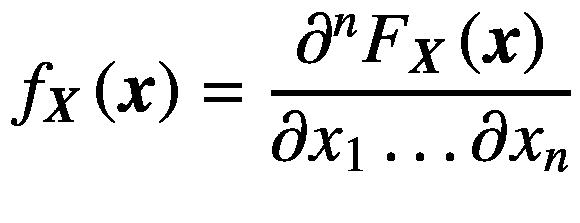

对于两个随机变量 `X` 和 `Y`，联合概率密度函数简化为如下形式：

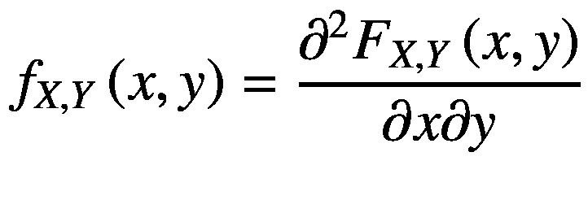

这等价于：

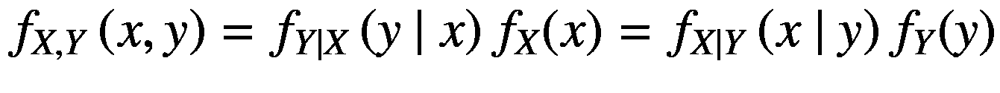

`fY | X` 是在给定 `X` 条件下 `Y` 的条件概率密度函数。`fX` 是 `X` 的边缘概率密度函数。`fX | Y` 是在给定 `Y` 条件下 `X` 的条件概率密度函数。`fY` 是 `Y` 的边缘概率密度函数。

区分 `X` 和 `Y` 的联合概率分布（多元分布）与每个变量各自的概率分布（单变量分布）十分重要。随机变量的单个概率分布被称为其边缘概率分布。通常，`X` 的边缘概率分布可由 `X` 与其他随机变量的联合概率分布确定。例如，若随机变量 `X` 和 `Y` 的联合概率密度函数为 `fX, Y`，则定义边缘分布的 `X` 和 `Y` 的边缘概率密度函数由下式给出：

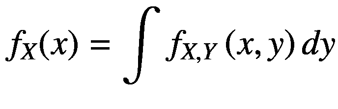

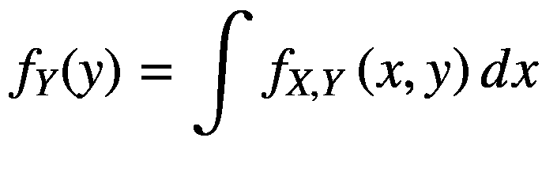

第一个积分是对特定 `X = x` 下 `(X, Y)` 范围内所有点，并对所有 `y` 求和。第二个积分是对 `Y = y` 下 `(X, Y)` 范围内所有点，并对所有 `x` 求和。

例如，图 12-42 展示了一个二元正态分布中抽取的随机样本（黑点）。图中同时显示了边缘概率密度函数。

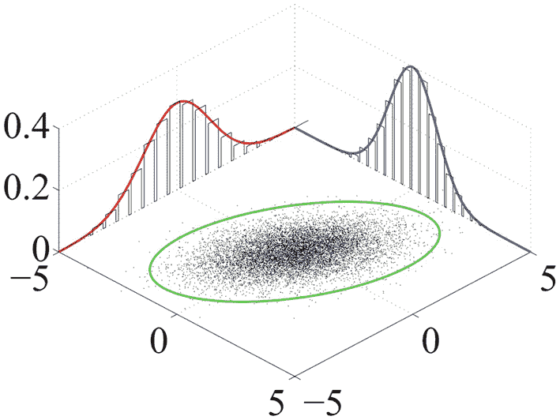

图 12-42 二元正态分布的随机样本

## NM Dev 中的实现

在 NM Dev 中，单变量概率函数的实现继承自 `MultivariateProbabilityDistribution` 接口。此类实现不仅指定了分布的累积分布函数和概率密度函数，还提供了描述性统计量（如均值和方差）等信息。其接口签名如下：

```
public interface MultivariateProbabilityDistribution {
/**
* 获取累积概率 F(x) = Pr(X ≤ x)。
*
* @param x x
* @return F(x) = Pr(X ≤ x)
*/
public double cdf(Vector x);
/**
* 密度函数（若存在），即 F 的导数。它描述了样本空间中每个点的概率密度。
*
* f(x) = dF(X) / dx
*
* 该函数不一定总是存在。
*
* 对于离散情况，此为概率质量函数。它给出离散随机变量恰好等于某个值的概率。
*
* @param x x
* @return f(x)
*/
public double density(Vector x);
/**
* 获取该分布的均值。
*
* @return 均值
*/
public Vector mean();
/**
* 获取该分布的众数。
*
* @return 众数
*/
public Vector mode();
/**
* 获取该分布的协方差矩阵。
*
* @return 协方差
*/
public Matrix covariance();
/**
* 获取该分布的熵。
*
* @return 熵
* @see
* 维基百科：
* 熵（信息论）
*/
public double entropy();
/**
* 矩生成函数是 etX 的期望值。即
*
* E(etX)
*
* 该函数不一定总是存在。
*
* @param t t
* @return E(exp(tX))
* @see
* 维基百科：
* 矩生成函数
*/
public double moment(Vector t);
}
```

请注意，对于多元分布，某些成员函数可能不支持。

## 12.4.1 多元正态分布

多元正态分布、多元高斯分布或联合正态分布是一维（单变量）正态分布向更高维度的推广。它通常用于描述（至少近似地）任何一组（可能）相关的实值随机变量，这些变量各自围绕一个均值聚集。

一个 `k` 维随机向量 `X = (X[1], ⋯, X[k])^(T)` 被称为标准正态随机向量，如果它的所有分量都是独立的、均值为零且方差为 1 的标准正态分布。即，对所有 `i`，有 `X[i]~N(0, 1)`。

一个 `k` 维随机向量 `X = (X[1], ⋯, X[k])^(T)` 具有多元正态分布，记为 `X~N(μ, Σ)`，当且仅当存在一个标准正态随机向量 `Z ∈ ℝ^(l)`，一个向量 `μ ∈ ℝ^(k)`，以及一个矩阵 `A ∈ ℝ^(k × l)`，使得下式成立：

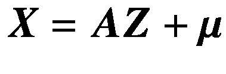

矩阵 `Σ = AA^(T)` 是随机变量 `{X[i]}` 的协方差矩阵。

可以证明，如果 `X~N(μ, Σ)`，则其分量的每一线性组合 `Y = a[1]X[1] + … + a[k]X[k]` 都服从正态分布。也就是说，对于任意常数向量 `a ∈ ℝ^(k)`，随机变量 `Y = a^(T)X` 具有单变量正态分布。

给定均值 `μ` 和正定协方差矩阵 `Σ`，多元正态分布的概率密度函数如下：


如果 `Σ` 是一个 1×1 矩阵（即单个实数），则上述方程简化为单变量正态分布的方程。

对于两个随机变量 `X` 和 `Y` 的情况，向量 `[XY]^(T)` 的联合概率密度函数如下：

![$$ f\left(x,y\right)=\frac{1}{2\pi {\sigma}_X{\sigma}_Y\sqrt{1-{\rho}²}}\exp \left(-\frac{1}{2\left(1-{\rho}²\right)}\left[{\left(\frac{x-{\mu}_X}{\sigma_X}\right)}²-2\rho \left(\frac{x-{\mu}_X}{\sigma_X}\right)\left(\frac{y-{\mu}_Y}{\sigma_Y}\right)+{\left(\frac{y-{\mu}_Y}{\sigma_Y}\right)}²\right]\right) $$](images/500382_1_En_12_Chapter/500382_1_En_12_Chapter_TeX_Equgi.png)

其中 `ρ` 是 `X` 和 `Y` 之间的相关系数，且 `σ[X]` > 0，`σ[Y]` > 0。在更一般的多元正态概率密度函数中，我们有：

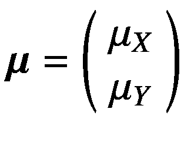 以及 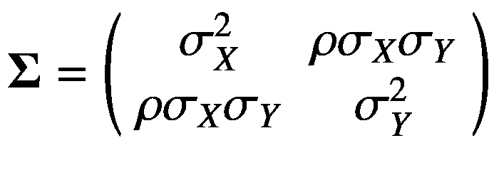

例如，图 12-43 展示了来自具有以下参数的二元正态分布的样本点：

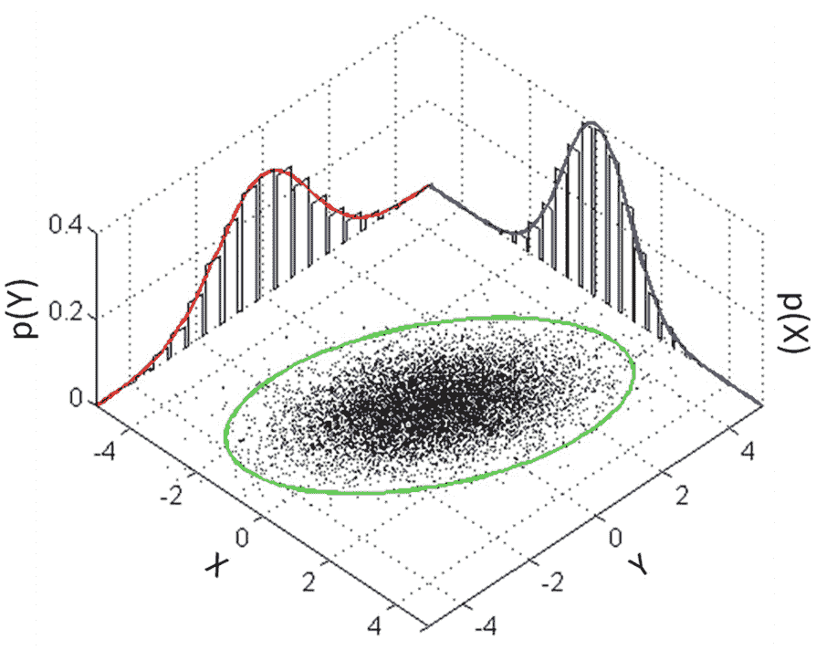

图 12-43 一个二元正态分布

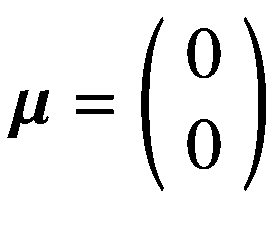 以及 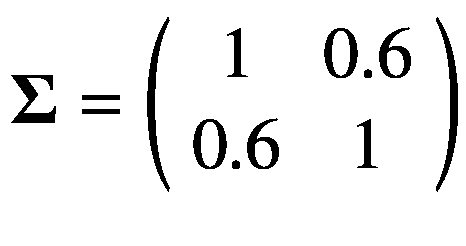

图中还显示了两个边缘分布、一维直方图和 3σ椭圆。

均值如下：

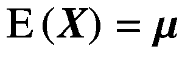

方差如下：

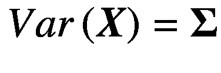

矩生成函数如下：

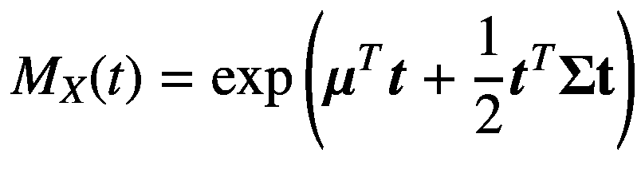

NM Dev 类 `MultivariateNormalDistribution` 实现了多元正态分布。以下是一个示例：

```java
System.out.println("构造一个 3 维多元标准正态分布");
MultivariateProbabilityDistribution mvnorm1
= new MultivariateNormalDistribution(
3 // 维度
);
System.out.println("均值 = " + mvnorm1.mean());
System.out.println("方差 = " + mvnorm1.covariance());
Vector x1 = new DenseVector(0.0, 0.0, 0.0);
System.out.println(String.format("f(%s) = %f", x1, mvnorm1.density(x1)));
x1 = new DenseVector(1.0, 0.0, 0.0);
System.out.println(String.format("f(%s) = %f", x1, mvnorm1.density(x1)));
x1 = new DenseVector(0.0, 0.5, 0.0);
System.out.println(String.format("f(%s) = %f", x1, mvnorm1.density(x1)));
x1 = new DenseVector(0.0, 0.0, 0.3);
System.out.println(String.format("f(%s) = %f", x1, mvnorm1.density(x1)));
x1 = new DenseVector(1.0, 0.5, 0.0);
System.out.println(String.format("f(%s) = %f", x1, mvnorm1.density(x1)));
x1 = new DenseVector(0.0, 0.5, 0.3);
System.out.println(String.format("f(%s) = %f", x1, mvnorm1.density(x1)));
x1 = new DenseVector(1.0, 0.0, 0.3);
System.out.println(String.format("f(%s) = %f", x1, mvnorm1.density(x1)));
x1 = new DenseVector(1.0, 0.5, 0.3);
System.out.println(String.format("f(%s) = %f", x1, mvnorm1.density(x1)));
System.out.println("构造一个 2 维多元正态分布");
DenseVector mu = new DenseVector(1.0, 2.0);
DenseMatrix sigma = new DenseMatrix(new double[][]{{4.0, 2.0}, {2.0, 3.0}});
MultivariateProbabilityDistribution mvnorm2
= new MultivariateNormalDistribution(mu, sigma);
System.out.println("均值 = " + mvnorm2.mean()); // 与 mu 相同
System.out.println("方差 = " + mvnorm2.covariance()); // 与 sigma 相同
Vector x2 = new DenseVector(0.3, 0.4);
System.out.println(String.format("f(%s) = %f", x2, mvnorm2.density(x2)));
x2 = new DenseVector(0.4, 0.3);
System.out.println(String.format("f(%s) = %f", x2, mvnorm2.density(x2)));
```

输出如下：

```text
mean = [0.000000, 0.000000, 0.000000]
variance = 3x3
[,1] [,2] [,3]
[1,] 1.000000, 0.000000, 0.000000,
[2,] 0.000000, 1.000000, 0.000000,
[3,] 0.000000, 0.000000, 1.000000,
f([0.000000, 0.000000, 0.000000] ) = 0.063494
f([1.000000, 0.000000, 0.000000] ) = 0.038511
f([0.000000, 0.500000, 0.000000] ) = 0.056033
f([0.000000, 0.000000, 0.300000] ) = 0.060700
f([1.000000, 0.500000, 0.000000] ) = 0.033986
f([0.000000, 0.500000, 0.300000] ) = 0.053567
f([1.000000, 0.000000, 0.300000] ) = 0.036816
f([1.000000, 0.500000, 0.300000] ) = 0.032490
构造一个 2 维多元正态分布
mean = [1.000000, 2.000000]
variance = 2x2
[,1] [,2]
[1,] 4.000000, 2.000000,
[2,] 2.000000, 3.000000,
f([0.300000, 0.400000] ) = 0.035812
f([0.400000, 0.300000] ) = 0.032955
```

### 12.4.2 多元 t 分布

多元 t 分布是一元（单变量）t 分布向更高维度的推广。对于一个 `p` 维 t 分布，假设 `y ~ N(0, Sigma)` 是一个多元正态分布，`u ~ ChiSquare(v)` 是一个自由度为 `v` 的卡方分布，并且我们有一个 `p` × `p` 的正定尺度矩阵 `Sigma`，使得 `y / sqrt(u / v) = x - mu`，那么随机向量 `x` 服从多元 t 分布。

其概率密度函数（PDF）如下：

```
f(x | v, mu, Sigma) = Gamma((v + p) / 2) / (Gamma(v / 2) * v^(p/2) * pi^(p/2) * |Sigma|^(1/2)) * [1 + (1/v) * (x - mu)^T * Sigma^(-1) * (x - mu)]^(-(v + p) / 2)
```

均值如下：
`E(X) = mu`，`v` > 1；否则未定义。

方差如下：
`Var(X) = v / (v - 2) * Sigma`，`v` > 2；否则未定义。

偏度为 0。

NM Dev 类 `MultivariateTDistribution` 实现了多元 t 分布。示例如下：

```java
int p = 2; // 维度
Vector mu = new DenseVector(1., 2.); // 均值
Matrix Sigma = new DenseMatrix(p, p).ONE(); // 尺度矩阵
int v = 1; // 自由度
MultivariateTDistribution t
= new MultivariateTDistribution(v, mu, Sigma);
Vector x = new DenseVector(1.23, 4.56);
System.out.println(String.format("f(%s) = %f", x, t.density(x)));
v = 2;
t = new MultivariateTDistribution(v, mu, Sigma);
x = new DenseVector(1.23, 4.56);
System.out.println(String.format("f(%s) = %f", x, t.density(x)));
v = 3;
t = new MultivariateTDistribution(v, mu, Sigma);
x = new DenseVector(1.23, 4.56);
System.out.println(String.format("f(%s) = %f", x, t.density(x)));
v = 4;
t = new MultivariateTDistribution(v, mu, Sigma);
x = new DenseVector(1.23, 4.56);
System.out.println(String.format("f(%s) = %f", x, t.density(x)));
v = 5;
t = new MultivariateTDistribution(v, mu, Sigma);
x = new DenseVector(1.23, 4.56);
System.out.println(String.format("f(%s) = %f", x, t.density(x)));
v = 6;
t = new MultivariateTDistribution(v, mu, Sigma);
x = new DenseVector(1.23, 4.56);
System.out.println(String.format("f(%s) = %f", x, t.density(x)));
```

输出如下：

```
f([1.230000, 4.560000] ) = 0.007587
f([1.230000, 4.560000] ) = 0.008595
f([1.230000, 4.560000] ) = 0.008674
f([1.230000, 4.560000] ) = 0.008537
f([1.230000, 4.560000] ) = 0.008351
f([1.230000, 4.560000] ) = 0.008167
```

### 12.4.3 多元 Beta 分布

多元 beta 分布，通常被称为 Dirichlet 分布，是一元（单变量）beta 分布向更高维度的推广。其概率密度函数返回的是当 `K` 个竞争事件各自被观察到 `a[i]` 次时，这些事件的概率为 `x[i]` 的信念。

阶数为 `K` ≥ 2，参数为 `a[1]`, …, `a[K]` 的 Dirichlet 分布，其概率密度函数如下所示：

```
f(x1, ..., xK | a1, ..., aK) = (1 / B(a)) * prod_{i=1}^K x_i^(a_i - 1)
```

其中 `sum_{i=1}^K x_i = 1`，且对于所有 `i`，有 `x[i]` ≥ 0。

归一化常数是多元 beta 函数，可以用伽马函数表示，如下所示：

```
B(a) = prod_{i=1}^K Gamma(a_i) / Gamma(sum_{i=1}^K a_i)
```

图 12-44 展示了一个示例。

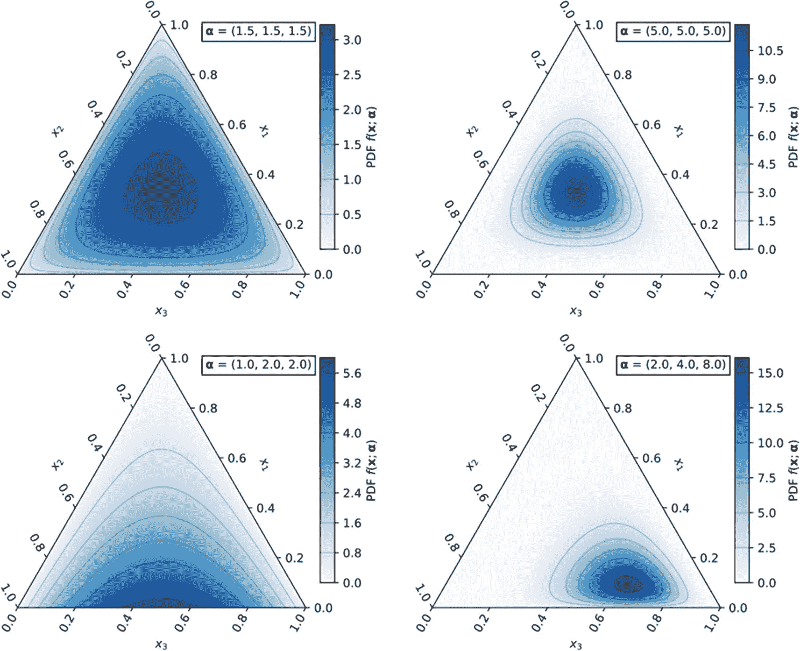

**图 12-44** Dirichlet 分布的概率密度函数

NM Dev 类 `DirichletDistribution` 实现了 Dirichlet 分布。示例如下：

```java
// 参数
double[] a = new double[]{1, 2, 3, 4, 5};
DirichletDistribution dist = new DirichletDistribution(a);
Vector x = new DenseVector(0.1, 0.2, 0.3, 0.2, 0.2);
System.out.println(String.format("f(%s) = %f", x, dist.density(x)));
```

输出如下：

```
f([0.100000, 0.200000, 0.300000, 0.200000, 0.200000] ) = 69.742633
```

### 12.4.4 多项分布

多项分布是二项分布在高维空间中的推广。二项分布给出了一系列二元结果实验中成功（及失败）次数的概率，而多项分布则给出了一个 `k` 面骰子投掷 `n` 次后每个面出现次数的概率。换句话说，对于 `n` 次独立试验，每次试验恰好导致 `k` 个类别中的一个成功，且每个类别具有给定的固定成功概率，多项分布给出了各个类别成功次数任意特定组合的概率。当 `k` 为 2 且 `n` 为 1 时，多项分布就是伯努利分布。当 `k` 为 2 且 `n` 大于 1 时，它就是二项分布。当 `k` 大于 2 且 `n` 为 1 时，它就是分类分布。

从数学上讲，我们有 `k` 个可能的互斥结果，对应的概率为 `p[1]`, …, `p[k]`，以及 `n` 次独立试验。由于这 `k` 个结果互斥且必然发生一个，因此对于 `i` = 1, …, `k`，有 `p[i]` ≥ 0，并且

$$
\sum_{i=1}^k{p}_i=1
$$

如果随机变量 `{X[i]}` 表示第 `i` 个结果在 `n` 次试验中被观察到的次数，则随机向量 `X` = (`X[1]`, …, `X[k]`)^(T) 服从参数为 `n` 和 `p` 的多项分布，其中 `p` = (`p[1]`, …, `p[k]`)。虽然各次试验是独立的，但结果 `X` 是相互依赖的，因为它们必须加起来等于 `n`，即

$$
\sum_{i=1}^k{x}_i=n
$$

多项分布是一种离散概率分布。其概率质量函数描述了 `k` 个事件同时发生的联合概率。

$$
{p}_{X_1,\dots, {X}_k}\left({x}_1,\dots, {x}_k\right)=\mathrm{P}\left({X}_1={x}_1\wedge \dots \wedge {X}_k={x}_k\right)
$$

所有结果的总和等于 1。

$$
\sum \limits_i\sum \limits_j\dots \sum \limits_n\mathrm{P}\left({X}_1={x}_{1i},\dots, {X}_k={x}_{kn}\right)=1
$$

## 多项分布

该多项分布的概率质量函数给出了从一个袋子中抽取 `n` 个 `k` 种不同颜色球（每次抽取后放回）的概率。相同颜色的球视为等同。


均值如下：


方差和协方差如下：


矩母函数如下：


假设我们将 100 个球放入 3 个箱子，每个箱子的成功概率分别为 0.1、0.2 和 0.7。那么每个箱子中恰好有 10、20 和 70 个球的概率为 0.013279。见图 12-45。


图 12-45 多项分布，`k` = 3，`n` = 100

NM Dev 类 `MultinomialDistribution` 实现了多项分布。以下代码实现了前述示例：

```java
// k = 3, 3 个成功概率各为
double[] prob = new double[]{0.1, 0.2, 0.7};
int n = 100;
MultinomialDistribution dist = new MultinomialDistribution(n, prob);
// n 次试验的一个结果
Vector x = new DenseVector(new double[]{10, 20, 70});
System.out.println(String.format("f(%s) = %f", x, dist.density(x)));
```

输出如下：

```
f([10.000000, 20.000000, 70.000000] ) = 0.013279
```

## 12.5 假设检验

统计假设检验是一种统计推断方法。假设检验用于评估样本数据是否支持我们称之为假设的数据解释。假设是布尔型的，要么是肯定要么是否定。例如，我们可能想要检验以下内容：
- 数据服从正态分布。
- 关于总体参数的某个假设为真。
- 两个样本来自同一个总体分布。

假设检验背后的思想是：假设（零）假设为真，评估我们观察到该数据的可能性。如果该可能性很低，我们就说结果具有统计显著性，足以"拒绝零假设"。否则，我们就"无法拒绝零假设"。统计推断提供了一种替代方法来"证明"某事。我们可能无法通过从一组公理逐步使用演绎逻辑推理直到得出结论的方式来证明上帝的存在。但我们可以用统计方法证明上帝的存在。至少，我们可以无法拒绝"上帝存在"这个零假设。

通过假设检验并不意味着零假设为真。它仅仅意味着没有足够的证据表明它很可能是错误的。结果不具备统计显著性。事实上，使用假设检验可能会犯两种类型的推断错误。第一类错误是指零假设实际上为真，但我们却拒绝了它。这也被称为假阳性。这种情况可能发生在我们观测到的数据是极端值（不太可能发生但确实发生了）。第二类错误是指零假设为假，但我们未能拒绝它。这也被称为假阴性。例如，一种药物无效，但根据数据我们认为它是有效的。

再举一个例子，假设我们怀疑一枚硬币有偏差，旋转它时正面朝上的概率低于 50%。为了验证这个怀疑，我们进行了一项实验，旋转硬币 100 次，得到 37 次正面和 63 次反面。观察到的正面比例为 `37/100 = 37%`。对于这组数据，我们有两种可能的解释：
- 零假设（`H_0`）：数据仅仅是随机波动的反映。旋转硬币时正面朝上的真实概率是 `p = 0.5`。
- 备择假设（`H_1`）如下：旋转硬币时正面朝上的真实概率是 `p < 0.5`。

注意，零假设和备择假设必须互斥。如果我们无法拒绝零假设，就接受备择假设来解释数据。

让我们来回答这个问题："零假设是否为数据提供了一个合理的解释？" 首先，我们需要设计一个检验统计量来衡量数据与假设零假设为真时期望值之间的差异。在我们的例子中，如果零假设为真，那么正面朝上的次数（以及正面朝上的比例）服从参数 `p = 0.5` 和 `υ = 100` 的二项分布。该分布的标准差等于 0.05。可以使用以下代码进行计算：

```java
int n = 100;
BinomialDistribution dist2 = new BinomialDistribution(
    n,
    0.5 // p
);
double stdev = sqrt(dist2.variance()) / n;
System.out.println("standard deviation = " + stdev);
```

输出结果如下：

```
standard deviation = 0.05
```

因此，观测比例（37%）与真实比例（50%）之间差异的标准化 z 分数如下：
`z = (0.37 - 0.5) / 0.05 = -2.6`

我们可以看到，如果零假设为真，那么这个 z 分数异常地负，处于正态分布的极端一侧。查标准正态分布的累积分布函数（CDF）可知，z 分数为 −2.6 的概率是 0.004661188023718749（p 值），发生的概率低于 0.5%。以下代码计算了 z 分数和 p 值。

```java
double z_score = (0.37 - 0.5) / stdev;
System.out.println("z-score = " + z_score);
double p_value = new NormalDistribution() // default ctor for standard normal distribution
    .cdf(z_score);
System.out.println("p-value = " + p_value);
```

输出结果如下：

```
z-score = -2.6
p-value = 0.004661188023718749
```

换句话说，如果零假设为真，那么我们观察到该数据（37%的正面朝上）的概率极低。零假设对我们的数据提供了一个很差的解释。因此，我们拒绝零假设，接受备择假设。实际情况可能是这枚硬币有偏差，旋转它时正面朝上的概率低于 50%。（参见图 12-46。）


**图 12-46** 假设检验的拒绝域

这个例子说明了进行假设检验的一般步骤。

### 假设检验的步骤


**图 12-47** 假设检验的步骤

1. 收集数据和/或进行实验。

2. 陈述零假设（`H_0`）和备择假设（`H_1`）。零假设本身不涉及数据。它是关于总体参数或数值特征的一个陈述。我们检验该参数的有效性。备择假设是零假设的互斥否定版本。

3. 设计一个合适的检验和检验统计量 `T`。推导在零假设和相关假设下检验统计量的分布。通常使用正态分布和 t 分布。

4. 选择一个显著性水平 `α`，这是一个概率阈值，低于该阈值时拒绝零假设。常见的值有 5%（统计显著）和 1%（统计极显著）。

5. 根据观测值计算检验统计量 `T` 的观测值 `t̂`。计算 p 值。这是在零假设下，抽样得到一个至少与观测值一样极端的检验统计量的概率（该事件的最大概率）。

6. 当且仅当 p 值小于（或等于）显著性水平阈值 `α` 时，拒绝零假设，支持备择假设。（参见图 12-47。）

NM Dev 提供了广泛的假设检验，用于检验总体分布、总体参数以及比较潜在的总体分布。所有假设检验的实现都继承自抽象类 `HypothesisTest`。其签名如下：

`public abstract class HypothesisTest`类定义了一系列用于假设检验的抽象方法。该类提供了获取检验统计量、p 值、原假设和备择假设描述等基本功能。

```java
/**
 * 获取检验统计量。
 *
 * @return 检验统计量
 * @see 维基百科: 检验统计量
 */
public abstract double statistics();

/**
 * 获取检验统计量的 p 值。
 *
 * @return p 值
 * @see 维基百科: P 值
 */
public abstract double pValue();

/**
 * 获取原假设的描述。
 *
 * @see 维基百科: 原假设
 * @return 原假设描述
 */
public abstract String getNullHypothesis();

/**
 * 获取备择假设的描述。
 *
 * @return 备择假设描述
 * @see 维基百科: 备择假设
 */
public abstract String getAlternativeHypothesis();

/**
 * 获取观察数据的组数。
 *
 * @return 观察数据的组数
 */
public int nGroups() {
    return k;
}

/**
 * 获取观察数据的总数。
 *
 * @return 观察数据的总数
 */
public int nObs() {
    return N;
}

/**
 * 使用 p 值检查在给定的显著性水平下是否可以拒绝原假设。
 * 即，在原假设成立的情况下，观察到当前数据的概率很小。
 *
 * @param alpha 检验的显著性水平
 * @return {@code true} 如果根据 p 值拒绝了原假设
 */
public boolean isNullRejected(double alpha) {
    return pValue() < alpha;
}
```

以下类表示单侧检验的 p 值。顾名思义，检验统计量的方向是已知的。该 p 值定义为在原假设为真的情况下，观察到检验统计量至少与观测值一样极端的概率。对于连续分布，它由互补累积分布函数（生存函数）给出。对于离散分布，我们还需要加上观测到临界值的概率。

```java
/**
 * 获取单侧检验的 p 值。即，在原假设为真的情况下，
 * 观察到检验统计量至少与观测临界值一样极端的概率。
 * 对于连续分布，由互补累积分布函数（生存函数）给出。
 * 对于离散分布，还需要加上观测到临界值的概率。
 *
 * @param F 一个单变量分布
 * @param x 临界值
 * @return 临界值的 p 值
 */
public static double oneSidedPvalue(ProbabilityDistribution F, double x) {
    if (F instanceof EmpiricalDistribution) {
        return 1.0 - F.cdf(x) + F.density(x);
    }
    return 1.0 - F.cdf(x);
}
```

## 12.5.1 分布检验

NM Dev 支持大量假设检验，用于评估数据样本是否来自特定分布（例如正态分布），或者两个样本是否具有相同的总体分布。

### 12.5.1.1 正态性检验

存在多种假设检验用于评估样本是否服从正态分布。它们具有不同的功效和局限性，例如对样本量上限的要求。

#### Shapiro-Wilk 检验

最好的正态性检验是 Shapiro-Wilk 检验，适用于样本量不超过 5000 个数据点且没有太多相同值的情况。Shapiro-Wilk 检验的原假设是样本 `x[1]`, …, `x[n]` 来自正态分布总体。其检验统计量如下：

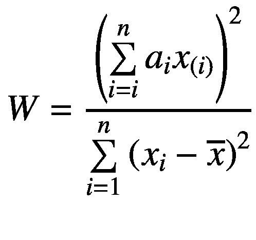

其中 `x[(i)]`（下标索引 `i` 用括号括起来；不要与 `x[i]` 混淆）是第 `i` 个顺序统计量。要找到顺序统计量，我们需要对样本进行排序，并找出样本中第 `i` 个最小的数。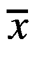 是样本均值。

系数 `a[i]` 由下式给出：

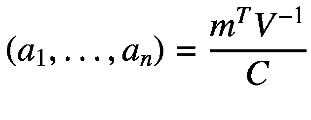

其中 `C` 是一个向量范数，如下所示：

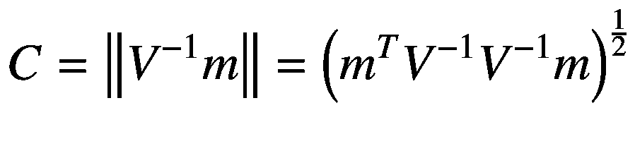

向量 `m` 由来自标准正态分布的独立同分布随机变量的顺序统计量的期望值构成。`V` 是这些正态顺序统计量的协方差矩阵。

`W` 服从 Shapiro-Wilk 分布，该分布在算法 AS R94 (Anon., 1995) 中实现。

NM Dev 类 `ShapiroWilk` 实现了 Shapiro-Wilk 检验。以下是一个示例：

```java
double[] sample = new double[]{-1.7, -1, -1, -.73, -.61, -.5, -.24, .45, .62, .81, 1, 5};
ShapiroWilk test = new ShapiroWilk(sample);
System.out.println("H0: " + test.getNullHypothesis());
System.out.println("H1: " + test.getAlternativeHypothesis());
System.out.println("test statistics = " + test.statistics());
System.out.println("p-value = " + test.pValue());
System.out.println("is null rejected at 5% = " + test.isNullRejected(0.05));
```

输出结果如下：

```
H0: the samples come from a normally distributed population
H1: the samples do not come from a normally distributed population
test statistics = 0.7818521311977514
p-value = 0.005868730248429044
is null rejected at 5% = true
```

对于这个样本，在 5% 的显著性水平下拒绝了原假设。因此，接受备择假设，即该样本不服从正态分布。

#### Jarque-Bera 检验

Jarque-Bera 检验是一种拟合优度检验，用于检验样本数据的偏度和峰度是否与正态分布匹配。正态分布的偏度和超额峰度都等于零。如果任何一个值远离零，则表明数据不服从正态分布。

检验统计量 `JB` 定义如下：

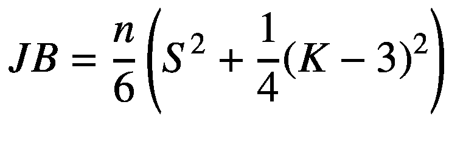

其中 `n` 是观测值数量（通常为自由度），`S` 是样本偏度，`K` 是样本峰度。

如果数据来自正态分布，`JB` 统计量渐近地服从自由度为 2 的卡方分布，因此该统计量可用于检验数据是否来自正态分布。原假设是偏度为零且超额峰度为零的联合假设。正如 `JB` 的定义所示，任何与此的偏差都会增加 `JB` 统计量。

对于小样本，卡方近似过于敏感，常常在原假设为真时拒绝它。此外，p 值的分布偏离均匀分布，变成右偏的单峰分布，尤其对于小的 p 值。这导致较大的第一类错误率。存在更强大的正态性检验。

NM Dev 类 `JarqueBera` 实现了 Jarque-Bera 检验。以下是一个示例：

# 达戈斯蒂诺检验

达戈斯蒂诺检验是一种比雅克-贝拉检验更强大的正态性检验方法，它也是衡量偏离正态分布的拟合优度指标。该检验基于样本峰度和偏度的变换，结合了偏度检验和峰度检验。偏度检验用于判断数据的偏度是否在统计上显著异于零，其检验统计量为 `z_s²`。同样，峰度检验用于判断数据的超额峰度是否在统计上显著异于零，其检验统计量为 `z_k²`。达戈斯蒂诺检验基于以下原理：当数据服从正态分布时，检验统计量 `T = z_s² + z_k²` 服从自由度为 2 的卡方分布。该检验通常不应用于样本量小于 20 的数据集。原假设如下：偏度和超额峰度均为 0。备择假设如下：偏度或超额峰度中至少有一个不为 0。

NM Dev 类 `DAgostino` 实现了达戈斯蒂诺检验。示例如下：

```java
double[] samples = new double[]{
    39, 35, 33, 33, 32, 30, 30, 30, 28, 28,
    27, 27, 27, 27, 27, 26, 26, 26, 26, 26,
    26, 25, 25, 25, 25, 25, 25, 24, 24, 24,
    24, 24, 23, 23, 23, 23, 23, 23, 23, 23,
    23, 23, 23, 23, 23, 22, 22, 22, 22, 21,
    21, 21, 21, 21, 21, 21, 20, 20, 19, 19,
    18, 16
};
DAgostino test = new DAgostino(samples);
System.out.println("H0: " + test.getNullHypothesis());
System.out.println("H1: " + test.getAlternativeHypothesis());
System.out.println("skewness test statistics " + test.Z1());
System.out.println("p-value for skewness test = " + test.pvalueZ1());
System.out.println("kurtosis test statistics " + test.Z2());
System.out.println("test statistics = " + test.statistics());
System.out.println("p-value = " + test.pValue());
System.out.println("is null rejected at 5% = " + test.isNullRejected(0.05));
```

输出如下：

```
H0: both the skewness and the excess kurtosis are 0
H1: either the skewness or the excess kurtosis is non-zero
skewness test statistics 3.1816798934083783
p-value for skewness test = 0.001464235568704897
kurtosis test statistics 2.328055257751046
test statistics = 15.542928227261438
p-value = 4.2159555092358136E-4
is null rejected at 5% = true
```

# 利利福斯检验

利利福斯检验用于检验原假设，即数据来自一个均值与方差均由样本估计得到的正态分布总体。检验统计量是经验分布与假设正态分布之间的最大绝对差值。由于假设的累积分布函数使用了基于数据的均值和方差估计值，因此检验统计量的“零分布”（即在原假设为真时的概率分布）在随机意义上小于原假设指定了一个特定正态分布时的分布（这就是利利福斯分布产生的原因）。

该检验步骤如下：
1.  首先，根据数据估计总体均值和总体方差。
2.  然后，找出经验分布函数与具有估计均值和估计方差的正态分布累积分布函数之间的最大差异。
3.  最后，评估该最大差异是否足够大以具有统计显著性，从而拒绝原假设。我们使用利利福斯分布来确定拒绝域。

NM Dev 类 `Lilliefors` 实现了利利福斯检验。在本实现中，我们首先使用 `Dallal` & `Wilkinson (1986)` 中的公式计算 `p` 值，该公式仅在 `p` 值小于 0.1 时被认为可靠。当此 `p` 值大于 0.1 时，我们再次使用修正统计量的分布 `(Stephens, 1974)` 计算 `p` 值。示例如下：

```java
double[] sample = new double[]{-1.7, -1, -1, -.73, -.61, -.5, -.24, .45, .62, .81, 1, 5};
Lilliefors test = new Lilliefors(sample);
System.out.println("H0: " + test.getNullHypothesis());
System.out.println("H1: " + test.getAlternativeHypothesis());
System.out.println("test statistics = " + test.statistics());
System.out.println("p-value = " + test.pValue());
System.out.println("is null rejected at 5% = " + test.isNullRejected(0.05));
```

输出如下：

```
H0: the samples come from a normally distributed population
H1: the samples do not come from a normally distributed population
test statistics = 0.23353570622938402
p-value = 0.0696831488554199
is null rejected at 5% = false
```

## 12.5.1.2 柯尔莫哥洛夫检验

柯尔莫哥洛夫-斯米尔诺夫检验（K-S 检验或 KS 检验）有两种版本。单样本 KS 检验比较样本的经验分布函数与参考分布的累积分布函数之间的距离（如利利福斯检验）。双样本 KS 检验比较两个样本的经验分布函数之间的距离。该统计量的零分布是在零假设下计算的，零假设为样本来自参考分布（单样本情况）或样本来自同一分布（双样本情况）。见图 12-48。

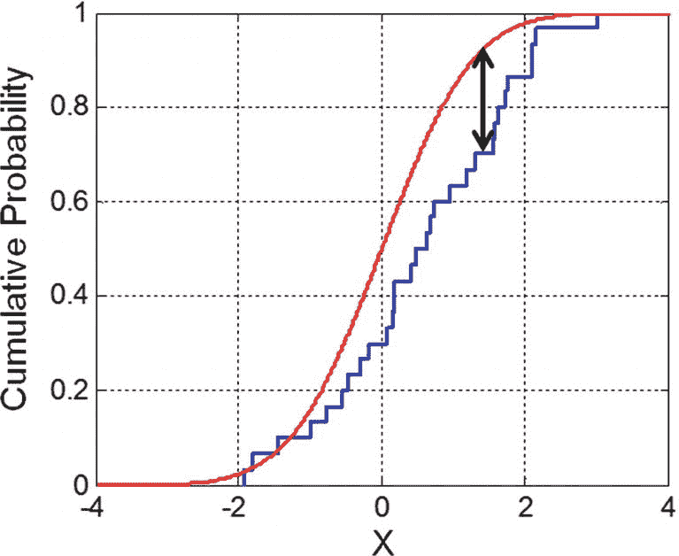

图 12-48

单样本柯尔莫哥洛夫-斯米尔诺夫统计量示意图。平滑线为参考 CDF，阶梯线为经验 CDF，黑色箭头为 K-S 统计量。

单样本柯尔莫哥洛夫-斯米尔诺夫统计量如下：

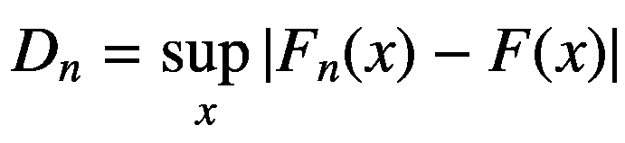

其中，`$$ \underset{x}{\sup } $$` 是经验分布函数 `F_n` 与累积分布函数 `F(x)` 之间距离集合的上确界。直观上，该统计量取所有 `x` 值上两个分布函数之间的最大绝对差值。根据格里文科-坎特利定理，如果样本来自分布 `F(x)`，那么当 `n` 趋于无穷时，`D[n]` 几乎必然收敛于 0。在实践中，该统计量需要相对较大的数据点数量（与其他拟合优度准则如安德森-达林检验统计量相比）才能正确拒绝零假设。如果 `F(x)` 的参数是根据数据确定的，例如利利福斯检验中的样本均值和样本方差，那么使用柯尔莫哥洛夫-斯米尔诺夫分布确定的临界值将是无效的。

双样本柯尔莫哥洛夫-斯米尔诺夫检验用于评估两个一维概率分布是否存在差异。双样本 KS 统计量如下：

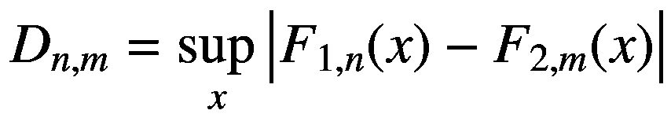

其中，`F_{1,n}` 和 `F_{2,m}` 分别是第一个和第二个样本的经验分布函数，`$$ \underset{x}{\sup } $$` 是上确界函数。

双样本 KS 检验是比较两个样本最有用且最通用的非参数方法之一，因为它对两个样本经验累积分布函数在位置和形状上的差异都敏感。见图 12-49。

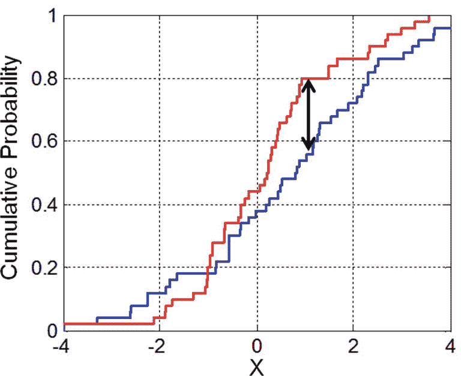

图 12-49

双样本柯尔莫哥洛夫-斯米尔诺夫统计量示意图。平滑线和阶梯线各对应一个经验分布函数，黑色箭头为双样本 KS 统计量。

柯尔莫哥洛夫-斯米尔诺夫检验可以修改为拟合优度检验。在检验分布正态性的特殊情况下，样本会被标准化并与标准正态分布进行比较。这等同于将参考分布的均值和方差设置为样本估计值，并且已知使用这些值来定义特定的参考分布会改变检验统计量的零分布（参见利利福斯检验）。多项研究发现，即使在这种修正形式下，该检验在检验正态性方面的功效也低于夏皮罗-威尔克检验或安德森-达林检验。然而，这些其他检验也有自身的缺点。例如，夏皮罗-威尔克检验已知在大样本或包含许多相同值的样本中效果不佳。

NM Dev 类 `KolmogorovSmirnov1Sample` 和 `KolmogorovSmirnov2Samples` 实现了单样本和双样本柯尔莫哥洛夫-斯米尔诺夫检验。示例如下：

```java
// one-sample KS test
KolmogorovSmirnov1Sample test1 = new KolmogorovSmirnov1Sample(
new double[]{ // with duplicates
1.2142038235675114, 0.8271665834857130, -2.2786245743283295, 0.8414895245471727,
-1.4327682855296735, -0.2501807766164897, -1.9512765152306415, 0.6963626117638846,
0.4741320101265005, 1.2142038235675114
},
new NormalDistribution(),
KolmogorovSmirnov.Side.TWO_SIDED // options are: TWO_SIDED, GREATER, LESS
);
System.out.println("H0: " + test1.getNullHypothesis());
System.out.println("test statistics = " + test1.statistics());
System.out.println("p-value = " + test1.pValue());
System.out.println("is null rejected at 5% = " + test1.isNullRejected(0.05));
// two-sample KS test
KolmogorovSmirnov2Samples test2 = new KolmogorovSmirnov2Samples(
new double[]{ // x = rnorm(10)
1.2142038235675114, 0.8271665834857130, -2.2786245743283295, 0.8414895245471727,
-1.4327682855296735, -0.2501807766164897, -1.9512765152306415, 0.6963626117638846,
0.4741320101265005, -1.2340784297133520
},
new double[]{ // x = rnorm(15)
1.7996197748754565, -1.1371109188816089, 0.8179707525071304, 0.3809791236763478,
0.1644848304811257, 0.3397412780581336, -2.2571685407244795, 0.4137315314876659,
0.7318687611171864, 0.9905218801425318, -0.4748590846019594, 0.8882674167954235,
1.0534065683777052, 0.2553123235884622, -2.3172807717538038},
KolmogorovSmirnov.Side.GREATER // options are: TWO_SIDED, GREATER, LESS
);
System.out.println("H0: " + test2.getNullHypothesis());
System.out.println("test statistics = " + test2.statistics());
System.out.println("p-value = " + test2.pValue());
System.out.println("is null rejected at 5% = " + test2.isNullRejected(0.05));
```

输出如下：

```
H0: the true distribution function of sample is equal to the hypothesized distribution function
test statistics = 0.2822971133259847
p-value = 0.4028859117233684
is null rejected at 5% = false
H0: the true distribution function of sample is greater than the distribution function of the other sample
test statistics = 0.2666666666666667
p-value = 0.4259925874001307
is null rejected at 5% = false
```

#### 12.5.1.3 安德森-达令检验

安德森-达令多样本检验用于检验多个样本是否来自同一分布，该分布无需事先指定。该检验会生成两个统计量和两个 p 值。`T[kN]` 和 `p[kN]` 是在不存在结观测值时的统计量和 p 值。`T[akN]` 和 `p[akN]` 是当分布为离散型或连续型数据被分组时，针对结观测值采用的替代统计量和 p 值。在这两种情况下，可能存在结观测值。

NM Dev 库中的 `AndersonDarling` 类实现了安德森-达令多样本检验。示例如下：

### 12.5.1.4 克拉默·冯·米塞斯检验

双样本克拉默·冯·米塞斯检验是另一种用于比较两个样本，评估它们是否来自同一总体分布的检验方法。

NM Dev 库中的 `CramerVonMises2Samples` 类实现了双样本克拉默·冯·米塞斯检验。示例如下：

```
// 样本数据
double[] x1 = new double[]{-0.54289848, 0.08999578, -1.77719573, -0.67991860, -0.65741590, -0.25776164, 1.02024626, 1.26434300, 0.51068476, -0.23998229};
double[] x2 = new double[]{1.7053818, 1.0260726, 1.7695157, 1.5650577, 1.4945107, 1.8593791, 2.1760302, -0.9728721, 1.4208313, 1.5892663};
CramerVonMises2Samples test = new CramerVonMises2Samples(x1, x2);
System.out.println("H0: " + test.getNullHypothesis());
System.out.println("H1: " + test.getAlternativeHypothesis());
System.out.println("test statistics = " + test.statistics());
System.out.println("p-value = " + test.pValue());
System.out.println("is null rejected at 5% = " + test.isNullRejected(0.05));
```

输出结果如下：

```
H0: the two samples are drawn from the same distribution
H1: the two samples are not drawn from the same distribution
test statistics = 1.1450000000000002
p-value = 0.0010713596423332916
is null rejected at 5% = true
```

### 12.5.1.5 皮尔逊卡方检验

皮尔逊卡方独立性检验用于评估列联表（一个矩阵）中两个变量的成对观测值是否相互独立。原假设是这两个变量在统计上相互独立。

例如，假设我们想找出上课是否有助于通过考试（比如澳大利亚英才班的那些测试）。我们会在如下所示的列联表中记录出勤/缺勤与通过/未通过的关系：

|   | 通过 | 未通过 | 总计 |
| --- | --- | --- | --- |
| 出勤 | 25 | 6 | 31 |
| 缺勤 | 8 | 15 | 23 |
| 总计 | 33 | 21 | 54 |

如果变量确实相互独立，我们预计会得到如下公平的结果：

|   | 通过 | 未通过 | 总计 |
| --- | --- | --- | --- |
| 出勤 | `31*33/54 = 18.94` | `31*21/54 = 12.06` | 31 |
| 缺勤 | `23*33/54 = 14.06` | `23*21/54 = 8.94` | 23 |
| 总计 | 33 | 21 | 54 |

检验统计量如下：

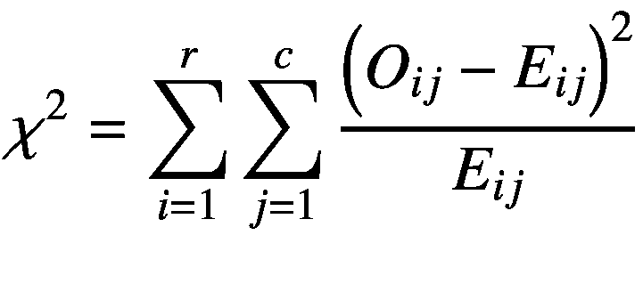

其中 `O[ij]` 是某个单元格中的观测频数，`E[ij]` 是假设独立性原假设下的期望频数。该检验统计量是对所有行（`r`）和列（`c`）求和。它本质上是将平方偏差之和除以期望频数，以对所有单元格中大数和小数进行归一化处理。注意，当且仅当所有单元格的 `O[ij] = E[ij]` 时，`χ² = 0`。

当样本量较小且列联表不平衡时，`χ²` 服从费希尔精确分布。否则，当样本量较大且列联表平衡时，我们使用卡方分布，这是费希尔精确分布的渐近分布。

NM Dev 库中的 `ChiSquareIndependenceTest` 类实现了皮尔逊卡方独立性检验。以下代码针对前面的示例进行计算：

# 卡方独立性检验与 T 检验

## 12.5.1 卡方独立性检验

### 12.5.1.1 示例：通过/未通过与上课/未上课

下面的代码计算一个 `ChiSquareIndependenceTest`，并打印假设、检验统计量、p 值和是否拒绝原假设的结论。

```java
// 出勤/缺勤与通过/未通过的计数
Matrix counts = new DenseMatrix(new double[][]{
{25, 6},
{8, 15}
});
ChiSquareIndependenceTest test1
= new ChiSquareIndependenceTest(
counts,
0,
// 渐近分布是卡方分布
ChiSquareIndependenceTest.Type.ASYMPTOTIC
);
Matrix expected = ChiSquareIndependenceTest.getExpectedContingencyTable(
new int[]{31, 23}, // 行和
new int[]{33, 21} // 列和
);
System.out.println("期望频数:");
System.out.println(expected);
System.out.println("H0: " + test1.getNullHypothesis());
System.out.println("H1: " + test1.getAlternativeHypothesis());
System.out.println("test statistics = " + test1.statistics());
System.out.println("p-value = " + test1.pValue());
System.out.println("is null rejected at 5% = " + test1.isNullRejected(0.05));
ChiSquareIndependenceTest test2
= new ChiSquareIndependenceTest(
counts,
100000,// 计算费希尔精确分布的模拟次数
ChiSquareIndependenceTest.Type.EXACT // 使用费希尔精确分布
);
System.out.println("p-value = " + test2.pValue());
System.out.println("is null rejected at 5% = " + test2.isNullRejected(0.05));
```

输出结果如下：

```
the expected frequencies:
2x2
[,1] [,2]
[1,] 18.944444, 12.055556,
[2,] 14.055556, 8.944444,
H0: the two random variables in the contingency table are independent
H1: the two random variables in the contingency table are not independent
test statistics = 9.835886413726527
p-value = 0.0017113979062570728
is null rejected at 5% = true
p-value = 6.500000000000436E-4
is null rejected at 5% = true
```

使用卡方分布作为渐近分布时，p 值为 `0.0017`。使用费希尔精确分布时，p 值为 `0.0006`。无论哪种情况，在 5%的显著性水平下都可以放心地拒绝原假设。我们得出结论：上课对考试通过与否毫无影响的可能性非常小。或者说，上课与通过考试很可能存在关联。所以，不要逃课！

## 12.5.2 秩检验

NM Dev 支持一系列假设检验，用于评估两个样本是否具有相同的总体均值、中位数和变异性。

### 12.5.2.1 T 检验（T-Test）

`t` 检验为两个独立同分布的正态总体均值是否相等提供了精确检验，这两个总体方差未知但相等。韦尔奇 `t` 检验则适用于数据正态但方差可能不同的情况，属于近似精确检验。当用于单样本时，该检验可用于将样本均值与假设均值进行比较。对于中等大小的样本和单尾检验，`t` 检验对正态性假设的适度偏离相对稳健。在样本足够大时，`t` 检验渐近趋近于 `z` 检验，即使数据严重偏离正态分布也依然稳健。然而，如果数据严重非正态且样本量较小，`t` 检验可能会给出误导性结果。

NM Dev 类 `T` 同时实现了等方差 `t` 检验和方差不相等时的韦尔奇 `t` 检验。示例如下：

```java
// t 检验
T test1 = new T(
new double[]{1, 3, 5, 2, 3, 5},
new double[]{2, 5, 6, 4, 9, 8},
true, // 假设方差相等
4 // 原假设中的假设均值差 = 4
);
System.out.println("H0: " + test1.getNullHypothesis());
System.out.println("H1: " + test1.getAlternativeHypothesis());
System.out.println("检验统计量 = " + test1.statistics());
System.out.println("第一组均值 = " + test1.mean1());
System.out.println("第二组均值 = " + test1.mean2());
System.out.println("p 值 = " + test1.pValue());
System.out.println("p 值（右侧） = " + test1.rightOneSidedPvalue());
System.out.println("p 值（左侧） = " + test1.leftOneSidedPvalue());
System.out.println(String.format("95%% 置信区间 = (%f, %f)", test1.leftConfidenceInterval(0.95), test1.rightConfidenceInterval(0.95)));
System.out.println("97.5%% 置信区间 = " + Arrays.toString(test1.confidenceInterval(0.975)));
System.out.println("是否在 5%显著性水平下拒绝原假设 = " + test1.isNullRejected(0.05));
// 韦尔奇 t 检验
T test2 = new T(
new double[]{1, 3, 5, 2, 3, 5},
new double[]{2, 5, 6, 4, 9, 8},
false, // 假设方差不相等
4 // 原假设中的假设均值差 = 4
);
System.out.println("检验统计量 = " + test2.statistics());
System.out.println("p 值 = " + test2.pValue());
System.out.println("p 值（右侧） = " + test2.rightOneSidedPvalue());
System.out.println("p 值（左侧） = " + test2.leftOneSidedPvalue());
System.out.println(String.format("95%% 置信区间 = (%f, %f)", test2.leftConfidenceInterval(0.95), test2.rightConfidenceInterval(0.95)));
System.out.println("97.5%% 置信区间 = " + Arrays.toString(test2.confidenceInterval(0.975)));
System.out.println("是否在 5%显著性水平下拒绝原假设 = " + test2.isNullRejected(0.05));
```

输出结果如下：

### 12.5.2.2 单因素方差分析（One-Way ANOVA）

```
H0: 均值相等
H1: 均值不相等
检验统计量 = -5.239739845279477
第一组均值 = 3.1666666666666665
第二组均值 = 5.666666666666667
p 值 = 3.7894052596908147E-4
p 值（右侧） = 0.9998105297370155
p 值（左侧） = 1.8947026298454073E-4
95% 置信区间 = (-0.251606, -4.748394)
97.5%% 置信区间 = [-5.26404992720365, 0.26404992720364895]
是否在 5%显著性水平下拒绝原假设 = true
检验统计量 = -5.239739845279477
p 值 = 6.816159267755681E-4
p 值（右侧） = 0.9996591920366122
p 值（左侧） = 3.4080796338778404E-4
95% 置信区间 = (-0.205769, -4.794231)
97.5%% 置信区间 = [-5.339736444764696, 0.33973644476469556]
是否在 5%显著性水平下拒绝原假设 = true
```

第一组的均值为 3.17，第二组的均值为 5.67。假设方差相等的 `t` 检验在 5%显著性水平下拒绝了均值差为 4 的原假设。假设方差不等的韦尔奇 `t` 检验同样拒绝了原假设。

单因素方差分析用于检验多个组的均值是否相等。ANOVA 的优势在于它比双样本 `t` 检验更具优越性。进行多次双样本 `t` 检验会增加犯第一类错误的概率。因此，ANOVA 在比较三个或更多均值时非常有用。

NM Dev 类 `OneWayANOVA` 实现了单因素方差分析。示例如下：

```java
double[][] samples = new double[4][];
samples[0] = new double[]{1.3, 5.4, 7.6, 7.2, 3.5};
samples[1] = new double[]{2.7, 5.21, 6.3, 4.4, 9.8, 10.24};
samples[2] = new double[]{-2.3, -5.3, -4.33, -5.4};
samples[3] = new double[]{0.21, 0.34, 0.27, 0.86, 0.902, 0.663};
OneWayANOVA test = new OneWayANOVA(samples);
System.out.println("H0: " + test.getNullHypothesis());
System.out.println("H1: " + test.getAlternativeHypothesis());
System.out.println("检验统计量 = " + test.statistics());
System.out.println("p 值 = " + test.pValue());
System.out.println("是否在 5%显著性水平下拒绝原假设 = " + test.isNullRejected(0.05));
```

输出结果如下：

```
H0: 所有 k 个总体均值相等
H1: 至少两个均值不相等
检验统计量 = 23.708487028327358
p 值 = 2.629604777371064E-6
是否在 5%显著性水平下拒绝原假设 = true
```

### 12.5.2.3 克鲁斯卡尔-沃利斯检验（Kruskal-Wallis Test）

克鲁斯卡尔-沃利斯检验是一种用于检验各组总体中位数是否相等的非参数方法。它与将数据替换为秩次的单因素方差分析完全一致。作为一种非参数方法，克鲁斯卡尔-沃利斯检验不假设总体服从正态分布，而与之类似的单因素方差分析则有此假设。但该检验确实假设除中位数差异外，每组的分布形状和尺度相同。

NM Dev 类 `KruskalWallis` 实现了克鲁斯卡尔-沃利斯检验。示例如下：

```java
double[][] samples = new double[4][];
samples[0] = new double[]{1, 1, 7.6, 7.2, 3.5};
samples[1] = new double[]{2, 2, 6.3, 4.4, 9.8, 10.24};
samples[2] = new double[]{-9, -9, -4.33, -5.4};
samples[3] = new double[]{0.21, 0.21, 0.21, 0.86, 0.902, 0.663};
KruskalWallis test = new KruskalWallis(samples);
System.out.println("H0: " + test.getNullHypothesis());
System.out.println("H1: " + test.getAlternativeHypothesis());
System.out.println("检验统计量 = " + test.statistics());
System.out.println("p 值 = " + test.pValue());
System.out.println("是否在 5%显著性水平下拒绝原假设 = " + test.isNullRejected(0.05));
```

输出结果如下：

```
H0: 所有总体中位数相等
H1: 至少两个中位数不相等
检验统计量 = 16.873233311589477
p 值 = 7.504596408127728E-4
是否在 5%显著性水平下拒绝原假设 = true
```

### 12.5.2.4 Wilcoxon 符号秩检验

Wilcoxon 符号秩检验（单样本情况）用于检验分布的中位数是否等于一个假设的中位数，而（双样本情况）则用于检验两组的中位数是否相等。与 `t` 检验不同，Wilcoxon 符号秩检验不假设总体的任何分布形式。Wilcoxon 秩和统计量是所有满足 `y` 不大于 `x` 的配对 `{(x, y) | y ≤ x}` 的数量。该统计量的取值在 0 到 `MN` 之间，其中 `M` 是组 1 的观测数，`N` 是组 2 的观测数。该检验统计量服从 Wilcoxon 秩和分布，参见 `WilcoxonRankSumDistribution` 类。

NM Dev 库中的 `WilcoxonSignedRank` 类实现了 Wilcoxon 符号秩检验。示例如下：

```java
double[] sample1 = new double[]{1.3, 5.4, 7.6, 7.2, 3.5};
double[] sample2 = new double[]{2.7, 5.2, 6.3, 4.4, 9.8};
WilcoxonSignedRank test = new WilcoxonSignedRank(
sample1, sample2,
2, // 分布对称性所围绕的假设中位数 mu
true // 使用精确的 Wilcoxon 秩和分布，而非正态分布
);
System.out.println("H0: " + test.getNullHypothesis());
System.out.println("H1: " + test.getAlternativeHypothesis());
System.out.println("test statistics = " + test.statistics());
System.out.println("p-value = " + test.pValue());
System.out.println("p-value, right sided = " + test.rightOneSidedPvalue());
System.out.println("p-value, left sided = " + test.leftOneSidedPvalue());
System.out.println("is null rejected at 5% = " + test.isNullRejected(0.05));
```

输出结果如下：

```
H0: the medians are equal (by offset mu)
H1: the medians are different (not by mu)
test statistics = 2.0
p-value = 0.1875
p-value, right sided = 0.9375
p-value, left sided = 0.09375
is null rejected at 5% = false
```

### 12.5.2.5 Siegel-Tukey 检验

Siegel-Tukey 检验用于检验两组数据中是否有一组比另一组倾向于具有更分散的值。换句话说，该检验判断两组数据中的一组是否倾向于在（顺序尺度的）中心两侧（有时向右，有时向左）移动。原假设为两组的方差和中位数相等。备择假设为一组的方差大于另一组。

# 12.5 非参数检验

## 12.5.1 Siegel-Tukey 检验

假设有两组数据 `A` 和 `B`，第一组有 `n` 个观测，第二组有 `m` 个观测（因此总观测数为 `N` = `n` + `m`）。如果将所有 `N` 个观测按升序排列，则预期在两组之间没有差异的情况下（遵循原假设 `H0`），两组的值会随机混合或排序。这意味着在极端（高和低）得分的秩中，`A` 组和 `B` 组的值分布相似。例如，如果 `A` 组更倾向于极端值（备择假设 `H1`），那么来自 `A` 组的观测在低值或高值区域的比例会更高，而在中心区域的比例会降低。该检验统计量服从 Wilcoxon 秩和分布，参见 `WilcoxonRankSumDistribution` 类。

NM Dev 库中的 `SiegelTukey` 类实现了 Siegel-Tukey 检验。示例如下：

```java
double[] sample1 = new double[]{4, 16, 48, 51, 66, 98};
double[] sample2 = new double[]{33, 62, 84, 85, 88, 93, 97};
SiegelTukey test = new SiegelTukey(
sample1,
sample2,
0, // 假设的平均差异 true
// 使用精确的 Wilcoxon 秩和分布，而非正态分布
);
System.out.println("H0: " + test.getNullHypothesis());
System.out.println("H1: " + test.getAlternativeHypothesis());
System.out.println("test statistics = " + test.statistics());
System.out.println("p-value = " + test.pValue());
System.out.println("p-value, right sided = " + test.rightOneSidedPvalue());
System.out.println("p-value, left sided = " + test.leftOneSidedPvalue());
System.out.println("is null rejected at 5% = " + test.isNullRejected(0.05));
```

输出结果如下：

```
H0: the two samples have the same variability and median
H1: the two samples have different variabilities
test statistics = 16.0
p-value = 0.5337995337995338
p-value, right sided = 0.7773892773892773
p-value, left sided = 0.2668997668997669
is null rejected at 5% = false
```

## 12.5.2 Van der Waerden 检验

Van der Waerden 检验将标准的 Kruskal-Wallis 单因素方差分析中的秩转换为标准正态分布的分位数。这些转换后的值称为正态得分，检验就是基于这些正态得分计算的。对于单因素模型，最常用的非参数检验是 Kruskal-Wallis 检验。Kruskal-Wallis 检验基于数据的秩。Van der Waerden 检验的优点是：当正态性假设确实满足时，它能提供标准方差分析的高效率；而当正态性假设不满足时，它又具有 Kruskal-Wallis 检验的稳健性。

NM Dev 库中的 `VanDerWaerden` 类实现了 Van der Waerden 检验。示例如下：

```java
double[][] samples = new double[3][];
samples[0] = new double[]{8, 10, 9, 10, 9};
samples[1] = new double[]{7, 8, 5, 8, 5};
samples[2] = new double[]{4, 8, 7, 5, 7};
VanDerWaerden test = new VanDerWaerden(samples);
System.out.println("H0: " + test.getNullHypothesis());
System.out.println("H1: " + test.getAlternativeHypothesis());
System.out.println("test statistics = " + test.statistics());
System.out.println("p-value = " + test.pValue());
System.out.println("is null rejected at 5% = " + test.isNullRejected(0.05));
```

输出结果如下：

```
H0: all population distribution functions are identical
H1: at least two samples do not come from the same distribution
test statistics = 8.512005836094222
p-value = 0.014178863374360917
is null rejected at 5% = true
```

# 12.6 马尔可夫模型

马尔可夫模型是一种随机模型，用于描述一系列可能的状态。在该模型中，下一个状态的概率仅依赖于当前状态，而与历史无关，因此具有无记忆性（不记住过去任何信息）。马尔可夫模型在贝叶斯统计学、热力学、统计力学、物理学、化学、经济学、金融学、信号处理、信息论和语音处理等领域有广泛的应用。马尔可夫过程是称为马尔可夫链蒙特卡洛（`MCMC`）的一般随机模拟方法的基础，该方法用于模拟来自复杂概率分布的采样。

## 12.6.1 离散时间马尔可夫链

最简单的马尔可夫模型是离散时间马尔可夫链（`DTMC`）。它在离散时间步长上转移状态，且状态数量有限或可数。下一状态的概率仅取决于当前状态，而与过去的任何信息无关。数学上，假设有一系列随机变量 `X[0]`, `X[1]`, `X[2]`, … 满足马尔可夫性质，那么我们有如下关系（见图 12-50）：

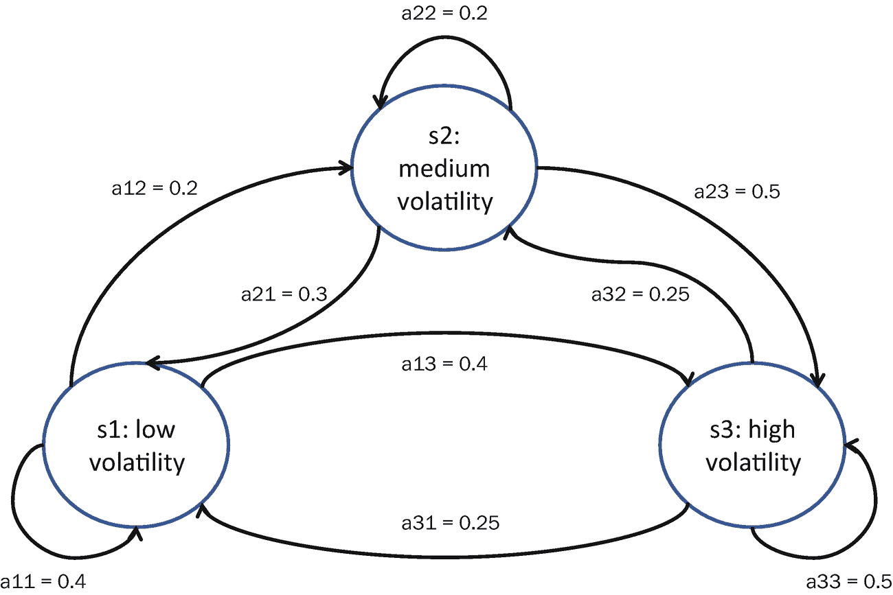

图 12-50 一个具有三个状态的离散时间马尔可夫链

例如，在图 12-50 中，我们可以将股票市场分为三种不同的状态：低波动、中波动和高波动。市场明天可能保持在同一（低波动）状态（概率为 40%），但也可能转移到其他状态，如中波动状态（概率为 20%）或高波动状态（概率为 40%）。转移概率（由箭头和数字表示）是指过程从一个状态转移到另一个状态的概率。需要注意的是，从某个状态出发并停留在同一状态（指向自身的箭头）的转移概率之和必须为 1。转移概率通常用随机矩阵来描述，该矩阵列出了从每个状态（行）转移到其他各个状态（列）的概率。图 12-50 中 `DTMC` 的随机矩阵如下：


该矩阵与初始状态的初始概率共同完整地描述了一个时齐的 `DTMC`。系统在未来第 `n` 步处于特定状态的概率可以被计算出来。例如，我们可以计算观测到状态序列 `Q = {s[3], s[1], s[1], s[1]}` 的概率。系统从状态 `s[3]` 开始（概率为 1）。

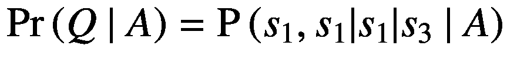

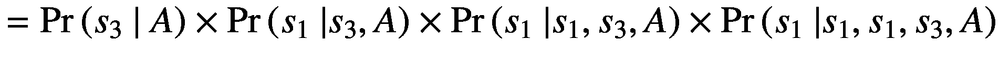

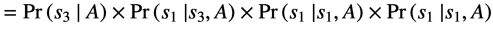

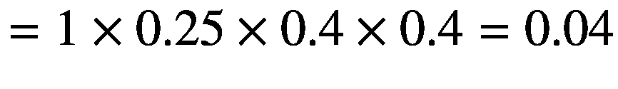

在第三步中，我们利用了马尔可夫性质来简化条件概率。具体来说，马尔可夫性质表述如下：

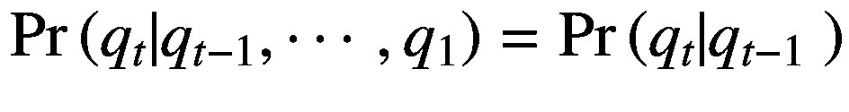

在量化金融中，马尔可夫性质与有效市场假说的弱形式是一致的，该假说认为市场的未来价格不取决于任何历史价格。历史价格无法预测未来。

一个 DTMC 可以永远在状态之间转移。它生成的状态序列是一个随机数（整数）序列。一个具有随机矩阵 `A` 的 DTMC 存在一个平稳分布 `π`，当且仅当 `πA = π`。平稳分布是指当时间趋于无穷时，我们在各个状态中找到系统的概率。

NM Dev 类 `SimpleMC` 实现了一个时齐的 DTMC。例如，以下代码实现了前面提到的三状态马尔可夫链：

```
// 转移概率的随机矩阵
Matrix A = new DenseMatrix(new double[][]{
{0.4, 0.2, 0.4},
{0.3, 0.2, 0.5},
{0.25, 0.25, 0.5}
});
// 从状态 3 开始
Vector I = new DenseVector(0., 0., 1.);
SimpleMC MC = new SimpleMC(I, A);
Vector PI = SimpleMC.getStationaryProbabilities(A);
System.out.println("平稳分布 = " + PI);
// 模拟接下来的 9 步
System.out.println("时间 0 = " + 3);
for (int i = 1; i < 10; ++i) {
    int state = MC.nextState();
    System.out.println(String.format("时间 %d = %d", i, state));
}
```

输出结果如下：

```
平稳分布 = [0.307263, 0.223464, 0.469274]
时间 0 = 3
时间 1 = 3
时间 2 = 3
时间 3 = 3
时间 4 = 3
时间 5 = 3
时间 6 = 1
时间 7 = 2
时间 8 = 2
时间 9 = 1
```

平稳分布是指当时间趋于无穷时，我们在各个状态中找到系统的概率。在这个例子中，有 47% 的概率会发现系统处于该马尔可夫链的状态 3。

### 12.6.2 隐马尔可夫模型

隐马尔可夫模型（HMM）是一种随机过程，其底层过程是一个关于状态的马尔可夫链，但你无法看到系统处于哪个状态，因此它是隐藏的。你能看到的是观测值。每个隐藏状态都关联着一个（不同的）观测值概率分布。见图 12-51。

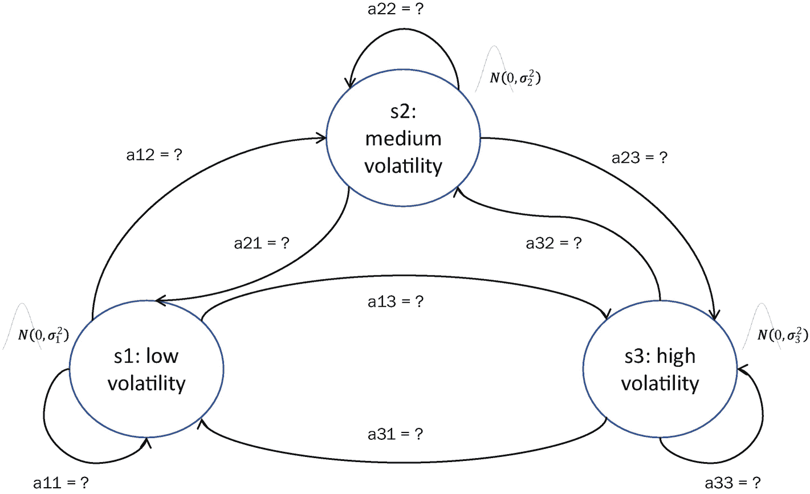

图 12-51

股票市场的隐马尔可夫模型

例如，扩展图 12-51 中的例子，市场可以处于三种状态中的任何一种：低波动、中波动和高波动。每种状态下股票的日收益率服从均值为零但波动率不同的正态分布，其中 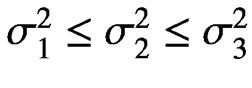。注意，每种状态都会生成相同的收益率范围 (−∞, +∞)，但概率不同。我们无法确切地知道市场在任意时刻处于哪种状态。我们不仅不知道（隐藏的）状态，也不知道模型的参数 `λ`，例如转移概率和 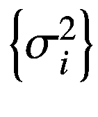。我们观测到的以及我们拥有的全部信息就是历史收益率，即观测序列 `Ω`（以及 HMM 的结构）。

关于 HMM，我们可能会问三个问题。第一，似然度问题。给定参数 `λ` 和观测序列 `Ω`，我们能否计算出观测到这个特定序列 `Pr(Ω | λ)` 的似然度？第二，解码问题。给定参数 `λ` 和观测序列 `Ω`，我们能否确定最可能的隐藏状态序列 `Q`？第三，学习问题。给定观测序列 `Ω` 和 HMM 的结构，我们能否学习出 `λ`？

#### 12.6.2.1 似然问题

在给定模型 `λ` 的参数后，我们想要计算特定观测序列或输出序列 `Ω` 的概率。最直观的方法就是将所有可能的状态序列上观测到 `Ω` 的概率加起来。即，

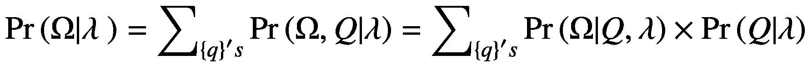

第一项是在给定隐藏状态序列 `Q` 的条件下观测到 `Ω` 的概率；第二项是在给定 HMM 参数 `λ` 的条件下出现该隐藏状态序列的概率。对于第一项，我们有以下公式：

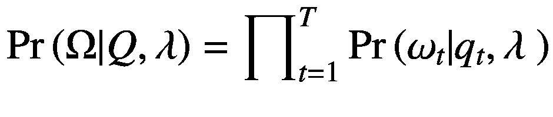

`Pr(ω[t]| q[t], λ)` 表示在时刻 `t` 处于状态 `q[t]` 时观测到 `ω[t]` 的概率。这个概率由每个状态对应的概率分布给出。在我们图 12-51 的例子中，它是由状态 `q[t]`（系统在时刻 `t` 所处的状态）中的正态分布给出的。

对于第二项，我们有以下公式：

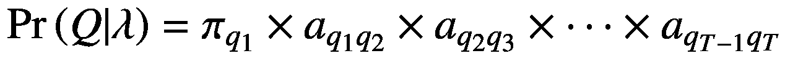

这仅仅是初始状态概率 `π_{q_1}`（从状态 `q[1]` 开始）与转移概率的乘积。

然而，这种朴素的方法在计算上并不可行，因为路径的数量呈指数级增长。我们需要一种更高效的方法。

将前向概率 `αt` 定义为：到时刻 `t` 为止的部分观测序列，且系统在时刻 `t` 处于状态 `s[i]` 的概率。即，

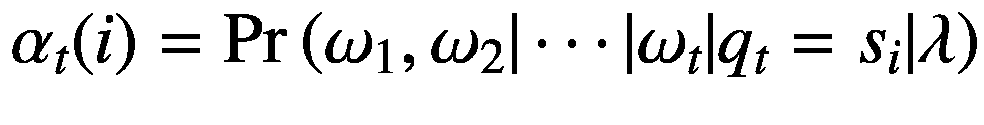

这可以通过前向归纳法计算。首先初始化第一步，如下所示：

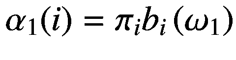

其中 `bi` 是在状态 `i` 下观测到 `ω[1]` 的概率。它由该状态的概率分布给出。在我们的例子中，它由正态分布给出。（由于在我们的数学表达中 `ω` 是离散的，这里使用具有概率质量函数的离散概率分布可能更容易理解。但思路是相同的。）请参阅图 12-52。

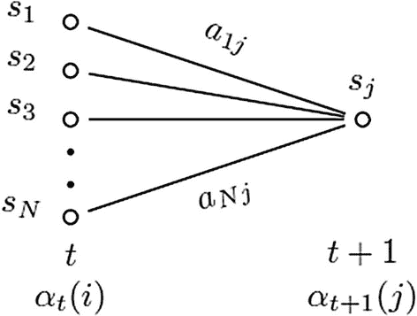

图 12-52

前向算法

归纳步骤表明，`αt + 1` 是所有之前的 `αt` 之和，然后转移到状态 `j`。即，

![$$ {\alpha}_{t+1}(i)=\left[\sum \limits_{j=1}^N{\alpha}_t(i){a}_{ij}\right]{b}_i\left({\omega}_{t+1}\right) $$](images/500382_1_En_12_Chapter/500382_1_En_12_Chapter_TeX_Equhr.png)

其中 `N` 是 HMM 中的状态数，`a[ij]` 是从状态 `i` 到状态 `j` 的转移概率。

最后，在给定 `λ` 的条件下观测到 `Ω` 的概率，就是所有状态对应的所有 `α[T]` 之和。

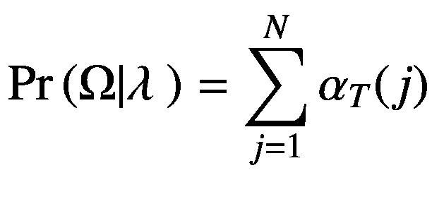

例如，考虑一个村庄，所有村民要么健康要么发烧，并且只有村里的医生能判断每个人是否发烧。医生通过询问病人的感觉来诊断发烧。村民们可能回答他们感觉正常、头晕或发冷。

医生认为，病人的健康状况构成一个离散马尔可夫链。有两种状态：健康（Healthy）和发烧（Fever），但医生无法直接观察到它们；它们对医生是隐藏的。每天，根据病人的健康状况，病人有一定概率告诉医生他感觉正常、发冷或头晕。

观测值（正常、发冷或头晕）以及隐藏状态（健康、发烧）构成了一个隐马尔可夫模型（HMM），可以如图 12-53 所示表示。

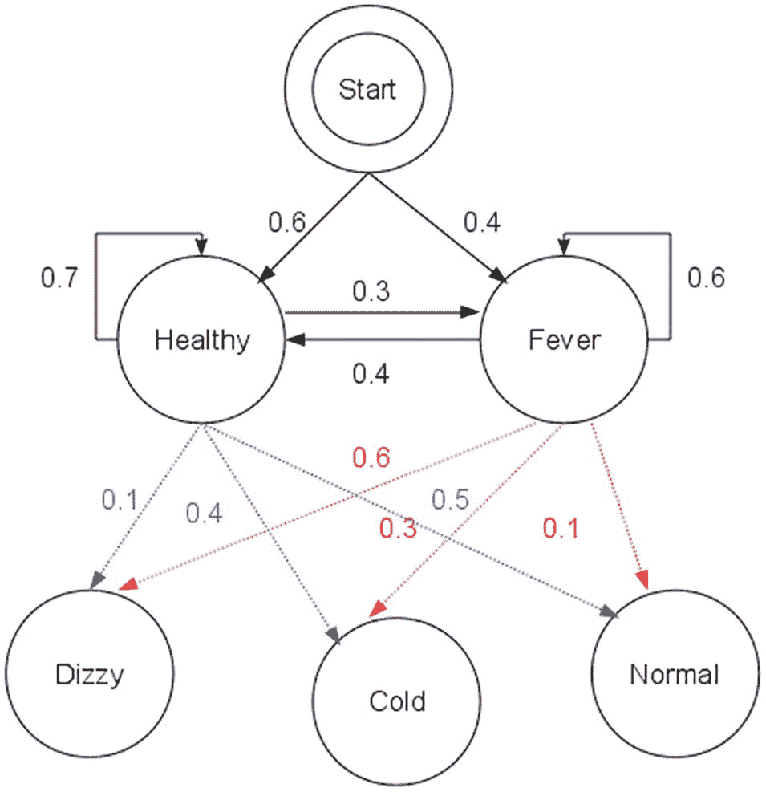

图 12-53

村民健康状况的隐马尔可夫模型

NM Dev 类 `DiscreteHMM` 实现了一个离散隐马尔可夫模型，类 `ForwardBackwardProcedure` 执行前向-后向算法来计算前向和后向概率。例如，以下代码实现了上述的两状态 HMM：

```
// 两个状态的初始概率
DenseVector PI = new DenseVector(
new double[]{0.6, 0.4}
);
// 转移概率
DenseMatrix A = new DenseMatrix(new double[][]{
{0.7, 0.3},
{0.4, 0.6}
});
// 观测概率; 两个状态对应 3 种可能结果
DenseMatrix B = new DenseMatrix(new double[][]{
{0.5, 0.4, 0.1},
{0.1, 0.3, 0.6}
});
// 构建一个 HMM
DiscreteHMM hmm = new DiscreteHMM(PI, A, B);
// 实际观测值
double[] observations = new double[]{1, 2, 3};
// 运行前向-后向算法
ForwardBackwardProcedure fb = new ForwardBackwardProcedure(hmm, observations);
for (int t = 1; t <= observations.length; ++t) {
System.out.println(String.format(
"时刻 %d 时，每个状态的*缩放后*前向概率 alpha: %s",
t,
fb.scaledAlpha(t)
));
}
```

输出如下：

```
时刻 1 时，每个状态的*缩放后*前向概率 alpha: [0.882353, 0.117647]
时刻 2 时，每个状态的*缩放后*前向概率 alpha: [0.725522, 0.274478]
时刻 3 时，每个状态的*缩放后*前向概率 alpha: [0.212128, 0.787872]
```

#### 12.6.2.2 解码问题

给定模型参数 `λ` 和观测序列 `Ω`，滤波问题是计算系统在序列末尾处于某个状态的概率，即 `Pr(q[T] = s[i] | λ, Ω)`。该问题可以使用前述的前向算法高效求解。

平滑问题与滤波问题类似，但它计算的是系统在序列中间某个时刻处于某个状态的概率，换句话说，即 `Pr(q[t] = s[i] | λ, Ω)`。

定义后向概率 `βt` 为系统在时刻 `t` 处于状态 `s[i]`，并且从该时刻之后直到时刻 `t` 的部分观测值出现的概率。即：

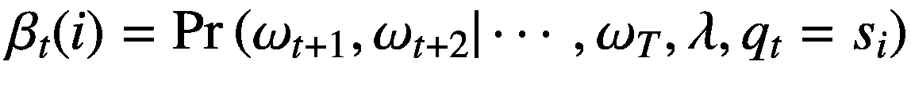

这可以通过后向归纳法计算。初始化最后一个时间步，如图 12-54 所示。

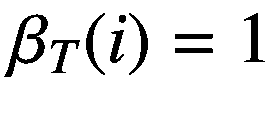

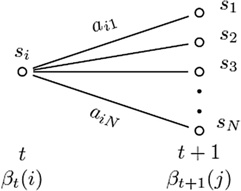

图 12-54 后向算法

归纳步骤表明，`βt` 是所有从状态 `i` 转移到下一个时间步 `βt + 1` 并在所有路径中观测到 `ω[t + 1]` 的可能路径之和。即：

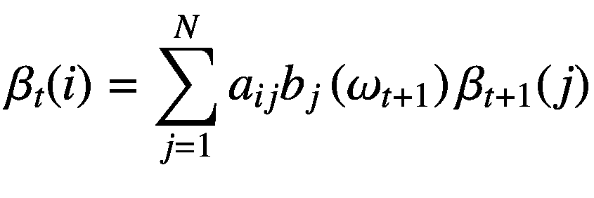

最后，给定观测值 `Ω` 和参数 `λ`，系统在时刻 `t` 处于状态 `i` 的概率如下：

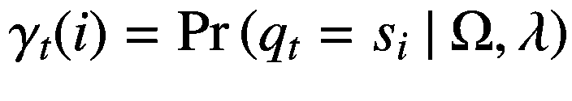

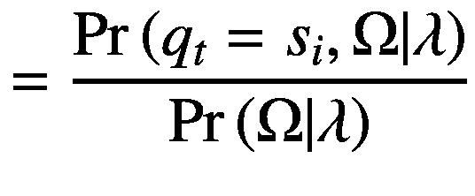

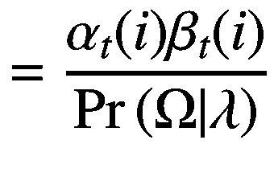


在每个时刻 `t`，不考虑状态序列发生概率的情况下，最可能的状态如下：

![$$ {q}_t=\underset{1\le i\le N}{\mathrm{argmax}}\left[{\gamma}_t(i)\right] $$](images/500382_1_En_12_Chapter/500382_1_En_12_Chapter_TeX_Equia.png)

最可能的隐藏状态序列，即寻找所有可能状态序列中的最大值，可以使用维特比算法求解。定义系统经过这些状态、在时刻 `t` 到达状态 `s[i]` 并生成观测值的最大概率：

![$$ {\delta}_t(i)=\max \left[\Pr \left({q}_1,{q}_2|\cdots |{q}_t={s}_i|{\omega}_0|\cdots |{\omega}_t|\lambda \right)\right] $$](images/500382_1_En_12_Chapter/500382_1_En_12_Chapter_TeX_Equib.png)

初始化：


递归：

![$$ {\delta}_t(j)=\underset{i}{\max}\left[{\delta}_{t-1}(i){a}_{ij}{b}_j\left({\omega}_t\right)\right] $$](images/500382_1_En_12_Chapter/500382_1_En_12_Chapter_TeX_Equie.png)

此处 `δt` 是产生前 `t` 个观测值且以状态 `j` 为最终状态的最可能状态序列 `q[1]`、`q[2]`、⋯、`q[t]` 的概率。

![$$ {\psi}_t=\underset{i}{\mathrm{argmax}}\left[{\delta}_{t-1}(i){a}_{ij}\right] $$](images/500382_1_En_12_Chapter/500382_1_En_12_Chapter_TeX_Equif.png)

其中 `ψ[t]` 是在时刻 `t` 选择的、能使 `δt` 最大化的状态。

终止：


NM Dev 类 `Viterbi` 实现了维特比算法。以下代码延续了图 12-54 中的示例：

```java
// the initial probabilities for 2 states
DenseVector PI = new DenseVector(
new double[]{0.6, 0.4}
);
// the transition probabilities
DenseMatrix A = new DenseMatrix(new double[][]{
{0.7, 0.3},
{0.4, 0.6}
});
// the observation probabilities; 3 possible outcomes for 2 states
DenseMatrix B = new DenseMatrix(new double[][]{
{0.5, 0.4, 0.1},
{0.1, 0.3, 0.6}
});
// construct an HMM
DiscreteHMM hmm = new DiscreteHMM(PI, A, B);
// the realized observations
double[] observations = new double[]{1, 2, 3};
// run the Viterbi algorithm to find the most likely sequence of hidden states
Viterbi viterbi = new Viterbi(hmm);
int[] viterbi_states = viterbi.getViterbiStates(observations);
System.out.println("the Viterbi states: " + Arrays.toString(viterbi_states));
```

输出如下：

```
the Viterbi states: [1, 1, 2]
```

### 12.6.2.3 学习问题

隐马尔可夫模型中的参数学习任务是在给定输出序列 `Ω` 的情况下，找到最佳的状态转移概率 `A` 和概率分布参数 `λ`。该任务通常是基于给定的输出序列集推导 HMM 参数的最大似然估计。也就是说，我们的目标是找到使 `Pr(Ω | λ)` 最大化的 `λ`。对于任何 `λ`，我们都可以计算出 `Pr(Ω | λ)`。这个问题变成了一个多变量无约束优化问题。原则上，任何优化算法（例如 Nelder-Mead 算法）都可以解决它。然而，在实践中，存在收敛性和效率问题。目前已知没有易于处理的算法可以精确解决此问题，但可以使用 Baum-Welch 算法有效推导出局部最大似然估计。Baum-Welch 算法是期望最大化算法（EM 算法）的一个特例。它利用前向-后向算法来计算期望步骤中的统计量。见图 12-55。


**图 12-55** Baum-Welch 算法

`ξt` 定义为：在给定模型 `λ` 和观测序列 `Ω` 的条件下，在时间 `t` 处于状态 `s[i]`，且在时间 `t + 1` 处于状态 `s[j]` 的概率。即：


我们可以用前向概率和后向概率来表示它。


因此，我们可以得到：


对时间 `t` 上的 `γt` 求和即为状态 `s[i]` 被访问的次数。对时间 `t` 上的 `ξt` 求和即为系统从状态 `s[i]` 转移到状态 `s[j]` 的次数。我们现在可以按如下方式估计模型参数 `λ`：

- `π̂_i = γ₁(i)`，初始状态概率
- `â_{ij} = (Σ_{t=1}^{T-1} ξ_t(i, j)) / (Σ_{t=1}^{T-1} γ_t(i))`，转移概率
- `b̂_j(vₖ) = (Σ_{t=1, ω_t = vₖ}^{T-1} γ_t(j)) / (Σ_{t=1}^{T-1} γ_t(i))`，对于离散观测，在状态 `s[j]` 下观测条件概率

NM Dev 类 `BaumWelch` 实现了 Baum-Welch 算法。以下代码根据从原始 HMM 随机生成的样本学习了图 12-53 中的 HMM：

### 生成与学习隐马尔可夫模型

```java
// 从一个 HMM 生成观测序列
// 两个状态的初始概率
DenseVector PI = new DenseVector(
new double[]{0.6, 0.4}
);
// 转移概率
DenseMatrix A = new DenseMatrix(new double[][]{
{0.7, 0.3},
{0.4, 0.6}
});
// 观测概率；2 个状态有 3 种可能的结果
DenseMatrix B = new DenseMatrix(new double[][]{
{0.5, 0.4, 0.1},
{0.1, 0.3, 0.6}
});
// 构建一个 HMM1
DiscreteHMM model = new DiscreteHMM(PI, A, B);
model.seed(1234507890L, 1234507891L);
// 生成观测值
int T = 10000;
HmmInnovation[] innovations = new HmmInnovation[T];
int[] states = new int[T];
int[] observations = new int[T];
for (int t = 0; t < T; ++t) {
    innovations[t] = model.next();
    states[t] = innovations[t].state();
    observations[t] = (int) innovations[t].observation();
}
System.out.println("观测值: ");
for (int t = 1; t <= 100; ++t) {
    System.out.print(observations[t] + ", ");
    if (t % 20 == 0) {
        System.out.println("");
    }
}
System.out.println("");
// 从观测值学习 HMM
DenseVector PI_0 = new DenseVector(new double[]{0.5, 0.5}); // 初始猜测
DenseMatrix A_0 = new DenseMatrix(new double[][]{ // 初始猜测
    {0.5, 0.5},
    {0.5, 0.5}
});
DenseMatrix B_0 = new DenseMatrix(new double[][]{ // 初始猜测
    {0.60, 0.20, 0.20},
    {0.20, 0.20, 0.60}
});
DiscreteHMM model_0 = new DiscreteHMM(PI_0, A_0, B_0);  // 初始猜测
// 训练
int nIterations = 40;
for (int i = 1; i <= nIterations; ++i) {
    model_0 = BaumWelch.train(observations, model_0);
}
// 训练结果
System.out.println("估计的转移概率: ");
System.out.println(model_0.A()); // 应接近 A
System.out.println("(观测)条件概率: ");
System.out.println(model_0.B());  // 应接近 B
```

### 输出与讨论

```
观测值:
2, 3, 3, 3, 3, 2, 1, 3, 2, 2, 2, 1, 2, 3, 3, 2, 2, 2, 2, 3,
1, 2, 3, 2, 2, 3, 2, 1, 3, 1, 1, 2, 2, 1, 2, 2, 2, 3, 1, 1,
3, 3, 1, 1, 3, 2, 3, 1, 3, 3, 2, 2, 2, 1, 3, 3, 1, 1, 2, 3,
3, 3, 3, 2, 1, 1, 1, 2, 1, 1, 3, 2, 3, 1, 1, 2, 1, 1, 3, 3,
1, 1, 1, 2, 2, 2, 1, 3, 2, 3, 2, 1, 1, 1, 3, 3, 1, 2, 2, 1,
估计的转移概率:
2x2
[,1] [,2]
[1,] 0.701488, 0.298512,
[2,] 0.336808, 0.663192,
(观测)条件概率:
2x3
[,1] [,2] [,3]
[1,] 0.500569, 0.428947, 0.070485,
[2,] 0.130704, 0.271811, 0.597485,
```

训练后的 HMM 参数与原始参数相近，精确到前两位小数。

### 混合隐马尔可夫模型

我们到目前为止的公式假设了离散条件概率。采用连续概率密度函数（例如正态分布）的公式类似，但计算更复杂。这些被称为混合隐马尔可夫模型（mixture HMM）。观测值是连续的，并遵循连续分布。NM Dev 类 `MixtureHMM` 实现了混合 HMM。要学习它们的参数，我们需要推导出各自的要在 EM 算法中使用的最大似然函数。E 步骤根据观测值和当前参数估计值计算条件期望。M 步骤根据估计参数和数据集最大化对数似然函数。重复这两个步骤，直到满足某个收敛标准。然而，它们的解可能甚至不是解析的，例如 t 分布。

NM Dev 支持一系列混合分布，例如：
- `NormalMixtureDistribution`
- `LogNormalMixtureDistribution`
- `ExponentialMixtureDistribution`
- `PoissonMixtureDistribution`
- `GammaMixtureDistribution`
- `BetaMixtureDistribution`
- `BinomialMixtureDistribution`

NM Dev 类 `MixtureHMMEM` 实现了 EM 算法来学习混合 HMM。以下代码演示了学习一个具有正态混合分布的 HMM，该模型用于图 12-50 中三种体制下的每日股票收益率。

```java
// 初始概率
`Vector` `PI0` = new `DenseVector`(new double[]{0., 0., 1.});
// 转移概率
`Matrix` `A0` = new `DenseMatrix`(new double[][]{
    {0.4, 0.2, 0.4},
    {0.3, 0.2, 0.5},
    {0.25, 0.25, 0.5}
});
// 条件正态分布
`NormalMixtureDistribution.Lambda[]` `lambda0` = new `NormalMixtureDistribution.Lambda`[]{
    new `NormalMixtureDistribution.Lambda`(0., .5), // (mu, sigma)
    new `NormalMixtureDistribution.Lambda`(0., 1.), // 中等波动率
    new `NormalMixtureDistribution.Lambda`(0., 2.5) // 高波动率
};
// 原始 HMM：一个包含 3 种状态的日股票收益模型
`MixtureHMM` `model0` = new `MixtureHMM`(`PI0`, `A0`, new `NormalMixtureDistribution`(`lambda0`));
`model0`.seed(1234567890L);
// 从 HMM 生成观测序列
int T = 10000;
`HmmInnovation[]` `innovations` = new `HmmInnovation`[T];
double[] `observations` = new double[T];
for (int t = 0; t < T; ++t) {
    `innovations`[t] = `model0`.next();
    `observations`[t] = `innovations`[t].observation();
}
`System.out.println`("观测值: ");
for (int t = 1; t <= 100; ++t) {
    `System.out.print`(`observations`[t] + ", ");
    if (t % 20 == 0) {
        `System.out.println`("");
    }
}
`System.out.println`("");
// 从观测值学习 HMM
`MixtureHMM` `model1`
    = new `MixtureHMMEM`(`observations`, `model0`, 1e-5, 20); // 使用真实参数作为初始估计
`Matrix` `A1` = `model1`.A();
`NormalMixtureDistribution.Lambda[]` `lambda1`
    = ((`NormalMixtureDistribution`) `model1`.getDistribution()).getParams();
`System.out.println`("原始转移概率");
`System.out.println`(`A0`);
`System.out.println`("学习到的转移概率");
`System.out.println`(`A1`);
for (int i = 0; i < `lambda0`.length; ++i) {
    `System.out.println`(`String.format`("比较 mu: %f vs %f", `lambda0`[i].mu, `lambda1`[i].mu));
    `System.out.println`(`String.format`("比较 sigma: %f vs %f", `lambda0`[i].sigma, `lambda1`[i].sigma));
}
```

输出结果如下：

```
观测值:
0.6667426768019611, -0.32352325221978717, 3.694903034165229, -1.3008707225256613, 0.07691232606090105, -1.0668653899699068, 1.2547831047356035, -0.3246773249494731, -3.1233208370458296, 0.07292920944831502, -0.11620867976390438, -0.09177918144492855, 1.061260530481548, 3.7632206619139903, 0.8109245344429039, -1.0456473967986801, 0.023362246470829524, 0.7787930654317092, -2.576397166364735, -0.0467834253483496,
3.503162408902286, 1.1028762361945696, 0.18432457538929753, -0.15602885867240143, 0.2860555006413944, 0.5199262544700902, 3.289672039992487, 0.3423964725249409, 1.4075325491240163, 4.10317186600716, 0.4828282434224251, 0.25452361143844454, 0.5712599275796462, -2.5704804292527013, 0.33450861675375654, -2.8531667206093934, -3.0936506692640764, -0.15973644756612507, -0.47277685283533033, 0.0707131186690788,
-1.7796825533737028, 0.9864117126346634, 0.2939922129246895, -2.5399726513271608, -2.6290623371098096, 0.25314785052888766, -0.18575291314328318, -0.7946029274675578, 0.23552969611536276, 2.9897693796241063, 0.5660684741804526, -0.6527078440547278, -0.5004832349155411, -0.2704637817979793, -0.6025767412479524, 0.5771268464391458, -0.24208449949682542, -0.02819954652010102, -2.486386056973469, -3.441724309397634,
-0.4133398692983409, 0.31129502315376223, -0.04193184097521976, -1.0182212276190052, -0.3671837409753249, 0.536533989621346, 3.462093125207502, -2.461234362203126, -2.3392296163644772, -0.47516934718702636, -0.11730581631252934, -0.4265784970780354, -0.8615577291928018, 6.920251345713026, 1.76323228509548, -2.6811368060909544, -1.5171036957836417, -4.899485440536609, -3.610116084182736, 0.33601950735980296,
-0.5835341423322717, 2.6648103130978678, 0.10317758590238832, 0.19254522009732306, -2.2919311524559345, -2.7407736539634344, 0.17291860725525898, 0.18227164156727216, -0.5643594075632472, -0.035583544387142646, -0.09409631532976256, -0.025219030831549336, 0.4529864965098783, -0.8837144318482597, -0.12251468831918433, -0.31744262647741256, 5.209863176061461, -2.474241618649255, 0.1755140184813729, 0.2368171868332689,
原始转移概率
3x3
[,1] [,2] [,3]
[1,] 0.400000, 0.200000, 0.400000,
[2,] 0.300000, 0.200000, 0.500000,
[3,] 0.250000, 0.250000, 0.500000,
学习到的转移概率
3x3
[,1] [,2] [,3]
[1,] 0.413363, 0.192624, 0.394012,
[2,] 0.291749, 0.191727, 0.516524,
[3,] 0.262275, 0.245234, 0.492491,
比较 mu: 0.000000 vs -0.006115
比较 sigma: 0.500000 vs 0.509837
比较 mu: 0.000000 vs 0.036859
比较 sigma: 1.000000 vs 0.952345
比较 mu: 0.000000 vs 0.000615
比较 sigma: 2.500000 vs 2.559295
```

从输出中可以看出，EM 算法从日股票收益中很好地学习了真实的 HMM，三个状态的方差也匹配得相当不错。

## 12.7 主成分分析

考虑一个激励性的例子：如图 12-56 所示，在 XY 平面上绘制（例如，实验）数据。我们发现两个变量`X`和`Y`具有相当高的相关性。当`X`较大时，`Y`也往往较大。同样，当`X`较小时，`Y`也往往较小。实际上，`Y`可以近似为`X`的线性函数。如果我们只记录`X`，就能足够好地估计`Y`。无需同时记录两者，仅记录`X`就足够了。我们本质上将二维数据“压缩”到了一维空间。这便是降维的基本原理。


图 12-56：XY 平面上的数据

如果我们旋转 XY 平面的坐标轴，使得大多数点落在或接近新的 x 轴`x'`上（如图 12-57 所示），就能更清楚地看到这种降维效果。我们实际上不需要记录`y'`，因为它们都接近 0，位于一个狭窄的带内。我们只需要记录`x'`，因为它们可以在很大范围内取许多值。数据主要沿`x'`轴分布，这也是方差最大的地方。寻找一个新的坐标系，使得大部分方差仅落在轴的一个小子集上，有助于降低维度、滤除噪声、识别数据的重要部分以及发现模式。这正是主成分分析的基本原理。


图 12-57：旋转后 XY 平面上的数据

Jon（2003）给出了另一个现实生活中的例子，来说明我们为何以及如何进行 PCA。在实验物理学中，我们经常需要对一个现象进行多次测量。图 12-58 显示，我们使用三台相机捕捉一个连接在弹簧上的球的运动。在我们理解一个现象之前，不一定知道如何进行测量。我们可能简单地将相机放置在方便且有空间的地方。每台相机从其视角记录一系列`x`和`y`坐标。每张快照中共有六个坐标。

![$$ \boldsymbol{X}=\left[\begin{array}{c}{x}_A\\ {}{y}_A\\ {}{x}_B\\ {}{y}_B\\ {}{x}_C\\ {}{y}_C\end{array}\right] $$](images/500382_1_En_12_Chapter/500382_1_En_12_Chapter_TeX_Equio.png)


图 12-58：测量连接在弹簧上的球的运动

我们可以收集数千个这样的坐标用于分析。然而，在事后了解了弹簧的工作方式后，我们知道这六个坐标的数据很难分析，并且它们掩盖了弹簧运动的整体图景，而弹簧实际上只在一个方向上运动。是否可能“变换”数据，使得主要成分易于可视化？从数学上讲，我们希望找到一个坐标变换或基变换，使得新的坐标能够反映弹簧来回弹跳的那个维度。也就是说，找到一个基变换矩阵`P`，使得：

其中 `PX = Y`，这里 `X` 是去均值后的数据（在 PCA 中，我们总是首先对每个因子或行 `x[i]` 减去均值）；`Y` 是新基下的新坐标。更多细节请参见第 2 章。

为了找到 `P`，我们需要施加一些条件来证明 `P` 是一个好的基变换。例如，我们希望新坐标系中的 `Y` 满足：

- 每个新轴上的方差最大化。
- 任意一对变量之间的协方差最小化，例如为 0。

这两个条件基本上是说 `Y` 的协方差矩阵应该是一个对角矩阵。也就是说，对角元素（方差）最大化，非对角元素（协方差）为 0。在数学上，我们有：

$$ {\boldsymbol{S}}_{\boldsymbol{Y}}=\frac{1}{n-1}\boldsymbol{Y}{\boldsymbol{Y}}^T $$

$$ =\frac{1}{n-1}\left(\boldsymbol{PX}\right){\left(\boldsymbol{PX}\right)}^T $$

$$ =\frac{1}{n-1}\boldsymbol{PX}{\boldsymbol{X}}^T\boldsymbol{P} $$

注意，`A = XX^T` 是 `X` 的协方差矩阵（在移除样本均值和缩放因子之后）。它是对称的，因此可以对角化。存在一个特征向量矩阵 `E` 和一个对角矩阵 `D`，使得：

$$ \boldsymbol{A}=\boldsymbol{ED}{\boldsymbol{E}}^T $$

假设我们选择基变换 `P = E^T`，则有：

$$ {\boldsymbol{S}}_{\boldsymbol{Y}}=\frac{1}{n-1}\boldsymbol{P}{\boldsymbol{P}}^T\boldsymbol{D}{\boldsymbol{P}}^T\boldsymbol{P} $$

$$ =\frac{1}{n-1}\boldsymbol{P}{\boldsymbol{P}}^{-1}\boldsymbol{D}{\boldsymbol{P}}^{-1}\boldsymbol{P} $$，因为 `P` 是标准正交的

$$ =\frac{1}{n-1}\boldsymbol{D} $$

显然，`P = E^T` 将 `S[Y]` 对角化。这就是对 `X` 进行 PCA，以产生坐标变换 `P`，从而得到 `Y`。

我们也可以使用 SVD 进行 PCA。对于去均值后的数据（减去样本均值的数据）`X`，存在标准正交基 `U` 和 `V` 以及一个对角矩阵 `Σ`，使得：

$$ \boldsymbol{X}=\boldsymbol{U}\boldsymbol{\Sigma } {\boldsymbol{V}}^T $$

等价地，

$$ {\boldsymbol{U}}^T\boldsymbol{X}=\boldsymbol{\Sigma} {\boldsymbol{V}}^T $$

这里我们再次得到基变换如下：

$$ \boldsymbol{P}={\boldsymbol{U}}^T $$

以及新坐标如下：

$$ \boldsymbol{Y}=\boldsymbol{\Sigma} {\boldsymbol{V}}^T $$

`U` 是张成一个 `n` 维空间的标准正交向量集；`V` 是张成一个 `m` 维空间的标准正交向量集。这种 SVD 或 PCA 将 `n` 维空间投影到 `m` 维空间，从而实现降维。我们通常按降序排列 `Σ` 中的对角元素，以便可以选择截断不重要的奇异值。这将进一步降低投影空间的维度。回到图 12-58 中的弹簧示例，我们希望找到能旋转坐标系的 `P`，使得大多数数据位于一个（新的）x 轴上。此外，我们只保留一个最重要的奇异值，并截断其他五个以去除噪声。这将数据的维度从 6 降到了 1。这样，我们就可以轻松地可视化和分析弹簧沿直线来回运动的过程。

NM Dev 支持通过特征分解和 SVD 两种方式来进行 PCA。所有实现都继承自接口 `PCA`。其签名如下：

```java
public interface PCA {
    /**
     * 获取原始数据中的观测值数量；样本大小。
     *
     * @return nObs，原始数据中的观测值数量
     */
    public int nObs();
    /**
     * 获取原始数据中的变量数量。
     *
     * @return nFactors，原始数据中的变量数量
     */
    public int nFactors();
    /**
     * 获取被减去的样本均值。
     *
     * @return 原始数据中每个变量的样本均值
     */
    public Vector mean();
    /**
     * 获取应用于每个变量的缩放值。
     *
     * @return 原始数据中每个变量的缩放值
     */
    public Vector scale();
    /**
     * 获取用于 PCA 的（可能经过中心化和/或缩放后的）数据矩阵 X。
     *
     * @return （可能经过中心化和/或缩放后的）数据矩阵 X
     */
    public Matrix X();
    /**
     * 获取主成分的标准差（即相关矩阵或协方差矩阵特征值的平方根）。
     *
     * @return 主成分的标准差
     */
    public Vector sdPrincipalComponents();
    /**
     * 获取第 i 个主成分的标准差。
     *
     * @param i 索引，从 1 开始计数
     * @return 第 i 个主成分的标准差
     */
    public double sdPrincipalComponent(int i);
    /**
     * 获取变量载荷矩阵。载荷矩阵各列的符号是任意的。
     *
     * @return 变量载荷矩阵
     */
    public Matrix loadings();
    /**
     * 获取第 i 个主成分的载荷向量。
     *
     * @param i 索引，从 1 开始计数
     * @return 第 i 个主成分的载荷向量
     */
    public Vector loading(int i);
    /**
     * 获取每个主成分所解释的总体方差比例。
     *
     * @return 每个主成分所解释的总体方差比例
     */
    public Vector proportionVar();
    /**
     * 获取第 i 个主成分所解释的总体方差比例。
     *
     * @param i 索引，从 1 开始计数
     * @return 第 i 个主成分所解释的总体方差比例
     */
    public double proportionVar(int i);
    /**
     * 获取主成分所解释的总体方差累计比例。
     *
     * @return 主成分所解释的总体方差累计比例
     */
    public Vector cumulativeProportionVar();
    /**
     * 获取提供的数据在主成分上的得分。得分矩阵各列的符号是任意的。
     *
     * @return 提供的数据在主成分上的得分
     */
    public Matrix scores();
}
```

例如，以下代码在 R 中对美国逮捕数据（`USArrests`）进行 PCA 分析。（该数据集随本书源代码提供。）

## PCA分析

使用特征值分解对数据进行 PCA 分析：
```java
// 使用特征值分解对数据进行 PCA 分析
PCA pca = new PCAbyEigen(
    USArrests, // 以矩阵形式呈现的数据集
    false // 使用协方差矩阵而非相关矩阵
);
// 因子数量
int p = pca.nFactors();
// 观测值数量
int n = pca.nObs();
Vector mean = pca.mean();
Vector scale = pca.scale();
Vector sdev = pca.sdPrincipalComponents();
Matrix loadings = pca.loadings();
Vector proportion = pca.proportionVar();
Vector cumprop = pca.cumulativeProportionVar();
Matrix scores = pca.scores();
System.out.println("因子数量 = " + p);
System.out.println("观测值数量 = " + n);
System.out.println("均值: " + mean);
System.out.println("缩放值: " + scale);
// 标准差相差一个 sqrt(50 / 49) 因子，
// 因为我们在样本协方差矩阵中使用了除数 (nObs - 1)
System.out.println("标准差: " + sdev);
// 载荷矩阵各列的符号是任意的。
System.out.println("载荷: ");
System.out.println(loadings);
// 每个维度的方差比例
System.out.println("方差比例: " + proportion);
System.out.println("方差累计比例: " + cumprop);
System.out.println("得分: ");
System.out.println(scores);
```

输出如下：
```
因子数量 = 4
观测值数量 = 50
均值: [7.788000, 170.760000, 65.540000, 21.232000]
缩放值: [1.000000, 1.000000, 1.000000, 1.000000]
标准差: [83.732400, 14.212402, 6.489426, 2.482790]
载荷:
4x4
[,1] [,2] [,3] [,4]
[1,] -0.041704, 0.044822, 0.079891, 0.994922,
[2,] -0.995221, 0.058760, -0.067570, -0.038938,
[3,] -0.046336, -0.976857, -0.200546, 0.058169,
[4,] -0.075156, -0.200718, 0.974081, -0.072325,
方差比例: [0.965534, 0.027817, 0.005800, 0.000849]
方差累计比例: [0.965534, 0.993352, 0.999151, 1.000000]
```

PCA 将数据的维度从 4 维降至 1 维或 2 维。第一主成分解释了 96.6%的数据变异。前两个主成分解释了 99%的数据变异。我们可以安全地截断最后两个成分。

以下代码使用 SVD 解决相同的问题：
```java
// 使用 SVD 对数据进行 PCA 分析
PCA pca = new PCAbySVD(
    USArrests // 以矩阵形式呈现的数据集
);
// 因子数量
int p = pca.nFactors();
// 观测值数量
int n = pca.nObs();
Vector mean = pca.mean();
Vector scale = pca.scale();
Vector sdev = pca.sdPrincipalComponents();
Matrix loadings = pca.loadings();
Vector proportion = pca.proportionVar();
Vector cumprop = pca.cumulativeProportionVar();
System.out.println("因子数量 = " + p);
System.out.println("观测值数量 = " + n);
System.out.println("均值: " + mean);
System.out.println("缩放值: " + scale);
// 标准差相差一个 sqrt(50 / 49) 因子，
// 因为我们在样本协方差矩阵中使用了除数 (nObs - 1)
System.out.println("标准差: " + sdev);
// 载荷矩阵各列的符号是任意的。
System.out.println("载荷: ");
System.out.println(loadings);
// 每个维度的方差比例
System.out.println("方差比例: " + proportion);
System.out.println("方差累计比例: " + cumprop);
```

输出如下：
```
因子数量 = 4
观测值数量 = 50
均值: [7.788000, 170.760000, 65.540000, 21.232000]
缩放值: [4.355510, 83.337661, 14.474763, 9.366385]
标准差: [1.574878, 0.994869, 0.597129, 0.416449]
载荷:
4x4
[,1] [,2] [,3] [,4]
[1,] 0.535899, -0.418181, -0.341233, 0.649228,
[2,] 0.583184, -0.187986, -0.268148, -0.743407,
[3,] 0.278191, 0.872806, -0.378016, 0.133878,
[4,] 0.543432, 0.167319, 0.817778, 0.089024,
方差比例: [0.620060, 0.247441, 0.089141, 0.043358]
方差累计比例: [0.620060, 0.867502, 0.956642, 1.000000]
```

## 12.8 因子分析

因子分析用于通过较少数量的未观测变量（称为因子）来解释一组相关变量或观测值。例如，十个观测变量的变化可能主要反映了两个未观测（潜在）变量的变化。观测变量被建模为未观测因子的线性组合加上“误差”项。与 PCA 类似，它有助于降低数据的维度。在处理大型数据集时，因子分析常用于生物学、心理测量学、人格理论、市场营销、产品管理、运筹学和金融等领域。

这个概念最好通过一个例子来说明。假设一位心理学家假设存在两种智力：语言智力和数学智力，且这两种智力均无法直接观测。为了寻找该假设的证据，心理学家收集了 1000 名学生在 10 个不同学术领域的考试成绩。该假设认为，对于每个学术领域，学生的成绩是其语言智力和数学智力的线性组合。虽然每个学生都有自己的语言智力和数学智力，但这两个因子的系数对所有人都是相同的。这些系数称为因子载荷。一个因子的因子载荷量化了观测变量与该因子相关的程度（权重）。例如，该假设可能预测学生在天文学上的成绩如下：

`{10 × 学生的语言智力} + {6 × 学生的数学智力}`

数字 10 和 6 是与天文学相关的因子载荷。其他学科可能有不同的因子载荷。

两个假设具有相同语言和数学智力、因此预测成绩也相同的学生，可能在物理学和其他学科上取得不同的分数。预测值与实际值（观测值）之间的这种差异称为误差。

可观测的数据是 1000 名学生的 10 项成绩，总共 10,000 个数字。未观测的因子值（每个学生 2 个，共 2,000 个数字）和因子载荷通过因子分析从数据中估计得出。

我们可以用数学语言写出这些关系。对于学生 *i*，他在 10 个学科中的标准化 z 分数（我们使用 z 分数是为了使所有变量的量级具有可比性）可以建模如下：

$$
\begin{array}{c}
{z}_{1,i}={l}_{1,1}{F}_{1,i}+{l}_{1,2}{F}_{2,i}+{\varepsilon}_{1,i} \\
\vdots \\
{z}_{10,i}={l}_{10,1}{F}_{1,i}+{l}_{10,2}{F}_{2,i}+{\varepsilon}_{10,i}
\end{array}
$$

或者，更简洁地，可以写成：

$$
{z}_{a,i}=\sum \limits_{p=1}²{l}_{a,1}{F}_{p,i}+{\varepsilon}_{a,i}
$$

其中 `F[1, i]` 是学生 `i` 的语言智力，`F[2, i]` 是学生 `i` 的数学智力，`l[a, p]` 是第 `p` = 1, 2 个因子在第 `a` 个学科上的因子载荷。见图 12-59。


**图 12-59** 因子分析的几何解释

从几何角度来看，数据（`z[a, i]`）、因子（`F[p, i]`）和误差（`ε[a, i]`）可以看作是 `N` 维欧几里得空间（样本空间）中的向量，分别表示为 `z[a]`、`F[j]` 和 `ε[a]`。由于数据已标准化，数据向量是单位长度的（`‖z[a]‖ = 1`）。因子向量在该空间中定义了一个 `k` 维线性子空间（即一个超平面），数据向量正交投影到该超平面上。在前面的例子中，超平面是一个由两个因子向量定义的二维平面，如图 12-59 所示。因子分析的目标是找到一个在某种意义上与数据“最佳拟合”的超平面。因此，只要定义该超平面的因子向量是独立的并且位于该超平面内，如何选择它们并不重要。

一般来说，对于所有学生的所有学科，用矩阵符号表示如下：

$$ Z= LF+\varepsilon $$

NM Dev 类 `FactorAnalysis` 实现了因子分析过程，以根据 `Z`（或 `X`）来找到 `L`、`F` 和 `ε`。下面是一个例子：

```java
// 隐藏因子的数量
int nFactors = 3;
FactorAnalysis factor_analysis
= new FactorAnalysis(
R_data,
nFactors,
FactorAnalysis.ScoringRule.THOMSON // 指定评分规则
);
System.out.println("观测数 = " + factor_analysis.nObs());
System.out.println("变量数 = " + factor_analysis.nVariables());
System.out.println("因子数 = " + factor_analysis.nFactors());
// 协方差矩阵
Matrix S = factor_analysis.S();
System.out.println("协方差矩阵:");
System.out.println(S);
FAEstimator estimators = factor_analysis.getEstimators(700);
double fitted = estimators.logLikelihood();
System.out.println("拟合的对数似然 = " + fitted);
Vector uniqueness = estimators.psi();
System.out.println("唯一性 = " + uniqueness);
int dof = estimators.dof();
System.out.println("自由度 = " + dof);
// 因子载荷
Matrix loadings = estimators.loadings();
System.out.println("因子载荷:");
System.out.println(loadings);
double testStats = estimators.statistics();
System.out.println("检验统计量 = " + testStats);
double pValue = estimators.pValue();
System.out.println("p 值 = " + pValue);
Matrix scores = estimators.scores();
System.out.println("得分:");
System.out.println(scores);
```

输出如下：

```
观测数 = 18
变量数 = 6
因子数 = 3
协方差矩阵:
6x6
[,1] [,2] [,3] [,4] [,5] [,6]
[1,] 1.000000, 0.939308, 0.512887, 0.432031, 0.466495, 0.408608,
[2,] 0.939308, 1.000000, 0.412444, 0.408428, 0.436393, 0.432611,
[3,] 0.512887, 0.412444, 1.000000, 0.877075, 0.512887, 0.432031,
[4,] 0.432031, 0.408428, 0.877075, 1.000000, 0.432031, 0.432326,
[5,] 0.466495, 0.436393, 0.512887, 0.432031, 1.000000, 0.947345,
[6,] 0.408608, 0.432611, 0.432031, 0.432326, 0.947345, 1.000000,
拟合的对数似然 = 0.475515649954116
唯一性 = [0.005000, 0.100900, 0.005000, 0.224053, 0.084290, 0.005000]
自由度 = 0
因子载荷:
6x3
[,1] [,2] [,3]
[1,] 0.943840, 0.181926, 0.266614,
[2,] 0.904720, 0.234836, 0.159479,
[3,] 0.235639, 0.209603, 0.946344,
[4,] 0.179976, 0.242255, 0.827568,
[5,] 0.242107, 0.880640, 0.285599,
[6,] 0.192766, 0.958837, 0.196209,
检验统计量 = 5.785440407775078
p 值 = -1.0
得分:
18x3
[,1] [,2] [,3]
[1,] -0.896511, -0.924689, 0.936376,
[2,] -0.861396, -0.926617, 0.924255,
[3,] -0.900730, -0.925772, 0.950364,
[4,] -0.993305, -0.251413, 0.808659,
[5,] -0.896511, -0.924689, 0.936376,
[6,] -0.741151, 0.720108, -0.783533,
[7,] -0.706036, 0.718180, -0.795654,
[8,] -0.745370, 0.719025, -0.769545,
[9,] -0.802830, 1.391456, -0.923371,
[10,] -0.741151, 0.720108, -0.783533,
[11,] 0.916893, -0.925056, -0.830334,
[12,] 0.952008, -0.926984, -0.842455,
[13,] 0.912674, -0.926140, -0.816346,
[14,] 0.820099, -0.251780, -0.958051,
[15,] 0.916893, -0.925056, -0.830334,
[16,] 0.426454, 2.035689, 1.282442,
[17,] 1.464788, 1.290102, 0.547953,
[18,] 1.875185, 0.313530, 1.946731,
```

## 12.9 协方差选择

本节内容遵循 d'Aspremont (2011) 的研究。协方差矩阵是建模协变量和理解变量间关系的基础，也是投资组合优化（需要协方差矩阵的逆）等众多算法中的关键信息。为了深入理解为何估计协方差矩阵如此困难，我们以要估计 3000 只股票（约等于纽交所上市股票数量）的协方差矩阵为例。该协方差矩阵是一个 3000 × 3000 的矩阵。由于对称性，自由元素的个数如下：

$$ \frac{3000²+3000}{2}=4,504,500 $$

换句话说，我们需要估计约 450 万个参数！鉴于有限的数据集，这似乎远超可行性。对于 10 年的数据，仅有 2500 个交易日。对于 100 年的数据（不确定我们是否真有那么久远且完整的记录），也仅有 25000 个交易日，这还是（错误地）假设股票协方差在过去 100 年内保持不变的情况下。

从真实数据中估计协方差矩阵通常是困难的。关于这个主题已有大量研究。第 12.2.9.4 节和第 12.2.9.5 节中的收缩方法是一种实现方式。另一种流行的方法是给协方差矩阵施加结构，例如将协方差矩阵逆矩阵中的元素设为零。后一种方法被称为协方差选择。

# 逆协方差矩阵与条件独立性

逆协方差矩阵中的零对应模型中条件独立的变量。这种方法不仅可以同时获得协方差矩阵的稳健估计，或许更重要的是，还能发现底层图模型中的结构。这种权衡是在解矩阵 `X` 的对数似然与其逆矩阵中的零元素数量（即模型结构）之间做出的，可以用以下问题来形式化：


其中我们选择一个协方差矩阵 `X`。`Card(X)` 是 `X` 的基数，即 `X` 中非零系数的数量，而 `ρ > 0` 是一个控制似然性与结构之间权衡的参数。

## 求解方法

求解这个惩罚最大似然估计问题，既可以通过隐式减少参数数量来提高估计过程的稳定性，又可以直观地凸显基础模型中的结构。不幸的是，基数惩罚使得这个问题在数值上非常难以求解。`d'Aspremont` (2011) 描述了一种解决方案，即放松 `Card(X)` 惩罚项，转而用 `X` 系数的（凸）`L1` 范数来求解以下问题。


涉及 `X` 条目绝对值之和的惩罚项充当了基数的代理：函数  可以被视作在超立方体上进行秩最小化时，`Card(X)` 的最大凸下界。它也被常用于回归和变量选择过程，例如 `LASSO`。

## 金融应用

在多元高斯分布中，逆协方差矩阵中的零值表明，在给定所有其他变量的条件下，某些变量是条件独立的。这具有明确的金融解释：逆协方差矩阵反映了资产价格动态中特质成分之间的独立关系。

`图 12-60` 展示了美国互换利率的最终依赖关系网络，即图模型。在此图中，变量（节点）之间当且仅当存在条件依赖时，才通过一条边连接。这是根据样本逆协方差矩阵中零元素的模式推断出的图模型。


`图 12-60` 根据样本逆协方差矩阵中零元素模式推断出的条件依赖网络

`图 12-61` 展示了相同的图，但这次使用了惩罚参数 `ρ = 0.1` 的惩罚协方差估计。请注意，在惩罚估计中，利率按期限聚类。该图清晰地揭示了互换利率呈曲线运动。


`图 12-61` 使用惩罚协方差估计的条件依赖网络

## NM Dev 实现

NM Dev 类 `CovarianceSelectionLASSO` 实现了这种协方差选择的 `LASSO` 方法。以下是一个示例：

```
// 从标准正态分布生成随机样本
StandardNormalRNG rnorm = new StandardNormalRNG();
rnorm.seed(1234567890L);
int nRows = 50;
int nCols = 10;
Matrix X = new DenseMatrix(nRows, nCols);
for (int i = 1; i <= nRows; ++i) {
    for (int j = 1; j <= nCols; ++j) {
        X.set(i, j, rnorm.nextDouble());
    }
}
// 样本协方差矩阵
Matrix S = new SampleCovariance(X);
System.out.println("样本协方差:");
System.out.println(S);
Matrix S_inv = new Inverse(S);
System.out.println("样本逆协方差:");
System.out.println(S_inv);
// 惩罚参数
double rho = 0.03;
CovarianceSelectionProblem problem
    = new CovarianceSelectionProblem(S, rho);
CovarianceSelectionLASSO lasso
    = new CovarianceSelectionLASSO(problem, 1e-5);
Matrix sigma = lasso.covariance();
System.out.println("估计的 sigma:");
System.out.println(sigma);
System.out.println("逆 sigma:");
Matrix sigma_inv = lasso.inverseCovariance();
System.out.println(sigma_inv);
```

输出如下：

## 样本协方差矩阵
10x10
```
[,1] [,2] [,3] [,4] [,5] [,6] [,7] [,8] [,9] [,10]
[1,] 1.257573, -0.268311, -0.004012, 0.016913, 0.165132, -0.141960, -0.120079, -0.160693, -0.004260, -0.020667,
[2,] -0.268311, 0.967782, -0.095157, 0.024637, -0.072037, 0.247739, 0.087125, 0.104371, 0.027777, -0.120613,
[3,] -0.004012, -0.095157, 1.054483, -0.265138, -0.052141, -0.060283, 0.183169, 0.019140, -0.153415, -0.249564,
[4,] 0.016913, 0.024637, -0.265138, 1.349217, 0.198557, 0.152614, -0.241012, -0.312265, 0.129352, -0.005313,
[5,] 0.165132, -0.072037, -0.052141, 0.198557, 0.757638, 0.051643, -0.104339, -0.155671, -0.057254, -0.049277,
[6,] -0.141960, 0.247739, -0.060283, 0.152614, 0.051643, 1.040272, -0.062670, -0.145262, -0.054679, -0.032205,
[7,] -0.120079, 0.087125, 0.183169, -0.241012, -0.104339, -0.062670, 1.010590, 0.215534, 0.096810, -0.236964,
[8,] -0.160693, 0.104371, 0.019140, -0.312265, -0.155671, -0.145262, 0.215534, 1.265944, 0.165415, 0.042200,
[9,] -0.004260, 0.027777, -0.153415, 0.129352, -0.057254, -0.054679, 0.096810, 0.165415, 0.819512, -0.059635,
[10,] -0.020667, -0.120613, -0.249564, -0.005313, -0.049277, -0.032205, -0.236964, 0.042200, -0.059635, 0.903708,
```

## 样本协方差逆矩阵
10x10
```
[,1] [,2] [,3] [,4] [,5] [,6] [,7] [,8] [,9] [,10]
[1,] 0.889463, 0.204701, 0.024410, 0.040368, -0.159001, 0.093188, 0.082792, 0.084561, -0.031126, 0.064997,
[2,] 0.204701, 1.220477, 0.158580, -0.010523, 0.089933, -0.266324, -0.053575, -0.099297, 0.020385, 0.198650,
[3,] 0.024410, 0.158580, 1.139158, 0.169159, 0.065688, 0.019023, -0.114823, 0.004253, 0.223593, 0.326010,
[4,] 0.040368, -0.010523, 0.169159, 0.898154, -0.177519, -0.076864, 0.156986, 0.189060, -0.179432, 0.059589,
[5,] -0.159001, 0.089933, 0.065688, -0.177519, 1.459253, -0.061742, 0.069285, 0.068113, 0.121494, 0.125836,
[6,] 0.093188, -0.266324, 0.019023, -0.076864, -0.061742, 1.075471, 0.046224, 0.113329, 0.065587, 0.017503,
[7,] 0.082792, -0.053575, -0.114823, 0.156986, 0.069285, 0.046224, 1.175381, -0.123063, -0.130119, 0.274742,
[8,] 0.084561, -0.099297, 0.004253, 0.189060, 0.068113, 0.113329, -0.123063, 0.925784, -0.191756, -0.089434,
[9,] -0.031126, 0.020385, 0.223593, -0.179432, 0.121494, 0.065587, -0.130119, -0.191756, 1.366450, 0.136669,
[10,] 0.064997, 0.198650, 0.326010, 0.059589, 0.125836, 0.017503, 0.274742, -0.089434, 0.136669, 1.317651,
```

## 估计的`sigma`矩阵
10x10
```
[,1] [,2] [,3] [,4] [,5] [,6] [,7] [,8] [,9] [,10]
[1,] 1.257573, -0.003607, -0.000000, 0.000088, 0.004447, -0.000108, -0.000000, -0.000003, -0.000000, 0.000000,
[2,] -0.003607, 0.967782, -0.000000, -0.000000, -0.000013, 0.029033, 0.000000, 0.000000, 0.000000, 0.000000,
[3,] -0.000000, -0.000000, 1.054483, -0.000000, -0.000000, -0.000000, 0.000564, 0.000001, -0.021276, -0.019718,
[4,] 0.000088, -0.000000, -0.000000, 1.349217, 0.035708, -0.000000, -0.000054, -0.038336, -0.000377, 0.000001,
[5,] 0.004447, -0.000013, -0.000000, 0.035708, 0.757638, -0.000000, -0.000001, -0.001014, -0.000010, 0.000000,
[6,] -0.000108, 0.029033, -0.000000, -0.000000, -0.000000, 1.040272, -0.000000, 0.000000, -0.000000, 0.000000,
[7,] -0.000000, 0.000000, 0.000564, -0.000054, -0.000001, -0.000000, 1.010590, 0.001605, 0.000004, -0.011437,
[8,] -0.000003, 0.000000, 0.000001, -0.038336, -0.001014, 0.000000, 0.001605, 1.265944, 0.012436, -0.000018,
[9,] -0.000000, 0.000000, -0.021276, -0.000377, -0.000010, -0.000000, 0.000004, 0.012436, 0.819512, 0.000398,
[10,] 0.000000, 0.000000, -0.019718, 0.000001, 0.000000, 0.000000, -0.011437, -0.000018, 0.000398, 0.903708,
```

## `sigma`逆矩阵
10x10
```
[,1] [,2] [,3] [,4] [,5] [,6] [,7] [,8] [,9] [,10]
[1,] 0.795208, 0.002964, 0.000000, 0.000072, -0.004671, 0.000000, 0.000000, 0.000000, 0.000000, -0.000000,
[2,] 0.002964, 1.034168, 0.000000, -0.000000, 0.000000, -0.028863, -0.000000, -0.000000, -0.000000, -0.000000,
[3,] 0.000000, 0.000000, 0.949216, -0.000000, 0.000000, 0.000000, -0.000296, -0.000242, 0.024637, 0.020696,
[4,] 0.000072, -0.000000, -0.000000, 0.742735, -0.034976, 0.000000, 0.000004, 0.022464, -0.000000, -0.000000,
[5,] -0.004671, 0.000000, 0.000000, -0.034976, 1.321568, 0.000000, 0.000000, -0.000000, -0.000000, -0.000000,
[6,] 0.000000, -0.028863, 0.000000, 0.000000, 0.000000, 0.962092, 0.000000, -0.000000, 0.000000, -0.000000,
[7,] 0.000000, -0.000000, -0.000296, 0.000004, 0.000000, 0.000000, 0.989665, -0.001255, -0.000000, 0.012519,
[8,] 0.000000, -0.000000, -0.000242, 0.022464, -0.000000, -0.000000, -0.001255, 0.790724, -0.011995, 0.000000,
[9,] 0.000000, -0.000000, 0.024637, -0.000000, -0.000000, 0.000000, -0.000000, -0.011995, 1.221060, -0.000000,
[10,] -0.000000, -0.000000, 0.020696, -0.000000, -0.000000, -0.000000, 0.012519, 0.000000, -0.000000, 1.107162,
```

我们可以看到，经过惩罚的协方差矩阵（及其逆矩阵）比样本协方差矩阵（及其逆矩阵）更接近单位矩阵（这是合理的，因为数据是独立同分布的标准正态分布），这凸显了样本协方差矩阵存在的问题，以及 LASSO 协方差选择方法的有效性。

Sustik & Ben (2012) 提出了一种比原始 LASSO 实现快得多的实现方法。图 12-62 展示了各种 LASSO 实现之间的基准测试对比。


**图 12-62**  GLASSOFAST 与 GLASSO 的对比

NM Dev 类 `CovarianceSelectionGLASSOFAST` 实现了这种快速协方差选择的 LASSO 算法。示例如下：

```java
// generate random samples from standard normal distribution
StandardNormalRNG rnorm = new StandardNormalRNG();
rnorm.seed(1234567890L);
int nRows = 50;
int nCols = 10;
Matrix X = new DenseMatrix(nRows, nCols);
for (int i = 1; i <= nRows; ++i) {
    for (int j = 1; j <= nCols; ++j) {
        X.set(i, j, rnorm.nextDouble());
    }
}
// sample covariance matrix
Matrix S = new SampleCovariance(X);
System.out.println("sample covariance:");
System.out.println(S);
Matrix S_inv = new Inverse(S);
System.out.println("inverse sample covariance:");
System.out.println(S_inv);
// the penalty parameter
double rho = 0.03;
CovarianceSelectionProblem problem
        = new CovarianceSelectionProblem(S, rho);
long time1 = System.currentTimeMillis();
CovarianceSelectionLASSO lasso
        = new CovarianceSelectionLASSO(problem, 1e-5);
Matrix sigma = lasso.covariance();
time1 = System.currentTimeMillis() - time1;
System.out.println("estimated sigma:");
System.out.println(sigma);
System.out.println("inverse sigma:");
Matrix sigma_inv = lasso.inverseCovariance();
System.out.println(sigma_inv);
long time2 = System.currentTimeMillis();
CovarianceSelectionGLASSOFAST lasso2 = new CovarianceSelectionGLASSOFAST(problem);
Matrix sigma2 = lasso2.covariance();
time2 = System.currentTimeMillis() - time2;
System.out.println("CovarianceSelectionLASSO took " + time1 + " millisecs");
System.out.println("CovarianceSelectionGLASSOFAST took " + time2 + " millisecs ");
```

输出如下：

```text
CovarianceSelectionLASSO took 542 millisecs
CovarianceSelectionGLASSOFAST took 9 millisecs
```

显然，`GLASSOFAST` 比经典的 LASSO 实现快数个数量级。