# 随机数与模拟

随机数或随机变量是随机过程的结果，其结果不具有确定性。我们只能事后（即事件发生后）获知该变量的确切值。例如，骰子的下一次投掷是随机的，我们只有在掷出后才能知道点数。抛硬币也是随机的，我们只有在结果出现后才能知晓。另一种理解随机变量的方式是观察它揭示的信息。例如，虽然班级中某个学生的考试成绩是固定的，但对我们而言，在查看成绩前它是未知或不确定的，因此具有随机性。我们只有在信息可用后才能知道测试分数。因此，许多应用和物理现象之所以具有随机性，要么是因为其本质，要么是由于不确定性或信息不可用。随机数的研究是统计学的核心。

生成随机数的方法有很多，这些方法被称为随机数生成器（RNG）。RNG 最重要的特性是生成独立同分布（i.i.d.）的随机数。也就是说，下一个生成的随机数与之前生成的任何随机数无关，唯一的共同点是它们来自同一概率分布。

真正的随机数是利用物理现象生成的，例如抛硬币、掷骰子、电子元件的噪声、核裂变和放射性衰变。这类 RNG 被称为物理随机数生成器。它们成本高昂且难以集成到计算机中。要使用计算机生成真正的随机数，我们可以计算例如：一段时间内的计算次数、系统时间的误差以及声卡的噪声。在实践中，我们不使用真正的随机数，因为生成成本太高。更重要的是，它们不可重复。在模拟中，我们常常需要重复相同的随机数序列，以使计算和实验可重复。此外，调试一个可重现的问题远比调试一个每次都在变化的问题容易得多。

伪随机数生成器是一种旨在生成无规律伪随机数序列的算法。需要明确的是，该序列并非真正的随机，而是完全由一组较小的初始值决定。知道生成算法和状态后，就可以预测下一个值。这些“看似”随机的值是以确定性方式生成的。另一方面，它们具有较长的周期性，即需要经过很长的序列后才会重复相同的模式。它们在统计特性上模拟了真实的随机数。一个好的伪 RNG（或简称为 RNG）实现必须速度快，因为我们常常需要在应用程序中生成数百万、数十亿甚至更多的随机数。此外，我们可以通过检查 RNG 生成随机数的均匀性、随机性和独立性来评估其质量。

## 均匀随机数生成器

最简单的 RNG 是一类均匀 RNG。它们按照均匀分布生成介于 0 和 1（含）之间的随机数。也就是说，介于 0 和 1（含）之间的任何数字被选中的概率相等。它们是所有其他更复杂 RNG（例如从高斯分布、贝塔分布和伽马分布等概率分布中采样的 RNG）的构建基础。更复杂的分布通常是对均匀分布进行变换得到的。

### 线性同余法

用于均匀分布的经典且最著名的伪随机数生成算法是线性同余生成器（LCG）系列。它们首先生成整数，然后将其缩放至单位区间内。该理论相对容易理解，实现简单且速度快，尤其适用于支持通过存储位截断实现模运算的计算机硬件。

当两个整数 A 和 B 除以自然数 M 后余数相同时，称它们关于模 M 同余。示例如下：

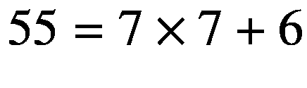

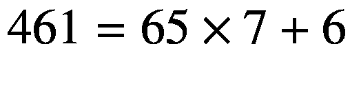

461 除以 7 余数为 6；55 除以 7 余数也为 6。因此，461 和 55 关于模 7 同余。我们写作：

461≡55 mod 7

LCG 由以下递推关系定义：

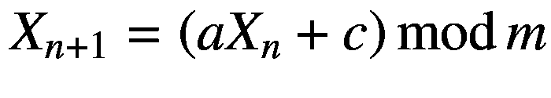

`X[n]` 是随机数序列。

`m`，0 < `m`，是模数。

`a`，0 < `a` < `m`，是乘数。

0 ≤ `c` < `m`，是增量，也称为偏移量。

`X[0]`，0 ≤ `X[0]` < `m`，是起始值。

给定起始值 `X[0]`，我们可以持续运行递推关系来生成随机数序列。假设参数选择得当，随机性质量良好。所有可能的整数最终都会出现。序列的最大周期为 `m`。然而，LCG 的质量很大程度上取决于所选参数。它可能会产生短周期甚至非随机的数（高度序列相关）。我们通常不会手动挑选这些参数。

莱默随机数生成器是参数的一种流行选择。它将 `m` 设置为素数或素数的幂，且 `c` = 0。例如，NM Dev 默认使用 `m` = 2147483563 和 `a` = 40014。

LCG 的一个问题是其周期对于某些应用来说可能太小。创建具有更大周期的 LCG 的一种方法是组合多个 LCG。组合 LCG 的输出等效于单个 LCG 的输出，该单个 LCG 的模数等于各组件生成器模数的乘积，周期等于各组件周期的最小公倍数。

在 NM Dev 中，我们有一系列随机数生成器。随机数生成器的签名如下所示。`seed` 方法将 RNG 初始化为随机序列的起始点。`nextDouble` 方法根据特定 RNG 的属性生成下一个随机数。

```
public interface Seedable {
/**
* 为随机数/向量/场景生成器设定种子，以产生可重复的实验。
*
* @param seeds 种子值
*/
public void seed(long... seeds);
}
public interface RandomNumberGenerator extends Seedable {
/**
* 获取下一个随机 {@code double} 值。
*
* @return 下一个随机数
*/
public double nextDouble();
}
```

以下代码使用各种 LCG 生成多个随机数序列。`nextLong` 方法为 LCG 生成整数；`nextDouble` 方法生成介于 0 和 1 之间的双精度浮点数。


```java
System.out.println("generate randome numbers using an Lehmer RNG:");
RandomLongGenerator rng1 = new Lehmer();
rng1.seed(1234567890L);
generateIntAndPrint(rng1, 10);
double[] arr = generate(rng1, 10);
print(arr);
System.out.println("generate randome numbers using an LEcuyer RNG:");
RandomLongGenerator rng2 = new LEcuyer();
rng2.seed(1234567890L);
generateIntAndPrint(rng2, 10);
arr = generate(rng2, 10);
print(arr);
System.out.println("generate randome numbers using a composite LCG:");
RandomLongGenerator rng3 = new CompositeLinearCongruentialGenerator(
        new LinearCongruentialGenerator[]{
                (LinearCongruentialGenerator) rng1,
                (LinearCongruentialGenerator) rng2
        }
);
rng3.seed(1234567890L);
generateIntAndPrint(rng3, 10);
arr = generate(rng3, 10);
print(arr);
```

输出结果如下：

```
generate randome numbers using an Lehmer RNG:
[1435150771, 264992611, 1287986023, 14695885, 1778129691, 1803529921, 261124279, 1119365911, 242889263, 1607847107]
[0.9693015489683634, 0.6321804200929291, 0.06732959846175084, 0.12655284849786763, 0.8856797936757945, 0.591264143240383, 0.8434276206844243, 0.9128140665540452, 0.34205909356243114, 0.15256980711986945]
generate randome numbers using an LEcuyer RNG:
[931800788, 1315300572, 50110053, 1984090886, 1233048435, 1852047791, 1666959172, 802962765, 288962461, 1436549801]
[0.5579439720874392, 0.8760583083499495, 0.27437038918694967, 0.8951008789684162, 0.9749086084658786, 0.5236797712387888, 0.5190309786792058, 0.07284812912011898, 0.947280622528531, 0.9903890099331686]
generate randome numbers using a composite LCG:
[1435150771, 264992611, 1287986023, 14695885, 1778129691, 1803529921, 261124279, 1119365911, 242889263, 1607847107]
[0.9693015115049681, 0.6321803956592273, 0.06732959585946947, 0.12655284360661437, 0.8856797594443706, 0.5912641203880907, 0.8434275880860421, 0.9128140312738847, 0.34205908034188587, 0.15256980122306366]
```

请注意，LCG 生成的是整数。为了从均匀分布中采样，它们将这些整数缩放到单位区间内。

通过使用相同的种子，本例中的 `1234567890L`，代码始终生成相同的随机数序列。这对于我们希望反复执行同一随机实验的场景非常重要，例如，在调试或计算 `π` 时获取相同的数值。一般而言，在包含多个 RNG 的应用程序中，它们都应共享同一个底层均匀 RNG。换句话说，一个应用程序应该只有一个且仅有一个均匀 RNG，无论它使用了多少个其他 RNG。该均匀 RNG 接收一个种子，并且应该仅在应用程序启动时播种一次，并在其整个生命周期内保持不变。

`CompositeLinearCongruentialGenerator` 的签名如下：

```java
/**
 * 通过一些更简单、模数更小的生成器构造一个线性同余生成器。
 *
 * @param rng 更简单、模数更小的线性同余生成器数组
 */
public CompositeLinearCongruentialGenerator(LinearCongruentialGenerator[] rng)
```

### 13.1.2 梅森旋转算法

线性同余方法的一个问题是，其周期对于某些应用来说可能太小，例如 `2³²`。即使我们使用组合 LCG 将几个生成器结合起来，这个周期仍然很小。因此，LCG 适用于只需要几千个随机数的小型应用，但不适用于需要数百万个随机数的场景。相比之下，常用的梅森旋转算法（MT）RNG，即 MT19937，其周期为 `2¹⁹⁹³⁷ − 1`（Matsumoto & Nishimura，1998）。此外，MT RNG 具有良好的统计随机性。MT19937 是使用最广泛的通用 RNG。

以下代码在 114 毫秒内使用 MT19937 生成了 100 万个随机数：

```java
RandomLongGenerator rng = new MersenneTwister();
long startTime = System.nanoTime();
int N = 1_000_000;
for (int i = 0; i < N; ++i) {
    rng.nextDouble();
}
long endTime = System.nanoTime();
long duration = (endTime - startTime);
double ms = (double) duration / 1_000_000.; // 除以 1000000 得到毫秒数
System.out.println(String.format("took MT19937 %f milliseconds to generate %d random numbers", ms, N));
```

输出结果如下：

```
took MT19937 114.543900 milliseconds to generate 1000000 random numbers
```

## 13.2 从概率分布中采样

随机数生成广泛应用于游戏、赌博、密码学、仿真以及许多其他需要产生不可预测结果的领域。一些物理现象本质上是随机的，例如抛硬币、放射性衰变、粒子位置以及量子领域的一切事物。仿真和蒙特卡洛方法已被证明在解决没有其他已知解决方案的难题方面非常有效。它们广泛应用于科学的各个分支，并建立在随机数生成的基础之上。因此，我们经常需要对某个过程或系统的随机性进行建模。换句话说，我们希望生成能够模拟系统概率特性的随机数。例如，我们希望编写一个程序来模拟抛掷 100 枚硬币的实验，并统计每次实验中硬币正面的数量。我们需要根据 50-50 的概率分布生成大量随机数 `{正面 = 0, 反面 = 1}`。我们将这种随机数生成称为从概率分布中进行采样。

随机变量 `X` 是一个可以取不同值的变量。在你观测它之前，你并不知道它会取什么值（信息被揭示）。这与确定性变量（例如 `x = 1`）相反，后者始终只能取一个值。每次你“查看”一个随机变量，就是对该随机变量的一次采样。例如，抛硬币的结果就是一个随机变量。在你掷出硬币之前，你并不知道它是正面还是反面。抛掷硬币 10 次会给出 10 次观测值或样本，例如 `{x[1] = 1, x[2] = 1, x[3] = 0, ⋯, x[10] = 0}`。每个样本都来自一枚公平硬币的概率分布。

概率分布是一个数学函数，它给出了实验中不同可能结果发生的概率。例如，抛一枚公平硬币的概率分布为：正面概率 0.5（50%），反面概率 0.5（50%）。概率分布由累积分布函数正式定义。一个实值随机变量 `X` 的累积分布函数（CDF），在 `x` 处的取值，是 `X` 取一个小于或等于 `x` 值的概率。数学上，我们有如下定义（见图 13-1）：

`F_X(x) = P(X ≤ x)`

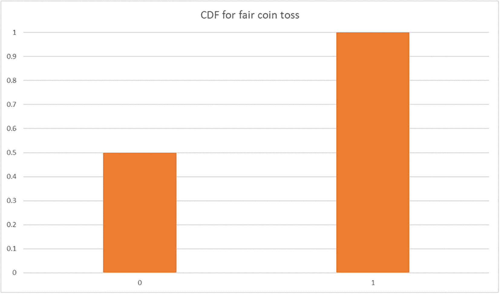

**图 13-1** – 公平硬币抛掷的累积分布函数

抛掷一枚公平硬币的 CDF，将正面标记为 0，反面标记为 1，如下所示：

`F_X(x) = { 0.5, x=0; 1, x=1 }`

图 13-2 展示了几种正态分布的 CDF。我们可以看到，对于 `μ = 0`（均值为 0）的正态分布，从该概率分布中获取一个值小于（或大于）0 的样本的概率为 0.5。

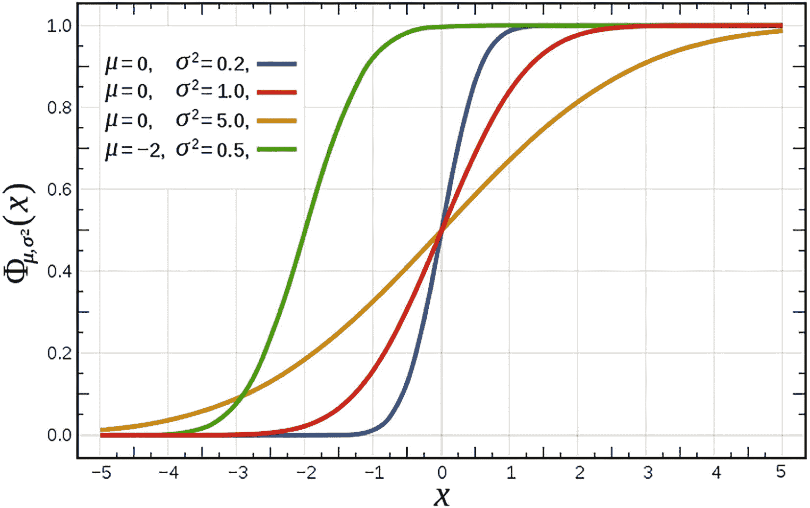

**图 13-2** – 正态分布的累积分布函数

对于连续随机变量，使用概率密度函数（PDF）来描述通常更直观。

`f_X(x) = d/dx F_X(x)`


### 概率分布与采样

`f(x)` 是随机变量等于样本值 `x` 的相对似然性。相对似然性越大，我们越可能看到该样本而不是另一个样本。对于连续随机变量，绝对似然性始终为 0。随机变量的值落在某个区域内的概率，等于该区域在概率密度函数（PDF）曲线下的面积，即 PDF 在该区域上的积分。

我们已在第 13.1 节中讨论了如何从均匀分布中采样。本节将讨论从任意概率分布中采样的方法。

### 13.2.1 逆变换采样

逆变换采样是一种方法，它利用任意概率分布的累积分布函数（CDF）来随机生成该分布的样本。该方法从均匀分布 `y`（取值范围在 0 到 1 之间）中取一个随机数，将其解释为一个概率，然后返回分布 `F(x)` 定义域内满足 `F(x) ≤ y` 的最大数 `x`。换句话说，它计算的是逆函数。对于图 13-3 中的例子，一个均匀随机数产生了四个样本：`U1, U2^a, U2^b, U2^c`。来自概率分布 `F(x)` 的对应样本是 `Fx^{-1}(U1)` 和三个 `Fx^{-1}(U2)`。

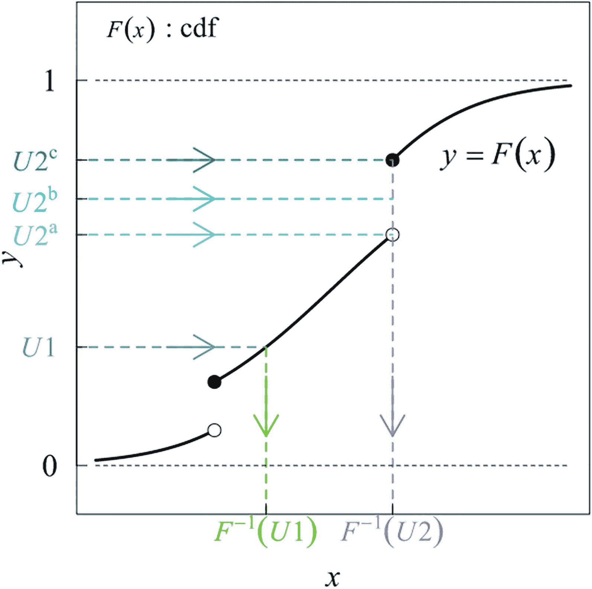

**图 13-3** 逆变换采样示意图

`NM Dev` 有一个用于执行逆变换采样的类。其签名如下：

```
/**
* Constructs a random number generator to sample from a distribution.
*
* @param distribution the distribution to sample from
* @param uniform      a uniform random number generator
*/
public InverseTransformSampling(
ProbabilityDistribution distribution,
RandomLongGenerator uniform)
```

瑞利分布的 CDF 如下所示：

为了构建一个用于瑞利分布的随机数生成器（RNG），我们只需将其概率分布传递给 `InverseTransformSampling`（见图 13-4）。

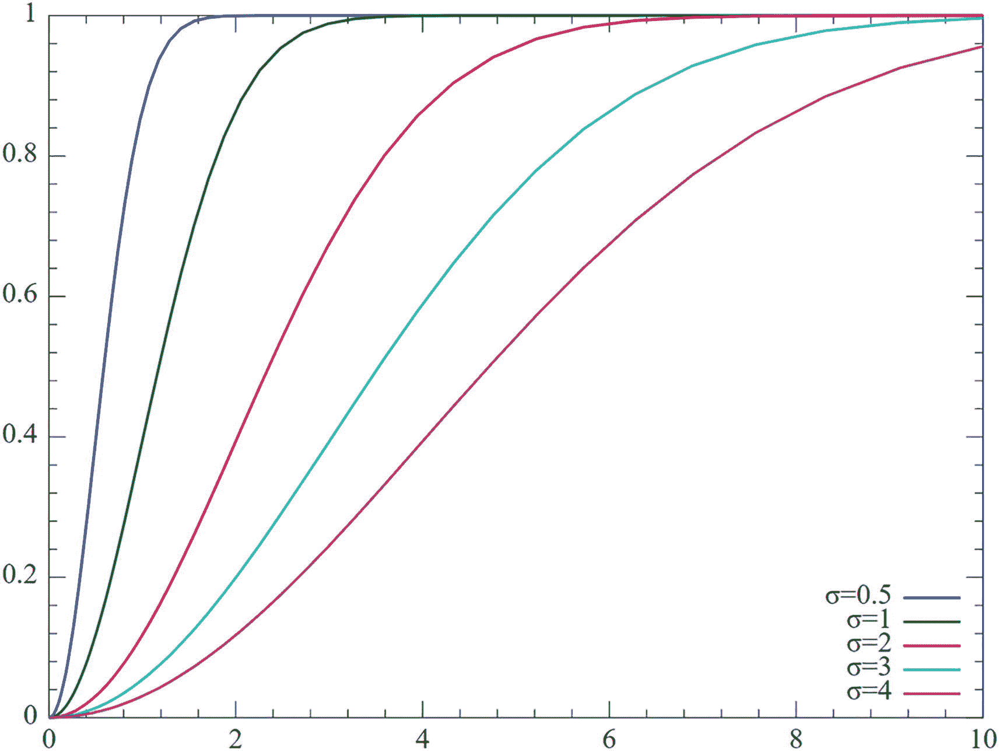

**图 13-4** 瑞利分布的 CDF

```
/**
* Constructs a random number generator to sample from the Rayleigh
* distribution.
*
* @param sigma the standard deviation
*/
public RayleighRNG(double sigma) {
super(new dev.nm.stat.distribution.univariate.RayleighDistribution(sigma));
}
```

从计算角度看，该方法涉及计算分布的分位数函数，即累积分布函数的逆函数。这就是此方法名称中包含“逆（inverse）”的原因。不幸的是，对于许多分布而言，当难以或不可能计算其 PDF 的积分或 CDF 的逆函数时，这种方法在计算上效率低下或不可行。逆变换采样对于稀有事件效率不高。对于概率接近 0 的事件，即 `P(X ∈ A) ≈ 0`，需要接近无限多的均匀样本才能采样到它们。

### 13.2.2 接受-拒绝采样

假设我们要从 PDF `f(x)` 中采样。我们在一个大矩形板上绘制该 PDF。我们随机且均匀地向板子上投掷飞镖。移除那些落在曲线下方面积之外的飞镖。剩下的飞镖将均匀分布在曲线下方的区域内，这些飞镖的 `x` 位置将根据随机变量的密度分布。这是因为曲线最高处为飞镖提供了最大的落点空间，因而概率密度也最大。

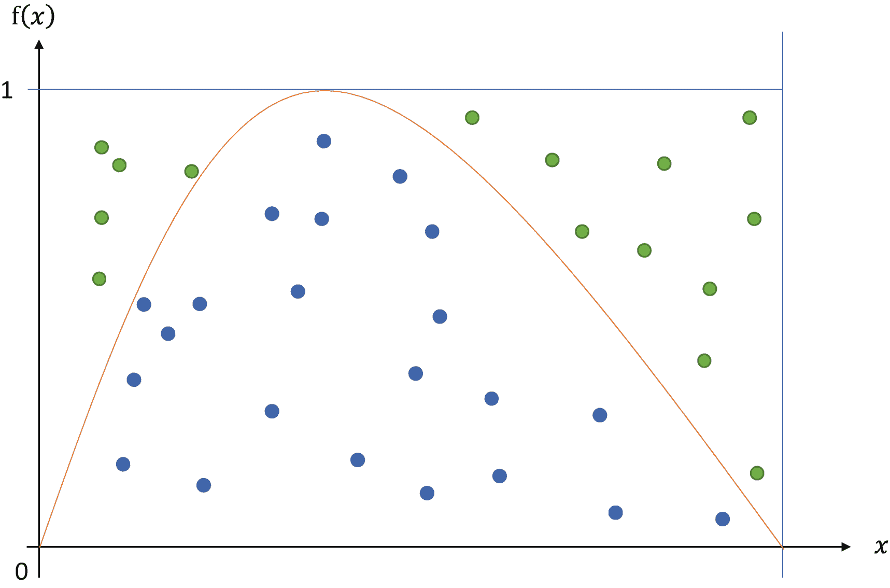

**图 13-5** 接受-拒绝的概念图：接受曲线下方的点，拒绝曲线上方的点

这个想法可以扩展到提议分布不是均匀分布（即矩形板）的情况，而是任何我们知道如何采样的分布。提议分布需要至少和目标分布一样高，以完全包络后者。否则，我们想要采样的曲线区域中有些部分将永远无法到达。这种接受-拒绝算法也适用于更高维度的 PDF。

假设我们要从目标 PDF `f(x)` 中采样。我们希望提议分布 PDF `g(x)` 满足以下条件：

*   对于任意 `x`，`f(x) <= M * g(x)`。
*   `g(x)` 易于采样。
*   `g(x)` 的形状应与 `f(x)` 相似。

拒绝方法如下：

1.  从提议分布 `g(x)` 中采样，得到 `x[i]`，即 `x[i] ~ g(x)`。
2.  从均匀分布中采样，得到 `u[i] ~ U(a, b)`。
3.  如果 `u[i] <= f(x[i]) / (M * g(x[i]))`，则接受 `x[i]` 作为有效样本；否则拒绝它。
4.  重复步骤 1 到 3，直到我们对样本集满意为止。

该算法的一个缺点是，在找到一个有效样本之前，可能会产生大量不需要的样本。在高维情况下，这个问题更加严重，使得该方法在该情境下效率低下且不实用。

### 13.2.3 从单变量分布中采样

逆变换采样和接受-拒绝采样是通用的方法，适用于（几乎）所有概率分布，但它们速度较慢。对于某些特定的概率分布，有专门且更快的采样方法。`NM Dev` 有一套庞大的随机数生成器，可以从一些最流行的概率分布中采样：高斯/正态分布、贝塔分布、伽马分布、指数分布、泊松分布、伯努利分布、二项分布、瑞利分布、威布尔分布等。其中一些分布（如正态分布）有多种实现。


#### 13.2.3.1 高斯分布或正态分布

最重要的概率分布或许就是高斯分布或正态分布了。自然界中有许多现象，要么本身就是正态分布，要么近似服从正态分布，要么就被假定为正态分布。扩散粒子在经历一段时间后的位置完全服从正态分布。一系列抛硬币结果中正面朝上的次数近似服从正态分布。股票收益对数的变化被假定为正态分布。其应用在金融、物理、生物学、统计学等领域无处不在。

从数学上看，正态分布有许多优良性质。它们具有对称性、单峰性、无限可微性、完全由前两个矩（均值和方差）决定、最大熵性、不相关性蕴含独立性以及可加性。或许使正态分布在统计学中占据核心地位的是中心极限定理，该定理指出：当样本量趋于无穷时，样本均值的分布趋向于正态分布。换言之，任何样本值的均值（或总和），例如测量值和误差，都近似服从正态分布。参见图 13-6。

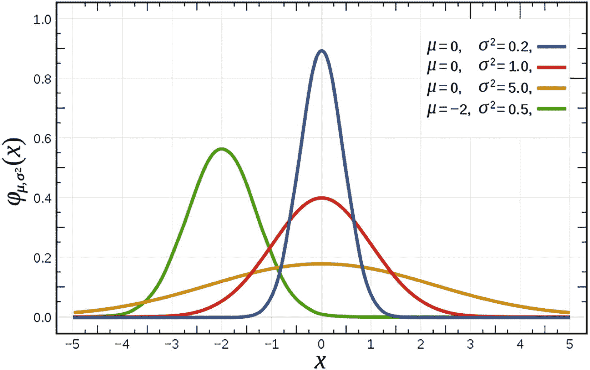

图 13-6 正态分布的概率密度函数

正态分布的概率密度函数如下：

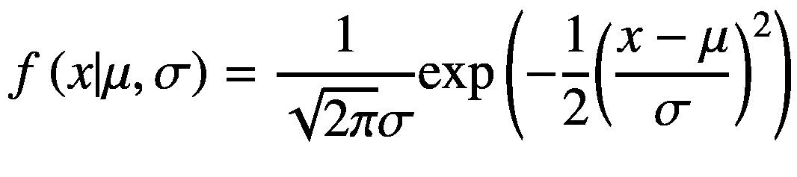

参数 `μ` 是分布的均值或期望，参数 `σ` 是标准差。分布的方差是 `σ²`。服从高斯分布的随机变量 `X` 被称为正态分布，记为 `X` ~ `N(μ, σ²)`。正态分布的均值 `μ` 决定其位置，标准差 `σ` 决定分布的幅度。当 `μ = 0` 且 `σ = 1` 时，该正态分布为标准正态分布。

NM Dev 提供了多种实现来生成随机正态样本。它们是 `Zignor2005` (Doornik, 2005)、`Ziggurat2000` (Marsaglia & Tsang, 2000)、`MarsagliaBray1964` (G. & Bray) 和 `BoxMuller` (Box & Muller, 1958)。默认情况下，我们使用 `Zignor2005`。

以下代码片段是生成标准正态样本和正态样本的示例：

```
RandomLongGenerator uniform = new MersenneTwister();
uniform.seed(1234567890L);
RandomStandardNormalGenerator rng1 = new Zignor2005(uniform); // mean = 0, stdev = 1
int N = 1000;
double[] arr1 = new double[N];
for (int i = 0; i < N; ++i) {
    arr1[i] = rng1.nextDouble();
}
// 检查随机样本的统计量
Variance var1 = new Variance(arr1);
System.out.println(
    String.format(
        "mean = %f, stdev = %f",
        var1.mean(),
        var1.standardDeviation()));
NormalRNG rng2 = new NormalRNG(1., 2., rng1); // mean = 1, stdev = 2
double[] arr2 = new double[N];
for (int i = 0; i < N; ++i) {
    arr2[i] = rng2.nextDouble();
}
// 检查随机样本的统计量
Variance var2 = new Variance(arr2);
System.out.println(
    String.format(
        "mean = %f, stdev = %f",
        var2.mean(),
        var2.standardDeviation()));
```

输出结果如下：

```
mean = 0.011830, stdev = 1.009379
mean = 0.940225, stdev = 2.037228
```

样本的统计量与传递给 RNG 构造函数的分布参数相匹配。

其签名如下：

```
/**
* 构造一个改进的 Ziggurat 随机正态生成器。
*
* @param uniform 一个均匀随机数生成器
*/
public Zignor2005(RandomLongGenerator uniform)
/**
* 构造一个随机数生成器，用于从正态分布中采样。
*
* @param mean  均值
* @param sigma 标准差
* @param rnorm 一个标准随机正态数生成器
*/
public NormalRNG(double mean, double sigma, RandomStandardNormalGenerator rnorm)
```

标准正态 RNG `Zignor2005` 接收一个均匀 RNG 作为输入，在我们的示例中为 `MersenneTwister`。然后，正态 RNG 接收一个标准正态 RNG 和分布参数作为输入。请注意，我们在一个应用程序中仅对均匀 RNG 进行一次播种。

#### 13.2.3.2 Beta 分布

Beta 分布是一族在单位区间 [0, 1] 上定义的连续概率分布，由控制分布形状的两个正形状参数 `α` 和 `β` 参数化。Beta 分布已被用于在众多学科中建模被限制在有限长度区间内的随机变量的行为。Beta 分布的概率密度函数如下：

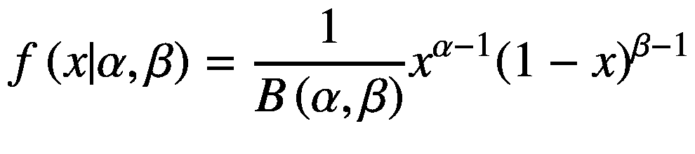

`B(α, β)` 是 Beta 函数。服从参数为 `α` 和 `β` 的 Beta 分布的随机变量 `X` 记作 `X` ~ `Be(α, β)`。

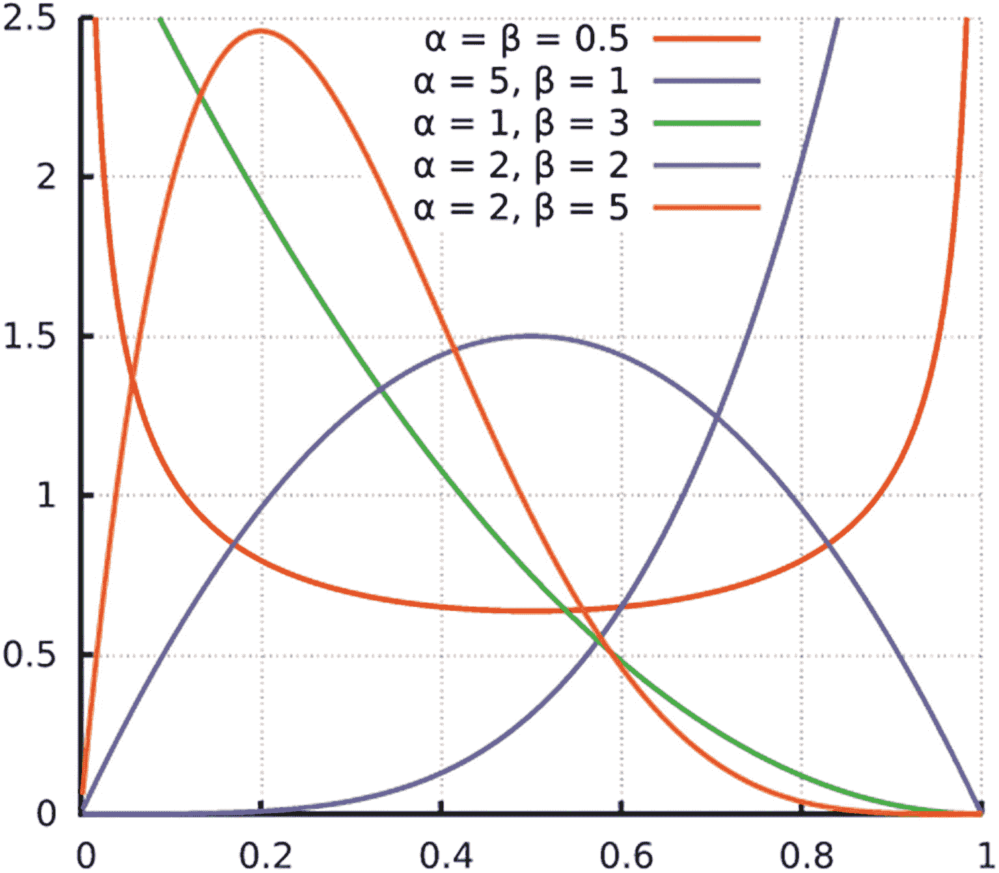

图 13-7 Beta 分布的概率密度函数

NM Dev 提供了多种实现来生成随机 Beta 样本。它们是 `Cheng1978` (Cheng, 1978) 和 `VanDerWaerden1969` (van der Waerden)。默认情况下，我们使用 `Cheng1978`。类 `Cheng1978` 是一种用于生成 Beta 变量的新拒绝方法。该方法在理论上和通过计算机计时都与先前发布的方法进行了比较。结果表明，该方法在速度和编程简洁性上优于先前的方法，特别是对于参数值的“困难”组合。具体来说，如果 `X` 和 `Y` 独立，且 `X` ~ `Γ(α, θ)`，`Y` ~ `Γ(β, θ)`，则 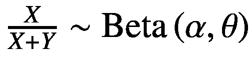。要从 Beta 分布中采样，我们可以生成 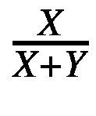，其中 `X` 是参数为 `Γ(α, 1)` 的 Gamma 变量，`Y` 是参数为 `Γ(β, 1)` 的独立 Gamma 变量。

以下代码片段生成了 `α = 0.1`，`β = 0.2` 的 Beta 变量：

```
final int size = 1_000_000;
final double alpha = 0.1;
final double beta = 0.2;
RandomBetaGenerator rng = new Cheng1978(alpha, beta, new UniformRNG());
rng.seed(1234567890L);
double[] x = new double[size];
for (int i = 0; i < size; ++i) {
    x[i] = rng.nextDouble();
}
// 计算样本统计量
Mean mean = new Mean(x);
Variance var = new Variance(x);
Skewness skew = new Skewness(x);
Kurtosis kurtosis = new Kurtosis(x);
// 计算理论统计量
ProbabilityDistribution dist = new BetaDistribution(alpha, beta);
// 比较样本统计量与理论统计量
printStats(dist, mean, var, skew, kurtosis);
```

输出结果如下：

```
theoretical mean = 0.333333, sample mean = 0.333402
theoretical var = 0.170940, sample var = 0.171025
theoretical skew = 0.701066, sample skew = 0.700741
theoretical kurtosis = -1.304348, sample kurtosis = -1.305287
```

我们可以看到，样本统计量与根据概率分布函数分析计算得到的理论值吻合良好。

构造函数的签名如下：

```
/**
* 构造一个随机数生成器，用于从 Beta 分布中采样。
*
* @param aa      自由度
* @param bb      自由度
* @param uniform 一个均匀随机数生成器
*/
public Cheng1978(double aa, double bb, RandomLongGenerator uniform)
```


### 13.2.3.3 Gamma 分布

Gamma 分布是一个包含两个参数的连续概率分布族。指数分布、Erlang 分布和卡方分布都是 Gamma 分布的特例。这两个参数分别是形状参数 *k* 和尺度参数 *θ*。Gamma 分布常用于对等待时间进行建模。例如，在寿命测试中，死亡前的等待时间是一个随机变量，通常用 Gamma 分布建模。Gamma 分布也用于对保险索赔金额和降雨量进行建模。这意味着总保险索赔和水库中累积的降雨量是通过 Gamma 过程建模的。在肿瘤学中，癌症发病率的年龄分布通常遵循 Gamma 分布，而形状和尺度参数分别预测驱动事件的数量以及它们之间的时间间隔。在神经科学中，Gamma 分布常用于描述尖峰间期的分布。在细菌基因表达中，组成型表达蛋白的拷贝数通常遵循 Gamma 分布，其中尺度参数和形状参数分别是每个细胞周期的平均爆发次数和单个 mRNA 在其生命周期内产生的平均蛋白质分子数量。

参数 *α* = *k* 称为形状参数，而 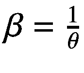 称为逆尺度参数。Gamma 分布的概率密度函数如下：

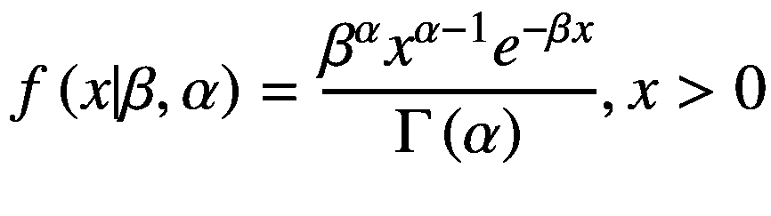

Γ(*α*) 是 Gamma 函数。服从参数为 *α* 和 *β* 的 Gamma 分布的随机变量 *X* 记作 *X*~Γ(*α*, *β*)。见图 13-8。

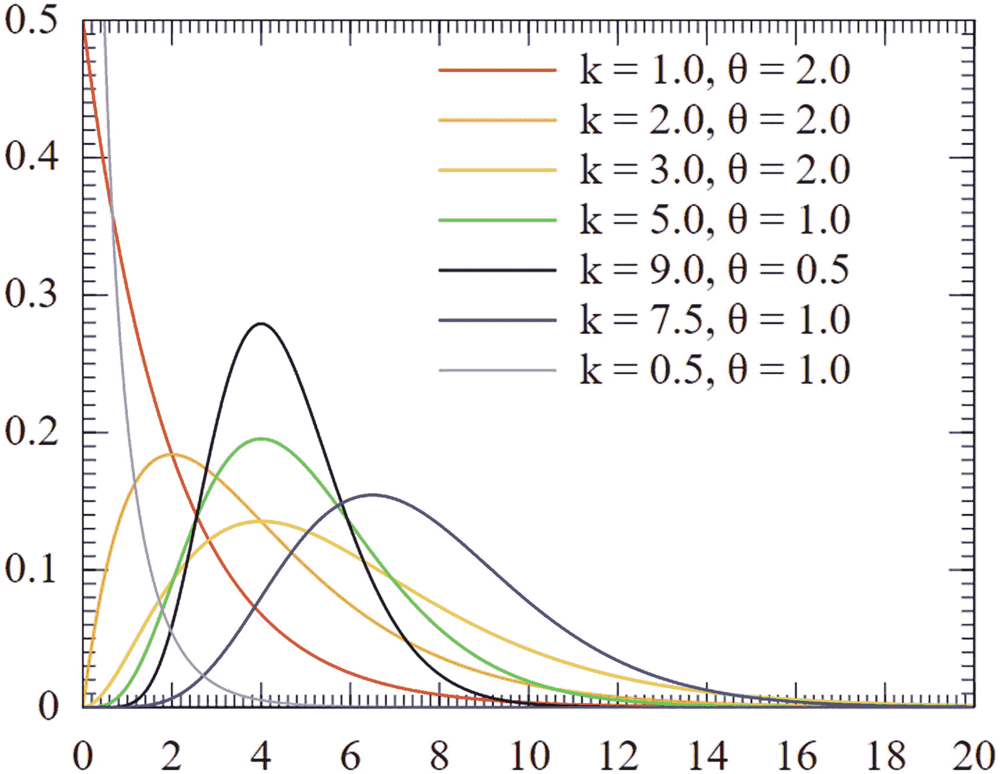

**图 13-8** Gamma 分布的概率密度函数

NM Dev 提供了多种生成随机 Gamma 样本的实现。它们是 `InverseTransformSamplingGammaRNG`（逆变换采样，效率较低），`MarsagliaTsang2000`（Marsaglia & Tsang, 2000），`XiTanLiu2010a` 和 `XiTanLiu2010b`（Xi, Tan, & Liu），以及 `KunduGupta2007`（Kundu & Gupta, 2007）。默认情况下，我们使用 `KunduGupta2007`。当形状参数介于 0 和 1 之间时，它使用一种便捷的方法，通过广义指数分布来生成 Gamma 变量。

下面的代码片段生成 *k* = 0.1, *θ* = 1 的 Gamma 变量：

```java
final int size = 1_000_000;
final double k = 0.1;
final double theta = 1;
KunduGupta2007 rng = new KunduGupta2007(k, theta, new UniformRNG());
rng.seed(1234567895L);
double[] x = new double[size];
for (int i = 0; i < size; ++i) {
    x[i] = rng.nextDouble();
}
// compute the sample statistics
Mean mean = new Mean(x);
Variance var = new Variance(x);
Skewness skew = new Skewness(x);
Kurtosis kurtosis = new Kurtosis(x);
// compute the theoretial statistics
ProbabilityDistribution dist = new GammaDistribution(k, theta);
// compute the theoretial statistics
printStats(dist, mean, var, skew, kurtosis);
```

输出如下：

```
theoretical mean = 0.100000, sample mean = 0.102555
theoretical var = 0.100000, sample var = 0.102297
theoretical skew = 6.324555, sample skew = 6.303562
theoretical kurtosis = 60.000000, sample kurtosis = 60.330271
```

我们可以看到，样本统计量与根据概率分布函数解析计算出的理论值匹配良好。

构造函数的签名如下：

```java
/**
 * 构造一个用于从 Gamma 分布中采样的随机数生成器。
 *
 * @param k       形状参数
 * @param theta   尺度参数
 * @param uniform 一个均匀随机数生成器
 */
public KunduGupta2007(double k, double theta, RandomLongGenerator uniform)
```

### 13.2.3.4 Poisson 分布

泊松过程是一系列离散事件，其中事件之间的平均时间是已知的，但下一个事件发生的确切时间是随机的。一个事件的发生与之前的事件是独立的；也就是说，事件之间的等待时间是无记忆的（马尔可夫性）。例如，一个呼叫中心平均每小时接听 180 个电话，全天 24 小时如此。这些电话是相互独立的；接听一个电话并不会改变下一个电话何时到达的概率。在任何一分钟内接到的电话数量遵循泊松概率分布：最可能出现的数字是 2 和 3，但出现 1 和 4 的可能性也很大，出现 0 的概率很小，出现 10 的可能性则非常小。另一个例子是在给定的观察期内，从放射源发生的衰变事件的数量。如果事件数量在每个固定时间间隔内有一个已知的平均值，并且与自上一个事件以来的时间无关，那么泊松分布的概率质量函数给出了在固定时间间隔内观察到 *k* 个随机事件的概率。概率质量函数的形式如下：

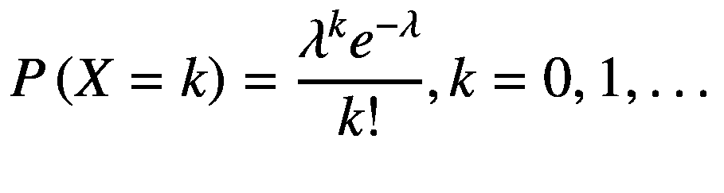

泊松分布的参数 *λ* 是单位时间内随机事件的平均数量。泊松分布的期望和方差均为 *λ*。请注意，与我们之前看到的所有分布不同，泊松分布是一个离散分布。*X* 取整数值。

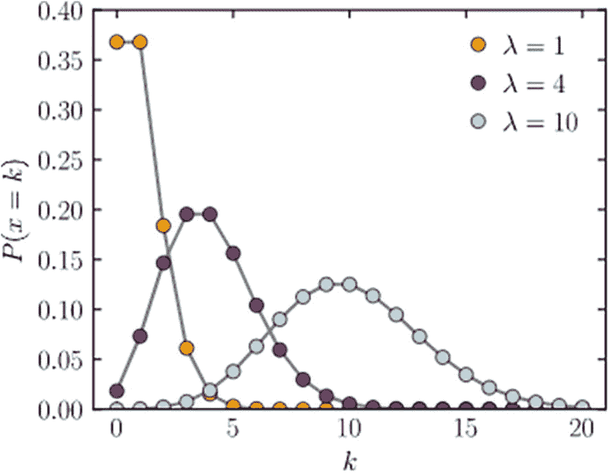

**图 13-9** 泊松分布的概率质量函数

在 NM Dev 中，泊松 RNG 类是 `Knuth1969`。下面的代码片段生成 *λ* = 1 的泊松变量：

```java
final int N = 10_000;
double lambda = 1;
RandomNumberGenerator rng = new Knuth1969(lambda);
rng.seed(123456789L);
double[] x = new double[N];
for (int i = 0; i < N; ++i) {
    x[i] = rng.nextDouble();
}
// compute the sample statistics
Mean mean = new Mean(x);
Variance var = new Variance(x);
Skewness skew = new Skewness(x);
Kurtosis kurtosis = new Kurtosis(x);
// compute the theoretial statistics
PoissonDistribution dist = new PoissonDistribution(lambda);
// compute the theoretial statistics
printStats(dist, mean, var, skew, kurtosis);
```

输出如下：

```
theoretical mean = 1.000000, sample mean = 1.013300
theoretical var = 1.000000, sample var = 1.022225
theoretical skew = 1.000000, sample skew = 1.000960
theoretical kurtosis = 1.000000, sample kurtosis = 0.990813
```

我们可以看到，样本统计量与根据概率分布函数解析计算出的理论值匹配良好。

构造函数的签名如下：

```java
/**
 * 构造一个用于从泊松分布中采样的随机数生成器。
 *
 * @param lambda  形状参数
 * @param uniform 一个均匀随机数生成器
 */
public Knuth1969(double lambda, RandomLongGenerator uniform)
```


#### 13.2.3.5 指数分布

泊松分布描述的是某个区间内事件发生的次数，而指数分布描述的则是泊松过程中事件之间的时间间隔。它是针对随机时间的分布，也是伽马分布的一个特例。指数分布的例子有很多，例如放射性粒子衰变前的时间、接到下一个电话前的等待时间，以及在信用风险模型中贷款违约前的时间。

`λ > 0` 被称为速率参数。它表示单位时间内事件发生的平均次数。随机时间范围为 `0, ∞)`。如果一个随机变量 `X` 服从指数分布，则记作 `X ~ E(λ)`。其概率密度函数如下（图 13-10）：

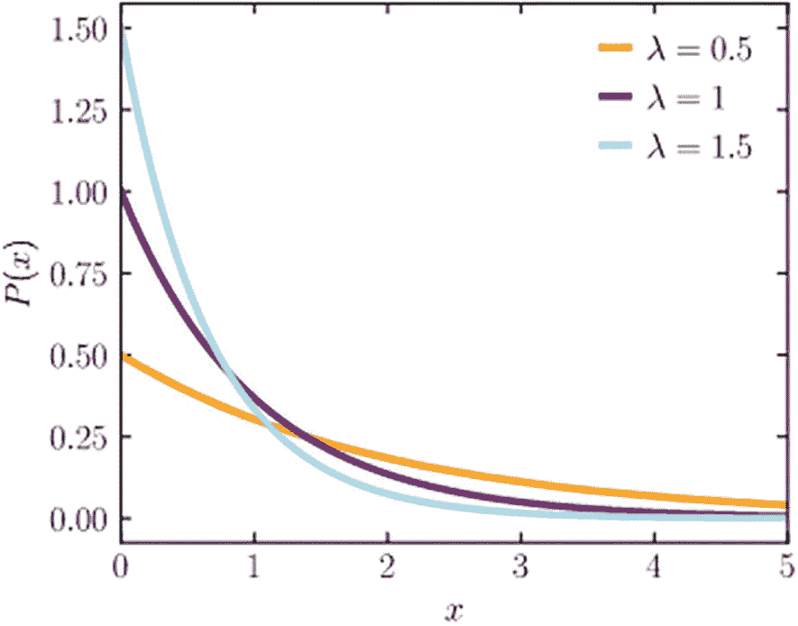

图 13-10  
指数分布的概率密度函数

我们可以通过逆变换采样法生成指数分布变量。NM Dev 实现了一个更高效的算法 `Ziggurat2000Exp` (Marsaglia & Tsang, 2000)。下面的代码片段生成了 `λ = 1` 的标准指数分布变量。注意，`Ziggurat2000Exp` 使用默认构造函数，并且不接受参数。

```
int size = 500_000;
RandomExpGenerator rng = new Ziggurat2000Exp();
rng.seed(634641070L);
double[] x = new double[size];
for (int i = 0; i < size; ++i) {
x[i] = rng.nextDouble();
}
// 计算样本统计量
Mean mean = new Mean(x);
Variance var = new Variance(x);
Skewness skew = new Skewness(x);
Kurtosis kurtosis = new Kurtosis(x);
// 计算理论统计量
ProbabilityDistribution dist = new ExponentialDistribution();
// 计算理论统计量
printStats(dist, mean, var, skew, kurtosis);
```

输出结果如下：

```
theoretical mean = 1.000000, sample mean = 1.000983
theoretical var = 1.000000, sample var = 0.996058
theoretical skew = 2.000000, sample skew = 1.958222
theoretical kurtosis = 6.000000, sample kurtosis = 5.489008
```

我们可以看到，样本统计量与根据概率分布函数通过解析计算得出的理论值吻合得很好。

要生成非标准的指数分布变量，我们可以先生成标准指数分布变量，然后对其进行缩放。或者，我们可以直接使用以 `λ` 为参数的 `InverseTransformSamplingExpRNG`。其签名如下：

```
/**
* 构造一个随机数生成器，用于使用逆变换采样法从指数分布中采样。
*
* @param lambda 速率参数
*/
public InverseTransformSamplingExpRNG(double lambda)
```

### 13.2.4 从多元分布中采样

NM Dev 支持对某些高维多元分布生成随机向量。每个样本是一个数字向量，而不仅仅是一个数字。这些分布包括但不限于以下内容（因为我们一直在扩展该库）：

*   高维盒子区域上的多元均匀分布
*   高维单位超球面上的多元均匀分布
*   多元正态分布
*   多项分布

随机向量生成器 `RandomVectorGenerator` 的签名如下：

```
public interface RandomVectorGenerator extends Seedable {
/**
* 获取下一个随机向量。
*
* @return 下一个随机向量
*/
public double[] nextVector();
}
```

每次调用 `nextVector` 都会生成一个 `double[]` 形式的向量样本。

#### 13.2.4.1 盒子上的多元均匀分布

`UniformDistributionOverBox` 类是一个随机向量生成器，它在一个高维超立方体或盒子内均匀地生成样本。它接受一个一维均匀随机数生成器和盒子的维度作为输入。其签名如下：

```
/**
* 构造一个随机向量生成器，用于在盒子区域内均匀采样点。
*
* @param uniform 一个均匀随机数生成器
* @param bounds  可行的盒子区域
*/
public UniformDistributionOverBox(
RandomLongGenerator uniform,
RealInterval... bounds
)
```

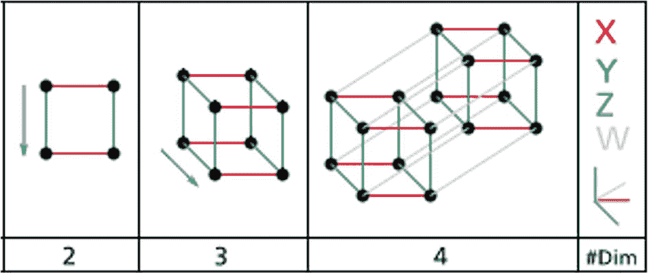

图 13-11  
不同维度的立方体

下面展示了如何使用随机采样来计算圆的周长与直径之比，即 `π`。其原理是：向一个包含圆形的单位板 `x ∈ [-1, 1]`, `y ∈ [-1, 1]` 上随机投掷飞镖。正方形的面积为 1，圆的面积为 `π/4`。也就是说，落在圆内的飞镖数量 `N[0]` 与落在整个板上的飞镖数量 `N` 之比为：

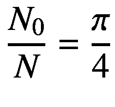

我们由此求解 `π`。以下代码实现了该过程：

```
private void compute_Pi() {
final int N = 1_000_000;
RandomVectorGenerator rvg
= new UniformDistributionOverBox(
new RealInterval(-1., 1.), // 一个单位正方形盒子
new RealInterval(-1., 1.));
int N0 = 0;
for (int i = 0; i < N; i++) {
double[] xy = rvg.nextVector();
double x = xy[0], y = xy[1];
if (x * x + y * y <= 1.) { // 检查点是否在圆内
N0++;
}
}
double pi = 4\. * N0 / N;
System.out.println("pi = " + pi);
}
```

输出结果如下：

```
pi = 3.139588
```

#### 13.2.4.2 超球面上的多元均匀分布

`HypersphereRVG` 类是一个随机向量生成器，它在一个高维超球体的表面上均匀地生成样本。它接受球体维度和一个一维标准正态随机数生成器作为输入。其签名如下：

```
/**
* 构造一个超球面 RVG，用于生成均匀随机点。
*
* @param dimension 超球面的维度
* @param rnorm     要使用的标准正态随机数生成器
*/
public HypersphereRVG(int dimension, RandomStandardNormalGenerator rnorm)
```


### 13.2.4.3 多元正态分布

多元正态分布、多元高斯分布或联合正态分布是一维（单变量）正态分布向更高维度的推广。一种定义是：如果一个随机向量的* k *个分量的每一个线性组合都具有单变量正态分布，则该随机向量称为*k*元正态分布。根据多维中心极限定理，多元正态分布通常（至少近似地）用于描述任意一组（可能）相关的实值随机变量，这些变量各自聚集在一个均值附近。

如果实随机向量 ***X*** = (*X*[1], ⋯, *X*[*k*])^(*T*) 的每个分量 *X*[*i*] 本身是单变量标准正态分布且彼此独立，则称其为（多元）标准正态随机向量。也就是说，对所有 *i*，有 *X*[*i*]~*N*(0, 1)。可以证明，任何多元正态向量都可以写成 *k* 维向量 *μ* 与一个缩放后的多元标准正态向量之和。也就是说，***X***~*N*(***μ***, **Σ**) 当且仅当存在 ***μ*** ∈ *ℝ*^(*k*) 和 ***A*** ∈ *ℝ*^(*kxl*)，使得 ***X*** = ***AZ*** + ***μ***，其中 *Z* 是多元标准正态向量。***μ*** 是 *k* 维均值向量，**Σ** 是各分量的 *k* × *k* 协方差矩阵。请参见图 13-12。

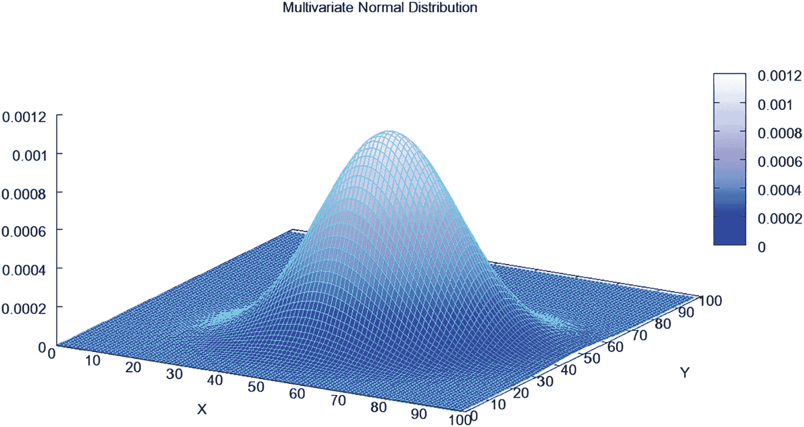

图 13-12

二维正态分布的概率密度函数

多元正态分布的概率密度函数如下：


在 NM Dev 中，`NormalRVG` 类用于从多元正态分布中采样。以下代码片段生成相关的多元正态变量：

```
// 均值
Vector mu = new DenseVector(new double[]{-2., 2.});
// 协方差矩阵
Matrix sigma = new DenseMatrix(new double[][]{
{1., 0.5},
{0.5, 1.}
});
NormalRVG rvg = new NormalRVG(mu, sigma);
rvg.seed(1234567890L);
final int size = 10_000;
double[][] x = new double[size][];
Mean mean1 = new Mean();
Mean mean2 = new Mean();
for (int i = 0; i < size; ++i) {
double[] v = rvg.nextVector();
mean1.addData(v[0]);
mean2.addData(v[1]);
x[i] = v;
}
System.out.println(String.format("X_1 的均值 = %f", mean1.value()));
System.out.println(String.format("X_2 的均值 = %f", mean2.value()));
Matrix X = new DenseMatrix(x);
SampleCovariance cov = new SampleCovariance(X);
System.out.println(String.format("样本协方差 = %s", cov.toString()));
```

输出结果如下：

```
X_1 的均值 = -2.007342
X_2 的均值 = 1.995800
样本协方差 = 2x2
[,1] [,2]
[1,] 1.003598, 0.496158,
[2,] 0.496158, 1.012381,
```

样本均值和样本协方差矩阵与实际输入的参数匹配得相当好。

`NormalRVG` 构造函数的签名如下：

```
/**
 * 构造一个多元正态随机向量生成器。
 *
 * @param mu      均值
 * @param sigma   协方差矩阵
 * @param epsilon 精度参数：当 |x| &le; &epsilon; 时，视为 0
 * @param rnorm   随机标准正态数生成器
 */
public NormalRVG(
    final Vector mu,
    final Matrix sigma,
    final double epsilon,
    final RandomStandardNormalGenerator rnorm
)
```

### 13.2.4.4 多项分布

多项分布根据各箱子的概率将 *n* 个物品分配到 *k* 个箱子中。输出随机向量统计每个箱子中的物品数量，总数为 *n*。当 *k* = 2 且 *n* = 1（将一个物品放入两个箱子）时，它就是伯努利分布。输出结果是 (0, 1) 或 (1, 0)。这类似于投掷一次（不一定均匀的）硬币，得到正面或反面。当 *k* = 2 且 *n* > 1（将 *n* 个物品放入 2 个箱子）时，它就是二项分布。这类似于将同一枚硬币投掷 *n* 次并统计正面（或反面）的次数。对于固定的有限 *k*，***X*** 中的第 *i* 个分量表示在总共 *n* 个物品中，第 *i* 个箱子中的物品数量。

多项分布的概率质量函数如下：

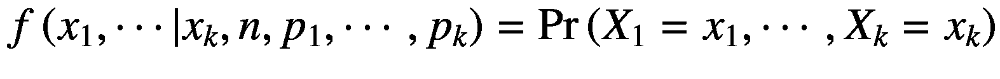

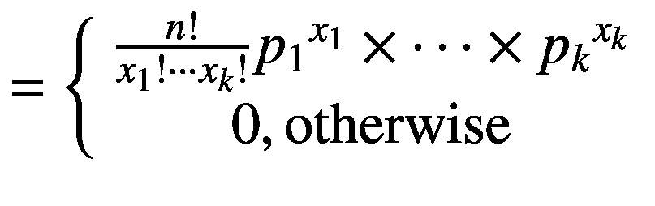

在 NM Dev 中，`MultinomialRVG` 类用于从多项分布中采样。以下代码片段将 10,000 个物品放入两个箱子中，概率分别为 70% 和 30%：

```
MultinomialRVG rvg
= new MultinomialRVG(100_000, new double[]{0.7, 0.3}); // 箱子 0 概率 70%，箱子 1 概率 30%
double[] bin = rvg.nextVector();
double total = 0;
for (int i = 0; i < bin.length; ++i) {
total += bin[i];
}
double bin0 = bin[0] / total; // 箱子 0 百分比
double bin1 = bin[1] / total; // 箱子 1 百分比
System.out.println(String.format("箱子 0 %% = %f, 箱子 1 %% = %f", bin0, bin1));
```

输出结果如下：

```
箱子 0 % = 0.702410, 箱子 1 % = 0.297590
```

样本百分比与输入中每个箱子的个体概率匹配得相当好。

`MultinomialRVG` 构造函数的签名如下：

```
/**
 * 构造一个多项随机向量生成器。
 *
 * @param N       一个整数 N，指定在典型多项实验中放入 K 个箱子的总物品数
 * @param prob    长度为 K 的数值非负向量，指定 K 个箱子的概率
 * @param uniform 均匀随机数生成器
 */
public MultinomialRVG(int N, double[] prob, RandomLongGenerator uniform)
```


### 13.2.5 重采样方法

可视化经验分布的一种方法如下。给定一组样本，经验分布将`1/N`的概率分配给每个样本。然后以`1/N`的概率，从该集合中随机抽取一个样本作为下一个随机变量。集合中出现频率较高的项更容易被抽中，因此具有更高的概率质量。罕见的项则不易被抽中，在输出中出现的频率也会更低。本质上，我们是从样本集中进行抽样以生成新样本。我们可以推广这种重采样思想，一次抽取多个项。一次性抽取多个项相对于经验分布方法的一个重要优势是，前者还考虑了样本之间的序列相关性，而后者则假设数据集中的所有样本是独立同分布的。换句话说，通过重采样方法生成的变量不仅具有与真实分布相似的概率分布，还具有相似的序列相关性（样本之间的时间依赖性）。当系统的真实概率分布未知时，重采样方法是一种常用的、进行统计估计和统计推断的非参数方法。

在 NM Dev 中，重采样类实现了此接口。每次调用 `newResample()` 方法都会基于原始样本集生成一个新样本块。

```
public interface Resampler extends Seedable {
/**
 * 从原始样本中获取一个重采样。
 *
 * 此方法必须是线程安全的，这一点非常重要，以便重采样可以并行运行。
 *
 * @return 一个重采样，例如，一个自助法样本
 */
public double[] newResample();
}
```

#### 13.2.5.1 自助法

自助法是从给定样本集（通常称为训练集）中进行有放回的均匀抽样。当选取一个样本块时，它就成为随机数生成器的输出。相同的样本被“放回”训练集，并可被再次选取。自助法的基本思想是，关于真实概率分布 *J* 的总体的推断，可以通过使用经验分布 `Ĵ` 计算推断来近似。由于我们知道 `Ĵ`，因此可以衡量使用重采样数据对 `Ĵ` 进行推断的准确性。如果 `Ĵ` 是 *J* 的合理近似，那么就可以反过来推断对 *J* 进行推断的质量。

更具体地说，假设我们想要估计全球人口的平均身高。我们无法测量全球所有人。相反，我们只抽取其中极小的一部分进行测量。假设样本大小为 *N*；也就是说，我们测量了 *N* 个人的身高。根据这单一一个样本，我们只能得到均值的单一估计值。为了推断总体情况，我们需要对所计算的均值的变异性有一定的感知。最简单的自助法包括获取原始身高数据集（训练集），并从中抽样形成一个同样大小为 *N* 的新样本（称为重采样或自助法样本）。自助法样本通过有放回抽样从原始数据中获取（例如，我们可能从 [150, 155, 160, 165, 170] 中“重采样”五次，得到 [155, 170, 165, 165, 150]）。如果 *N* 足够大，出于所有实际目的，它与训练集完全相同的概率几乎为零。这个过程重复大量次数（通常为 1,000 或 10,000 次）。对于每个自助法样本，我们计算其均值（每个都称为一个自助法估计值）。现在，我们可以创建一个自助法均值的直方图。该直方图提供了样本均值分布形状的估计，据此我们可以回答关于均值在不同重采样之间变化程度的问题。此处针对均值描述的方法，几乎可以应用于任何其他统计量或估计量。

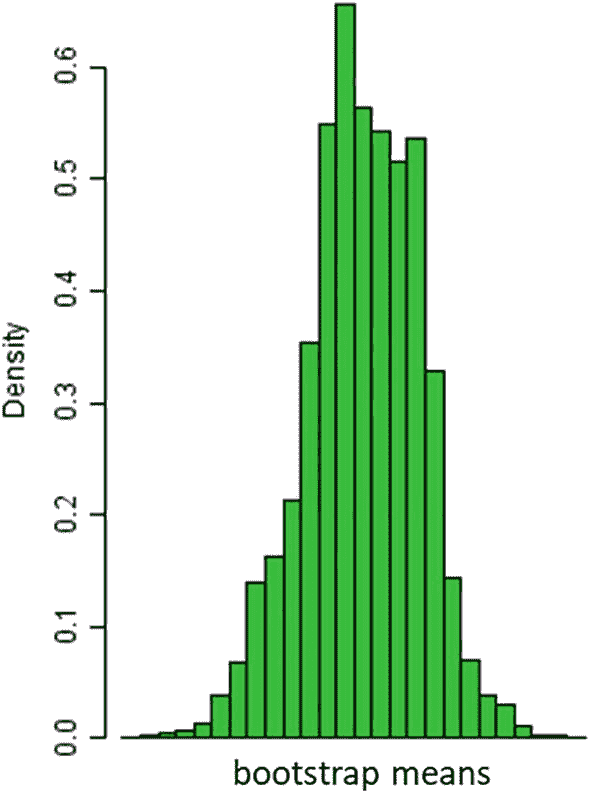

**图 13-13** 自助法均值的直方图

以下代码片段实现了前面估计平均身高的示例：

```
// 来自真实总体的样本
double[] sample = new double[]{150., 155., 160., 165., 170.};
CaseResamplingReplacement boot = new CaseResamplingReplacement(sample);
boot.seed(1234567890L);
int B = 1000;
double[] means = new double[B];
for (int i = 0; i < B; ++i) {
    double[] resample = boot.newResample();
    means[i] = new Mean(resample).value();
}
// 总体均值的估计量
double mean = new Mean(means).value();
// 估计量的方差；受限于样本大小（无论 B 多大）
double var = new Variance(means).value();
System.out.println(
    String.format("mean = %f, variance of the estimated mean = %f",
        mean,
        var));
```

或者，`BootstrapEstimator` 提供了一个便捷的封装类来重写此示例，如下所示：

```
// 来自真实总体的样本
double[] sample = new double[]{150., 155., 160., 165., 170.};
CaseResamplingReplacement boot = new CaseResamplingReplacement(sample);
boot.seed(1234567890L);
int B = 1000;
BootstrapEstimator estimator
    = new BootstrapEstimator(boot, () -> new Mean(), B);
System.out.println(
    String.format("mean = %f, variance of the estimated mean = %f",
        estimator.value(),
        estimator.variance()));
```

输出如下：

```
mean = 159.976000, variance of the estimated mean = 9.286711
```

估计的总体平均身高为 159.976，其精度（以估计均值的方差衡量）为 9.2867。请注意，此方差是估计值的方差，而不是总体身高的方差。

我们在本例中使用的自助法重采样器是 `CaseResamplingReplacement` 类。其签名如下：

```
/**
 * 构建一个自助法样本生成器。这是经典的有放回自助法。
 *
 * @param sample 原始样本。
 */
public CaseResamplingReplacement(double[] sample)
```

`BootstrapEstimator` 的签名如下：

```
/**
 * 构建一个自助法估计量。
 *
 * @param bootstrap 自助法方法和样本
 * @param factory   统计量
 * @param B        自助法复制的次数
 */
public BootstrapEstimator(
    Resampler bootstrap,
    StatisticFactory factory,
    int B
)
```

一般来说，在自助法重采样次数相同的情况下，增大训练集的大小 *N* 可以提高精度。增加自助法重采样次数 *B* 可以改善估计量的估计，但不会提高精度。在每次重采样中，一个样本被选中的概率是 `1/N`，因此不被选中的概率是 `1 - 1/N`。在所有 *B* 次中均未被选中的概率，即从未出现在任何重采样集中的概率，是 `(1 - 1/N)^B`。当训练集大小和重采样次数都趋于无穷大时，该概率将趋近于 *e^(-1) = 0.368*。换句话说，使用朴素的有放回个案重采样方法，训练集中的原始数据集大约只有 63.2% 会出现在重采样中。


### 13.2.5.2 Politis-White-Patton 方法

`NM Dev` 还实现了基于《自相关自举的自动块长选择》（Politis & White, 2004）及其勘误《自相关自举的自动块长选择更正》（Politis, White, & Patton, 2009）的自举方法。Politis-White-Patton 自举方法生成序列的重采样，即具有序列相关性或时间依赖性的数据序列，与简单的有放回案例重采样方法相比，它能更好地模拟训练数据。例如，任何给定模式的出现次数更接近原始序列中的次数。以下代码示例通过以概率 `q` 保留上一个值，并以概率 (1 − `q`) 改变上一个值，构建了一个序列相关序列（由 0 和 1 组成）。然后，对于给定模式（例如 `{1, 0, 1, 0, 1}`），它比较了该模式在训练序列与不同自举重采样序列中的出现次数。

```
final int N = 10000;
final double q = 0.70; // 保留上一个值的概率
UniformRNG uniformRNG = new UniformRNG();
uniformRNG.seed(1234567890L);
// 生成一个具有序列相关性的 0 和 1 随机序列
final double[] sample = new double[N];
sample[0] = uniformRNG.nextDouble() > 0.5 ? 1 : 0;
for (int i = 1; i < N; ++i) {
    sample[i] = uniformRNG.nextDouble() < q ? sample[i - 1] : 1 - sample[i - 1];
}
// 简单有放回案例重采样方法
CaseResamplingReplacement simpleBoot
    = new CaseResamplingReplacement(sample, uniformRNG);
Mean countInSimpleBootstrap = new Mean();
RandomNumberGenerator rlg = new Ziggurat2000Exp();
rlg.seed(1234567890L);
// 使用平稳块的 Patton-Politis-White 方法
PattonPolitisWhite2009 stationaryBlock
    = new PattonPolitisWhite2009(
        sample,
        PattonPolitisWhite2009ForObject.Type.STATIONARY,
        uniformRNG,
        rlg);
Mean countInStationaryBlockBootstrap = new Mean();
// 使用循环块的 Patton-Politis-White 方法
PattonPolitisWhite2009 circularBlock
    = new PattonPolitisWhite2009(
        sample,
        PattonPolitisWhite2009ForObject.Type.CIRCULAR,
        uniformRNG,
        rlg);
Mean countInCircularBlockBootstrap = new Mean();
// 更改此行以使用不同的模式
final double[] pattern = new double[]{1, 0, 1, 0, 1};
final int B = 10000;
for (int i = 0; i < B; ++i) {
    // 统计该模式在序列中的出现次数
    int numberOfMatches = match(simpleBoot.newResample(), pattern);
    countInSimpleBootstrap.addData(numberOfMatches);
    // 统计该模式在序列中的出现次数
    numberOfMatches = match(stationaryBlock.newResample(), pattern);
    countInStationaryBlockBootstrap.addData(numberOfMatches);
    // 统计该模式在序列中的出现次数
    numberOfMatches = match(circularBlock.newResample(), pattern);
    countInCircularBlockBootstrap.addData(numberOfMatches);
}
// 比较使用不同自举方法得到的模式出现次数
int countInSample = match(sample, pattern);
System.out.println("样本中匹配的模式次数: " + countInSample);
System.out.println("简单自举中匹配的模式次数: " + countInSimpleBootstrap.value());
System.out.println("平稳块自举中匹配的模式次数: " + countInStationaryBlockBootstrap.value());
System.out.println("循环块自举中匹配的模式次数: " + countInCircularBlockBootstrap.value());
```

输出结果如下：

```
matched patterns in sample: 39
matched patterns in simple bootstrap: 316.8101000000013
matched patterns in stationary block bootstrap: 45.09940000000004
matched patterns in circular block bootstrap: 44.1490999999999
```

在原始训练序列中，模式 `{1, 0, 1, 0, 1}` 出现了 39 次。使用简单的有放回案例重采样方法得到的自举序列结果偏差很大（316 次）。而使用 Politis-White-Patton 方法得到的自举序列结果则与原始训练序列接近，分别为 45 次和 44 次。

类 `PattonPolitisWhite2009` 的签名如下：

```
/**
 * 构造一个块自举样本生成器。块长度自动选择。
 *
 * @param sample  原始样本
 * @param type    块自举的类型，可以是
 *                {@linkplain Type#STATIONARY} 或
 *                {@linkplain Type#CIRCULAR}
 * @param uniform 一个并发的随机长整数生成器
 * @param rng     一个并发的随机指数生成器
 */
public PattonPolitisWhite2009(
    double[] sample,
    PattonPolitisWhite2009ForObject.Type type,
    RandomLongGenerator uniform,
    RandomNumberGenerator rng
)
```

## 13.3 方差缩减

假设我们想要估计随机变量 *X* 的统计量 *Z*。我们需要生成大量的 *X*[1], ⋯, *X*[*n*]，然后对于每个 *X*[*i*] 计算统计量 *Z*[*i*]，从而得到 *Z*[1], ⋯, *Z*[*n*]。那么估计量如下所示：

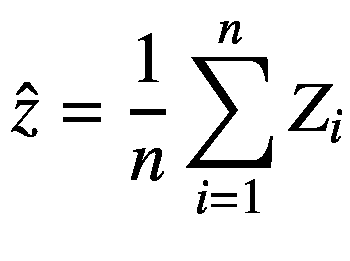

这种方法称为蒙特卡洛模拟。由于这种计算基于随机性的本质，每个随机样本都伴随着一个限制结果精度的方差。中心极限定理指出，当 *n* → ∞ 时，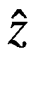 收敛于一个以真实均值 *z* 和标准误差 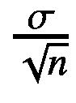 为特征的正态分布。这意味着标准误差（即逆精度）以 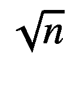 的速率趋近于 0。为了使估计量的精度提高一倍，我们需要将随机样本数量增加 4 倍。例如，对于第 13.2.4.1 节中的 `compute_Pi` 代码，使用 1,000,000 个样本时精度为 2 位小数。要将精度提高一倍，我们需要 4,000,000 个样本。这需要生成大量的样本点。

方差缩减是一种在相同计算工作量（例如使用的随机样本数量）下提高估计量精度的技术。`NM Dev` 提供了一套开箱即用的方差缩减技术，我们可以使用它们来提高估计器的精度。


### 13.3.1 公共随机数

当我们想要比较两个或更多估计量时，公共随机数是一种流行且有用的方差缩减技术。更具体地说，我们想要估计以下内容：

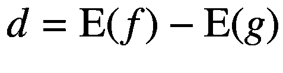

如果我们分别使用两个独立的随机数流序列来生成`f`和`g`，即如下所示：

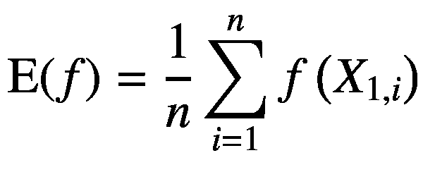

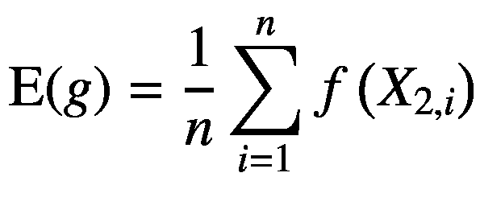

那么我们有：

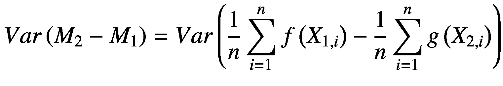

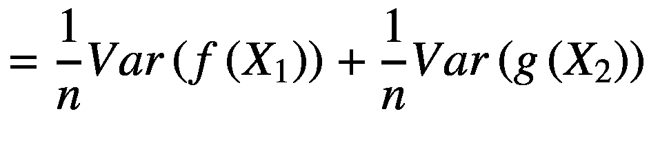

假设`X[1, i]`和`X[2, i]`是正相关的；那么我们有：

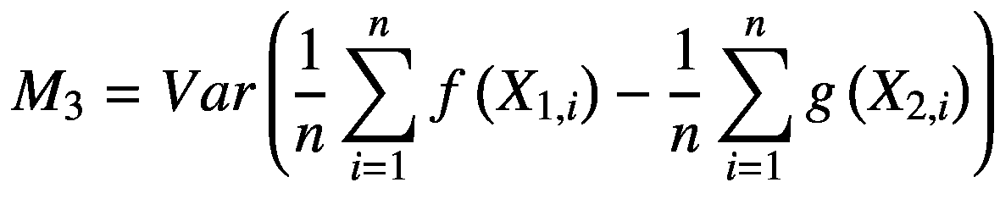

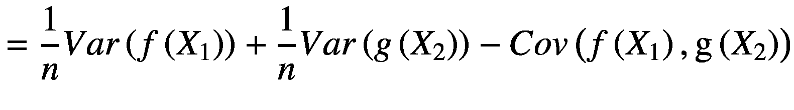

如果我们进一步假设`f`和`g`都是单调非递减的，那么正的`Cov(X[1], X[2])`意味着正的`Cov(f(X[1]), g(X[2]))`。因此，估计量的方差得以减小。

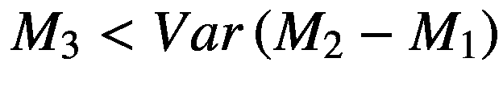

以下代码计算了：

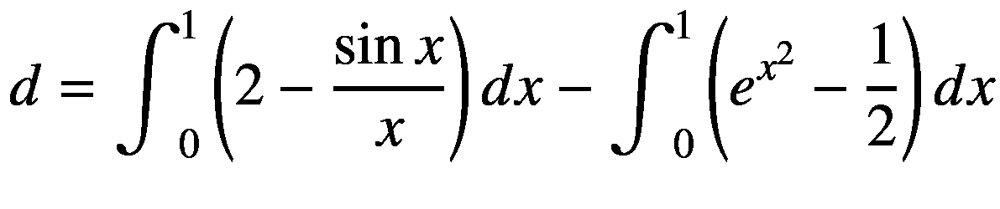

```
final UnivariateRealFunction f
= new AbstractUnivariateRealFunction() {
@Override
public double evaluate(double x) {
double fx = 2\. - Math.sin(x) / x;
return fx;
}
};
final UnivariateRealFunction g
= new AbstractUnivariateRealFunction() {
@Override
public double evaluate(double x) {
double gx = Math.exp(x * x) - 0.5;
return gx;
}
};
RandomLongGenerator X1 = new UniformRNG();
X1.seed(1234567890L);
CommonRandomNumbers crn0
= new CommonRandomNumbers(
f,
g,
X1,
new AbstractUnivariateRealFunction() { // 另一个独立的均匀随机数生成器
final RandomLongGenerator X2 = new UniformRNG();
{
X2.seed(246890123L);
}
@Override
public double evaluate(double x) {
return X2.nextDouble();
}
});
Estimator estimator0 = crn0.estimate(100_000);
System.out.println(
String.format("d = %f, variance = %f",
estimator0.mean(),
estimator0.variance()));
CommonRandomNumbers crn1
= new CommonRandomNumbers(f, g, X1); // 对 f 和 g 使用相同的 X1
Estimator estimator1 = crn1.estimate(100_000);
System.out.println(
String.format("d = %f, variance = %f",
estimator1.mean(),
estimator1.variance()));
```

输出如下：

```
d = 0.091698, variance = 0.227836
d = 0.090606, variance = 0.182244
```

两个 CRN 估计量中 `d` 都 ≈ 0.091。第二个 CRN 估计量使用了相关（实际上是相同）的随机数序列 `X[1]`，其精度（方差更小）高于第一个使用了两个独立随机数流 `X[1]` 和 `X[2]` 的 CRN 估计量。请注意，CRN 在某些情况下可能不适用，或者如果 `Cov(f(X[1]), g(X[2]))` < 0，其表现可能会更差。

`CommonRandomNumbers` 类的一个构造函数的签名如下：

```
/**
* 估计 \(E(f(X_1) - g(X_2))\)，其中 f 和 g 是
* 均匀随机变量的函数。我们设定 X2 = X1。
*
* @param f  第一个系统
* @param g  第二个系统
* @param X1 一个均匀随机数生成器
*/
public CommonRandomNumbers(
UnivariateRealFunction f,
UnivariateRealFunction g,
RandomLongGenerator X1
)
```

### 13.3.2 对偶变量法

对偶变量法是一种通过在观测对之间引入负相关性来减少方差的技术。一般而言，我们有：

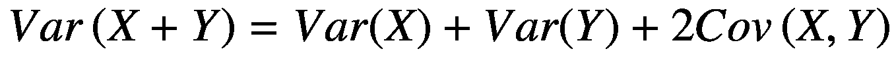

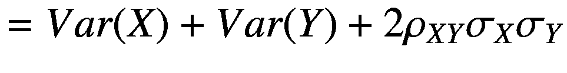

如果 `X` 和 `Y` 之间的相关性 `ρ[XY]` 为负，那么 (`X` + `Y`) 的方差将小于它们各自方差之和，从而实现方差缩减。一种实现方法是，对于获得的每个样本路径 `{ε[1], ⋯, ε[n]}`，我们创建其对偶路径 `{-ε[1], ⋯, -ε[n]}`。这实际上使样本数量翻倍，并减少了样本路径的方差，从而提高精度。

以下代码计算了积分 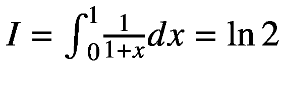：

```
UnivariateRealFunction f
= new AbstractUnivariateRealFunction() {
@Override
public double evaluate(double x) {
double fx = 1\. / (1\. + x);
return fx;
}
};
RandomLongGenerator uniform = new UniformRNG();
uniform.seed(1234567894L);
AntitheticVariates av
= new AntitheticVariates(
f,
uniform,
AntitheticVariates.REFLECTION);
Estimator estimator = av.estimate(1500);
System.out.println(
String.format(
"mean = %f, variance = %f",
estimator.mean(),
estimator.variance()));
```

输出如下：

```
mean = 0.693158, variance = 0.000595
```

方差为 0.0006。而使用朴素方法，方差将是 0.00255。

`AntitheticVariates` 类的一个构造函数的签名如下：

```
/**
* 估计 \(E(f(X_1))\)，其中 f 是一个随机变量的函数。
*
* @param f  用于评估期望的随机函数
* @param X1 一个随机数生成器
* @param X2 对偶函数，给定 {@code X}
*/
public AntitheticVariates(
UnivariateRealFunction f,
RandomNumberGenerator X1,
UnivariateRealFunction X2
)
```


### 13.3.3 控制变量法

控制变量法是一种方差缩减技术，它利用已知量估计值中误差的信息来减少未知量估计值的误差。更具体地说，假设我们要估计 `μ`，且统计量为 `m`，因此 `E(m) = μ`。假设我们有另一个统计量 `t`，且已知 `E(t) = τ`。我们可以使用 `t` 来帮助估计 `μ`。如下所示：

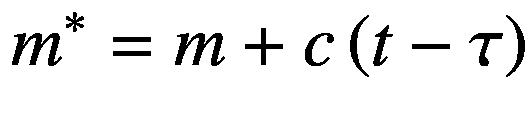

那么对于任意 `c`，`m^∗` 也是 `μ` 的一个估计量，因为 `E(m^∗) = E(m) = μ`。`m^∗` 的方差如下：

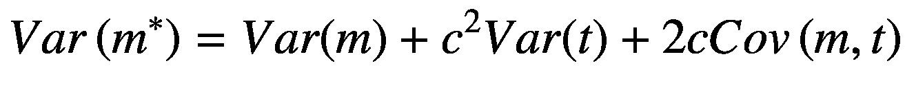

`m^∗` 的方差最小化，如下所示：

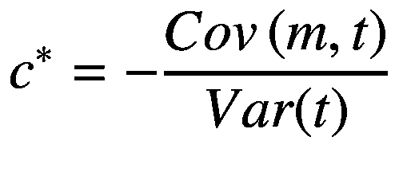

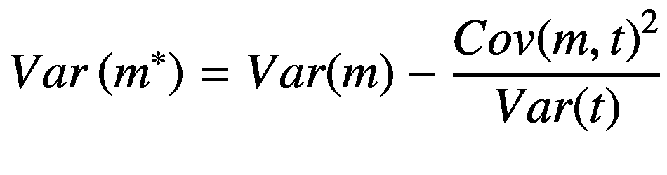

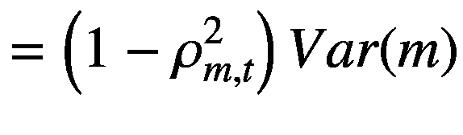

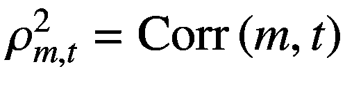，即 `m` 与 `t` 之间的相关性。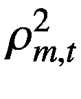 的值越大，实现的方差缩减就越多。

以下代码示例再次计算了前一示例中的同一个积分：

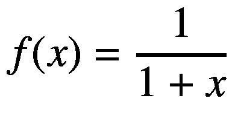

它使用了这个已知积分，如下所示：


我们得到：


`u[i]` 是来自均匀分布的样本。

```
UnivariateRealFunction f
= new AbstractUnivariateRealFunction() {
@Override
public double evaluate(double x) {
double fx = 1\. / (1\. + x);
return fx;
}
};
UnivariateRealFunction g
= new AbstractUnivariateRealFunction() {
@Override
public double evaluate(double x) {
double gx = 1\. + x;
return gx;
}
};
RandomLongGenerator uniform = new UniformRNG();
uniform.seed(1234567891L);
ControlVariates cv
= new ControlVariates(f, g, 1.5, -0.4773, uniform);
ControlVariates.Estimator estimator = cv.estimate(1500);
System.out.println(
String.format(
"mean = %f, variance = %f, b = %f",
estimator.mean(),
estimator.variance(),
estimator.b()));
```

输出如下：

```
mean = 0.692015, variance = 0.000601, b = -0.472669
```

方差为 0.0006。而使用朴素方法方差为 0.00255。对于此问题，使用控制变量法的结果与使用对偶变量法的结果相似。

类 `ControlVariates` 的构造函数的签名如下：

```
/**
* 估计 \(E(f(X_1))\)，其中 f 是随机变量的函数。
*
* @param f  要评估其期望的随机函数
* @param g  具有已知值的随机函数
* @param Eg g 的期望值
* @param c  系数
* @param X  随机数生成器
*/
public ControlVariates(
UnivariateRealFunction f,
UnivariateRealFunction g,
double Eg,
double c,
RandomNumberGenerator X
)
```

### 13.3.4 重要性采样

重要性采样是使用蒙特卡洛模拟来估计概率分布属性的一项重要策略，但仅使用从与目标分布不同的分布生成的样本。重要性采样的核心思想是，模拟中输入随机变量的某些值对正在计算的积分（或平均值）的影响比其他值更大。如果通过更频繁地采样来强调这些“重要”值，则可以减少估计量的方差。因此，重要性采样的基本方法是选择一个能“鼓励”重要值的分布。如果在模拟中直接使用这种“有偏”的分布，就会导致有偏的估计量。然而，模拟输出会被加权，以校正使用有偏分布带来的影响。这确保了新的重要性采样估计量是无偏的。

假设我们要计算函数 `f(x)` 在目标分布 `P` 下的期望。如果从 `P` 中采样，使用蒙特卡洛方法会得到以下计算结果：

![$$ {E}_{x\sim P}\left[f(x)\right]={\int}_x^NP(x)f(x) dx\approx \frac{1}{N}\sum \limits_{x_i\sim P,i=1}^Nf\left({x}_i\right) $$](images/500382_1_En_13_Chapter/500382_1_En_13_Chapter_TeX_Equak.png)

但是，如果我们无法轻松或高效地从 `P` 中采样，则无法进行此求和。我们可以尝试找到另一个我们知道如何从中采样的分布 `P'` 来进行积分。测度或概率分布的变换公式如下：

![$$ {E}_{x\sim P}\left[f(x)\right]={\int}_x^Nf(x)P(x) dx $$](images/500382_1_En_13_Chapter/500382_1_En_13_Chapter_TeX_Equal.png)


![$$ ={E}_{x\sim {P}^{\prime }}\left[\frac{P}{P^{\prime }}f(x)\right] $$](images/500382_1_En_13_Chapter/500382_1_En_13_Chapter_TeX_Equan.png)


数学表述是，我们现在从 `P'` 中采样 `x[i]`，并且对于每个 `f(x[i])`，我们需要将输出乘以  来校正偏差。

这是一个简单的例子。假设我们要计算恒等函数 `f(x) = x` 在正态分布（均值=1，标准差=1）`N[0] = N(0, 1)` 下的积分。我们不从标准正态分布中采样，而是从另一个均值=1、标准差=0.5 的正态分布 `N[1] = N(0, 0.5)` 中采样。对于从 `N[1]` 中抽取的每个样本 `x[i]`，我们计算校正后的输出并取平均值。


更具体地说，假设我们从 `N[1]` 中抽取了两次样本，得到了 1.09 和 2.36。计算过程如下：


我们可以进一步扩展这个例子，来计算标准正态函数 `ϕ(x)` 在 0 到 1 之间的积分。即，


一种实现方法是，从标准正态分布 `N[0]` 中采样 `x^(s)`，并且只保留那些满足 `x^(s) ∈ [0, 1]` 的样本，而拒绝其他样本。其均值如下：

![$$ {I}_0=\frac{\sum \limits_{s=1}^S{x}^s\bullet \mathbf{1}\left({x}^s\in \left[0,1\right]\right)}{\mathbf{1}\left({x}^s\in \left[0,1\right]\right)} $$](images/500382_1_En_13_Chapter/500382_1_En_13_Chapter_TeX_Equas.png)


如果大部分样本被拒绝（即 `1`(*x*^(*s*) ∈ [0, 1]) ≪ *S*），这种计算效率很低。

另一种方法是，我们从均匀分布中抽样，并令 *g*(*x*) = 1（若 *x*^(*s*) ∈ [0, 1]）。权重计算如下：


均值如下：


没有样本被拒绝。以下代码片段解决了这个示例：

```
UnivariateRealFunction h = new AbstractUnivariateRealFunction() {
@Override
public double evaluate(double x) {
return x; // the identity function
}
};
UnivariateRealFunction w = new AbstractUnivariateRealFunction() {
private final Gaussian phi = new Gaussian();
private final StandardCumulativeNormal N = new CumulativeNormalMarsaglia();
private final double I = N.evaluate(1) - N.evaluate(0);
@Override
public double evaluate(double x) {
double w = phi.evaluate(x) / I; // the weight
return w;
}
};
RandomNumberGenerator rng = new UniformRNG();
rng.seed(1234567892L);
ImportanceSampling is = new ImportanceSampling(h, w, rng);
Estimator estimator = is.estimate(100000);
System.out.println(
String.format(
"mean = %f, variance = %f",
estimator.mean(),
estimator.variance()));
```

输出如下：

```
mean = 0.459671, variance = 0.047314
```

类 `ImportanceSampling` 的构造函数签名如下：

```
/**
* Uses importance sample to do Monte Carlo integration.
*
* @param h the function to integrate
* @param w the weight function or the change of measure
* @param G a uniform random number generator
*/
public ImportanceSampling(
UnivariateRealFunction h,
UnivariateRealFunction w,
RandomNumberGenerator G
)
```

我们举一个来自 (scratchapixel) 的示例，以展示重要性采样的有效性。如果我们能使用“匹配”分布而非均匀分布，那么效率会很高。假设我们想用蒙特卡洛模拟来计算这个积分。见图 13-14。


![$$ ={\left[-\cos (x)\right]}_0^{\frac{\pi }{2}} $$](images/500382_1_En_13_Chapter/500382_1_En_13_Chapter_TeX_Equaw.png)


**图 13-14** 使用两种不同概率密度函数进行重要性采样

我们有两种分布可供选择。

*   我们通常使用的均匀分布：
*   一种概率密度函数接近被积函数的分布：

使用均匀分布时，我们首先求累积分布函数的反函数。


`ξ`[0] 在单位区间上服从均匀分布。蒙特卡洛求和如下：


使用第二个分布时，我们同样先求累积分布函数的反函数。


`ξ`[1] 在单位区间上服从均匀分布。蒙特卡洛求和如下：


以下代码比较了这两种求和结果：

```
RandomNumberGenerator rng = new UniformRNG();
rng.seed(1234567892L);
int N = 16;
for (int n = 0; n < 10; ++n) {
float sumUniform = 0, sumImportance = 0;
for (int i = 0; i < N; ++i) {
double r = rng.nextDouble();
sumUniform += sin(r * PI * 0.5);
double xi = sqrt(r) * PI * 0.5;
sumImportance += sin(xi) / ((8 * xi) / (PI * PI));
}
sumUniform *= (PI * 0.5) / N;
sumImportance *= 1.f / N;
System.out.println(String.format("%f %f\n", sumUniform, sumImportance));
}
```

输出如下：


可以看出，在随机样本数量和随机值 `ξ`[0] = `ξ`[1] 相同的情况下，重要性采样技术显著降低了方差，并且收敛速度更快。


