# 14. 线性回归

在统计学中，线性回归是一种用于对标量响应（因变量）`y` 与一个或多个解释变量（自变量）`x`（向量）之间的关系进行建模的线性方法。当只有一个解释变量时，称为简单线性回归。当有多个解释变量时，称为多元线性回归。此类线性模型的参数 `β` 是解释变量的系数，这些参数根据数据估计得出。当使用此类线性模型根据解释变量的值预测响应结果时，通常假设响应的条件均值或其变换 `g` 是解释变量的线性函数，即 `g(ŷ) = g(E(y)) = xβ`。当变换为恒等变换时，可简化为 `ŷ = E(y) = xβ`。

线性回归因其易于可视化的特点而被广泛应用于众多领域和科学中。如图 14-1 所示的简单线性回归，模型在 `xy` 平面上只是一条直线。对于多元线性回归，则是一个超平面。参数易于确定。此外，已有大量工作对线性回归进行了广泛而严谨的研究，该模型及其性质已得到充分理解。

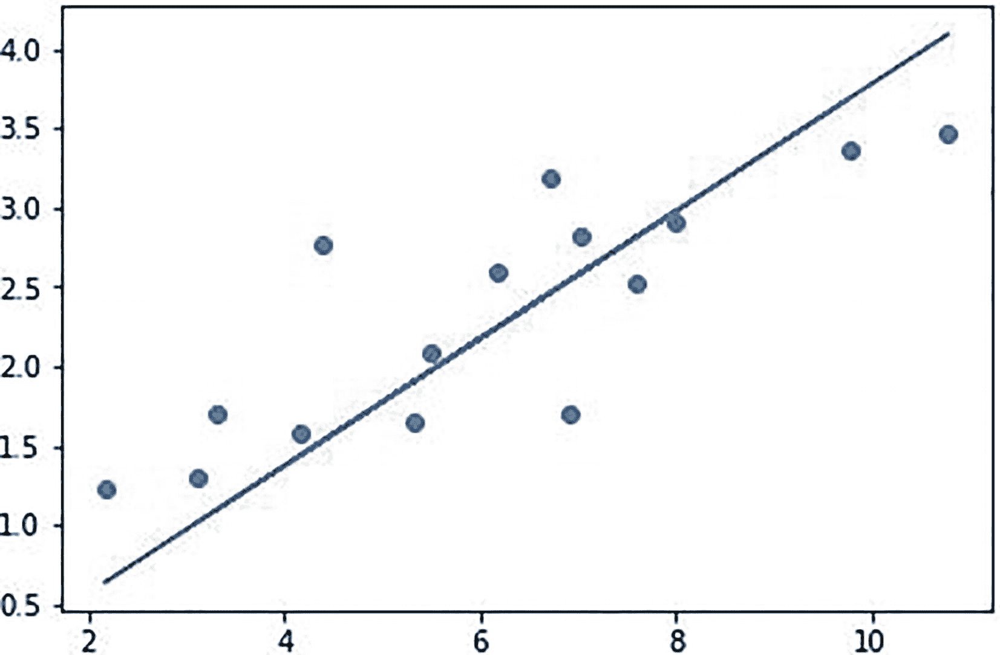
**图 14-1** 简单线性回归

例如，在金融领域，著名的资本资产定价模型（CAPM）就是股票公平/预期超额收益率 `E(R[i]) − R[f]` 与市场预期超额收益率 `E(R[M]) − R[f]` 之间的简单线性回归。由于股票或市场的回报是未知或随机的，我们为其加上期望算子 `E()`。资产的超额收益是指超过无风险利率 `R[f]`（如政府担保国债的利率）的收益。该简单线性回归模型如下：`E(R[i]) = R[f] + βi − R[f])`。系数 `β[i]` 称为股票 `i` 的贝塔值，用于衡量预期资产超额收益对预期市场超额收益的敏感度。这是金融领域描述股票最重要的特征之一。

在经济学中，线性回归是主要的实证工具。它用于预测消费支出、固定投资支出、库存投资、一国出口购买、进口支出、持有流动性资产的需求以及劳动力需求与供给。线性回归可用于构建代表时间序列数据长期运动的趋势线。它能判断特定数据集（如 GDP、油价或股票价格）在一段时间内是增加还是减少。趋势线可以通过肉眼穿过一组数据点简单绘制，但更规范的做法是使用线性回归等统计技术计算其位置和斜率。线性回归还广泛应用于生物学、行为科学、社会科学等领域，用以描述实验和调查中变量之间可能的关系。它是这些学科中最重要的工具之一。见图 14-2。

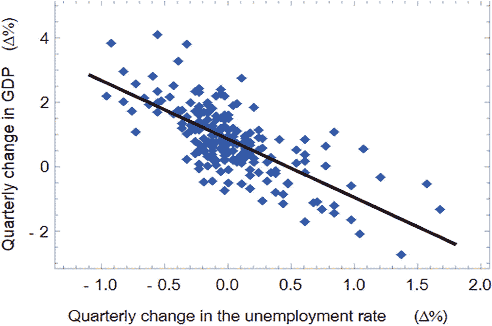
**图 14-2** 在经济学中，奥肯定律指出，一个经济体的 GDP 增长与失业率的变化呈线性关系。

假设数据包含 `n` 个观测值，`{xi, yi}_{i=1}^n`。每个观测值包含一个响应 `y[i]` 和 `p` 个解释变量 `x[i] = (x[i1], x[i2], …, x[ip])^T`。数据可列表如下：

| 观测值 | y | `x[1]` | `x[2]` | `⋯` | `x[p]` |
| --- | --- | --- | --- | --- | --- |
| 1 | `y[1]` | `x[11]` | `x[12]` | `⋯` | `x[1p]` |
| 2 | `y[2]` | `x[21]` | `x[22]` | `⋯` | `x[2p]` |
| 3 | `y[3]` | `x[31]` | `x[32]` | `⋯` | `x[3p]` |
| `⋮` | `⋮` | `⋮` | `⋮` | `⋯` | `⋮` |
| n | `y[n]` | `x[n1]` | `x[n2]` | `⋯` | `x[np]` |

在线性模型中，响应 `y[i]` 是解释变量 `x[i]` 的线性函数。即：
```
y1 = β1*x11 + ⋯ + βp*x1p + ε1
y2 = β1*x21 + ⋯ + βp*x2p + ε2
⋮
yn = β1*xn1 + ⋯ + βp*xnp + εn
```
或者，用向量形式表示如下：
```
yi = xi^T β + εi
```
`x[i]` 是第 `i` 个观测值中解释变量的列向量，`β` 是 `p × 1` 的模型参数向量（需从数据中估计），`ε[i]` 称为*残差*，用于解释 `y[i]` 的随机性，这可能源于测量误差或 `x[i]` 无法解释的影响。`ε[i]` 是一个随机变量，因此 `y[i]` 也是一个随机变量。响应值是随机变量 `y[i]` 的一个具体实现。

用矩阵形式，我们写作：
```
y = Xβ + ε
```
其中 `y = [y1, y2, …, yn]^T`，`X = [[x11, x12, ⋯, x1p], [x21, x22, ⋯, x2p], [⋯], [xn1, xn2, ⋯, xnp]]^T`，`β = [β1, β2, …, βp]^T`，`ε = [ε1, ε2, …, εp]^T`。

解释变量不必相互独立。它们之间可以存在任何关系（只要不是线性关系）。例如，将一个小球向上抛，其高度与时间的关系如下：
```
hi = β1*ti + β2*ti² + εi
```
`β[1]` 与球的初始速度有关，`β[2]` 与地球重力（减速度）成正比。`ε[i]` 是测量误差。该模型在时间变量 `t[i]` 上是非线性的（二次函数），但在参数 `β[1]` 和 `β[2]` 上是线性的。它仍然是标准形式的线性模型。

## 14.1 普通最小二乘法

根据目标函数和假设的不同，有多种方法可以选择模型参数`β`。最常用的方法之一是普通最小二乘法（OLS）。OLS 最小化给定数据集中观测响应（被观测变量的值）`y[i]`与由解释变量线性函数预测的拟合值`ŷ_i`之间差值的平方和。也就是说，目标函数如下所示：
```
S(β) = Σᵢ₌₁ⁿ |yᵢ - ŷᵢ|² = Σᵢ₌₁ⁿ |yᵢ - Σⱼ₌₁ᵖ Xᵢⱼβⱼ|² = ‖y - Xβ‖²
```
OLS 的贝塔值选择如下（见图 14-3）：
```
β̂ = argmin_β S(β)
```
**图 14-3** 正规方程

可以证明，正规方程的解如下所示（见图 14-4）。（之所以称为正规方程，是因为残差`y - Xβ`垂直于，即，与`X`张成的空间正交。）
```
β̂ = (XᵀX)⁻¹Xᵀy
```
**图 14-4** 最小化误差平方和的最小二乘估计

因此，我们得到：
```
ŷ = Xβ̂ = X(XᵀX)⁻¹Xᵀy = Hy
```
`H = X(XᵀX)⁻¹Xᵀ` 被称为帽子矩阵，因为这个矩阵正是将帽子符号'^'添加到观测响应向量`y`上，从而得到拟合响应向量`ŷ`的矩阵。

### 14.1.1 假设

OLS 理论建立在若干假设之上。

**正确设定**
线性函数形式必须与实际数据生成过程的形式一致。

**外生性**
外生性意味着解释变量与误差项不相关，即`E(Xᵀϵ) = 0`。否则，称为内生性。此外，回归模型中的误差项应具有条件均值为零。
```
E(ϵ | X) = 0
```
外生性假设的直接后果是误差项均值为零：`E(ϵ) = 0`。

**无线性相关**
解释变量或设计矩阵`X`中的所有列必须线性独立。从数学上讲，这意味着矩阵`X`几乎必然满秩。
```
Pr(rank(X) = p) = 1
```
通常，还假设`X`具有至少到二阶矩的有限矩。那么矩阵`Q[XX] = E(XᵀX/n)` 是有限且半正定的。当违反此假设时，称设计矩阵是线性相关的或存在完全多重共线性。

**同方差性**
`E(ϵᵢ² | X) = σ²` 意味着每个观测值中误差项的方差`σ²`相同。但实际情况往往并非如此，因为均值较大的变量通常比均值较小的变量具有更大的方差。例如，预测收入为 10 万美元的人，其实际收入很容易达到 8 万或 12 万美元，即标准差约为 2 万美元。相比之下，另一个预测收入为 1 万美元的人，不太可能具有相同的 2 万美元标准差，因为这意味着其实际收入可能在 -1 万美元到 3 万美元之间变化。当违反这一要求时，称为异方差性。在这种情况下，更有效的估计量（具有较低方差的估计量）将是加权最小二乘法（见第 14.2 节），我们可以为数据中的每个观测值分配不同的权重。

**无自相关**
观测值之间的误差项不相关，即对于`i ≠ j`，有`E(ϵ[i]ϵ[j] | X) = 0`。在处理时间序列数据、面板数据、聚类样本、分层数据、重复测量数据、纵向数据以及其他存在依赖关系的数据时，此假设可能被违反。在这种情况下，广义最小二乘法提供了比 OLS 更好的替代方案（见第 14.3 节）。

**正态性**
有时还会额外地假设，在给定解释变量的条件下，误差项服从正态分布。
```
ε | X ~ N(0, σ²Iₙ)
```

此假设对于 OLS 方法的有效性并非必需，尽管当满足此假设时（尤其是在假设检验领域），可以确立某些额外的有限样本性质（数据集大小`n`是有限的）。此外，当误差项服从正态分布时，OLS 估计量等价于最大似然估计量（`MLE`），因此在所有正则估计量类别中具有渐近有效性（当`n → ∞` 时方差最小）。重要的是，正态性假设仅适用于误差项；与流行的误解相反，响应变量`y`并不要求服从正态分布。

## 14.1.2 模型性质

在外生性假设下，OLS 估计量  和 `s²` 是无偏的，这意味着它们的期望值与其真实值一致。

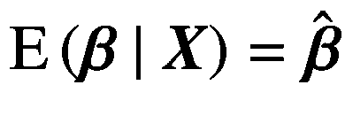 且 `E(s² | X) = σ²`。

`s²` 被称为回归的标准误差，其定义为残差平方和除以问题的自由度。

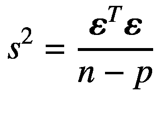

在误差项不相关且同方差的假设下，估计量  在线性无偏估计量类中是有效的。这被称为最佳线性无偏估计量（`BLUE`）。这意味着  的方差小于任何其他观测值线性组合的估计量的方差。从这个意义上说，OLS 估计量是参数的最佳或最优估计量。特别注意，此性质与误差的统计分布无关。换句话说，误差的分布函数不必是正态分布。

然而，如果我们假设误差确实服从正态分布 `ε ~ N(0, σ² I[n])`，那么  也服从正态分布。

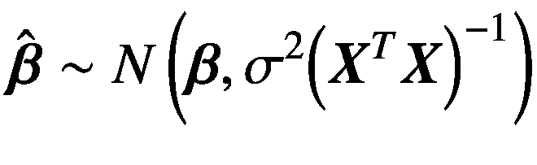

此外，该估计量达到了模型的 `Cramér-Rao` 下界，因此在所有无偏估计量类中是最优的。

解释变量的 `beta` 系数的绝对值越高，该变量的影响就越强。例如，对于同一个变量，`beta` 值为 `-0.9` 的影响比 `beta` 值为 `+0.8` 更强。然而，`beta` 系数的大小并不能让我们比较变量之间的显著性。例如，`x[1]` 的单位可能是美元，而 `x[2]` 的单位可能是美分。`x[1]` 的 `beta` 值为 `0.1` 与 `x[2]` 的 `beta` 值为 `1.0`，并不表明 `x[1]` 的 `beta` 比 `x[2]` 的更显著，因为如果将 `x[1]` 用美分表示，其 `beta` 值将变为 `10`。

标准化后的 `beta` 系数以其标准差为单位。这意味着可以轻松地相互比较这些变量。换句话说，标准化 `beta` 系数是指如果在运行分析之前将回归中的所有变量都转换为 `z` 分数所得到的系数。一个系数除以其标准误差也称为 `t` 统计量，并服从学生 `t` 分布。我们可以使用学生 `t` 分布来计算标准化 `beta` 系数的 `p` 值，以确定其显著性。根据经验法则，如果一个 `beta`/变量/`t` 统计量的 `t` 统计量大于 `2.0`，或者等价地 `p` 值小于 `0.05`，则它显著。这对应于 `5%` 的显著性水平。假设您的模型设定正确，那么该变量产生某种效应的正确概率为 `95%`。

## 14.1.3 残差分析

残差定义为对于给定的解释变量值，观测值与拟合值之间的差值。请注意，在统计学中，残差和误差是两个不同的概念。残差是观测值与模型值之间的差值 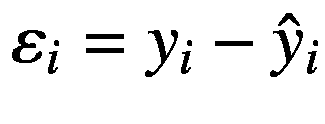；误差是观测值与真实（不可观测）值之间的差值。残差是对误差的估计。

由于回归假设并非总能满足，因此残差分析对于评估线性回归模型（不仅是 OLS）的适用性非常重要。对于简单线性回归，残差图绘制了残差相对于单个解释变量的散点图。理想情况下，残差图应像围绕零的随机噪声，没有任何模式。如果数据呈现趋势，则回归模型很可能不正确；例如，真实函数可能是一个二次或更高阶多项式。如果残差是随机的或没有趋势但呈“扇形发散”，则表现为异方差性。参见图 14-5。

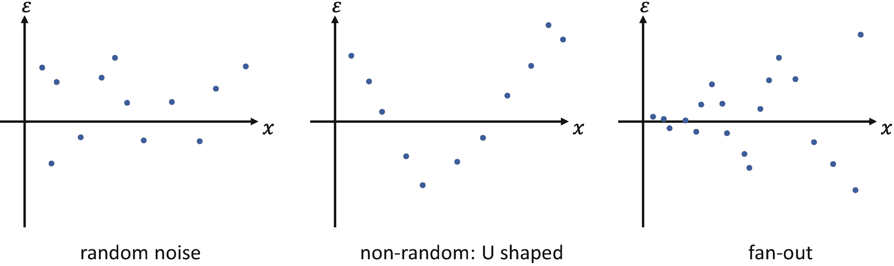

**图 14-5** 残差图

### **RSS**

有许多与残差相关的统计量，我们可以用来评估最终线性回归模型的拟合程度。由于 OLS 旨在最小化误差平方和，残差平方和（`RSS`）衡量的是数据中未被回归解释的变异量。也就是说，`RSS` 是数据偏离模型期望的量。

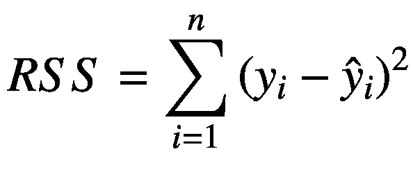

### **RMSE**

平均误差或偏差称为均方根误差（`RMSE`）。

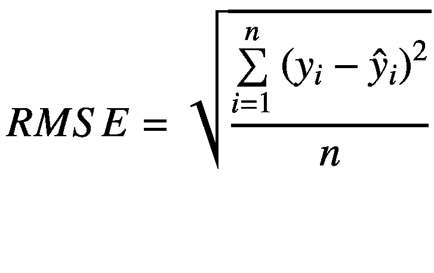

### **RSE**

我们还可以将平方和除以自由度，即数据样本量减去参数数量，以获得误差项 `σ` 标准差的无偏估计量。在这种情况下，我们得到残差标准误差（`RSE`）。

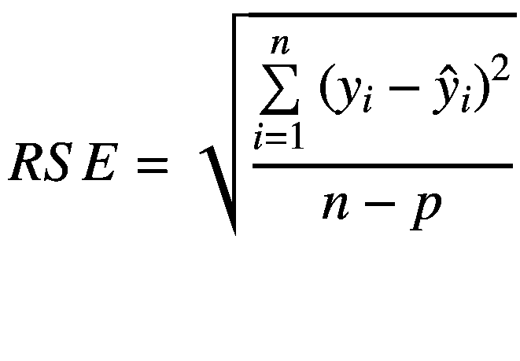

在假设误差 `ε` 服从正态分布的前提下，模型期望 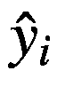 和 `RSE` 给出了 `y[i]` 模型预测的正态分布。该分布可用于求置信区间。`y[i]` 的真实值有 `68%` 的概率落在区间 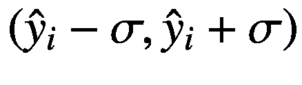 内。参见图 14-6。

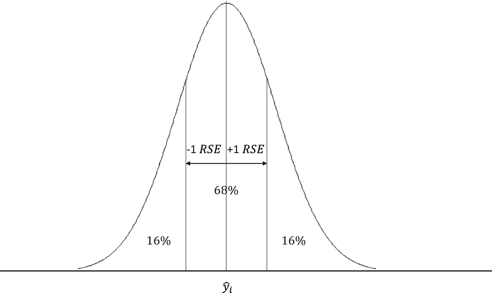

**图 14-6** 模型预测的置信区间

### **ESS**

令 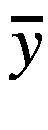 为响应的样本均值。那么，解释平方和（`ESS`）衡量的是模型值中的变异量。

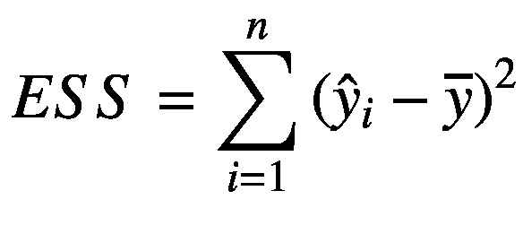

### **TSS**

总平方和（`TSS`）是 `ESS` 和 `RSS` 之和。它衡量的是观测数据中的变异量。

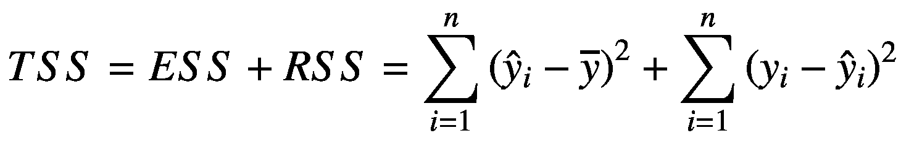

### **R 平方**