# 拟合优度的度量

拟合优度的一个重要度量指标是决定系数，即`R²`。`R²`定义为模型所解释的数据变异比例，其值始终介于 0（0%）和 1（100%）之间。模型能解释的变异越多，其`R²`值就越高。

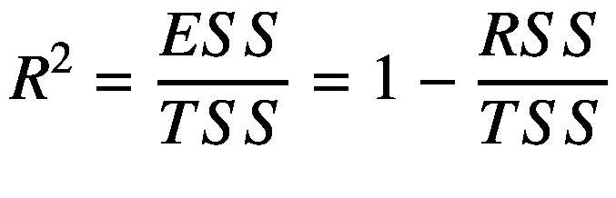

## 调整后的 R 平方

`R²`本身并不能说明模型是好是坏。一个好的模型也可能具有较低的`R²`。例如，预测人类行为（如心理学）的模型，其`R²`值通常小于 50%。预测人类比预测物理过程要困难得多。另一方面，一个糟糕的模型也可能具有较高的`R²`。例如，如果一个模型能解释 100%的方差（`R² = 1`），那么拟合值将始终等于观测值，所有数据点都将落在拟合的回归线/平面上。事实上，你可以通过不断添加解释变量来随意增加`R²`。`R²`总是增加，从不减少，即使新变量只是偶然与响应变量相关。这是一个典型的过拟合案例。你那个高`R²`的模型可能并未发现任何有意义的模式，而仅仅是在连接数据中的各个点。

调整后的`R²`（`R²_adj`）是`R²`的一个修正版本，它根据模型中解释变量的数量进行了调整。只有当添加真正能改进模型的有用变量时，调整后的`R²_adj`才会增加。如果添加无用变量，它则会减少。调整后的`R²_adj`可能为负，但通常不会。它总是低于`R²`。

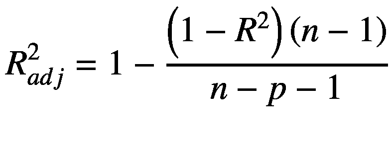

## F 统计量

某个贝塔系数的 t 统计量或 p 值，可以告诉我们该系数/变量在 5%显著性水平上是否显著（参见第 14.1.2 节）。这意味着该结果有 5%的概率是假阳性（即该贝塔系数实际上不显著）。由于所有这些 t 统计量都是独立的，模型中变量越多，就越有可能（至少有一个）p 值偶然小于 0.05。如果有四个解释变量，那么至少有一个贝塔系数显著（p < 0.05）的概率为`1 - (1 - 0.05)⁴ = 18.5%`。换句话说，我们有 18.5%的概率会错误地认为该模型有用。当变量超过 100 个时，至少有一个贝塔系数显著（p < 0.05）的概率将非常高（99.4%），因此无论实际情况如何，我们都很可能认为模型有用。因此，我们需要另一种方法来确定一个线性回归模型是否有用，即它是否真的拥有至少一个并非偶然出现的显著解释变量。

`F`统计量用于检验线性回归模型的整体显著性。其原假设（`H0`）是：所有解释变量与响应变量之间均不存在关系。备择假设（`H1`）是：至少存在一个显著变量。在 5%的显著性水平下，如果`F`统计量的 p 值小于 0.05，我们可以拒绝原假设，并认为该模型有用。有可能出现`F`统计量不显著，但某些贝塔系数的 t 统计量显著的情况；在这种情况下，我们将接受原假设并拒绝该模型。另一方面，也可能出现`F`统计量显著，但没有任何一个贝塔系数的 t 统计量显著（所有 t 值均不显著，或小于 2）的情况；在这种情况下，我们将拒绝原假设并接受该模型。关键在于，当涉及线性回归模型的整体显著性时，我们总是相信与`F`统计量相关联的 p 值的统计显著性，而非每个解释变量各自的 p 值。

```r
// F 统计量不显著，但部分贝塔系数的 t 统计量显著
beta hat
beta^ = [3.055264, -0.347572, 0.019219, -4.357924]
beta^ standard error = [0.491998, 0.194540, 0.299207, 3.958854]
beta^ t = [6.209908, -1.786633, 0.064232, -1.100804]
residual F-stat = 0.528805679720477
// F 统计量显著，但没有任何一个贝塔系数的 t 统计量显著
beta^ = [0.055264, -0.347572, 0.019219, -4.357924]
beta^ standard error = [0.491998, 0.194540, 0.299207, 3.958854]
beta^ t = [0.112326, -1.786633, 0.064232, -1.100804]
residual F-stat = 13.528805679720477
```

### 14.1.4 影响力点

回顾帽子矩阵 `H = X(X^T X)^{-1} X^T`，模型参数是观测值的线性组合，但每个观测值对帽子矩阵以及因此对`β̂`和拟合值`ŷ`的影响不同。某个观测值可能对回归产生不当影响，并且根据该特定观测值是否存在，可能会得出不同的结果。见图 14-7。

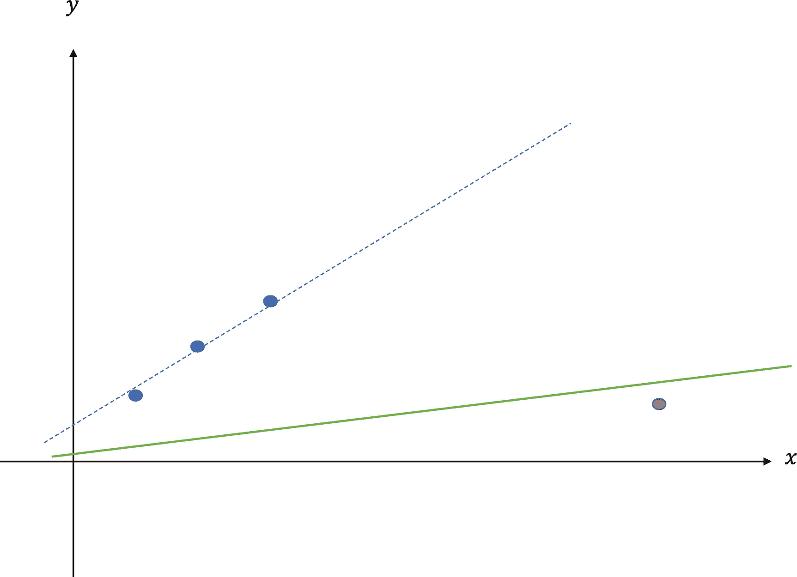

图 14-7: 红点对回归的严重影响

例如，在图 14-7 中，如果没有红点（最右侧的点），线性回归模型将穿过三个蓝点（虚线）。红点的存在将回归线向 x 轴方向“拉动”了很多。可以说红点对回归结果有严重影响。OLS 的一个缺点是它很容易受到数据集中少数影响力点的影响。

有两种类型的影响力点。第一种类型称为异常值。异常值是指其响应变量`y`不遵循其余数据总体趋势的数据点。例如，图 14-8 中的红点是一个异常值，因为它有一个极端的`y`值。它不遵循其他三个蓝点构建的总体趋势。

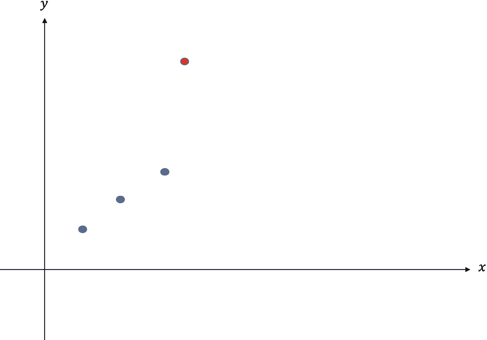

图 14-8: 一个异常值

第二种类型的影响力点称为高杠杆点。如果一个数据点在解释变量或其线性组合上具有极端值，则称该点具有高杠杆。例如，图 14-9 中的红点相比其他三个蓝点具有大得多的`x`值。

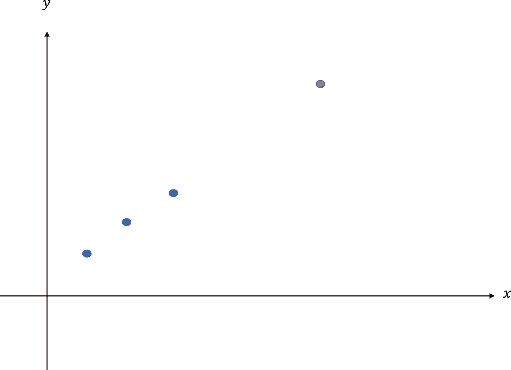

图 14-9: 一个高杠杆点

一个数据点可以同时是异常值并具有高杠杆。例如，图 14-9 中的红点既有极端的`y`值，也有极端的`x`值。评估一个影响力点是否对回归有影响（以及有多大影响）的方法是进行两次回归：一次包含该点，另一次排除该点。然后我们可以比较两次回归的结果，例如拟合响应、假设检验结果、置信区间和预测区间。

#### 杠杆

展开 `ŷ = H y` 得到以下内容：

```
ŷ₁ = h₁₁ y₁ + h₁₂ y₂ + ... + h₁ₙ yₙ
ŷ₂ = h₂₁ y₁ + h₂₂ y₂ + ... + h₂ₙ yₙ
...
ŷᵢ = hᵢ₁ y₁ + hᵢ₂ y₂ + ... + hᵢₙ yₙ
```

杠杆`hᵢᵢ`量化了观测响应`yᵢ`对其拟合值`ŷᵢ`的影响程度。也就是说，如果`hᵢᵢ`很小，那么观测响应`yᵢ`在拟合响应`ŷᵢ`的值中只起很小的作用。另一方面，如果`hᵢᵢ`很大，那么观测响应`yᵢ`在拟合响应`ŷᵢ`的值中起很大作用。这就是它被称为*杠杆*的原因。

一个高杠杆数据点可能会对回归结果产生不当影响。根据经验法则，如果一个数据点`i`的杠杆值超过平均杠杆值的**三倍**，则认为其具有高杠杆。

```
hᵢᵢ > 3 * h̄ = 3 * (p / n)
```

由于`hᵢᵢ`是解释变量`X`的线性组合，极端的`hᵢᵢ`意味着`x`值中存在大的线性组合。该数据点是否真的具有影响力还取决于观测响应`yᵢ`。

#### 学生化残差

极端的`y`值表明存在异常值，但普通残差`εᵢ = yᵢ - ŷᵢ`并不是量化异常值的好方法，因为其大小取决于测量单位，例如，美元对美分。消除单位影响的一种方法是将残差除以其标准差的估计值，从而得到所谓的标准化残差。

标准化残差（又称内部学生化残差）对于每个观测值`i = 1, …, n`定义为普通残差除以其标准差的估计值：

```
rᵢ = εᵢ / s(εᵢ) = εᵢ / (RMSE * √(1 - hᵢᵢ))
```

给定数据点的标准化残差不仅取决于普通残差`εᵢ`，还取决于均方根误差 (RMSE) 及其杠杆`hᵢᵢ`。

标准化残差的一个问题是，潜在异常值的存在可能会将回归线向其“拉动”太多，以至于该特定数据点不会被“标记”为异常值。为了解决这个问题，我们可以每次删除一个观测值，并每次对剩余的`n - 1`个观测值拟合一个新的回归模型。我们将观测响应`yᵢ`与基于删除第`i`个观测值后的回归模型得到的拟合响应`ŷ₍ᵢ₎`进行比较。第`i`个删除残差定义如下：

```
dᵢ = yᵢ - ŷ₍ᵢ₎
```

具有较大删除残差的数据点表明该数据点具有影响力，因为它的存在“移动”了回归线。

外部学生化残差或简称为学生化残差是指删除残差除以其估计标准差。可以证明，它等于普通残差除以基于删除第`i`个观测值后的回归模型的均方根误差`RMSE₍ᵢ₎`和杠杆`hᵢᵢ`。即，

### 14.1.4 影响点的诊断

```tᵢ = dᵢ / s(dᵢ) = εᵢ / (RMSE₍ᵢ₎ * √(1 - hᵢᵢ))```

根据经验法则，如果`|tᵢ| > 3`，我们则认为该数据点是一个异常值。

#### DFFITS

为了评估一个影响点的影响（例如第`i`个数据点），其思路是运行两次回归：一次包含第`i`个数据点，另一次删除第`i`个数据点；然后比较两个模型的拟合响应值。这就是差异拟合（DFFITS）背后的思想。

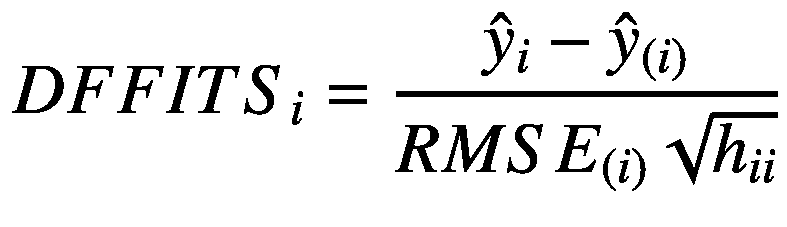

分子是包含和不包含第`i`个数据点运行回归时，拟合响应值之间的差异。分母是分子（差异）的估计标准差。换句话说，`DFFITS[i]`衡量的是当移除第`i`个数据点时，标准差数量的变化。

根据经验法则，如果一个数据点`i`满足以下条件，则认为是影响点：

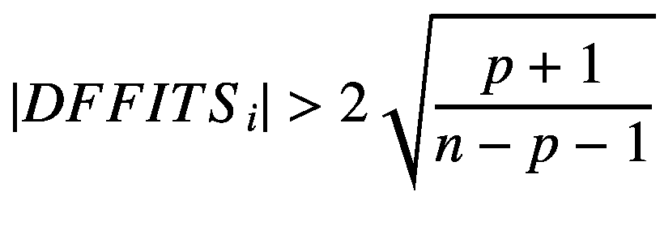

#### Cook 距离

Cook 距离定义如下：

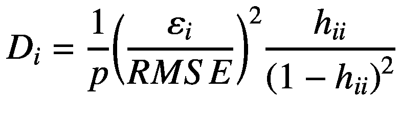

该定义既依赖于残差（针对极端的`y`值），也依赖于杠杆值（针对极端的`x`值）。它衡量的是当删除第`i`个观测值时，所有拟合值的变化程度。根据经验法则，如果`D[i] > 0.5`，则该数据点可能是一个影响点；如果`D[i] > 1`，则该数据点很可能是一个影响点；如果`D[i]`远大于其他 Cook 距离，则该数据点几乎肯定是一个影响点。在图 14-10 中，有一个数据点的 Cook 距离（红色虚线）略高于 0.5。因为它具有一定的杠杆值，所以值得考虑是否将其包含在回归中。

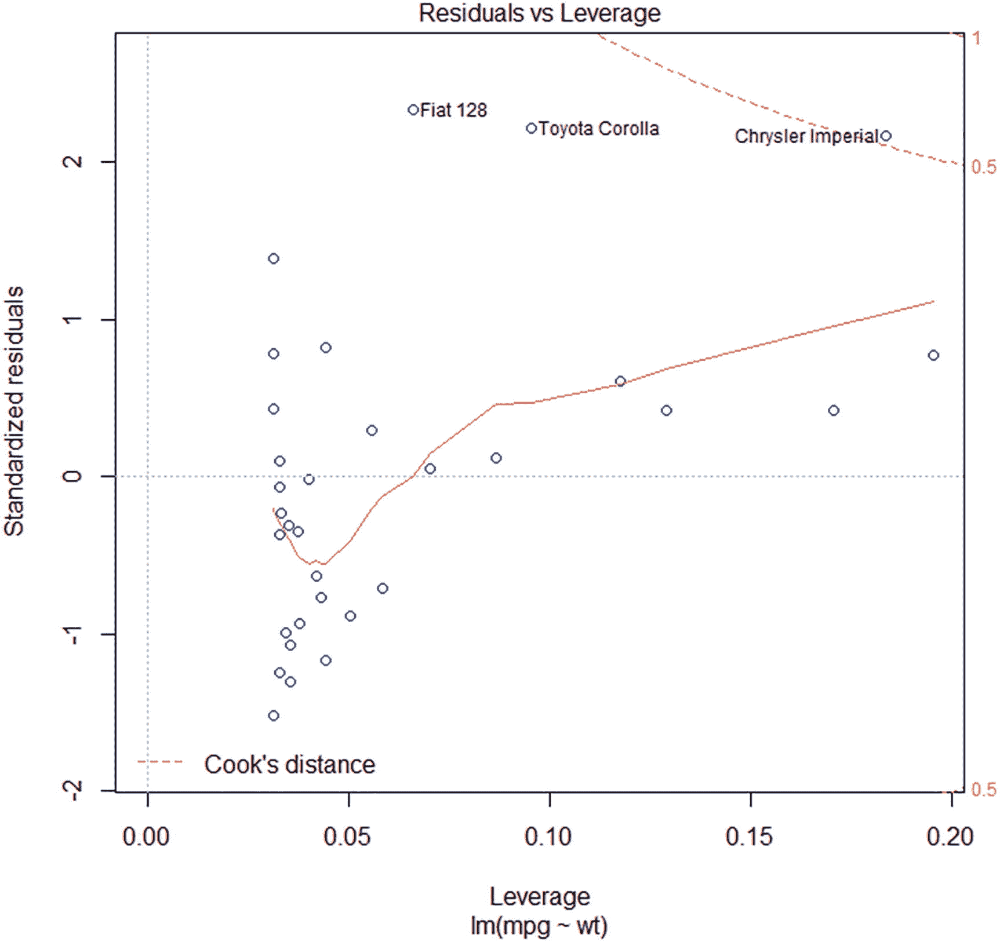

`mtcars`数据集中每个数据点的影响力

### 14.1.5 信息准则

对于一组数据，给定多个竞争模型，信息准则（IC）会估计每个模型相对于其他模型的质量，并根据 IC 值对它们进行排序。这提供了一种模型选择的方法。例如，可以选择 IC 值最低的模型作为最佳模型。通过 IC 值，我们可能会推断出排名前三的模型属于同一梯队，而其余模型则差得多。然而，为一个给定模型设定一个“被拒绝”的阈值是相当武断的。需要注意的是，IC 值并不能说明模型的绝对质量，而只能说明其相对于其他模型的质量。如果所有候选模型都拟合得很差，IC 不会给出任何警告。因此，在使用 IC 选择模型后，通常最好验证模型的绝对质量。这种验证通常包括检查模型的残差（以确定残差是否表现为白噪声）以及检验模型的预测。

#### AIC

通常，当使用统计模型来表示生成数据的真实过程时，该模型几乎不可能是精确的表示。使用模型表示会丢失信息。赤池信息准则（AIC）估计了给定模型所丢失信息的相对量：模型丢失的信息越少，该模型的质量就越高。在估计模型丢失的信息量时，AIC 处理的是模型拟合优度与模型简洁性之间的权衡。换句话说，AIC 同时处理了过拟合和欠拟合的风险。AIC 奖励拟合优度（通过似然函数评估，在线性回归模型中为`RSS`），并且还包含一个惩罚项，该惩罚项是估计参数数量的递增函数，以防止过拟合。具体而言，其数学定义如下：

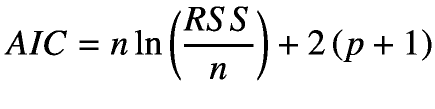

#### BIC

贝叶斯信息准则（BIC）的公式与 AIC 相似，但对参数数量的惩罚不同。AIC 的惩罚系数是 2，而 BIC 的惩罚系数是`ln n`。通常，BIC 对自由参数的惩罚比 AIC 更严厉。

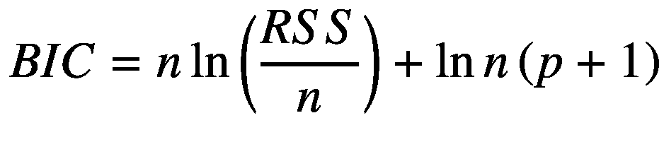

已有研究指出，AIC 和 BIC 适用于不同的任务。具体来说，有观点认为，如果“真实模型”在候选模型集中，BIC 适用于从候选集中选择该“真实模型”（即生成数据的过程），而 AIC 则不适用。具体而言，如果“真实模型”在候选集中，那么当`n → ∞`时，BIC 将以概率 1 选择该“真实模型”。相比之下，通过 AIC 进行选择时，这个概率可能小于 1。然而，也有观点认为这个问题无关紧要，因为实际上“真实模型”几乎从不在候选集中。事实上，统计学中有一句常见的格言：“所有模型都是错的”；因此，“真实模型”（即现实）不可能在候选集中。

另一项研究提供了一个允许“真实模型”在候选集中的模拟研究。该模拟特别表明，即使“真实模型”在候选集中，AIC 有时也会选择比 BIC 好得多的模型。原因是，对于有限的`n`，BIC 可能有相当大的风险从候选集中选出一个糟糕的模型。即使`n`远大于`p²`，这个原因也可能出现。使用 AIC 时，选择非常差模型的风险被最小化。如果“真实模型”不在候选集中，那么我们最多能期望做到的就是选择最接近“真实模型”的模型。在某些假设下，AIC 适用于寻找最佳近似模型。在回归中，假设“真实模型”不在候选集中，AIC 对于选择具有最小均方误差的模型是渐近最优的。而 BIC 在该假设下并不是渐近最优的。

### 14.1.6 NM Dev 线性回归包

NM Dev 拥有一个广泛的包，可以使用多种回归方法解决多种类型的线性模型问题：普通最小二乘法（非加权，第 14.1 节；加权，第 14.2 节）、广义线性模型（第 14.4 节）、逻辑回归（第 14.3 节）、逐步回归（第 14.5 节）、LASSO（第 14.6 节）。为了构建和分析线性模型，我们首先构造一个`LMProblem`。该类的签名如下：

```java
/**
* 构建一个线性回归问题。
*
* @param y         因变量
* @param X         自变量/因子
* @param intercept 是否在线性回归中额外添加一个截距项
* @param weights   分配给每个观测值的权重
*/
public LMProblem(Vector y, Matrix X, boolean intercept, Vector weights)
```

应用 NM Dev 包中的任何回归方法都会生成一个`LinearModel`对象。该接口的签名如下：

```java
public interface LinearModel {
/**
* 获取 \(\hat{\beta}\) 及其统计量。
*
* @return \(\hat{\beta}\) 及其统计量
*/
public LMBeta beta();
/**
* 获取 OLS 回归的残差分析结果。
*
* @return 残差分析结果
*/
public LMResiduals residuals();
/**
* 根据给定输入计算期望值 \(E(y(x))\)。
*
* @param x 一个输入值
* @return \(E(y(x))\)
*/
public double Ey(Vector x); // 待办：置信区间，预测区间
}
```

这个`LinearModel`对象包含了估计的贝塔帽子 `LMBeta`、预测方法 `Ey` 以及残差 `LMResiduals` 的结果。函数 `Ey` 可用于计算模型拟合值。`LMBeta` 包含了贝塔帽子的期望值、估计贝塔的协方差矩阵、它们的标准误差以及 t 统计量。该类的签名如下：

```java
public abstract class LMBeta {
/**
* 获取系数估计值，即 β^。
*
* @return 系数估计值，β^
*/
public ImmutableVector betaHat();
/**
* 获取系数估计值 β^ 的协方差矩阵。
*
* @return 系数估计值 β^ 的协方差矩阵
*/
public abstract ImmutableMatrix covariance();
/**
* 获取系数 β^ 的标准误差。
*
* @return 系数 β^ 的标准误差
*/
public ImmutableVector stderr();
/**
* 获取回归系数 β^ 的 t 值或 z 值。
*
* @return 回归系数 β^ 的 t 值或 z 值
*/
public ImmutableVector t();
}
```

`LMResiduals` 类包含了大量关于残差及其分析的信息。该类的签名如下：

# 线性模型 API 文档

## `LMResiduals` 类

`LMResiduals` 类提供残差分析的各项指标。

```java
public class LMResiduals {
    /**
     * 获取拟合值，即 y^。
     *
     * @return 拟合值，y^
     */
    public ImmutableVector fitted();
    /**
     * 获取残差，即 ε，样本值与拟合值之间的差异。
     *
     * @return 残差，ε
     */
    public ImmutableVector residuals();
    /**
     * 获取加权后的拟合值。
     *
     * @return 加权后的拟合值
     */
    public ImmutableVector weightedFittedValues();
    /**
     * 获取加权后的残差。
     *
     * @return 加权后的残差
     */
    public ImmutableVector weightedResiduals();
    /**
     * 获取诊断指标：残差平方和，\(\sum \epsilon²\)。
     *
     * @return 残差平方和，\(\sum \epsilon²\)
     */
    public double RSS();
    /**
     * 获取诊断指标：总平方和，\(\sum (y-y_mean)² \)。
     *
     * @return 总平方和，\(\sum (y-y_mean)² \)
     */
    public double TSS();
    /**
     * 获取诊断指标：R 方。
     *
     * @return R 方
     */
    public double R2();
    /**
     * 获取诊断指标：调整后的 R 方。
     *
     * @return 调整后的 R 方
     */
    public double AR2();
    /**
     * 获取残差的标准误差。
     *
     * @return 残差的标准误差
     */
    public double stderr();
    /**
     * 获取诊断指标：F 统计量。
     * 
     * 回归均方 / 均方误差 =
     * sum((y_i_hat-y_mean)²) / 均方误差 =
     * [(TSS-RSS)/n] / [RSS/(m-n)]
     * 
     * y_i_hat 是回归的拟合值。
     *
     * @return F 统计量
     * @see "Kutner, Nachtsheim and Neter, "p.69, equation (2.60)," Applied linear regression
     * models. 4th edition."
     */
    public double Fstat();
    /**
     * 获取投影矩阵，即 H 帽子。
     *
     * @return 投影矩阵
     * @see "Sanford Weisberg, "p.168, Section 8.1, Chapter 8," Applied Linear
     * Regression, 3rd
     * edition, 2005\. Wiley-Interscience."
     */
    public ImmutableMatrix hHat();
    /**
     * 获取杠杆值。
     * 观测值的杠杆值越大，对预测的影响就越大。
     *
     * @return 杠杆值
     */
    public ImmutableVector leverage();
    /**
     * 标准化残差 = 残差 / v1 / sqrt(RSS / (n-m))
     *
     * @return 标准化残差
     */
    public ImmutableVector standardized();
    /**
     * 学生化残差 = 标准化 * sqrt((n-m-1) /
     * (n-m-standardized²))
     *
     * @return 学生化残差
     * @see
     * 
     * "Chatterjee, Hadi and Price, "p.90 (4.15), Section 4.3," Regression
     * Analysis by Example,
     * 3rd edition, 2000\. Wiley Series in Probability and Statistics."
     * @see
     * 维基百科：
     * 学生化残差
     * 
     */
    public ImmutableVector studentized();
    /**
     * 获取自由度。
     * 
     * 待办：用户应能修改此方法以适应不同的回归。
     *
     * @return 自由度
     */
    public int df();
}
```

## `LMDiagnostics` 类

`LMDiagnostics` 类计算影响点。该类的签名如下：

```java
public class LMDiagnostics {
    /**
     * DFFITS，Welsch 和 Kuh 度量。
     *
     * @return DFFITS
     * @see
     * 
     * "Chatterjee, Hadi and Price, "p.105 (4.23), Section 4.9.2, Regression
     * Analysis by Example," 3rd edition, 2000\. Wiley Series in Probability and
     * Statistics."
     * "David A. Belsley, Edwin Kuh, Roy E. Welsch, Regression diagnostics:
     * identifying influential data and sources of collinearity. Wiley series in
     * probability and mathematical statistics. New York: John Wiley & Sons.
     * ISBN 0471058564\. 1980."
     * 
     */
    public ImmutableVector DFFITS;
    /**
     * Cook 距离。
     *
     * @return Cook 距离
     * @see "Sanford Weisberg, "p.200," Applied Linear Regression, 3rd edition,
     * 2005.
     * Wiley-Interscience."
     */
    public ImmutableVector cookDistances();
    /**
     * Hadi 影响度量。
     *
     * @return Hadi 影响度量
     * @see "Chatterjee, Hadi and Price, "p.105 (4.24), Section 4.9.2,"
     * Regression Analysis by Example, 3rd edition, 2000\. Wiley Series in
     * Probability and Statistics."
     */
    public ImmutableVector Hadi();
}
```

## `OLSRegression` 类

类 `OLSRegression` 接收一个 `LMProblem` 作为输入，运行 OLS 回归并生成一个 `LinearModel`。其类签名如下：

```java
public class OLSRegression implements LinearModel {
    /**
     * 构造一个 `OLSRegression` 实例。
     *
     * @param problem 待求解的线性回归问题
     * @param epsilon 精度参数：当数值 `|x| ≤ ε` 时，视为 `0`
     */
    public OLSRegression(LMProblem problem, double epsilon);
}
```

## 示例

以下是一个求解 OLS 问题的示例。响应向量如下：

![$$ \boldsymbol{y}=\left[\begin{array}{c}2.32\\ {}0.452\\ {}4.53\\ {}12.34\\ {}32.2\end{array}\right] $$](images/500382_1_En_14_Chapter/500382_1_En_14_Chapter_TeX_Equak.png)

解释变量的设计矩阵如下：

![$$ X=\left[\begin{array}{ccc}1.52&amp; 2.23&amp; 4.31\\ {}3.22&amp; 6.34&amp; 3.46\\ {}4.32&amp; 12.2&amp; 23.1\\ {}10.1034&amp; 43.2&amp; 22.3\\ {}12.1&amp; 2.12&amp; 3.27\end{array}\right] $$](images/500382_1_En_14_Chapter/500382_1_En_14_Chapter_TeX_Equal.png)

```java
// 构造一个线性模型问题
LMProblem problem = new LMProblem(
        // 因变量，y
        new DenseVector(new double[]{2.32, 0.452, 4.53, 12.34, 32.2}),
        // 自变量的设计矩阵，X
        new DenseMatrix(
                new double[][]{
                        {1.52, 2.23, 4.31},
                        {3.22, 6.34, 3.46},
                        {4.32, 12.2, 23.1},
                        {10.1034, 43.2, 22.3},
                        {12.1, 2.12, 3.27}
                }),
        true // 包含截距项
);
// 求解一个 OLS 问题
OLSRegression ols = new OLSRegression(problem);
System.out.println("beta hat");
// beta 的均值
System.out.println("beta^ = " + ols.beta().betaHat());
// beta 的标准误差
System.out.println("beta^ standard error = " + ols.beta().stderr());
// 若 beta/变量的 t 统计量绝对值大于 2，则视为显著
System.out.println("beta^ t = " + ols.beta().t());
System.out.println("\nresiduals");
System.out.println("residual F-stat = " + ols.residuals().Fstat());
System.out.println("fitted values: " + ols.residuals().fitted());
System.out.println("residuals: " + ols.residuals().residuals());
System.out.println("residual standard error = " + ols.residuals().stderr());
System.out.println("RSS = " + ols.residuals().RSS());
System.out.println("TSS = " + ols.residuals().TSS());
System.out.println("R2 = " + ols.residuals().R2());
System.out.println("AR2 = " + ols.residuals().AR2());
System.out.println("\ninfluential points");
System.out.println("standarized residuals: " + ols.residuals().standardized());
System.out.println("studentized residuals: " + ols.residuals().studentized());
System.out.println("leverage/hat values: " + ols.residuals().leverage());
System.out.println("DFFITS: " + ols.diagnostics().DFFITS());
System.out.println("cook distances: " + ols.diagnostics().cookDistances());
System.out.println("Hadi: " + ols.diagnostics().Hadi());
System.out.println("\ninformation criteria");
System.out.println("AIC = " + ols.informationCriteria().AIC());
System.out.println("BIC = " + ols.informationCriteria().BIC());
```

输出包含了我们在前几节中讨论的所有结果和统计量。

```
beta hat
beta^ = [3.055264, -0.347572, 0.019219, -4.357924]
beta^ standard error = [0.491998, 0.194540, 0.299207, 3.958854]
beta^ t = [6.209908, -1.786633, 0.064232, -1.100804]
residuals
residual F-stat = 13.528805679720477
fitted values: [-0.406176, 3.342917, 5.044391, 11.924108, 31.936759]
residuals: [2.726176, -2.890917, -0.514391, 0.415892, 0.263241]
residual standard error = 4.036867249675668
RSS = 16.29629719150399
TSS = 677.7046112
R2 = 0.9759536870161641
AR2 = 0.9038147480646566
influential points
standarized residuals: [1.000000, -1.000000, -1.000000, 1.000000, 1.000000]
studentized residuals: [0.000000, 0.000000, 0.000000, 0.000000, 0.000000]
leverage/hat values: [0.543943, 0.487159, 0.983763, 0.989386, 0.995748]
DFFITS: [0.000000, 0.000000, 0.000000, 0.000000, 0.000000]
cook distances: [0.298178, 0.237481, 15.147200, 23.304136, 58.542696]
Hadi: [8.546417, 9.160788, 64.654821, 97.259457, 238.187865]
information criteria
AIC = 30.096885349082104
BIC = 28.144074911252606
```

## 14.2 加权最小二乘法

OLS 中的一个重要假设是同方差性，即所有误差或残差具有相同的常数方差。这一假设在许多实际应用中经常不成立。如关于收入的例子所示，高收入者的方差往往比低收入者更大。方差的大小通常取决于数值的大小。

加权最小二乘法（WLS）是 OLS 的扩展，用于解决异方差性问题，即所有误差或残差具有不同的方差。从数学上讲，对于如下回归模型：

```
\boldsymbol{y}=\boldsymbol{X}\boldsymbol{\beta } +\boldsymbol{\varepsilon}
```

假设我们可以用每个观测值的误差标准差对其进行缩放。

```
\frac{y_1}{\sigma_1}={\beta}_0\frac{1}{\sigma_1}+{\beta}_1\frac{x_{11}}{\sigma_1}+\cdots +{\beta}_p\frac{x_{1p}}{\sigma_1}+{\varepsilon}_1
```

```
\frac{y_2}{\sigma_2}={\beta}_0\frac{1}{\sigma_2}+{\beta}_1\frac{x_{21}}{\sigma_2}+\cdots +{\beta}_p\frac{x_{2p}}{\sigma_2}+{\varepsilon}_2
```

```
\vdots
```

```
\frac{y}{\sigma_n}={\beta}_0\frac{1}{\sigma_n}+{\beta}_1\frac{x_{n1}}{\sigma_n}+\cdots +{\beta}_p\frac{x_{np}}{\sigma_n}+{\varepsilon}_n
```

# 加权最小二乘法（WLS）概述

那么缩放后的模型具有恒定的误差方差。其平方误差和如下：


系数`w[i] = σ[i]^(-2)`本质上是分配给各观测值的权重。

## 权重矩阵与正规方程

正规方程如下：

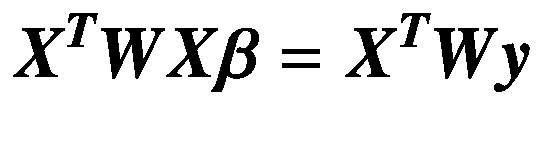

其中`W`是一个`n × n`的权重对角矩阵。

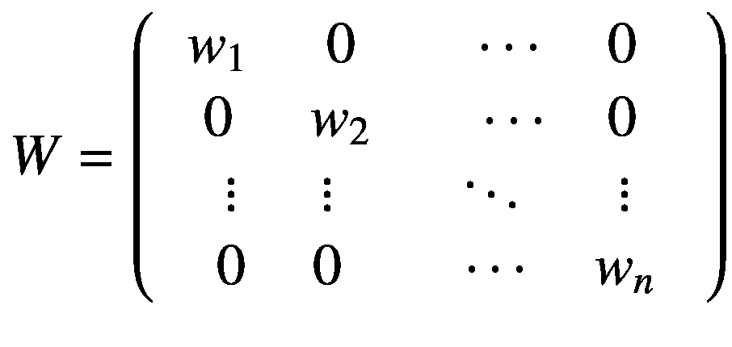

## 权重的扩展意义

权重可以扩展到更一般的情况，即我们希望为不同的观测值赋予不同的重要性。例如，我们可能希望将回归模型聚焦于某些难以、昂贵或耗时复现的数据（或实验）部分。我们可能希望更偏好测量更准确、更可靠的数据，而对估计所得、不可靠的数据给予较低的权重。需要注意的是，每个观测值的权重是相对于其他观测值的权重而言的，因此不同的绝对权重集合可能产生相同的效果。权重不必总和为 1。

## 求解WLS估计值

为了求解正规方程，我们找到最小化该目标函数的`β̂`。

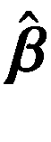

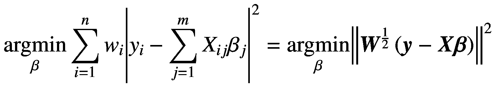

`β̂` 的 WLS 估计值如下：

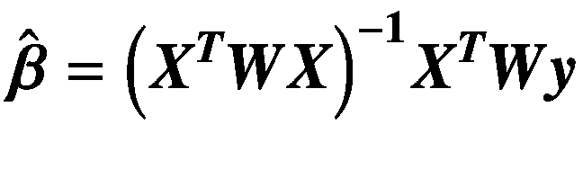

## 实际应用与注意事项

在实际应用中，我们可能无法确切知道权重和方差。使用估计的权重可能会产生不良结果，尤其是当权重是根据小样本估计时。WLS 也容易受到异常值问题的影响。当我们无意中通过赋予异常值很大的权重而增加其影响时，这个问题会更加明显。

在 NM Dev 中，`OLSRegression` 类可以将权重作为输入来执行 WLS。示例如下：

```markdown
## 14.3 逻辑回归

考虑这样一个问题：一组 20 名学生，他们的备考时间在 0 到 6 小时之间。学习时间的长短如何影响学生通过考试的概率？数据如下表所示。表中列出了每名学生的学习时长，以及他们是通过（1）还是未通过（0）。请注意，1 和 0 是名义响应变量，意味着 1 和 0 仅仅是标签或类别。`(1+0)/2`或`1 > 0`这样的计算是没有意义的。

| 学习时长 | 0.5 | 0.75 | 1.00 | 1.25 | 1.50 | 1.75 | 1.75 | 2.00 | 2.25 | 2.50 | 2.75 | 3.00 | 3.25 | 3.50 | 4.00 | 4.25 | 4.50 | 4.75 | 5.00 | 5.50 |
|----------|-----|------|------|------|------|------|------|------|------|------|------|------|------|------|------|------|------|------|------|------|
| 是否通过 | 0   | 0    | 0    | 0    | 0    | 0    | 1    | 0    | 1    | 0    | 1    | 0    | 1    | 0    | 1    | 1    | 1    | 1    | 1    | 1    |

我们不能使用普通最小二乘法，首先是因为响应变量`y`不是数值，而是标签。假设我们改用通过概率`p = Pr(y = 1)`作为因变量。我们仍然不能使用普通最小二乘法，因为`p`的取值范围是[0, 1]，而非(-∞, ∞)。我们可以使用 logit 函数来变换这个取值范围。它也称为对数几率，因为它就是几率比`p/(1-p)`的对数。见图 14-11。

`logit(p) = σ⁻¹(p) = log(p/(1-p))`

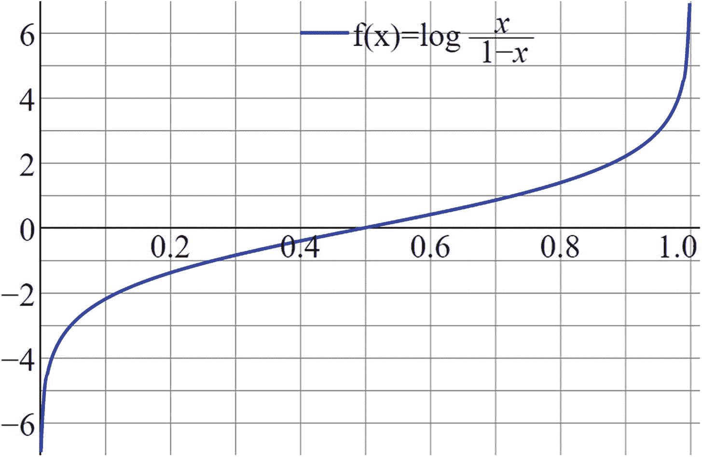
```

**图 14-11** logit 函数，即对数几率函数

通过变换，我们构建了一个线性回归问题，使得响应变量`p`的某个函数（logit）成为自变量（学习时长）的线性模型。即：

`l = log(p/(1-p)) = β₀ + β₁h`

我们可以通过对对数几率取指数来恢复通过概率，如下所示：

`p/(1-p) = e^(β₀ + β₁h)`

或者等价地：

`p = 1/(1 - e^(−(β₀ + β₁h))) = S(β₀ + β₁h)`

其中`S`是 Sigmoid 函数。见图 14-12。

`S(x) = 1/(1 + e^(-x)) = e^x/(e^x + 1) = 1 - S(-x)`

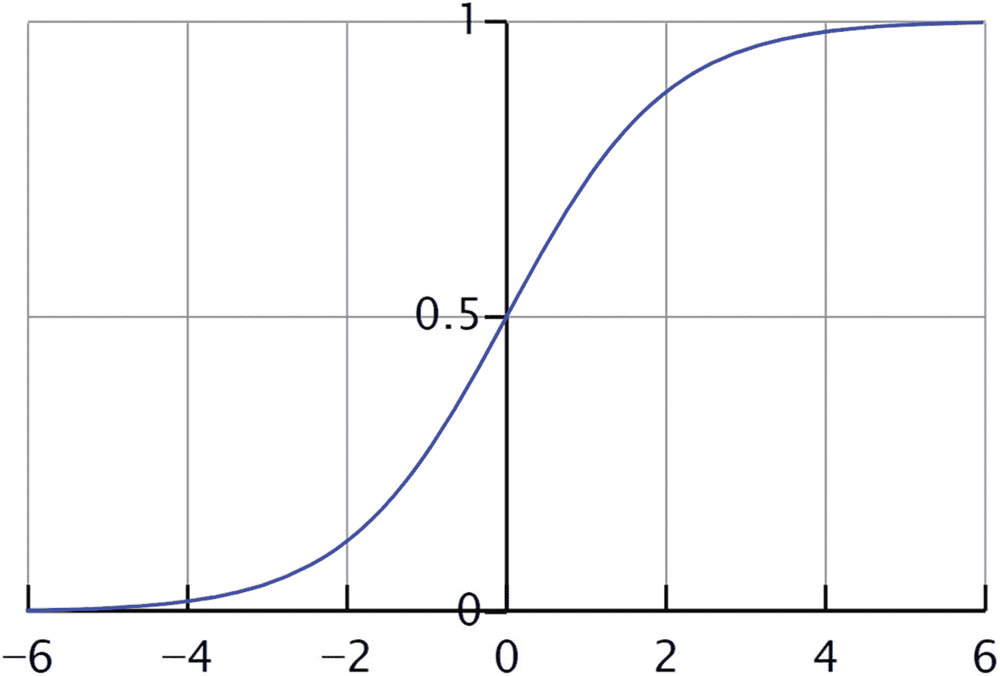

**图 14-12** Sigmoid 函数

对变换后的问题运行普通最小二乘回归，或者直接运行逻辑回归，得到以下结果：

|  | Beta hat | 标准误差 | T 统计量 | P 值 |
| --- | --- | --- | --- | --- |
| 截距 | -4.0777 | 1.7610 | -2.316 | 0.0206 |
| 学习时长 | 1.5046 | 0.6287 | 2.393 | 0.0167 |

输出结果表明，学习时长与通过考试的概率显著相关（p 值为 0.0167 < 5%）。我们可以将考试通过的概率（`y = 1`）表示为学习时长（`h`）的函数。

`Pr(y = 1) = 1 / (1 + exp(−(1.5046 × h − 4.0777)))`

图 14-13 展示了这个考试通过概率随学习时长变化的函数图像。

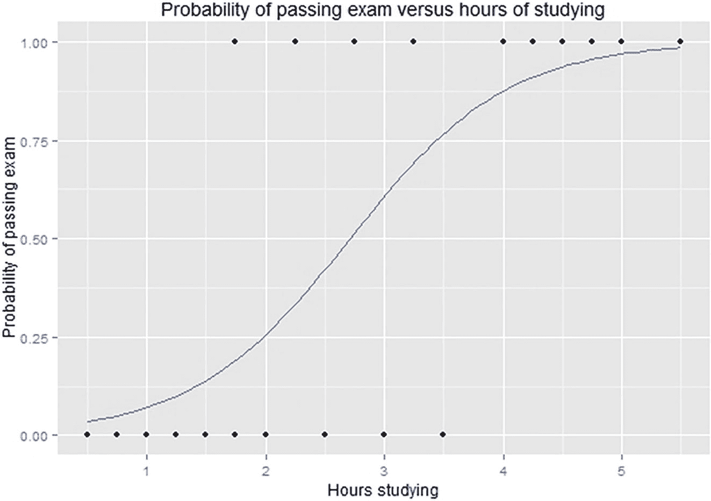

**图 14-13** 逻辑回归结果，展示了考试通过概率与学习时长之间的关系

NM Dev 库中的`LogisticRegression`类可对`LMProblem`对象执行逻辑回归。以下代码片段解决了我们前面讨论的问题：

```
// 构建一个线性模型问题
LMProblem problem = new LMProblem(
// 自变量, y, {通过, 未通过}
new DenseVector(new double[]{0, 0, 0, 0, 0, 0, 1, 0, 1, 0, 1, 0, 1, 0, 1, 1, 1, 1, 1, 1}),
// 因变量的设计矩阵, X, 学习时长
new DenseMatrix(
new double[][]{
{0.5},
{0.75},
{1.},
{1.25},
{1.5},
{1.75},
{1.75},
{2.},
{2.25},
{2.5},
{2.75},
{3.},
{3.25},
{3.5},
{4.},
{4.25},
{4.5},
{4.75},
{5.},
{5.5}
}),
// 包含截距
true);
// 解决逻辑回归问题
LogisticRegression logistic = new LogisticRegression(problem);
System.out.println("beta hat");
// 系数的均值
System.out.println("beta^ = " + logistic.beta().betaHat());
// 系数的标准误差
System.out.println("beta^ 标准误差 = " + logistic.beta().stderr());
// 如果 t 统计量大于 2，则该 beta/变量显著
System.out.println("beta^ t = " + logistic.beta().t());
System.out.println("\n 残差");
System.out.println("拟合值: " + logistic.residuals().fitted());
System.out.println("偏差残差: " + logistic.residuals().devianceResiduals());
System.out.println("偏差: " + logistic.residuals().deviance());
System.out.println("零模型偏差: " + logistic.residuals().nullDeviance());
System.out.println("\n 信息准则");
System.out.println("AIC = " + logistic.AIC());
```

输出结果如下：

```
beta hat
beta^ = [1.504645, -4.077713]
beta^ 标准误差 = [0.628721, 1.760994]
beta^ t = [2.393185, -2.315574]
残差
拟合值: [0.034710, 0.049773, 0.070892, 0.100029, 0.139344, 0.190837, 0.190837, 0.255703, 0.333530, 0.421627, 0.515011, 0.607359, 0.692617, 0.766481, 0.874448, 0.910278, 0.936624, 0.955611, 0.969097, 0.985194]
偏差残差: [-0.265808, -0.319544, -0.383485, -0.459113, -0.547834, -0.650775, 1.820076, -0.768525, 1.481905, -1.046456, 1.152013, -1.367376, 0.857062, -1.705574, 0.518002, 0.433603, 0.361867, 0.301346, 0.250561, 0.172721]
偏差: 16.059756928689346
零模型偏差: 27.725887222397812
信息准则
AIC = 20.059756928689346
```

## 14.4 广义线性模型

存在许多普通最小二乘法（OLS）无法适用的情况（我们已经看到两种），例如：异方差性；响应变量为离散型、二分类或类别型；响应变量取值范围受限，例如 `[0, 1]`，而非整个实数线 `(−∞, ∞)`；以及响应变量服从非正态的概率分布。（请注意，对解释变量没有限制。）广义线性模型（GLM）放宽了 OLS 的许多严格假设，提供了一个框架，使（仍然）线性回归能够适用于更广泛的问题。

以简单线性回归为例。它最适合应用于图 14-14 所示的数据：聚类在趋势线上的连续数据，响应变量和误差服从正态分布，且误差方差恒定。

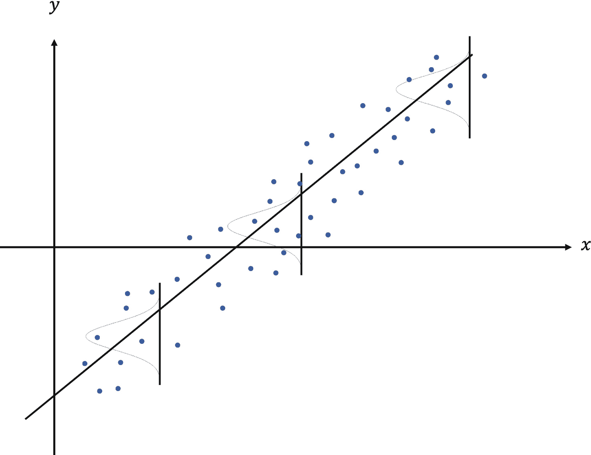

图 14-14 OLS 回归

从数学上讲，线性预测器 `b[0] + b[1] * x` 预测响应变量 `y[i]` 的均值。然后，`y[i]` 由一个先验分布决定，在本例中，是方差恒定为 `ε` 的正态分布。

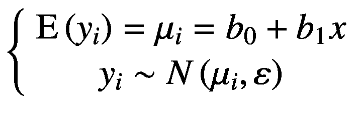

考虑另一组数据，例如，后院兔子数量随时间变化的情况，如图 14-15 所示。种群数量是随机的，因为它们的出生和死亡（例如，被我吃掉）是不确定的。如果我们穿过数据点画一条曲线，其形状更像是指数曲线而非直线（非线性）。随着 `t` 变大，数据点分布得更分散（异方差性）。兔子种群数量是正整数（离散型，取值范围受限）。显然，OLS 不适用于这组数据，因为它几乎违反了所有假设。

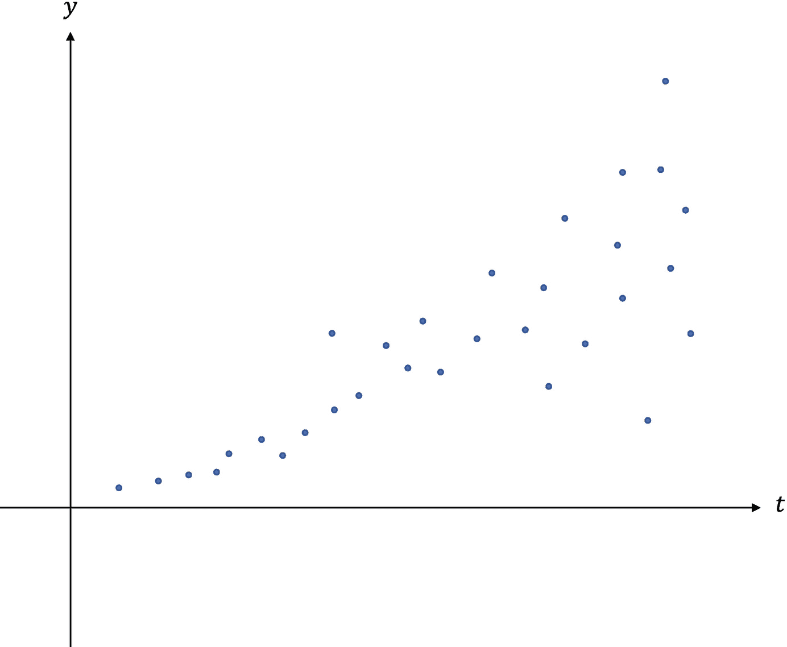

图 14-15 兔子数量随时间变化

为了解决响应变量的概率分布及其取值范围的问题，我们不使用正态分布，而是使用泊松分布。泊松分布是一种离散概率分布，用于描述事件发生次数的概率。它只有一个参数 `λ`，这个参数既是该分布的均值，也是其方差。参见第 12.3.5 节。一旦我们通过预测函数确定了均值，方差和泊松分布就完全确定了。我们可以为更大的 `t` 使用更大的 `λ`，以模拟随时间增加的方差。

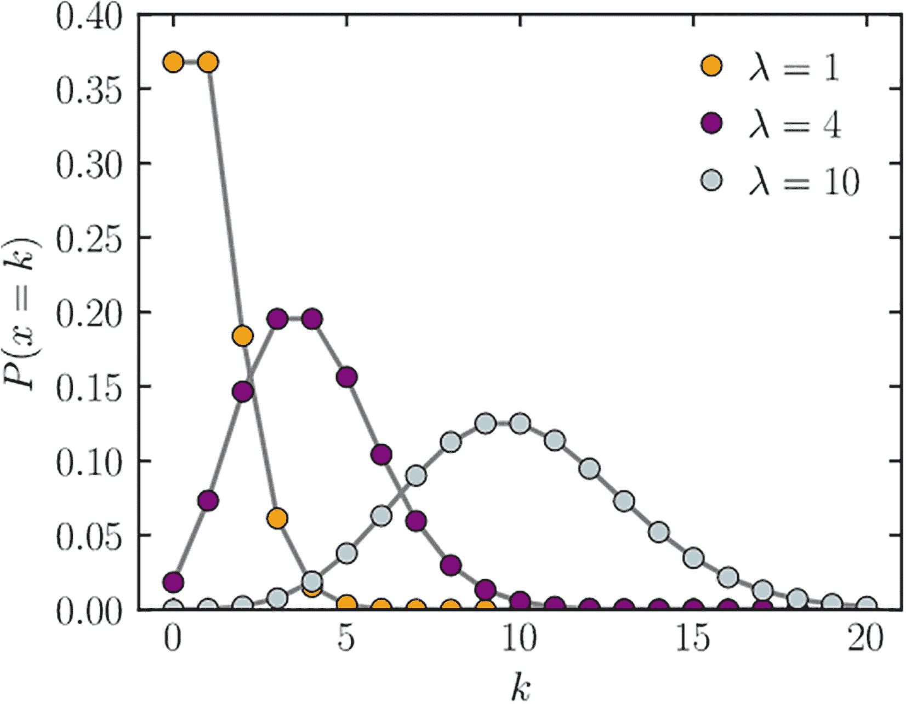

图 14-16 泊松分布的概率质量函数

为了拟合穿过数据点的回归线，我们可以对预测值进行变换，使其与分布的期望相匹配。在 OLS 中，预测值就是期望值。直线回归线是使用恒等函数将预测值与期望值“连接”起来的结果。要模拟指数曲线，我们可以使用指数函数。也就是说，

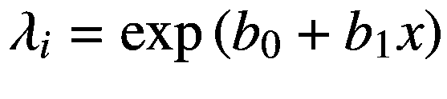

或者等价地，

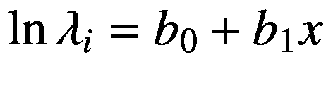

这种回归（泊松分布、线性预测器、指数函数）被称为泊松回归。其结果如图 14-17 所示。不同方差的泊松分布被叠加在指数回归线上。

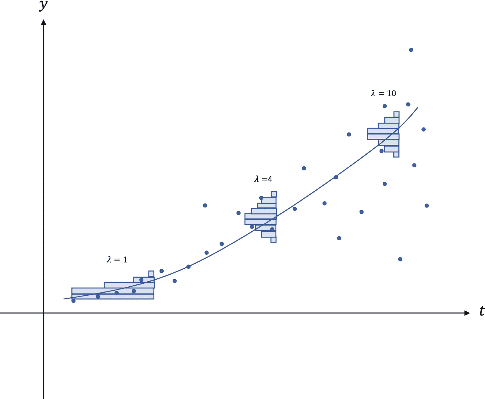

图 14-17 泊松回归

广义线性模型（GLM）通过容纳变化的方差以及残差（从而响应变量）的替代分布，扩展了线性建模的应用范围。GLM 统一了许多其他统计模型。WLS、逻辑回归和泊松回归都是 GLM 框架下的特例。

所有 GLM 回归都有三个共同要素。首先，系统性和确定性组成部分是预测函数，它是解释变量的线性组合，即 `Xβ`。其次，随机组成部分是对残差/响应变量概率分布的指定。这些分布均来自指数分布族，其特征是均值的某个函数（典范参数或位置参数）和方差的某个函数（离散参数）。源于指数分布族的概率分布的概率密度函数的一般形式如下：

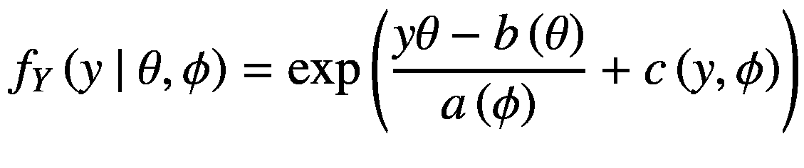

其中参数 `θ` 是典范参数，`b(θ)` 是累积量函数，`ϕ` 是离散参数。NM Dev 接口 `GLMExponentialDistribution` 代表了这类指数概率分布。

第三，链接函数（通常记作 `g`）将系统性组成部分和随机组成部分连接起来。其逆函数将预测值转换为概率分布的均值。在数学上，我们有如下公式：

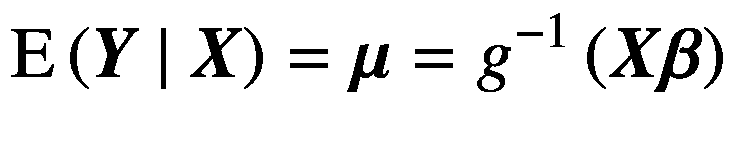

下表总结了各种 GLM 回归的这三个组成部分及其在 NM Dev 中的支持：

| 回归模型 | 响应变量 | 概率分布 | 典范链接函数 | NM Dev 类 |
| --- | --- | --- | --- | --- |
| 线性回归 | 连续测量值 | 正态 | 恒等 | `GLMGaussian` |
| 逻辑回归 | 二分类 | 二项式 | Logit | `GLMBinomial` |
| 泊松回归 | 计数 | 泊松 | Log | `GLMPoisson` |
| | 生存数据 | 伽马 | Log | `GLMGamma` |
| | | | | `GLMInverseGaussian` |

在 NM Dev 中，要运行 GLM 回归，我们首先需要使用 `GLMProblem` 类构建一个问题实例。该类的签名如下：

```
/**
 * 构造一个 GLM 问题。
 *
 * @param y         因变量
 * @param X         因子
 * @param intercept 如果为线性回归添加额外的截距项，则为 {@code true}
 * @param family    均值的指数分布族
 */
public GLMProblem(
    Vector y,
    Matrix X,
    boolean intercept,
    GLMFamily family
)
```

`GeneralizedLinearModel` 类用于执行 GLM 回归。该类的签名如下：

```
/**
 * 构造一个 {@code GeneralizedLinearModel} 实例。
 *
 * @param problem 待解决的广义线性回归问题
 * @param fitting 拟合方法，参见 {@link GLMFitting}
 */
public GeneralizedLinearModel(GLMProblem problem, GLMFitting fitting)
```

参数 `fitting` 指定了用于估计回归参数的方法。默认的估计方法是迭代重加权最小二乘法（IWLS）。它是一种最大似然算法。

以下示例使用二项式分布和 logit 链接函数运行了一个 GLM 回归：

```
// 构建线性模型问题
GLMProblem problem = new GLMProblem(
        // 自变量 y
        new DenseVector(new double[]{1, 1, 0, 1, 1}),
        // 因变量的设计矩阵 X
        new DenseMatrix(
                new double[][]{
                        {1.52},
                        {3.22},
                        {4.32},
                        {10.1034},
                        {12.1}
                }),
        // 包含截距项
        true,
        // 使用二项分布
        new GLMFamily(new GLMBinomial()));
// 求解 GLM 回归问题
GeneralizedLinearModel glm = new GeneralizedLinearModel(problem);
System.out.println("beta hat");
// 各个回归系数的均值
System.out.println("beta^ = " + glm.beta().betaHat());
// 各个回归系数的标准误
System.out.println("beta^ standard error = " + glm.beta().stderr());
// 若回归系数的 t 统计量大于 2，则说明该系数/变量显著
System.out.println("beta^ t = " + glm.beta().t());
System.out.println("\n 残差");
System.out.println("拟合值: " + glm.residuals().fitted());
System.out.println("偏差残差: " + glm.residuals().devianceResiduals());
System.out.println("偏差: " + glm.residuals().deviance());
System.out.println("过度离散: " + glm.residuals().overdispersion());
System.out.println("\n 信息准则");
System.out.println("AIC = " + glm.AIC());
```

输出结果如下：

```
beta hat
beta^ = [0.165250, 0.487592]
beta^ standard error = [0.328662, 1.917517]
beta^ t = [0.502798, 0.254283]
residuals
fitted values: [0.676727, 0.734914, 0.768787, 0.896338, 0.923234]
deviance residuals: [0.883727, 0.784859, -1.711383, 0.467841, 0.399681]
deviance: 4.704428247887891
over dispersion: 1.0
information criteria
AIC = 8.70442824788789
```

以下示例使用泊松分布和对数链接函数执行 GLM 回归：

```
// 构建线性模型问题
GLMProblem problem = new GLMProblem(
        // 自变量 y
        new DenseVector(new double[]{4, 1, 4, 5, 7}),
        new DenseMatrix(
                // 因变量的设计矩阵 X
                new double[][]{
                        {1.52, 2.11},
                        {3.22, 4.32},
                        {4.32, 1.23},
                        {10.1034, 8.43},
                        {12.1, 7.31}
                }),
        // 包含截距项
        true,
        // 使用泊松分布
        new GLMFamily(new GLMPoisson()));
// 求解 GLM 回归问题
GeneralizedLinearModel glm = new GeneralizedLinearModel(problem);
System.out.println("beta hat");
// 各个回归系数的均值
System.out.println("beta^ = " + glm.beta().betaHat());
// 各个回归系数的标准误
System.out.println("beta^ standard error = " + glm.beta().stderr());
// 若回归系数的 t 统计量大于 2，则说明该系数/变量显著
System.out.println("beta^ t = " + glm.beta().t());
System.out.println("\n 残差");
System.out.println("拟合值: " + glm.residuals().fitted());
System.out.println("偏差残差: " + glm.residuals().devianceResiduals());
System.out.println("偏差: " + glm.residuals().deviance());
System.out.println("过度离散: " + glm.residuals().overdispersion());
System.out.println("\n 信息准则");
System.out.println("AIC = " + glm.AIC());
```

输出结果如下：

```
beta hat
beta^ = [0.159667, -0.126816, 0.952348]
beta^ standard error = [0.107230, 0.154416, 0.470909]
beta^ t = [1.489023, -0.821261, 2.022359]
residuals
fitted values: [2.528082, 2.505862, 4.419947, 4.465919, 7.080190]
deviance residuals: [0.852544, -1.083724, -0.203045, 0.247925, -0.030194]
deviance: 2.0048958300580386
over dispersion: 1.0
information criteria
AIC = 23.8245863701111
```

### 14.4.1 拟似然族

过度离散是指在数据集中出现的变异性或方差大于给定统计模型预期值的情况。在使用 GLM 对离散数据建模时尤其常见，因为指数分布规定了均值与方差之间的特定关系。例如，对于泊松分布，均值等于方差，两者均为`λ`。离散数据集可能具有均值`λ`，但其变异性却大于`λ`。

解决该问题的一种方法是在泊松模型中引入离散参数`σ`²，使得修正后的条件方差如下所示：

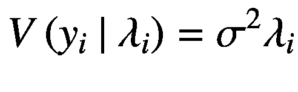

如果`σ`² > 1，那么响应的条件方差会比均值增长得更快。在指数分布族中，不存在对应于该规范以便用于 GLM 的分布。相反，我们应像前面的比例方差方程那样，直接指定条件均值和条件方差。虽然不存在似然函数（因为没有概率密度函数），但 GLM 最大似然估计的常规过程会得出回归系数的所谓拟似然估计量，该估计量具有最大似然估计量的许多性质。实际上，这种处理过度离散的方法会得到相同的估计值。然而，估计的标准误必须乘以因子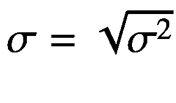。

NM Dev 库支持多种拟分布。其接口为`QuasiDistribution`。类签名如下：

```java
public interface QuasiDistribution extends GLMExponentialDistribution {
    /**
     * 对应于单个观测值的拟似然函数
     * Q(&mu;; y)
     *
     * @param mu &mu;
     * @param y  y
     * @return Q(&mu;; y)
     *
     * @see "P. J. MacCullagh and J. A. Nelder, Generalized Linear
     * Models, 2nd ed. Chapter 9\. Table 9.1\. p.326."
     */
    public double quasiLikelihood(double mu, double y);

    /**
     * 对应于单个观测值的拟偏差函数
     *
     * @param y  y
     * @param mu &mu;
     * @return D(y; &mu;;)
     *
     * @see "P. J. MacCullagh and J. A. Nelder, Generalized Linear
     * Models, 2nd ed. Chapter 9\. Eq. 9.4., the integral form, p.327."
     */
    public double quasiDeviance(double y, double mu);
}
```

NM Dev 支持的拟分布如下：

*   `QuasiBinomial`（拟二项分布）
*   `QuasiGamma`（拟伽马分布）
*   `QuasiGaussian`（拟高斯分布）
*   `QuasiInverseGaussian`（拟逆高斯分布）
*   `QuasiPoisson`（拟泊松分布）

以下示例使用拟二项分布和 logit 链接函数执行 OLS 回归：

## 14.5 逐步回归

对于包含众多可能解释变量的高维数据集，我们可能不清楚应将哪些子集纳入回归模型。一种系统性的解释变量选择方法是逐步回归。在每一步中，根据预设的准则，考虑向解释变量集合中添加一个变量，或从中剔除一个变量。通常，这表现为一系列F检验或t检验，但也可采用其他技术，如调整后的`R`²、`AIC`、`BIC`等。

主要有三种方法。**前向选择**是指：从模型中不包含任何变量开始，使用选定的模型拟合准则测试每个变量的添加效果；添加能使拟合效果在统计上显著提升最大的变量（若有的话），并重复此过程，直到再无变量能在统计上显著改善模型。NM Dev的`ForwardSelection`类实现了这一过程。以下示例使用`AIC`作为选择准则，对GLM模型进行逐步前向选择：
```java
// 构建线性模型问题
QuasiGLMProblem problem = new QuasiGLMProblem(
    // 因变量 y
    new DenseVector(new double[]{1, 1, 0, 1, 1}),
    // 自变量的设计矩阵 X
    new DenseMatrix(
        new double[][]{
            {1.52},
            {3.22},
            {4.32},
            {10.1034},
            {12.1}
        }),
    // 包含截距项
    true,
    new QuasiFamily(
        new QuasiBinomial(), // 拟二项分布
        new LinkLogit() // logit 连接函数
    ));
// 求解 GLM 回归问题
GeneralizedLinearModelQuasiFamily glm
    = new GeneralizedLinearModelQuasiFamily(problem);
System.out.println("beta hat");
// 各 beta 的均值
System.out.println("beta^ = " + glm.beta().betaHat());
// 各 beta 的标准误差
System.out.println("beta^ standard error = " + glm.beta().stderr());
// 若 beta/变量的 t 统计量大于 2，则表明显著
System.out.println("beta^ t = " + glm.beta().t());
System.out.println("\nresiduals");
System.out.println("fitted values: " + glm.residuals().fitted());
System.out.println("deviance residuals: " + glm.residuals().devianceResiduals());
System.out.println("deviance: " + glm.residuals().deviance());
System.out.println("over dispersion: " + glm.residuals().overdispersion());
```
输出结果如下：
```
beta hat
beta^ = [0.165250, 0.487592]
beta^ standard error = [0.396316, 2.312236]
beta^ t = [0.416966, 0.210875]
residuals
fitted values: [0.676727, 0.734914, 0.768787, 0.896338, 0.923234]
deviance residuals: [0.883727, 0.784859, -1.711383, 0.467841, 0.399681]
deviance: 4.704428247887892
over dispersion: 1.4540719510495013
```
请注意，过度离散值为1.454 > 1。否则，若使用普通的泊松分布，这组数据的拟合效果会较差。

以下示例使用拟正态分布和逆连接函数运行OLS回归：
```java
// 构建线性模型问题
QuasiGLMProblem problem = new QuasiGLMProblem(
    // 因变量 y
    new DenseVector(new double[]{1, 1, 0, 1, 1}),
    // 自变量的设计矩阵 X
    new DenseMatrix(
        new double[][]{
            {1.52},
            {3.22},
            {4.32},
            {10.1034},
            {12.1}
        }),
    // 包含截距项
    true,
    new QuasiFamily(
        new QuasiGaussian(), // 拟正态分布
        new LinkInverse() // 逆连接函数
    ));
// 求解 GLM 回归问题
GeneralizedLinearModelQuasiFamily glm
    = new GeneralizedLinearModelQuasiFamily(problem);
System.out.println("beta hat");
// 各 beta 的均值
System.out.println("beta^ = " + glm.beta().betaHat());
// 各 beta 的标准误差
System.out.println("beta^ standard error = " + glm.beta().stderr());
// 若 beta/变量的 t 统计量大于 2，则表明显著
System.out.println("beta^ t = " + glm.beta().t());
System.out.println("\nresiduals");
System.out.println("fitted values: " + glm.residuals().fitted());
System.out.println("deviance residuals: " + glm.residuals().devianceResiduals());
System.out.println("deviance: " + glm.residuals().deviance());
System.out.println("over dispersion: " + glm.residuals().overdispersion());
```
输出结果如下：
```
beta hat
beta^ = [-0.045443, 1.566066]
beta^ standard error = [0.083658, 0.800455]
beta^ t = [-0.543192, 1.956470]
residuals
fitted values: [0.668008, 0.704356, 0.730060, 0.903390, 0.984046]
deviance residuals: [0.331992, 0.295644, -0.730060, 0.096610, 0.015954]
deviance: 0.7401995829806532
over dispersion: 0.24673319432688443
```
请注意，过度离散值为0.2467 < 1，表明该数据集呈现欠离散现象。

## 逐步选择方法

```java
// 从 csv 文件读取出生体重数据
double[][] birthwt
    = DoubleUtils.readCSV2d(
        this.getClass().getClassLoader().getResourceAsStream("birthwt.csv"),
        true,
        true
    );
// 将 csv 文件转换为矩阵以便操作
Matrix A = new DenseMatrix(birthwt);
// 因变量 y
Vector y = A.getColumn(1);
// 自变量的设计矩阵 X
Matrix X = MatrixFactory.columns(A, 2, A.nCols() - 1); // 忽略最后一列
// 构建线性模型问题
GLMProblem problem = new GLMProblem(
    y, // 响应变量
    X, // 解释变量
    true, // 包含截距项
    new GLMFamily(new GLMBinomial()) // 使用二项分布的 GLM
);
// 对协变量进行逐步前向选择
ForwardSelection forwardSelection
    = new ForwardSelection(problem, new SelectionByAIC());
System.out.println("selection sequence:");
System.out.println(Arrays.toString(forwardSelection.getFlags()));
```

输出为每次添加一个协变量的选择序列。

```
selection sequence:
[0, 2, 3, 4, 5, 6, 7, 0]
```

**反向消除**是指：从包含所有候选变量开始，使用选定的模型拟合准则测试剔除每个变量的效果；剔除使模型拟合效果在统计上损失最小且不显著的变量（若有的话），并重复此过程，直到再剔除任何变量都会导致模型拟合在统计上显著损失为止。NM Dev 的 `BackwardElimination` 类实现了这一过程。以下示例使用 AIC 作为消除准则，对 GLM 模型进行逐步反向消除：

```java
// 从 csv 文件读取出生体重数据
double[][] birthwt
    = DoubleUtils.readCSV2d(
        this.getClass().getClassLoader().getResourceAsStream("birthwt.csv"),
        true,
        true
    );
// 将 csv 文件转换为矩阵以便操作
Matrix A = new DenseMatrix(birthwt);
// 因变量 y
Vector y = A.getColumn(1);
// 自变量的设计矩阵 X
Matrix X = MatrixFactory.columns(A, 2, A.nCols() - 1); // 忽略最后一列
// 构建线性模型问题
GLMProblem problem = new GLMProblem(
    y, // 响应变量
    X, // 解释变量
    true, // 包含截距项
    new GLMFamily(new GLMBinomial()) // 使用二项分布的 GLM
);
BackwardElimination backwardElimination
    = new BackwardElimination(problem, new EliminationByAIC());
System.out.println("elimination sequence:");
System.out.println(Arrays.toString(backwardElimination.getFlags()));
```

输出为每次剔除一个协变量的消除序列。

```
elimination sequence:
[0, 2, 3, 4, 5, 6, 7, 0]
```

**双向消除**是前两种方法的结合，在每一步中测试变量应被纳入还是剔除。逐步回归的主要缺点包括：参数估计存在偏差、模型选择算法之间不一致、固有的多重假设检验问题（通常被忽视），以及不恰当地聚焦或依赖单一最佳模型。这些方法仅在特定情况下能提高预测精度，例如当仅有少数协变量与结果有较强相关性时。然而，在其他情况下，它们可能会增加预测误差。

## 14.6 LASSO

最小绝对收缩与选择算子（LASSO）是另一种能够自动/系统地进行变量选择的方法。它通过正则化或惩罚项对 `β` 系数的总和规模进行约束，迫使部分系数归零，从而将其从模型中有效排除。与逐步回归（一种每次只考虑一个变量的贪婪算法）不同，LASSO 能够同时全局性地选择所有显著变量。从数学上看，LASSO 解决了一个带有 *ℓ*[1] 正则化约束的残差平方和（RSS）问题。

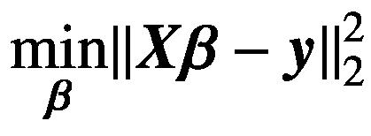, 约束条件：‖***β***‖[1] ≤ *t*

NM Dev 类 `ConstrainedLASSOProblem` 用于构造此类问题。该类签名如下：

```
/**
 * 构造约束形式的 LASSO 问题。
 *
 * @param y 响应变量向量（n * 1），已进行适当的去均值和缩放处理
 * @param X 因子设计矩阵（n * m），已进行适当的去均值和缩放处理
 * @param t 惩罚参数
 */
public ConstrainedLASSOProblem(Vector y, Matrix X, double t)
```

等价地，我们可以将约束问题以拉格朗日形式写成一个无约束的最小化问题。

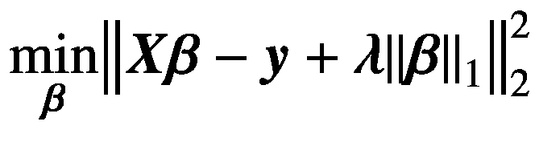

其中 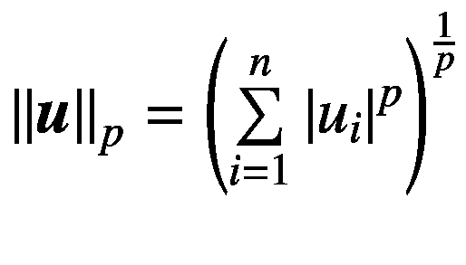 是标准的 *ℓ*[*p*]-范数。

NM Dev 类 `UnconstrainedLASSOProblem` 用于构造此类问题。该类签名如下：

```
/**
 * 构造一个 LASSO 问题。
 *
 * @param y      响应变量向量（n * 1），已进行适当的去均值和缩放处理
 * @param X      因子设计矩阵（n * m），已进行适当的去均值和缩放处理
 * @param lambda 惩罚参数
 */
public UnconstrainedLASSOProblem(Vector y, Matrix X, double lambda)
```

解决 LASSO 问题有两种方法：二次规划（QP）或最小角回归（LARS）。

QP 方法将问题转化为一个具有 2*p* 个约束条件的单一二次规划问题，其中 *p* 是设计矩阵的列数或解释变量的数量。

以下代码示例通过使用 QP 方法 `ConstrainedLASSObyQP` 解决糖尿病数据集上的 LASSO 问题，从而选择一组解释变量来构建线性模型。

## 使用二次规划方法求解LASSO问题

```java
// 正则化惩罚
double t = 0.;
// 构造一个约束 LASSO 问题
ConstrainedLASSOProblem problem
= new ConstrainedLASSOProblem(diabetes_y, diabetes_X, t);
// 运行 LASSO 回归
Vector betaHat = new ConstrainedLASSObyQP(problem).beta().betaHat();
System.out.println("beta^ = " + betaHat);
t = 1500.;
problem = new ConstrainedLASSOProblem(diabetes_y, diabetes_X, t);
betaHat = new ConstrainedLASSObyQP(problem).beta().betaHat();
System.out.println("beta^ = " + betaHat);
// 放宽约束；结果本质上与 OLS 解相同
t = 10000.;
problem = new ConstrainedLASSOProblem(diabetes_y, diabetes_X, t);
betaHat = new ConstrainedLASSObyQP(problem).beta().betaHat();
System.out.println("beta^ = " + betaHat);
```

输出结果如下：

```
beta^ = [0.000000, 0.000000, 0.000000, 0.000000, 0.000000, 0.000000, 0.000000, 0.000000, 0.000000, 0.000000]
beta^ = [0.000000, -97.708619, 511.776121, 245.453117, 0.000000, 0.000000, -185.906071, 0.000000, 451.728462, 7.427610]
beta^ = [-10.012159, -239.819200, 519.839803, 324.390488, -792.185282, 476.746446, 101.045359, 177.064955, 751.279595, 67.625253]
```

最后一个结果是针对一个非常大的`t`值，因此β系数不受约束。该结果相当于运行一个 OLS 回归。

## 使用最小角回归方法求解LASSO问题

最小角回归（LARS）是一种通过选择协变量子集来对高维数据进行线性回归模型拟合的算法。LARS 的解并非仅给出一个向量结果，而是由一条曲线构成，该曲线表示参数向量的`ℓ`[1]-范数每个取值对应的解。该算法类似于前向逐步回归，但在每一步中，不是直接包含变量，而是沿着与各变量残差相关性等角的方向增加估计参数。

以下代码使用 LARS 方法 `ConstrainedLASSObyLARS` 解决同一个 LASSO 问题：

```java
// 正则化惩罚
double t = 0.;
// 构造一个约束 LASSO 问题
ConstrainedLASSOProblem problem
= new ConstrainedLASSOProblem(diabetes_y, diabetes_X, t);
// 运行 LASSO 回归
Vector betaHat = new ConstrainedLASSObyLARS(problem).beta().betaHat();
System.out.println("beta^ = " + betaHat);
t = 1500.;
problem = new ConstrainedLASSOProblem(diabetes_y, diabetes_X, t);
betaHat = new ConstrainedLASSObyLARS(problem).beta().betaHat();
System.out.println("beta^ = " + betaHat);
// 放宽约束；结果本质上与 OLS 解相同
t = 10000.;
problem = new ConstrainedLASSOProblem(diabetes_y, diabetes_X, t);
betaHat = new ConstrainedLASSObyLARS(problem).beta().betaHat();
System.out.println("beta^ = " + betaHat);
```

输出结果与之前的结果类似：

```
beta^ = [0.000000, 0.000000, 0.000000, 0.000000, 0.000000, 0.000000, 0.000000, 0.000000, 0.000000, 0.000000]
beta^ = [0.000000, -97.708579, 511.776094, 245.453106, 0.000000, 0.000000, -185.906061, 0.000000, 451.728473, 7.427686]
beta^ = [-10.012180, -239.819080, 519.839776, 324.390434, -792.184539, 476.746095, 101.044789, 177.064323, 751.279476, 67.625345]
```

## 查看LARS算法的选择步骤

`ConstrainedLASSObyLARS` 实际上调用了另一个 NM Dev 类 `LARSFitting` 来计算所有的选择步骤。以下代码重复了之前展示的 LARS 计算，并显示了选择步骤：

```java
// 构造一个 LARS 问题
LARSProblem problem = new LARSProblem(
diabetes_y,
diabetes_X,
true); // 使用 LASSO 变体
// 运行 LARS 拟合算法
LARSFitting fit = new LARSFitting(problem, 1e-8, 100);
LARSFitting.Estimators estimators = fit.getEstimators();
// 获取执行的动作序列：它们是每次迭代中添加或删除的变量。
System.out.println("动作序列: " + estimators.actions());
// 估计的 LARS 回归系数的完整序列，按每行的 L2 范数缩放。
System.out.println("估计的 LARS 回归系数序列:");
System.out.println(estimators.scaledBetas());
```

输出结果如下：

```
action sequence: [3, 9, 4, 7, 2, 10, 5, 8, 6, 1, -7, 7]
sequence of estimated LARS regression coefficients:
13x10
[,1] [,2] [,3] [,4] [,5] [,6] [,7] [,8] [,9] [,10]
[1,] 0.000000, 0.000000, 0.000000, 0.000000, 0.000000, 0.000000, 0.000000, 0.000000, 0.000000, 0.000000,
[2,] 0.000000, 0.000000, 60.119242, 0.000000, 0.000000, 0.000000, 0.000000, 0.000000, 0.000000, 0.000000,
[3,] 0.000000, 0.000000, 361.894607, 0.000000, 0.000000, 0.000000, 0.000000, 0.000000, 301.775368, 0.000000,
[4,] 0.000000, 0.000000, 434.757952, 79.236444, 0.000000, 0.000000, 0.000000, 0.000000, 374.915860, 0.000000,
[5,] 0.000000, 0.000000, 505.659547, 191.269880, 0.000000, 0.000000, -114.100976, 0.000000, 439.664962, 0.000000,
[6,] 0.000000, -74.916586, 511.348065, 234.154655, 0.000000, 0.000000, -169.711445, 0.000000, 450.667480, 0.000000,
[7,] 0.000000, -111.978545, 512.044082, 252.527016, 0.000000, 0.000000, -196.045438, 0.000000, 452.392756, 12.078126,
[8,] 0.000000, -197.756472, 522.264838, 297.159728, -103.946230, 0.000000, -223.926021, 0.000000, 514.749501, 54.767648,
[9,] 0.000000, -226.133645, 526.885462, 314.389272, -195.105865, 0.000000, -152.477201, 106.342877, 529.916060, 64.487389,
[10,] 0.000000, -227.175802, 526.390580, 314.950478, -237.341820, 33.628919, -134.598949, 111.384299, 545.482926, 64.606642,
[11,] -5.718925, -234.397602, 522.648781, 320.342551, -554.266205, 286.736032, 0.000000, 148.900519, 663.033257, 66.330916,
[12,] -7.011225, -237.100771, 521.075122, 321.549026, -580.438529, 313.862048, 0.000000, 139.857924, 674.936610, 67.179361,
[13,] -10.012180, -239.819080, 519.839776, 324.390434, -792.184539, 476.746095, 101.044789, 177.064323, 751.279476, 67.625345,
```