# 15. 时间序列分析

## 15.1 时间序列分析概述

时间序列分析是一种研究时间序列数据的统计技术。时间序列是按离散时间顺序索引的数据点序列。通常，时间序列是在时间上连续等间隔（但并非必须）取值的序列。时间序列的示例包括标普 500 指数（`SPX`）的每日收盘值、过去 100 年的人口数据以及月度销售数据。时间序列分析旨在提取时间序列数据的有意义统计量和其他特征。时间序列预测则基于观测值预测未来值。

## 15.2 回归分析与时间序列分析

在回归中，我们分析响应变量与（其他）解释变量之间的关系。在时间序列分析中，我们不仅关注观测值与解释变量（即时间）之间的关系，更关注观测值本身之间的关系，例如时间点`t`的值与其前两个值之间的关系。例如，回归分析计算的是响应变量与解释变量之间的相关性。时间序列分析计算的则是观测值本身之间的相关性。回归不假设观测值的顺序，而时间序列数据具有自然的时间顺序，即时间。时间序列模型通常会反映出时间上相近的观测值比时间上相隔较远的观测值关系更密切这一事实。无论是在简单线性回归（一个解释变量）还是在时间序列分析中，我们都会穿过数据点绘制一条最佳拟合序列的直线。时间序列分析常使用线性回归来研究数据。

## 15.3 应用领域与方法

时间序列分析可应用于实值连续数据、离散数值数据，甚至离散符号数据（例如，英文字母和单词等字符序列）。时间序列分析（及预测）是一个庞大的课题。研究时间序列的方法有很多：参数方法与非参数方法、线性方法与非线性方法、频域方法与时域方法。在本章中，我们只能简要讨论其中一个重要类别：线性参数时域方法。

时间序列作为一种重要的统计工具，广泛应用于众多领域。在统计学、计量经济学、数量金融学、地震学、气象学和地球物理学中，时间序列分析的主要目标是预测。在信号处理、控制工程和通信工程中，它用于信号检测。在机器学习、数据挖掘和模式识别中，它用于聚类、分类、按内容查询、异常检测和预测。

## 15.4 数据可视化与探索

任何时间序列分析的第一步都是绘制数据图。可视化对于发现模式、深入了解数据集至关重要，例如识别趋势、检测异常值以及发现聚类。在构建任何模型之前，我们需要对数据的外观有所了解。例如，图 15-1 展示了 2015 年 1 月至 2019 年 12 月标普 500 指数每日价格的走势图。我们可以看到标普 500 指数总体呈上升趋势（这正是沃伦·巴菲特建议被动投资者买入标普 500 指数股票的原因）。此外，我们注意到几次大幅回撤，指数可能下跌超过 40%，但最终都会恢复（这正是沃伦·巴菲特建议被动投资者长期持有标普 500 指数基金，忽略市场一切波动的根本原因）。另一个发现是标普 500 指数存在多种状态：上涨、下跌和横盘整理。同时，低波动期之后通常紧跟着低波动期，高波动期之后也通常紧跟着高波动期；因此，我们观察到波动率聚集现象。

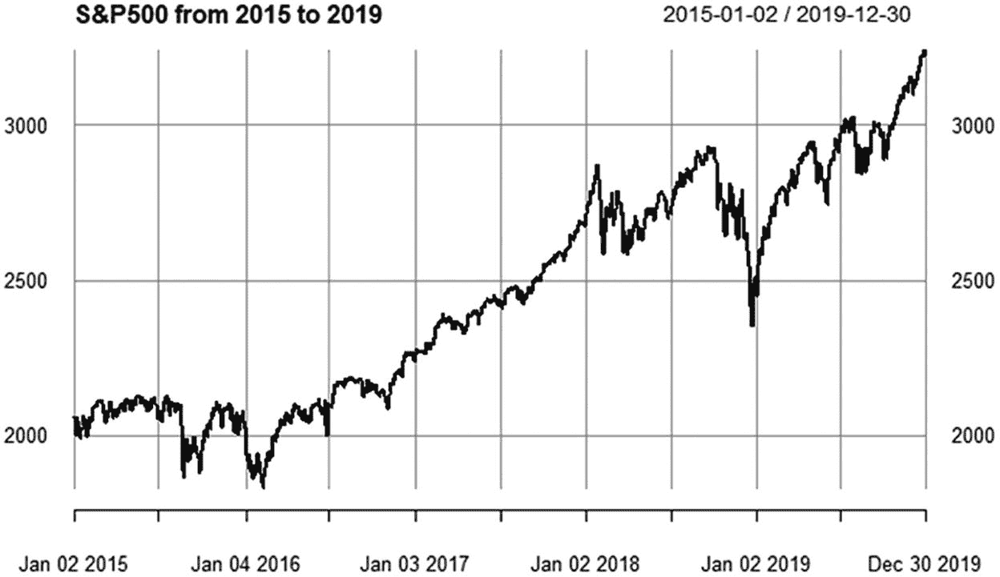

**图 15-1**

标普 500 指数每日收盘价的时间序列图

## 15.5 随机过程表示

理解时间序列是一个随机过程非常重要。某个时间点的观测值是该时间点随机变量的一个具体实现（它可能取其他值）。时间序列通常表示如下：

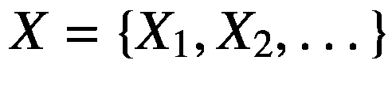

其中下标为自然数。

另外，我们还有如下表示：

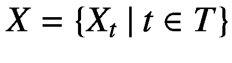

其中 `T` 是指标集。

每个 `X[t]` 都是一个随机变量。因此，时间序列是一个由相互关联的、带索引的随机变量组成的序列。

## 15.6 线性时间序列模型

存在三大类模型用于表示线性时间序列（即，值仅线性依赖于过去的值）：自回归（`AR`）模型、移动平均（`MA`）模型和差分整合（`I`）模型。这些思想的组合产生了自回归移动平均（`ARMA`）模型和差分整合自回归移动平均（`ARIMA`）模型。这些类别的扩展用于处理向量值数据，可在多变量时间序列模型的范畴下获得，有时前述缩写词前会加上代表“向量”的字母 `V`，例如 `VAR` 代表向量自回归。这些模型描述一阶效应，即时间序列的均值或水平。为了描述（非线性）时间序列的二阶效应，即波动性，存在诸如自回归条件异方差（`ARCH`）模型和广义自回归条件异方差（`GARCH`）模型等模型。

## 15.7 NM Dev 库中的时间序列接口

在 NM Dev 库中，有大量类用于表示单变量和多变量时间序列的模型和预测。同时，也有一系列实用函数和类用于操作、转换和计算时间序列的属性。

### `TimeSeries` 接口

通用时间序列的接口是 `TimeSeries`。其签名如下：

```java
public interface TimeSeries<T, V, E extends TimeSeries.Entry<T, V>> extends Iterable<E> {
    /**
     * 时间序列由一系列{@code Entry}组成。
     * 
     * {@code TimeSeries.Entry}是不可变的。
     *
     * @param <T> 时间类型
     * @param <V> 值类型
     */
    public static interface Entry<T, V> {
        /**
         * 获取时间戳。
         *
         * @return 时间戳
         */
        public T getTime();
        /**
         * 获取条目值。
         *
         * @return 条目值
         */
        public V getValue();
    }
    /**
     * 获取时间序列的长度。
     *
     * @return 时间序列长度
     */
    public int size();
}
```

该实现将每条数据及其时间戳表示为值-索引对，通常将索引称为时间。这些条目（值-索引对）按其时间戳升序排列。这是一个通用接口，其中泛型类型 `T` 可以是任何支持排序或可比较的类。例如，`T` 可以是使用 `LocalDateTime` 实现的实际时间戳。示例如下：

```java
public class DateTimeGenericTimeSeries
implements TimeSeries<LocalDateTime, Double, TimeSeries.Entry<LocalDateTime, Double>> {...}
```

另一方面，泛型类型 `V` 可以表示任何值类型。当 `V` 是向量时，它可以表示多变量时间序列。对于单变量时间序列，我们最常研究的是由 `double` 表示的实数时间序列。

### `UnivariateTimeSeries` 接口

接口 `UnivariateTimeSeries` 扩展了 `TimeSeries`，并实现了此类时间序列。其索引是某种时间概念，值为 `double`。

```java
public interface UnivariateTimeSeries<T, E extends UnivariateTimeSeries.Entry<T>> extends dev.nm.stat.timeseries.datastructure.TimeSeries<T, Double, E> {...}
```

在大多数应用中，指标集由自然数组成。

### `IntTimeTimeSeries` 接口

接口 `IntTimeTimeSeries` 扩展了 `UnivariateTimeSeries`，使用整数作为索引，值类型为 `double`。

```java
public interface IntTimeTimeSeries extends dev.nm.stat.timeseries.datastructure.univariate.UnivariateTimeSeries<Integer, IntTimeTimeSeries.Entry> {...}
```

### `SimpleTimeSeries` 类

为简化编码和使用，NM Dev 使用实现了 `IntTimeTimeSeries` 的 `SimpleTimeSeries` 类来表示以自然数为索引、取实数值的时间序列。该类还支持许多常见操作来操纵此类时间序列。其签名如下：

```markdown
## 15.1 单变量时间序列

```java
public class SimpleTimeSeries implements IntTimeTimeSeries {
    /**
     * 构造一个 {@code SimpleTimeSeries} 实例。
     *
     * @param values 值数组
     */
    public SimpleTimeSeries(double[] values);

    @Override
    public int size();

    @Override
    public Iterator iterator();

    @Override
    public double[] toArray();

    @Override
    public double get(int t);

    /**
     * 通过删除前 {@code nItems} 个条目来构造一个 {@code SimpleTimeSeries} 实例。
     *
     * @param nItems 要删除的前导条目数
     * @return 一个 {@code SimpleTimeSeries}
     */
    public SimpleTimeSeries drop(int nItems);

    /**
     * 通过进行 {@code d} 次一阶差分来构造一个 {@code SimpleTimeSeries} 实例。
     *
     * @param d 差分次数
     * @return {@code diff(x, lag = 1, differences = d)}，如 DoubleUtils 中所示
     */
    public SimpleTimeSeries diff(int d);

    /**
     * 通过对时间序列进行滞后操作来构造一个 {@code SimpleTimeSeries} 实例。此操作仅对等距数据点有意义。
     *
     * @param nLags  滞后次数
     * @param length 滞后时间序列的长度
     * @return 一个滞后时间序列
     */
    public SimpleTimeSeries lag(int nLags, int length);

    /**
     * 通过对时间序列进行滞后操作来构造一个 {@code SimpleTimeSeries} 实例。此操作仅对等距数据点有意义。
     *
     * @param nLags 滞后次数
     * @return 一个滞后时间序列
     */
    public SimpleTimeSeries lag(int nLags);

    @Override
    public String toString();
}
```

图 15-2 展示了根据时间或索引类型以及值类型来表示不同单变量时间序列的类层级结构。

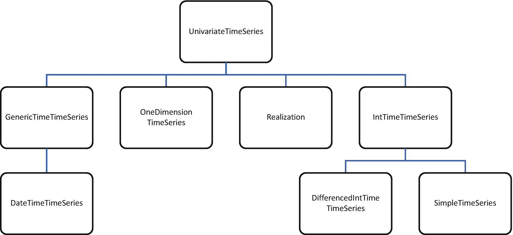

下面的示例构造了一个单变量时间序列，并演示了对其进行的几个操作：

```java
// 构造一个时间序列
SimpleTimeSeries ts1 = new SimpleTimeSeries(new double[]{1, 2, 3, 4, 5, 6, 7, 8, 9, 10});
System.out.println("ts1:" + ts1);

// 通过对另一个时间序列进行一阶差分来构造一个时间序列
// 每一项都是原时间序列中连续两项的差
SimpleTimeSeries ts2 = ts1.diff(1);
System.out.println("ts2:" + ts2);

// 通过删除另一个时间序列的前两项来构造一个时间序列
SimpleTimeSeries ts3 = ts1.drop(2);
System.out.println("ts3:" + ts3);

// 通过对另一个时间序列进行滞后操作来构造一个时间序列
// 此操作仅对等距数据点有意义。
SimpleTimeSeries ts4 = ts1.lag(2);
System.out.println("ts4:" + ts4);
```

输出如下：

```
ts1:length = 10
[1,] 1.000000, [2,] 2.000000, [3,] 3.000000, [4,] 4.000000, [5,] 5.000000, [6,] 6.000000, [7,] 7.000000, [8,] 8.000000, [9,] 9.000000, [10,] 10.000000,
ts2:length = 9
[1,] 1.000000, [2,] 1.000000, [3,] 1.000000, [4,] 1.000000, [5,] 1.000000, [6,] 1.000000, [7,] 1.000000, [8,] 1.000000, [9,] 1.000000,
ts3:length = 8
[1,] 3.000000, [2,] 4.000000, [3,] 5.000000, [4,] 6.000000, [5,] 7.000000, [6,] 8.000000, [7,] 9.000000, [8,] 10.000000,
ts4:length = 8
[1,] 1.000000, [2,] 2.000000, [3,] 3.000000, [4,] 4.000000, [5,] 5.000000, [6,] 6.000000, [7,] 7.000000, [8,] 8.000000,
```

前瞻或删除操作，即 `drop` 函数，会将时间序列左移。注意，时间序列的排列顺序是从最旧的观测值（左侧）到最新的观测值（右侧）。删除第一个或前导观测值即删除最旧的观测值。例如，对于以下情况：


最早的观测值为 1，最新的观测值为 10。我们可以预测下一个项很可能是 11。因此，向前移动或丢弃 2 个观测值会得到以下结果：

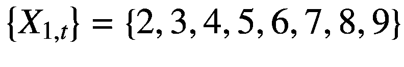

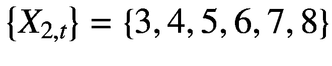

与此相反，滞后操作，即函数 `lag`，会将序列向右移动，使得最新的观测值来自过去。

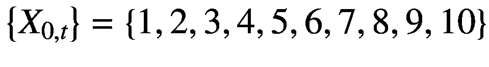

滞后 1 意味着最新的观测值来自一个时间单位（例如，年、月或日）之前。

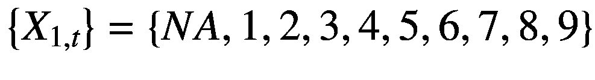

滞后 2 意味着最新的观测值来自两个时间单位之前。

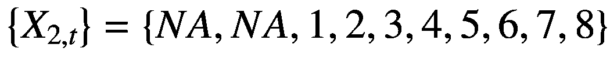

NM Dev 不会在数组或时间序列中输出 `NaN`。如有需要，用户可能需要自行进行填充。

单变量时间序列是一个随机过程（“随机”的学术说法），它由一系列按时间索引的随机变量 `X[t]` = {`X[1]`, `X[2]`, ...} 组成，其中 `X[1]` 表示时间 `t` = 1 时的随机变量，`X[2]` 表示时间 `t` = 2 时的随机变量，以此类推。这样一个随机过程的观测值，`X[1]` = `x[1]`，`X[2]` = `x[2]`，等等，被称为该随机过程的一个实现。这个序列 {`X[t]`} = {`x[1]`, `x[2]`, ...} 也被称为时间序列。根据上下文，我们可以清楚地知道我们指的是随机过程还是该过程的一个特定实现。

以下 NM Dev 代码读取 SPX 数据，使用该指数从 2015 年 1 月 2 日到 2019 年 12 月 30 日期间的调整后每日收盘价，创建一个单变量时间序列。调整后的收盘价与每天发布的指数收盘价并不完全相同。由于股票在过去可能会发生拆分和分红，我们根据证券价格研究中心（CRSP）的标准，使用适当的拆分和股息乘数来调整数据。我们通常使用调整后的价格而不是原始价格来分析股权资产价格。
```

```
// 从 CSV 文件读取 S&P 500 数据
double[][] spx_arr
= DoubleUtils.readCSV2d(
this.getClass().getClassLoader().getResourceAsStream("sp500_daily.csv"),
true,
true
);
// 将 CSV 文件转换为矩阵以便操作
Matrix spx_M = new DenseMatrix(spx_arr);
// 提取调整后收盘价的列
Vector spx_v = spx_M.getColumn(5); // 调整后收盘价
// 从数据构建单变量时间序列
SimpleTimeSeries spx = new SimpleTimeSeries(spx_v.toArray());
System.out.println(spx);
```

（删节后的）输出如下：

```
length = 1257
[1,] 2058.199951, [2,] 2020.579956, [3,] 2002.609985, [4,] 2025.900024, [5,] 2062.139893, [6,] 2044.810059, [7,] 2028.260010, [8,] 2023.030029, [9,] 2011.270020, [10,] 1992.670044, [11,] 2019.420044, [12,] 2022.550049, [13,] 2032.119995, [14,] 2063.149902, [15,] 2051.820068, [16,] 2057.090088, [17,] 2029.550049, [18,] 2002.160034, [19,] 2021.250000, [20,] 1994.989990,
[21,] 2020.849976, [22,] 2050.030029, [23,] 2041.510010, [24,] 2062.520020, [25,] 2055.469971, [26,] 2046.739990, [27,] 2068.590088, [28,] 2068.530029, [29,] 2088.479980, [30,] 2096.989990, [31,] 2100.340088, [32,] 2099.679932, [33,] 2097.449951, [34,] 2110.300049, [35,] 2109.659912, [36,] 2115.479980, [37,] 2113.860107, [38,] 2110.739990, [39,] 2104.500000, [40,] 2117.389893,
[41,] 2107.780029, [42,] 2098.530029, [43,] 2101.040039, [44,] 2071.260010, [45,] 2079.429932, [46,] 2044.160034, [47,] 2040.239990, [48,] 2065.949951, [49,] 2053.399902, [50,] 2081.189941, [51,] 2074.280029, [52,] 2099.500000, [53,] 2089.270020, [54,] 2108.100098, [55,] 2104.419922, [56,] 2091.500000, [57,] 2061.050049, [58,] 2056.149902, [59,] 2061.020020, [60,] 2086.239990,
```

同样，任何数据分析的第一步都是可视化，即在本例中绘制数据图表（在数据收集、数据清洗等步骤之后）。我们在图 15-3 中再次绘制了 SPX 数据。

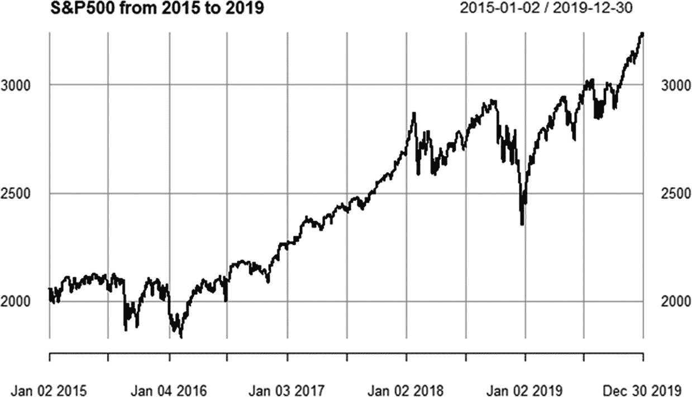

`图 15-3` S&P 500 指数每日收盘价的时间序列

SPX（或某只股票）的（每日）价格在不同时间具有不同的统计特性。例如，在 2015 年，价格的水平/均值大约在 2,000 左右（但每天仍有所不同）；在 2019 年，价格范围从 2,500 到 3,000。我们不能直接处理价格数据，因为统计分析通常作用于平稳数据，这意味着数据具有相同的概率分布、相同的均值、相同的方差等。

解决该问题的一种方法是将价格`P[t]`转换为简单收益率`R[t]`。这种归一化以百分比这一可比指标衡量所有股票，从而允许评估两只或多只股票之间的关系（例如协方差矩阵），即使它们的价格可能具有不同的量级。（截至今日，`SPX`为`4370.04`，`GOOG`为`2619.38`，`AAPL`为`145.62`，`SRNE`为`8.25`。）

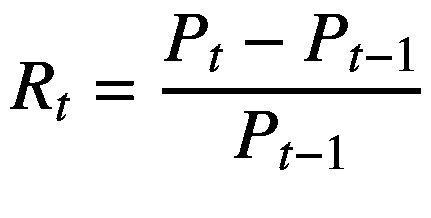

接前面的示例，以下代码根据价格计算简单收益率：

```java
double[] diff = spx.diff(1).toArray();
double[] p0 = spx.lag(1).toArray();
double[] simple_returns = new double[diff.length];
for (int i = 0; i < diff.length; ++i) {
    simple_returns[i] = diff[i] / p0[i];
}
System.out.println(Arrays.toString(simple_returns));
```

（经过删减的）输出如下：

```
[-0.01827810508970322, -0.008893471870112912, 0.011629842642575248, 0.01788828104579755, -0.008403811040573337, -0.008093685243358803, -0.002578555497921567, -0.005813066949783809, -0.00924787612555373, 0.013424199395451945, 0.0015499524278268393, 0.0047316238254433785, 0.015269721805970466, -0.0054915224477955155, 0.002568461085935695, -0.013387862379316457, -0.013495609538427277, 0.009534685377702431, -0.01299196536796535, 0.012962464037225537, 0.014439494938539686, -0.004156045950290833, 0.010291406800400634, -0.003418172396697485, -0.0042471946188310196, 0.010675561188404731, -2.903378506370865E-5, 0.009644506350069552, 0.004074738604868008, 0.001597574626476824, -3.14309098689124E-4,
```

在量化金融中，出于多种原因，我们通常使用对数收益率`r[t]`而非简单收益率。

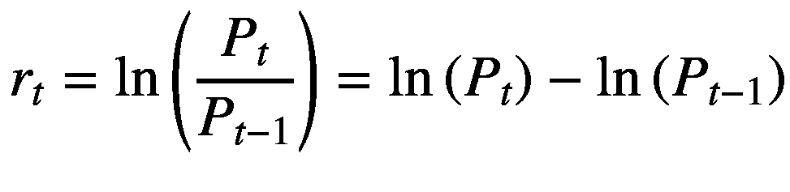

首先，我们通常假设价格服从对数正态分布而非正态分布。对数正态分布始终为正，而正态分布可能给出负价格。那么，对数收益率便服从正态分布，这符合经典统计学中多数情况下的正态性假设。价格、简单收益率和对数收益率之间的关系如下：

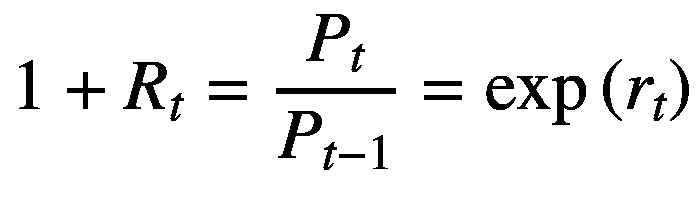

其次，当收益率非常小时（对于短时间内的价格变动很常见，但不会像高频交易中那样短），简单收益率和对数收益率非常接近。

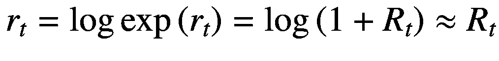

第三，简单收益率不具有时间可加性，但对数收益率具有该性质。具体来说，一系列简单收益率的复合收益率如下：

## 15 对数收益率的优势

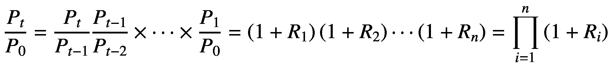
该复合收益率是（独立）正态变量的乘积，且不服从正态分布。相比之下，复合收益率的对数是一系列对数收益率之和。


复合收益率的对数是正态分布的，因为（独立）正态变量之和服从正态分布。即使对数收益率不是正态的，当`t`足够大时，根据中心极限定理，它们的和（以及均值）也近似服从正态分布。

第四，许多金融数学建立在连续时间随机过程之上，这些过程严重依赖积分和微分。对数收益率的指数，即价格，在微积分中更容易处理。

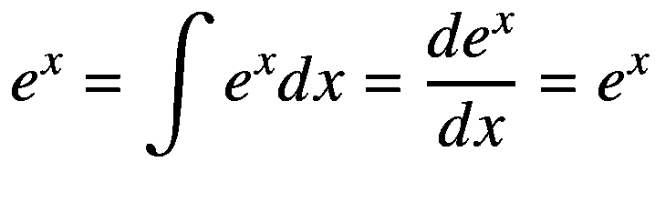

第五，对小数值进行加法在数值上更稳定，但乘法（尤其是小数值相乘）则不然，因为它容易出现算术下溢。这对于长时间计算尤其是一个严重问题。为了解决这个问题，要么需要修改算法以使其在数值上更稳健，要么可以通过对数将其转换为数值安全的求和形式。

接前面的示例，以下代码根据价格计算对数收益率：

```java
// compute log returns from prices
double[] p1 = spx.drop(1).toArray();
double[] p = spx.toArray();
double[] log_return = new double[p1.length];
for (int i = 0; i < p0.length; i++) {
    log_return[i] = log(p1[i]) - log(p[i]);
}
System.out.println(Arrays.toString(log_return));
```

（经过删减的）输出如下：

```
-0.01844721347614442, -0.008933254839187832, 0.011562735816044167, 0.017730168536121305, -0.00843932215298615, -0.00812661692658967, -0.002581885698118569, -0.0058300285881660585, -0.009290903210184887, 0.013334893185903418, 0.0015487524912991546, 0.004720464879542696, 0.015154312961683125, -0.005506656287836975, 0.002565168226942305, -0.01347828778434046, -0.013587502985455302, 0.009489517148010052, -0.01307709912379984, 0.012879170322592337, 0.014336238227742548, -0.004164706312833388, 0.010238810823374855, -0.0034240276947166137, -0.004256239569425446, 0.010618979721447985, -2.9034206551870057E-5, 0.009598294984989764, 0.004066459340458017, 0.00159629986164056, -3.1435850414673894E-4,
```

图[15-4 绘制了该输出，即`SPX`的对数收益率时间序列。

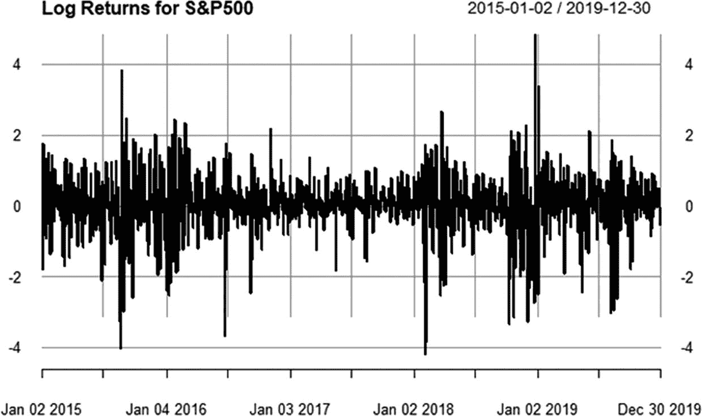

**图 15-4**：标普 500 指数对数收益率的时间序列

### 15.1.1 平稳性

平稳时间序列是指其统计性质不依赖于观测该序列的时间点。因此，带有趋势或季节性的时间序列是非平稳的。趋势和季节性会影响时间序列在不同时间点的值，例如其水平/均值。另一方面，白噪声序列是平稳的。在任意时刻，每个数据点都看起来像是从同一个（正态）分布中抽取的。比较图 15-3 和图 15-4，我们可以很容易地发现，标普 500 指数价格是非平稳的，因为它随时间增长；而对数收益（或简单收益）是平稳的，因为它们像白噪声一样围绕 0 振荡。预测未来的收益会落在哪里（大概在 0 附近）要比猜测标普 500 指数未来的点位（华尔街最聪明的人尝试过，但许多人失败了！）容易得多。我们可以对平稳时间序列进行预测，因为它们的统计性质不随时间变化，但对于非平稳序列则不行。此外，诸如均值、方差以及与其他变量的相关性等样本统计量，只有在数据平稳时才有意义。一阶差分，即对连续观测值求差，或对连续观测值的对数求差，是将非平稳时间序列转换为平稳序列的常用技术。如果一次不够，我们可以做两次，即二阶差分。在实践中，几乎不需要使用超过二阶的差分。

从数学上讲，如果对于所有`t = 1, ..., T`，所有随机变量`X[t]`都具有相同的概率密度函数，则时间序列 {`X[t]`} 是一阶强平稳的。如果对于所有`t = 1, ..., T`，所有随机变量`X[t]`都具有相同的有限均值，则时间序列 {`X[t]`} 是一阶弱平稳的。如果对于所有`t = 1, ..., T`，所有随机变量`X[t]`都具有相同的有限均值和有限方差，并且协方差不依赖于`t`，仅依赖于变量之间的滞后阶数，则它是二阶弱平稳的。一个（二阶）弱平稳过程 {`X[t]`} 满足以下条件：
- `E(X[t]) = μ < ∞`
- `E(|X[t]|²) = σ² < ∞`
- `cov(X[t], X[s]) = f(|t − s|)` 且与`t`和`s`无关

### 15.1.2 自协方差

第三个条件定义了一个称为自协方差函数的函数。从数学上讲，给定一个时间序列 {`X[t]`}，自协方差函数 (ACVF) `cov(X[t], X[s])` 给出了该过程在时间点对 (`t`, `s`) 上与自身的协方差。对于平稳过程，该函数仅取决于`t`和`s`之间的距离或滞后`k = ∣t − s∣`，而不取决于`t`和`s`本身。即，对于所有`k = 0, 1, 2, ...`：

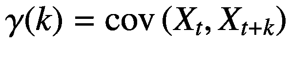

注意，由于自协方差函数的对称性质（因为只关心距离，而不关心指标），我们有：

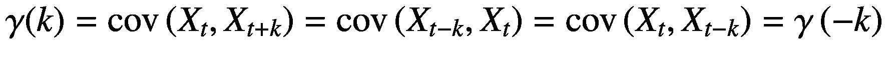

具体来说，我们得到：

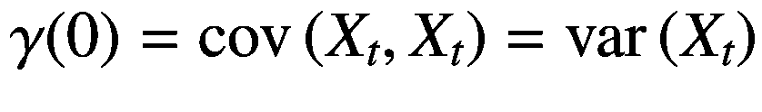

阶数为`k`（其中`k = 0, 1, 2, ...`）的样本自协方差系数 (ACVF) 定义如下：

## 时间序列分析

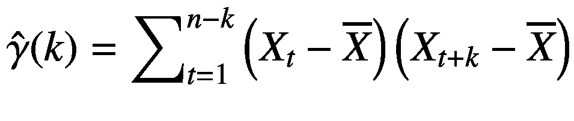

其中， 是时间序列的样本均值。

在 NM Dev 中，`SampleAutoCovariance` 类用于计算每个滞后阶数的样本 ACVF。例如，以下代码计算了 1981 年 1 月至 2019 年 12 月期间标普 500 指数月度调整收盘价的前 25 个滞后阶数的 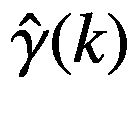：

```
// 从 csv 文件读取月度标普 500 数据
double[][] spx_arr
= DoubleUtils.readCSV2d(
this.getClass().getClassLoader().getResourceAsStream("sp500_monthly.csv"),
true,
true
);
// 将 csv 文件转换为矩阵以便操作
Matrix spx_M = new DenseMatrix(spx_arr);
// 提取调整收盘价列
Vector spx_v = spx_M.getColumn(5); // 调整收盘价
// 从数据构建单变量时间序列
SimpleTimeSeries spx = new SimpleTimeSeries(spx_v.toArray());
//        System.out.println(spx);
// 计算滞后阶数 0, 1, 2, ..., 24 的 ACVF
SampleAutoCovariance acvf = new SampleAutoCovariance(spx);
for (int i = 0; i < 25; i++) {
System.out.printf("acvf(%d) = %f%n", i, acvf.evaluate(i));
}
```

输出结果如下：

```
acvf(0) = 551182.987070
acvf(1) = 543953.818490
acvf(2) = 537216.947501
acvf(3) = 530958.035823
acvf(4) = 524883.334938
acvf(5) = 519097.358346
acvf(6) = 512715.454348
acvf(7) = 506618.687345
acvf(8) = 501222.083894
acvf(9) = 494564.151860
acvf(10) = 488414.476447
acvf(11) = 482362.807657
acvf(12) = 476667.617979
acvf(13) = 471903.185864
acvf(14) = 465878.602696
acvf(15) = 460072.984734
acvf(16) = 453220.603768
acvf(17) = 446307.958179
acvf(18) = 439721.402860
acvf(19) = 433499.577238
acvf(20) = 427157.843522
acvf(21) = 421179.456775
acvf(22) = 415192.648687
acvf(23) = 409011.565601
acvf(24) = 402280.844734
```

### 15.1.3 自相关

自相关函数 (ACF) 是对 ACVF 进行归一化处理，其阶数 `k` 的定义如下：

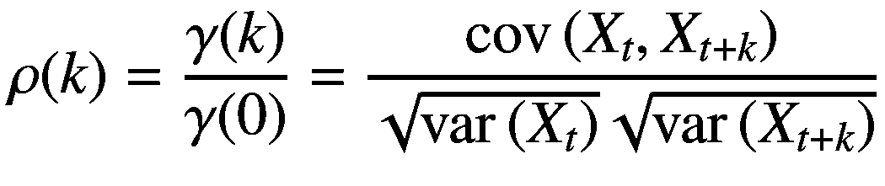

注意以下内容：


ACF 具有对称性质 `ρ(k) = ρ(−k)`。

对于 `k` = 0, 1, 2, ...，阶数为 `k` 的样本自相关系数 (ACF) 定义如下：

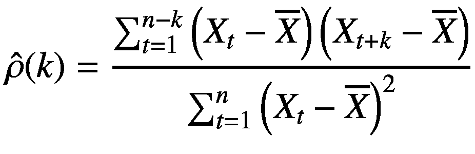

其中 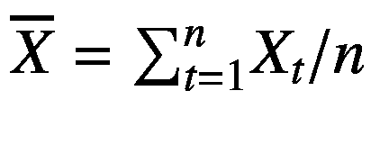 是时间序列的样本均值。

当时间序列存在趋势时，较小滞后的 ACF 往往较大且为正；连续项之间的相关性更强。当时间序列存在季节性时，ACF 在季节性滞后或季节性频率的整数倍处会更大；处于同一季节的项相关性更强。当时间序列同时具备这两种性质时，ACF 将呈现出这些特征的组合。

在 NM Dev 中，`SampleAutoCorrelation` 类用于计算每个滞后的样本 ACF。延续之前的示例，以下代码计算了 1981 年 1 月至 2019 年 12 月标普 500 月度调整收盘价前 25 个滞后的 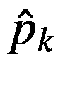：

```
// ACF for lags 0, 1, 2, ..., 24
SampleAutoCorrelation acf = new SampleAutoCorrelation(spx);
for (int i = 0; i < 25; i++) {
    System.out.printf("acf(%d) = %f%n", i, acf.evaluate(i));
}
```

输出如下：

```
acvf(0) = 1.000000
acvf(1) = 0.986884
acvf(2) = 0.974662
acvf(3) = 0.963306
acvf(4) = 0.952285
acvf(5) = 0.941788
acvf(6) = 0.930209
acvf(7) = 0.919148
acvf(8) = 0.909357
acvf(9) = 0.897278
acvf(10) = 0.886120
acvf(11) = 0.875141
acvf(12) = 0.864808
acvf(13) = 0.856164
acvf(14) = 0.845234
acvf(15) = 0.834701
acvf(16) = 0.822269
acvf(17) = 0.809727
acvf(18) = 0.797778
acvf(19) = 0.786489
acvf(20) = 0.774984
acvf(21) = 0.764137
acvf(22) = 0.753276
acvf(23) = 0.742061
acvf(24) = 0.729850
```

图 15-5 展示了结果。我们可以看到，标普 500 月度数据的样本 ACF 在第 22 个滞后之后从正值下降为负值。

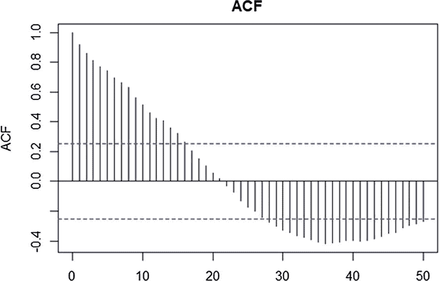

**图 15-5** 标普 500 月度收益率的 ACF

### 15.1.4 偏自相关

偏自相关系数 (PACF) `ϕ[k]` 用于衡量变量 `X[t − k]` 和 `X[t]` 之间在去除所有中间变量影响后的相关性。它是 `X[t − k]` 和 `X[t]` 之间的自相关，该部分未被从 `t − k + 1` 到 `t − 1`（包含两端，共 `k − 1` 项）的滞后所解释。数学上，定义如下：

对于零均值的平稳时间序列，我们运行两次回归来消除中间变量的线性依赖性。（由于`X[t]`的均值为零，因此没有截距项。）

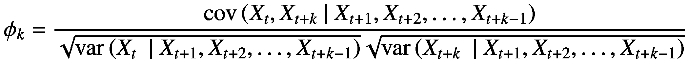

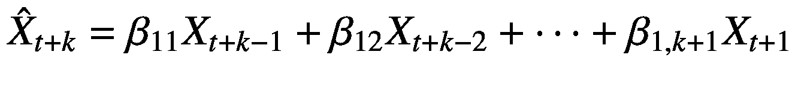

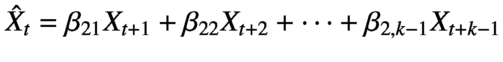

然后，我们得到：

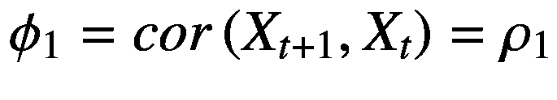

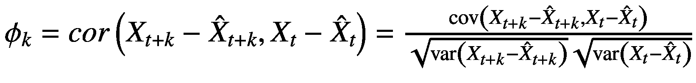，`k` ≥ 2

样本 PACF 可以通过样本 ACF `$$ \hat{\rho}(k) $$` 递归计算：

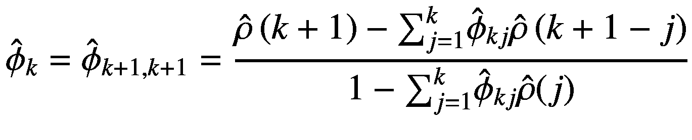

并且

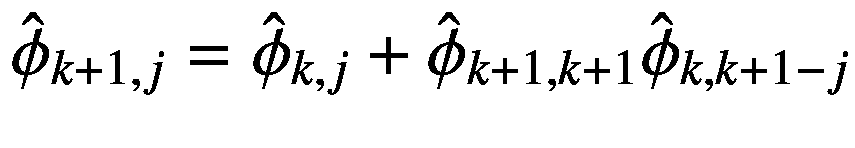

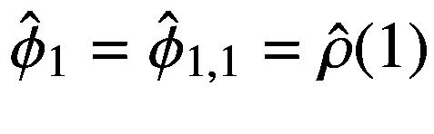

其中 `j` = 1, ..., `k`。

在 NM Dev 中，`SamplePartialAutoCorrelation` 类用于计算每个滞后的样本 PACF。延续之前的示例，以下代码计算了 1981 年 1 月至 2019 年 12 月标普 500 月度调整收盘价前 24 个滞后（从 1 开始，而非 0）的 `$$ {\hat{\phi}}_k $$`：

```java
// PACF for lags 1, 2, ..., 24
SamplePartialAutoCorrelation pacf = new SamplePartialAutoCorrelation(spx);
for (int i = 1; i < 25; i++) {
    System.out.printf("pacf(%d) = %f%n", i, pacf.evaluate(i));
}
```

输出如下：

```
pacf(1) = 0.986884
pacf(2) = 0.027673
pacf(3) = 0.028265
pacf(4) = 0.009367
pacf(5) = 0.016586
pacf(6) = -0.044565
pacf(7) = 0.012763
pacf(8) = 0.042335
pacf(9) = -0.089551
pacf(10) = 0.025976
pacf(11) = 0.001272
pacf(12) = 0.019560
pacf(13) = 0.056418
pacf(14) = -0.078582
pacf(15) = 0.006884
pacf(16) = -0.089247
pacf(17) = -0.005869
pacf(18) = 0.000041
pacf(19) = 0.028124
pacf(20) = -0.015747
pacf(21) = 0.010677
pacf(22) = 0.012282
pacf(23) = -0.032621
pacf(24) = -0.031604
```

图 15-6 展示了输出结果。

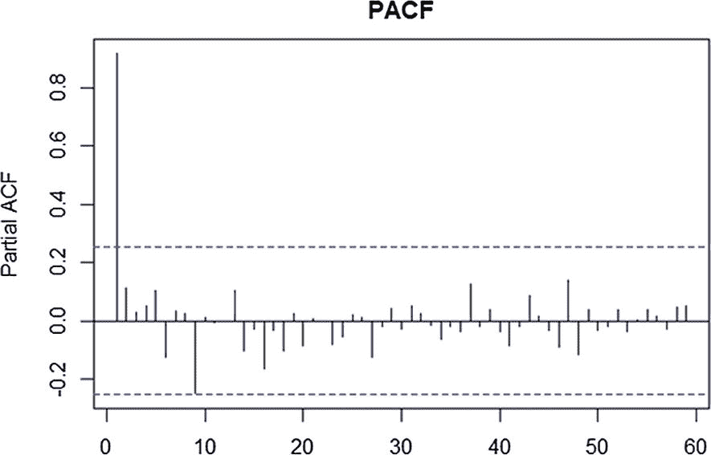

**图 15-6** 标普 500 月度收益率的 PACF

### 15.1.5 白噪声过程与随机游走

有一种特殊的时间序列称为白噪声。设 `{ε[t]}` 为一个白噪声过程，则 `ε[t]` 满足以下条件：

- `E(ε[t]) = μ < ∞`，∀`t`
- `var(ε[t]) = σ² < ∞`，∀`t`
- `cov(ε[t], ε[s]) = 0`，∀`t ≠ s`

白噪声过程的 ACF 和 PACF 在所有滞后阶数上均为零，因为根据其定义，对于所有 `k = 1, 2, ...`，有 `ρ(k) = γ(k) / γ(0) = 0`。

随机游走是一种随机过程，它是随机步长的总和。对 `ε[t]` 求和，即 `W_t = Σ_{i=1}^t ε_i`，便是一个随机游走。每个后续值 `W[t + 1]` 都是从前一个值出发的一个随机步长。当 `E(ε[t]) = 0` 时，`W[t]` 被称为**无漂移随机游走模型**。华尔街的随机游走理论暗示市场是一种随机游走。这与有效市场假说一致，即历史信息无助于预测未来。我个人（以及纯属个人的）观点是，技术分析与占星术一样虚幻。它背后没有科学、证据或数学支撑。相比之下，量化交易则基于坚实的数学与证明。量化交易之于技术分析，正如天文学之于占星术。幸运的是，占星术有时也能蒙对，就像坏掉的钟一天也能准两次。

例如，如果我们模拟一个随机游走过程（比如，通过对 100 个标准正态变量求和），我们会发现其中许多会呈现出看似显著的走势，如图 15-7 所示。事实上，在多次重复迭代中，同一个模型通常会产生上升和下降趋势，以及一些看似需要某种复杂模型来解释的有趣曲线。这只是一种统计幻觉。我们的大脑会努力寻找模式，即使这些模式并不存在。图 15-7 看起来像是一只值得买入的好股票，因为它呈现出强劲的上升趋势。然而，这个时间序列纯粹是一个无漂移随机游走模型，它是通过对 100 个均值为 0、方差为 1 的标准正态变量求和生成的。长期持有这只股票很可能一无所获。试图预测其未来价格，例如使用技术分析，是具有欺骗性的。

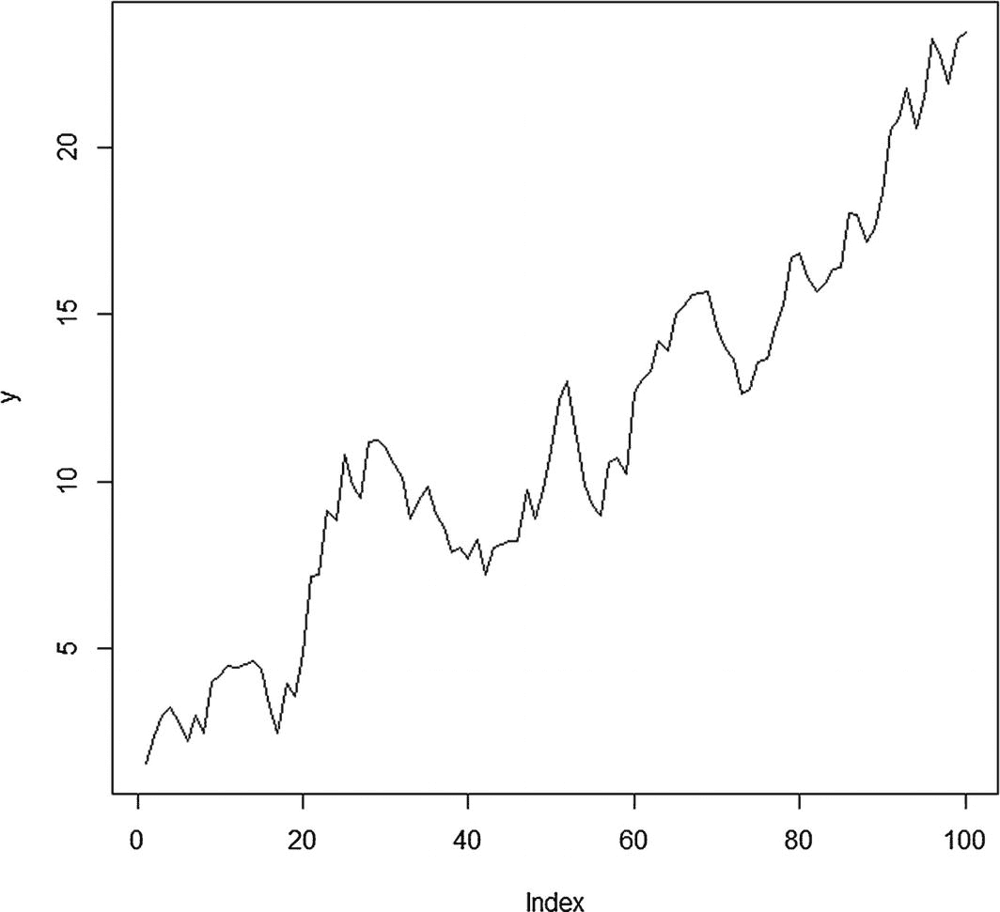

图 15-7：标准正态变量之和构成的随机游走

### 15.1.6 白噪声的 Ljung-Box 检验

检验时间序列是否为随机游走的一种方法（正如我们将在本章中看到的，还有许多其他方法）是检查其一阶差分是否为白噪声。白噪声的理论 ACF 为 0。然而，我们从数据中计算出的样本 ACF 值虽然很小，但不太可能恰好等于 0。问题在于，这些值应该小到何种程度才能被视为数值上的 0，从而我们可以高置信度（但绝非绝对确定）地得出结论，认为该过程是白噪声。

# Ljung-Box 检验与时间序列模型分解

## Ljung-Box 检验

Ljung-Box 检验是一种针对时间序列或残差序列零自相关性的假设检验。它检验时间序列中任意数量滞后阶数的自相关性是否为零。我们针对想要检验的多个滞后阶数计算样本 ACF `ρ̂` 值。原假设是前 `m` 阶自相关系数联合为零。

`H₀: ρ̂(1) = ρ̂(2) = ... = ρ̂(m) = 0`

拒绝原假设意味着存在某些高达 `m` 阶的自相关系数不为零。

Ljung-Box 检验统计量如下：

`Q(m) = n(n + 2) Σ_{k=1}^m (ρ̂(k)² / (n - k))`

其中 `n` 为样本量。

在原假设下，该统计量服从自由度为 `m` 的卡方分布 `χ²_m`。如果此检验统计量大于临界值（p 值小于阈值），则我们拒绝原假设，并得出结论：该时间序列不是白噪声过程。否则，我们接受原假设（或者，严格来说，未能拒绝原假设），并得出结论：该时间序列是白噪声过程。

我们可以使用 Ljung-Box 检验来检查标普 500 指数的日收益率是否为白噪声。首先，我们绘制 ACF 图以检查有多少个滞后阶数是不显著的。图 15-8 显示，前 14 个滞后阶数可能不显著（`ρ̂(1) = 1` 是恒成立的）。因此，我们如下检验这个原假设：

`H₀: ρ̂(1) = ρ̂(2) = ... = ρ̂(14) = 0`

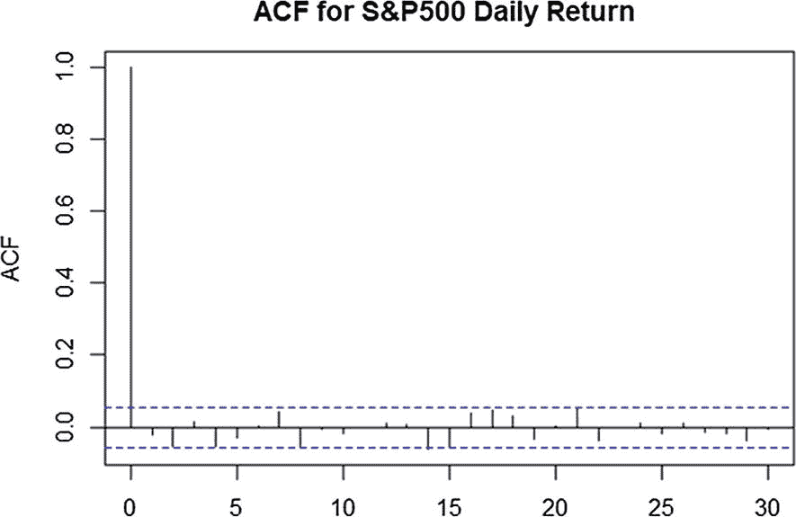

图 15-8：标普 500 指数日收益率的 ACF 图

拒绝原假设意味着存在某些高达第 14 阶的自相关系数不为零。这里自由度 `m = 14`。NM Dev 类 `LjungBox` 实现了 Ljung-Box 检验。以下代码解决了这个示例：

```
// 运行 Ljung-Box 检验
LjungBox lb_test = new LjungBox(log_returns, 14, 0);
System.out.printf("原假设为：%s%n", lb_test.getNullHypothesis());
System.out.printf("备择假设为：%s%n", lb_test.getAlternativeHypothesis());
System.out.printf("检验统计量 = %f%n", lb_test.statistics());
System.out.printf("p 值 = %f%n", lb_test.pValue());
```

输出如下：

```
原假设为：截至滞后 14 阶，没有任何自相关系数显著不为零；数据是随机的
备择假设为：在指定的显著性水平下，至少有一个自相关系数值在统计上显著不为零；数据不是随机的
检验统计量 = 20.203475
p 值 = 0.123856
```

检验统计量为 20.20。p 值为 0.124，大于 5% 的显著性水平。因此，我们未能拒绝原假设，即截至滞后 14 阶，没有任何自相关系数显著不为零。我们得出结论：收益率为白噪声。

## 模型分解

白噪声过程在时间序列分析中非常重要。它是任何时间序列的基本构建块。沃尔德分解定理指出，对于任何协方差平稳的随机过程 `{X[t]}`，都可以将其写成一个确定性时间序列和一个随机时间序列之和。从数学上讲，如果 `{X[t]}` 是一个协方差平稳过程，且 `{ε[t]}` 是一个零均值白噪声过程，那么存在一个唯一的线性表示形式，如下所示：

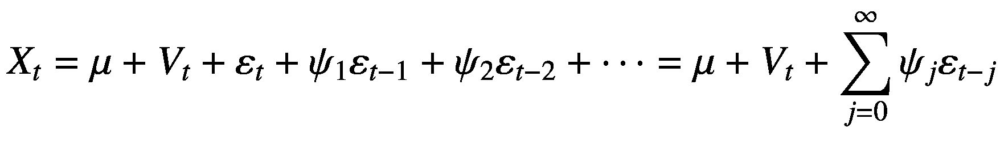

其中 `V[t]` 是确定性分量，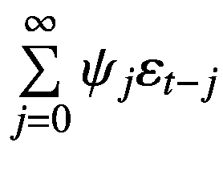 是随机分量，且 `ψ[0]` = 1，。由于 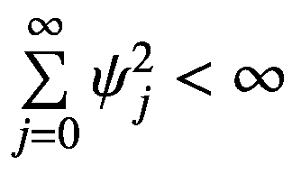，所以存在一个时间 `j`，使得对于 `i` = `j` + 1, `j` + 2, ... 的 `ψ[i]` 会变得越来越小。

如果没有确定性分量，那么 `{X[t]}` 就是一个带漂移项 `μ` 的随机游走。

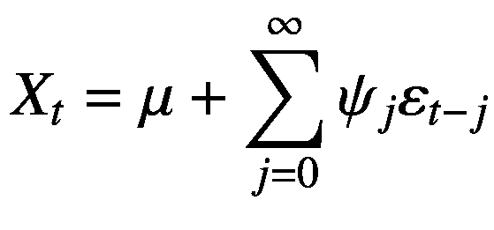

以及

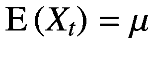

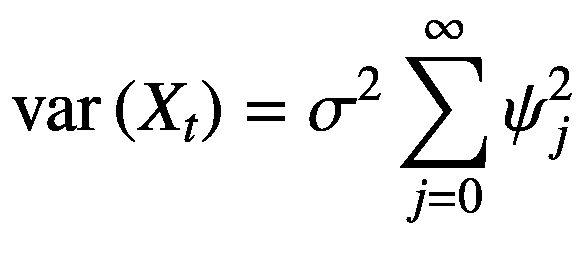

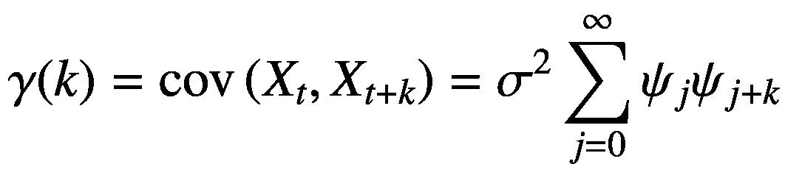

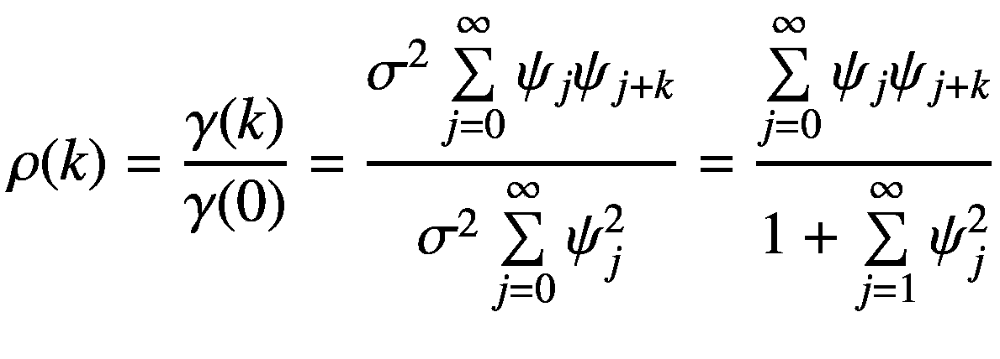

其中 `μ` 是一个常数，`ε[t]` 是白噪声。

确定性分量可以是趋势分量、季节分量，或者两者兼有。通常，一个时间序列可以分解为以下三个分量：

*   趋势分量
*   季节分量
*   不规则随机分量

当数据存在长期增加或减少的趋势时，就存在趋势分量。例如，标普 500 指数随时间增长。当数据呈现出随月份或季度等季节变化的模式时，就存在季节分量。例如，迪士尼乐园的游客数量会随着季节变化（夏季更多，冬季更少）。不规则随机分量，也称为随机分量或白噪声，由随时间变化的新息组成。它是时间序列不确定性的来源。例如，标普 500 指数的收益率就是一个不规则过程。

这种分解被称为经典分解模型。分解有两种形式：加法模型和乘法模型。它们通过组合趋势分量 `T[t]`、季节分量 `S[t]` 和随机分量 `ε[t]` 来构建时间序列模型。

加法模型将这些分量相加：

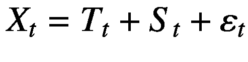

在 NM Dev 中，`AdditiveModel` 类用于构建这样的加法模型。趋势、季节和随机分量以数组形式提供。示例如下：

```
RandomNumberGenerator rng = new StandardNormalRNG();
// 构建一个加法模型
AdditiveModel additive_model = new AdditiveModel(
// 趋势
new double[]{
1, 3, 5, 7, 9, 11, 13, 15, 17, 19
},
// 季节分量
new double[]{
0, 1
},
// 随机数源
rng
);
System.out.println(additive_model);
```

输出如下：

```
length = 10
[1,] 0.657586, [2,] 3.794529, [3,] 5.718166, [4,] 6.634372, [5,] 9.802750, [6,] 10.789668, [7,] 12.700581, [8,] 16.614644, [9,] 15.694052, [10,] 20.973963,
```
请注意，季节分量数组的长度仅为 2，而不是 10。这是因为数组中的元素被重复使用，以表示一个季节模式的周期。

乘法模型将这些分量相乘：

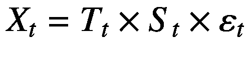

在 NM Dev 中，`MultiplicativeModel` 类用于构建这样的乘法模型。趋势、季节和随机分量以数组形式提供。示例如下：
```java
RandomNumberGenerator rng = new StandardNormalRNG();
// 构建一个乘法模型
MultiplicativeModel multiplicative_model = new MultiplicativeModel(
// 趋势
new double[]{
1, 3, 5, 7, 9, 11, 13, 15, 17, 19
},
// 季节分量
new double[]{
-1, 1
},
// 随机数源
rng
);
System.out.println(multiplicative_model);
```
输出如下：
```
length = 10
[1,] 0.035056, [2,] 4.531332, [3,] -5.732130, [4,] -1.103154, [5,] 0.125291, [6,] 4.601235, [7,] -35.735400, [8,] -8.219343, [9,] -14.441234, [10,] -11.707299,
```
另一方面，NM Dev 中的 `MADecomposition` 类使用对称窗口的移动平均估计方法，将时间序列分解为趋势、季节和随机分量。该类首先使用移动平均（使用等权重的对称窗口）确定趋势分量，并将其从时间序列中移除。然后，通过在每个时间单元上对所有周期进行平均来计算季节因子。接着，对季节因子进行居中处理。最后，通过从原始时间序列中移除趋势和季节因子（根据需要循环使用）来确定误差分量。它按如下方式构建时间序列模型：


且满足以下条件：
- E(`ε[t]`) = 0
- var(`ε[t]`) = `σ²`
- cov(`ε[t]`, `ε[s]`) = 0
- `S[t + d]` = `S[t]`；`d` 是一个季节的长度

以下代码将标普 500 指数的月度收益率分解为三个分量。我们将季节性长度设为 12。
```java
// 将标普 500 指数月度收益率分解为经典加法模型
MADecomposition spx_model
= new MADecomposition(
spx.toArray(), // 标普 500 指数月度收益率
12 // 季节性长度
);
System.out.printf("趋势分量: %s%n", Arrays.toString(spx_model.getTrend()));
System.out.printf("季节分量: %s%n", Arrays.toString(spx_model.getSeasonal()));
System.out.printf("随机分量: %s%n", Arrays.toString(spx_model.getRandom()));
```
（节选的）输出如下：

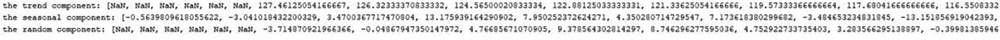

图 15-9 绘制了这三个分量的时间序列。它证实了我们的预期。趋势时间序列呈上升趋势。季节时间序列呈现出周期性模式。随机时间序列是一个白噪声过程。

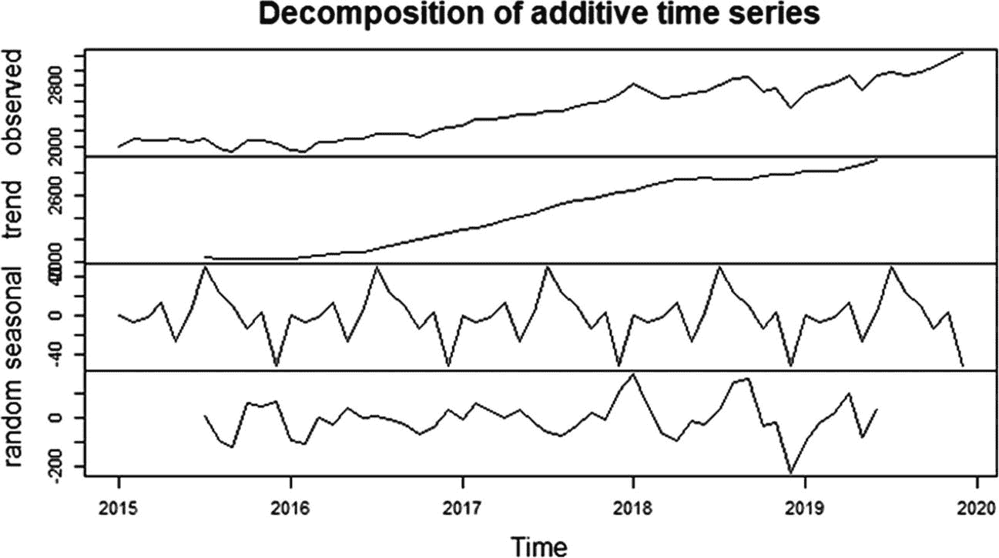

**图 15-9.** 使用加法模型对标普 500 指数月度收益率的分解

## 15.2 时间序列模型

通常，我们可以使用时间函数或平滑方法（如移动平均）来对趋势分量进行建模。我们也可以使用虚拟变量函数来对季节分量进行建模。在去除趋势和季节分量后，剩下的是随机残差。在此，我们总结了时间序列建模的一般步骤：
1. 绘制时间序列图，检查是否存在非平稳行为，例如趋势和季节分量。
2. 移除非平稳分量，例如通过减去趋势和季节性、计算一阶差分等方法，以获得由随机残差构成的平稳时间序列。
3. 选择合适的*时间序列模型*来拟合残差。
4. 检查模型的拟合优度。
5. 反转步骤 2 中的操作，例如重新加入趋势和季节分量、对残差进行积分等，以构建原始时间序列的模型。

有几种重要的时间序列模型可用于对随机残差进行建模。它们是本节的主题。

### 15.2.1 AR 模型

给定一个时间序列 `X[t]`，滞后算子或后移算子 `B` 的作用是将时间序列向右移动。数学上，其定义为：


其中，`k` 是表示滞后阶数的正整数，`c` 是一个常数。

例如，假设我们有：


那么，我们得到：


NM Dev 函数 `lag` 实现了后移算子。

我们可以用后移算子表示应用于 `X[t]` 的一阶差分算子 ∆。


后移算子在时间序列模型中被广泛使用，因为许多时间序列模型都依赖于过去的值。

#### 15.2.1.1 AR(1)

自回归（AR）模型规定，输出变量线性地依赖于其自身的先前值（或滞后值）以及一个随机项。最简单的 AR 模型是 AR(1)，即一阶自回归模型。其输出取决于一个常数（水平）、上一个值和一个白噪声。具体来说，我们有：


其中，`ϕ[0]` 是常数项，`ϕ[1]` 是自回归系数，`ε[t]` 是随机项或误差项。它是一个满足以下条件的白噪声：
- 均值为零，E[`ε[t]`] = 0
- 方差恒定 `σ²`，var[`ε[t]`] = E[`ε[t]ε[t]`] = `σ²`
- 独立分布，E[`ε[t]ε[t − 1]`] = 0

AR(1) 被称为一阶模型，是因为它只将一个过去值作为因变量。

用后移算子表示，我们有：


整理各项并使用多项式记号，我们得到：


```


条件期望和条件方差如下：


如果`X[t]`是一个平稳过程（即`X[t]`具有恒定的均值和方差），那么无条件期望如下：


无条件方差如下（注意`X[t-1]`和`ε[t]`是独立的，因此它们的协方差为 0）：


从方差公式的最后一个表达式可以看出，只有在`|ϕ[1]| < 1`时，`AR(1)`才是平稳的。`AR(1)`为协方差平稳的一个必要（且可证明也是充分）条件是`|ϕ| < 1`。这个条件防止序列“发散”。`ϕ[1]`衡量模型的持久性。`ϕ[1]`越小，方差就越小。
假设`AR(1)`是一个具有恒定均值`μ`的平稳过程，那么去均值后的过程如下：

或者，令，则有：

那么，去均值变量与误差项之间的协方差如下：
![$$ \mathrm{E}\left[{\overset{\sim }{X}}_t{\varepsilon}_t\right]=\mathrm{E}\left[\left({\phi}_1{\overset{\sim }{X}}_{t-1}+{\varepsilon}_t\right){\varepsilon}_t\right]={\phi}_1\mathrm{E}\left[{\overset{\sim }{X}}_{t-1}{\varepsilon}_t\right]+{\sigma}²={\sigma}² $$](images/500382_1_En_15_Chapter/500382_1_En_15_Chapter_TeX_Equbo.png)
方差如下：
![$$ \gamma (0)=\mathrm{E}\left[{\overset{\sim }{X}}_t{\overset{\sim }{X}}_t\right]=\mathrm{E}\left[\left({\phi}_1{\overset{\sim }{X}}_{t-1}+{\varepsilon}_t\right)\left({\phi}_1{\overset{\sim }{X}}_{t-1}+{\varepsilon}_t\right)\right] $$](images/500382_1_En_15_Chapter/500382_1_En_15_Chapter_TeX_Equbp.png)
![$$ =\mathrm{E}\left[\left({\phi}_1²{\overset{\sim }{X}}_{t-1}{\overset{\sim }{X}}_{t-1}+2{\phi}_1{\overset{\sim }{X}}_{t-1}{\varepsilon}_t+{\varepsilon}_t²\right)\right] $$](images/500382_1_En_15_Chapter/500382_1_En_15_Chapter_TeX_Equbq.png)
![$$ ={\phi}_1²\mathrm{E}\left[{\overset{\sim }{X}}_{t-1}{\overset{\sim }{X}}_{t-1}\right]+2{\phi}_1\mathrm{E}\left[{\overset{\sim }{X}}_{t-1}{\varepsilon}_t\right]+\mathrm{E}\left[{\varepsilon}_t²\right] $$](images/500382_1_En_15_Chapter/500382_1_En_15_Chapter_TeX_Equbr.png)
即：


`AR(1)`模型的自协方差函数（ACVF）如下：

![$$ \mathrm{E}\left[{\overset{\sim }{X}}_t{\overset{\sim }{X}}_{t-j}\right]=\mathrm{E}\left[\left({\phi}_1{\overset{\sim }{X}}_{t-1}+{\varepsilon}_t\right){\overset{\sim }{X}}_{t-j}\right] $$](images/500382_1_En_15_Chapter/500382_1_En_15_Chapter_TeX_Equbu.png)

![$$ ={\phi}_1\mathrm{E}\left[{\overset{\sim }{X}}_{t-1}{\overset{\sim }{X}}_{t-j}\right]+\mathrm{E}\left[{\varepsilon}_t{\overset{\sim }{X}}_{t-j}\right] $$](images/500382_1_En_15_Chapter/500382_1_En_15_Chapter_TeX_Equbv.png)

![$$ ={\phi}_1\mathrm{E}\left[{\overset{\sim }{X}}_{t-1}{\overset{\sim }{X}}_{t-j}\right] $$](images/500382_1_En_15_Chapter/500382_1_En_15_Chapter_TeX_Equbw.png)

也就是说，我们得到以下关系：


AR(1) 模型的自相关函数（ACF）如下：


当 `|ϕ[1]| < 1` 时，AR(1) 模型的 ACF 幅度 `|ρ(j)|` 呈指数衰减。

AR(1) 模型是连续时间均值回归过程（即奥恩斯坦-乌伦贝克过程）的离散时间类比。因此，理解以等价形式表达的 AR(1) 模型的特性有时会很有用。在这种形式下，具有均值回归参数 `θ` 的 AR(1) 模型由下式给出：


可以证明以下结果：

![$$ \mathrm{E}\left[{X}_{t+n}\ |\ {X}_t\right]=\mu \left(1-{\theta}^n\right)+{X}_t{\theta}^n $$](images/500382_1_En_15_Chapter/500382_1_En_15_Chapter_TeX_Equca.png)

![$$ \operatorname{var}\left[{X}_{t+n}\ |\ {X}_t\right]={\sigma}²\frac{1-{\theta}^{2n}}{1-{\theta}²} $$](images/500382_1_En_15_Chapter/500382_1_En_15_Chapter_TeX_Equcb.png)

在 NM Dev 中，`ARModel` 类用于构建 AR 模型。该类的签名如下：

```
public class ARModel extends ARMAModel {
/**
* 构建一个单变量 AR 模型。
*
* @param mu    截距（常数）项
* @param AR    AR 系数（不包括初始的 1）
* @param sigma 白噪声方差
*/
public ARModel(double mu, double[] AR, double sigma) {
super(mu, AR, null, sigma);
}
/**
* 构建一个具有单位方差的单变量 AR 模型。
*
* @param mu 截距（常数）项
* @param AR AR 系数（不包括初始的 1）
*/
public ARModel(double mu, double[] AR) {
this(mu, AR, 1);
}
/**
* 构建一个零截距（mu）的单变量 AR 模型。
*
* @param AR    AR 系数（不包括初始的 1）
* @param sigma 白噪声方差
*/
public ARModel(double[] AR, double sigma) {
this(0, AR, sigma);
}
/**
* 构建一个具有单位方差和零截距（mu）的单变量 AR 模型。
*
* @param AR AR 系数（不包括初始的 1）
*/
public ARModel(double[] AR) {
this(AR, 1);
}
/**
* 拷贝构造函数。
*
* @param that 一个单变量 AR 模型
*/
public ARModel(ARModel that) {
super(that);
}
}
```

例如，以下代码构建了该 AR(1) 模型并计算其 ACVF 和 ACF：


```
// 定义一个 AR(1) 模型
ARModel ar1 = new ARModel(
new double[]{0.6} // phi_1 = 0.6
);
final int nLags = 10;
// 计算模型的自协方差函数
AutoCovariance acvf1 = new AutoCovariance(ar1);
for (int i = 0; i < nLags; i++) {
System.out.printf("AR(1) 模型在滞后%d 处的自协方差 = %f%n", i, acvf1.evaluate(i));
}
// 计算模型的自相关函数
AutoCorrelation acf1 = new AutoCorrelation(ar1, nLags);
for (int i = 0; i < nLags; i++) {
System.out.printf("AR(1) 模型在滞后%d 处的自相关 = %f%n", i, acf1.evaluate(i));
}
```

输出结果如下：

```
AR(1) 模型在滞后 0 处的自协方差 = 1.562500
AR(1) 模型在滞后 1 处的自协方差 = 0.937500
AR(1) 模型在滞后 2 处的自协方差 = 0.562500
AR(1) 模型在滞后 3 处的自协方差 = 0.337500
AR(1) 模型在滞后 4 处的自协方差 = 0.202500
AR(1) 模型在滞后 5 处的自协方差 = 0.121500
AR(1) 模型在滞后 6 处的自协方差 = 0.072900
AR(1) 模型在滞后 7 处的自协方差 = 0.043740
AR(1) 模型在滞后 8 处的自协方差 = 0.026244
AR(1) 模型在滞后 9 处的自协方差 = 0.015746
AR(1) 模型在滞后 0 处的自相关 = 1.000000
AR(1) 模型在滞后 1 处的自相关 = 0.600000
AR(1) 模型在滞后 2 处的自相关 = 0.360000
AR(1) 模型在滞后 3 处的自相关 = 0.216000
AR(1) 模型在滞后 4 处的自相关 = 0.129600
AR(1) 模型在滞后 5 处的自相关 = 0.077760
AR(1) 模型在滞后 6 处的自相关 = 0.046656
AR(1) 模型在滞后 7 处的自相关 = 0.027994
AR(1) 模型在滞后 8 处的自相关 = 0.016796
AR(1) 模型在滞后 9 处的自相关 = 0.010078
```

我们看到，ACVF 和 ACF 都呈指数衰减至 0。图 15-10 绘制了 ACF 的值。


**图 15-10** 当 `ϕ[1] = 0.6` 时 AR(1) 过程的 ACF

#### 15.2.1.2 AR(2)

AR(2) 模型如下：


其中 `ϕ[1]` 和 `ϕ[2]` 是自回归系数。`ε[t]` 是误差项，即均值为零、方差恒定（`σ²`）的白噪声。AR(2) 称为二阶模型，是因为其因变量中包含 `X[t − 1]` 和 `X[t − 2]`。

使用后移算子 `B` 表示，我们有：


整理各项并使用多项式符号，我们得到：


将 `X[t − 1]` 和 `X[t − 2]` 视为常数，AR(2) 的条件均值和方差如下：


假设 `{X[t]}` 是平稳的，那么无条件期望如下：


即，


无条件方差的计算稍微复杂一些，因为我们需要考虑 `X[t − 1]` 与 `X[t − 2]` 之间的协方差（该协方差不为零）。我们将使用 `ACVF` 来计算方差，这等价于滞后为 0 时的自协方差 `γ(0)`。

假设 AR(2) 是一个具有恒定均值 `μ` 的平稳过程，那么去均值后的过程如下：


或者等效地，


那么，去均值后的变量与误差之间的协方差如下：


AR(2) 的 `ACVF` 如下：


即，


初始条件由下式给出：

## 15.2.1.2 AR(2)

![$$ \gamma (0)=\mathrm{E}\left[{\overset{\sim }{X}}_t{\overset{\sim }{X}}_t\right]=\mathrm{E}\left[{\overset{\sim }{X}}_t\left({\phi}_1{\overset{\sim }{X}}_{t-1}+{\phi}_2{\overset{\sim }{X}}_{t-2}+{\varepsilon}_t\right)\right] $$](images/500382_1_En_15_Chapter/500382_1_En_15_Chapter_TeX_Equcw.png)

![$$ =\mathrm{E}\left[{\phi}_1{\overset{\sim }{X}}_t{\overset{\sim }{X}}_{t-1}+{\phi}_2{\overset{\sim }{X}}_t{\overset{\sim }{X}}_{t-2}+{\overset{\sim }{X}}_t{\varepsilon}_t\right] $$](images/500382_1_En_15_Chapter/500382_1_En_15_Chapter_TeX_Equcx.png)

![$$ ={\phi}_1\mathrm{E}\left[{\overset{\sim }{X}}_t{\overset{\sim }{X}}_{t-1}\right]+{\phi}_2\mathrm{E}\left[{\overset{\sim }{X}}_t{\overset{\sim }{X}}_{t-2}\right]+\mathrm{E}\left[{\overset{\sim }{X}}_t{\varepsilon}_t\right] $$](images/500382_1_En_15_Chapter/500382_1_En_15_Chapter_TeX_Equcy.png)


线性方程组如下：


我们可以解出 `γ(0)`、`γ(1)` 和 `γ(2)`，然后利用递推关系计算 `j = 1, 2, ....` 时的 `γ(j)`。

ACF 如下：


同样，初始条件由下式给出：


经过更多代数运算，我们得到变量的方差如下：

![$$ \mathrm{E}\left[{\overset{\sim }{X}}_t{\overset{\sim }{X}}_t\right]=\gamma (0)=\frac{1}{1-{\phi}_1\rho (1)-{\phi}_2\rho (2)}{\sigma}² $$](images/500382_1_En_15_Chapter/500382_1_En_15_Chapter_TeX_Equdh.png)

下面的代码构建了此 AR(2) 模型，并计算了其 ACVF 和 ACF：


```
// 定义一个 AR(2) 模型
ARModel ar2 = new ARModel(
new double[]{1.2, -0.35}
);
// 计算模型的自协方差函数
AutoCovariance acvf2 = new AutoCovariance(ar2);
for (int i = 1; i < nLags; i++) {
System.out.printf("the acvf of the AR(2) model at lag%d = %f%n", i, acvf2.evaluate(i));
}
// 计算模型的自相关函数
AutoCorrelation acf2 = new AutoCorrelation(ar2, 10);
for (int i = 0; i < nLags; i++) {
System.out.printf("the acf of the AR(2) model at lag%d = %f%n", i, acf2.evaluate(i));
}
```

输出结果如下：

```
the acvf of the AR(2) model at lag1 = 4.826546
the acvf of the AR(2) model at lag2 = 3.891403
the acvf of the AR(2) model at lag3 = 2.980392
the acvf of the AR(2) model at lag4 = 2.214480
the acvf of the AR(2) model at lag5 = 1.614238
the acvf of the AR(2) model at lag6 = 1.162018
the acvf of the AR(2) model at lag7 = 0.829438
the acvf of the AR(2) model at lag8 = 0.588620
the acvf of the AR(2) model at lag9 = 0.416040
the acf of the AR(2) model at lag0 = 1.000000
the acf of the AR(2) model at lag1 = 0.888889
the acf of the AR(2) model at lag2 = 0.716667
the acf of the AR(2) model at lag3 = 0.548889
the acf of the AR(2) model at lag4 = 0.407833
the acf of the AR(2) model at lag5 = 0.297289
the acf of the AR(2) model at lag6 = 0.214005
the acf of the AR(2) model at lag7 = 0.152755
the acf of the AR(2) model at lag8 = 0.108404
the acf of the AR(2) model at lag9 = 0.076621
```

图 15-11 绘制了该模型的 ACF。这些值呈指数衰减至 0。


**图 15-11** 当 `ϕ`[1] = 1.2, `ϕ`[2] = −0.35 时 AR(2) 过程的 ACF

## 15.2.1.3 AR(p)

AR(1) 和 AR(2) 是更一般的 *p* 阶 AR(p) 模型的重要特例。其定义如下：

# AR(p) 模型

$$ {X}_t={\phi}_0+{\phi}_1{X}_{t-1}+{\phi}_2{X}_{t-2}+\dots +{\phi}_p{X}_{t-p}+{\varepsilon}_t $$

其中 `{φ}[i]` 是自回归系数，`ε[t]` 是白噪声。

使用后移算子，我们写成如下形式：

$$ {X}_t={\phi}_0+{\phi}_1B{X}_t+{\phi}_2{B}²{X}_t+\dots +{\phi}_p{B}^p{X}_t+{\varepsilon}_t $$
$$ {X}_t-{\phi}_1B{X}_t-{\phi}_2{B}²{X}_t-\dots -{\phi}_p{B}^p{X}_t={\phi}_0+{\varepsilon}_t $$
$$ \underset{\phi (B)}{\underbrace{\left(1-{\phi}_1B-{\phi}_2{B}²-\dots -{\phi}_p{L}^p\right)}}{X}_t={\phi}_0+{\varepsilon}_t $$
$$ \phi (B){X}_t={\phi}_0+{\varepsilon}_t $$
$$ {X}_t=\frac{\phi_0+{\varepsilon}_t}{\phi (B)} $$

当执行右边的多项式除法时，应用到 `ε[t]` 的后移算子多项式是无限阶的，这意味着方程右边会出现无限多个 `ε[t]`, `ε[t-1]`, `ε[t-2]`, ...。因此，一个 AR 模型可以被视为无限多个过去误差项的和。因此，一次性冲击会永久地、在无限远的未来影响该演变变量的值。例如，考虑 AR(1) 模型 `X[t] = ϕ[0] + ϕ[1]X[t-1] + ε[t]`。假设在时间 `t=1` 处 `ε[t]` 有一个非零值，它会影响 `X[1]`，影响量为 `ε[1]`。然后，根据 `X[1]` 表示的 `X[2]` 的 AR 方程，这会影响 `X[2]`，影响量为 `ϕ[1]ε[1]`。接着，根据 `X[2]` 表示的 `X[3]` 的 AR 方程，这会影响 `X[3]`，影响量为 `ϕ[1]²ε[1]`。重复此过程表明 `ε[1]` 的影响永远不会结束，不过如果过程是平稳的，该影响会在极限中逐渐衰减至零。

最简单的 AR 过程是 AR(0)，其各项之间没有依赖关系。只有误差项对过程的输出有贡献。AR(0) 对应于图 15-12 中的白噪声。对于一个具有正 `ϕ[1]` 的 AR(1) 过程，只有过程中的前一项和噪声项对输出有贡献。如果 `ϕ[1]` 接近 0，则该过程看起来仍然像白噪声，但随着 `ϕ[1]` 趋近于 1，相对于噪声，输出从先前的项中获得的贡献更大。这会导致输出的“平滑”或积分，类似于图 15-12 中的低通滤波器。对于 AR(2) 过程，前两项和噪声项对输出有贡献。如果 `ϕ[1]` 和 `ϕ[2]` 都为正，输出将类似于低通滤波器，噪声的高频部分会减少。如果 `ϕ[1]` 为正而 `ϕ[2]` 为负，则该过程倾向于在过程的各项之间改变符号。输出会振荡。这可以类比为边缘检测或方向变化检测，如图 15-12 所示。


**图 15-12** 比较不同的 AR 过程

AR(p) 的无条件均值如下：

$$ E\left({X}_t\right)=\frac{\phi_0}{1-{\phi}_1-\dots -{\phi}_p} $$

## 估计

给定一个时间序列数据，我们可能希望为其构建一个 `AR(p)` 模型。首先需要确定滞后阶数 `p`，这决定了 `AR` 模型的规格。随后我们只需确定自回归系数 `φ[i]`，其中 `0 ≤ i ≤ p`。

考虑一个 `AR(p)` 模型：

```
X_t = φ_0 + φ_1 * X_{t-1} + φ_2 * X_{t-2} + ... + φ_p * X_{t-p} + ε_t
```

直观上看，由于 `X[t]` 是 `X[t-i]`（`1 ≤ i ≤ p`）的线性组合，那么在考虑了中间变量（即 `X[t-i]`，其中 `1 ≤ i ≤ p`）之后，`i ≥ p + 1` 的 `X[t-i]` 对 `X[t]` 没有影响。`X[t] - E[X[t] | X[t-i], 1 ≤ i ≤ p] = ε[t]` 仅为白噪声，因此与 `t` 之前的任何事物（如 `i ≥ p + 1` 的 `X[t-i]`）都不相关。可以证明，`AR(p)` 模型的 PACF（即消除了中间变量 `X[t-i]`（`i ≥ p + 1`）影响后 `X[t]` 与 `X[t+k]` 之间的相关性）在滞后 `p` 之后消失（等于 0）。我们可以利用这一事实，通过 PACF 图（例如月度标普 500 收益率的 PACF 图）来确定 `AR` 模型的合适滞后阶数。换句话说，非零偏自相关的数量表明了 `AR` 模型的阶数。

在确定 `p` 之后，有许多方法可以估计系数。其中一种方法是 Yule-Walker 方程。NM Dev 在 AR 估计中并不使用 Yule-Walker 方程，但为了完整性，我们在此进行讨论。从去均值后的 `AR` 模型（`φ[0] = 0`）开始，我们得到：

```
X̃_t = φ_1 * X̃_{t-1} + φ_2 * X̃_{t-2} + ... + φ_p * X̃_{t-p} + ε_t
```

两边同时乘以 `X[t-k]`，得到：

```
X̃_t * X̃_{t-k} = φ_1 * X̃_{t-1} * X̃_{t-k} + φ_2 * X̃_{t-2} * X̃_{t-k} + ... + φ_p * X̃_{t-p} * X̃_{t-k} + ε_t * X̃_{t-k}
```

两边取期望，得到：

```
E(X̃_t * X̃_{t-k}) = φ_1 * E(X̃_{t-1} * X̃_{t-k}) + φ_2 * E(X̃_{t-2} * X̃_{t-k}) + ... + φ_p * E(X̃_{t-p} * X̃_{t-k}) + E(ε_t * X̃_{t-k})
```

```
= φ_1 * E(X̃_{t-1} * X̃_{t-k}) + φ_2 * E(X̃_{t-2} * X̃_{t-k}) + ... + φ_p * E(X̃_{t-p} * X̃_{t-k})
```

利用自协方差 `γ(k) = cov(X̃_t, X̃_{t+k}) = E(X̃_t * X̃_{t+k})` 及其对称性质 `γ(k) = γ(-k)` 进行重写，得到：

```
γ(k) = φ_1 * γ(k-1) + φ_2 * γ(k-2) + ... + φ_p * γ(k-p), 对于 k = 1, ..., p
```

除以方差后，得到自相关函数的等价形式如下：

```
ρ(k) = φ_1 * ρ(k-1) + φ_2 * ρ(k-2) + ... + φ_p * ρ(k-p), 对于 k = 1, ..., p
```

展开此式（注意 `ρ(0) = 1` 且 `ρ(k) = ρ(-k)`），得到：

```
ρ(1) = φ_1 * ρ(0) + φ_2 * ρ(-1) + ... + φ_p * ρ(1-p) = φ_1 + φ_2 * ρ(1) + ... + φ_p * ρ(p-1)
ρ(2) = φ_1 * ρ(1) + φ_2 * ρ(0) + ... + φ_p * ρ(2-p) = φ_1 * ρ(1) + φ_2 + ... + φ_p * ρ(p-2)
...
```

或者写作矩阵形式：

```
[ 1         ρ(1)      ...   ρ(p-1)   ]   [ φ_1 ]   =   [ ρ(1) ]
[ ρ(1)      1         ...   ρ(p-2)   ]   [ φ_2 ]       [ ρ(2) ]
[ ...       ...       ...   ...      ]   [ ... ]       [ ...  ]
[ ρ(p-1)    ρ(p-2)    ...   1        ]   [ φ_p ]       [ ρ(p) ]
```

这就是著名的 Yule-Walker 方程。

对于`AR(2)`的情况，我们有：

```
[ 1        ρ(1)     ]   [ φ_1 ]   =   [ ρ(1) ]
[ ρ(1)     1        ]   [ φ_2 ]       [ ρ(2) ]
```

解这个线性方程组得到：

```
φ_1 = (ρ(1) * (1 - ρ(2))) / (1 - ρ²(1))
φ_2 = (ρ(2) - ρ²(1)) / (1 - ρ²(1))
```

要估计`φ̂_i`，我们只需将公式中的`ρ(i)`替换为从数据中估计得到的自相关`ρ̂(i)`即可。

在 NM Dev 中，我们使用最大似然方法来估计系数。`ConditionalSumOfSquares`类实现了这种估计算法。以下代码演示了如何从数据中估计系数。它首先定义了一个`AR(2)`模型。`ARIMASim`类接受一个`AR`模型，并根据该模型生成一个随机数时间序列。然后，我们通过先使用 PACF 确定滞后阶数（即 2），再拟合时间序列，来估计另一个`AR(2)`模型。我们期望估计出的系数应与原始模型中的系数相匹配。

```java
// 定义一个 AR(2)模型
ARModel ar2 = new ARModel(
    new double[]{1.2, -0.35}
);
// 从 AR 模型创建一个随机数生成器
ARIMASim sim = new ARIMASim(ar2);
sim.seed(1234567890L);
// 生成一个随机时间序列
final int T = 500; // 时间序列长度
double[] x = new double[T];
for (int i = 0; i < T; ++i) {
    // 调用 RNG 根据规格生成随机数
    x[i] = sim.nextDouble();
}
// 使用偏自相关确定截止滞后阶数
SamplePartialAutoCorrelation acf2_hat
    = new SamplePartialAutoCorrelation(new SimpleTimeSeries(x));
for (int i = 1; i < 5; i++) {
    System.out.printf("时间序列在滞后%d 处的经验 pacf: %f%n", i, acf2_hat.evaluate(i));
}
// 使用数据拟合一个 AR(2)模型
ConditionalSumOfSquares fit
    = new ConditionalSumOfSquares(
        x,
        2, // AR 阶数
        0,
        0);
System.out.printf("phi: %s%n", Arrays.toString(fit.getARMAModel().phi()));
System.out.printf("误差项方差: %s%n", fit.var());
```

输出如下：

```
时间序列在滞后 1 处的经验 pacf: 0.870717
时间序列在滞后 2 处的经验 pacf: -0.361752
时间序列在滞后 3 处的经验 pacf: 0.006046
时间序列在滞后 4 处的经验 pacf: 0.050507
phi: [1.0, 1.1861775215396104, -0.3622433585852758]
误差项方差: 1.0322854887339732
```

#### 15.2.1.5 预测

用于生成随机时间序列的原始模型为 。估计的系数和估计的方差为 。它们相当接近。

给定一个`AR(p)`模型，如下所示：


一步预测`f[t + 1]`是`X[t + 1]`的条件期望，它是最后`p`个观测值的线性组合。


对于两步预测`f[t + 2]`，我们没有时间`t + 1`的观测值，但我们可以用预测值`f[t + 1]`来代替它。也就是说，我们得到以下公式：


区分两步预测`f[t + 2]`和晚一步的一步预测`f[t + 2 | t + 1]`非常重要。前者是在没有时间`t + 1`观测值的情况下做出的，而后者则包含了该信息，因为该预测是在该信息出现后的未来做出的。我们来比较这两者。这是前者：


而后者如下：


一般来说，首先，我们使用`t`来指代数据尚未可用的第一个时期。我们将已知的前期值`X[t - i]`（1 ≤ i ≤ p）代入自回归方程，同时将误差项`ε[t]`设为零（因为我们预测`X[t]`等于其期望值，且未观测到的误差项的期望值为零）。自回归方程的输出就是第一个未观测时期的预测值。接着，我们再次使用自回归方程进行预测，但有一点不同：当前预测时期前一个时期的值`X[t + 1]`是未知的，因此使用其期望值，即来自先前预测步骤的预测值，来代替。对于后续时期，重复执行相同的过程，每次在预测方程的右侧多使用一个预测值，直到经过`p`次预测后，所有`p`个右侧值都来自先前步骤的预测值。我们得到以下公式：


在 NM Dev 中，`ARMAForecast`类接收一个模型规格并计算接下来的`n`步预测。该类的签名如下：
```
/**
 * 构造一个假设为 ARMA 模型的时间序列预测器。
 *
 * @param xt   时间序列
 * @param arma ARMA 规格
 */
public ARMAForecast(IntTimeTimeSeries xt, ARMAModel arma);
/**
 * 获取下一个预测值。
 *
 * @return 下一个预测值
 */
public Forecast next();
/**
 * 获取接下来的 n 步预测。
 *
 * @param nSteps 要预测的步数
 * @return 所有 n 步预测的列表
 */
public List next(int nSteps);
```

以下代码片段延续了之前的示例，并计算了接下来的十步`n`步预测：
```java
// 进行预测
ARMAForecast forecast_ar2
= new ARMAForecast(new SimpleTimeSeries(x), ar2);
System.out.println("AR(2) 模型的预测值为");
for (int j = 0; j < 10; ++j) {
System.out.println(forecast_ar2.next());
}
```

输出如下：
```
AR(2) 模型的预测值为
[501]: 0.355169 (1.000000)
[502]: 0.370225 (2.440000)
[503]: 0.319961 (3.628100)
[504]: 0.254374 (4.416644)
[505]: 0.193263 (4.884637)
[506]: 0.142884 (5.144859)
[507]: 0.103819 (5.283771)
[508]: 0.074574 (5.355976)
[509]: 0.053152 (5.392841)
[510]: 0.037681 (5.411433)
```

### 15.2.2 MA 模型

移动平均模型规定，输出变量线性依赖于误差项、随机冲击或白噪声的当前值和各种过去值。与仅当自回归系数满足特定条件时才平稳的 AR 模型相反，有限阶的 MA 模型总是平稳的。

不应将移动平均模型与移动平均函数或方法（一个不同的概念）混淆。当人们在金融应用或技术分析中谈及数据的移动平均时，他们实际指的是数据的（加权）平均，而非不可观测误差项的（加权）平均。更令人困惑的是，数据的移动平均（或加权平均）实际上是一个自回归过程。例如，简单移动平均（SMA）是前`k`个数据点的未加权平均值。


这是一个阶数为`k`的 AR 过程，其所有系数都等于 。

实际上，很大一部分技术指标或技术规则由过去价格的不同移动平均构成。它们只是过去价格或收益的有限线性组合，因此属于 AR 模型。Emmanual 与 Stephen（2002）分析了这些交易规则，并在数学上证明了它们能够盈利的条件。其中一个必要条件是，所交易的股票需要具有自相关性。然而，股票中并不存在序列依赖性。据我所知，无论是理论上的（有效市场假说）还是实证上的（无显著序列相关性）证据，都表明没有科学理由认为使用技术分析进行交易能够盈利（除非靠运气）。当有足够多的人这样做时，有些人必然会赚钱，就像一场抛硬币比赛，赢得比赛的人是在连续抛出 20 次正面。考虑到我出生以来美国市场一直在上涨，情况甚至更容易。感兴趣的读者可以在我的另一本书《*量化交易中的数值方法*》中找到更多细节。

## MA(1)

一阶移动平均模型，即`MA(1)`模型，其形式如下：


其中，`θ[0]`是常数项，`θ[1]`是自回归系数，`ε[t]`是随机扰动项或误差项。该误差项为白噪声，满足以下条件：

-   均值为零，即 `E[ε[t]] = 0`

-   方差恒定，即 `var[ε[t]] = E[ε[t]ε[t]] = σ²`

-   独立分布，即 `E[ε[t]ε[t − 1]] = 0`

`X[t]` 的无条件均值如下：


`X[t]` 的无条件方差如下：

![$$ \gamma (0)=\operatorname{var}\left({X}_t\right)=\mathrm{E}\left({X}_t²\right)-{\left[\mathrm{E}\left({X}_t\right)\right]}²=\mathrm{E}\left({X}_t²\right) $$](images/500382_1_En_15_Chapter/500382_1_En_15_Chapter_TeX_Equeo.png)


去均值后的时间序列如下：


`X[t]` 的自协方差函数（ACVF）如下：


，`k > 1`

`X[t]` 的自相关函数（ACF）如下：


`MA(1)` 模型的一个示例如下：


在 NM Dev 中，可以使用 `MAModel` 类来构建 MA 模型。以下代码片段构建了上述模型：

```java
// 定义一个 MA(1) 模型
MAModel ma1 = new MAModel(
new double[]{0.8} // theta_1 = 0.8
);
final int nLags = 10;
// 计算该模型的自协方差函数
AutoCovariance acvf1 = new AutoCovariance(ma1);
for (int i = 0; i < nLags; i++) {
System.out.printf("the acvf of the MA(1) model at lag%d = %f%n", i, acvf1.evaluate(i));
}
// 计算该模型的自相关函数
AutoCorrelation acf1 = new AutoCorrelation(ma1, nLags);
for (int i = 0; i < nLags; i++) {
System.out.printf("the acv of the MA(1) model at lag%d = %f%n", i, acf1.evaluate(i));
}
```

输出结果如下：

## MA(1) 模型的自协方差与自相关

```
the acvf of the MA(1) model at lag0 = 1.640000
the acvf of the MA(1) model at lag1 = 0.800000
the acvf of the MA(1) model at lag2 = 0.000000
the acvf of the MA(1) model at lag3 = 0.000000
the acvf of the MA(1) model at lag4 = 0.000000
the acvf of the MA(1) model at lag5 = 0.000000
the acvf of the MA(1) model at lag6 = 0.000000
the acvf of the MA(1) model at lag7 = 0.000000
the acvf of the MA(1) model at lag8 = 0.000000
the acvf of the MA(1) model at lag9 = 0.000000
the acf of the MA(1) model at lag0 = 1.000000
the acf of the MA(1) model at lag1 = 0.487805
the acf of the MA(1) model at lag2 = 0.000000
the acf of the MA(1) model at lag3 = 0.000000
the acf of the MA(1) model at lag4 = 0.000000
the acf of the MA(1) model at lag5 = 0.000000
the acf of the MA(1) model at lag6 = 0.000000
the acf of the MA(1) model at lag7 = 0.000000
the acf of the MA(1) model at lag8 = 0.000000
the acf of the MA(1) model at lag9 = 0.000000
```

注意，在滞后 1 期之后，所有的 ACVF 和 ACF 均为零，即 `γ(k) = 0`，`k > 1`。这一特性可用来识别 MA 模型的阶数。见图 15-13。


图 15-13：当 `θ[1] = 0.8` 时，MA(1) 过程的 ACF

### 15.2.2.2 MA(p)

通常，阶数为 *q* 的 `MA(q)` 模型形式如下：


其中 `θ[t]` 为移动平均系数。

等价地，我们可以使用后移算子 `B` 将其表示为：


其中 `θ[0]` 是过程在时间 0 处的值，`ε[t]` 是白噪声。

`X[t]` 的均值如下：


`X[t]` 的方差如下：


综合以上两点，这表明 MA 过程随时间在其起始值 `θ[0]` 附近上下波动，且方差恒定，为 `$(1+\theta_1²+\dots+\theta_q²)\sigma²$`。本质上，移动平均模型是一个应用于白噪声的有限脉冲响应滤波器，并赋予了额外的解释。MA 模型中随机冲击的作用与 AR 模型中的不同，体现在两个方面。第一，它们直接传播到时间序列的未来值；例如，在 MA 模型中，像 `ε[t−1]` 这样的过去冲击直接出现在 `X[t]` 方程的右侧。相比之下，在 AR 模型中，`ε[t−1]` 并不出现在 `X[t]` 方程的右侧，而是出现在 `X[t−1]` 方程的右侧，同时 `X[t−1]` 出现在 `X[t]` 方程的右侧，仅产生 `ε[t−1]` 对 `X[t−1]` 的间接影响。第二，在 MA 模型中，一个冲击仅影响当前时期和未来 *q* 个时期的时间序列；相比之下，在 AR 模型中，一个冲击会永久且无限期地影响时间序列的值，因为 `ε[t]` 影响 `X[t]`，`X[t]` 影响 `X[t+1]`，进而影响 `X[t+2]`，如此无限传导下去。

自协方差函数 (ACVF) 如下：


其中 `θ[0] = 1`。

例如，对于 `MA(2)` 模型，其自协方差函数为：


而自相关函数 (ACF) 为：


以下代码构建了此 `MA(2)` 模型，并计算其自协方差函数和自相关函数，如下所示：


```
// define an MA(2) model
MAModel ma2 = new MAModel(
    new double[]{-0.2, 0.01} // the moving-average coefficients
);
AutoCovariance acvf2 = new AutoCovariance(ma2);
for (int i = 1; i < 10; i++) {
    System.out.printf("the acvf of the MA(2) model at lag%d: %f%n", i, acvf2.evaluate(i));
}
AutoCorrelation acf2 = new AutoCorrelation(ma2, 10);
for (int i = 0; i < 10; i++) {
    System.out.printf("the acf of the MA(2) model at lag%d: %f%n", i, acf2.evaluate(i));
}
```

输出结果如下：

```
the acvf of the MA(2) model at lag1: -0.202000
the acvf of the MA(2) model at lag2: 0.010000
the acvf of the MA(2) model at lag3: 0.000000
the acvf of the MA(2) model at lag4: 0.000000
the acvf of the MA(2) model at lag5: 0.000000
the acvf of the MA(2) model at lag6: 0.000000
the acvf of the MA(2) model at lag7: 0.000000
the acvf of the MA(2) model at lag8: 0.000000
the acvf of the MA(2) model at lag9: 0.000000
the acf of the MA(2) model at lag0: 1.000000
the acf of the MA(2) model at lag1: -0.194212
the acf of the MA(2) model at lag2: 0.009614
the acf of the MA(2) model at lag3: 0.000000
the acf of the MA(2) model at lag4: 0.000000
the acf of the MA(2) model at lag5: 0.000000
the acf of the MA(2) model at lag6: 0.000000
the acf of the MA(2) model at lag7: 0.000000
the acf of the MA(2) model at lag8: 0.000000
the acf of the MA(2) model at lag9: 0.000000
```

请注意，MA(2) 模型的偏自相关函数 (PACF) 和自相关函数 (ACF) 在滞后阶数大于 2 时均为零。参见图 15-14。


**图 15-14**
当 `θ[1]` = `-0.2`，`θ[2]` = `0.01` 时的 MA(2) 过程的自相关函数 (ACF)

### 15.2.2.3 可逆性与因果性

考虑一个 MA(1)模型：


使用后移算子表示，我们得到：


或者等价地，


我们可以将多项式除法写成一个无穷级数的和。


当 `|a| < 1` 时，该级数收敛。

这里 `a = (-θ₁L)`。当 `|θ₁| < 1` 时，我们得到：

![$$ {\varepsilon}_t=\left({X}_t-{\theta}_0\right)\sum \limits_{i=0}^{\infty }{\left(-{\theta}_1B\right)}^i=\left({X}_t-{\theta}_0\right)\left(1-{\theta}_1B+{\theta}_1²{B}²-{\theta}_1³{B}³+\dots \right)=\left({X}_t-{\theta}_0\right)-{\theta}_1B\left({X}_t-{\theta}_0\right)+{\theta}_1²{B}²\left({X}_t-{\theta}_0\right)-{\theta}_1³{B}³\left({X}_t-{\theta}_0\right)+\dots =\left({X}_t-{\theta}_0\right)-{\theta}_1\left({X}_{t-1}-{\theta}_0\right)+{\theta}_1²\left({X}_{t-2}-{\theta}_0\right)-{\theta}_1³\left({X}_{t-3}-{\theta}_0\right)+\dots $$](img/500382_1_En_15_Chapter_TeX_Equfq.png)

注意，这是一个无穷阶的自回归过程，AR(∞)。

如果一个 MA 模型在代数上等价于一个收敛的无穷阶 AR 模型，则称该 MA 模型是可逆的。所谓收敛，是指 AR 系数绝对可和 。对于 MA(1)模型，当 `|θ₁| < 1` 时，这一条件成立。我们通常施加可逆性条件，以确保对于给定的自相关函数，存在唯一的 MA 过程。这是从数据中估计移动平均系数时的一个约束条件。

另一方面，考虑一个 AR(1)过程（为简单起见，假设均值为零）。


我们可以通过递归地代入过去的误差项来展开它。


如果一个 AR(1)过程可以写成无穷多个过去误差项的和，且 MA 系数序列绝对可和 ，则称该过程为因果的。因果性意味着一个过程可以用冲击 `ε[t]` 的线性过程来表示。一般来说，有限阶 MA 对应无穷阶 AR，而有限阶 AR 对应无穷阶 MA。

### 15.2.2.4 估计
```

### MA 模型阶数确定与估计

为了将一组数据拟合到 MA 模型，我们首先通过观察 ACF 来确定阶数 `q`。`MA(q)` 过程的 ACF 在滞后 `q + 1` 及更高阶处为零。因此，我们通过检查样本自相关函数，看在某个特定滞后之后的所有滞后处，自相关是否变得不显著异于零，从而确定用于估计的适当最大滞后，该滞后被指定为最大滞后 `q`。

寻找 MA 系数并不容易，因为滞后的误差项是不可观测的。在 NM Dev 中，我们使用最大似然法来估计系数。`ConditionalSumOfSquares` 类实现了这一估计算法。下面的代码演示了如何从数据中估计系数。它首先定义了一个 `MA(2)` 模型。`ARIMASim` 类接收一个 MA 模型，并根据该模型生成随机数时间序列。然后，我们通过首先使用 ACF 识别滞后阶数（为 2），再拟合时间序列，来估计另一个 `MA(2)` 模型。我们期望估计出的系数应与原始模型中的系数相匹配。

```
// 定义一个 MA(2) 模型
MAModel ma3 = new MAModel(
0.1, // 均值
new double[]{-0.5, 0.01}, // 移动平均系数
10. // 标准差
);
// 从 MA 模型创建一个随机数生成器
ARIMASim sim = new ARIMASim(ma3);
sim.seed(1234567890L);
// 生成一个随机时间序列
final int T = 500; // 时间序列的长度
double[] x = new double[T];
for (int i = 0; i < T; ++i) {
// 调用 RNG 根据规范生成随机数
x[i] = sim.nextDouble();
}
// 使用自相关确定截断滞后
SampleAutoCorrelation acf3_hat
= new SampleAutoCorrelation(new SimpleTimeSeries(x));
for (int i = 0; i < 5; i++) {
System.out.printf("时间序列在滞后%d 处的经验自相关函数: %f%n", i, acf3_hat.evaluate(i));
}
// 使用数据拟合一个 MA(2) 模型
ConditionalSumOfSquares fit
= new ConditionalSumOfSquares(
x,
0,
0,
2); // MA 阶数
System.out.printf("theta: %s%n", Arrays.toString(fit.getARMAModel().theta()));
System.out.printf("误差项的方差: %s%n", fit.var());
```

输出如下：

```
the empirical acf of a time series at lag0: 1.000000
the empirical acf of a time series at lag1: -0.400610
the empirical acf of a time series at lag2: 0.021983
the empirical acf of a time series at lag3: -0.056620
the empirical acf of a time series at lag4: 0.034655
theta: [1.0, -0.4990165791512235, -0.00881872629264049]
var of error term: 98.13651792771375
```

用于生成随机时间序列的原始模型是 。

估计出的系数和方差是 。它们非常接近。

## 预测

对于给定的 `MA(q)` 过程：


其一步预测如下：


类似地，对于两步预测 `f[t+2]`，我们有：


我们需要计算过去的误差项（创新项）。任何未来误差项的期望值为 0。因此，对于 `n > q` 的 `n` 步预测，该预测即为过程均值 `θ[0]`。


在 NM Dev 中，`ARMAForecast` 类接收一个模型规格并计算接下来的 `n` 步预测。下面的代码片段延续了之前的示例，并计算了接下来的 10 步预测：

```
// make forecast
ARMAForecast forecast_ma3
= new ARMAForecast(new SimpleTimeSeries(x), ma3);
System.out.println("The forecasts for the MA(2) model are");
for (int j = 0; j < 10; ++j) {
System.out.println(forecast_ma3.next());
}
```

输出如下：

```
The forecasts for the MA(2) model are
[1001]: -3.918696 (1.000000)
[1002]: 0.180772 (1.250000)
[1003]: 0.100000 (1.250100)
[1004]: 0.100000 (1.250100)
[1005]: 0.100000 (1.250100)
[1006]: 0.100000 (1.250100)
[1007]: 0.100000 (1.250100)
[1008]: 0.100000 (1.250100)
[1009]: 0.100000 (1.250100)
[1010]: 0.100000 (1.250100)
```

请注意，所有超过两步的预测都仅仅是均值 `θ[0] = 0.1`。

### ARMA 模型

ARMA 模型结合了 AR 模型和 MA 模型，其未来值同时依赖于过去的观测值和过去的创新项（误差项）。

#### 15.2.3.1 ARMA(1,1)

最简单的情况是 ARMA(1, 1) 模型，它结合了 AR(1) 和 MA(1)。模型结构如下（假设 `μ = 0` 或已去均值的 `X[t] − μ`）：


或者，通常写作 AR 项在等式左侧、MA 项在等式右侧的形式：


其中 `ε[t]` 是独立同分布的白噪声。

当 `−ϕ[1] ≠ θ[1]` 时，我们可以用后移算子来表达该模型：


或者等价地，


否则，通过在等式两边同时除以 `(1 − ϕ[1]B)` 或 `(1 + θ[1]B)`，模型将退化为白噪声。

展开下式：


其中 `ψ[0] = 1` 且 。

因此，MA(∞) 表示形式如下：


该表示仅在 `|ϕ[1]| < 1` 时有效，这样 `ψ[i]` 就不会因 `i` 变大而发散。也就是说，ARMA(1, 1) 的因果性条件（从而也是平稳性条件）是 `|ϕ[1]| < 1`。

此外，我们可以写出：


考虑以下幂级数展开：


结合这两个方程，我们得到：


该表达式仅在 `|θ[1]| < 1` 时有效，这样 AR 系数就不会发散。这就是 ARMA(1, 1) 的可逆性条件。我们总结了 ARMA(1, 1) 过程的因果性和可逆性条件以及其允许的参数范围，如图 15-15 所示。


我们通常假设 ARMA 过程是平稳的、因果的和可逆的，这样我们就可以在时间序列的 AR 和 MA 表示之间切换。


我们可以使用 MA 形式计算 ARMA(1,1) 的 ACVF。


那么 ACVF 如下：


![\gamma(0)={\sigma}²\sum \limits_{i=o}^{\infty }{\psi}_i²={\sigma}²\left[1+{\left({\phi}_1+{\theta}_1\right)}²\sum \limits_{i=1}^{\infty }{\phi}_1^{2\left(i-1\right)}\right]](images/500382_1_En_15_Chapter/500382_1_En_15_Chapter_TeX_Equgr.png)

![={\sigma}²\left[1+\frac{{\left({\phi}_1+{\theta}_1\right)}²}{1-{\phi}_1²}\right]](images/500382_1_En_15_Chapter/500382_1_En_15_Chapter_TeX_Equgs.png)


![$$ ={\sigma}²\left[\left({\phi}_1+{\theta}_1\right)+\left({\phi}_1+{\theta}_1\right)\left({\phi}_1+{\theta}_1\right){\phi}_1+\left({\phi}_1+{\theta}_1\right){\phi}_1\left({\phi}_1+{\theta}_1\right){\phi}_1²+\left({\phi}_1+{\theta}_1\right){\phi}_1²\left({\phi}_1+{\theta}_1\right){\phi}_1³+\dots\right] $$](images/500382_1_En_15_Chapter/500382_1_En_15_Chapter_TeX_Equgu.png)

![$$ ={\sigma}²\left[\left({\phi}_1+{\theta}_1\right)+{\left({\phi}_1+{\theta}_1\right)}²{\phi}_1\left(1+{\phi}_1²+{\phi}_1⁴+\dots\right)\right]={\sigma}²\left[\left({\phi}_1+{\theta}_1\right)+{\left({\phi}_1+{\theta}_1\right)}²{\phi}_1\sum \limits_{i=0}^{\infty }{\phi}_1^{2i}\right] $$](images/500382_1_En_15_Chapter/500382_1_En_15_Chapter_TeX_Equgv.png)

![$$ ={\sigma}²\left[\left({\phi}_1+{\theta}_1\right)+\frac{{\left({\phi}_1+{\theta}_1\right)}²{\phi}_1}{1-{\phi}_1²}\right] $$](images/500382_1_En_15_Chapter/500382_1_En_15_Chapter_TeX_Equgw.png)


ACF 是将 `γ(k)` 除以 `γ(0)`。

![$$ \rho(1)=\frac{\gamma(1)}{\gamma(0)}=\frac{\sigma²\left[\left({\phi}_1+{\theta}_1\right)+\frac{{\left({\phi}_1+{\theta}_1\right)}²{\phi}_1}{1-{\phi}_1²}\right]}{\sigma²\left[1+\frac{{\left({\phi}_1+{\theta}_1\right)}²}{1-{\phi}_1²}\right]} $$](images/500382_1_En_15_Chapter/500382_1_En_15_Chapter_TeX_Equgy.png)


请注意，当 `-ϕ₁ = θ₁` 时，`γ(1) = γ(k) = ρ(1) = ρ(k) = 0`。该过程就是白噪声。

在 NM Dev 中，我们使用类 `ARMAModel` 来构建 ARMA 过程。该类签名如下：

```java
public class ARMAModel extends ARIMAModel {
/**
* 构建一个单变量 ARMA 模型。
*
* @param mu    截距（常数）项
* @param AR    AR 系数（不包括初始 1）；如果没有 AR 系数，则为 {@code null}
* @param MA    MA 系数（不包括初始 1）；如果没有 MA 系数，则为 {@code null}
* @param sigma 白噪声方差
*/
public ARMAModel(double mu, double[] AR, double[] MA, double sigma) {
super(mu, AR, 0, MA, sigma);
}
/**
* 构建一个具有单位方差的单变量 ARMA 模型。
*
* @param mu 截距（常数）项
* @param AR AR 系数（不包括初始 1）；如果没有 AR 系数，则为 {@code null}
* @param MA MA 系数（不包括初始 1）；如果没有 MA 系数，则为 {@code null}
*/
public ARMAModel(double mu, double[] AR, double[] MA) {
this(mu, AR, MA, 1);
}
/**
* 构建一个零截距 (mu) 的单变量 ARMA 模型。
*
* @param AR    AR 系数（不包括初始 1）；如果没有 AR 系数，则为 {@code null}
* @param MA    MA 系数（不包括初始 1）；如果没有 MA 系数，则为 {@code null}
* @param sigma 白噪声方差
*/
public ARMAModel(double[] AR, double[] MA, double sigma) {
this(0, AR, MA, sigma);
}
/**
* 构建一个具有单位方差和零截距 (mu) 的单变量 ARMA 模型。
*
* @param AR AR 系数（不包括初始 1）；如果没有 AR 系数，则为 {@code null}
* @param MA MA 系数（不包括初始 1）；如果没有 MA 系数，则为 {@code null}
*/
public ARMAModel(double[] AR, double[] MA) {
this(AR, MA, 1);
}
/**
* 拷贝构造函数。
*
* @param that 一个单变量 ARMA 模型
*/
public ARMAModel(ARMAModel that) {
super(that);
}
/**
* 计算给定所有滞后项后的单变量 ARMA 条件均值。
*
* @param arLags AR 滞后项
* @param maLags MA 滞后项
* @return 条件均值
*/
public double conditionalMean(double[] arLags, double[] maLags);
/**
* 计算多变量 ARMA 的无条件均值。
*
* @return 无条件均值
*/
public double unconditionalMean();
/**
* 获取时间序列模型的去均值版本。
* \[
* Y_t = (X_t - \mu) = \sum_{i=1}^p \phi_i (X_{t-i} - \mu) + \sum_{i=1}^q
* \theta_j \epsilon_{t-j} + \epsilon_t
* \]
* &mu; 是无条件均值。
*
* @return 去均值的时间序列
*/
public ARMAModel getDemeanedModel();
```

以下代码为以下 ARMA(1,1) 模型构建一个实例，并计算其 ACVF 和 ACF：


```java
// 构建一个 ARMA(1, 1) 模型
ARMAModel arma11 = new ARMAModel(
new double[]{0.2}, // AR 系数
new double[]{1.1}  // MA 系数
);
// 计算模型的自协方差函数
AutoCovariance acvf = new AutoCovariance(arma11);
for (int i = 1; i < 10; i++) {
System.out.printf("the acvf of the ARMA(1,1) model at lag%d: %f%n", i, acvf.evaluate(i));
}
// 计算模型的自相关函数
AutoCorrelation acf = new AutoCorrelation(arma11, 10);
for (int i = 0; i < 10; i++) {
System.out.printf("the acf of the ARMA(1,1) model at lag%d: %f%n", i, acf.evaluate(i));
}
```

输出如下：

```
ARMA(1,1) 模型在滞后 1 处的自协方差函数值：1.652083  
ARMA(1,1) 模型在滞后 2 处的自协方差函数值：0.330417  
ARMA(1,1) 模型在滞后 3 处的自协方差函数值：0.066083  
ARMA(1,1) 模型在滞后 4 处的自协方差函数值：0.013217  
ARMA(1,1) 模型在滞后 5 处的自协方差函数值：0.002643  
ARMA(1,1) 模型在滞后 6 处的自协方差函数值：0.000529  
ARMA(1,1) 模型在滞后 7 处的自协方差函数值：0.000106  
ARMA(1,1) 模型在滞后 8 处的自协方差函数值：0.000021  
ARMA(1,1) 模型在滞后 9 处的自协方差函数值：0.000004  
ARMA(1,1) 模型在滞后 0 处的自相关函数值：1.000000  
ARMA(1,1) 模型在滞后 1 处的自相关函数值：0.598491  
ARMA(1,1) 模型在滞后 2 处的自相关函数值：0.119698  
ARMA(1,1) 模型在滞后 3 处的自相关函数值：0.023940  
ARMA(1,1) 模型在滞后 4 处的自相关函数值：0.004788  
ARMA(1,1) 模型在滞后 5 处的自相关函数值：0.000958  
ARMA(1,1) 模型在滞后 6 处的自相关函数值：0.000192  
ARMA(1,1) 模型在滞后 7 处的自相关函数值：0.000038  
ARMA(1,1) 模型在滞后 8 处的自相关函数值：0.000008  
ARMA(1,1) 模型在滞后 9 处的自相关函数值：0.000002
```

图 15-16 根据输出结果绘制了该模型的自相关函数（ACF）。请注意，自相关函数（以及偏自相关函数 PACF）在滞后 1 之后并未消失，尽管它们衰减至 0。对于 ARMA 模型，其自相关函数和偏自相关函数不存在截尾滞后。它们仅能指示自回归（AR）和移动平均（MA）阶数的可能取值。


**图 15-16**

ARMA(1,1) 过程的自相关函数（`ϕ[1]` = `0.2`，`θ[1]` = `1.1`）

#### 15.2.3.2 ARMA(p, q)

ARMA(`p`, `q`) 模型结合了 AR(`p`) 模型和 MA(`q`) 模型。前者将其自身过去的行为作为模型的输入来解释，例如，金融交易市场中常观察到的动量效应和均值回归效应。后者则纳入了冲击效应，例如意外盈利公告、战争和新冠疫情等影响过程的突发事件。因此，ARMA 模型在建模时间序列时，试图同时捕捉这两个方面。请注意，AR、MA 和 ARMA 模型都建模过程的一阶（水平），而非二阶（波动性），例如波动率聚类（许多金融时间序列的一个关键实证现象）。这将是 15.2.5 节的主题。

ARMA(`p`, `q`) 模型（其中 `p` 是 AR 模型的阶数，`q` 是 MA 模型的阶数）定义为 AR(`p`) 模型和 MA(`q`) 模型之和。模型结构如下（假设 `μ` = 0 或去均值后的 `X[t]` − `μ`）：


或者，通常将其写作 AR 项位于方程左侧、MA 项位于右侧的形式：


其中 `ε[t]` 是独立同分布的白噪声。

我们可以用后移算子来书写模型：


或者等价地，


其中 `B` 是滞后算子，`ε[t]` 是误差项，`ϕ[t]` 是自回归系数，`θ[t]` 是移动平均系数。

该模型需要对 `θ(B)` 和 `ϕ(B)` 施加若干条件。具体如下：

- **可识别性条件**：多项式 `ϕ(B)` 和 `θ(B)` 没有公共零点；否则，两个多项式相除将得到  的形式。
- **归一化条件**：`ϕ(0)` = `θ(0)` = 1。
- `{X[t]}` 是**平稳的**。
- `{X[t]}` 是**可逆的**。
- `{X[t]}` 是**因果的**。

最后一个因果性条件意味着存在一个绝对可和的系数序列 `{ψ[i]}`，使得 `X[t]` 可以写成 MA 项的无穷和。这种白噪声的无穷线性组合被称为时间序列的**线性表示**。


令：


我们可以使用以下方程求解 `ψ[i]` 的值：


即，


通过匹配 `B` 的系数，我们得到以下结果。

对于滞后 0，有：


对于滞后 1，


对于一个 ARMA(1, 1) 过程，其中 `ψ[i] = θ[i] = 0`，且 `i ≥ 2`，我们有如下结果。

对于滞后 2，有：


对于滞后 `k`，其中 `k ≥ 2`，有：


在 NM Dev 中，类 `LinearRepresentation` 用于计算 ARMA 过程的线性表示并计算 `ψ[k]` 的值。假设我们有如下模型：


即 `ϕ[1] = 0.2`，`θ[1] = 1.1`。

以下代码求解前 20 个滞后的 `ψ[k]`：

```
// 构建一个 ARMA(1, 1) 模型
ARMAModel arma11 = new ARMAModel(
new double[]{0.2}, // AR 系数
new double[]{1.1} // MA 系数
);
// 计算线性表示
LinearRepresentation ma = new LinearRepresentation(arma11);
for (int i = 1; i < 20; i++) {
System.out.printf("滞后 %d 处线性表示的系数 = %f%n", i, ma.AR(i));
}
```

输出结果如下：

```
滞后 1 处线性表示的系数 = 1.300000
滞后 2 处线性表示的系数 = 0.260000
滞后 3 处线性表示的系数 = 0.052000
滞后 4 处线性表示的系数 = 0.010400
滞后 5 处线性表示的系数 = 0.002080
滞后 6 处线性表示的系数 = 0.000416
滞后 7 处线性表示的系数 = 0.000083
滞后 8 处线性表示的系数 = 0.000017
滞后 9 处线性表示的系数 = 0.000003
滞后 10 处线性表示的系数 = 0.000001
滞后 11 处线性表示的系数 = 0.000000
滞后 12 处线性表示的系数 = 0.000000
滞后 13 处线性表示的系数 = 0.000000
滞后 14 处线性表示的系数 = 0.000000
滞后 15 处线性表示的系数 = 0.000000
滞后 16 处线性表示的系数 = 0.000000
滞后 17 处线性表示的系数 = 0.000000
滞后 18 处线性表示的系数 = 0.000000
滞后 19 处线性表示的系数 = 0.000000
滞后 20 处线性表示的系数 = 0.000000
```

由于这些系数是绝对可和的，它们最终会收敛到 0。

ARMA 的线性表示是移动平均项的无穷和。利用第 15.2.3.2 节的结果，我们可以计算 ARMA 的自协方差函数。


自相关函数如下：


可以证明序列 `{γ(k)}` 也是绝对可和的。换句话说，我们有：


因此，随着滞后阶数的增大，自协方差会收敛到 0。换言之，我们有：


以下代码计算一个 ARMA(2, 3) 模型的线性表示、自协方差和自相关函数：


```
// 构建一个 ARMA(2, 3) 模型
ARMAModel arma23 = new ARMAModel(
new double[]{0.6, -0.23}, // AR 系数
new double[]{0.1, 0.2, 0.4} // MA 系数
);
// 计算线性表示
LinearRepresentation ma = new LinearRepresentation(arma23);
for (int i = 1; i <= 20; i++) {
System.out.printf("滞后 %d 处线性表示的系数 = %f%n", i, ma.AR(i));
}
// 计算模型的自协方差函数
AutoCovariance acvf = new AutoCovariance(arma23);
for (int i = 1; i < 10; i++) {
System.out.printf("ARMA(2,3)模型在滞后 %d 处的自协方差: %f%n", i, acvf.evaluate(i));
}
// 计算模型的自相关函数
AutoCorrelation acf = new AutoCorrelation(arma23, 10);
for (int i = 0; i < 10; i++) {
System.out.printf("ARMA(2,3)模型在滞后 %d 处的自相关: %f%n", i, acf.evaluate(i));
}
```

输出结果如下：

## 15.2.3.2 ARMA 模型的特性

```
滞后 1 的线性表示系数 = 0.700000
滞后 2 的线性表示系数 = 0.390000
滞后 3 的线性表示系数 = 0.473000
滞后 4 的线性表示系数 = 0.194100
滞后 5 的线性表示系数 = 0.007670
滞后 6 的线性表示系数 = -0.040041
滞后 7 的线性表示系数 = -0.025789
滞后 8 的线性表示系数 = -0.006264
滞后 9 的线性表示系数 = 0.002173
滞后 10 的线性表示系数 = 0.002745
滞后 11 的线性表示系数 = 0.001147
滞后 12 的线性表示系数 = 0.000057
滞后 13 的线性表示系数 = -0.000230
滞后 14 的线性表示系数 = -0.000151
滞后 15 的线性表示系数 = -0.000038
滞后 16 的线性表示系数 = 0.000000
滞后 17 的线性表示系数 = 0.000000
滞后 18 的线性表示系数 = 0.000000
滞后 19 的线性表示系数 = 0.000000
滞后 20 的线性表示系数 = 0.000000
ARMA(2,3)模型在滞后 1 的自协方差函数：1.251651
ARMA(2,3)模型在滞后 2 的自协方差函数：0.792637
ARMA(2,3)模型在滞后 3 的自协方差函数：0.587703
ARMA(2,3)模型在滞后 4 的自协方差函数：0.170315
ARMA(2,3)模型在滞后 5 的自协方差函数：-0.032983
ARMA(2,3)模型在滞后 6 的自协方差函数：-0.058962
ARMA(2,3)模型在滞后 7 的自协方差函数：-0.027791
ARMA(2,3)模型在滞后 8 的自协方差函数：-0.003113
ARMA(2,3)模型在滞后 9 的自协方差函数：0.004524
ARMA(2,3)模型在滞后 0 的自相关函数：1.000000
ARMA(2,3)模型在滞后 1 的自相关函数：0.656730
ARMA(2,3)模型在滞后 2 的自相关函数：0.415890
ARMA(2,3)模型在滞后 3 的自相关函数：0.308362
ARMA(2,3)模型在滞后 4 的自相关函数：0.089363
ARMA(2,3)模型在滞后 5 的自相关函数：-0.017306
ARMA(2,3)模型在滞后 6 的自相关函数：-0.030937
ARMA(2,3)模型在滞后 7 的自相关函数：-0.014582
ARMA(2,3)模型在滞后 8 的自相关函数：-0.001634
ARMA(2,3)模型在滞后 9 的自相关函数：0.002374
```

图 15-17 绘制了该 `ARMA(2,3)` 过程的 ACF。虽然 ACF（和 PACF）在滞后`q`（和`p`）之后呈指数收敛至 0，但与 AR 或 MA 模型的图不同，`ARMA` 没有明确的截尾滞后点来确定`p`或`q`。


### 15.2.3.3 预测

对于（零均值或去均值后的）`ARMA` 模型，基于所有观测值 `{`$X[1]$`, `$X[2]$`, ..., `$X[n]$`}` 来预测下一步的 `${\hat{X}}_{n+1}$`，等同于计算条件均值，如下所示：

```
{\hat{X}}_{n+1}=g\left({X}_1,{X}_2,\dots, {X}_n\right)=\mathrm{E}\left({X}_{n+1}\ |\ {X}_1,{X}_2,\dots, {X}_n\right)
```

从而使得均方误差最小化：

```
\underset{g}{\min}\mathrm{E}{\left({X}_{n+1}-\mathrm{g}\left({X}_1,{X}_2,\dots, {X}_n\right)\right)}²
```

通常，`g` 是一个非线性函数，但我们希望找到一个（最佳的）线性预测器。也就是说，`g` 是过去观测值的线性组合，使得下式成立：

```
\underset{\boldsymbol{a}}{\min}\mathrm{E}{\left({X}_{n+1}-\sum \limits_{i=1}^n{a}_i{X}_{n+1-i}\right)}²
```

为了求解`a`，我们将利用预测误差与观测值不相关的等价表述。

```
\mathrm{E}\left({X}_{n+1}-{\hat{X}}_{n+1}\right){X}_j=0,j=1,2,\dots, n
```

将 `${\hat{X}}_{n+1}$` 替换为线性预测器，如下所示：

```
\mathrm{E}\left({X}_{n+1}-\sum \limits_{i=1}^n{a}_i{X}_{n+1-i}\right){X}_j=0,j=1,2,\dots, n
```

将其展开，如下所示：

```
\mathrm{E}\left({X}_{n+1}{X}_j\right)=\mathrm{E}\left({X}_j\sum \limits_{i=1}^n{a}_i{X}_{n+1-i}\right),j=1,2,\dots, n
```

```
\mathrm{E}\left({X}_{n+1}{X}_j\right)=\sum \limits_{i=1}^n{a}_i\mathrm{E}\left({X}_j{X}_{n+1-i}\right),j=1,2,\dots, n
```

```
\left\{\begin{array}{c}\mathrm{E}\left({X}_{n+1}{X}_1\right)=\sum \limits_{i=1}^n{a}_i\mathrm{E}\left({X}_1{X}_{n+1-i}\right)\\ {}\mathrm{E}\left({X}_{n+1}{X}_2\right)=\sum \limits_{i=1}^n{a}_i\mathrm{E}\left({X}_2{X}_{n+1-i}\right)\\ {}\vdots \end{array}\right.
```

用 ACF 表示，我们得到：

```
\left\{\begin{array}{c}\gamma (n)=\sum \limits_{i=1}^n{a}_i\gamma \left(n-i\right)\\ {}\gamma \left(n-i\right)=\sum \limits_{i=1}^n{a}_i\gamma \left(n-i-1\right)\\ {}\vdots \end{array}\right.
```

用矩阵符号表示，我们得到：

```
\boldsymbol{\gamma} ={\boldsymbol{\Gamma}}_{\boldsymbol{n}}\boldsymbol{a}
```

其中 `[`$\boldsymbol{\Gamma}_{n}$`]`[`ij`] = `$\gamma(i - j)$`。

求解该矩阵方程将得到下一步预测的最佳线性预测器。

`${\hat{X}}_{n+1}=\sum \limits_{i=1}^n{a}_i{X}_{n+1-i}$`，其中 `$\boldsymbol{a}={\boldsymbol{\Gamma}}_{\boldsymbol{n}}^{-\mathbf{1}}\boldsymbol{\gamma}$`

在实践中，我们使用迭代算法来求解`a`，而不是求解一个数值困难的矩阵方程，特别是当`n`很大时。迭代过程将计算所有`j` = 1, 2, ..., `n`, `n`+1 的条件期望。这个 Yule-Walker 方程可以扩展到多步超前预测。

好的，作为一名高级文档工程师和翻译员，我将严格遵循您提供的注意事项和示例格式，将给定的英文文本翻译成中文。

在 NM Dev 中，类 `ARMAForecastOneStep` 实现了迭代创新算法，用于计算一步预测。（类 `ARMAForecastMultiStep` 用于计算 h 步预测。）它接受一系列观测值和一个模型规格说明，并输出随时间变化的条件期望。例如，以下代码从一个 `ARMA(1, 1)` 模型生成一个随机时间序列，并计算每个时间步的条件期望：

```
// define an ARMA(1, 1)
ARMAModel arma11 = new ARMAModel(
new double[]{0.2}, // the AR coefficients
new double[]{1.1} // the MA coefficients
);
// create a random number generator from the ARMA model
ARIMASim sim = new ARIMASim(arma11);
sim.seed(1234567890L);
// generate a random time series
final int T = 50; // length of the time series
double[] x = new double[T];
for (int i = 0; i < T; ++i) {
// call the RNG to generate random numbers according to the specification
x[i] = sim.nextDouble();
}
// compute the one-step conditional expectations for the model
ARMAForecastOneStep forecaset = new ARMAForecastOneStep(x, arma11);
double[] x_hat = new double[T];
double[] residuals = new double[T];
for (int i = 0; i < T; ++i) {
// the one-step conditional expectations
x_hat[i] = forecaset.xHat(i);
// the errors
residuals[i] = x[i] - x_hat[i];
}
System.out.println(Arrays.toString(x));
System.out.println(Arrays.toString(x_hat));
System.out.println(Arrays.toString(residuals));
```

输出如下：


图 15-18 绘制了输出结果。观测值以红线表示，一步预测以蓝线表示。


**图 15-18**

观测值（红色）与条件期望（蓝色）的对比

图 15-19 绘制了误差，即观测值与条件期望之间的差异。


**图 15-19**

误差

#### 15.2.3.4 估计

通常，给定一个数据集，我们会使用 ACF 和 PACF 图来确定适合该数据的模型。如果 PACF 图在 `p` 个显著滞后之后急剧下降，而 ACF 图逐渐衰减，这是 AR(p) 过程的一个良好指示。如果 ACF 图在 `q` 个显著滞后之后急剧下降，而 PACF 图逐渐衰减，则是 MA(q) 过程的一个良好指示。另一方面，如果 ACF 和 PACF 图都逐渐衰减，则应考虑使用 ARMA 过程进行建模。尽管 ACF 和 PACF 没有截断滞后阶数，但它们衰减的位置可以指示正确的阶数。例如，如果 ACF 和 PACF 在滞后 1 之后都很小，我们可以尝试 `ARMA(1, 1)`。我们还应该尝试其他几个竞争模型，如 `ARMA(0, 1)`、`ARMA(1, 0)`、`ARMA(2, 1)`、`ARMA(1, 2)` 和 `ARMA(2, 2)`。我们将数据拟合到这些模型中的每一个，并通过选择具有最小 `AIC`、`AICc`（或 `BIC`）的模型来从候选集中选出最佳模型。然后我们检查拟合优度以验证该选择。

`AIC` 定义如下：


其中 `ln(L)` 是模型的对数似然函数，`k` 是参数个数。

`AICc` 定义如下：


其中 `ln(L)` 是模型的对数似然函数，`k` 是参数个数，`n` 是样本量。

为了拟合每个可能的模型，NM Dev 类 `ConditionalSumOfSquares` 使用条件平方和方法。这是一种最大似然方法，它利用了数据中的所有信息，而不仅仅是矩方法中的一阶和二阶矩。NM Dev 使用的以 ARMA 模型参数 {`ϕ`, `θ`, `σ`²} 表示的似然函数如下：


它所做的是找到 `ARMA(p, q)` 模型的一个完整规格说明，包括 `ϕ`（AR 系数）、`θ`（MA 系数）和 `σ`²（误差项的方差），使得观测值 `X[t]` 与预测值/期望值  之间的平方差之和最小化。此外，该类还计算用于模型选择的 `AIC` 和 `AICc`。该类的签名如下：

# ARIMA模型拟合与验证

```java
public class ConditionalSumOfSquares implements ARMAFit {
    /**
     * 使用 CSS 方法为观测值拟合 ARIMA 模型。请注意，
     * 该算法仅拟合 ARMA 模型。{@code d}作为输入参数。如果
     * 差分后的输入时间序列不是零均值，则按照 Brockwell 和 Davis 的方法，
     * 在运行算法之前先进行去均值处理。报告模型时，我们计算截距以匹配均值。
     *
     * @param x             观测值的时间序列
     * @param p             AR 项的阶数
     * @param d             差分阶数
     * @param q             MA 项的阶数
     * @param maxIterations 最大迭代次数
     */
    public ConditionalSumOfSquares(
            double[] x,
            final int p,
            final int d,
            final int q,
            int maxIterations
    );

    /**
     * 使用 CSS 方法为观测值拟合 ARIMA 模型。请注意，
     * 该算法仅拟合 ARMA 模型。{@code d}作为输入参数。如果
     * 差分后的输入时间序列不是零均值，则按照 Brockwell 和 Davis 的方法，
     * 在运行算法之前先进行去均值处理。报告模型时，我们计算截距以匹配均值。
     *
     * @param x 观测值的时间序列
     * @param p AR 项的阶数
     * @param d 差分阶数
     * @param q MA 项的阶数
     */
    public ConditionalSumOfSquares(
            double[] x,
            final int p,
            final int d,
            final int q
    );

    /**
     * 获取用于估计/拟合的参数数量。这些参数是 AR
     * 项、MA 项和方差（sigma²）。
     *
     * @return 参数数量
     */
    public int nParams();

    /**
     * 获取拟合后的 ARIMA 模型。
     *
     * @return 拟合后的 ARIMA 模型
     */
    @Override
    public ARIMAModel getModel();

    /**
     * 获取拟合后的 ARMA 模型。
     *
     * @return 拟合后的 ARMA 模型
     */
    public ARMAModel getARMAModel();

    @Override
    public double var();

    /**
     * 获取估计参数&phi;和&theta;的渐近协方差矩阵。
     * 估计量是渐近正态的。
     *
     * @return 渐近协方差矩阵
     * @see "P. J. Brockwell and R. A. Davis, 公式 10.8.27, 定理 10.8.2, 第
     * 10.8 章, 基于 ARIMA 过程的模型构建与预测, 时间序列：理论与方法, Springer, 2006."
     */
    @Override
    public Matrix covariance();

    /**
     * 获取估计参数&phi;和&theta;的渐近标准误差。
     * 估计量是渐近正态的。
     *
     * @return 渐近误差
     * @see "P. J. Brockwell and R. A. Davis, 公式 10.8.27, 定理 10.8.2, 第
     * 10.8 章, 基于 ARIMA 过程的模型构建与预测, 时间序列：理论与方法, Springer, 2006."
     */
    @Override
    public ImmutableVector stderr();

    /**
     * 计算 AIC，一种模型选择准则。
     *
     * @return AIC 值
     * @see 维基百科: 赤池信息准则
     */
    @Override
    public double AIC();

    /**
     * 计算 AICc，一种模型选择准则。
     *
     * @return AICc 值
     * @see "P. J. Brockwell and R. A. Davis, 公式 9.2.1, 第 9.2 章, 基于 ARIMA 过程的模型构建与预测, 时间序列：理论与方法, Springer, 2006."
     */
    @Override
    public double AICC();
}
```

为了确定所选的 `ARMA(p, q)` 模型在拟合模型参数后是否能够很好地拟合数据，我们需要验证残差 `r_t = X_t - X̄_t` 是否为无序列相关性的白噪声过程。我们可以对残差运行 `Ljung-Box` 检验，以检查是否存在非零自相关。`χ²(m)` 检验的自由度为 `m = l - (p + q)`，即检查的滞后数减去模型参数数量。如果检验的 p 值小于所需的显著性水平（例如 5%），则表明残差中存在拟合模型未能解释的自相关。我们需要选择不同的模型。否则，我们可以得出结论：残差是独立的白噪声，因此模型选择良好。

## 残差检验与模型选择

以下代码演示了如何为数据拟合模型并检验其拟合优度。我们首先从一个（已知的）模型创建一个随机时间序列 `{X[t]}`。然后，我们为数据拟合一个 `ARMA(1, 1)` 模型。（此时，我们只是猜测 `p = q = 1`。如果它未能通过拟合优度检验，我们就必须选择另一对阶数。）利用拟合后的模型，我们计算拟合值 `{X̄_t}` 和残差 `r_t = X_t - X̄_t`。最后，我们使用 `LjungBox` 类检验残差在前四个滞后阶数是否为白噪声。原假设是四个滞后阶数的 ACF 均为零。因此自由度为 `(4 - (1 + 1)) = 2`。（由于 `ARMA(1, 1)` 模型中的模型参数数量，自由度减少了 2。）

# ARMA与ARIMA模型示例

## ARMA 模型拟合与检验

以下 Java 代码演示了如何定义、模拟、拟合一个 `ARMA(1, 1)` 模型，并进行拟合优度检验。

```java
// 定义一个 ARMA(1, 1) 模型
ARMAModel arma11 = new ARMAModel(
    new double[]{0.2}, // AR 系数
    new double[]{1.1} // MA 系数
);
// 从 ARMA 模型创建一个随机数生成器
ARIMASim sim = new ARIMASim(arma11);
sim.seed(1234567890L);
// 生成一个随机时间序列
final int T = 50; // 时间序列长度
double[] x = new double[T];
for (int i = 0; i < T; ++i) {
    // 调用 RNG 根据规格生成随机数
    x[i] = sim.nextDouble();
}
// 拟合一个 ARMA(1,1) 模型
ConditionalSumOfSquares css
    = new ConditionalSumOfSquares(x, 1, 0, 1);
ARMAModel arma11_css = css.getARMAModel();
System.out.printf("拟合的 ARMA(1,1) 模型为 %s%n", arma11_css);
System.out.printf("拟合的 ARMA(1,1) 模型（去均值后）为 %s%n", arma11_css.getDemeanedModel());
System.out.printf("AIC = %f%n", css.AIC());
// 使用拟合模型计算拟合值
ARMAForecastOneStep forecaset = new ARMAForecastOneStep(x, arma11_css);
double[] x_hat = new double[T];
double[] residuals = new double[T];
for (int i = 0; i < T; ++i) {
    // 拟合值
    x_hat[i] = forecaset.xHat(i);
    // 残差
    residuals[i] = x[i] - x_hat[i];
}
System.out.println(Arrays.toString(x));
System.out.println(Arrays.toString(x_hat));
System.out.println(Arrays.toString(residuals));
// 运行拟合优度检验
LjungBox test = new LjungBox(
    residuals,
    4, // 检查到第 4 个滞后阶数
    2 // 参数数量
);
System.out.printf("检验统计量 = %f%n", test.statistics());
System.out.printf("p 值 = %f%n", test.pValue());
```

输出结果如下：
```
拟合的 ARMA(1,1) 模型为 x_t = -0.25855664657157695 + (0.4087316816737802*x_{t-1}) + (1.0193696854247496*e_{t-1}) + e_t; var(e_t) = 0.886664, d = 0
拟合的 ARMA(1,1) 模型（去均值后）为 x_t = 0.0 + (0.4087316816737802*x_{t-1}) + (1.0193696854247496*e_{t-1}) + e_t; var(e_t) = 1.000000, d = 0
AIC = 93.971130
检验统计量 = 2.686421
p 值 = 0.261006
```

真实过程如下：


拟合过程如下：


检验统计量为 `2.686421`。p 值为 `0.261006`，大于 5% 的显著性水平。因此，我们无法拒绝“直到滞后 4 阶的所有自相关系数均为零”的原假设。我们得出结论：残差是随机的白噪声。拟合模型的效果良好。请注意，尽管拟合模型与生成数据的真实模型不完全一致，尤其是在 `ϕ[1]` 上，但它对数据的拟合效果很好。结果受到所使用的数值优化方法、其实现方式以及样本量的影响。如果在模拟中将样本量 `T` 增加到 1000，那么拟合模型将与真实模型吻合得很好。

图 15-20 绘制了观测值（红色）与来自拟合模型的拟合值（蓝色）的时间序列。图 15-21 绘制了残差，看起来非常像白噪声。因此，该模型与数据拟合得很好。


图 15-21

拟合 ARMA(1, 1) 模型后的残差


图 15-20

观测值（红色）与拟合值（蓝色）对比

## 15.2.4 ARIMA 模型

我们到目前为止所讨论的 AR、MA 和 ARMA 过程都是平稳过程。它们是均值回归过程，当出现偏离时，有回归均值的趋势。它们的均值随时间保持不变，方差也是如此。许多现实生活中的数据，例如金融数据，并非如此。例如，图 15-22 中的标普 500 价格 `Y[t]` 明显表现出（随机）趋势，因此（价格）水平随时间上升。似乎不存在价格会回归到的均值或水平。


图 15-22

2015 年至 2019 年的标普 500 价格

### 15.2.4.1 单位根

考虑一个简单的 AR(1) 过程（均值为零或已去均值）：
```
Y_t = ϕ_1 * Y_{t-1} + ε_t
```

差分后的序列如下：
```
ΔY_t = Y_t - Y_{t-1} = (ϕ_1 - 1) * Y_{t-1} + ε_t = λ * Y_{t-1} + ε_t
```

如果 `λ = 0`，则当前水平 `Y[t - 1]` 对未来值 `Y[t]` 没有影响。那么 `Y_t = Σ_{i=1}^t ε_i` 仅仅是白噪声的总和，因此是一个随机游走。另一方面，如果 `λ < 0`，那么当前值 `Y[t - 1]` 越正，下一个增量 `ΔY[t]` 就越负。此外，当前值 `Y[t - 1]` 越负，下一个增量 `ΔY[t]` 就越正。因此，我们得到了均值回归。注意，当 `λ < 0` 时，我们有 `ϕ_1 < 1`，这是 AR(1) 平稳条件（的一部分）。另一方面，当 `λ = 0` 时，我们有 `ϕ_1 = 1`。该过程被认为具有单位根，并且是非平稳的。

当 `ϕ_1 = 1` 时，单位根过程有三种类型：无漂移或时间趋势的单位根、有漂移的单位根、以及有漂移和确定性时间趋势的单位根。

给定一个白噪声过程 `{ε[t]}`，它是独立同分布的，具有零均值和恒定方差 `σ²`，无漂移或时间趋势的单位根过程如下：
```
Y_t = Y_{t-1} + ε_t
```

或者等价地：
```
Y_t = Y_0 + Σ_{i=1}^t ε_i
```

那么，我们得到：
```
{
  E(Y | Y_0) = Y_0
  var(Y_t | Y_0) = σ² * t
}
```

也就是说，当 `ϕ_1 = 1` 时，该过程的方差是时间 `t` 的线性函数，因此是非平稳的。

带有漂移 `α` 的单位根过程如下：
```
Y_t = α + Y_{t-1} + ε_t
```

或者等价地：
```
Y_t = Y_0 + α * t + Σ_{i=1}^t ε_i
```

那么，我们得到：
```
{
  E(Y_t | Y_0) = Y_0 + α * t
  var(Y_t | Y_0) = σ² * t
}
```

也就是说，当 `ϕ_1 = 1` 时，该过程的均值和方差都是时间 `t` 的线性函数，因此是非平稳的。

带有漂移和确定性时间趋势的单位根过程如下：
```
Y_t = α + β * t + Y_{t-1} + ε_t
```

或者等价地：
```
Y_t = Y_0 + α * t + β * Σ_{i=1}^t i + Σ_{i=1}^t ε_i
```

那么，它看起来像这样：

```markdown
#### 15.2.4.2 ARIMA(p, d, q)

根据 ADF 检验，标普 500 指数价格并非平稳序列。然而，如第 15.1 节所示，价格差分序列`ΔY[t]`是平稳的，类似于白噪声。

`ΔY_t = Y_t - Y_{t-1}`

我们可以将`Y[t]`表示为差分序列的一阶累积和。

`Y_t = Σ(k=1 to t) ΔY_k`

`Y[t]`被称为具有一阶单整性，或者称为一阶单整序列。在数学中，“积分”一词意指求和。在微积分中，积分是对无穷小元素的求和；而在此处，它是对时间序列的求和。

更一般地，如果一个时间序列需要经过`d`次差分才能得到一个协方差平稳序列，则称该时间序列为`d`阶单整，记为`I(d)`。也就是说，以下序列：

`Δ^d Y_k = (1 - B)^d Y_t`

是平稳的。

`Y[t]`是差分序列的`d`阶累积和，如下所示：

`Y_t = Σ(k=1 to t) ... Σ(k=1 to t) Δ^d Y_k`

在实践中，`d`几乎不会超过 2。
```

## ARIMA与ARIMAX模型

通常，一个 `ARIMA(p, d, q)` 过程 `Y[t]` 是指，如果我们对其进行 `d` 次差分，得到的新时间序列 `Δ^d Y[k]` 是一个平稳的 ARMA 过程。字母 `I` 代表“积分”。例如， `ARIMA(0, 1, 0)` 是一个纯随机游走，它是对误差项求和的结果（尽管误差项可能具有不同的方差，我们将在第 15.2.5 节中看到）。NM Dev 类 `ARIMAModel` 用于构建此类时间序列。该类的签名如下：

```java
public class ARIMAModel extends ARIMAXModel {
/**
* 构造一个单变量 ARIMA 模型。
*
* @param mu    截距（常数）项
* @param AR    AR 系数（不包括初始的 1）；如果没有 AR 系数则为{@code null}
* @param d     积分阶数
* @param MA    MA 系数（不包括初始的 1）；如果没有 MA 系数则为{@code null}
* @param sigma 白噪声方差
*/
public ARIMAModel(double mu, double[] AR, int d, double[] MA, double sigma);
/**
* 构造一个具有单位方差的单变量 ARIMA 模型。
*
* @param mu 截距（常数）项
* @param AR AR 系数（不包括初始的 1）；如果没有 AR 系数则为{@code null}
* @param d  积分阶数
* @param MA MA 系数（不包括初始的 1）；如果没有 MA 系数则为{@code null}
*/
public ARIMAModel(double mu, double[] AR, int d, double[] MA);
/**
* 构造一个零截距（mu）的单变量 ARIMA 模型。
*
* @param AR    AR 系数（不包括初始的 1）；如果没有 AR 系数则为{@code null}
* @param d     积分阶数
* @param MA    MA 系数（不包括初始的 1）；如果没有 MA 系数则为{@code null}
* @param sigma 白噪声方差
*/
public ARIMAModel(double[] AR, int d, double[] MA, double sigma);
/**
* 构造一个具有单位方差和零截距（mu）的单变量 ARIMA 模型。
*
* @param AR AR 系数（不包括初始的 1）；如果没有 AR 系数则为{@code null}
* @param d  积分阶数
* @param MA MA 系数（不包括初始的 1）；如果没有 MA 系数则为{@code null}
*/
public ARIMAModel(double[] AR, int d, double[] MA);
/**
* 复制构造函数。
*
* @param that 一个单变量 ARIMA 模型
*/
public ARIMAModel(ARIMAModel that);
/**
* 获取此 ARIMA 模型的 ARMA 部分，实质上忽略了差分。
*
* @return ARMA 部分
*/
public ARMAModel getARMA();
}
```

NM Dev 类 `ARIMASim` 根据 ARIMA 规范构建一个随机数生成器。它生成一个基于模型（无论是 AR、MA、ARMA 还是 ARIMA）分布的随机数序列。该类的签名如下：

```java
public class ARIMASim implements RandomNumberGenerator {
/**
* 构造一个 ARIMA 模型。
*
* @param arima      一个 ARIMA 模型
* @param lags       AR 的滞后项长度；{@code lags[0]} 是 \(x_{t-1}\)
* @param innovations MA 的新息项长度；{@code innovations[0]} 是 \(e_{t-1}\)
* @param rng        一个用于生成新息项的随机数生成器
*/
public ARIMASim(
ARIMAModel arima,
double[] lags,
double[] innovations,
RandomNumberGenerator rng
);
/**
* 构造一个 ARIMA 模型。
* 滞后项和新息项被初始化为 0。
*
* @param arima 一个 ARIMA 模型
* @param rng   一个用于生成新息项的随机数生成器
*/
public ARIMASim(
ARIMAModel arima,
RandomNumberGenerator rng
);
/**
* 构造一个 ARIMA 模型，使用标准的随机高斯新息。
*
* @param arima 一个 ARIMA 模型
*/
public ARIMASim(ARIMAModel arima);
@Override
public void seed(long... seeds);
@Override
public double nextDouble();
}
```

### 15.2.4.3 ARIMAX(p, d, q)

类 `ARIMAModel` 继承自类 `ARIMAXModel`，后者代表一个 ARIMAX 模型。一个 ARIMAX 过程是指，如果我们对其进行 `d` 次差分，得到的新时间序列 `Δ^d Y[k]` 是一个带有外生变量或自变量的平稳 ARMA 过程。字母 `X` 代表“外生”。从数学上讲，我们有如下表示：

`Δ^d Y_k = (1 - B)^d Y_t = X_t = φ_1 X_{t-1} + ... + φ_p X_{t-p} + θ_1 ε_{t-1} + ... + θ_q ε_{t-q} + ε_t + ψ D_t`

`φ(B) X_t = θ(B) ε_t + ψ D_t`

处理此类模型的一种方法是将其重新解释为 `X[t]` 关于 `D[t]` 的线性回归加上平稳的均值回复 ARMA 误差 `u[t]`，如下所示：

`X_t = ψ D_t + u_t`

`u_t = φ_1 X_{t-1} + ... + φ_p X_{t-p} + θ_1 ε_{t-1} + ... + θ_q ε_{t-q} + ε_t`

其中， `D[t]` 是一个 `m × 1` 的向量，包含了在时间 `t` 的所有 `m` 个外生变量（不包括截距项），其系数由一个 `m` 维向量 `ψ` 表示。

ARIMAX 模型的一个用途是将产品线增长建模为年通胀率、年 GDP 和年人口增长率的线性函数。在这个例子中，外生因素是年通胀率、年 GDP 和年人口增长率。然后，线性回归的残差可以建模为一个 ARMA 过程。NM Dev 类 `ARIMAXModel` 代表一个 ARIMAX 模型。我们可以通过指定 `φ[i]`、 `θ[j]` 和 `ψ` 来构造这样一个 ARIMAX 模型。该类的签名如下：

#### 15.2.4.4 估计

```java
public class ARIMAXModel {
    /**
     * 构建一个单变量 ARIMAX 模型。
     *
     * @param mu    截距（常数）项
     * @param AR    自回归系数（不包括初始的 1）；如果没有自回归系数则为 `null`
     * @param d     差分阶数
     * @param MA    移动平均系数（不包括初始的 1）；如果没有移动平均系数则为 `null`
     * @param psi   确定性项系数（不包括截距项）
     * @param sigma 白噪声方差
     */
    public ARIMAXModel(
        double mu,
        double[] AR,
        int d,
        double[] MA,
        double[] psi,
        double sigma
    );
    /**
     * 构建一个具有单位方差的单变量 ARIMAX 模型。
     *
     * @param mu  截距（常数）项
     * @param AR  自回归系数（不包括初始的 1）；如果没有自回归系数则为 `null`
     * @param d   差分阶数
     * @param MA  移动平均系数（不包括初始的 1）；如果没有移动平均系数则为 `null`
     * @param psi 确定性项系数（不包括截距项）
     */
    public ARIMAXModel(
        double mu,
        double[] AR,
        int d,
        double[] MA,
        double[] psi
    );
    /**
     * 构建一个零截距（mu）的单变量 ARIMAX 模型。
     *
     * @param AR    自回归系数（不包括初始的 1）；如果没有自回归系数则为 `null`
     * @param d     差分阶数
     * @param MA    移动平均系数（不包括初始的 1）；如果没有移动平均系数则为 `null`
     * @param psi   确定性项系数（不包括截距项）
     * @param sigma 白噪声方差
     */
    public ARIMAXModel(
        double[] AR,
        int d,
        double[] MA,
        double[] psi,
        double sigma
    );
    /**
     * 构建一个具有单位方差和零截距（mu）的单变量 ARIMAX 模型。
     *
     * @param AR  自回归系数（不包括初始的 1）；如果没有自回归系数则为 `null`
     * @param d   差分阶数
     * @param MA  移动平均系数（不包括初始的 1）；如果没有移动平均系数则为 `null`
     * @param psi 确定性项系数（不包括截距项）
     */
    public ARIMAXModel(
        double[] AR,
        int d,
        double[] MA,
        double[] psi
    );
    /**
     * 复制构造函数。
     *
     * @param that 一个单变量 ARIMAX 模型
     */
    public ARIMAXModel(ARIMAXModel that);
    /**
     * 获取截距（常数）项。
     *
     * @return 截距（常数）项
     */
    public double mu();
    /**
     * 获取第 i 个自回归系数；AR(0) = 1。
     *
     * @param i 索引
     * @return 第 i 个自回归系数
     */
    public double AR(int i);
    /**
     * 获取所有自回归系数。
     *
     * @return 所有自回归系数
     */
    public double[] phi();
    /**
     * 获取多项式 (1 - &phi;)。
     * 系数（除了初始的 1）的符号与 `AR(int)` 和 `phi()` 相反。
     *
     * @return 多项式 (1 - &phi;)
     */
    public Polynomial phiPolynomial();
    /**
     * 获取第 i 个移动平均系数；MA(0) = 1。
     *
     * @param i 索引
     * @return 第 i 个移动平均系数
     */
    public double MA(int i);
    /**
     * 获取所有移动平均系数。
     *
     * @return 所有移动平均系数
     */
    public double[] theta();
    /**
     * 获取多项式 (1 + &theta;)。
     *
     * @return 多项式 (1 + &theta;)
     */
    public Polynomial thetaPolynomial();
    /**
     * 获取确定性项的系数。
     *
     * @return 确定性项的系数；可能为 `null`
     */
    public double[] psi();
    /**
     * 获取差分阶数。
     *
     * @return 差分阶数
     */
    public int d();
    /**
     * 获取自回归项的数量。
     *
     * @return 自回归项的数量
     */
    public int p();
    /**
     * 获取移动平均项的数量。
     *
     * @return 移动平均项的数量
     */
    public int q();
    /**
     * 获取自回归长度或移动平均长度的最大值。
     *
     * @return max(# 自回归项数, # 移动平均项数)
     */
    public int maxPQ();
    /**
     * 获取白噪声方差。
     *
     * @return 白噪声方差
     */
    public double sigma();
    /**
     * 获取此 ARIMAX 模型的 ARMAX 部分，本质上是忽略差分。
     *
     * @return ARMAX 部分
     */
    public ARMAXModel getARMAX();
    @Override
    public String toString();
}
```

给定一个数据集，NM Dev 类 `AutoARIMAFit` 会自动构建一个最适合该数据的模型。它会生成一个候选模型池，这些模型具有不同的参数组合 `p`、`d`、`q`，然后根据 AIC 或 AICc 选择最优模型。每个候选模型都使用第 15.2.3.4 节所述的 `最大似然法` 对数据进行拟合。该类签名如下：

```java
public class AutoARIMAFit {
    /**
     * 使用自定义参数自动选择并估计 ARIMA 模型。
     *
     * @param x            时间序列
     * @param maxP         考虑的 AR 阶数最大值
     * @param maxD         考虑的积分阶数最大值
     * @param maxQ         考虑的 MA 阶数最大值
     * @param minP         考虑的 AR 阶数最小值
     * @param minQ         考虑的 MA 阶数最小值
     * @param maxIteration 优化迭代的最大次数
     */
    public AutoARIMAFit(
        double[] x,
        int maxP,
        int maxD,
        int maxQ,
        int minP,
        int minQ,
        int maxIteration
    );
    /**
     * 使用默认参数自动选择并估计 ARIMA 模型。
     *
     * @param x 时间序列
     */
    public AutoARIMAFit(double[] x);
    /**
     * 通过 AIC 选择最优的 ARIMA 模型。
     *
     * @return 最优的 ARIMA 模型
     */
    public ARIMAModel optimalModelByAIC();
    /**
     * 通过 AICC 选择最优的 ARIMA 模型。
     *
     * @return 最优的 ARIMA 模型
     */
    public ARIMAModel optimalModelByAICC();
}
```

继续我们使用标普 500 指数的例子，以下代码片段根据标普 500 指数的每日价格和对数收益率构建了一个 `ARIMA` 模型。由于我们从第 15.2.4.1 节已经知道数据存在单位根，因此我们预期最终模型中的积分阶数为 1，但我们尚不知道自回归和移动平均的滞后阶数。另一方面，由于对数收益率数据是平稳的，我们预期其积分阶数为 0。代码将自动找到最优的自回归和移动平均滞后阶数。

```
// 自动将 ARIMA 模型拟合到标普 500 价格数据
AutoARIMAFit fit_sp500_1 = new AutoARIMAFit(spx.toArray());
ARIMAModel arima1 = fit_sp500_1.optimalModelByAIC();
ARIMAModel arima2 = fit_sp500_1.optimalModelByAICC();
System.out.println("通过 AIC 为标普 500 价格找到的最优模型是：");
System.out.println(arima1);
System.out.println("通过 AICc 为标普 500 价格找到的最优模型是：");
System.out.println(arima2);
// 自动将 ARIMA 模型拟合到标普 500 对数收益率
AutoARIMAFit fit_sp500_2 = new AutoARIMAFit(log_returns, 5, 1, 5, 0, 0, 500);
ARIMAModel arima3 = fit_sp500_2.optimalModelByAIC();
ARIMAModel arima4 = fit_sp500_2.optimalModelByAICC();
System.out.println("通过 AIC 为标普 500 对数收益率找到的最优模型是：");
System.out.println(arima3);
System.out.println("通过 AICc 为标普 500 对数收益率找到的最优模型是：");
System.out.println(arima4);
```

输出如下：

```
The optimal model for S&P500 prices by AIC is:
x_t = 1.7922553356473905 + (-0.8770604472900667*x_{t-1}+-0.05836375140117205*x_{t-2}) + (0.857937953677179*e_{t-1}) + e_t; var(e_t) = 416.996308, d = 1
The optimal model for S&P500 prices by AICc is:
x_t = 1.7922553356473905 + (-0.8770604472900667*x_{t-1}+-0.05836375140117205*x_{t-2}) + (0.857937953677179*e_{t-1}) + e_t; var(e_t) = 416.996308, d = 1
The optimal model for S&P500 log returns by AIC is:
x_t = 1.906712718546103E-5 + (0.5853547135786259*x_{t-1}+0.36118328122948645*x_{t-2}) + (-0.6148623312793726*e_{t-1}+-0.41230588621083164*e_{t-2}+0.0547444231494261*e_{t-3}) + e_t; var(e_t) = 0.000073, d = 0
The optimal model for S&P500 log returns by AICc is:
x_t = 1.906712718546103E-5 + (0.5853547135786259*x_{t-1}+0.36118328122948645*x_{t-2}) + (-0.6148623312793726*e_{t-1}+-0.41230588621083164*e_{t-2}+0.0547444231494261*e_{t-3}) + e_t; var(e_t) = 0.000073, d = 0
```

AIC 和 AICc 为价格和对数收益率选择了相同的模型。为标普 500 价格选择的模型如下：


这是一个 `ARIMA(2, 1, 1)` 模型。

为标普 500 对数收益率选择的模型如下：


这是一个 `ARMA(2, 3)` 模型。请注意，误差项的方差似乎小得可疑，仅为 0.000073。

#### 15.2.4.5 预测

NM Dev 类 `ARIMAForecast` 使用第 15.2.3.3 节所述的创新算法对 ARIMA 时间序列进行预测。继续标普 500 指数示例，以下代码片段预测了接下来十个价格：

```
// 基于拟合模型进行价格预测
ARIMAForecast forecast_prices = new ARIMAForecast(spx, arima1);
System.out.println("使用 ARIMA(2,1,1) 模型对标普 500 进行的下一个价格预测（共 10 个）是：");
for (int i = 0; i < 10; i++) {
System.out.println(forecast_prices.next());
}
```

输出如下：

```
The next 10 price forecasts for sp500 using the ARIMA(2,1,1) model is:
[1258]: 3222.504320 (0.000006)
[1259]: 3224.324729 (0.000011)
[1260]: 3224.449506 (0.000016)
[1261]: 3226.026079 (0.000022)
[1262]: 3226.428302 (0.000027)
[1263]: 3227.775769 (0.000032)
[1264]: 3228.362739 (0.000038)
[1265]: 3229.561543 (0.000043)
[1266]: 3230.268117 (0.000048)
[1267]: 3231.370697 (0.000054)
```

图 15-23 绘制了结果。顶部的蓝色线是实际价格，底部的橙色线是来自 `ARIMA(2, 1, 1)` 模型的预测值。


图 15-23 标普 500 指数接下来十天：实际价格与预测值对比

以下代码片段预测了接下来十个对数收益率：

```
// 基于拟合模型进行对数收益率预测
ARIMAForecast forecast_returns = new ARIMAForecast(new SimpleTimeSeries(log_returns), arima4);
System.out.println("使用 ARMA(2,3) 模型对标普 500 进行的下一个对数收益率预测（共 10 个）是：");
for (int i = 0; i < 10; i++) {
System.out.println(forecast_returns.next());
}
```

输出如下：

```
The next 10 price forecasts for sp500 using the ARMA(2,3) model is:
[1257]: -0.000121 (1.000000)
[1258]: 0.000000 (1.000871)
[1259]: -0.000305 (1.005549)
[1260]: -0.000160 (1.005565)
[1261]: -0.000185 (1.006064)
[1262]: -0.000147 (1.006198)
[1263]: -0.000134 (1.006419)
[1264]: -0.000112 (1.006586)
[1265]: -0.000095 (1.006752)
[1266]: -0.000077 (1.006901)
```

图 15-24 绘制了结果。波动性较大的蓝色线是实际对数收益率，较为平稳的橙色线是来自 `ARMA(2, 3)` 模型的预测值。


图 15-24 标普 500 指数接下来十天：实际对数收益率与预测值对比

在图 15-23 和图 15-24 中，可以明显看出，预测值（或者说模型）严重低估了数据的波动性。这将是下一节的主题。

### 15.2.5 GARCH 模型

到目前为止，我们已经介绍了分析时间序列条件均值的方法。现在我们将引入研究时间序列波动性或方差的工具。波动性在估计预测误差和置信区间时非常重要。在金融学中，波动性通常被用作风险的度量指标。图 15-25 绘制了标准普尔 500 指数的收益率。我们已在第 15.1.6 节中说明这些收益率是白噪声，但其波动性随时间变化。此外，高波动时期之后往往紧随高波动时期；低波动时期之后则紧随低波动时期。这被称为波动率聚集。


`图 15-25` 标准普尔 500 指数收益率

在第 15.2.4.4 节中，我们为收益率校准了一个 ARMA 模型。即，收益率`r[t]`遵循 ARMA(p, q)过程。

```
{r}_t={\phi}_0+\sum \limits_{i=1}^p{\phi}_i{r}_{t-i}+\sum \limits_{j=1}^q{\theta}_j{\varepsilon}_{t-j}+{\varepsilon}_t
```

收益率的条件均值`μ[t]`如下：

```
{\mu}_t=\mathrm{E}\left({r}_t\ |\ {r}_1,\dots {r}_{t-1}\right)
```

```
={\phi}_0+\sum \limits_{i=1}^p{\phi}_i{r}_{t-i}+\sum \limits_{j=1}^q{\theta}_j{\varepsilon}_{t-j}
```

```
{r}_t={\mu}_t+{\varepsilon}_t
```

条件方差`σ[t]²`如下：

```
{\sigma}_t²=\operatorname{var}\left({r}_t\ |\ {r}_1,\dots {r}_{t-1}\right)=\mathrm{E}\left({\left({r}_t-{\mu}_t\right)}²\ |\ {r}_1,\dots {r}_{t-1}\right)
```

```
=\mathrm{E}\left({\varepsilon}_t²\ |\ {r}_1,\dots {r}_{t-1}\right)
```

#### 15.2.5.1 ARCH(q)

误差项如下：

```
{\varepsilon}_t={r}_t-{\mu}_t={r}_t-\mathrm{E}\left({r}_t\ |\ {r}_1,\dots {r}_{t-1}\right)
```

这些`ε[t]`被分解为随机部分`z[t]`和表征项典型规模的时变标准差`σ[t]`，因此我们有：

```
{\varepsilon}_t={\sigma}_t{z}_t
```

其中`z[t]`是均值为零、单位方差的独立同分布白噪声。

如果我们绘制`ε[t]²`的图形，会发现其偏自相关函数比自相关函数衰减得快得多。这表明 AR 过程适用于对`σ[t]²`进行建模。自回归条件异方差（ARCH）模型是一种用于时间序列的统计模型，它将当前误差项或新息项的方差描述为先前误差项实际大小的函数。

```
{\sigma}_t²={\alpha}_0+{\alpha}_1{\varepsilon}_{t-1}²+\dots +{\alpha}_p{\varepsilon}_{t-q}²={\alpha}_0+\sum \limits_{i=1}^q{\alpha}_i{\varepsilon}_{t-i}²
```

其中 `α[0] > 0`，`α[i] ≥ 0`，`i = 1, 2, ..., q`，且 `var(ε[t]) < ∞`。

可以使用普通最小二乘回归来估计 ARCH(q)模型。对于 ARCH 效应的滞后长度`q`的假设检验如下。首先，在数据上估计拟合效果最佳的自回归模型 AR(q)。

```
{y}_t={a}_0+{a}_1{y}_{t-1}+\dots +{a}_q{y}_{t-q}+{\varepsilon}_t
```

然后，获取误差平方`ε[t]²`，并将其对一个常数和`q`个滞后值进行回归。

```
{\hat{\varepsilon}}_t²={\hat{\alpha}}_0²+\sum \limits_{i=1}^q{\hat{\alpha}}_i{\hat{\varepsilon}}_{t-i}²
```

其中`q`是 ARCH 滞后的长度。

最后，原假设是在不存在 ARCH 效应的情况下，对于所有`i = 1, ..., q`，有`α[i] = 0`。

```
{H}_0:{\hat{\alpha}}_1=\dots ={\hat{\alpha}}_q=0
```

备择假设是在存在 ARCH 效应的情况下，至少有一个估计的`α[i]`系数必须显著（非零）。在不存在 ARCH 误差的原假设下，基于`T`个残差的样本，检验统计量如下：

```
s=\left(T-q\right){R}²
```

其中`R²`是`ε[t]²`回归的可决系数。

该检验统计量服从自由度为`q`的`χ²`分布。如果`s`大于卡方分布表的值，我们拒绝原假设，并得出结论认为 ARMA 模型中存在 ARCH 效应。如果`s`小于卡方分布表的值，则我们不拒绝原假设。

那么，`{r[t]}`的条件方差可以写为过去误差或新息项之和的形式。

```
\operatorname{var}\left({r}_t\ |\ {r}_1,\dots {r}_{t-1}\right)={\sigma}_t²={\alpha}_0+{\alpha}_1{\varepsilon}_{t-1}²+\dots +{\alpha}_p{\varepsilon}_{t-q}²={\alpha}_0+\sum \limits_{i=1}^q{\alpha}_i{\varepsilon}_{t-i}²
```

对于 ARCH(1)，我们有：

```
{\varepsilon}_t={\sigma}_t{z}_t
```

```
\sigma_t² = \alpha_0 + \alpha_1 \varepsilon_{t-1}²
```

其中 `\alpha_0 > 0`, `0 < \alpha_1 < 1`。

无条件均值如下：

```
\mathrm{E}(\varepsilon_t) = \mathrm{E}(\mathrm{E}(\varepsilon_t \mid r_1, \dots, r_{t-1}))
```

```
= \mathrm{E}(\mathrm{E}(\sigma_t z_t \mid r_1, \dots, r_{t-1}))
```

```
= \mathrm{E}(\sigma_t \mathrm{E}(z_t \mid r_1, \dots, r_{t-1}))
```

```
= \sigma_t \mathrm{E}(\mathrm{E}(z_t \mid r_1, \dots, r_{t-1})) = 0
```

因为 `z_t` 是均值为 0 的独立同分布噪声。

无条件方差如下：

```
\operatorname{var}(\varepsilon_t) = \mathrm{E}(\varepsilon_t²)
```

```
= \mathrm{E}(\mathrm{E}(\varepsilon_t² \mid r_1, \dots, r_{t-1}))
```

### 方差推导与模型假设

$$= \mathrm{E}(\mathrm{E}(\sigma_t² z_t² \mid r_1, \dots, r_{t-1}))$$

$$= \mathrm{E}(\sigma_t² \mathrm{E}(z_t² \mid r_1, \dots, r_{t-1}))$$

$$= \mathrm{E}(\sigma_t²) = \mathrm{E}(\alpha_0 + \alpha_1 \varepsilon_{t-1}²)$$

$$= \alpha_0 + \alpha_1 \mathrm{E}(\varepsilon_{t-1}²)$$

令 \(\operatorname{var}(\varepsilon_t) = \operatorname{var}(\varepsilon_{t-1}) = \mathrm{E}(\varepsilon_{t-1}²)\)，则有：

$$\operatorname{var}(\varepsilon_t) = \frac{\alpha_0}{1 - \alpha_1}$$

自协方差函数如下：

$$\gamma(k) = \operatorname{cov}(\varepsilon_t, \varepsilon_{t-k}) = \mathrm{E}(\varepsilon_t \varepsilon_{t-k})$$

$$= \mathrm{E}(\sigma_t z_t \sigma_{t-k} z_{t-k})$$

$$= \mathrm{E}(z_t) \mathrm{E}(\sigma_t \sigma_{t-k} z_{t-k}) = 0$$

同样因为 \(z_t\) 是均值为 0 的独立同分布噪声。

假设数据服从 `AR(1)` 模型，即：

$$X_t = \phi_0 + \phi_1 X_{t-1} + \varepsilon_t$$

且 \(\varepsilon_t\) 服从 `ARCH(1)` 过程。

该过程的无条件均值如下：

$$\mathrm{E}(X_t) = \phi_0 + \phi_1 \mathrm{E}(X_{t-1}) + \mathrm{E}(\varepsilon_t)$$

由于 \(\mathrm{E}(X_t) = \mathrm{E}(X_{t-1})\) 且 \(\mathrm{E}(\varepsilon_t) = 0\)，可得：

$$\mathrm{E}(X_t) = \frac{\phi_0}{1 - \phi_1}$$

该过程的无条件方差如下：

$$\operatorname{var}(X_t) = \frac{\operatorname{var}(\varepsilon_t)}{1 - \phi_1²} = \frac{1}{1 - \phi_1²} \cdot \frac{\alpha_0}{1 - \alpha_1}$$

#### 15.2.5.2 `GARCH(p, q)`

如果 `ARCH` 模型需要较大的`q`或高阶项，那么广义自回归条件异方差（`GARCH`）模型可能更为简洁，从而更容易识别和估计。`GARCH` 模型是 `ARCH` 模型的扩展，它在自回归成分的基础上，加入了方差的移动平均成分。具体来说，`GARCH(p, q)`模型包含了`p`个方差项的滞后项（例如，若对另一过程的残差进行建模，则指其观测值），以及`q`个来自某个过程的残差项的滞后项。


其中，`z[t]`是独立的、均值为 0、方差为 1 的白噪声序列。`α[0] > 0`，对于`i = 1, ..., q`，有`α[t - i] ≥ 0`；对于`j = 1, ..., p`，有`β[t - j] ≥ 0`。

`GARCH(p, q)`过程中的滞后长度`p`可以通过三个步骤确定。首先，在数据上估计最佳拟合的自回归模型`AR(q)`。


然后，计算并绘制`ε²`的自相关函数，如下所示：


最后，对于大样本，`ρ(i)`的渐近标准差为`1/√T`。大于此值的单个数值表明存在 `GARCH` 误差。

最佳的识别工具可能是绘制时间序列图。通常很容易在数据中观察到波动性增大的时期。查看`y[t]`和`y_t²`的自相关函数（`ACF`）和偏自相关函数（`PACF`）会很有帮助。例如，如果`y[t]`看起来是白噪声，而`y_t²`是`AR(1)`过程，那么方差的`ARCH(1)`模型可能是合适的。如果`y_t²`的 `PACF` 在滞后`q`后截断，那么`ARCH(q)`可能有效。如果 `ACF` 和 `PACF` 都缓慢衰减，那么可以尝试使用 `GARCH` 模型。

给定一个`GARCH(1, 1)`过程如下：


条件均值如下：


无条件均值如下：


无条件方差如下：


在 NM Dev 中，我们可以使用`GARCHModel`类来构建 GARCH 模型，因此也能构建 ARCH 模型。该类的签名如下：

```java
public class GARCHModel {
/**
* 构造一个 GARCH 模型。
*
* @param a0 常数项
* @param a  ARCH 系数
* @param b  GARCH 系数
*/
public GARCHModel(double a0, double[] a, double[] b);
/**
* 拷贝构造函数。
*
* @param that 一个 GARCH 模型
*/
public GARCHModel(GARCHModel that);
/**
* 获取常数项。
*
* @return 常数项
*/
public double a0();
/**
* 获取 ARCH 系数。
*
* @return ARCH 系数；可能为{@code null}
*/
public double[] alpha();
/**
* 获取 GARCH 系数。
*
* @return GARCH 系数；可能为{@code null}
*/
public double[] beta();
/**
* 获取 GARCH 项的数量。
*
* @return GARCH 项的数量
*/
public int p();
/**
* 获取 ARCH 项的数量。
*
* @return ARCH 项的数量
*/
public int q();
/**
* 获取 ARCH 长度或 GARCH 长度的最大值。
*
* @return max(# ARCH 项, # GARCH 项)
*/
public int maxPQ();
/**
* 计算 GARCH 模型的无条件方差。
*
* @return 无条件方差
*/
public double var();
/**
* 基于过去信息计算条件方差。
*
* @param e2         最近的 q 个平方观测值
* @param sigma2_lag 最近的 p 个条件方差
* @return 条件方差, h(t | Ft)
*/
public double sigma2(double[] e2, double[] sigma2_lag);
@Override
public String toString();
}
```

例如，以下代码片段构建了这个`ARCH(1)`过程：


```java
GARCHModel arch1
= new GARCHModel(
0.2, // 常数项
new double[]{0.212}, // ARCH 项
new double[]{} // 无 GARCH 项
);
System.out.println(arch1);
System.out.printf("条件方差 = %f%n", arch1.var());
```

输出如下：

```
0.2+ 0.212000 * e_{t-1}
条件方差 = 0.253807
```

以下代码片段构建了这个`GARCH(1, 1)`过程：


```java
// σ_t²= 0.2+0.212ε_(t-1)²+0.106σ_(t-1)²
GARCHModel garch11
= new GARCHModel(
0.2, // 常数项
new double[]{0.212}, // ARCH 项
new double[]{0.106} // GARCH 项
);
System.out.println(garch11);
System.out.printf("条件方差 = %f%n", garch11.var());
```

输出如下：

```
0.2+ 0.212000 * e_{t-1}+ 0.106000 * h_{t-1}
条件方差 = 0.293255
```

NM Dev 类`GARCHSim`基于 GARCH 模型构建随机数生成器。它会生成一串符合该模型分布的随机数序列，该模型可以是 ARCH 或 GARCH。其类签名如下所示：

```java
public class GARCHSim implements RandomNumberGenerator {
/**
* 模拟 GARCH 模型。
*
* @param model 一个 GARCH 模型
* @param z     创新项；长度为 q
* @param rng   一个随机数生成器
*/
public GARCHSim(
GARCHModel model,
double[] z,
RandomNumberGenerator rng
);
/**
* 模拟 GARCH 模型。
* 创新项初始化为 0。
*
* @param model 一个 GARCH 模型
* @param rng   一个随机数生成器
*/
public GARCHSim(
GARCHModel model,
RandomNumberGenerator rng
);
/**
* 模拟 GARCH 模型。
* 创新项初始化为 0。
*
* @param model 一个 GARCH 模型
*/
public GARCHSim(GARCHModel model);
@Override
public void seed(long... seeds);
@Override
public double nextDouble();
/**
* 获取下一个随机对 (e2_t, h_t)。
*
* @return 下一个随机对 (e2_t, h_t)
*/
public Pair nextPair();
}
```

注意，函数`nextPair()`会生成下一个随机对 。

以下代码为前述 GARCH(1, 1) 过程生成了一串 ：

# 15.2.5.3 参数估计

ARMA（或 ARIMA）模型给出了时间序列的（条件）均值，而 GARCH（或 ARCH）模型则给出了（条件）方差。估计模型参数有两种方法。一种是分别估计，先估计 ARMA，再估计 GARCH。另一种是同时进行联合估计。

以下是分别估计 ARMA 和 GARCH 模型的步骤：

1.  用 ARMA 模型拟合给定的时间序列 {*X*[*t*]}。
2.  计算拟合值 。
3.  获取残差 。
4.  用 GARCH 模型拟合残差 {*Z*[*t*]}。

我们将通过继续第 15.2.5 节中的标普 500 示例来说明这些步骤。

**第 1 步**

在该节中，我们已经为指数数据的对数收益率拟合了一个 ARMA 模型。标普 500 对数收益率的模型是一个 ARMA(2, 3) 模型。


**第 2 步**

在第 15.2.3.3 节中，我们展示了如何使用 `ARMAForecastOneStep` 类来计算拟合值。以下代码片段根据 ARMA 模型计算了对数收益率的拟合值：

```java
// 计算每个时间点模型的条件均值
ARMAForecastOneStep log_returns_hat
= new ARMAForecastOneStep(log_returns, arima4.getARMA());
```

**第 3 步**

残差即为观测值与拟合值之间的差值。

```java
// 计算残差 = 观测值 - 拟合值
double[] residuals = new double[log_returns.length];
for (int t = 0; t < log_returns.length; ++t) {
    residuals[t] = log_returns[t] - log_returns_hat.xHat(t);
}
System.out.println("residuals:");
System.out.println(Arrays.toString(residuals));
```

图 15-28 绘制了残差。


图 15-28：残差

**第 4 步**

最后，我们使用 NM Dev 类 `GARCHFit` 将残差拟合到 GARCH(1, 1) 模型。

```java
// 将残差拟合到 GARCH(1,1) 模型
GARCHFit garch_fit = new GARCHFit(residuals, 1, 1);
GARCHModel garch = garch_fit.getModel();
System.out.printf("the residual GARCH(1,1) model is: %s%n", garch);
```

综合起来，输出如下：

```
residuals:
[-0.018803861662403516, -0.009667995537079697, 0.009867948291772356, 0.017230524405766275, -0.008052457343284872, -0.00802263763874365, -0.00388207620190564, -0.006538145657867553, -0.010089298244179472, 0.012219831049269827, 6.923295906500515E-4, 0.0049467495116336125, 0.014384919218676588, -0.005355196442542493, 0.0027100743427746175, -0.014354852007562454, -0.01389617168273286, 0.007807679503488708, -0.013934967193129357, 0.01256537802026989, 0.01290446728032751, -0.003443932600304114, ......]
the residual GARCH(1,1) model is: 8.526563917448361E-6 + 0.240668 * e_{t-1}² + 0.603932 * h_{t-1}²
```

拟合残差数据的 GARCH 模型如下：


因此，使用两步法得到的标普 500 对数收益率的完整 ARMA-GARCH 模型如下：


或者，NM Dev 类 `ARMAGARCHFit` 能够将数据一次性同时拟合到 ARMA 模型和 GARCH 模型中。请注意，该算法得出的结果与两步法略有不同。`ARMAGARCHFit` 采用准极大似然估计法。它假设创新项服从正态分布，并使用稳健标准误进行推断。以下是代码片段：

```java
// 一次性同时拟合 ARMA 和 GARCH 模型
ARMAGARCHFit arma_garch_fit
= new ARMAGARCHFit(
    log_returns, // 输入序列
    2, // ARMA 模型中 AR 的阶数
    3, // ARMA 模型中 MA 的阶数
    1, // GARCH 模型中 GARCH 的阶数
    1 // GARCH 模型中 ARCH 的阶数
);
System.out.println("ARMA 模型为:");
System.out.println(arma_garch_fit.getARMAGARCHModel().getARMAModel());
System.out.println("GARCH 模型为:");
System.out.println(arma_garch_fit.getARMAGARCHModel().getGARCHModel());
```

输出如下：


以下是一个关于 GARCH 模型创建和模拟的示例代码：

```java
// σ_t²= 0.2+0.212ε_(t-1)²+0.106σ_(t-1)²
GARCHModel garch11
= new GARCHModel(
    0.2, // 常数项
    new double[]{0.212}, // ARCH 项
    new double[]{0.106}  // GARCH 项
);
System.out.println(garch11);
// 模拟 GARCH 过程
GARCHSim sim = new GARCHSim(garch11);
sim.seed(1234567890L);
double[] series = RNGUtils.nextN(sim, 200);
System.out.println(Arrays.toString(series));
```

图 15-26 显示了输出结果。另请参见绘制了输出结果的图 15-27。


图 15-27：绘制结果


图 15-26：GARCH 过程  的模拟

```
ARMA 模型为:
x_t = 1.906712718546103E-5 + (0.5185474463591396*x_{t-1}+0.4510540652006832*x_{t-2}) + (-0.6106836970210202*e_{t-1}+-0.39996126652483494*e_{t-2}+0.03177641621643222*e_{t-3}) + e_t; var(e_t) = 1.000000, d = 0
GARCH 模型为:
3.355640148051882E-6+ 0.203885 * e_{t-1}+ 0.749625 * h_{t-1}
```

## 15.2.5.4 预测

ARMA-GARCH 模型描述了随机过程的动态特性，用于预测条件均值和条件方差。即：


使用 ARMA 进行预测 `{\hat{X}}_t` 已在第 15.2.3.3 节讨论。接下来，我们将展示如何使用 GARCH(1, 1) 模型进行预测 `{\sigma}_t²`。


一步预测如下：


常数 `α[0]` 对应长期均值。第二项 `{\alpha}_1{\varepsilon}_t²` 是先前预测时不可用的新信息。第三项 `{\beta}_1{\sigma}_t²` 是上一期所做的预测。这三个项的权重决定了方差随新信息变化的速度以及向其长期均值回归的速度。

两步预测如下：


一般而言，对于 `h` ≥ 2，`h` 步预测如下：


## 15.3 多元时间序列

许多现实中的时间序列更适合相互结合考虑，因为它们相互交织，关系紧密。例如，一个空气质量数据集可能包含温度、气压、风速和风向随时间变化的时间序列。单个时间序列本身并不能告诉我们太多关于空气质量的信息，但这些分量序列放在一起，就能让我们对现实有更全面的了解。同时考虑多个时间序列的联合特性，还可能揭示出独立考虑每个序列时无法获得的新信息。图 15-29 绘制了从 1981 年 1 月 1 日至 2019 年 12 月 12 日标普 500 指数和苹果公司股票的价格走势。我们看到，苹果公司从 2008 年才开始成为市场的主要参与者并追随标普 500 指数。这一年正是 iPhone 3 问世的时候。苹果公司经历了三次大规模抛售：从 2012 年 9 月到 2013 年 5 月，其股价下跌了 46.8%，同期标普 500 指数上涨了 11.7%；当苹果公司股价从 2015 年 2 月到 2016 年 5 月下跌 25.8%时，标普 500 指数基本持平；在苹果公司股价从 2018 年 10 月的历史高点跌至 2019 年 1 月收盘，跌幅达 36%期间，标普 500 指数几乎没有变化。当我们说苹果公司股价被高估或低估时，将其与标普 500 指数这样的基准进行比较才更有意义。我们希望联合研究这两个时间序列，并探究它们的相互依赖性和协同运动。许多为单变量时间序列开发的概念和技术，如自回归、移动平均、平稳性、自协方差、估计和预测，都可以自然地扩展到多元时间序列。


图 15-29 1981 年至 2019 年标普 500 指数和苹果公司股票的月度价格

一个多元时间序列 {`X[t]`} 由 `m` 个时间序列 { `X[ti]`, `t` = 0, ±1, ±2, ...} 组成，其中 `i` = 1, ..., `m`，并且 `X[t]` 中的每一行都是一个单变量时间序列。


一个联合平稳过程 {`X[t]`} 意味着每一个单变量分量过程 {`X[ti]`} 都是平稳的。

在 NM Dev 中，表示多元时间序列的数据结构如图 15-30 所示，它们与单变量时间序列的数据结构相对应。顶层接口是 `MultivariateTimeSeries`。根据时间戳或索引的类型，我们有用于任何可比较索引类型的 `MultivariateGenericTimeTimeSeries`，用于实值时间（如连续时间随机过程）的 `MultivariateRealization`，以及用于整数索引时间序列的 `MultivariateIntTimeTimeSeries` 和 `MultivariateSimpleTimeSeries`。


图 15-30 表示多元时间序列的类层次结构

在本节中，我们将主要使用 `MultivariateSimpleTimeSeries` 类，因为我们研究的是等间隔时间数据。该类的签名及其支持的操作如下：

```java
public class MultivariateSimpleTimeSeries implements MultivariateIntTimeTimeSeries {
    /**
     * 构造一个`MultivariateSimpleTimeSeries`实例。
     *
     * @param values 时间序列的矩阵表示
     */
    public MultivariateSimpleTimeSeries(Matrix values);
    /**
     * 构造一个`MultivariateSimpleTimeSeries`实例。
     *
     * @param values 时间序列的双精度数组表示
     */
    public MultivariateSimpleTimeSeries(double[]... values);
    /**
     * 构造一个`MultivariateSimpleTimeSeries`实例。
     *
     * @param values 时间序列的向量表示
     */
    public MultivariateSimpleTimeSeries(Vector... values);
    /**
     * 从一维时间序列构造一个`MultivariateSimpleTimeSeries`实例。
     *
     * @param ts 一维时间序列
     */
    public MultivariateSimpleTimeSeries(IntTimeTimeSeries ts);
    @Override
    public Matrix toMatrix();
    @Override
    public int size();
    @Override
    public int dimension();
    @Override
    public Iterator iterator();
    @Override
    public Vector get(int t);
    /**
     * 通过丢弃前`nItems`个条目构造一个`MultivariateSimpleTimeSeries`实例。
     *
     * @param nItems 要丢弃的前导条目数
     * @return 一个`MultivariateSimpleTimeSeries`
     */
    public MultivariateSimpleTimeSeries drop(int nItems);
    /**
     * 通过进行`d`次一阶差分构造一个`MultivariateSimpleTimeSeries`实例。
     *
     * @param d 差分次数
     * @return 如 `DoubleUtils` 中的 `diff(x, lag = 1, differences = d)`
     */
    public MultivariateSimpleTimeSeries diff(int d);
    /**
     * 通过滞后时间序列构造一个`MultivariateSimpleTimeSeries`实例。
     * 此操作仅对等距数据点有意义。
     *
     * @param nLags  滞后阶数
     * @param length 滞后时间序列的长度
     * @return 一个滞后时间序列
     */
    public MultivariateSimpleTimeSeries lag(int nLags, int length);
    /**
     * 通过滞后时间序列构造一个`MultivariateSimpleTimeSeries`实例。
     * 此操作仅对等距数据点有意义。
     *
     * @param nLags 滞后阶数
     * @return 一个滞后时间序列
     */
    public MultivariateSimpleTimeSeries lag(int nLags);
    @Override
    public String toString();
}
```

例如，以下代码片段构造并操作一个整数索引的二元时间序列。时间序列中的每个时间点或行由一对实数组成。注意，NM Dev 代码的约定与数学符号不同，后者每行代表一个分量的一维时间序列。

```java
// 构造一个二元时间序列
MultivariateSimpleTimeSeries X_T0
    = new MultivariateSimpleTimeSeries(
        new double[][]{
            {-1.875, 1.693},
            {-2.518, -0.03},
            {-3.002, -1.057},
            {-2.454, -1.038},
            {-1.119, -1.086},
            {-0.72, -0.455},
            {-2.738, 0.962},
            {-2.565, 1.992},
            {-4.603, 2.434},
            {-2.689, 2.118}
        });
System.out.println("X_T0: " + X_T0);
// 二元时间序列的一阶差分
MultivariateSimpleTimeSeries X_T1 = X_T0.diff(1);
System.out.println("diff(1): " + X_T1);
// 一阶滞后时间序列
MultivariateSimpleTimeSeries X_T2 = X_T0.lag(1);
System.out.println("lag(1): " + X_T2);
// 丢弃前两个条目
MultivariateSimpleTimeSeries X_T3 = X_T0.drop(1);
System.out.println("drop(1): " + X_T3);
```

输出如下：

```
X_T0: [[-1.875000, 1.693000] , [-2.518000, -0.030000] , [-3.002000, -1.057000] , [-2.454000, -1.038000] , [-1.119000, -1.086000] , [-0.720000, -0.455000] , [-2.738000, 0.962000] , [-2.565000, 1.992000] , [-4.603000, 2.434000] , [-2.689000, 2.118000] ]
diff(1): [[-0.643000, -1.723000] , [-0.484000, -1.027000] , [0.548000, 0.019000] , [1.335000, -0.048000] , [0.399000, 0.631000] , [-2.018000, 1.417000] , [0.173000, 1.030000] , [-2.038000, 0.442000] , [1.914000, -0.316000] ]
lag(1): [[-1.875000, 1.693000] , [-2.518000, -0.030000] , [-3.002000, -1.057000] , [-2.454000, -1.038000] , [-1.119000, -1.086000] , [-0.720000, -0.455000] , [-2.738000, 0.962000] , [-2.565000, 1.992000] , [-4.603000, 2.434000] ]
drop(1): [[-2.518000, -0.030000] , [-3.002000, -1.057000] , [-2.454000, -1.038000] , [-1.119000, -1.086000] , [-0.720000, -0.455000] , [-2.738000, 0.962000] , [-2.565000, 1.992000] , [-4.603000, 2.434000] , [-2.689000, 2.118000] ]
```

以下代码读取标普 500 和 AAPL 的月度价格数据，并计算它们的对数收益率：

## 多元时间序列的统计分析

以下是用于读取和分析标普 500 与 AAPL 股票数据的 Java 代码示例：

```java
// 从 CSV 文件读取月度标普 500 数据
double[][] spx_arr
    = DoubleUtils.readCSV2d(
        this.getClass().getClassLoader().getResourceAsStream("sp500_monthly.csv"),
        true,
        true
    );
// 将 CSV 文件转换为矩阵以便操作
Matrix spx_M = new DenseMatrix(spx_arr);
// 提取调整后收盘价列
Vector spx_v = spx_M.getColumn(5); // 调整后收盘价
// 从 CSV 文件读取月度 AAPL 数据
double[][] appl_arr
    = DoubleUtils.readCSV2d(
        this.getClass().getClassLoader().getResourceAsStream("AAPL_monthly.csv"),
        true,
        true
    );
// 将 CSV 文件转换为矩阵以便操作
Matrix aapl_M = new DenseMatrix(appl_arr);
// 提取调整后收盘价列
Vector aapl_v = aapl_M.getColumn(5); // 调整后收盘价
// 合并 SPX 和 AAPL 以形成二元时间序列
MultivariateSimpleTimeSeries mts
    = new MultivariateSimpleTimeSeries(cbind(spx_v, aapl_v));
System.out.println("(spx, aapl) 价格: \n" + mts);
// 计算对数收益率的二元时间序列
Matrix p1 = mts.drop(1).toMatrix();
Matrix p = mts.toMatrix();
Matrix log_returns_M = p1.ZERO(); // 为新矩阵分配空间
for (int i = 1; i <= p1.nRows(); i++) { // 矩阵和向量索引从 1 开始
    double r = log(p1.get(i, 1)) - log(p.get(i, 1));
    log_returns_M.set(i, 1, r);
    r = log(p1.get(i, 2)) - log(p.get(i, 2));
    log_returns_M.set(i, 2, r);
}
// 将矩阵转换为多元时间序列
MultivariateSimpleTimeSeries log_returns
    = new MultivariateSimpleTimeSeries(log_returns_M);
System.out.println("(spx, aapl) 对数收益率: \n" + log_returns);
```


图 15-32 和图 15-33 绘制了输出结果。图 15-34 在同一图表中绘制了两只股票月度对数收益率。它清晰地展示了两组时间序列的共同变动。


令 $${\boldsymbol{X}}_{\boldsymbol{t}}=\left(\genfrac{}{}{0pt}{}{\begin{array}{c}{X}_{1t}\\ {}\vdots \end{array}}{X_{mt}}\right)$$，则 `X[t]` 的均值为

$$\boldsymbol{\mu} =\mathrm{E}\left({\boldsymbol{X}}_{\boldsymbol{t}}\right)=\left(\genfrac{}{}{0pt}{}{\begin{array}{c}{\mu}_1\\ {}\vdots \end{array}}{\mu_n}\right)$$

`X[it]` 与 `X[jt]` 之间的互协方差函数是滞后距离 `k` = |`i` − `j`| 的函数。该函数表示前导滞后之间的协方差，也表征分量对之间的协方差。

$$\boldsymbol{\Gamma} (k)=\operatorname{cov}\left({\boldsymbol{X}}_{\boldsymbol{t}},{\boldsymbol{X}}_{\boldsymbol{t}+\boldsymbol{k}}\right)=\mathrm{E}\left(\left({\boldsymbol{X}}_{\boldsymbol{t}}-\boldsymbol{\mu} \right){\left({\boldsymbol{X}}_{\boldsymbol{t}+\boldsymbol{k}}-\boldsymbol{\mu} \right)}^{\prime}\right)$$

$$=\mathrm{E}\left(\left(\begin{array}{c}{X}_{1t}-{\mu}_1\\ {}\vdots \\ {}{X}_{mt}-{\mu}_m\end{array}\right){\left(\begin{array}{c}{X}_{1t+k}-{\mu}_1\\ {}\vdots \\ {}{X}_{mt+k}-{\mu}_m\end{array}\right)}^{\prime}\right)$$

$$=\left[\begin{array}{cccc}\operatorname{cov}\left({X}_{1t},{X}_{1\left(t+k\right)}\right)& \operatorname{cov}\left({X}_{1t},{X}_{2\left(t+k\right)}\right)& \dots & \operatorname{cov}\left({X}_{1t},{X}_{m\left(t+k\right)}\right)\\ {}\operatorname{cov}\left({X}_{2t},{X}_{1\left(t+k\right)}\right)& \operatorname{cov}\left({X}_{2t},{X}_{2\left(t+k\right)}\right)& & \operatorname{cov}\left({X}_{2t},{X}_{m\left(t+k\right)}\right)\\ {}\vdots & & \ddots & \vdots \\ {}\operatorname{cov}\left({X}_{mt},{X}_{1\left(t+k\right)}\right)& \operatorname{cov}\left({X}_{mt},{X}_{2\left(t+k\right)}\right)& \dots & \operatorname{cov}\left({X}_{mt},{X}_{m\left(t+k\right)}\right)\end{array}\right]$$

![$$ =\left[\begin{array}{cccc}{\gamma}_{11}(k)&amp; {\gamma}_{12}(k)&amp; \dots &amp; {\gamma}_{1m}(k)\\ {}{\gamma}_{21}(k)&amp; {\gamma}_{22}(k)&amp; &amp; {\gamma}_{2m}(k)\\ {}\vdots &amp; &amp; \ddots &amp; \vdots \\ {}{\gamma}_{m1}(k)&amp; {\gamma}_{m2}(k)&amp; \dots &amp; {\gamma}_{mm}(k)\end{array}\right] $$](images/500382_1_En_15_Chapter/500382_1_En_15_Chapter_TeX_Equmh.png)

其中`i` = 1, 2, ..., `m`，`j` = 1, 2, ..., `m`，且有：

![$$ {\gamma}_{ij}(k)=E\left[\left({X}_{it}-{\mu}_i\right)\ \left({X}_{j\left(t+k\right)}-{\mu}_j\right)\right]=E\left[\left({X}_{i\left(t-k\right)}-{\mu}_i\right)\left({X}_{jt}-{\mu}_j\right)\right]={\gamma}_{ij}\left(-k\right) $$](images/500382_1_En_15_Chapter/500382_1_En_15_Chapter_TeX_Equmi.png)

`Γ(k)`被称为向量过程{`X[t]`}的互协方差矩阵函数。`γij`被称为互滞后协方差。第`i`个分量的自协方差是`γii`。矩阵`Γ(0)`是过程的同期方差-协方差矩阵。第`i`个分量与第`j`个分量之间的协方差是`γij`。第`i`个分量的方差是`γii`。

向量过程的互相关矩阵函数如下所示：

![$$ \boldsymbol{\rho} (k)={\boldsymbol{D}}^{-\frac{1}{2}}\boldsymbol{\Gamma} (k){\boldsymbol{D}}^{-\frac{1}{2}}=\left[{\boldsymbol{\rho}}_{ij}(k)\right] $$](images/500382_1_En_15_Chapter/500382_1_En_15_Chapter_TeX_Equmj.png)

其中`i` = 1, 2, ..., `m`，`j` = 1, 2, ..., `m`。

`D`是对角矩阵，其第`i`个对角元素是第`i`个分量过程的方差。即，

![$$ \boldsymbol{D}=\operatorname{diag}\left[{\gamma}_{11}(0),{\gamma}_{22}(0),\dots, {\gamma}_{nn}(0)\right] $$](images/500382_1_En_15_Chapter/500382_1_En_15_Chapter_TeX_Equmk.png)

`ρij`是`X[it]`与`X[jt]`之间的互相关函数。

![$$ {\rho}_{ij}(k)=\frac{\gamma_{ij}(k)}{{\left[{\gamma}_{ii}(0){\gamma}_{jj}(0)\right]}^{\frac{1}{2}}} $$](images/500382_1_En_15_Chapter/500382_1_En_15_Chapter_TeX_Equml.png)

`ρii`是第`i`个分量序列`X[it]`的自相关函数。

### 15.3.1 VAR 模型

向量自回归模型（VAR）是单变量自回归模型在多变量时间序列上的自然扩展。由于 VAR 纳入了分量时间序列之间的结构或依赖关系，因此它可能比使用单变量自回归模型提供更好的预测。

#### 15.3.1.1 VAR(1) 模型

考虑如下 VAR(1) 模型：


写成矩阵形式如下：


其中 `X[t]` 是一个 (*m* × 1) 向量，`μ` 是一个 (*m* × 1) 向量，`ϕ[1]` 是一个 (*m* × *m*) 的 AR 系数矩阵。

`ε[t]` 是一个 (*m* × 1) 的白噪声向量，其均值为零，协方差矩阵结构如下：


其中 `Σ` 是一个 (*m* × *m*) 的对称正定矩阵。

使用滞后算子 `B` 表示，则有：


其中 `I[m]` 是 (*m* × *m*) 的单位矩阵。

如果特征方程的根 `z` 都在复单位圆外，即 |*z*| > 1，则 VAR(1) 是平稳的。

`det(I[m] − ϕ[1]z) = 0` 对于 |*z*| ≤ 1

VAR(1) 的 ACVF 如下：


对于 *k* ≥ 1。

方差 `Γ(0)` 的计算如下：


因此矩阵方程为：


求解 `Γ(0)` 通常表示为移动平均系数的无穷和。

### 15.3.1.2 VAR(p) 模型

更一般地，VAR(p) 模型表示为对滞后值的回归。

![$$ \left(\genfrac{}{}{0pt}{}{\begin{array}{c}{X}_{1t}\\ {}\vdots \end{array}}{X_{mt}}\right)=\left(\genfrac{}{}{0pt}{}{\begin{array}{c}{\mu}_1\\ {}\vdots \end{array}}{\mu_m}\right)+{\boldsymbol{\phi}}_{\mathbf{1}}\left(\genfrac{}{}{0pt}{}{\begin{array}{c}{X}_{1\left(t-1\right)}\\ {}\vdots \end{array}}{X_{m\left(t-1\right)}}\right)+\dots +{\boldsymbol{\phi}}_{\boldsymbol{p}}\left(\genfrac{}{}{0pt}{}{\begin{array}{c}{X}_{1\left(t-p\right)}\\ {}\vdots \end{array}}{X_{m\left(t-p\right)}}\right)+\left(\genfrac{}{}{0pt}{}{\begin{array}{c}{\varepsilon}_{1t}\\ {}\vdots \end{array}}{\varepsilon_{mt}}\right) $$](img/500382_1_En_15_Chapter_TeX_Equmv.png)

其中 `ϕ[i]` 是一个 (*m* × *m*) 的 AR 系数矩阵。

`ε[t]` 是一个 (*m* × 1) 的白噪声向量，其均值为零，协方差矩阵结构如下：


其中 `Σ` 是一个 (*m* × *m*) 的对称正定矩阵。

使用滞后算子 `B` 表示，则有：


或者简写为：


平稳性条件是特征多项式的根 `z` 都在复单位圆外，即 |*z*| > 1。

 对于 |*z*| ≤ 1

举例来说，一个双变量 VAR(p) 模型可以写成如下形式：


在 NM Dev 中，我们可以使用 `VARModel` 类来构建一个 VAR 模型。该类签名如下：

```java
public class VARModel extends VARMAModel {

    /**
     * 构造一个 VAR 模型。
     *
     * @param mu    截距（常数）向量
     * @param phi   自回归系数（不含初始的 1）
     * @param sigma 白噪声协方差矩阵
     */
    public VARModel(Vector mu, Matrix[] phi, Matrix sigma);

    /**
     * 构造一个具有单位方差的 VAR 模型。
```

### VAR 模型类定义

```java
public class VARModel extends VARMAXModel {

    /**
     * 构造一个具有截距（mu）和自回归系数的 VAR 模型。
     *
     * @param mu  截距（常数）向量
     * @param phi 自回归系数（不含初始的 1）
     */
    public VARModel(Vector mu, Matrix[] phi);

    /**
     * 构造一个零截距（`mu`）的 VAR 模型。
     *
     * @param phi   自回归系数（不含初始的 1）
     * @param sigma 白噪声协方差矩阵
     */
    public VARModel(Matrix[] phi, Matrix sigma);

    /**
     * 构造一个具有单位方差和零截距（`mu`）的 VAR 模型。
     *
     * @param phi 自回归系数（不含初始的 1）
     */
    public VARModel(Matrix[] phi);

    /**
     * 从单变量 AR 模型构造一个多变量模型。
     *
     * @param model 一个单变量 AR 模型
     */
    public VARModel(dev.nm.stat.timeseries.linear.univariate.stationaryprocess.arma.ARModel model);

    /**
     * 拷贝构造函数。
     *
     * @param that 一个 VAR 模型
     */
    public VARModel(VARModel that);
}
```

### VAR(1) 模型示例

以下代码片段构造了该 VAR(1) 模型：


或者等价地，


```java
// 构造一个 VAR(1) 模型
Matrix[] PHI = new Matrix[1];
PHI[0] = new DenseMatrix(
    new double[][]{
        {0.7, 0.12},
        {0.31, 0.6}
    }
);
VARModel var1 = new VARModel(PHI);
System.out.println("无条件均值 = " + var1.unconditionalMean());
```

输出结果如下：

```
无条件均值 = [0.000000, 0.000000]
```

### VARX(p)

`VARX` 模型是 `VAR` 模型的扩展，允许纳入外生变量（例如通过线性回归确定的变量）。`VARX(p)` 模型定义如下：


其中 `D[t]` 是一个 (m × 1) 向量，包含时间 `t` 时的所有外生变量（不含截距项），其系数由一个 m 维向量 `ψ` 表示。

在 NM Dev 中，我们可以通过指定 `ϕ[i]` 和 `ψ`，使用 `VARXModel` 类来构造一个 VARX 模型。该类签名如下：

```java
public class VARXModel extends VARMAXModel {

    /**
     * 构造一个 VARX 模型。
     *
     * @param mu    截距（常数）向量
     * @param phi   自回归系数（不含初始的 1）
     * @param psi   确定性项（不含截距）的系数
     * @param sigma 白噪声协方差矩阵
     */
    public VARXModel(
        Vector mu,
        Matrix[] phi,
        Matrix psi,
        Matrix sigma
    );

    /**
     * 构造一个具有单位方差的 VARX 模型。
     *
     * @param mu  截距（常数）向量
     * @param phi 自回归系数（不含初始的 1）
     * @param psi 确定性项（不含截距）的系数
     */
    public VARXModel(
        Vector mu,
        Matrix[] phi,
        Matrix psi
    );

    /**
     * 构造一个零均值的 VARX 模型。
     *
     * @param phi   自回归系数（不含初始的 1）
     * @param psi   确定性项（不含截距）的系数
     * @param sigma 白噪声协方差矩阵
     */
    public VARXModel(
        Matrix[] phi,
        Matrix psi,
        Matrix sigma
    );

    /**
     * 构造一个具有单位方差和零均值的 VARX 模型。
     *
     * @param phi 自回归系数（不含初始的 1）
     * @param psi 确定性项（不含截距）的系数
     */
    public VARXModel(
        Matrix[] phi,
        Matrix psi
    );

    /**
     * 从过渡性 `VECM(p)` 构造一个 `VARX(p)` 模型。
     *
     * @param vecm 一个过渡性 `VECM(p)`
     */
    public VARXModel(VECMTransitory vecm);

    /**
     * 从长期 `VECM(p)` 构造一个 `VARX(p)` 模型。
     *
     * @param vecm 一个长期 `VECM(p)`
     */
    public VARXModel(VECMLongrun vecm);

    /**
     * 拷贝构造函数。
     *
     * @param that 一个 `VARX` 模型
     */
    public VARXModel(VARXModel that);
}
```

### 估计

有多种方法可以估计`VAR(p)`模型的参数`μ`、`φ[i]`、`Σ`。一些方法涉及最大似然估计；一些方法涉及某种形式的线性回归。最简单的方法是对分量序列（例如`X[1t]`）基于滞后观测值（例如`{X[1(t-1)], X[2(t-1)]}`）依次执行 OLS 回归，总共进行`m`次回归。NM Dev 的`VARFit`类实现了这种估计算法。下面的示例对一个由已知`VAR(2)`模型随机生成的数据集进行拟合。然后我们将估计模型与真实模型进行比较。

# 15.3.1.5 向量自回归模型

## 模型构建与拟合示例

首先，我们构建一个 `VAR(2)` 模型并进行模拟。

```
// 构建一个 VAR(2) 模型
Vector MU = new DenseVector(new double[]{1., 2.});
Matrix[] PHI = new Matrix[]{
new DenseMatrix(new double[][]{
{0.2, 0.3},
{0., 0.4}}),
new DenseMatrix(new double[][]{
{0.1, 0.2},
{0.3, 0.1}})
};
VARModel model0 = new VARModel(MU, PHI);
// 从模型构建一个随机数生成器
VARIMASim sim = new VARIMASim(model0);
sim.seed(1234567891L);
// 生成一个随机多元时间序列
final int N = 5000;
double[][] ts = new double[N][];
for (int i = 0; i < N; ++i) {
    ts[i] = sim.nextVector();
}
MultivariateIntTimeTimeSeries mts
= new MultivariateSimpleTimeSeries(ts);
// 将数据拟合到一个 VAR(2) 模型
VARModel model1 = new VARFit(mts, 2);
System.out.println("μ = ");
System.out.println(model1.mu());
System.out.println("ϕ_1 =");
System.out.println(model1.AR(1));
System.out.println("ϕ_2 =");
System.out.println(model1.AR(2));
System.out.println("sigma =");
System.out.println(model1.sigma());
```

输出如下：

```
μ =
[1.074960, 1.980312]
ϕ _1 =
2x2
[,1]     [,2]
[1,]  0.214364,  0.275072,
[2,] -0.005042,  0.408162,
ϕ _2 =
2x2
[,1]     [,2]
[1,]  0.106844,  0.197318,
[2,]  0.293868,  0.106817,
sigma =
2x2
[,1]     [,2]
[1,]  1.000000,  0.000000,
[2,]  0.000000,  1.000000,
```

数据生成过程具有以下模型参数：
![$$ \left\{\begin{array}{c}\boldsymbol{\mu} =\left[\begin{array}{c}1\\ {}2\end{array}\right]\\ {}{\boldsymbol{\phi}}_{\mathbf{1}}=\left[\begin{array}{cc}0.2&amp; 0.3\\ {}0&amp; 0.4\end{array}\right]\\ {}{\boldsymbol{\phi}}_{\mathbf{2}}=\left[\begin{array}{cc}0.1&amp; 0.2\\ {}0.3&amp; 0.1\end{array}\right]\\ {}\boldsymbol{\Sigma} =\left[\begin{array}{cc}1&amp; 0\\ {}0&amp; 1\end{array}\right]\end{array}\right. $$](images/500382_1_En_15_Chapter/500382_1_En_15_Chapter_TeX_Eqund.png)

估计模型如下：
![$$ \left\{\begin{array}{c}\boldsymbol{\mu} =\left[\begin{array}{c}1.074960\\ {}1.980312\end{array}\right]\\ {}{\boldsymbol{\phi}}_{\mathbf{1}}=\left[\begin{array}{cc}0.214364&amp; 0.275072\\ {}-0.005042&amp; 0.408162\end{array}\right]\\ {}{\boldsymbol{\phi}}_{\mathbf{2}}=\left[\begin{array}{cc}0.106844&amp; 0.197318\\ {}0.293868&amp; 0.106817\end{array}\right]\\ {}\boldsymbol{\Sigma} =\left[\begin{array}{cc}1&amp; 0\\ {}0&amp; 1\end{array}\right]\end{array}\right. $$](images/500382_1_En_15_Chapter/500382_1_En_15_Chapter_TeX_Equne.png)

因此，拟合模型与真实模型相当接近。

## 实际应用：S&P 500 与 AAPL

继续我们的 S&P 500 和 AAPL 示例，我们将数据拟合到一个 `VAR(1)` 模型。

```
// 将对数收益率拟合到一个 VAR(1) 模型
VARFit fit = new VARFit(log_returns, 1);
System.out.println("var(1) 的估计 phi_1 为");
System.out.println(fit.AR(1));
```

S&P 500 (`X[t]`) 和 AAPL (`Y[t]`) 的对数收益率的拟合模型如下：


## 预测

NM Dev 使用新息算法的多元版本来对 `VAR` 模型（或更一般的 `VARMA` 模型）进行预测，如第 15.2.3.3 节所示。该算法只需要时间序列的自协方差结构来进行预测。更多细节请参见 Brockwell & Davis (2006)。NM Dev 的 `MultivariateForecastOneStep` 类实现了这种算法。

为了说明，以下代码对一个视为多元时间序列的*单变量* `MA(1)` 过程进行预测：


其自协方差函数如下：


```
```
// MA(1) 模型参数
final double theta = -0.9;
final double sigma = 1;
// 一个多元时间序列（尽管维度为 1）
MultivariateIntTimeTimeSeries Xt
= new MultivariateSimpleTimeSeries(
new double[][]{
{-2.58},
{1.62},
{-0.96},
{2.62},
{-1.36}
});
// 自协方差函数
MultivariateAutoCovarianceFunction K = new MultivariateAutoCovarianceFunction() {
@Override
public Matrix evaluate(double x1, double x2) {
int i = (int) x1;
int j = (int) x2;
double k = 0;
if (i == j) {
k = sigma * sigma;
k *= 1 + theta * theta;
}
if (Math.abs(j - i) == 1) {
k = theta;
k *= sigma * sigma;
}
// 其他情况下 γ = 0
DenseMatrix result = new DenseMatrix(new double[][]{{k}});
return result;
}
};
// 运行新息算法
MultivariateForecastOneStep forecast
= new MultivariateForecastOneStep(Xt, K);
// 进行预测
for (int i = 0; i <= 5; ++i) {
System.out.println(Arrays.toString(forecast.xHat(i).toArray()));
}
```

输出如下：
```
[0.0]
[1.2828729281767954]
[-0.22269169944446712]
[0.5459302808535396]
[-1.632259252377928]
[-0.22241089478200632]
```

继续我们关于 S&P 500 和 AAPL 的示例，我们使用新息算法来预测这两只股票未来的对数收益率。NM Dev 的 `MultivariateAutoCovarianceFunction` 类会自动从一个（去均值后的）模型构建自协方差函数。

```
VARMAModel log_returns2 = fit.getDemeanedModel(); // 去均值后的版本
// 使用新息算法预测未来值
MultivariateAutoCovarianceFunction K
= new VARMAAutoCovariance(log_returns2, log_returns.size());
MultivariateForecastOneStep forecast
= new MultivariateForecastOneStep(log_returns, K);
for (int i = 0; i <= 5; ++i) {
System.out.println(Arrays.toString(forecast.xHat(i).toArray()));
}
```

输出如下：
```
[-0.0011136954759254775, -0.0034724968295386954]
[-0.0010870486562220205, -0.0036785428307488867]
[0.002652352403164996, 0.008171489429722277]
[0.0031357055857177477, 0.009321715600157739]
[-0.005096491742666534, -0.014981786357934351]
```

### 15.3.2 VMA 模型

向量移动平均（VMA）模型是一列*m*维白噪声随机向量的线性组合。

#### 15.3.2.1 VMA(1)

考虑一个 VMA(1)模型：


用矩阵符号表示如下：


其中，`X[t]` 是 (`m` × 1) 向量，`μ` 是 (`m` × 1) 向量，`θ[1]` 是 (`n` × `n`) 矩阵。

`ε[t]` 是 (`m` × 1) 的零均值白噪声向量，其协方差矩阵结构如下所示：


其中，`Σ` 是 (`m` × `m`) 的对称正定矩阵。

#### 15.3.2.2 VMA(q)

通常，一个阶数为 `q` 的 VMA(q) 模型是将观测值对先前白噪声进行回归，如下所示：


其中，`θ[i]` 是 (`m` × `m`) 的 MA 系数矩阵。

`ε[t]` 是 `m` 维的零均值白噪声随机向量，其协方差矩阵结构如下所示：


其中，`Σ` 是 (`m` × `m`) 的对称正定矩阵。

用后移算子 `B` 表示，我们有：


与标量情形类似，对于有限的 `q`，任何 VMA(q) 过程都是平稳的。对于一个 VMA(∞) 过程，如果矩阵序列  是绝对可和的，则该过程是平稳的。即，对于任何 `i` = 1, 2, ..., `m` 和 `j` = 1, 2, ..., `m`，我们有：


其中，`θ[ij, s]` 是矩阵 `θ[ij, s]` 的第 `i` 行第 `j` 列元素。

在 NM Dev 中，我们可以使用类 `VMAModel` 来构建一个 VMA 模型。该类的签名如下：
```
public class VMAModel extends VARMAModel {
/**
* 构造一个多元 MA 模型。
*
* @param mu    截距（常数）向量
* @param theta MA 系数（不包括初始的 1）；如果没有 MA 系数，则为 {@code null}
* @param sigma 白噪声协方差矩阵
*/
public VMAModel(
Vector mu,
Matrix[] theta,
Matrix sigma
);
/**
* 构造一个具有单位方差的多元 MA 模型。
*
* @param mu    截距（常数）向量
* @param theta MA 系数（不包括初始的 1）；如果没有 MA 系数，则为 {@code null}
*/
public VMAModel(
Vector mu,
Matrix[] theta
);
/**
* 构造一个零均值的多元 MA 模型。
*
* @param theta MA 系数（不包括初始的 1）；如果没有 MA 系数，则为 {@code null}
* @param sigma 白噪声协方差矩阵
*/
public VMAModel(
Matrix[] theta,
Matrix sigma
);
/**
* 构造一个具有单位方差和零均值的多元 MA 模型。
*
* @param theta MA 系数（不包括初始的 1）；如果没有 MA 系数，则为 {@code null}
*/
public VMAModel(Matrix[] theta);
/**
* 从一元 MA 模型构造多元 MA 模型。
*
* @param model 一个一元 MA 模型
*/
public VMAModel(dev.nm.stat.timeseries.linear.univariate.stationaryprocess.arma.MAModel model);
/**
* 复制构造函数。
*
* @param that 一个多元 MA 模型
*/
public VMAModel(VMAModel that);
}
```

以下代码展示了如何构造此 VMA(1) 模型：


```

```
// 构造一个 VAR(1) 模型
Matrix[] THETA = new Matrix[1];
THETA[0] = new DenseMatrix(
new double[][]{
{0.5, 0.16},
{-0.7, 0.28}
});
VMAModel vma1 = new VMAModel(THETA);
System.out.println("无条件均值 = " + vma1.unconditionalMean());
```

输出结果如下：

```
无条件均值 = [0.000000, 0.000000]
```

### 15.3.3 VARMA 模型

多变量 VARMA 模型是 VAR 模型和 VMA 模型的组合。即：

![$$ \left(\genfrac{}{}{0pt}{}{\begin{array}{c}{X}_{1t}\\ {}\vdots \end{array}}{X_{mt}}\right)=\left(\genfrac{}{}{0pt}{}{\begin{array}{c}{\mu}_1\\ {}\vdots \end{array}}{\mu_m}\right)+{\boldsymbol{\phi}}_{\mathbf{1}}\left(\genfrac{}{}{0pt}{}{\begin{array}{c}{X}_{1\left(t-1\right)}\\ {}\vdots \end{array}}{X_{m\left(t-1\right)}}\right)+\dots +{\boldsymbol{\phi}}_{\boldsymbol{p}}\left(\genfrac{}{}{0pt}{}{\begin{array}{c}{X}_{1\left(t-p\right)}\\ {}\vdots \end{array}}{X_{m\left(t-p\right)}}\right)+{\boldsymbol{\theta}}_{\mathbf{1}}\left(\genfrac{}{}{0pt}{}{\begin{array}{c}{\varepsilon}_{1\left(t-1\right)}\\ {}\vdots \end{array}}{\varepsilon_{m\left(t-1\right)}}\right)+\dots +{\boldsymbol{\theta}}_{\boldsymbol{q}}\left(\genfrac{}{}{0pt}{}{\begin{array}{c}{\varepsilon}_{1\left(t-q\right)}\\ {}\vdots \end{array}}{\varepsilon_{m\left(t-q\right)}}\right)+\left(\genfrac{}{}{0pt}{}{\begin{array}{c}{\varepsilon}_{1t}\\ {}\vdots \end{array}}{\varepsilon_{mt}}\right) $$](img/500382_1_En_15_Chapter_TeX_Equnq.png)

其中 `ϕ[i]` 是一个 (m × m) 的 AR 系数矩阵，`θ[j]` 是一个 (m × m) 的 MA 系数矩阵。

用矩阵表示法，我们有：


`X[t]`、`μ` 和 `ε[t]` 是 m 维向量。

`ε[t]` 是一个 (m × 1) 的白噪声向量，均值为零，协方差矩阵结构如下：


其中 `Σ` 是一个 (m × m) 的对称正定矩阵。

在 NM Dev 中，我们可以使用 `VARMAModel` 类来构建 VARMA 模型。该类的签名如下：

### VARMAModel

`public class VARMAModel extends VARIMAModel`

#### 构造函数

```java
/**
 * 构造一个多变量 ARMA 模型。
 *
 * @param mu    截距（常数）向量
 * @param phi   AR 系数（不包括初始的 1）；如果不存在 AR 系数，则为 `null`
 * @param theta MA 系数（不包括初始的 1）；如果不存在 MA 系数，则为 `null`
 * @param sigma 白噪声协方差矩阵
 */
public VARMAModel(
    Vector mu,
    Matrix[] phi,
    Matrix[] theta,
    Matrix sigma
);
```

```java
/**
 * 构造一个具有单位方差的多变量 ARMA 模型。
 *
 * @param mu    截距（常数）向量
 * @param phi   AR 系数（不包括初始的 1）；如果不存在 AR 系数，则为 `null`
 * @param theta MA 系数（不包括初始的 1）；如果不存在 MA 系数，则为 `null`
 */
public VARMAModel(
    Vector mu,
    Matrix[] phi,
    Matrix[] theta
);
```

```java
/**
 * 构造一个零截距（`mu`）的多变量 ARMA 模型。
 *
 * @param phi   AR 系数（不包括初始的 1）；如果不存在 AR 系数，则为 `null`
 * @param theta MA 系数（不包括初始的 1）；如果不存在 MA 系数，则为 `null`
 * @param sigma 白噪声协方差矩阵
 */
public VARMAModel(
    Matrix[] phi,
    Matrix[] theta,
    Matrix sigma
);
```

```java
/**
 * 构造一个具有单位方差和零截距（`mu`）的多变量 ARMA 模型。
 *
 * @param phi   AR 系数（不包括初始的 1）；如果不存在 AR 系数，则为 `null`
 * @param theta MA 系数（不包括初始的 1）；如果不存在 MA 系数，则为 `null`
 */
public VARMAModel(
    Matrix[] phi,
    Matrix[] theta
);
```

```java
/**
 * 从单变量 ARMA 模型构造多变量模型。
 *
 * @param model 一个单变量 ARMA 模型
 */
public VARMAModel(dev.nm.stat.timeseries.linear.univariate.stationaryprocess.arma.ARMAModel model);
```

```java
/**
 * 拷贝构造函数。
 *
 * @param that 一个多变量 ARMA 模型
 */
public VARMAModel(VARMAModel that);
```

#### 公共方法

```java
/**
 * 计算给定所有滞后期的多变量 ARMA 条件均值。
 *
 * @param arLags AR 滞后期
 * @param maLags MA 滞后期
 * @return 条件均值
 */
public Vector conditionalMean(
    Matrix arLags,
    Matrix maLags
);
```

```java
/**
 * 计算多变量 ARMA 无条件均值。
 *
 * @return 无条件均值
 */
public Vector unconditionalMean();
```

```java
/**
 * 获取时间序列模型的去均值版本。
 * \[
 * Y_t = (X_t - \mu) = \sum_{i=1}^p \phi_i (X_{t-i} - \mu) + \sum_{i=1}^q
 * \theta_j
 * \epsilon_{t-j} + \epsilon_t
 * \]
 * &mu; 是无条件均值。
 *
 * @return 去均值时间序列
 */
public VARMAModel getDemeanedModel();
```

### 示例

例如，以下代码为 `X[t]` 和 `Y[t]` 构建了此 `VARMA(1, 1)` 模型：


```java
// 构造一个 VARMA(1,1) 模型
Matrix PHI1 = new DenseMatrix(
    new double[][]{
        {0.7, 0},
        {0, 0.6}
    });
Matrix THETA1 = new DenseMatrix(
    new double[][]{
        {0.5, 0.6},
        {-0.7, 0.8}
    });
VARMAModel varma11 = new VARMAModel(
    new Matrix[]{PHI1},
    new Matrix[]{THETA1}
);
System.out.println("无条件均值 = " + varma11.unconditionalMean());
```

输出如下：

```
无条件均值 = [0.000000, 0.000000]
```

对于去均值的 `VARMA(p, q)` 过程，如下所示：


或简记为：


其中


且


`I` 是单位矩阵。`ϕ(B)` 和 `Θ(B)` 是矩阵值多项式，满足以下关系：


以及


可以证明，当且仅当`ϕ(z)`的根`z`位于复平面单位圆外（即`|z| > 1`）时，`X[t]`是因果的，这意味着`X[t]`可以表示为MA项的无穷和。也就是说，当且仅当以下条件成立：`det ϕ(z) ≠ 0, for |z| ≤ 1`，我们就有：


其中：


另一方面，可以证明，当且仅当`Θ(z)`的根`z`位于复平面单位圆外（即`|z| > 1`）时，`X[t]`是可逆的，这意味着`X[t]`可以表示为AR项的无穷和。也就是说，当且仅当以下条件成立：`det Θ(z) ≠ 0, for |z| ≤ 1`，我们就有：


其中：


我们通常假设`X[t]`是平稳、因果且可逆的。

为了求该过程的自协方差函数`Γ(k)`，考虑在ARMA方程两边同时右乘`$${\boldsymbol{X}}_{\boldsymbol{t}-\boldsymbol{k}}^{\prime }$$`并取期望。ARMA方程如下：


由此得到：


为了计算`$$\mathrm{E}\left({\boldsymbol{\varepsilon}}_{\boldsymbol{t}-\boldsymbol{i}}{\boldsymbol{X}}_{\boldsymbol{t}-\boldsymbol{k}}^{\prime}\right)$$`，我们可以使用ARMA过程的无限阶滑动平均表示（因果性）。


将两个方程结合起来，我们得到：


注意以下关系：


我们可以将方程简化为：

因果 ARMA 过程的自协方差函数可以通过求解以下 Yule-Walker 方程组递归得到：


对于纯自回归阶数为 `p` 的过程，其中 `θ[i] = 0`（当 `i > 1` 时），有以下关系：


对于纯阶数为 `q` 的移动平均过程，当 `i` > 0 时，`ϕ[i]` = 0，有以下公式：


对于 `k` = 0, ..., `q`。

在 NM Dev 中，`VARMAAutoCovariance` 类用于计算因果 VARMA 过程的自协方差函数。`VARMAAutoCorrelation` 类用于计算自相关函数。我们在 15.3.1.5 节中看到了如何计算 S&P 500 对数收益率的自协方差函数。以下是另一个计算 VARMA 模型自协方差函数的示例：

```java
// the AR coefficients
Matrix[] AR = new Matrix[1];
AR[0] = new DenseMatrix(
new double[][]{
{0.5, 0.5},
{0, 0.5}});
// the MA coefficients
Matrix[] MA = new Matrix[1];
MA[0] = AR[0].t();
// SIGMA
Matrix SIGMA
= new DenseMatrix(
new double[][]{
{1, 0.2},
{0.2, 1}
});
// define a VARMA(1,1) model
VARMAModel varma11 = new VARMAModel(AR, MA, SIGMA);
// comptue the autocovariance function for a VARMA process up to a certian number of lags
VARMAAutoCovariance GAMMA
= new VARMAAutoCovariance(
varma11,
10 // number of lags
);
// print out the autocovariance function
for (int i = 0; i <= 5; ++i) {
System.out.printf("GAMMA(%d) = %n", i);
System.out.println(GAMMA.evaluate(1));
System.out.println();
}
```

输出如下：

```
GAMMA(0) =
2x2
[,1] [,2]
[1,] 5.598667, 3.897333,
[2,] 3.524000, 3.241333,
GAMMA(1) =
2x2
[,1] [,2]
[1,] 5.598667, 3.897333,
[2,] 3.524000, 3.241333,
GAMMA(2) =
2x2
[,1] [,2]
[1,] 5.598667, 3.897333,
[2,] 3.524000, 3.241333,
GAMMA(3) =
2x2
[,1] [,2]
[1,] 5.598667, 3.897333,
[2,] 3.524000, 3.241333,
GAMMA(4) =
2x2
[,1] [,2]
[1,] 5.598667, 3.897333,
[2,] 3.524000, 3.241333,
GAMMA(5) =
2x2
[,1] [,2]
[1,] 5.598667, 3.897333,
[2,] 3.524000, 3.241333,
```

### 15.3.4 VARIMA 模型
与标量时间序列情况一样，当存在单位根或数据不平稳时，我们可以取一阶差分并对差分进行建模。VARIMA(p, d, q) 过程是一个多元时间序列 `Y[t]`，其定义如下：


在 NM Dev 中，`VARIMAModel` 类代表这种模型。其类签名如下：

```java
public class VARIMAModel extends VARIMAXModel {
/**
* 构建一个多元 ARIMA 模型。
*
* @param MU    截距（常数）向量
* @param PHI   AR 系数（不包括初始的 1）；若无 AR 系数，则为 {@code null}
* @param d     差分阶数
* @param THETA MA 系数（不包括初始的 1）；若无 MA 系数，则为 {@code null}
* @param SIGMA 白噪声协方差矩阵
*/
public VARIMAModel(
Vector MU,
Matrix[] PHI,
int d,
Matrix[] THETA,
Matrix SIGMA
);
/**
* 构建一个具有单位方差的多元 ARIMA 模型。
*
* @param MU    截距（常数）向量
* @param PHI   AR 系数（不包括初始的 1）；若无 AR 系数，则为 {@code null}
* @param d     差分阶数
* @param THETA MA 系数（不包括初始的 1）；若无 MA 系数，则为 {@code null}
*/
public VARIMAModel(
Vector MU,
Matrix[] PHI,
int d,
Matrix[] THETA
);
/**
* 构建一个零截距（mu）的多元 ARIMA 模型。
*
* @param PHI   AR 系数（不包括初始的 1）；若无 AR 系数，则为 {@code null}
* @param d     差分阶数
* @param THETA MA 系数（不包括初始的 1）；若无 MA 系数，则为 {@code null}
* @param SIGMA 白噪声协方差矩阵
*/
public VARIMAModel(
Matrix[] PHI,
int d,
Matrix[] THETA,
Matrix SIGMA
);
/**
* 构建一个具有单位方差和零截距（mu）的多元 ARIMA 模型。
*
* @param PHI   AR 系数（不包括初始的 1）；若无 AR 系数，则为 {@code null}
* @param d     差分阶数
* @param THETA MA 系数（不包括初始的 1）；若无 MA 系数，则为 {@code null}
*/
public VARIMAModel(
Matrix[] PHI,
int d,
Matrix[] THETA
);
/**
* 从一元 ARIMA 模型构建多元模型。
*
* @param model 一元 ARIMA 模型
*/
public VARIMAModel(dev.nm.stat.timeseries.linear.univariate.arima.ARIMAModel model);
/**
* 复制构造函数。
*
* @param that 一个多元 ARIMA 模型
*/
public VARIMAModel(VARIMAModel that);
/**
* 获取此 ARIMA 模型的 ARMA 部分，本质上忽略差分。
*
* @return ARMA 部分
*/
public VARMAModel getVARMA();
}
```

例如，以下代码构建了此 `VARIMA` 过程：


```java
// the AR coefficients
Matrix[] PHI_1 = new Matrix[4];
PHI_1[0] = new DenseMatrix(new DenseVector(new double[]{0.3}));
PHI_1[1] = new DenseMatrix(new DenseVector(new double[]{-0.2}));
PHI_1[2] = new DenseMatrix(new DenseVector(new double[]{0.05}));
PHI_1[3] = new DenseMatrix(new DenseVector(new double[]{0.04}));
// the MA coefficients
Matrix[] THETA_1 = new Matrix[2];
THETA_1[0] = new DenseMatrix(new DenseVector(new double[]{0.2}));
THETA_1[1] = new DenseMatrix(new DenseVector(new double[]{0.5}));
// the order of integration
int d = 1;
// construct a VARIMA(1,1,1) model
VARIMAModel varima111 = new VARIMAModel(PHI_1, d, THETA_1);
```

我们还可以在方程中添加外生变量或因子。`VARIMAX(p, d, q)` 模型的定义如下：


其中 `D[t]` 是一个向量，包含时间 `t` 时的所有外生变量（不包括截距项），其系数以向量 `ψ[t]` 表示。

在 NM Dev 中，`VARIMAXModel` 类代表这种模型。其类签名如下：

## VARIMAXModel 类

NM Dev 的 `VARIMASim` 类接收一个 `VARIMA` 模型（或其任意变体）并构造一个随机数生成器，该生成器产生遵循模型概率分布的随机向量序列。示例如下：

```java
public class VARIMAXModel {
    /**
     * 构建一个多元 ARIMAX 模型。
     *
     * @param MU    截距（常数）向量
     * @param PHI   AR 系数（不包括初始的 1）；若无 AR 系数则为 {@code null}
     * @param d     差分阶数
     * @param THETA MA 系数（不包括初始的 1）；若无 MA 系数则为 {@code null}
     * @param PSI   确定性项的系数（不包括截距项）
     * @param SIGMA 白噪声协方差矩阵
     */
    public VARIMAXModel(
        Vector MU,
        Matrix[] PHI,
        int d,
        Matrix[] THETA,
        Matrix PSI,
        Matrix SIGMA
    );
    /**
     * 构建一个具有单位方差的多元 ARIMAX 模型。
     *
     * @param MU    截距（常数）向量
     * @param PHI   AR 系数（不包括初始的 1）；若无 AR 系数则为 {@code null}
     * @param d     差分阶数
     * @param THETA MA 系数（不包括初始的 1）；若无 MA 系数则为 {@code null}
     * @param PSI   确定性项的系数（不包括截距项）
     */
    public VARIMAXModel(
        Vector MU,
        Matrix[] PHI,
        int d,
        Matrix[] THETA,
        Matrix PSI
    );
    /**
     * 构建一个零截距（μ）的多元 ARIMAX 模型。
     *
     * @param PHI   AR 系数（不包括初始的 1）；若无 AR 系数则为 {@code null}
     * @param d     差分阶数
     * @param THETA MA 系数（不包括初始的 1）；若无 MA 系数则为 {@code null}
     * @param PSI   确定性项的系数（不包括截距项）
     * @param SIGMA 白噪声协方差矩阵
     */
    public VARIMAXModel(
        Matrix[] PHI,
        int d,
        Matrix[] THETA,
        Matrix PSI,
        Matrix SIGMA
    );
    /**
     * 构建一个具有单位方差和零截距（μ）的多元 ARIMAX 模型。
     *
     * @param PHI   AR 系数（不包括初始的 1）；若无 AR 系数则为 {@code null}
     * @param d     差分阶数
     * @param THETA MA 系数（不包括初始的 1）；若无 MA 系数则为 {@code null}
     * @param PSI   确定性项的系数（不包括截距项）
     */
    public VARIMAXModel(
        Matrix[] PHI,
        int d,
        Matrix[] THETA,
        Matrix PSI
    );
    /**
     * 拷贝构造函数。
     *
     * @param that 一个多元 ARIMAX 模型
     */
    public VARIMAXModel(VARIMAXModel that);
    /**
     * 从一元 ARIMAX 模型构建多元 ARIMAX 模型。
     *
     * @param model 一个一元 ARIMAX 模型
     */
    public VARIMAXModel(
        dev.nm.stat.timeseries.linear.univariate.arima.ARIMAXModel model
    );
    /**
     * 获取截距（常数）向量。
     *
     * @return 截距（常数）向量
     */
    public ImmutableVector mu();
    /**
     * 获取第 i 个 AR 系数；AR(0) = 1。
     *
     * @param i 索引
     * @return 第 i 个 AR 系数
     */
    public ImmutableMatrix AR(int i);
    /**
     * 获取所有 AR 系数。
     *
     * @return 所有 AR 系数
     */
    public ImmutableMatrix[] phi();
    /**
     * 获取第 i 个 MA 系数；MA(0) = 1。
     *
     * @param i 索引
     * @return 第 i 个 MA 系数
     */
    public ImmutableMatrix MA(int i);
    /**
     * 获取所有 MA 系数。
     *
     * @return 所有 MA 系数
     */
    public ImmutableMatrix[] theta();
    /**
     * 获取确定性项的系数。
     *
     * @return 确定性项的系数；可能为 {@code null}
     */
    public ImmutableMatrix psi();
    /**
     * 获取差分阶数。
     *
     * @return 差分阶数
     */
    public int d();
    /**
     * 获取多元时间序列的维度。
     *
     * @return 多元时间序列的维度
     */
    public int dimension();
    /**
     * 获取 AR 项的数量。
     *
     * @return AR 项的数量
     */
    public int p();
    /**
     * 获取 MA 项的数量。
     *
     * @return MA 项的数量
     */
    public int q();
    /**
     * 获取 AR 长度或 MA 长度的最大值。
     *
     * @return 最大值(AR 项数, MA 项数)
     */
    public int maxPQ();
    /**
     * 获取白噪声协方差矩阵。
     *
     * @return 白噪声协方差矩阵
     */
    public ImmutableMatrix sigma();
    /**
     * 获取此 ARIMAX 模型的 ARMAX 部分，本质上忽略了差分操作。
     *
     * @return ARMAX 部分
     */
    public VARMAXModel getVARMAX();
}
```

```markdown
### Java 代码示例

以下是生成 VARMA 模型模拟数据的 Java 代码及其运行结果。

```java
// 要生成的随机数数量
int T = 100000;
// 均值
Vector MU = new DenseVector(new double[]{1., 1.});
// AR 系数
Matrix[] PHI = new Matrix[]{
new DenseMatrix(
new double[][]{
{0.5, 0.5},
{0., 0.5}
})};
// MA 系数
Matrix[] THETA = new Matrix[]{PHI[0]};
// 白噪声协方差结构
Matrix SIGMA
= new DenseMatrix(
new double[][]{
{1, 0.2},
{0.2, 1}
});
// 构建 VARMA 模型
VARMAModel VARMA = new VARMAModel(MU, PHI, THETA, SIGMA);
// 从 VARMA 模型构建随机数生成器
VARIMASim SIM = new VARIMASim(VARMA);
SIM.seed(1234567890L);
// 生成随机向量
Vector[] data = new Vector[T];
for (int i = 0; i < T; ++i) {
data[i] = new DenseVector(SIM.nextVector());
}
// 模拟结果的统计信息
System.out.printf("每个向量大小 = %d%n", data[0].size());
System.out.printf("样本量 = %d%n", data.length);
// 计算数据的理论均值
double[] theoretical_mean = new Inverse(new DenseMatrix(2, 2).ONE().minus(VARMA.AR(1))).multiply(new DenseVector(MU)).toArray();
System.out.println("理论均值 =");
System.out.println(Arrays.toString(theoretical_mean));
// 将随机数据转换为矩阵形式以便于操作
Matrix dataM = MatrixFactory.rbind(data);
// 计算数据的样本均值
double sample_mean1 = new Mean(dataM.getColumn(1).toArray()).value();
double sample_mean2 = new Mean(dataM.getColumn(2).toArray()).value();
System.out.printf("第一个变量的样本均值 = %f%n", sample_mean1);
System.out.printf("第二个变量的样本均值 = %f%n", sample_mean2);
// 计算数据的理论协方差
Matrix cov_theoretical = new DenseMatrix(
new double[][]{
{811\. / 135., 101\. / 45.},
{101\. / 45., 7\. / 3.}
});
System.out.println("理论协方差 =");
System.out.println(cov_theoretical);
// 计算数据的样本协方差
SampleCovariance sample_cov = new SampleCovariance(dataM);
System.out.println("样本协方差 =");
System.out.println(sample_cov);
```

### 运行结果

```
每个向量大小 = 2
样本量 = 100000
理论均值 =
[4.0, 2.0]
第一个变量的样本均值 = 3.994879
第二个变量的样本均值 = 2.005700
理论协方差 =
2x2
[,1] [,2]
[1,] 6.007407, 2.244444,
[2,] 2.244444, 2.333333,
样本协方差 =
2x2
[,1] [,2]
[1,] 5.315639, 1.790519,
[2,] 1.790519, 2.340646,
```

可见，模拟数据的样本统计量与理论统计量吻合较好。
```

## 15.4 协整

在时间序列分析和预测中，我们通常处理平稳数据，以确保其均值和方差不随时间变化。如果数据的统计特性不断变化，那么进行任何预测都将相当困难。然而，许多现实生活中的数据，例如金融数据，往往是非平稳的。虽然我们可以通过一阶差分使其平稳，但这会丢失数据中的长期信息。更重要的是，差分无法让我们发现数据之间任何（长期的）关系。

考虑以下这对假设的序列：


显然，`Y[1t]` 和 `Y[2t]` 都是随机游走。如果单独研究它们，我们首先会使用差分使其各自平稳。但这样一来，我们得到的只是两个白噪声过程，无法从中得出任何结论。我们肯定会错过一个事实：它们实际上是紧密耦合的，甚至共享一个共同的（随机）趋势，即 `Y[1t]`。


在金融领域，如果我们逐一审视价格时间序列的各个成分，它们大多非常类似于随机游走。然而，经济理论告诉我们，同一板块的资产通常共享相同的市场趋势。例如，在一个大牛市中，`GOOD`、`M$FT`、`AAPL` 和 `AMZN` 等知名科技股往往会共同上涨；而在熊市中，它们又会同时被抛售。`CAPM` 理论普及了股票“贝塔”的概念。股票的贝塔系数 `β` 衡量了该股票对市场波动的敏感程度。它反映了股票（超额）收益 `R[i]` 对市场（超额）收益 `R[M]` 的敏感度。换言之，市场上所有股票都共享一个（随机的）共同市场趋势。

![$$ \mathrm{E}\left({R}_i\right)-{R}_f={\beta}_i\left[\mathrm{E}\left({R}_M\right)-{R}_f\right] $$](images/500382_1_En_15_Chapter/500382_1_En_15_Chapter_TeX_Equov.png)

图 15-34 绘制了 2008 年至 2019 年标普 500 指数和 `AAPL` 的价格走势。每个序列看起来都像是随机游走（事实上可能确实如此）。然而，人们不禁会想，它们之间是否存在某种关系。它们之间的差距看起来或多或少是稳定的。尽管预测股市未来的走向是出了名地困难，但预测它们之间的差距似乎相当容易。事实上，如果我们计算标普 500 价格减去（按比例调整后的）`AAPL` 价格，其差值确实是平稳的。这表明这两只股票共享一个共同的随机趋势。图 15-35 绘制了这些差值。


**图 15-35**
标普 500 指数与按比例调整后的 `AAPL` 之间的差值


**图 15-34**
2008 年至 2019 年标普 500 指数和 `AAPL` 的月度价格

### 15.4.1 VEC 模型

考虑以下这个简单的 VAR 示例：


进行一阶差分，如下所示：


或者，等价地表示为：

![$$ \left[\begin{array}{c}\varDelta {x}_t\\ {}\varDelta {y}_t\end{array}\right]=\left[\begin{array}{cc}{a}_{11}-1&amp; {a}_{12}\\ {}{a}_{21}&amp; {a}_{22}-1\end{array}\right]\left[\begin{array}{c}{x}_{t-1}\\ {}{y}_{t-1}\end{array}\right]+\left[\begin{array}{c}{\varepsilon}_{xt}\\ {}{\varepsilon}_{yt}\end{array}\right] $$](images/500382_1_En_15_Chapter/500382_1_En_15_Chapter_TeX_Equoy.png)

假设我们有以下形式：


那么，我们得到：

![$$ \left[\begin{array}{c}\varDelta {x}_t\\ {}\varDelta {y}_t\end{array}\right]=\left[\begin{array}{cc}\frac{-{a}_{12}{a}_{21}}{1-{a}_{22}}&amp; {a}_{12}\\ {}{a}_{21}&amp; {a}_{22}-1\end{array}\right]\left[\begin{array}{c}{x}_{t-1}\\ {}{y}_{t-1}\end{array}\right]+\left[\begin{array}{c}{\varepsilon}_{xt}\\ {}{\varepsilon}_{yt}\end{array}\right] $$](images/500382_1_En_15_Chapter/500382_1_En_15_Chapter_TeX_Equpa.png)

重新排列各项，我们得到：


其中：


我们知道 `Δx[t]`、`Δy[t]`、`ϵ[xt]` 和 `ϵ[yt]` 都是平稳的，因此公共因子 `(x[t-1] - βy[t-1])` 也必须是平稳的。事实上，它是 `x[t]` 和 `y[t]` 背后的长期均衡关系。`β` 被称为协整系数。`x[t]` 和 `y[t]` 被称为具有协整关系，并且协整关系 `x[t] - βy[t]` 是平稳的。假设由 `β` 张成的长期均衡为 0（或期望为 0）；那么 `Δx[t]` 和 `Δy[t]` 仅对冲击做出反应。`α[x]` 和 `α[y]` 被称为调整速度。假设 `α[x] < 0` 且 `α[y] > 0`；那么当出现正向偏离均衡时，`{x[t]}` 会下降，而 `{y[t]}` 会上升作为响应。换句话说，只要其中一个组成序列偏离长期均衡，`α` 就像统计重力一样，将其拉回均衡。图 15-36 描绘了协整的概念。


**图 15-36**
`X[1]` 和 `X[2]` 围绕由 `β[⊥]` 张成的长期均衡的协整关系

一般来说，我们可以将 VAR 模型 `Y[t]` 写成（暂态的）向量误差修正模型（`VECM`），就像我们对前面简单例子所做的那样。`VECM` 的形式如下：


其中 `μ`、`Y[t]` 和 `ϵ[t]` 是 `m` 维向量。影响矩阵 `Π` 以及滞后时间序列的系数 `Γ[i]` 是 (`m` × `m`) 矩阵。`D[t]` 是一个向量，包含时间 `t` 时所有外生变量（不包括截距项）。其系数由（例如，来自线性回归的）矩阵 `Ψ` 表示。

如果 `Y[t]` 是协整的，则存在 `β`，并且存在一个 `VECM`。此外，影响矩阵可以分解为如下形式：


在我们的简单示例中，我们有如下表达式：

![$$ \left[\begin{array}{c}\varDelta {x}_t\\ {}\varDelta {y}_t\end{array}\right]=\left[\begin{array}{c}{\alpha}_x\\ {}{\alpha}_y\end{array}\right]\left[1\kern0.5em -\beta \right]\left[\begin{array}{c}{x}_t\\ {}{y}_t\end{array}\right]+\left[\begin{array}{c}{\varepsilon}_{xt}\\ {}{\varepsilon}_{yt}\end{array}\right] $$](images/500382_1_En_15_Chapter/500382_1_En_15_Chapter_TeX_Equpf.png)

在 `NM Dev` 中，`VECMTransitory` 类表示过渡型 `VECM`。该类签名如下：

```java

它提供了在过渡型`VECM(p)`和`VARX(p)`模型之间进行转换的方法。以下是一个示例：

```java
// 定义一个 VAR(2) 模型
VARXModel var = new VARXModel(
    new Matrix[]{
        new DenseMatrix(
            new double[][]{
                {-0.210, 0.167},
                {0.512, 0.220}
            }),
        new DenseMatrix(
            new double[][]{
                {0.743, 0.746},
                {-0.405, 0.572}
            })
    },
    null);
// 从 VAR 构造一个 VECM
VECMTransitory vecm = new VECMTransitory(var);
System.out.println("维度 = " + vecm.dimension());
System.out.println("PI，影响矩阵 = ");
System.out.println(vecm.pi());
System.out.println("GAMMA = ");
System.out.println(vecm.gamma(1));
```

输出如下：

```
维度 = 2
PI，影响矩阵 =
2x2
[,1] [,2]
[1,] -0.467000, 0.913000,
[2,] 0.107000, -0.208000,
GAMMA =
2x2
[,1] [,2]
[1,] -0.743000, -0.746000,
[2,] 0.405000, -0.572000,
```

# VECMTransitory 类

```java
public class VECMTransitory extends VECM {

    /**
     * 构造一个过渡型 VECM(p) 模型。
     *
     * @param MU    截距（常数）向量
     * @param PI    影响矩阵
     * @param GAMMA 滞后差分的 AR 系数；如果 p = 1，则为 {@code null}
     * @param PSI   确定性项（不包括截距项）的系数
     * @param SIGMA 白噪声协方差矩阵
     */
    public VECMTransitory(
        Vector MU,
        Matrix PI,
        Matrix[] GAMMA,
        Matrix PSI,
        Matrix SIGMA
    );

    /**
     * 构造一个零截距（mu）的过渡型 VECM(p) 模型。
     *
     * @param PI    影响矩阵
     * @param GAMMA 滞后差分的 AR 系数；如果 p = 1，则为 {@code null}
     * @param PSI   确定性项（不包括截距项）的系数
     * @param SIGMA 白噪声协方差矩阵
     */
    public VECMTransitory(
        Matrix PI,
        Matrix[] GAMMA,
        Matrix PSI,
        Matrix SIGMA
    );

    /**
     * 从 VARX(p) 构造一个过渡型 VECM(p)。
     *
     * @param varx 一个 VARX 模型
     */
    public VECMTransitory(VARXModel varx);

    /**
     * 拷贝构造函数。
     *
     * @param that 一个过渡型 VECM 模型
     */
    public VECMTransitory(VECMTransitory that);

}
```

考虑一个`VAR(p)`模型，其分量序列`y[1t]`、`y[2t]`、...、`y[kt]`是一阶非平稳的。`D[t]`是一个外生向量，表示确定性趋势项、截距项等。


一阶`I(1)`过程在取一阶差分后，会变为零阶`I(0)`平稳过程。


通过匹配系数，我们得到如下关系：


`∆y[t]`和`∆y[t − j]`，其中`j = 1, 2, .... , p`，均为`I(0)`。如果`Πy[t − 1]`也是`I(0)`，则在`y[1t]`、`y[2t]`、...、`y[kt]`之间存在协整关系。我们通过协整将一个`I(1)`过程约简为一个`I(0)`过程。

通常，如果所考虑的时间序列具有相同的单整阶数`y[it]~I(d)`，并且存在某种线性组合（协整向量`β`），可以将组合后的时间序列降低到更低的单整阶数`β'Y[t]~I(d − b)`，那么就说这些时间序列之间存在显著的协整关系。换句话说，一个`m`维向量`Y[t] = (y[1t], y[2t], ..., y[mt])'`的分量被称为`(d, b)`阶协整，记作`Y[t]~CI(d, b)`。

### 15.4.2 约翰森协整检验

我们继续使用简单的`VAR`示例进行说明。

![$$ \left[\begin{array}{c}\varDelta {x}_t\\ {}\varDelta {y}_t\end{array}\right]=\left[\begin{array}{cc}\frac{-{a}_{12}{a}_{21}}{1-{a}_{22}}&amp; {a}_{12}\\ {}{a}_{21}&amp; {a}_{22}-1\end{array}\right]\left[\begin{array}{c}{x}_{t-1}\\ {}{y}_{t-1}\end{array}\right]+\left[\begin{array}{c}{\varepsilon}_{xt}\\ {}{\varepsilon}_{yt}\end{array}\right] $$](images/500382_1_En_15_Chapter/500382_1_En_15_Chapter_TeX_Equpk.png)

影响矩阵如下所示：

![$$ \boldsymbol{\Pi} =\left[\begin{array}{cc}\frac{-{a}_{12}{a}_{21}}{1-{a}_{22}}&amp; {a}_{12}\\ {}{a}_{21}&amp; {a}_{22}-1\end{array}\right] $$](images/500382_1_En_15_Chapter/500382_1_En_15_Chapter_TeX_Equpl.png)

注意，行之间并非线性独立。具体而言，我们有：

![$$ \left[\frac{-{a}_{12}{a}_{21}}{1-{a}_{22}}\kern0.5em {a}_{12}\right]\times \frac{-\left(1-{a}_{22}\right)}{a_{12}}=\left[\begin{array}{cc}{a}_{21}&amp; {a}_{22}-1\end{array}\right] $$](images/500382_1_En_15_Chapter/500382_1_En_15_Chapter_TeX_Equpm.png)

一般来说，影响矩阵`Π`的秩决定了分量序列之间是否存在协整关系以及存在多少个协整关系。如果`Π`是满秩的，那么`VAR`系统（在水平值上）已经是平稳的。如果秩为零，则分量时间序列之间不存在协整关系。有趣的情况是当秩不是满秩，即`r < m`时。确定`Π`的秩`r`意味着确定`Π`的非零特征值的个数。在数值计算中，我们并不只是检查一个数是否为零。`Π`通常是通过对数据的数值`VAR`估计得到的。`Π`的特征值是使用数值程序计算的。经过一系列数值计算后，它几乎不可能正好为零。因此，我们需要一个有效的方法来确定特征值的“数值零”。

**迹检验**

令矩阵`Π`的特征根或特征值为`λ[1] > λ[2] > ... > λ[m]`。非零特征值的个数`r`即为协整向量的个数。剩余的`m − r`个非协整特征值，即`λ[r + 1], ... λ[m]`，应为零。对于每个`r`，迹假设检验检验如下：


相应的检验统计量如下：


`η[r]`被称为特征根迹统计量。

我们在一个循环中检验`r`。如果`η[0]`不显著，我们接受`H[00]` (`r = 0`)，这意味着存在0个协整向量（即不存在协整关系）。我们停止。如果`η[0]`显著，拒绝`H[00]`意味着至少存在一个协整向量。接下来我们检验`η[1]`的显著性。如果`η[1]`不显著，我们接受`H[10]`，这意味着只有一个协整向量。我们停止。否则，我们重复同样的过程，直到`H[r0]`被接受，这意味着存在`r`个协整向量。这`r`个协整向量对应最大的`r`个特征值。

**最大特征值检验**

对于约翰森协整检验，还有另一个类似的假设检验来确定`r`。


检验统计量如下：


我们再次以迭代方式对不同`r`进行检验，直到确定最大的`r`。

假设`Π`的秩为`r`。那么我们可以将`Π`分解为：


使得`Π`是一个`(m × m)`矩阵，`α`是`(m × r)`矩阵，`β'`是`(r × m)`矩阵。

可以通过最大化Johansen (1995)中非常复杂且冗长的对数似然函数来估计`β`。在NM Dev中，`JohansenTest`类实现了约翰森算法和检验以找到`β`。它同时计算迹统计量和特征值统计量。它支持多种趋势假设。

1. `NO_CONSTANT`：此为趋势类型 I：无常数项，无线性趋势。
2. `RESTRICTED_CONSTANT`：此为趋势类型 II：有约束常数项，无线性趋势。
3. `CONSTANT`：此为趋势类型 III：有常数项，无线性趋势。
4. `CONSTANT_RESTRICTED_TIME`：此为趋势类型 IV：有常数项，有约束线性趋势。
5. `CONSTANT_TIME`：此为趋势类型 V：有常数项，有线性趋势。

以下代码计算了标普 500 指数和苹果公司股票之间的协整关系：

```
// 从 csv 文件读取月度标普 500 数据
```

double[][] spx_arr = DoubleUtils.readCSV2d(this.getClass().getClassLoader().getResourceAsStream("sp500_monthly.csv"), true, true);

// 将 csv 文件转换为矩阵以便操作
Matrix spx_M1 = new DenseMatrix(spx_arr);

// 移除 2008 年之前的数据
Matrix spx_M2 = MatrixFactory.subMatrix(spx_M1, 325, spx_M1.nRows(), 1, spx_M1.nCols());

// 提取调整后的收盘价列
Vector spx_v = spx_M2.getColumn(5); // 调整后的收盘价

// 从 csv 文件读取月度 AAPL 数据
double[][] appl_arr = DoubleUtils.readCSV2d(this.getClass().getClassLoader().getResourceAsStream("AAPL_monthly.csv"), true, true);

// 将 csv 文件转换为矩阵以便操作
Matrix aapl_M1 = new DenseMatrix(appl_arr);

// 移除 2008 年之前的数据
Matrix aapl_M2 = MatrixFactory.subMatrix(aapl_M1, 325, aapl_M1.nRows(), 1, aapl_M1.nCols());

// 提取调整后的收盘价列
Vector aapl_v = aapl_M2.getColumn(5); // 调整后的收盘价

// 合并 SPX 和 AAPL 以形成双变量时间序列
MultivariateSimpleTimeSeries mts = new MultivariateSimpleTimeSeries(cbind(spx_v, aapl_v));

// 在所有可用的检验与趋势类型的组合上运行协整
for (Test test : Test.values()) {
    for (dev.nm.stat.cointegration.JohansenAsymptoticDistribution.TrendType trend : dev.nm.stat.cointegration.JohansenAsymptoticDistribution.TrendType.values()) {
        CointegrationMLE coint = new CointegrationMLE(mts, true);
        JohansenTest johansen = new JohansenTest(test, trend, coint.getEigenvalues().size());

        System.out.println("alpha（阿尔法）：");
        System.out.println(coint.alpha());
        System.out.println("beta（贝塔）：");
        System.out.println(coint.beta());
        System.out.println("约翰森检验：" + test.toString() + "\t" + trend.toString() + "\t 特征值： " + coint.getEigenvalues() + "\t 统计量： " + johansen.getStats(coint));
    }
}

// 运行 ADF 检验以检查协整序列是否确实平稳
double[] betas = new double[]{-12.673296, -6.995392};
for (double beta : betas) {
    System.out.printf("对 beta = %f 进行检验%n", beta);
    Vector ci = spx_v.add(aapl_v.scaled(beta));
    AugmentedDickeyFuller adf = new AugmentedDickeyFuller(ci.toArray(), TrendType.CONSTANT, 4, null);
    System.out.println("H0： " + adf.getNullHypothesis());
    System.out.println("H1： " + adf.getAlternativeHypothesis());
    System.out.printf("检验的 p 值 = %f%n", adf.pValue());
    System.out.printf("检验的统计量 = %f%n", adf.statistics());
}

```

输出结果如下：

```text
alpha:

2x2

[,1] [,2]

[1,] 0.014356, -0.025999,

[2,] 0.005514, -0.000736,

beta:

2x2

[,1] [,2]

[1,] 1.000000, 1.000000,

[2,] -6.995392, -12.673296,

Johansen 检验: EIGEN   NO_CONSTANT    特征值: [0.027251, 0.006941]     统计量: [3.923298, 0.989090]

alpha:

2x2

[,1] [,2]

[1,] 0.014356, -0.025999,

[2,] 0.005514, -0.000736,

beta:

2x2

[,1] [,2]

[1,] 1.000000, 1.000000,

[2,] -6.995392, -12.673296,

Johansen 检验: EIGEN   RESTRICTED_CONSTANT    特征值: [0.027251, 0.006941]     统计量: [3.923298, 0.989090]

alpha:

2x2

[,1] [,2]

[1,] 0.014356, -0.025999,

[2,] 0.005514, -0.000736,

beta:

2x2

[,1] [,2]

[1,] 1.000000, 1.000000,

[2,] -6.995392, -12.673296,

Johansen 检验: EIGEN   CONSTANT    特征值: [0.027251, 0.006941]     统计量: [3.923298, 0.989090]

alpha:

2x2

[,1] [,2]

[1,] 0.014356, -0.025999,

[2,] 0.005514, -0.000736,

beta:

2x2

[,1] [,2]

[1,] 1.000000, 1.000000,

[2,] -6.995392, -12.673296,

Johansen 检验: EIGEN   CONSTANT_RESTRICTED_TIME    特征值: [0.027251, 0.006941]     统计量: [3.923298, 0.989090]

alpha:

2x2

[,1] [,2]

[1,] 0.014356, -0.025999,

[2,] 0.005514, -0.000736,

beta:

2x2

[,1] [,2]

[1,] 1.000000, 1.000000,

[2,] -6.995392, -12.673296,

Johansen 检验: EIGEN   CONSTANT_TIME    特征值: [0.027251, 0.006941]     统计量: [3.923298, 0.989090]

alpha:

2x2

[,1] [,2]

[1,] 0.014356, -0.025999,

[2,] 0.005514, -0.000736,

beta:

2x2

[,1] [,2]

[1,] 1.000000, 1.000000,

[2,] -6.995392, -12.673296,

Johansen 检验: TRACE   NO_CONSTANT    特征值: [0.027251, 0.006941]     统计量: [4.912388, 0.989090]

alpha:

2x2

[,1] [,2]

[1,] 0.014356, -0.025999,

[2,] 0.005514, -0.000736,

beta:

2x2

[,1] [,2]

[1,] 1.000000, 1.000000,

[2,] -6.995392, -12.673296,

Johansen 检验: TRACE   RESTRICTED_CONSTANT    特征值: [0.027251, 0.006941]     统计量: [4.912388, 0.989090]

alpha:
```

# Johansen 检验与单位根检验结果

## Johansen 检验: TRACE   CONSTANT

特征值: `[0.027251, 0.006941]`
统计量: `[4.912388, 0.989090]`

alpha:
```
2x2
      [,1]     [,2]
[1,] 0.014356, -0.025999,
[2,] 0.005514, -0.000736,
```

beta:
```
2x2
     [,1]     [,2]
[1,] 1.000000, 1.000000,
[2,] -6.995392, -12.673296,
```

## Johansen 检验: TRACE   CONSTANT_RESTRICTED_TIME

特征值: `[0.027251, 0.006941]`
统计量: `[4.912388, 0.989090]`

alpha:
```
2x2
      [,1]     [,2]
[1,] 0.014356, -0.025999,
[2,] 0.005514, -0.000736,
```

beta:
```
2x2
     [,1]     [,2]
[1,] 1.000000, 1.000000,
[2,] -6.995392, -12.673296,
```

## Johansen 检验: TRACE   CONSTANT_TIME

特征值: `[0.027251, 0.006941]`
统计量: `[4.912388, 0.989090]`

alpha:
```
2x2
      [,1]     [,2]
[1,] 0.014356, -0.025999,
[2,] 0.005514, -0.000736,
```

beta:
```
2x2
     [,1]     [,2]
[1,] 1.000000, 1.000000,
[2,] -6.995392, -12.673296,
```

## 单位根检验

### 检验 `beta = -12.673296`

H0: 该过程存在单位根，因此是非平稳的
H1: 该过程不存在单位根，因此是平稳的

检验的 p 值 = `0.520000`
检验的统计量 = `-1.520184`

### 检验 `beta = -6.995392`

H0: 该过程存在单位根，因此是非平稳的
H1: 该过程不存在单位根，因此是平稳的

检验的 p 值 = `0.000000`
检验的统计量 = `-3.683306`

根据统计量，仅存在一个协整关系。协整`beta`值为`-6.995392`。其协整关系如下：


我们对协整时间序列运行 ADF 检验。`p-value`为 0，这意味着我们拒绝原假设。我们得出结论，标普 500 指数与 AAPL 之间的“距离”确实是平稳的。当 AAPL 偏离统计均衡时，可能意味着一个交易信号。对于强均值回归的股票对，我们可以围绕它们设计交易策略。你可以在我的另一本书《量化交易中的数值方法》中找到更多细节。参见图 15-37。


图 15-37

标普 500 指数与 AAPL 存在协整关系

# 索引 A

## AbstractMatrix 接口
## AbstractUnivariateRealFunction
## 接受-拒绝采样
## Adams-Bashforth 隐式公式
## Adams-Bashforth 方法
## 赤池信息量准则 (AIC)
## 特征值的代数重数
## AlgoQuant
## 交替方向隐式 (ADI) 法
## Anderson-Darling K 样本检验
## 退火函数
## 对偶变量法
## Apache Commons Math
## ARIMA 模型，时间序列
### ARIMA(p, d, q)
### ARIMAX(p, d, q)
#### 估计
#### 预测
#### 单位根
## 算术平均值
## ARMA 模型
### ARMA(1,1)
### ARMA(p, q)
#### 估计
#### 预测
## 非对称 Kronecker 积
## 自相关函数 (ACF)
## 自协方差函数
## 自回归 (AR) 模型
### AR(1)
### AR(2)
### AR(p)
#### 估计
#### 预测
## 自回归 (AR) 模型
## 自回归条件异方差 (ARCH) 模型
## 自回归积分滑动平均 (ARIMA) 模型
## 自回归滑动平均 (ARMA)
## 平均斜率

# B

## 后向算法
### 后向差分
## 后向消元法
## 后向代入法
## Baum-Welch 算法
## 贝叶斯信息量准则 (BIC)
## 基准方法
## 伯努利试验
## 伯努利过程
## 伯努利试验
## 最佳线性无偏估计量 (BLUE)
## Beta 导数函数
## Beta 分布
### 贝叶斯推断
### CDF
### 实现
### 多变量
### PDF
### 百分比和比例
### 分位数函数
### 抽样
## Beta 函数
## 双共轭梯度求解器 (BiCG)
## 双共轭梯度稳定化求解器 (BiCGSTAB)
## 双三次插值
## 双对角矩阵
## 大 O 记号
## 双线性插值
### 二项分布
## 累积概率函数
### 实现
### 参数
### 概率质量函数
### 随机事件
## 二分法
## BivariateArrayGrid 类
## 二元分布
## 双变量插值
## 二元正态分布
## Black-Scholes 方程
## Block-Strassen 算法
## 自助法估计
## 自助法方法
## 自助法重采样器
## 边界节点
### 包围法
## Brent 搜索
## Fibonacci 搜索法
## 黄金分割搜索
### 单变量算法
## 包围搜索法
## BrentRoot 类
## Brent 方法
### 包围法
### 插值方法
### 逆二次插值
### 线性插值
### 割线法
## Brent 搜索
## Broyden-Fletcher-Goldfarb-Shanno 方法
## 暴力搜索

# C

## C² 函数
## C²OptimProblem
## 变分法
## 规范型线性规划问题
## Catmull-Rom 样条
## Catmull-Rom 切线
## Cauchy 边界条件
## 中心差分法
## 中心极限定理
### 中心路径
## 特征根迹统计量
## 卡方分布
## Cholesky-Banachiewicz 算法
## Cholesky 分解
## 选定模型拟合准则
### 染色体
## 钳制样条
## 经典分解模型
## 经典优化算法
## 类简约性
## 系数矩阵
## 协整
## Johansen 协整检验
### S&P 500 和 AAPL
### VEC 模型
## 列矩阵
## 公共随机数 (CRNs)
## 压缩行存储 (CRS)
## 压缩稀疏行 (CSR)
## 计算算法
## 条件依赖网络
## 条件概率分布
## 共轭方向定理
## 共轭梯度法
## 共轭梯度法正则化误差求解器 (CGNE)
## 共轭梯度法正则化残差求解器 (CGNR)
## 共轭梯度求解器 (CG)
## 共轭梯度平方法求解器 (CGS)
## 共轭转置
## 共轭向量
## 约束优化
### 优化问题
### 参见 优化问题
### QP
### 参见 二次规划 (QP)
### SOCP
### 参见 二阶锥规划 (SOCP) 问题
## 连续随机变量
## 控制变量法
## 收敛性
## 含等式约束的凸 QP 问题
## 凸集
## Cook 距离
### 相关系数
## 相关矩阵
## 协方差
### 相关系数
### Ledoit-Wolf 线性收缩
### Ledoit-Wolf 非线性收缩
### 矩阵
### 样本协方差
## 协方差矩阵
## 协方差选择
### Cramer Von Mises 检验
## Crank-Nicolson 有限差分法
## Crank-Nicolson 方法
## 互协方差函数
## 互协方差矩阵函数
## 互滞后协方差
### 交叉
## 交叉算子
## 三次 Hermite 样条插值
## 三次样条插值
### 三次样条
## 累积分布函数 (CDF)
## 指数分布
### 公平掷硬币
### 对数正态分布
### 正态分布
### 概率密度函数
### 瑞利分布
### 威布尔分布
## 累积概率函数
### 二项分布
### 泊松分布
### t-分布
## 曲线拟合误差
## 自定义模拟退火算法

# D

## D’Agostino 检验
## 数据分析
## Davidon-Fletcher-Powell (DPF) 方法
## 分解
## DenseMatrix
## DenseVector
## 导数函数
## 描述性统计
## 行列式
## 对角矩阵
## Dickey-Fuller 分布
## 键字典 (DOK)
## 差分进化 (DE) 算法
## 微分几何
## 差分变异
## 降维
## Dirichlet 边界条件
## Dirichlet 分布
## 离散概率分布
## 离散随机变量
## 离散时间马尔可夫链 (DTMC)
## 离散参数
## 分布检验
### Anderson-Darling 检验
### Cramer Von Mises 检验
### Kolmogorov-Smirnov 检验
### 正态性
### 参见 正态性检验
### 皮尔逊卡方检验
## 点积与角度
### 双指数
## Drop 运算
## 对偶有效集法
## 对偶问题
## 对偶 SDP 问题
## 动态剥离

# E

## 有效前沿
## 特征分解
## 特征值算法
## 特征向量
## 椭圆型方程有限差分法
## 二阶 PDE
## 经验累积分布函数
## 经验分布
### 编码
## 进基变量
## 等式约束最小化问题
## `equals()` 方法
## 等价无约束优化问题
## 误差导数函数
## 误差
## 欧几里得向量
### 欧拉公式
## 欧拉法（折线法）
### 欧拉公式
## 隐式欧拉公式
### 预测-校正法
### 梯形公式
## 穷举搜索
## 外生性
## 解释平方和 (ESS)
## ExplicitCentralDifference1D
## ExplicitCentralDifference2D
## 显式方法
## 指数分布
### 累积分布函数
### 实现
### 泊松过程
### 概率密度函数
### 分位数函数
### 随机时间
### 抽样
### 等待时间
## 外推法

# F

## 因子分析
## 因子分解
## 因子载荷
## 因子
## 假阴性
## 假阳性
## 快速矩阵乘法算法
## 快速乘法算法
## 快速单变量方法
## 厚尾与薄尾分布
## F-分布
### 累积分布函数
### 自由度
### 实现
### 矩母函数
### 概率密度函数
### 随机变量
## Fibonacci 法
## Fibonacci 搜索法
## Fibonacci 数列
## 求根
## 有限差分
### 后向差分
### 中心差分
## 前向差分
## 高阶导数
### 数值导数
### 数值解
### 椭圆型方程
### 双曲型方程
### 抛物型方程
## 一阶必要条件
## 一阶最速下降法
## `fit` 方法
### 适应度函数
## 五点菱形格式
## 五点模板
## Fletcher 罚函数
## Fletcher-Reeves 方法
## FORTRAN/C
## 前向算法
## 前向差分
## 前向代入法
## 四阶 Adams-Bashforth 方法
## 四阶 Runge-Kutta 公式
## F-统计量检验
## 满秩矩阵

# G

## Gamma 分布
### 累积分布函数
### 实现
### 参数化
### 概率密度函数
### 分位数函数
### 随机变量
### 抽样
## Gamma 函数
## Gauss-Chebyshev 求积公式
## Gauss 系数
## Gauss-Hermite 求积公式
## 高斯导数函数
## 高斯分布
## 高斯求积
## Gauss-Jordan 消元法
## Gauss-Laguerre 求积公式
## Gauss-Legendre 求积公式
## Gauss-Newton 法
## 高斯求积 vs. 梯形法则
## Gauss-Seidel 法
## Gauss-Seidel 求解器
## GeneralGreaterThanConstraints 类
## 广义自回归条件异方差 (GARCH) 模型
### ARCH(q)
#### 估计
#### 预测
### GARCH(p, q)
### S&P 500 收益率
## 广义共轭残差求解器 (GRES)
## 广义最小二乘法 (GLS)
## 广义线性模型 (GLM)
### 组成部分，回归
### 泊松分布
### 泊松回归
### 拟族
### 兔群数量 vs. 时间回归
## 广义最小残差求解器 (GMRES)
## 遗传算法 (GA) 接口
### 染色体
### 交叉
### 差分进化算法
### 编码
### 适应度函数
### 函数优化
### 实现
## 初始种群
### 变异操作
### 过程
### 优化问题
### 选择操作
### SimpleGridMinimizer
## GitHub 仓库
### 数据集
### 示例代码
## Givens 旋转
## Glivenko-Cantelli 定理
## 黄金分割搜索
## Golub-Kahan 算法
## 梯度函数
## 梯度向量
## Gram-Schmidt 过程
## 网格法

# H

## Halley 方法
## Hat 矩阵
## 热传导方程
### 显式格式
### 隐式格式
### 初始边值问题
### 流体动力学冲击的数学公式
### 一维
### 热力学第二定律
### 金融数学中价值万亿美元的 Black-Scholes 方程
## Hermite 多项式
## 厄米转置
## Hessenberg 分解
## Hessenberg 矩阵
## Hessian 行列式
## Hessian 函数
## Hessian 矩阵
## 启发式算法
## 隐马尔可夫模型 (HMM)
### 解码问题
### 学习问题
### 似然问题
### 随机过程
### 股票市场
### 村民健康状况
## 凸规划层次结构
## 高阶导数
## 高阶 Runge-Kutta 法
## 高杠杆点
## 爬山搜索
## Himmelblau 函数
## 齐次线性方程组
## 同方差性
## Householder 变换
## Huang 更新公式
## 混合 Block-Strassen (HBS)
## 双曲型方程有限差分法
## 初值问题
## 二阶 PDE
## 假设检验
### 定义
### 分布
### 参见 分布检验
### 一般步骤
### 实现
### 总体分布
### 秩
### 参见 秩检验
### 拒绝域
### 第一类错误
### 第二类错误

# I

## IJK 算法
## 隐式欧拉公式
## 隐式方法
## 重要性采样
## 不完全 Beta 函数
## 不等式约束
## 推断性统计
## 下确界算子
## 影响点
## 信息准则 (IC)
## 热传导方程的初始边值问题
## 初始种群
## 初值问题 (IVP)
## 集成开发环境 (IDE)
## 积分 (I) 模型
## 积分
## 换元积分法
### 双指数
### 半实轴的双指数
### 实轴的双指数
### 指数
### 变量反演
### 混合规则
### 幂律奇异性
### 标准区间
## IntelliJ IDEA
### 自动补全
### `Demo.java`
### 下载站点
### Java 类名
### `main()` 方法
### 运行
### Maven 项目
### 输出面板
### `pom.xml`
### 项目创建
### 重新加载项目
## 内部节点
## 内点算法
### 中心路径
### 原始-对偶解
### SDP 问题
## 插值
### 三次 Hermite
### 三次样条
### 定义
### 线性
### Newton 多项式
### 参见 Newton 多项式插值
## 逆协方差矩阵
## 逆累积分布函数
## 逆二次插值法
## 逆变换采样
## IterativeCentralDifference
## IterativeLinearSystemSolver.Solution
## 迭代重加权最小二乘算法 (IWLS)

# J

## Jacobian 和 Hessian 矩阵
## Jacobian 行列式
## Jacobian 函数
## Jacobian 矩阵
## Jacobi 求解器
## Jarque-Bera 检验
## Java 开发工具包 (JDK)
### 安装
### 默认安装目录
### 下载站点
### 安装向导
### Java 版本号
### Oracle Java 协议
### PATH 环境变量
### Windows 命令提示符
### Windows 安装程序
## Java vs. C++ 性能
## Jenkins-Traub 算法
## Johansen 协整检验
## 联合概率密度函数
## 联合概率分布

# K

## Karush-Kuhn-Tucker (KKT) 条件
### Kolmogorov-Smirnov 检验
## Kronecker 积
## Kruskal-Wallis 检验
## 峰度

# L

## 拉格朗日乘数
## Laguerre 多项式
## Lanczos 算法
## 拉普拉斯方程
## 拉普拉斯算子
## 最小绝对收缩和选择算子 (LASSO)
## 最小角回归 (LARS)
## 最小二乘估计
## LeastSquares 对象
## 最小二乘曲线拟合
## 曲线拟合误差
### 函数
### 线性 vs. 高阶多项式
### 过拟合
### 抛物线曲线拟合
### 多项式函数形式
### 均方根误差
### 数据点可视化
## 离基变量
### Ledoit-Wolf 线性收缩
### Ledoit-Wolf 非线性收缩
## Legendre 多项式
## Lehmer 随机数生成器
## 库设计
## 类简约性
## Java vs. C++ 性能
## Lilliefors 检验
## 线性偏微分方程
## 线性代数算法
## 线性同余生成器 (LCGs)
## 线性同余法
## 线性方程组，方阵系统
## LinearGreaterThanConstraints 类
### 线性插值
## 线性多步法
## 线性目标函数
## 线性参数时域方法
## 线性规划 (LP)
## 一阶必要条件
### 数学优化问题
### 单纯形法
### 参见 单纯形法
## 线性回归
## 线性回归包
## 线性表示，时间序列
## 线性收缩方法
## 线性收缩协方差矩阵估计量
## 线性收缩估计量
## 线性系统
### 参见 线性方程组
## LinearSystemSolver
## 线性时间序列
## 线搜索
## Lipschitz 条件
## 列表的列表 (LIL)
## Ljung-Box 检验
## LMResiduals 类
## 对数 Gamma 函数
## 逻辑回归
## 对数似然函数
### 对数正态分布
## 对数几率函数
## 下三角-上三角 (LU) 分解
## 低阶 Gauss-Legendre 求积法则
## LSProblem
## LU 分解
## LU 分解因子

# M

## 机器学习
## 边际概率密度函数
## 边际概率分布
## 马尔可夫链蒙特卡罗 (MCMC)
## 马尔可夫模型
## 矩阵类
### 定义
## 行列式
### 元素级运算
### 逆矩阵和伪逆矩阵
### Kronecker 积
### 乘法运算
### 秩
### 转置
## 矩阵分解
## Cholesky 分解
## 特征分解
## Hessenberg 分解
### LU 分解
### QR 分解
### SVD
### 参见 奇异值分解 (SVD)
## 矩阵不等式约束
## `MatrixMeasure.det`
## `MatrixMeasure.rank`
## 矩阵乘积
## `MatrixPropertyUtils.areEqual`
## `MatrixSpace` 接口
## Maven
## 最大特征值检验
## 极大似然法
## 中位数
## 无记忆性
## 梅森旋转算法 (MT)
## 最小残差求解器 (MINRES)
### 混合规则
### 矩母函数
## 矩
## 矩尺度不变性
## 蒙特卡罗方法
## 蒙特卡罗模拟
## Moore-Penrose 逆
## 滑动平均估计法
## 滑动平均 (MA) 模型
#### 估计
#### 预测
### 可逆性与因果性
### MA(1)
### MA(p)
## 多项分布
## 多目标函数优化问题
## 多元线性回归
## 多相对稳健表示法 (MRRR)
## 多元约束优化问题
## 多元有限差分
### 梯度
### Hessian
### Jacobian
### 参数 `varidx`
## 多元函数
## 多元插值
### 双变量
### 多变量
## 多元正态分布
## 多元概率分布
### beta 分布
### 多项分布
### 正态分布
### t-分布
## 多元实值函数
## 多元时间序列
### 类签名与操作
### 分量单变量时间序列
## 互协方差函数
### 类的层次结构
### 整数索引的双变量时间序列
### AAPL 的对数月收益率
### S&P 500 的对数月收益率
### S&P 500 的对数收益率
### 对数月收益率的散点图
### VARIMA 模型
### VARMA 模型
### VAR 模型
### 参见 向量自回归 (VAR) 模型
### VMA 模型
## 多元时间序列模型
## 多元均匀分布
### 在盒子内
### 在超球面上
## 多元 VARMA 模型
## 多元向量值函数
#### 变异

# N

## 朴素二分搜索
## 自然样条
## Navier-Stokes 方程
## 负协方差
## NetBeans
### 下载文件夹
### `HelloNM`
### 安装过程
### 安装程序
### 带有 Maven 的 Java
### 许可协议
### `nb-javac` API 许可协议
### `nb-javac` Impl
### `nb-javac` Java 编辑支持库
### NM Dev 库
### NM Dev 许可证文件
### 缺少 NM Dev 许可证文件
### NM Dev 项目
### NM Maven 仓库
### 项目选择
### 运行文件
### 欢迎起始页
## NETLIB
## Neumann 边界条件
## Newton-Cotes 公式
### 梯形求积公式
## Newton 线性多项式
## Newton 多项式插值
### 一般形式
### 线性形式
### 二次形式
## Newton 二次多项式
## Newton-Raphson 法
## Newton 均差插值多项式
## Newton 法
## `NewtonSystemRoot`
## NM Dev
### 快速矩阵乘法
### 线性回归包
### LU 分解
### 矩阵行列式计算
### 矩阵实现
### 性能优势
### QR 分解
### R
### SVD 分解
### 线性方程组
## `nmdev.jar`
### 在 NetBeans 中添加 Javadoc
### 在 NetBeans 中添加 JAR/文件夹 Ant
### 下载
### 在 NetBeans 中的 Java 应用程序
### 在 NetBeans 中
### 在 NetBeans 中的 `nmdev-javadoc.jar`
### NM Dev 库
### NM Maven 仓库
## 非凸集
## 非齐次线性方程组
## 不可逆矩阵
## 非线性偏微分方程
## 非线性问题
## 非线性收缩协方差矩阵估计量
## 非线性收缩估计量
## `NonNegativityConstraints` 类
## 非随机变量
## 非规则内部节点
## 范数
### 正态分布
### 累积分布函数
### vs. 经验分布
### 均值和方差
### 多变量
### 概率密度函数
## 正规方程
## 正态性检验
## D’Agostino 检验
## Jarque-Bera 检验
### Lilliefors 检验
##### Shapiro-Wilk 检验
## 正态得分
## 法向量
## `NoRootFoundException` 异常
## 非结点样条
## NP-难组合优化问题
## 零空间
## 数值计算
## 数值微分
## 数值积分
## 数值线性代数
## 数值优化算法
## 数值求积公式

# O

## 目标函数
## 单因素方差分析检验
## 优化算法
### 优化问题
### 约束
## 凸集
#### 等式约束
### 通用优化算法
## 不等式约束
## `OptimProblem` 类
## 常微分方程 (ODE)
### 高阶
### 数值解
### 一个自变量
### 方程组
## 普通最小二乘法 (OLS)
### 假设
## 影响点
### 信息准则
### 线性回归包
### 模型性质
### 正规方程
### 回归
### 残差
### 参见 残差分析，OLS
## Ornstein-Uhlenbeck 过程
## 超定线性系统
## 过度分散
## 过拟合

# P

## 抛物线曲线拟合
## 抛物型方程有限差分法
## 二阶 PDE
## 抛物线搜索
## `ParallelExecutor`
## 偏自相关系数 (PACF)
## 偏微分方程 (PDE)
## 偏微分
### PATH 环境变量
### 皮尔逊卡方检验
## 惩罚协方差估计
## 惩罚极大似然估计问题
## 惩罚因子
## 惩罚函数法
## `PenaltyMethodMinimizer` 类
## 平均损失百分比相对改进 (PRIAL)
## 置换矩阵
## 物理随机数生成器
## 主元
### 泊松分布
## 累积概率函数
## 离散概率分布
### 实现
### 概率质量函数
### 分位数函数
### 抽样
## 泊松方程
### 泊松过程
### 泊松回归
## Politis-White-Patton 方法
## 多项式导数函数
## `PolyRoot`
## 总体
#### 投资组合优化
## 正协方差
## 半正定矩阵
## Powell 法
## Powell 算法
### 幂律奇异性
## 预条件
### 预测-校正法
## 原始有效集算法
## SOCP 问题的原始-对偶法
## 原始-对偶路径跟踪算法
### 原始-对偶解
## 原始问题
## 原始 SDP 问题
## 主成分分析 (PCA)
## 协方差矩阵
### 旋转 XY 平面上的数据
### XY 平面上的数据
### 实现
### 测量，球的运动
### 主要性质
### SVD
## 概率密度函数 (PDF)
### 累积分布函数
## Dirichlet 分布
## 指数分布
## Gamma 分布
### 对数正态分布
### 正态分布
### 瑞利分布
### 威布尔分布
## 概率分布
## Beta 分布
### 二项分布
## 卡方分布
## 经验分布
## 指数分布
## F-分布
## Gamma 分布
### 峰度
### 对数正态分布
### 矩
### 正态分布
### 泊松分布
### 分位数函数
### 瑞利分布
### t-分布
### 威布尔分布
## 概率质量函数 (PMF)
### 二项分布
### 泊松分布
## 伪逆矩阵
## 伪随机数生成器

# Q

## `QPSimpleMinimizer` 类
## QR 算法
## QR 分解
## QR 分解
## 二次规划 (QP)
### 凸 QP 问题
## 对偶有效集法
### 仅含等式约束
### 原始有效集法
### 投资组合的有效前沿
### LASSO 问题
### 现代投资组合理论问题
### 风险厌恶系数
### 投资组合方差
## 二次样条
## 求积
### 分位数函数
## 分位数
## 量化金融
## 量化交易策略
## 拟线性偏微分方程
## 拟最小残差求解器 (QMR)
## 拟牛顿法
### BFGS
### DPF 法
## Huang 更新公式
### 秩一法

# R

## 随机数
## 随机数生成器 (RNGs)
### 随机变量
## 随机游走
## 不确定性区间
## 排序
### 最大值和最小值
### 中位数
### 分位数
## 秩-零化度定理
## 秩一法
## 秩检验
### Kruskal-Wallis 检验
### 单因素方差分析检验
### Siegel-Tukey 检验
### t-检验
### Van der Waerden 检验
### Wilcoxon 符号秩检验
## 率参数
### 瑞利分布
## `RealScalarFunction`
## `RealVectorFunction`
## 简化行阶梯形
## 正则化不完全 Beta 函数
## 重采样方法
### 自助法
### Politis-White-Patton 方法
## 残差分析，OLS
### 调整 R 方
### ESS
### F-统计量
### RMSE
### RSE
### R 方
### RSS
### TSS
## 残差图
## 残差标准误差 (RSE)
## 残差平方和 (RSS) 问题
## Ridders 方法
## 黎曼和
## 风险厌恶系数
## Romberg 公式
## Romberg 积分
## Romberg 积分法
## Romberg 求积公式
## 求根算法
## 二分法
### Brent 法
### 参见 Brent 法
### Halley 法
## Jenkins-Traub 算法
### Newton-Raphson 法
### 方程组
### 多变量方程组
### 三个方程的系统
### 两个非线性方程的系统
## 均方根误差 (RMSE)
## 行加法变换
## 行规范形
## 行乘法变换
## 行交换变换
## Runge-Kutta 法
### 高阶
### 二阶
### 三阶

# S

## 样本方差
## 标量复共轭
## 标量值函数
## 量子力学中的 Schrödinger 方程
## 搜索算法
### 割线法
## 二阶 Runge-Kutta 公式
## 二阶锥规划 (SOCP) 问题
### 凸锥
### 对偶
#### 等式约束
### 非凸锥
#### 投资组合优化
### 原始
### 原始-对偶法
### 维度的二阶锥
### `SOCPGeneralConstraint` 类
### `SOCPGeneralProblem` 类
### `SOCPPortfolioConstraint`
## 二阶导数
## 二阶线性 PDE
### 椭圆型方程
### 双曲型方程
### 抛物型方程
## 二阶混合偏导数
## 二阶 Runge-Kutta 法
## 二阶泰勒展开
## 半定规划 (SDP)
### 中心路径
### 日益关注的凸优化领域
### 线性矩阵不等式
### 原始和对偶 SDP 问题
### 原始-对偶路径跟踪法
## 序列二次规划 (SQP)
### 含不等式约束的问题
### 仅含等式约束
##### Shapiro-Wilk 检验
## 收缩
## 收缩强度
## Siegel-Tukey 检验
## Sigmoid 函数
## 简单线性回归
### SimpleGridMinimizer
## 简单线性回归
## 简单移动平均 (SMA)
## 单纯形法
### 代数
### 规范型
## 进基变量
### 迭代法
### 离基变量
### LP 问题
### `LPSimplexSolver` 接口
### `LPTwoPhaseSolver` 类
### 非负性约束
### 目标函数
### `SimplexTable` 类
### 松弛变量
### 两阶段算法
### `x_slack` 变量
## Simpson 求积公式
## 模拟退火 (SA)
## 退火函数
### 复杂函数
### 自定义算法
### 困难计算优化问题
### 物理类比
### 重启
### `SimulatedAnnealingMinimizer`
### 温度函数
### 调和接受概率函数
## 模拟
## 单步法
## 收敛性
### 欧拉法
### 参见 欧拉法（折线法）
### Runge-Kutta 法
### 参见 Runge-Kutta 法
### 稳定性
## 单步预测-校正法
## 奇异值分解 (SVD)
### 几何解释
## Golub-Kahan 算法
### 实现
### 线性变换
### 方法
### NM Dev 代码
### `SVDDecomposition`
## 偏度
## 解集
## `solve` 函数
## 张成空间
## 稀疏数据结构
## 稀疏矩阵
### 压缩稀疏行
### 定义
### DOK
### LIL
### 线性系统求解器
### 向量运算
## 稀疏向量
## Spearman 秩相关
## 特定热扩散率
## 调整速度
## 稳定性
## 标准化 Beta 系数
## 标准化矩
## 平稳时间序列
## 统计假设检验
## 统计量
## 协方差
### 参见 协方差
### 峰度
### 均值
### 矩
### 秩
### 参见 排序
### 偏度
### 方差
### 加权样本均值
### 加权样本方差
## 最速上升方向
## 最速下降算法框架
## Gauss-Newton 法
### 梯度和 Hessian 信息
### Newton-Raphson 法
## 最速下降求解器
## 逐步法
## 逐步回归
## Strassen 算法
## SuanShu
### 在 GitHub 下载
### 在 IntelliJ IDEA 中导入类
### 在 IntelliJ IDEA 中导入
### 在 IntelliJ IDEA 中的 `Main.java`
### 矩阵乘法
### 在 IntelliJ IDEA 中打开
### 输出
### 在 IntelliJ IDEA 中的项目 JDK
### 在 IntelliJ IDEA 中的项目结构
### `public static void main`
### 在 IntelliJ IDEA 中的根文件夹
### 缩放向量
### 源代码
## 代换法则
## 逐次对半加速法
## 逐次超松弛 (SOR)
## 对称分布
## 对称 Kronecker 积
## 对称逐次超松弛求解器 (SSOR)
## 方程组
## 线性方程组
## 后向代入法
### 行为
### 初等运算
### 行加法变换
### 行乘法变换
### 行交换变换
## 前向代入法
## Gauss-Jordan 消元法
### 齐次和非齐次系统
### NM Dev
### 超定线性系统
### 行阶梯形和简化行阶梯形
### 解的理论
## 非线性方程组
## 两个方程的系统
## 非线性方程组

# T

## 泰勒展开
## T-分布
## 累积概率函数
### 实现
### 多变量
### vs. 正态分布
### 分位数函数
### 统计分析
### 对称且钟形
## 温度函数
## 调和接受概率函数
## 理论算法
## 薄尾分布
## 三阶导数
## 三阶 Runge-Kutta 法
## 三阶泰勒展开
## 时间序列分析
### 应用
### 类的层次结构
### 实现
### 索引随机变量
### 绘制数据图
### 实值、连续数据、离散数值数据
### 回归
### S&P 500 指数
### SimpleTimeSeries 类
### 统计技术
### 随机过程
## 时间序列模型
### AR
### 参见 自回归 (AR) 模型
## ARMA 模型
### ARMA(1,1)
### ARMA(p, q)
#### 估计
#### 预测
### GARCH
### 参见 广义自回归条件异方差 (GARCH) 模型
### 滑动平均模型
## 全序排序
## 总平方和 (TSS)
## 训练集
### 梯形公式
## 梯形求积公式
## 旅行商问题
## 趋势平稳
## 三对角化
## T-统计量
## T-检验
## 二次可微函数
## 两阶段算法

# U

## 无条件方差
## 无约束优化
### 应用
### BFGS 求解器
### 包围法
### 参见 包围法
### 问题
## 无约束优化问题
## `UniformDistributionOverBox` 类
## 单峰分布
## 单峰函数
## 单位根过程
## 单变量函数
## 一阶导数
## 单变量插值算法
## 单变量方法
## 单变量优化算法
## 单变量优化问题
## 单变量概率函数
## `UnivariateRealFunction`
## 单变量时间序列
### 自相关函数
## 自协方差函数
### 白噪声的 Ljung-Box 检验
### 复合收益率的对数
### 根据价格计算的对数收益率
### S&P 500 指数的对数收益率
### 模型分解
### 操作
### 偏自相关
### 实现
### 根据价格计算的收益率
### S&P 500 指数
### 平稳性
### 随机性
### 可视化
### 白噪声过程和随机游走
## 单变量无约束优化问题

# V

## Van der Waerden 检验
## 方差
## 方差缩减
### 估计量的精度
## 对偶变量法
## 控制变量法
### CRNs
## 重要性采样
## VARIMA 模型
## 向量算术运算
### 元素级运算
### 内积与角度
### 范数
## 向量自回归 (VAR) 模型
#### 估计
#### 预测
### VAR(1)
### VAR(p)
### VARX(p)
## 向量不等式约束
## 向量滑动平均 (VMA) 模型