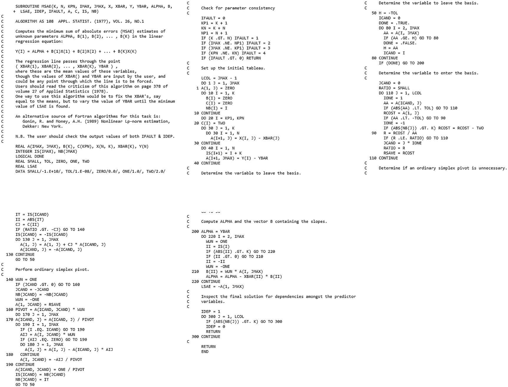

# 一次意外的辞职与Java数学库的诞生

`Something` 可能击中了我的头部，让我做出了一件不可思议的事：我从投资银行的交易员岗位辞职，踏上了一段伟大的冒险旅程。我着手创建一个`Java`数学库，它需要具备良好的数据结构和软件工程设计，易于人类（而非机器）阅读，利用现代计算技术，拥有高性能，并且内容广泛，涵盖线性代数、微积分、统计学、时间序列分析、优化、随机微分方程等。当我辞职时，我并没有意识到这会有多困难。我不知道有多少艰巨的任务需要克服。我只是觉得，创造一些东西（希望）能与世界分享会很有趣。十几岁时，我曾经通过整理数学笔记来编写自己的数学书。那时我想，用代码组织算法会更有用，算是我童年爱好的延续。

事实证明，构建一个数学库（尤其是优秀的数学库）极具挑战性。它远不止是将数学公式翻译成代码。首先，我们需要理解算法中的每一个细节。对于许多算法，我们阅读了原始出版物。一些古老的出版物是用古老而晦涩的语言写成的，极难理解。许多论文缺少细节，许多论文存在错误和笔误。对于我们实现的每一个算法，我们不得不重新推导数学中的每一个步骤，以确保我们理解了所有细节，并且算法是正确的。这与学习教科书完全不同，教科书通常编写良好，并配有大量示例。

有许多概念我们习以为常，甚至不会去思考其中的细节。例如，我们一直在使用矩阵的特征值和特征向量，但很少有人关心矩阵分解究竟是如何工作的。要编写一个线性代数包，我们需要理解矩阵的多种不同的分解与因式分解、它们的优缺点、精度、数值稳定性、调试与测试、API设计以及用户友好性——所有这些细节。这个过程并非易事。

其次，我们必须验证代码的正确性。如果论文附带了示例，我们就复现它们，以确保我们的结果与它们匹配。这些示例通常是非常简单的说明性例子。我们需要尝试各种测试案例、边界案例、压力测试和性能测试。我们的基准是`R`。我们始终将结果与`R`进行匹配。当存在差异时，我们必须逐一解释。我们对代码的准确性非常认真，并在每个版本中不断修复错误。在某些情况下，我们的代码甚至比`R`更准确。例如，我们不知道`R`在Johansen检验中只有少数几个临界点——例如10%、5%、1%——并对其余值进行线性插值（根据`R`的源代码）。而另一方面，我们使用精确分布函数计算了Johansen检验的渐近分布。这花费了我们很多小时的调试和阅读`R`源代码的时间。

第三，我们设计了软件，使其用户友好且符合良好的软件工程原则。大多数流行的数学库，如`Netlib`，都是在几十年前用`FORTRAN`/`C`编写的。它们既不用户友好，也没有使用良好的编程实践（因为那时计算机科学还不发达）。对我来说，最令人烦恼的一点是，一个函数通常需要几十个参数，而且参数名难以辨认和记忆（因为当时“对象”和数据结构的概念还不存在；变量名被限制在八个字符以内）。我常常记不住这些变量的含义，漏掉一些参数，或者弄错它们的顺序。按照现代标准，它们并不用户友好。

这些代码通常非常难以阅读。好的代码应该像英语一样易于阅读，并且应该易于其他专业程序员维护，而无需作者坐在他们旁边。当我们编写数学库时，我们尽一切努力让代码行与论文相匹配，以便其他人可以通过对比来理解我们的逻辑。这样做是为了让别人能够修复我们的错误、扩展我们的工作、将其翻译成另一种语言（例如`C#`），以及移植到其他硬件（例如`GPU`）。他们需要理解我们的代码才能做到这些。我的观点是，用几十年前的`FORTRAN`/`C`代码几乎不可能做到这一点。我敢打赌，一旦那些作者不在了，除了运行这些代码并相信它没有错误之外，没有人能对它做任何事情。我通过阅读原始论文，用`Java`编写了`ALGORITHM AS 288`。我试图理解`AS 288`的`FORTRAN`代码（见图1-1）以作对比，但至今仍未成功。`FORTRAN`代码似乎只是毫无明显理由地移动变量，然后神奇地得到了正确的结果。



矩阵乘法算法的片段。变量在此矩阵的三个不同层次上被确定。

**图 1-1**

很难记住`A`、`B`、`C`、`K`、`N`、`X`、`Y`（`AS108`）的含义和顺序。

构建这样一个库的首次尝试是`SuanShu`，它以已知最早的中国数学论著之一《算数书》（约公元前200年）命名。自2009年起，这是一个长达十年的努力。它从一个基本的线性代数包开始，发展成为一个涵盖微积分、优化算法、统计分析、微分方程等内容的广泛库。它最初是我个人的爱好，随后来自世界各地的数十位专家、教授、博士、学生和实践者都为该库做出了贡献。它被一些知名商业组织和学术机构所采用。2018年，我们决定停止`SuanShu`的销售和支持。我们自2012年6月起将其代码库开源。

凭借我们在数值编程领域十年的经验，`NM Dev`是一个全新的数值库，它接替了`SuanShu`。在过去的十年里，我们收集了大量来自用户的反馈和错误报告。我们希望建立一个全新的软件基础和架构，以充分考虑所有这些好的建议。

## 库设计

`SuanShu`以及其背后的`NM Dev`的目标是让工程应用的编程变得极其简单。程序员可以采用这样一种方式编写数学代码：源代码完全面向对象，且可独立测试。`NM Dev`的源代码遵循最严格的编码标准，确保代码可读性强、易于维护，并且能够方便地进行修改和扩展。

`NM Dev`彻底改变了数值计算的传统方式，例如`Netlib`和`gsl`等库。这些流行且“标准”的代码库，其本质是使用`FORTRAN`和`C`等旧语言编写的临时性源代码集合。这类代码的一个问题是，对于大多数现代程序员来说可读性差，因此难以维护。例如，理解`AS 288`已经是相当大的挑战，更不用说改进它了。其他问题还包括（但不限于）：缺乏数据结构、代码重复、完全过程化、变量命名极差、滥用`GOTO`、缺少测试用例、文档不足、缺乏IDE支持、与现代语言（如`Java`）链接不便、对并行计算不友好等等。

为了解决这些问题，`NM Dev`设计了一个可重用的数学组件（而非过程）框架，以便程序员可以像搭乐高积木一样将这些组件组合起来，构建更复杂的算法。`NM Dev`是完全重写的，以符合现代编程范式，例如变量命名、代码结构、可重用性、可读性、可维护性以及软件工程流程。为了确保代码质量极高且缺陷极少，`NM Dev`包含数千个每日运行的单元测试用例。

### 类精简原则

我们决定让类库尽可能精简，以避免方法污染。这一灵感来源于`jMatrices`的白皮书。^(¹) 挑战在于如何通过最精简且正确的包来组织方法。我们将以`NM Dev`的矩阵包为例进行说明。

`Matrix`类只有26个方法，其中9个是构造函数及相关方法，3个是`AbstractMatrix`接口的重写方法，还有8个是`MatrixSpace`接口的重写方法。其中仅有6个方法是该类特有的，旨在方便用户调用这些方法。其他数十种矩阵运算——例如各种分解、秩等属性、以及求逆等变换——则被分组成多个类和包。在大多数情况下，每个这样的运算本身就是一个类。例如，求逆运算就是一个继承自`Matrix`的类。其构造函数将待求逆的矩阵作为输入。例如，要求解下面矩阵的逆：

![$$ A=\left[\begin{array}{ccc}1&amp; 2&amp; 3\\ {}6&amp; 5&amp; 4\\ {}8&amp; 7&amp; 9\end{array}\right] $$](images/528380_1_En_1_Chapter/528380_1_En_1_Chapter_TeX_Equa.png)

`NM Dev`在`Kotlin`中的代码如下所示：

```
val A = DenseMatrix(arrayOf(
doubleArrayOf(1.0, 2.0, 3.0),
doubleArrayOf(6.0, 5.0, 4.0),
doubleArrayOf(8.0, 7.0, 9.0)))
val Ainv = Inverse(A)
Ainv
```

输出结果如下：

```
3x3
[,1] [,2] [,3]
[1,] -0.809524, -0.142857, 0.333333,
[2,] 1.047619, 0.714286, -0.666667,
[3,] -0.095238, -0.428571, 0.333333,
```

需要特别注意的是，`Ainv`对象属于`Matrix`类；它是作为`Inverse`类的一个新实例创建的。总之，我们选择拥有数百个类，而不是让一个类拥有数百个方法。每个类都刻意保持简短。这种类精简原则是指导整个库开发的关键设计决策。

### Java 与 C++ 性能对比

`FORTRAN`/`C`/`C++` 传统上是数学计算领域的语言，因为它们在裸机性能上占优。现代 `Java` 的性能已经与 `C++` 相当。过去对 `Java` 慢的错误认知，很大程度上是因为 1995 年的 `Java 1` 确实比 `C++` 慢。自那以后，`Java` 已经有了巨大改进，例如引入了 `hotspot` 技术。现在是 `17 LTS`（或 `18`）版本。如今，`Java` 相对于 `C`/`C++` 来说是一项颇具竞争力的技术。事实上，要在 `C`/`C++` 中实现真正的优化，你需要找到“对的”程序员来编写代码。这位程序员需要了解 `C`/`C++` 的所有性能问题，包括性能分析和代码优化（如循环展开），甚至可能需要编写汇编代码片段。一个普通的 `C`/`C++` 程序员写出来的代码，其性能很可能并不比用 `Java` 写的代码快。（我一般反对代码优化技术，因为它们使代码变得难以阅读，从而难以维护，就像在 `Netlib` 和 `Statlib` 中发现的许多 `FORTRAN`/`C`/`C++` 代码一样。）

更重要的是，大多数现代软件运行在多个核心上。代码优化技术相较于并行计算技术显得微不足道。在 `Java` 中编写并发编程代码要比在 `C++` 中明显更简单、更高效（也更有趣）。因此，为了编写高性能软件，我个人更倾向于用 `Java` 进行多核、多 CPU 和云计算，而不是在 `C`/`C++` 中进行代码优化。

总的来说，在通用编程语言中，只要有可能，我就喜欢使用 `Java` 而不是 `C`/`C++`、`FORTRAN`、`Assembly` 等，因为 `Java` 是一种非常容易学习和使用的编程语言，且性能上并无牺牲。它一直是构建系统和应用程序最流行的语言。

（至于 `FORTRAN`，我不确定它为何在 2022 年还能存活。你该如何阅读成千上万行所有字符都大小写混合、到处充斥着 `C` 和 `GOTO` 的代码呢？）