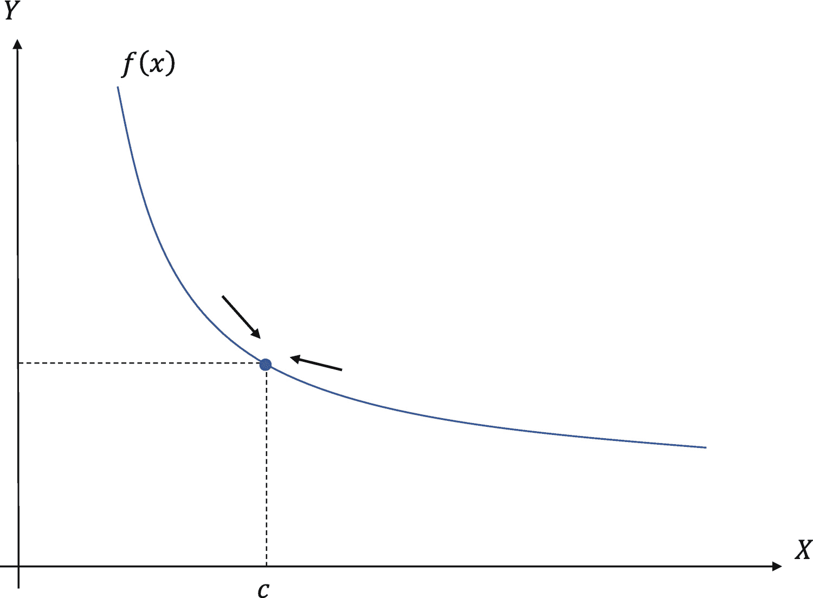
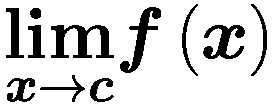

# 1.4 关于本书

本书涵盖了大学应用数学的基础广泛内容。这并不是一本典型的数学教科书。大多数人认为学习数学既困难又枯燥。我认为，主要原因在于大多数人不擅长处理符号、抽象推理、技术定义和严谨证明。例如，极限的技术定义如下：

定义域 `D` 在 ℝ 上的函数 `f`，当 `x` 趋近于 `closure`(`D`) 中的数 `c` 时，收敛于极限 `L`，如果对于任意 `ε` > 0，存在一个 `δ` > 0，使得当 `x` ∈ `D` 且 `|x − c|` < `δ` 时，有 `|f(x) − L|` < `ε`。

这个极限的定义之所以非常精确且技术化，是因为它是现代数学的基础。数学家能够运用它，但大多数人不行。仅仅那些 `ε` 和 `δ` 就足以让大多数人望而却步。数学家经过训练，能够可视化符号化的句子，并在脑海中构建图像。如果我们仅借助图 1-33 中的图形，简单地说函数的极限是当尝试不同的 `x` 值并使其越来越接近 `c` 时，函数所趋近的那个值，这对大多数人来说会容易得多。



一个在 y 对 x 平面上绘制的函数图形。箭头用于指示点 c，曲线显示下降趋势。

图 1-33



类似地，要证明 `lim(x→c) f(x) = f(c)` 当且仅当 `f` 是连续的，这件事并不困难但相当技术化，因为我们需要另一个连续性的定义，并处理极限的 `ε`-`δ` 定义。更简单的说法是，看图 1-33，这是显而易见的。当然，数学家不会这样工作。对大多数人是显而易见的事情，对数学家来说不能“仅仅是显而易见”；数学家觉得显而易见的事情，对非数学家通常并不显而易见。

对于大多数数学实践者来说，技术性和严谨性既不重要也不必要。本书是为应用数学的工程师，而非创造数学的数学家而写。我使用图片和图表来补充数学概念的想法，而非给出技术定义。我尝试运用直觉，而非严谨证明，这使得理解事物为何合理变得容易。更重要的是，本书的每个概念都附有示例代码。当你能够实际操作一个新数学概念时，学习它会更容易。例如，与其证明线性回归是在 `α`、`β`、`ε`、`y` 和 `X` 方面最适合数据集的直线，不如使用代码在你自己的数据集中绘制这条线。与其仅仅列出正态分布的公式，不如从该分布中生成一些随机数并亲眼看看，这更有趣。摆弄和改变事物（即实验）是学习和实践数学最好且最有趣的方式。它能使那些原本过于抽象而难以掌握的概念变得具体。正如儒家学者荀子指出的：“不闻不若闻之，闻之不若见之，见之不若知之，知之不若行之。”^(⁴)

### 1.4.1 示例代码

本书中的示例代码格式如下：

```
val v = DenseVector(arrayOf(1.0, 2.0, 3.0))
v
```

通常后面会跟着对应的输出，如下所示：

```
[1.000000, 2.000000, 3.000000]
```

你可以复制粘贴大部分示例代码到 S2 IDE 中，它们应该可以工作。有些代码引用了我未在书中复制的（大型）数据集。为方便起见，我们将源代码和数据集（在 `resources` 文件夹中）上传到了 GitHub。地址如下：

[`https://github.com/nmltd/s2-public/tree/main/Numerical%20Methods%20Using%20Kotlin`](https://github.com/nmltd/s2-public/tree/main/Numerical%2520Methods%2520Using%2520Kotlin)

以及

[`https://github.com/apress/numerical-methods-kotlin`](https://github.com/apress/numerical-methods-kotlin)

源代码应当可以直接编译、构建和运行。见图 1-34。


GitHub 软件中的示例代码片段。列出了两个文件夹和多个文件。

图 1-34

GitHub 上的示例代码

编程愉快！

脚注 1   2   3   4