# 2. 线性代数

线性代数算法是数值计算中最重要的算法，也是所有数值算法的基础。许多数值算法，无论多么复杂，都涉及一些线性代数计算。例如，非线性问题通常难以（甚至不可能）直接求解。一种常用技术是使用多个较小的线性子问题来逼近非线性问题（如同在微积分中的做法）。而线性问题通常涉及一些向量和矩阵，因为它包含多个变量。向量和矩阵的运算在数值计算中无处不在。不同库的理论算法可能相同，但其实现方式却可能大相径庭，从而导致性能和精度上的巨大差异。因此，线性代数算法（如矩阵分解）的实现，对于许多数值算法的精度和性能，乃至整个数值计算领域，都至关重要。

要创建一个高质量、专业的线性代数计算库，至少面临两个挑战：精度和高性能（快速计算）。计算机只能表示有限数量的数字（一台 64 位计算机大约能表示 1.8e19 个数字）；换句话说，有无数个数字计算机是无法表示的。计算的（浮点）值通常只是真实理论结果的近似值。当计算涉及一个非常大的数和一个非常小的数时，情况会更糟。结果往往偏向大数，忽略了小数的精度。在迭代计算（例如优化计算）中，每一轮微小的误差都会累积。一个理论上可解的问题有时会变得在实践中不可行。

因此，仅仅正确地实现理论算法是不够的。一个专业的数值库还需要处理实际的数值问题，例如，处理一个元素数量级相差极大的矩阵。涉及一系列连续行和/或列操作的基本矩阵运算，若混合了非常小和非常大的元素，将导致相当大的舍入误差。处理此问题的一种方法是在操作前尽可能地对矩阵进行重排，使元素按单调顺序重新排列。可以应用置换矩阵将较小的元素推到左上角，然后从右下角开始进行操作。有时，选择更好的算法也会有所帮助。例如，在计算特征值时，QL 算法通常比 QR 算法具有更小的舍入误差。

在 NM Dev 中，我们严肃对待数值稳定性问题。我们通过大量基准测试问题实例来测试我们的库，并收集病态和退化情况。然后，我们应用各种数值技术逐一处理这些情况。我们仔细地将我们的结果与其他开源和商业软件进行比较，以确保我们的结果良好。这个过程使得我们的库更加健壮，能够处理各种问题结构。

加速向量和矩阵的计算，通常也会相应地加速任何数值计算。利用现代计算技术加速的方法（及其考量因素）有很多：并行计算（多线程、多核、多机器、CUDA）、更快的算法、更高效的数据结构、原地操作与对象副本复制、内联操作与虚函数调用等等。其中一些技术可以加速代码执行（例如内联操作），但可能会使代码对其他人（有时甚至是原作者）难以理解，从而导致不可维护。NM Dev 致力于在（人类）可读性和速度之间取得平衡。我们将 NM Dev 的性能与所有其他公开可用的主要 Java 数学库进行了比较。比较是在一台配备双 Intel Xeon X5650 2.66GHz（共 12 核）处理器、24GB 内存、运行 Windows 7 Ultimate 64 位系统的机器上进行的。使用的 JVM 是 Oracle Java HotSpot 64-Bit Server 1.8.0\_25。根据我们的基准测试，NM Dev 是迄今为止（可能）最快的（Java）数学库。以下是几个基准比较。完整测试套件的源代码和结果可从此处下载：

```
https://nm.dev/html/benchmark/benchmark_chart.xhtml?category=linearalgebra
```

NM Dev 或 SuanShu 的矩阵乘法比 Apache Commons Math 快 182 倍，比 R 快 14 倍。见图 2-1。

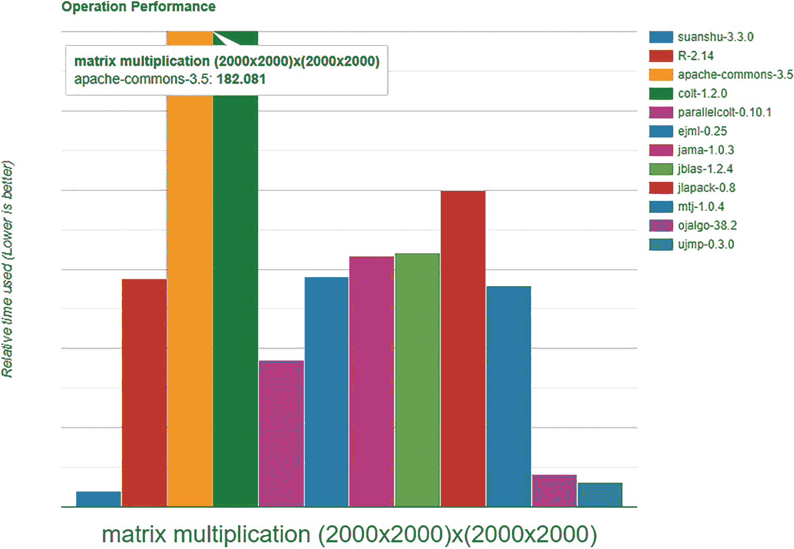

关于矩阵乘法相对耗时比较的柱状图。Apache commons 3.5 和 colt 1.2.0 的性能最高，而 suanshu 3.3.0 的性能最低。

图 2-1

NM Dev 的矩阵乘法比 Apache 快 182 倍

这是因为 NM Dev 的矩阵实现使用了自适应 Strassen 算法的并行版本进行快速矩阵乘法，其复杂度为 *O*(*n*^(2.8074))。Apache Commons Math 和我们所知的大多数其他 Java 库实现的是标准的 *O*(*n*³) 算法。对于较大的矩阵，尤其是处理大数据时，NM Dev 的性能优势非常显著。

NM Dev 的矩阵行列式计算比 Apache Commons Math 快 31 倍。见图 2-2。

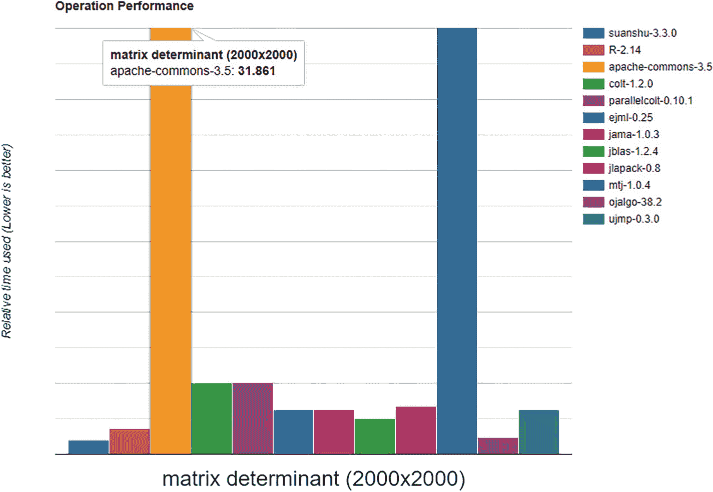

关于矩阵行列式相对耗时比较的柱状图。Apache commons 3.5 和 m t j 1.0.4 的性能最高，而 suanshu 3.3.0 的性能最低。

图 2-2

NM Dev 的矩阵行列式计算比 Apache 快 31 倍

NM Dev 的 LU 分解比 Apache Commons Math 快 32 倍。见图 2-3。

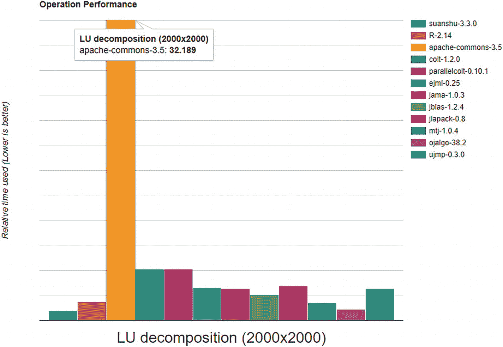

关于 LU 分解相对耗时比较的柱状图。Apache commons 3.5 的范围最高。

图 2-3

NM Dev 的 LU 分解比 Apache 快 32 倍

NM Dev 的 QR 分解比 R 快两倍。见图 2-4。

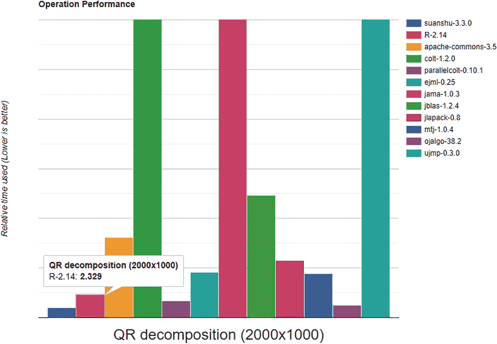

关于 QR 分解相对耗时比较的柱状图。Colt 1.2.0、jama 1.0.3、ujmp 0.3.0 的性能最高，而 suanshu 3.3.0 的性能最低。

图 2-4

NM Dev 的 QR 分解比 R 快两倍

NM Dev 的 SVD 分解比 R 快两倍。见图 2-5。

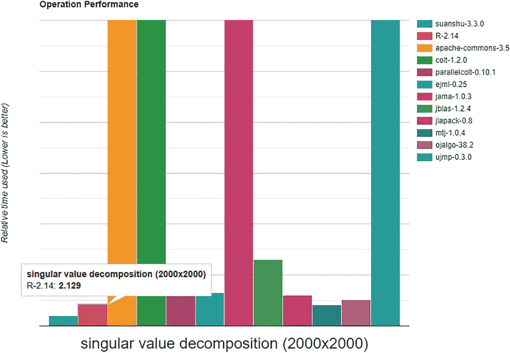

关于奇异值分解相对耗时比较的柱状图。Apache commons 3.5、colt 1.2.0、jama 1.0.3、ujmp 0.3.0 的性能最高，而 suanshu 3.3.0 的性能最低。

图 2-5

NM Dev 的 SVD 分解比 R 快两倍

在求解此线性方程组时，NM Dev 比 R 快六倍。见图 2-6。


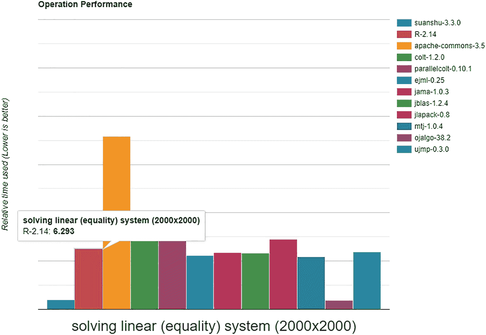

相对耗时与奇异值分解的柱状图。Apache Commons 3.5 性能最高，而 Suanshu 3.3.0 和 ojAlgo 38.2 性能最低。

图 2-6

在求解线性方程组时，NM Dev 比 R 语言快六倍

本章的源代码可在 S2 平台上运行：

[`​s21.​nm.​dev/​hub/​user-redirect/​lab/​tree/​s2-public/​Numerical%20​Methods%20​Using%20​Kotlin/​chapter2.​ipynb`](https://s21.nm.dev/hub/user-redirect/lab/tree/s2-public/Numerical%2520Methods%2520Using%2520Kotlin/chapter2.ipynb)

源代码可在 GitHub 上找到：

[`​github.​com/​nmltd/​s2-public/​blob/​main/​Numerical%20​Methods%20​Using%20​Kotlin/​chapter2.​ipynb`](https://github.com/nmltd/s2-public/blob/main/Numerical%2520Methods%2520Using%2520Kotlin/chapter2.ipynb)

## 2.1 向量

在数学中，欧几里得向量是一种具有大小（或长度）和方向的几何对象。一个 *n* 维向量可以表示为由 *n* 个标量元素组成的数组，其中每个元素是该向量在对应维度上投影的长度。例如，在二维欧几里得空间（记作 ℝ²）中，从点 *A* = (0, 0) 指向点 *B* = (1, 2) 的向量 *a* 可以表示为：

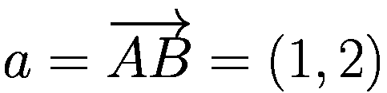

在 NM Dev 中，向量通过 `Vector` 接口表示。构造此类对象有多种方式。最常见的方式是使用 double 数组初始化一个 `DenseVector`，指定每个元素。见图 2-7。

```
val v1: Vector = DenseVector(arrayOf(1.0, 2.0)) // 定义一个向量
println(String.format("v1 = %s", v1)) // 打印 v1
```

输出如下：

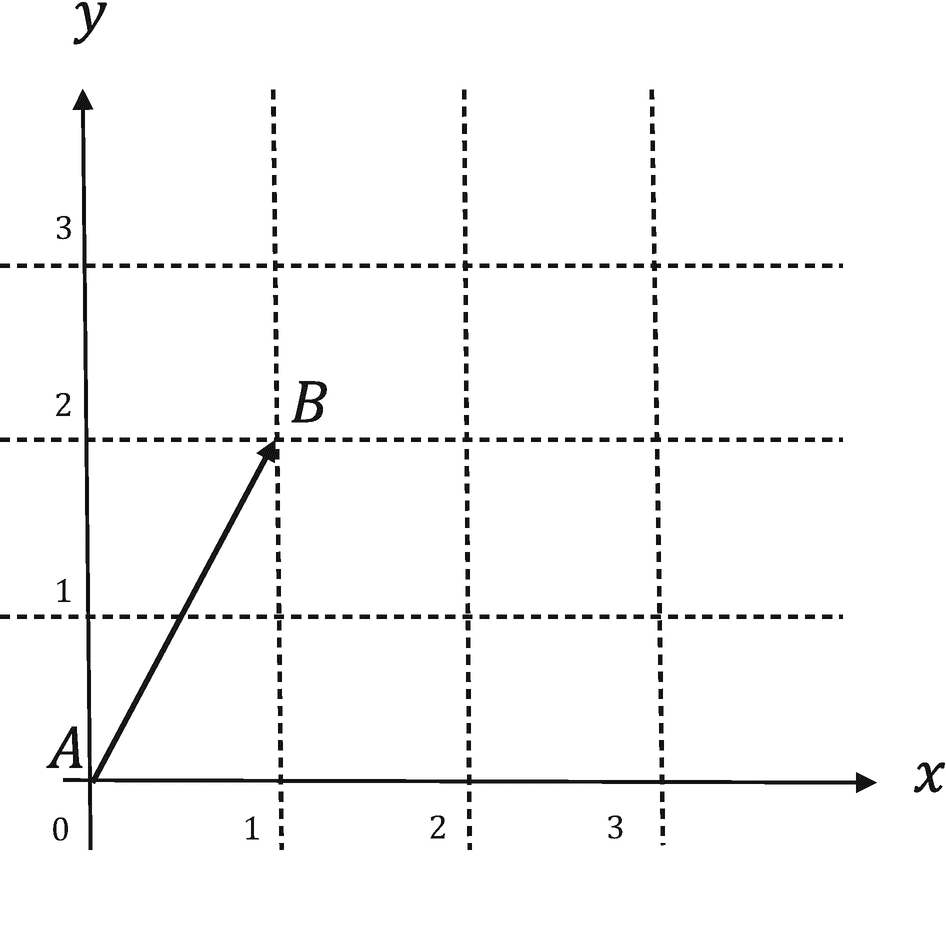

一幅图，显示从原点 A 到交点 (1,2) 处 B 点绘制的箭头。

图 2-7

向量 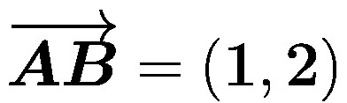

```
v1 = [1.000000, 2.000000]
```

### 2.1.1 逐元素运算

以下函数用于访问和修改 `Vector`：

```
/**
* 获取此向量的长度。
*
* @return 向量长度
*/
public int size();
/**
* 获取位置 i 处的值。
*
* @param i 向量条目的位置
* @return v[i]
*/
public double get(int i);
/**
* 更改此向量中某个条目的值。
* 这是唯一可能更改向量条目的方法。
*
* @param i     要更改条目的索引。索引从 1 开始计数，而非 0。
* @param value 要更改的值
*/
public void set(int i, double value);
```

计算机科学家从 0 开始计数，而数学家从 1 开始计数。NM Dev 遵循数学家的惯例，向量和矩阵的索引从 1 而不是 0 开始计数。

接续前面的示例，以下代码片段将向量改为 (1, −2)：

```
val size: Int = v1.size() // 2
println(String.format("v1 size = %d", size))
```

输出如下：

```
v1 size = 2
val v1_1: Double = v1.get(1) // 1.0
println(String.format("v1_1 = %f", v1_1))
```

输出如下：

```
v1_1 = 1.000000
v1.set(2, -2.0) // v1 变为 (1.0, -2.0)
println(String.format("v1 = %s", v1)) // 打印 v1
```

输出如下：

```
v1 = [1.000000, -2.000000]
```

在 NM Dev 中，向量上的算术运算——加法、减法、乘法、除法、缩放和幂运算——均为逐元素运算。

```
/**
* \(this + that\)
*
* @param that 一个向量
* @return \(this + that\)
*/
@Override
public Vector add(Vector that);
/**
* \(this - that\)
*
* @param that 一个向量
* @return \(this - that\)
*/
@Override
public Vector minus(Vector that);
/**
* 将 {@code this} 与 {@code that} 逐元素相乘。
*
* @param that 一个向量
* @return \(this \cdot that\)
*/
public Vector multiply(Vector that);
/**
* 将 {@code this} 除以 {@code that}，逐元素相除。
*
* @param that 一个向量
* @return \(this / that\)
*/
public Vector divide(Vector that);
/**
* 向此向量的所有条目添加一个常数。
*
* @param c 一个常数
* @return \(v + c\)
*/
public Vector add(double c);
/**
* 从此向量的所有条目中减去一个常数。
*
* @param c 一个常数
* @return \(v - c\)
*/
public Vector minus(double c);
/**
* 对此向量的所有条目进行幂运算，逐元素进行。
*
* @param c 一个常数
* @return \(v ^ c\)
*/
public Vector pow(double c);
/**
* 用一个常数缩放此向量，逐元素进行。获取向量的单位版本的方法如下：
* 
* vector.scaled(1\. / vector.norm())
* 
*
* @param c 一个常数
* @return \(c \times this\)
*/
public Vector scaled(double c);
```

以下代码片段演示了向量的算术运算：

```
val v2: Vector = DenseVector(arrayOf(-2.0, 1.0)) // 定义另一个向量
// 加法
val a1: Vector = v1.add(0.1) // 给所有条目加 0.1
println(String.format("a1 = %s", a1)) // 打印 a1
val a2: Vector = v1.add(v2) // a2 = v1 + v2，逐元素
println(String.format("a2 = %s", a2)) // 打印 a2
```

输出如下：

```
a1 = [1.100000, -1.900000]
a2 = [-1.000000, -1.000000]
// 减法
val m1: Vector = v1.minus(0.1) // 从所有条目中减 0.1
println(String.format("m1 = %s", m1)) // 打印 m1
val m2: Vector = v1.minus(v2) // v1 – v2，逐元素
println(String.format("m2 = %s", m2)) // 打印 m2
```

输出如下：

```
m1 = [0.900000, -2.100000]
m2 = [3.000000, -3.000000]
val s1: Vector = v1.scaled(0.5) // 将所有条目乘以 0.5
println(String.format("s1 = %s", s1)) // 打印 s1
```

输出如下：

```
s1 = [0.500000, -1.000000]
val t1: Vector = v1.multiply(v2) // 将 v1 与 v2 逐元素相乘
println(String.format("t1 = %s", t1)) // 打印 t1
```

输出如下：

```
t1 = [-2.000000, -2.000000]
// 除法
val d1: Vector = v1.divide(v2) // 将 v1 除以 v2，逐元素
println(String.format("d1 = %s", d1)) // 打印 d1
```

输出如下：

```
d1 = [-0.500000, -2.000000]
// 幂运算
val p1: Vector = v1.pow(2.0) // 取平方，逐元素
println(String.format("p1 = %s", p1)) // 打印 p1
```

输出如下：

```
p1 = [1.000000, 4.000000]
```


### 2.1.2 范数

向量 ***x*** = (*x*[1], *x*[1], …, *x*[*n*]) 的 *ℓ*[*p*]-范数定义如下：

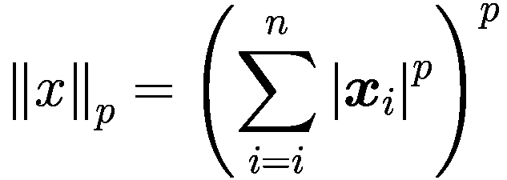

*范数*是一种函数，它将一个向量映射到一个非负实数，其性质类似于向量到原点的距离。它满足缩放齐次性，服从某种三角不等式，并且仅在原点处为零。在 NM Dev 中，向量范数通过 `norm(double p)` 成员方法计算。特别地，当不传入参数时，`norm()` 计算的是 *ℓ*[2]-范数。*ℓ*[2]-范数，也称为欧几里得范数，通常记为 ‖***x***‖[2] 或简写为 ‖***x***‖，表示向量到原点的欧几里得距离。它也是向量与其自身内积的平方根。以下代码片段计算了直角边长为 3 和 4 的直角三角形的 *ℓ*[1]-范数和 *ℓ*[2]-范数。请参见图 2-8。

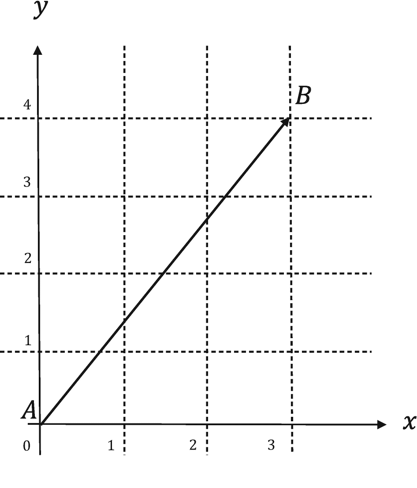

一幅从原点 A 到 B 的箭头图，箭头末端交于坐标为 (3,4) 的点。

图 2-8

一个 3-4-5 直角三角形

```
// 范数
val v3: Vector = DenseVector(arrayOf(3.0, 4.0))
val norm1: Double = v3.norm(1.0) // l1 范数 = (3.0 + 4.0) = 7.0
println(String.format("L1 范数 = %f", norm1))
val norm2: Double = v3.norm() // l2 范数 = sqrt(3² + 4²) = 5，勾股定理
println(String.format("L2 范数 = %f", norm2))
```

输出结果如下：

```
L1 范数 = 7.000000
L2 范数 = 5.000000
```

### 2.1.3 内积与夹角

在实数 *n* 维空间 ℝ^(*n*) 中，向量 ***x*** = (*x*[1], *x*[2], …, *x*[*n*]) 与 ***y*** = (*y*[1], *y*[2], …, *y*[*n*]) 的内积定义如下：

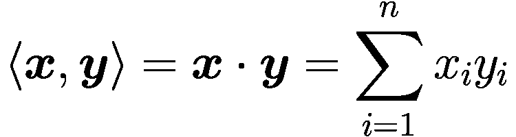

***x*** 与 ***y*** 之间的夹角 *θ* 定义如下：

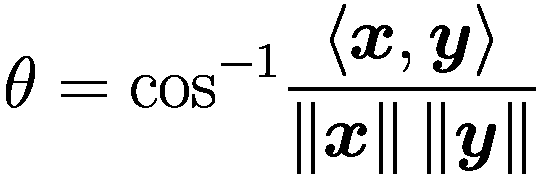

请参见图 2-9。

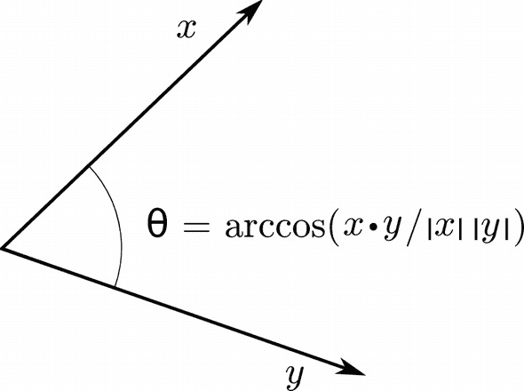

一张用公式展示点积与夹角的示意图。图中夹角的 θ 值小于 90 度。

图 2-9

点积与夹角

特别地，如果向量 *x* 和 *y* 正交或垂直（它们的夹角为 90°），则 ***x*** · ***y*** = 0。在另一个极端，如果它们指向同一方向（夹角为 0°），则 ***x*** · ***y*** = ‖***x***‖‖***y***‖。这意味着向量 ***x*** 与自身的内积为 ***x*** · ***x*** = ‖***x***‖²。在 NM Dev 中，内积和夹角方法的签名如下：

```
/**
 * 欧几里得空间中的内积即为点积。
 *
 * @param that 一个向量
 * @return \(this \cdot that\)
 * @see Wikipedia: Dot
 * product
 */
@Override
public double innerProduct(Vector that);
/**
 * 计算 {@code this} 与 {@code that} 之间的夹角 \(\theta\)。
 * 公式如下：
 * \[
 * this \cdot that = \|this\| \times \|that\| \times \cos \theta
 * \]
 *
 * @param that 一个向量
 * @return {@code this} 与 {@code that} 之间的夹角 \(\theta\)
 */
@Override
public double angle(Vector that);
```

示例如下：

```
// 内积与夹角
val v4: Vector = DenseVector(arrayOf(1.0, 2.0))
val v5: Vector = DenseVector(arrayOf(3.0, 4.0))
val dot: Double = v4.innerProduct(v5) // (1.*3\. + 2.*4.) = 11.
println(String.format(" = %f", v4, v5, dot))
val angle: Double = v4.angle(v5)
println(String.format("%s 与 %s 的夹角 = %f", v4, v5, angle))
```

输出结果如下：

```
 = 11.000000
[1.000000, 2.000000] 与 [3.000000, 4.000000] 的夹角 = 0.179853
```


## 2.2 矩阵

矩阵是按行和列排列在矩形阵列或表格中的一组元素或条目。一个 *m* × *n* 矩阵是一个具有 *m* 行和 *n* 列的矩形阵列。矩阵的元素可以是数字、符号或数学表达式。以下是一个由九个元素组成的三行三列矩阵：

![$$ \left[\begin{array}{ccc}1&amp; 2&amp; 3\\ {}4&amp; 5&amp; 6\\ {}7&amp; 8&amp; 9\end{array}\right] $$](images/528380_1_En_2_Chapter/528380_1_En_2_Chapter_TeX_Eque.png)

在一个 *m* × *n* 矩阵 ***A*** 中的各个条目通常用 *a*[*ij*] 表示，其中 *i*（行索引）和 *j*（列索引）通常分别从 1 变化到 *m* 和 *n*。为了方便地表示矩阵运算结果中的某个元素，该元素的索引通常附加在带括号或方括号的矩阵表达式上（例如，(***AB***)[*ij*] 指的是矩阵乘积的一个元素）。如果 *m* > *n*，则矩阵是高矩阵；如果 *m* < *n*，则是扁矩阵；如果 *m* = *n*，则是方矩阵。见图 2-10。

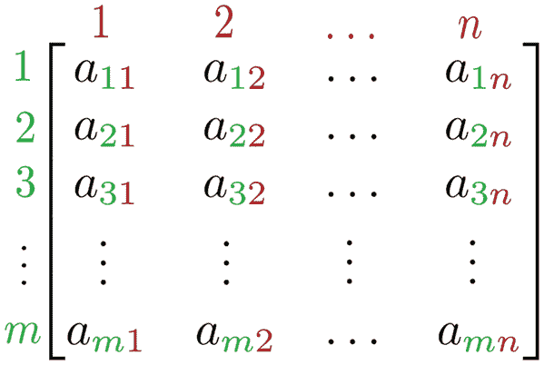

一个矩阵图示。方括号中给出的水平值从下标 1 1 到下标 1 n。它以从下标 m 1 到下标 m n 结束。

图 2-10

`a[ij]` 指的是第 i 行和第 j 列的条目

在 NM Dev 中，矩阵由 `Matrix` 接口表示。有多种构建 `Matrix` 对象的方法。最常见的方法是使用 `DenseMatrix` 实现，并在一个双精度数组中指定所有条目（非零和零）。以下代码片段构建了前面展示的 3×3 矩阵：

```
// matrix construction
val m1: Matrix = DenseMatrix(
arrayOf(
doubleArrayOf(1.0, 2.0, 3.0),
doubleArrayOf(4.0, 5.0, 6.0),
doubleArrayOf(7.0, 8.0, 9.0)
)
)
val m2: Matrix = DenseMatrix(m1) // copy the matrix m1
println(String.format("\nm1 = %s", m1)) // print out the matrix m1
println(String.format("\nm2 = %s", m2)) // print out the matrix m2
```

输出如下：

```
m1 = 3x3
[,1] [,2] [,3]
[1,] 1.000000, 2.000000, 3.000000,
[2,] 4.000000, 5.000000, 6.000000,
[3,] 7.000000, 8.000000, 9.000000,
m2 = 3x3
[,1] [,2] [,3]
[1,] 1.000000, 2.000000, 3.000000,
[2,] 4.000000, 5.000000, 6.000000,
[3,] 7.000000, 8.000000, 9.000000,
```

有许多种构造 `DenseMatrix` 的方法。其签名如下：

```
/**
* 构造一个维度为 nRows * nCols 的零矩阵。
*
* @param nRows 行数
* @param nCols 列数
*/
public DenseMatrix(int nRows, int nCols)
/**
* 从一个二维的 {@code double[][]} 数组构造矩阵。
*
* @param data 一个二维数组输入
* @throws IllegalArgumentException 当 {@code data} 是锯齿数组时
*/
public DenseMatrix(double[][] data)
/**
* 从一个一维的 {@code double[]} 构造矩阵。该数组是矩阵行的串联。
* 一个示例用法是将向量转换为矩阵。例如，要构造一个列向量，我们这样做
* {@code
* DenseMatrix V = new DenseMatrix(v.toArray(), v.length, 1);
* } 要构造一个行向量，我们这样做
* {@code
* DenseMatrix V = new DenseMatrix(v.toArray(), 1, v.length);
* }
*
* @param data  一维数组输入
* @param nRows 行数
* @param nCols 列数
* @throws IllegalArgumentException 当 {@code data} 的长度不等于 nRows * nCols 时
*/
public DenseMatrix(double[] data, int nRows, int nCols)
/**
* 从向量构造一个列矩阵。
*
* @param v 一个向量
*/
public DenseMatrix(Vector v)
/**
* 将任意矩阵转换为标准矩阵表示形式。如果 {@code A} 是 {@link Densifiable} 类型，
* 则此方法与 {@link #toDense} 相同。
*
* @param A 一个矩阵
*/
public DenseMatrix(Matrix A)
/**
* 执行深拷贝的拷贝构造函数。
*
* @param A 一个 {@code DenseMatrix}
*/
public DenseMatrix(DenseMatrix A)
```

例如，以下代码片段从一个向量创建了一个列矩阵：

```
// 创建一个向量
val v: Vector = DenseVector(arrayOf(1.0, 2.0, 3.0))
// 从一个向量创建一个列矩阵
val m3: Matrix = DenseMatrix(v)
println(String.format("\nm3 = %s", m3)) // 打印矩阵 m3
```

输出如下：

```
m3 = 3x1
[,1]
[1,] 1.000000,
[2,] 2.000000,
[3,] 3.000000,
```

### 2.2.1 矩阵运算

在设计 NM Dev 库时，我们使类库尽可能简洁，以避免方法污染。这是受 jMatrices 白皮书的启发。挑战在于通过最小且正确的包来组织方法。`Matrix` 类只有 26 个方法，其中 9 个是构造及相关方法，3 个是重写 `AbstractMatrix` 接口的，8 个是重写 `MatrixSpace` 接口的。只有 6 个是类特有的，这使得调用这些方法对用户来说很方便。其他几十种矩阵运算，例如各种分解、秩等属性以及逆变换等，都被分组到多个类和包中。在大多数情况下，这些运算中的每一个都是一个独立的类。例如，求逆运算本身就是一个继承自 `Matrix` 的类。其构造函数接受一个待求逆的 `Matrix` 作为输入。例如，要求解以下矩阵的逆：

![$$ \textbf{A}=\left[\begin{array}{ccc}1&amp; 2&amp; 3\\ {}6&amp; 5&amp; 4\\ {}8&amp; 7&amp; 9\end{array}\right] $$](images/528380_1_En_2_Chapter/528380_1_En_2_Chapter_TeX_Equf.png)

你可以编写如下代码：

```
// 计算可逆矩阵的逆
val A: Matrix = DenseMatrix(
arrayOf(
doubleArrayOf(1.0, 2.0, 3.0),
doubleArrayOf(6.0, 5.0, 4.0),
doubleArrayOf(8.0, 7.0, 9.0)
)
)
val Ainv: Matrix = Inverse(A)
val I: Matrix = A.multiply(Ainv)
println(String.format("%s * \n%s = \n%s", A, Ainv, I))
```

输出如下：

```
3x3
[,1] [,2] [,3]
[1,] 1.000000, 2.000000, 3.000000,
[2,] 6.000000, 5.000000, 4.000000,
[3,] 8.000000, 7.000000, 9.000000,  *
3x3
[,1] [,2] [,3]
[1,] -0.809524, -0.142857, 0.333333,
[2,] 1.047619, 0.714286, -0.666667,
[3,] -0.095238, -0.428571, 0.333333,  =
3x3
[,1] [,2] [,3]
[1,] 1.000000, 0.000000, 0.000000,
[2,] -0.000000, 1.000000, 0.000000,
[3,] -0.000000, -0.000000, 1.000000,
```

NM Dev 计算出的矩阵 A 的逆如下：

![$$ {A}^{-1}=\left[\begin{array}{ccc}-0.809524&amp; -0.142857&amp; 0.333333\\ {}1.047619&amp; 0.714286&amp; -0.666667\\ {}-0.095238&amp; -0.428571&amp; 0.333333\end{array}\right] $$](images/528380_1_En_2_Chapter/528380_1_En_2_Chapter_TeX_Equg.png)

需要注意的重要一点是，A 的逆 `Ainv` 也是一个 `Matrix`，是通过关键字 `new` 创建的，而不是通过方法调用。总之，我们选择拥有许多类，而不是拥有一个包含许多方法的类。每个类都刻意保持简短。这种类简洁原则是指导整个库开发的关键设计决策。


#### 2.2.2 逐元素运算

这些函数用于访问和修改一个 `Matrix`：

```
/**
* 将矩阵在 [i,j] 处的元素设置为指定值。
* 这是唯一可能修改矩阵的方法。
*
* @param i     行索引
* @param j     列索引
* @param value 要设置给 A[i,j] 的值
* @throws MatrixAccessException 如果 i 或 j 超出范围
*/
public void set(int i, int j, double value) throws MatrixAccessException;
/**
* 获取矩阵在 [i,j] 处的元素。
*
* @param i 行索引
* @param j 列索引
* @return A[i,j]
* @throws MatrixAccessException 如果 i 或 j 超出范围
*/
public double get(int i, int j) throws MatrixAccessException;
```

NM Dev 从 1 而不是 0 开始计数（向量和矩阵的）索引。左上角的元素是第 (1,1) 个元素。

以下代码片段将对角线元素设置为 0：

```
// getters and setters
val m1_11: Double = m1.get(1, 1)
val m1_22: Double = m1.get(2, 2)
val m1_33: Double = m1.get(3, 3)
println(String.format("\nThe diagonal entries are: %f, %f, %f", m1_11, m1_22, m1_33))
// changing the diagonal to 0
println("\nChanging the diagonal to 0")
m1.set(1, 1, 0.0)
m1.set(2, 2, 0.0)
m1.set(3, 3, 0.0)
println(String.format("m1 = %s", m1)) // print out the matrix m1
```

输出如下：

```
the diagonal entries are: 1.000000, 5.000000, 9.000000
changing the diagonal to 0
m1 = 3x3
[,1] [,2] [,3]
[1,] 0.000000, 2.000000, 3.000000,
[2,] 4.000000, 0.000000, 6.000000,
[3,] 7.000000, 8.000000, 0.000000,
```

在 NM Dev 中，矩阵上的算术运算——加法、减法和缩放——都是逐元素运算。其方法签名如下：

```
/**
* this + that
*
* @param that 一个矩阵
* @return {@code this} 与 {@code that} 的和
*/
@Override
public Matrix add(Matrix that);
/**
* this - that
*
* @param that 一个矩阵
* @return {@code this} 与 {@code that} 的差
*/
@Override
public Matrix minus(Matrix that);
/**
* 用常数缩放该矩阵 A。
*
* @param c 一个 double 值
* @return cA
*/
public Matrix scaled(double c);
```

下面是一个示例：

```
val m1: Matrix = DenseMatrix(
arrayOf(
doubleArrayOf(1.0, 2.0, 3.0),
doubleArrayOf(4.0, 5.0, 6.0),
doubleArrayOf(7.0, 8.0, 9.0)
)
)
// m2 = -m1
val m2: Matrix = m1.scaled(-1.0)
// m3 = m1 + m2 = m1 - m1 = 0
val m3: Matrix = m1.add(m2)
// not a recommended usage
val isEqual1: Boolean = m3.equals(m3.ZERO())
println(isEqual1)
// recommended usage
val isEqual2: Boolean = MatrixPropertyUtils.areEqual(m3, m3.ZERO(), 1e-16)
println(isEqual2)
```

输出如下：

```
true
true
```

`ZERO()` 方法生成一个与调用实例维度相同的零矩阵。`equals()` 函数比较两个矩阵并检查它们的值是否相等。然而，不推荐使用此函数，因为理论上相同的两个矩阵在计算机中可能具有不同的表示。元素的值可能因微小差异而不同，`equals()` 函数会错误地将它们视为不同。检查两个矩阵值是否相等的正确方法是逐元素检查它们在某个阈值内是否相同。工具函数 `MatrixPropertyUtils.areEqual` 正是为此目的而设计。该工具函数相较于 `equals()` 方法的优势在于，你可以为浮点数比较输入一个容差阈值。其方法签名如下：

```
/**
* 在指定精度下检查两个矩阵是否相等。
* 两个矩阵相等当且仅当：
* 
* 维度相同；
* 所有元素都相等。
* 
*
* @param A1      一个矩阵
* @param A2      一个矩阵
* @param epsilon 精度参数：当数值 |x| &le; &epsilon; 时，视为 0
* @return {@code true} 如果所有元素逐项相等
*/
public static boolean areEqual(Matrix A1, Matrix A2, double epsilon)
```

#### 2.2.3 转置

矩阵 `A` 的转置 `A^T = A'` 定义如下：

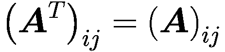

也就是说，它交换了行和列。列变成行，行变成列。例如，对于以下矩阵：

![$$ \boldsymbol{A}=\left[\begin{array}{ccc}1&amp; 2&amp; 3\\ {}4&amp; 5&amp; 6\\ {}7&amp; 8&amp; 9\end{array}\right] $$](images/528380_1_En_2_Chapter/528380_1_En_2_Chapter_TeX_Equi.png)

其转置如下：

![$$ {\boldsymbol{A}}^T=\left[\begin{array}{ccc}1&amp; 4&amp; 7\\ {}2&amp; 5&amp; 8\\ {}3&amp; 6&amp; 9\end{array}\right] $$](images/528380_1_En_2_Chapter/528380_1_En_2_Chapter_TeX_Equj.png)

以下代码实现了这个例子：

```
val m1: Matrix = DenseMatrix(
arrayOf(
doubleArrayOf(1.0, 2.0, 3.0),
doubleArrayOf(4.0, 5.0, 6.0),
doubleArrayOf(7.0, 8.0, 9.0)
)
)
println(String.format("m1 = %s", m1)) // print out the matrix m1
val m1t: Matrix = m1.t() // doing a transpose
println(String.format("m1t = %s", m1t)) // print out the transpose matrix
```

输出如下：

```
m1 = 3x3
[,1] [,2] [,3]
[1,] 1.000000, 2.000000, 3.000000,
[2,] 4.000000, 5.000000, 6.000000,
[3,] 7.000000, 8.000000, 9.000000,
m1t = 3x3
[,1] [,2] [,3]
[1,] 1.000000, 4.000000, 7.000000,
[2,] 2.000000, 5.000000, 8.000000,
[3,] 3.000000, 6.000000, 9.000000,
```


### 2.2.4 矩阵乘法

矩阵乘法是一种二元运算，用于从两个矩阵得到第三个矩阵。这第三个矩阵是前两个矩阵的乘积，称为*矩阵乘积*。如果***A***是一个 *m* × *n* 矩阵，***B***是一个 *n* × *p* 矩阵，那么它们的矩阵乘积***C*** = ***AB***是一个 *m* × *p* 矩阵。矩阵***A***中每一行的 *m* 个元素与矩阵***B***中对应列的 *m* 个元素相乘，这些乘积之和即为矩阵***C*** = ***AB***的一个元素。参见图 2-11。数学表示如下：

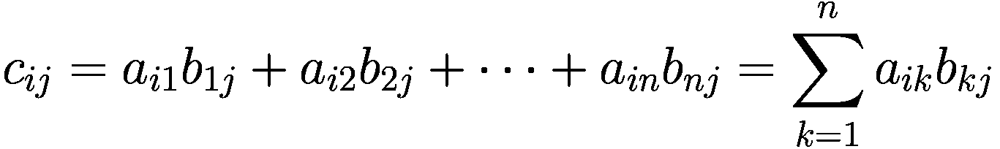

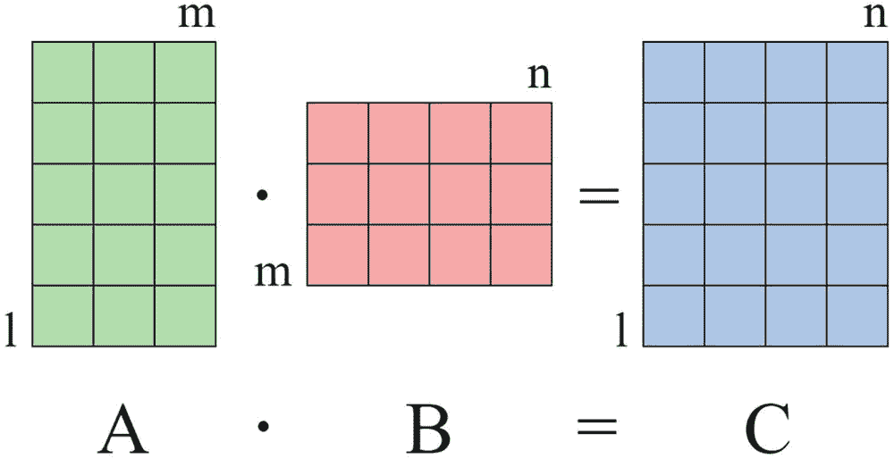

数学乘法的图示。该方程展示了将 A 乘以 B 得到 C 的函数。

**图 2-11** 矩阵乘法

例如，对于如下矩阵：

![$$ \boldsymbol{A}=\left[\begin{array}{ccc}1&amp; 2&amp; 3\\ {}4&amp; 5&amp; 6\\ {}7&amp; 8&amp; 9\end{array}\right] $$](images/528380_1_En_2_Chapter/528380_1_En_2_Chapter_TeX_Equl.png)

可以得到：

![$$ {\boldsymbol{A}}^T\boldsymbol{A}=\left[\begin{array}{ccc}1&amp; 4&amp; 7\\ {}2&amp; 5&amp; 8\\ {}3&amp; 6&amp; 9\end{array}\right]\left[\begin{array}{ccc}1&amp; 2&amp; 3\\ {}4&amp; 5&amp; 6\\ {}7&amp; 8&amp; 9\end{array}\right]=\left[\begin{array}{ccc}66&amp; 78&amp; 90\\ {}78&amp; 93&amp; 108\\ {}90&amp; 108&amp; 126\end{array}\right] $$](images/528380_1_En_2_Chapter/528380_1_En_2_Chapter_TeX_Equm.png)

请注意，矩阵乘法不满足交换律，这意味着***AB***不一定等于***BA***。

以下代码实现了这个例子：

```
val m1: Matrix = DenseMatrix(
arrayOf(
doubleArrayOf(1.0, 2.0, 3.0),
doubleArrayOf(4.0, 5.0, 6.0),
doubleArrayOf(7.0, 8.0, 9.0)
)
)
val m1t: Matrix = m1.t()
val m1tm1: Matrix = m1t.multiply(m1)
println(String.format("%s * \n%s = \n%s", m1t, m1, m1tm1))
```

输出如下：

```
3x3
[,1] [,2] [,3]
[1,] 1.000000, 4.000000, 7.000000,
[2,] 2.000000, 5.000000, 8.000000,
[3,] 3.000000, 6.000000, 9.000000,  *
3x3
[,1] [,2] [,3]
[1,] 1.000000, 2.000000, 3.000000,
[2,] 4.000000, 5.000000, 6.000000,
[3,] 7.000000, 8.000000, 9.000000,  =
3x3
[,1] [,2] [,3]
[1,] 66.000000, 78.000000, 90.000000,
[2,] 78.000000, 93.000000, 108.000000,
[3,] 90.000000, 108.000000, 126.000000,
```

矩阵乘法在科学计算中占据核心地位，应用范围极广。线性代数中的许多数值计算过程（例如，求解线性系统、矩阵求逆、因式分解和行列式）本质上都可以简化为矩阵乘法。因此，研究快速矩阵乘法算法以加速矩阵乘法（以及随之而来的其他数值计算过程）具有重大意义。根据我们的基准测试，NM Dev 在矩阵乘法（以及因此在线性代数方面）已经是速度最快的。参见图 2-12。

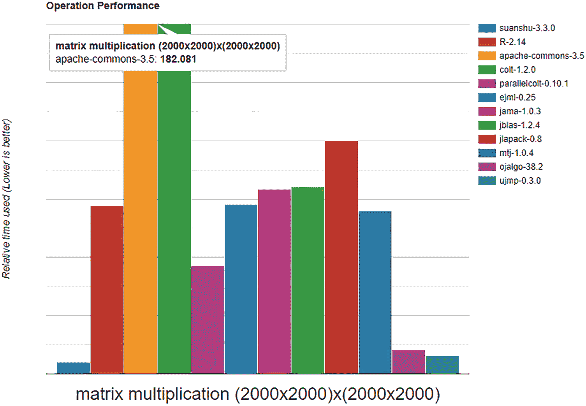

相对时间与矩阵乘法的柱状图。Apache commons 3.5 和 colt 1.2.0 的操作性能最高，而 suanshu 3.3.0 的性能最低。

**图 2-12** NM Dev 快速矩阵乘法

NM Dev 实现了一种用于快速矩阵乘法的先进算法。我们简要描述这个矩阵乘法算法的实现，与经典 IJK 算法相比，它显著加速了稠密矩阵-矩阵乘法。

我们首先描述作为该快速算法比较基准的方法，即 IJK 算法。经典的 IJK 算法使用三层循环进行矩阵乘法，因此时间复杂度为 *O*(*n*³)。假设 **A** 是 *m* × *n*，***B*** 是 *n* × *p*，***C*** 是 *m* × *p*，则 IJK 算法如下：

```
for (i = 1; i <= m; i ++){
for (j = 1; j <= p; j ++){
for (k = 1; k <= n; k ++){
C[i,k] += A[i,j] * B[j,k];
}
}
}
```

在 NM Dev 中，这是并行实现的；最外层的循环传递给一个`ParallelExecutor`。由于行数通常多于可用线程数，这种并行化的 IJK 算法的时间复杂度仍然与经典版本大致相同，为 *O*(*mnp*) 或当 *m* = *n* = *p* 时的立方时间 *O*(*n*³)。这是大多数其他 Java 库中的实现方式，而我们希望做得比这好得多。

我们快速乘法算法的核心是 Strassen 算法，它将时间复杂度降低到 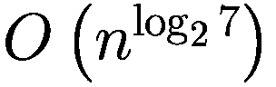。Strassen 算法（Strassen, 1969）基于以下分块矩阵乘法：

![$$ \left(\begin{array}{cc}{\boldsymbol{A}}_{\textbf{11}}&amp; {\boldsymbol{A}}_{\textbf{12}}\\ {}{\boldsymbol{A}}_{\textbf{21}}&amp; {\boldsymbol{A}}_{\textbf{22}}\end{array}\right)\left(\begin{array}{cc}{\boldsymbol{B}}_{\textbf{11}}&amp; {\boldsymbol{B}}_{\textbf{12}}\\ {}{\boldsymbol{B}}_{\textbf{21}}&amp; {\boldsymbol{B}}_{\textbf{22}}\end{array}\right)=\left(\begin{array}{cc}{\boldsymbol{A}}_{\textbf{11}}{\boldsymbol{B}}_{\textbf{11}}+{\boldsymbol{A}}_{\textbf{12}}{\boldsymbol{B}}_{\textbf{21}}&amp; {\boldsymbol{A}}_{\textbf{11}}{\boldsymbol{B}}_{\textbf{12}}+{\boldsymbol{A}}_{\textbf{12}}{\boldsymbol{B}}_{\textbf{22}}\\ {}{\boldsymbol{A}}_{\textbf{21}}{\boldsymbol{B}}_{\textbf{11}}+{\boldsymbol{A}}_{\textbf{22}}{\boldsymbol{B}}_{\textbf{21}}&amp; {\boldsymbol{A}}_{\textbf{21}}{\boldsymbol{B}}_{\textbf{12}}+{\boldsymbol{A}}_{\textbf{22}}{\boldsymbol{B}}_{\textbf{22}}\end{array}\right) $$](img/528380_1_En_2_Chapter_TeX_Equn.png)

计算此式的朴素方法涉及八次子矩阵乘法和四次加法。我们使用的 Strassen 算法的 Winograd 变体放弃了一次子矩阵乘法，转而进行 11 次额外的加法/减法，当子矩阵足够大时，这种方法更快（Winograd, 1971）。

算法运行如下（参见图 2-13）：

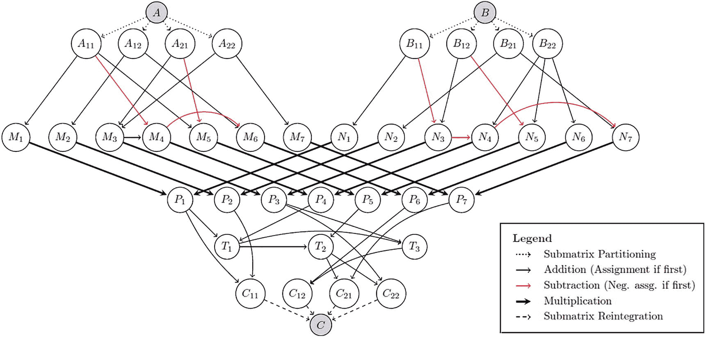

Strassen 算法的图示。网络拓扑中的虚线表示子矩阵划分，而粗箭头表示乘法。

**图 2-13** Strassen 算法的可视化（Winograd 变体）

| *M*[1] = *A*[11] | *N*[1] = *B*[11] |
| *M*[2] = *A*[12] | *N*[2] = *B*[21] |
| *M*[3] = *A*[21] + *A*[22] | *N*[3] = *B*[12] − *B*[11] |
| *M*[4] = *M*[3] − *A*[11] | *N*[4] = *B*[22] − *N*[3] |
| *M*[5] = *A*[11] − *A*[21] | *N*[5] = *B*[22] − *B*[12] |
| *M*[6] = *A*[12] − *M*[4] | *N*[6] = *B*[22] |
| *M*[7] = *A*[22] | *N*[7] = *B*[21] − *N*[4] |

1.  将***A***分割成四个大小相等的象限***A***[**11**], ***A***[**12**], ***A***[**21**], ***A***[**22**]。对***B***做同样的处理。
2.  得到以下因子矩阵：

| *C*[11] = *P*[1] + *P*[2] | *C*[22] = *T*[2] + *P*[3] |
| *T*[1] = *P*[1] + *P*[4] | *T*[3] = *T*[1] + *P*[3] |
| *T*[2] = *T*[1] + *P*[5] | *C*[12] = *T*[3] + *P*[6] |
| *C*[21] = *T*[2] + *P*[7] |  |

3.  对于 *i* ∈ {1, 2, ⋯, 7}，计算 ***P***[***i***] = ***M***[***i***] × ***N***[***i***]。根据维度的不同，我们或者使用并行 IJK，或者递归调用 Strassen 算法。
4.  然后可以如下得到最终乘积***C*** = ***A*** × ***B***。***T***[***i***] 是临时矩阵。


到目前为止，我们忽略了 `A` 和/或 `B` 的行/列数为奇数的情况。处理这种情况有几种方法。例如，你可以静态填充矩阵，使得在递归传递到 IJK 之前维度始终为偶数（静态填充）；或者，你可以在维度为奇数时再进行填充（动态填充）。另一种选择是，先忽略多余的行/列，待算法完成后再对其进行处理。（换句话说，如果 `A` 有多余的一行或 `B` 有多余的一列，则使用相应的矩阵-向量运算来计算 `C` 剩余的行/列。如果 `A` 有多余的一列且 `B` 有多余的一行，则它们的乘积可以在之后累加到 `C` 上。）NM Dev 在这个实现中使用了这种方法，称为**动态剥离**。

就其本身而言，这种基础版的 Strassen 算法在待乘矩阵大致为方阵时表现良好。在实践中，你可能会遇到某个矩阵高度矩形化（例如，过瘦或过长）的情况。你可以通过将矩阵分割成近似方形的块，然后在子矩阵上使用 Strassen 算法来解决这个问题。分块方案的目的是避免产生长条或高条的块。参见图 2-14。

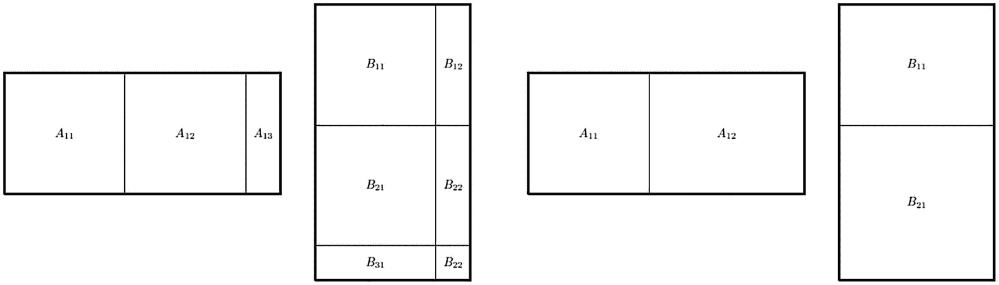

分块与瓦片化示意图。第一和第三个水平块被标识为 `A11`、`A12` 和 `A13`，而第二和第四个水平块被标识为 `B11`、`B21` 和 `B31`。

**图 2-14** 分块与瓦片化。左图：严格的分块方案（产生了长条！）。右图：高效的分块方案（我们的实现）

图 2-15 至 2-18 中的图表展示了我们混合的 Block-Strassen 算法与并行 IJK 算法在一台配备 Intel® Core i5-3337U CPU @ 1.80 GHz、6GB RAM、运行 Java 1.8.0 update 40 的机器上的性能对比。

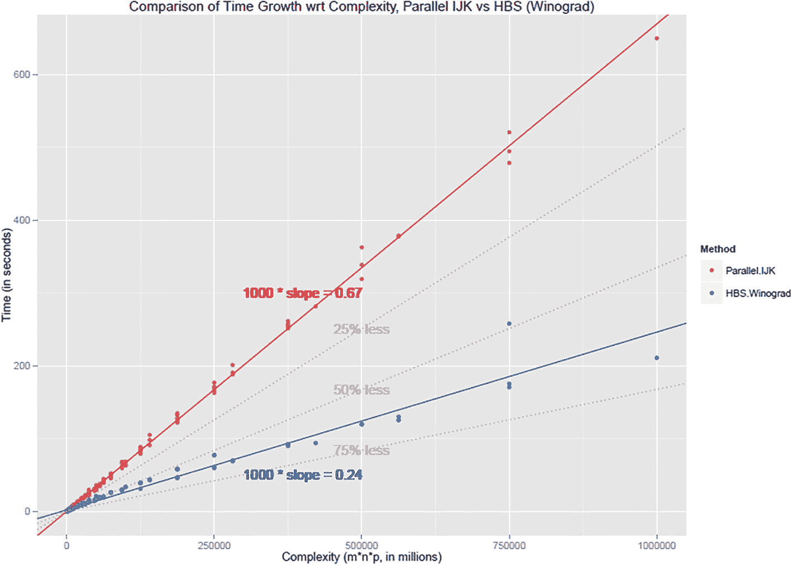

时间与复杂度的折线图。最高峰值由并行 IJK 方法表示。

**图 2-15** 乘法时间（按方法分类）与复杂度 `m × n × p` 的关系

测试模式参照 D'Alberto & Nicolau (2007)。我们对随机矩阵 `A`（`m` × `n`）和 `B`（`n` × `p`）执行了 `C = A × B` 运算。针对 `S`³ 中的每个三元组 (`m`, `n`, `p`)，其中 `S` = {100, 500, 1000, 2500, 5000, 7500, 10000}。该乘法运算使用并行 IJK 执行三次，然后使用混合 Block-Strassen（HBS）算法再执行三次。比较并记录了每种方法的平均时间。见图 2-15。

图 2-15 展示了乘法时间与维度乘积 `m × n × p` 的关系。IJK 算法的乘法时间是 `O(mnp)`，我们的实验结果表表明，并行 IJK 和 HBS 算法的乘法时间都与复杂度呈现强线性关系。然而，HBS 算法的梯度显著更小。

最佳拟合线的梯度表明，当复杂度趋近于无穷大时（忽略内存限制），HBS 算法所需的时间将比 IJK 算法少 63.5%。不过，有几个数据点（例如 `m`、`n`、`p` ≥ 5000）甚至显示出更大的加速比。参见图 2-16 和 2-17。

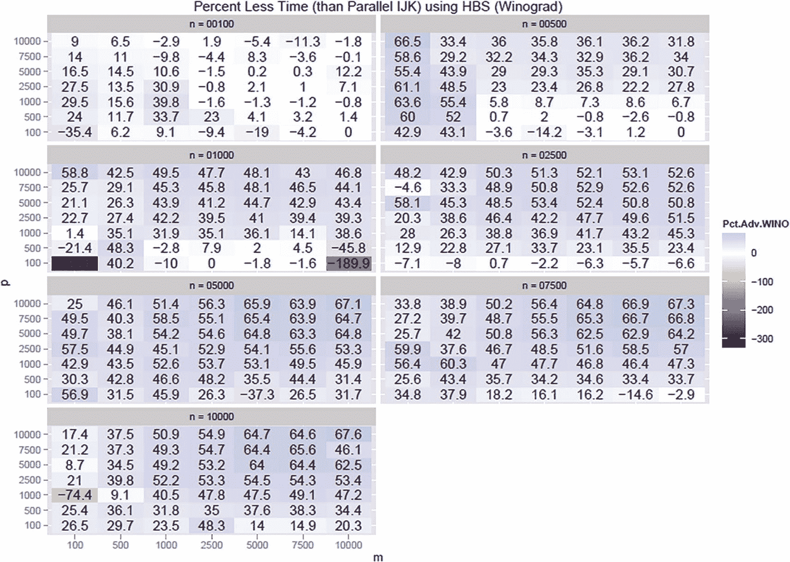

使用 HBS 算法节省的时间百分比矩阵。表格中不同值的阴影取决于颜色主题。

**图 2-17** 使用 HBS 与并行 IJK 相比的时间节省（占 P.IJK 时间的百分比）

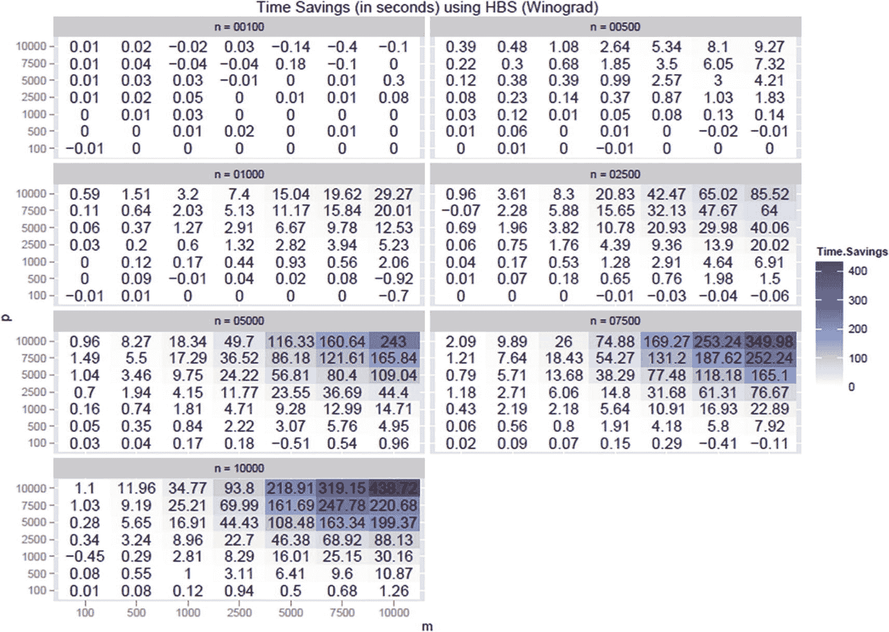

HBS 算法时间节省的矩阵表示。图中每个表格都给出了多个 `n` 值。

**图 2-16** 使用 HBS 与并行 IJK 相比的时间节省（单位：秒）

图 2-16 以秒为单位展示了 HBS 相较于并行 IJK 的时间节省，而图 2-17 则将其表示为并行 IJK 时间的百分比。每个表格对应特定的 `n` 值（`A` 的列数），并覆盖了 `m`（`A` 的行数）和 `p`（`B` 的列数）的取值范围。见图 2-18。

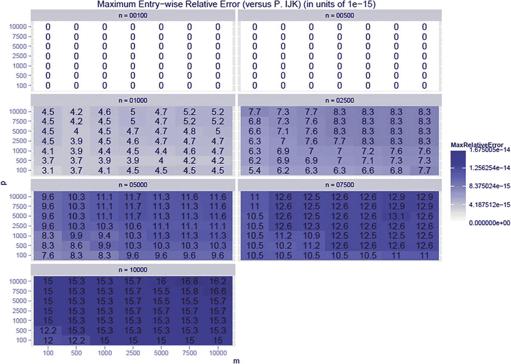

矩阵中最大逐元素相对误差的表示。对于 `n` 值 00100 和 00500，相对误差显示为无。

**图 2-18** HBS 相比于 PIJK 的最大逐元素相对误差（单位：1e-15）

最后，还进行了一项精度测试，以解决人们对 Strassen 算法数值稳定性的担忧。图 2-18 展示了结果乘积矩阵的最大逐元素相对误差 `max|(C_IJK - C_HBS) / C_IJK|`（对于所有 `i`, `j`）。可以看到没有任何误差超过 `2 × 10^(−14)`。请注意，我们并未将 Strassen 算法完全递归到标量级别；当矩阵 `M[i]` 和 `N[i]` 过小时，会改用 IJK 算法。这减少了误差。这表明 HBS 算法非常精确，因此当速度是首要考虑因素时，它是通用场景下的一个强力候选。HBS 是 NM Dev 中矩阵乘法的默认实现。

## 秩

矩阵 `A` 的列秩是 `A` 中线性无关列的最大数量。类似地，行秩是 `A` 中线性无关行的最大数量。矩阵的列秩和行秩总是相等的，因此可以简单地称为矩阵的秩 `rank(A)`。如果方阵的秩等于其列数（或行数），则称其为**满秩矩阵**。

示例如下：

```
A = [[1, 0, 1],
     [-2, -3, 1],
     [3, 3, 0]]
```

`A` 的秩为 2，因为前两列是线性无关的。然而，第三列是前两列的线性组合。具体来说，第三列等于第一列减去第二列。这是一个非满秩矩阵。

另一个例子：

```
A = [[1, 1, 0, 2],
     [-1, -1, 0, -2]]
```

`A` 的秩为 1，因为每一列都是第一列的标量倍数。

在 NM Dev 中，实用函数 `MatrixMeasure.rank` 用于计算矩阵的秩。以下代码计算了上述两个矩阵的秩：

```kotlin
val PRECISION: Double = 1e-15
val M1: Matrix = DenseMatrix(
arrayOf(
doubleArrayOf(1.0, 0.0, 1.0),
doubleArrayOf(-2.0, -3.0, 1.0),
doubleArrayOf(3.0, 3.0, 0.0)
)
)
// 计算 M1 的秩，将绝对值小于 PRECISION 的数字视为 0
val rank1: Int = MatrixMeasure.rank(M1, PRECISION)
println("秩 1: ${rank1}")
val M2: Matrix = DenseMatrix(
arrayOf(
doubleArrayOf(1.0, 1.0, 0.0, 2.0),
doubleArrayOf(-1.0, -1.0, 0.0, -2.0)
)
)
// 计算 M2 的秩，将绝对值小于 PRECISION 的数字视为 0
val rank2: Int = MatrixMeasure.rank(M2, PRECISION)
println("秩 2: ${rank2}")
```

输出结果如下：

```text

```


### 2.2.6 行列式

`Determinant` 是一个将 *n* × *n* 方阵 ***A*** 映射到标量的函数，通常记作 `|***A***|`。将矩阵 ***A*** 的元素记为 `*a*[*ij*]`，`*N*[*ij*]` 表示删除矩阵 ***A*** 的第 *i* 行和第 *j* 列后所得子矩阵的行列式。则矩阵 ***A*** 的行列式可按如下递推定义：

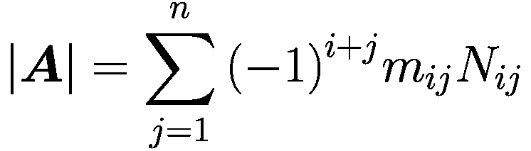

例如，当 *n* = 2 时，可得：

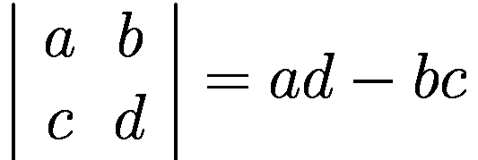

类似地，当 *n* = 3 时，可得：


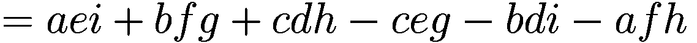

示例如下：

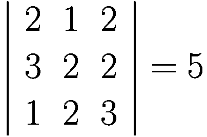

在 NM Dev 中，实用函数 `MatrixMeasure.det` 可计算矩阵的行列式。以下代码计算上述矩阵的行列式：

```
val M1: Matrix = DenseMatrix(
arrayOf(
doubleArrayOf(2.0, 1.0, 2.0),
doubleArrayOf(3.0, 2.0, 2.0),
doubleArrayOf(1.0, 2.0, 3.0)
)
)
// 计算矩阵 M1 的行列式
val det: Double = MatrixMeasure.det(M1)
println("行列式: ${det}")
```

输出结果如下：

```
行列式: 5.0
```

### 2.2.7 逆矩阵与伪逆矩阵

对于 *n* 阶方阵 ***A***，如果存在一个 *n* 阶方阵 ***B***，使得：

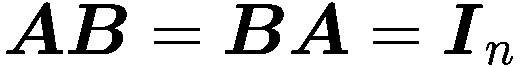

其中 ***I***[*n*] 是 *n* 阶单位矩阵，则称矩阵 ***A*** 是**可逆**的，矩阵 ***B*** 称为矩阵 ***A*** 的逆矩阵。通常将 ***A*** 的逆矩阵记作 `***A***^(−1)`，即 `***AA***^(−1) = ***A***^(−1)***A*** = ***I***[*n*]`。只有方阵才可能有逆矩阵。一个矩阵可逆当且仅当其满秩。并非所有方阵都可逆。不可逆的矩阵称为**奇异矩阵**或**退化矩阵**。矩阵奇异当且仅当其行列式为 0。

例如，考虑以下矩阵：

![$$ \boldsymbol{A}=\left[\begin{array}{cc}-1&amp; \frac{3}{2}\\ {}1&amp; -1\end{array}\right] $$](images/528380_1_En_2_Chapter/528380_1_En_2_Chapter_TeX_Equw.png)

***A*** 是可逆的。可以通过计算行列式 `|***A***| = − 0.5` 来验证。具体地，可得：

![$$ \left[\begin{array}{cc}-1&amp; \frac{3}{2}\\ {}1&amp; -1\end{array}\right]\left[\begin{array}{cc}2&amp; 3\\ {}2&amp; 2\end{array}\right]=\left[\begin{array}{cc}1&amp; 0\\ {}0&amp; 1\end{array}\right] $$](images/528380_1_En_2_Chapter/528380_1_En_2_Chapter_TeX_Equx.png)

在 NM Dev 中，`Inverse` 类构造一个新矩阵，该矩阵是可逆矩阵的逆矩阵。以下代码计算上述矩阵的逆矩阵：

```
// 计算可逆矩阵的逆矩阵
val A1: Matrix = DenseMatrix(
arrayOf(
doubleArrayOf(-1.0, 3.0 / 2),
doubleArrayOf(1.0, -1.0)
)
)
val det1: Double = MatrixMeasure.det(A1)
println("A1 的行列式 = " + det1)
val Ainv1: Matrix = Inverse(A1)
val I1: Matrix = A1.multiply(Ainv1)
println(String.format("%s * \n%s = \n%s", A1, Ainv1, I1))
```

输出结果如下：

```
A1 的行列式 = -0.5
2x2
[,1] [,2]
[1,] -1.000000, 1.500000,
[2,] 1.000000, -1.000000,  *
2x2
[,1] [,2]
[1,] 2.000000, 3.000000,
[2,] 2.000000, 2.000000,  =
2x2
[,1] [,2]
[1,] 1.000000, 0.000000,
[2,] 0.000000, 1.000000,
```

再考虑另一个矩阵：

![$$ \boldsymbol{A}=\left[\begin{array}{cc}2&amp; 4\\ {}5&amp; 10\end{array}\right] $$](images/528380_1_En_2_Chapter/528380_1_En_2_Chapter_TeX_Equy.png)

很容易检验该矩阵是奇异的，因为 `|***A***| = 0`，所以其逆矩阵不存在。摩尔和彭罗斯定义了一种广义逆的概念，称为**摩尔-彭罗斯逆**，简称**伪逆**，记作 `***A***^+`。伪逆具有以下四个定义性质：

1.  `***AA***^+***A*** = ***A***`
2.  `***A***^+***AA***^+ = ***A***^+`
3.  `(***AA***^+)^(*H*) = ***AA***^+`
4.  `(***A***^+***A***)^(*H*) = ***A***^+***A***`

运算符 `***A***^(*H*)` 表示矩阵的埃尔米特转置（也称为**共轭转置**）。首先对矩阵进行转置，然后将矩阵元素替换为其复共轭，即将 `*a* + *bi*` 替换为 `*a* − *bi*`。具体地，一个 *m* × *n* 矩阵 ***A*** 的埃尔米特转置定义如下：

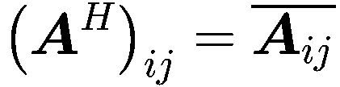

上划线表示标量的复共轭。如果 ***A*** 中所有元素均为实数，则埃尔米特转置与普通转置相同。第三条和第四条性质意味着 `***AA***^+` 和 `***A***^+***A***` 是对称矩阵。矩阵的伪逆是唯一确定的。它始终存在，即便对于非方阵也是如此。如果矩阵可逆，那么伪逆与逆矩阵相同。

在 NM Dev 中，`PseudoInverse` 类构造一个新矩阵，该矩阵是某个矩阵（奇异矩阵或可逆矩阵）的伪逆。以下代码计算上述矩阵的伪逆：


```kotlin
// compute the pseudo-inverse of a non-invertible matrix
val A2: Matrix = DenseMatrix(
arrayOf(
doubleArrayOf(2.0, 4.0),
doubleArrayOf(5.0, 10.0)
)
)
val det2: Double = MatrixMeasure.det(A2)
println("det of A2 = " + det2)
val A2p: PseudoInverse = PseudoInverse(A2)
println("The pseudo inverse is")
println(A2p)
// the first property of pseudo-inverse
println("Should be the same as the matrix")
val A2_copy: Matrix = A2.multiply(A2p).multiply(A2)
println(A2_copy)
// the second property of pseudo-inverse
println("Should be the same as the pseudo inverse")
val A2p_copy: Matrix = A2p.multiply(A2).multiply(A2p)
println(A2p_copy)
```

输出结果如下：

```
det of A2 = 0.0
the pseudo inverse is
2x2
[,1] [,2]
[1,] 0.013793, 0.034483,
[2,] 0.027586, 0.068966,
should be the same as the matrix
2x2
[,1] [,2]
[1,] 2.000000, 4.000000,
[2,] 5.000000, 10.000000,
should be the same as the pseudo inverse
2x2
[,1] [,2]
[1,] 0.013793, 0.034483,
[2,] 0.027586, 0.068966,
```

再考虑一个非方阵的示例，如下所示：

![$$ \boldsymbol{A}=\left[\begin{array}{cc}1&amp; 0\\ {}0&amp; 1\\ {}0&amp; 1\end{array}\right] $$](images/528380_1_En_2_Chapter/528380_1_En_2_Chapter_TeX_Equaa.png)

其伪逆如下所示：

![$$ {\boldsymbol{A}}^{+}=\left[\begin{array}{ccc}1&amp; 0&amp; 0\\ {}0&amp; 0.5&amp; 0.5\end{array}\right] $$](images/528380_1_En_2_Chapter/528380_1_En_2_Chapter_TeX_Equab.png)

以下代码计算上述矩阵的伪逆：

```kotlin
// compute the pseudo-inverse of a non-square matrix
val A3: Matrix = DenseMatrix(
arrayOf(
doubleArrayOf(1.0, 0.0),
doubleArrayOf(0.0, 1.0),
doubleArrayOf(0.0, 1.0)
)
)
val A3p: PseudoInverse = PseudoInverse(A3)
println("The pseudo inverse is")
println(A3p)
// the first property of pseudo-inverse
println("Should be the same as the matrix")
val A3_copy: Matrix = A3.multiply(A3p).multiply(A3)
println(A3_copy)
// the second property of pseudo-inverse
println("Should be the same as the pseudo inverse")
val A3p_copy: Matrix = A3p.multiply(A3).multiply(A3p)
println(A3p_copy)
```

输出结果如下：

```
the pseudo inverse is
2x3
[,1] [,2] [,3]
[1,] 1.000000, 0.000000, 0.000000,
[2,] 0.000000, 0.500000, 0.500000,
should be the same as the matrix
3x2
[,1] [,2]
[1,] 1.000000, 0.000000,
[2,] 0.000000, 1.000000,
[3,] 0.000000, 1.000000,
should be the same as the pseudo inverse
2x3
[,1] [,2] [,3]
[1,] 1.000000, 0.000000, 0.000000,
[2,] 0.000000, 0.500000, 0.500000,
```

## 2.2.8 克罗内克积

克罗内克积（又称外积或矩阵直积），用 ⨂ 表示，是对两个任意大小矩阵进行运算，结果得到一个分块矩阵。具体来说，如果 `A` 是一个 *m* × *n* 矩阵，`B` 是一个 *p* × *q* 矩阵，那么克罗内克积 `A` ⨂ `B` 是一个 *pm* × *qn* 的分块矩阵，如下所示：

![$$ \boldsymbol{A}\otimes \boldsymbol{B}=\left[\begin{array}{ccc}{a}_{11}\boldsymbol{B}&amp; \cdots &amp; {a}_{1n}\boldsymbol{B}\\ {}\vdots &amp; \ddots &amp; \vdots \\ {}{a}_{m1}\boldsymbol{B}&amp; \cdots &amp; {a}_{mn}\boldsymbol{B}\end{array}\right] $$](images/528380_1_En_2_Chapter/528380_1_En_2_Chapter_TeX_Equac.png)

或者更明确地表示如下：

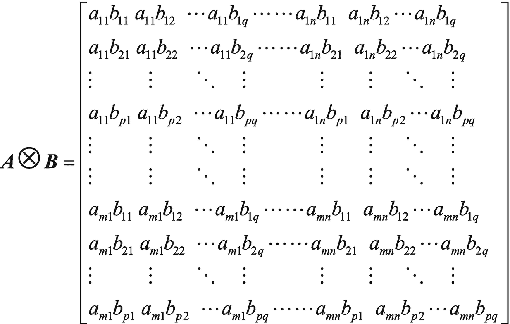

矩阵的表示。该矩阵给出了 a 乘以 b 这个问题的答案。

以下是一个例子：

![$$ \left[\begin{array}{cc}1&amp; 2\\ {}3&amp; 4\end{array}\right]\otimes \left[\begin{array}{cc}0&amp; 5\\ {}6&amp; 7\end{array}\right]=\left[\begin{array}{cc}1\left[\begin{array}{cc}0&amp; 5\\ {}6&amp; 7\end{array}\right]&amp; 2\left[\begin{array}{cc}0&amp; 5\\ {}6&amp; 7\end{array}\right]\\ {}3\left[\begin{array}{cc}0&amp; 5\\ {}6&amp; 7\end{array}\right]&amp; 4\left[\begin{array}{cc}0&amp; 5\\ {}6&amp; 7\end{array}\right]\end{array}\right]=\left[\begin{array}{cccc}1\times 0&amp; 1\times 5&amp; 2\times 0&amp; 2\times 5\\ {}1\times 6&amp; 1\times 7&amp; 2\times 6&amp; 2\times 7\\ {}3\times 0&amp; 3\times 5&amp; 4\times 0&amp; 4\times 5\\ {}3\times 6&amp; 3\times 7&amp; 4\times 6&amp; 4\times 7\end{array}\right]=\left[\begin{array}{cccc}0&amp; 5&amp; 0&amp; 10\\ {}6&amp; 7&amp; 12&amp; 14\\ {}0&amp; 15&amp; 0&amp; 20\\ {}18&amp; 21&amp; 24&amp; 28\end{array}\right] $$](images/528380_1_En_2_Chapter/528380_1_En_2_Chapter_TeX_Equad.png)

这是另一个例子：

![$$ {\displaystyle \begin{array}{c}\left[\begin{array}{cc}1&amp; -47\\ {}-2&amp; 33\end{array}\right]\otimes \left[\begin{array}{cccc}8&amp; 9&amp; 6&amp; 5\\ {}1&amp; -3&amp; -4&amp; 7\\ {}2&amp; 8&amp; -8&amp; 3\\ {}1&amp; 2&amp; -5&amp; -1\end{array}\right]\\ {}=\left[\begin{array}{cccccccccccc}8&amp; -9&amp; -6&amp; 5&amp; -32&amp; 36&amp; 24&amp; -20&amp; 56&amp; -63&amp; -42&amp; 35\\ {}1&amp; -3&amp; -4&amp; 7&amp; -4&amp; 12&amp; 16&amp; -28&amp; 7&amp; -21&amp; -28&amp; 49\\ {}2&amp; 8&amp; -8&amp; -3&amp; -8&amp; -32&amp; 32&amp; 12&amp; 14&amp; 56&amp; -56&amp; -21\\ {}1&amp; 2&amp; -5&amp; -1&amp; -4&amp; -8&amp; 20&amp; 4&amp; 7&amp; 14&amp; -35&amp; -7\\ {}-16&amp; 18&amp; 12&amp; -10&amp; 24&amp; -27&amp; -18&amp; 15&amp; 24&amp; -27&amp; -18&amp; 15\\ {}-2&amp; 6&amp; 8&amp; -14&amp; 3&amp; -9&amp; -12&amp; 21&amp; 3&amp; -9&amp; -12&amp; 21\\ {}-4&amp; -16&amp; 16&amp; 6&amp; 6&amp; 24&amp; -24&amp; -9&amp; 6&amp; 24&amp; -24&amp; -9\\ {}-2&amp; -4&amp; 10&amp; 2&amp; 3&amp; 6&amp; -15&amp; -3&amp; 3&amp; 6&amp; -15&amp; -3\end{array}\right]\end{array}} $$](images/528380_1_En_2_Chapter/528380_1_En_2_Chapter_TeX_Equae.png)

在 NM Dev 中，`KroneckerProduct`类构造一个新矩阵，该矩阵是两个矩阵的克罗内克积。以下代码计算前面示例的克罗内克积：

```kotlin
val A1 = DenseMatrix(
arrayOf(
doubleArrayOf(1.0, 2.0),
doubleArrayOf(3.0, 4.0)
)
)
val B1 = DenseMatrix(
arrayOf(
doubleArrayOf(0.0, 5.0),
doubleArrayOf(6.0, 7.0)
)
)
val C1 = KroneckerProduct(A1, B1)
println(String.format("%s ⊗ \n%s = \n%s", A1, B1, C1))
```

输出结果如下：

```
2x2
[,1] [,2]
[1,] 1.000000, 2.000000,
[2,] 3.000000, 4.000000,  ⊗
2x2
[,1] [,2]
[1,] 0.000000, 5.000000,
[2,] 6.000000, 7.000000,  =
4x4
[,1] [,2] [,3] [,4]
[1,] 0.000000, 5.000000, 0.000000, 10.000000,
[2,] 6.000000, 7.000000, 12.000000, 14.000000,
[3,] 0.000000, 15.000000, 0.000000, 20.000000,
[4,] 18.000000, 21.000000, 24.000000, 28.000000,
```

以下是另一个克罗内克积的例子：


```kotlin
val A2 = DenseMatrix(
    arrayOf(
        doubleArrayOf(1.0, -4.0, 7.0),
        doubleArrayOf(-2.0, 3.0, 3.0)
    )
)
val B2 = DenseMatrix(
    arrayOf(
        doubleArrayOf(8.0, -9.0, -6.0, 5.0),
        doubleArrayOf(1.0, -3.0, -4.0, 7.0),
        doubleArrayOf(2.0, 8.0, -8.0, -3.0),
        doubleArrayOf(1.0, 2.0, -5.0, -1.0)
    )
)
val C2 = KroneckerProduct(A2, B2)
println(String.format("%s ⊗ \n%s = \n%s", A2, B2, C2))
```

输出结果如下：

```
2x3
[,1] [,2] [,3]
[1,] 1.000000, -4.000000, 7.000000,
[2,] -2.000000, 3.000000, 3.000000,  ⊗
4x4
[,1] [,2] [,3] [,4]
[1,] 8.000000, -9.000000, -6.000000, 5.000000,
[2,] 1.000000, -3.000000, -4.000000, 7.000000,
[3,] 2.000000, 8.000000, -8.000000, -3.000000,
[4,] 1.000000, 2.000000, -5.000000, -1.000000,  =
8x12
[,1] [,2] [,3] [,4] [,5] [,6] [,7] [,8] [,9] [,10] [,11] [,12]
[1,] 8.000000, -9.000000, -6.000000, 5.000000, -32.000000, 36.000000, 24.000000, -20.000000, 56.000000, -63.000000, -42.000000, 35.000000,
[2,] 1.000000, -3.000000, -4.000000, 7.000000, -4.000000, 12.000000, 16.000000, -28.000000, 7.000000, -21.000000, -28.000000, 49.000000,
[3,] 2.000000, 8.000000, -8.000000, -3.000000, -8.000000, -32.000000, 32.000000, 12.000000, 14.000000, 56.000000, -56.000000, -21.000000,
[4,] 1.000000, 2.000000, -5.000000, -1.000000, -4.000000, -8.000000, 20.000000, 4.000000, 7.000000, 14.000000, -35.000000, -7.000000,
[5,] -16.000000, 18.000000, 12.000000, -10.000000, 24.000000, -27.000000, -18.000000, 15.000000, 24.000000, -27.000000, -18.000000, 15.000000,
[6,] -2.000000, 6.000000, 8.000000, -14.000000, 3.000000, -9.000000, -12.000000, 21.000000, 3.000000, -9.000000, -12.000000, 21.000000,
[7,] -4.000000, -16.000000, 16.000000, 6.000000, 6.000000, 24.000000, -24.000000, -9.000000, 6.000000, 24.000000, -24.000000, -9.000000,
[8,] -2.000000, -4.000000, 10.000000, 2.000000, 3.000000, 6.000000, -15.000000, -3.000000, 3.000000, 6.000000, -15.000000, -3.000000,
```

## 2.3 矩阵分解

矩阵分解是将一个矩阵因式分解为多个（更简单的）矩阵的乘积。针对不同应用场景（如求解线性方程组和计算特征值），存在多种不同的矩阵分解方法。它们在精度和稳定性等方面具有不同的数值特性。

### 2.3.1 LU 分解

LU 分解（即 LU 因式分解）将一个矩阵分解为一个下三角矩阵和一个上三角矩阵的乘积。计算机通常使用 LU 分解来求解方形线性方程组（当变量数量与方程数量相同时）。它也是求逆矩阵或计算矩阵行列式时的关键步骤。具体而言，对于一个方阵 ***A***，LU 分解会找到一个下三角矩阵 ***L***（对角线上方所有元素均为零）和一个上三角矩阵 ***U***（对角线下方所有元素均为零），使得：


例如，对于一个 3 × 3 的矩阵 ***A***，其 LU 分解如下所示：

![$$ \left[\begin{array}{ccc}{a}_{11}&amp; {a}_{12}&amp; {a}_{13}\\ {}{a}_{21}&amp; {a}_{22}&amp; {a}_{23}\\ {}{a}_{31}&amp; {a}_{32}&amp; {a}_{33}\end{array}\right]=\left[\begin{array}{ccc}{l}_{11}&amp; 0&amp; 0\\ {}{l}_{21}&amp; {l}_{22}&amp; 0\\ {}{l}_{31}&amp; {l}_{32}&amp; {l}_{33}\end{array}\right]\left[\begin{array}{ccc}{u}_{11}&amp; {u}_{12}&amp; {u}_{13}\\ {}0&amp; {u}_{22}&amp; {u}_{23}\\ {}0&amp; 0&amp; {u}_{33}\end{array}\right] $$](images/528380_1_En_2_Chapter/528380_1_En_2_Chapter_TeX_Equag.png)

这种形式有时可能无法实现。例如，如果 `a[11] = 0`，那么要么 `l[11] = 0`，要么 `u[11] = 0`。只需对 ***A*** 的行重新排序，使得置换后矩阵的第一个元素非零，即可解决此问题。后续分解步骤中的相同问题也可用同样的方法解决。因此，乘积有时会包含一个置换矩阵 ***P***。具体来说：

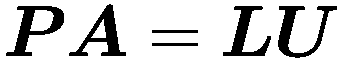

***P*** 是一个行置换矩阵，当左乘 ***A*** 时，会对 ***A*** 的行进行重排。事实证明，所有方阵都可以用这种形式进行分解，并且该分解在实践中具有数值稳定性。这使得 LUP 分解成为一种实用的技术。

例如，假设现有以下分解：

![$$ \left[\begin{array}{ccc}0&amp; 0&amp; 1\\ {}1&amp; 0&amp; 0\\ {}0&amp; 0&amp; 0\end{array}\right]\left[\begin{array}{ccc}1&amp; 2&amp; 3\\ {}4&amp; 5&amp; 6\\ {}7&amp; 8&amp; 9\end{array}\right]=\left[\begin{array}{ccc}1&amp; 0&amp; 0\\ {}0.142857&amp; 1&amp; 0\\ {}0.571429&amp; 0.5&amp; 1\end{array}\right]\left[\begin{array}{ccc}7&amp; 8&amp; 9\\ {}0&amp; 0.857143&amp; 1.714286\\ {}0&amp; 0&amp; 0\end{array}\right] $$](images/528380_1_En_2_Chapter/528380_1_En_2_Chapter_TeX_Equai.png)

在 NM Dev 中，`LU` 类用于对方阵执行 LU 分解。它会计算矩阵 ***L***、***U*** 和 ***P***。以下代码实现了前面的示例：

```kotlin
val A: Matrix = DenseMatrix(
    arrayOf(
        doubleArrayOf(1.0, 2.0, 3.0),
        doubleArrayOf(4.0, 5.0, 6.0),
        doubleArrayOf(7.0, 8.0, 9.0)
    )
)
// 执行 LU 分解
val lu: LU = LU(A)
val P: PermutationMatrix = lu.P()
println(String.format("P = %s", P))
```

输出结果如下：

```
P = 3x3
[,1] [,2] [,3]
[1,] 0.000000, 0.000000, 1.000000,
[2,] 1.000000, 0.000000, 0.000000,
[3,] 0.000000, 1.000000, 0.000000,
val L: LowerTriangularMatrix = lu.L()
println(String.format("L = %s", L))
```

输出结果如下：

```
L = 3x3
[,1] [,2] [,3]
[1,] 1.000000, 0.000000, 0.000000,
[2,] 0.142857, 1.000000, 0.000000,
[3,] 0.571429, 0.500000, 1.000000,
val U: UpperTriangularMatrix = lu.U()
println(String.format("U = %s", U))
```

输出结果如下：

```
U = 3x3
[,1] [,2] [,3]
[1,] 7.000000, 8.000000, 9.000000,
[2,] 0.000000, 0.857143, 1.714286,
[3,] 0.000000, 0.000000, 0.000000,
val PA: Matrix = P.multiply(A)
val LU: Matrix = L.multiply(U)
// 验证 PA = LU
println(String.format("%s = \n%s is %b",
    PA,
    LU,
    MatrixPropertyUtils.areEqual(PA, LU, 1e-14)))
```

输出结果如下：

```
3x3
[,1] [,2] [,3]
[1,] 7.000000, 8.000000, 9.000000,
[2,] 1.000000, 2.000000, 3.000000,
[3,] 4.000000, 5.000000, 6.000000,  =
3x3
[,1] [,2] [,3]
[1,] 7.000000, 8.000000, 9.000000,
[2,] 1.000000, 2.000000, 3.000000,
[3,] 4.000000, 5.000000, 6.000000,  is true
```

好的，作为高级文档工程师和翻译员，我将严格遵循您提供的注意事项和示例，将以下英文文本翻译成中文。


### 2.3.2 乔列斯基分解

如果 `A` 是一个对称（若 `A` 为复数，则为埃尔米特）正定矩阵，那么你可以使 `U` 成为 `L` 的共轭转置。也就是说，你可以将 `A` 写成以下形式：

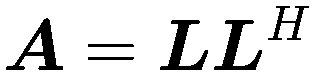

这种分解被称为乔列斯基分解。乔列斯基分解是将一个埃尔米特正定矩阵 `A` 分解为一个下三角矩阵 `L` 与其共轭转置 `L`^`H`（如果矩阵是实数，则简单表示为转置 `L`^`T`）的乘积。`L`^`H` 是一个上三角矩阵。对于正定矩阵，乔列斯基分解总是存在且唯一的。此外，计算乔列斯基分解比计算 LU 分解更高效，数值上也更稳定。在适用的情况下，对于求解线性方程组，乔列斯基分解的效率大约是 LU 分解的两倍。

经典乔列斯基分解的一种变体是 LDL 分解。即：

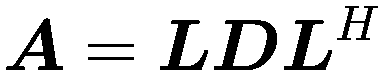

其中 `L` 是单位下三角矩阵（对角线元素为 1），`D` 是一个对角矩阵（对角线外元素全为零）。也就是说，为了在分解中引入一个额外的对角矩阵 `D`，要求 `L` 的对角元素为 1（单位三角）。其主要优势在于，LDL 分解可以使用本质上相同的算法进行计算和应用，但避免了平方根运算。LDL 分解与经典乔列斯基分解的关系如下：


例如，假设你有以下矩阵：

![$$ \left[\begin{array}{ccc}4&amp; 12&amp; -16\\ {}12&amp; 37&amp; -43\\ {}-16&amp; -43&amp; 98\end{array}\right]=\left[\begin{array}{ccc}2&amp; 0&amp; 0\\ {}6&amp; 1&amp; 0\\ {}-8&amp; 5&amp; 3\end{array}\right]\left[\begin{array}{ccc}2&amp; 6&amp; -8\\ {}0&amp; 1&amp; 5\\ {}0&amp; 0&amp; 3\end{array}\right] $$](images/528380_1_En_2_Chapter/528380_1_En_2_Chapter_TeX_Equam.png)

实现乔列斯基分解的方法有很多种。在 NM Dev 中，`Cholesky` 接口代表了库中的多种算法。`Chol` 类封装了一些实现，可根据输入矩阵选择使用。默认选择是 `Cholesky-Banachiewicz` 类。Cholesky-Banachiewicz 算法从矩阵 `L` 的左上角开始，逐行计算矩阵。NM Dev 的 `Chol` 实现针对性能进行了高度优化，因为乔列斯基分解是如此基础的操作，并出现在许多线性代数计算中。对于大型矩阵，`Chol` 会并行运行 Cholesky-Banachiewicz 算法。对于稀疏矩阵（元素大部分为零的矩阵），它会运行一个稀疏版本。`Cholesky` 计算矩阵 `L`。以下代码实现了前面的示例：

```kotlin
val A: Matrix = DenseMatrix(
    arrayOf(
        doubleArrayOf(4.0, 12.0, -16.0),
        doubleArrayOf(12.0, 37.0, -43.0),
        doubleArrayOf(-16.0, -43.0, 98.0)
    )
)
val chol: Cholesky = Chol(A)
val L: LowerTriangularMatrix = chol.L()
val Lt: UpperTriangularMatrix = chol.L().t()
println(String.format("\nL = %s", L))
```

输出如下：

```
L = 3x3
[,1] [,2] [,3]
[1,] 2.000000, 0.000000, 0.000000,
[2,] 6.000000, 1.000000, 0.000000,
[3,] -8.000000, 5.000000, 3.000000,
println(String.format("Lt = %s", Lt))
```

输出如下：

```
Lt = 3x3
[,1] [,2] [,3]
[1,] 2.000000, 6.000000, -8.000000,
[2,] 0.000000, 1.000000, 5.000000,
[3,] 0.000000, 0.000000, 3.000000,
val LLt: Matrix = L.multiply(Lt)
// 验证 A = LLt
println(String.format("%s = \n%s is %b",
    A,
    LLt,
    MatrixPropertyUtils.areEqual(A, LLt, 1e-14)))
```

输出如下：

```
3x3
[,1] [,2] [,3]
[1,] 4.000000, 12.000000, -16.000000,
[2,] 12.000000, 37.000000, -43.000000,
[3,] -16.000000, -43.000000, 98.000000,  =
3x3
[,1] [,2] [,3]
[1,] 4.000000, 12.000000, -16.000000,
[2,] 12.000000, 37.000000, -43.000000,
[3,] -16.000000, -43.000000, 98.000000,  is true
```


### 2.3.3 海森堡分解与三对角化

在二维空间 ℝ² 中，通常使用 x 轴和 y 轴作为坐标或基。然而，这两个轴除了相互垂直（正交）之外，并无特殊之处。如果更方便，你同样可以选择另一组正交轴来标记坐标。参见图 2-19。

基变换的示意图。角度箭头由符号 `v1`、`u1`、`v2` 和 `u2` 标识。

**图 2-19** – 坐标变换或基变换

对于图 2-19 中的示例，假设 `{u1 = (1, 0), u2 = (0, 1)}` 是通常的 x-y 轴。`{v1, v2}` 是新坐标系或基，它是 `{u1, u2}` 旋转 θ 角度得到的。你可以用 `{u1, u2}` 来表示 `{v1, v2}`，如下所示：

`v1 = u1 * cos θ + u2 * sin θ`  
`v2 = u1 * (-sin θ) + u2 * cos θ`

或者等效地以矩阵形式表示：

`[v1, v2]^T = [[cos θ, sin θ], [-sin θ, cos θ]] * [u1, u2]^T`

通过左乘基变换矩阵 `P = [[cos θ, sin θ], [-sin θ, cos θ]]`，你可以用原始坐标来表示新坐标。相同的基变换概念也适用于更高维度。

两个 *n* × *n* 方阵 `A` 和 `B` 是相似的，如果存在一个可逆矩阵 `P`，使得：

`B = P^(-1) * A * P`

`A` 和 `B` 表示相同的线性变换，但处于两个具有不同基的坐标系中。矩阵 `P` 是基变换矩阵。在基变换后的新坐标系中，`x` 的坐标如下所示：

`x' = P * x`

在新坐标系中，该变换可以写成：

`y' = A * x'`

在具有原始基的坐标系中，该变换为：

`y = B * x = P^(-1) * A * P * x`

从几何角度来看，相似变换分三步进行：变换到新基（`Px`），执行简单变换（`APx`），再变换回旧基（`P^(-1)APx`）。基变换（例如，将旋转轴与 z 轴正方向对齐）可以得出相同变换或矩阵的更简形式，例如 `A` 中有更多的零。相似矩阵具有相同的特征值、重数和行列式。

（上）海森堡矩阵是在第一次对角线以下元素均为零的矩阵。第一次对角线是指恰好位于对角线之下的元素。换句话说，海森堡矩阵仅在第一次对角线、对角线以及矩阵的上三角部分有非零元素。即，当 `i > j + 1` 时，`a[i][j] = 0`。例如，以下矩阵是一个海森堡矩阵：

`[[1, 4, 2, 3], [3, 4, 1, 7], [0, 2, 3, 4], [0, 0, 1, 3]]`

海森堡分解对于方阵 `A` 找到一个矩阵 `Q`，使得：

`Q' * A * Q = H`

`H` 是一个海森堡矩阵。`Q` 是一个正交矩阵，这意味着任意两行（或两列）是正交的，即它们的点积为 0。等价地，`Q^(-1) = Q'`。因此，`A` 和 `H` 是相似的。

在 NM Dev 中，`HessenbergDecomposition` 类对方阵执行海森堡分解。它计算 `Q` 和 `H` 矩阵。以下代码实现了这个示例：

`Q * A * Q^T = H`

其中：

`Q = [[1, 0, 0, 0], [0, -0.348743, 0.089751, -0.932911], [0, -0.464991, -0.880822, 0.089084], [0, -0.813733, 0.464862, 0.348914]]`  
`A = [[1, 5, 7, 9], [3, 0, 6, 3], [4, 3, 1, 0], [7, 13, 2, 10]]`  
`H = [[1, -12.322250, -1.533240, -0.900742], [-8.602325, 13.594595, -1.657558, 7.593136], [0, -5.460964, 2.073954, -1.404349], [0, 0, 4.989271, -4.668549]]`

```
println("Hessenberg decomposition")
val A: Matrix = DenseMatrix(
arrayOf(
doubleArrayOf(1.0, 5.0, 7.0, 9.0),
doubleArrayOf(3.0, 0.0, 6.0, 3.0),
doubleArrayOf(4.0, 3.0, 1.0, 0.0),
doubleArrayOf(7.0, 13.0, 2.0, 10.0)
)
)
val hessenberg: HessenbergDecomposition = HessenbergDecomposition(A)
val H: Matrix = hessenberg.H()
println(String.format(
"H = \n%s is Hessenberg, %b",
H,
Hessenberg.isHessenberg(H, 0.0)))
```

输出如下：

```
H =
4x4
[,1] [,2] [,3] [,4]
[1,] 1.000000, -12.322250, -1.533240, -0.900742,
[2,] -8.602325, 13.594595, -1.657558, 7.593136,
[3,] 0.000000, -5.460964, 2.073954, -1.404349,
[4,] 0.000000, 0.000000, 4.989271, -4.668549,  is Hessenberg, true

val Q: Matrix = hessenberg.Q()
println(String.format(
"Q = \n%s is orthogonal, %b",
Q,
MatrixPropertyUtils.isOrthogonal(Q, 1e-14)))
```

输出如下：

```
Q =
4x4
[,1] [,2] [,3] [,4]
[1,] 1.000000, 0.000000, 0.000000, 0.000000,
[2,] 0.000000, -0.348743, 0.089751, -0.932911,
[3,] 0.000000, -0.464991, -0.880822, 0.089084,
[4,] 0.000000, -0.813733, 0.464862, 0.348914,  is orthogonal, true

// 验证 Qt * A * Q = H
val QtAQ: Matrix = Q.t().multiply(A).multiply(Q)
println(String.format("%s = \n%s is %b",
H,
QtAQ,
MatrixPropertyUtils.isOrthogonal(Q, 1e-14)))
```

输出如下：

```
4x4
[,1] [,2] [,3] [,4]
[1,] 1.000000, -12.322250, -1.533240, -0.900742,
[2,] -8.602325, 13.594595, -1.657558, 7.593136,
[3,] 0.000000, -5.460964, 2.073954, -1.404349,
[4,] 0.000000, 0.000000, 4.989271, -4.668549,  =
4x4
[,1] [,2] [,3] [,4]
[1,] 1.000000, -12.322250, -1.533240, -0.900742,
[2,] -8.602325, 13.594595, -1.657558, 7.593136,
[3,] 0.000000, -5.460964, 2.073954, -1.404349,
[4,] -0.000000, 0.000000, 4.989271, -4.668549,  is true
```


如果 `A` 是埃尔米特矩阵，该变换会将其化简为三对角形式。即：

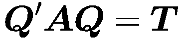

`A` 和 `T` 是相似的。`T` 是一个三对角矩阵。三对角矩阵的非零元素仅位于主对角线、主对角线下方第一条次对角线和主对角线上方第一条超对角线上。也就是说，当 `i > j + 1` 或 `i < j - 1` 时，`a[ij] = 0`。其形式如下：

![$$ T=\left[\begin{array}{ccccc}{a}_1&amp; {b}_1&amp; &amp; &amp; \\ {}{c}_1&amp; {a}_2&amp; {b}_2&amp; &amp; \\ {}&amp; {c}_2&amp; \ddots &amp; \ddots &amp; \\ {}&amp; &amp; \ddots &amp; \ddots &amp; {b}_{n-1}\\ {}&amp; &amp; &amp; {c}_{n-1}&amp; {a}_n\end{array}\right] $$](images/528380_1_En_2_Chapter/528380_1_En_2_Chapter_TeX_Equax.png)

在 NM Dev 中，`TriDiagonalization` 类用于对对称方阵进行三对角化。它会计算出 `Q` 和 `T` 矩阵。以下代码实现了此示例：

![$$ {\displaystyle \begin{array}{c}\left\lceil \begin{array}{cccc}1&amp; 0&amp; 0&amp; 0\\ {}0&amp; -0.40161&amp; 0.601902&amp; -0.690235\\ {}0&amp; -0.562254&amp; -0.756975&amp; -0.332956\\ {}0&amp; -0.722897&amp; 0.254368&amp; 0.64243\end{array}\right\rceil \times \left\lceil \begin{array}{cccc}1&amp; 5&amp; 7&amp; 9\\ {}5&amp; 0&amp; 3&amp; 13\\ {}7&amp; 3&amp; 1&amp; 2\\ {}9&amp; 13&amp; 2&amp; 10\end{array}\right\rceil \\ {}\times \left\lceil \begin{array}{cccc}1&amp; 0&amp; 0&amp; 0\\ {}0&amp; -0.40161&amp; -0.562254&amp; -0.722897\\ {}0&amp; 0.601902&amp; -0.756975&amp; 0.254368\\ {}0&amp; -0.690235&amp; -0.332956&amp; 0.64243\end{array}\right\rceil \\ {}=\left\lceil \begin{array}{cccc}1&amp; -12.4499&amp; 0&amp; 0\\ {}-12.4499&amp; 16.070968&amp; -7.692568&amp; 0\\ {}0&amp; -7.692568&amp; 1.696818&amp; 4.45481\\ {}0&amp; 0&amp; 4.45481&amp; -6.767786\end{array}\right\rceil \end{array}} $$](img/528380_1_En_2_Chapter_TeX_Equay.png)

```
println("三对角化")
// 定义一个对称矩阵
val S: Matrix = SymmetricMatrix(
arrayOf(
doubleArrayOf(1.0),
doubleArrayOf(5.0, 0.0),
doubleArrayOf(7.0, 3.0, 1.0),
doubleArrayOf(9.0, 13.0, 2.0, 10.0)
)
)
val triDiagonalization: TriDiagonalization = TriDiagonalization(S)
val T: Matrix = triDiagonalization.T()
println(String.format(
"T = \n%s 是三对角矩阵, %b",
T,
MatrixPropertyUtils.isTridiagonal(T, 1e-14)))
```

输出如下：

```
T = 4x4
[,1] [,2] [,3] [,4]
[1,] 1.000000, -12.449900, 0.000000, 0.000000,
[2,] -12.449900, 16.070968, -7.692568, 0.000000,
[3,] 0.000000, -7.692568, 1.696818, 4.454810,
[4,] 0.000000, 0.000000, 4.454810, -6.767786,  是三对角矩阵, true
val Q: Matrix = triDiagonalization.Q()
println(String.format(
"Q = \n%s 是正交矩阵, %b",
Q,
MatrixPropertyUtils.isOrthogonal(Q, 1e-14)))
```

输出如下：

```
Q = 4x4
[,1] [,2] [,3] [,4]
[1,] 1.000000, 0.000000, 0.000000, 0.000000,
[2,] 0.000000, -0.401610, 0.601902, -0.690235,
[3,] 0.000000, -0.562254, -0.756975, -0.332956,
[4,] 0.000000, -0.722897, 0.254368, 0.642430,  是正交矩阵, true
// 验证 Qt * A * Q = T
val QtSQ: Matrix = Q.t().multiply(S).multiply(Q)
println(String.format("%s = \n%s 是 %b",
T,
QtSQ,
MatrixPropertyUtils.areEqual(QtSQ, T, 1e-13)))
```

输出如下：

```
4x4
[,1] [,2] [,3] [,4]
[1,] 1.000000, -12.449900, 0.000000, 0.000000,
[2,] -12.449900, 16.070968, -7.692568, 0.000000,
[3,] 0.000000, -7.692568, 1.696818, 4.454810,
[4,] 0.000000, 0.000000, 4.454810, -6.767786,  =
4x4
[,1] [,2] [,3] [,4]
[1,] 1.000000, -12.449900, -0.000000, 0.000000,
[2,] -12.449900, 16.070968, -7.692568, 0.000000,
[3,] -0.000000, -7.692568, 1.696818, 4.454810,
[4,] 0.000000, 0.000000, 4.454810, -6.767786,  是 true
```

`SymmetricMatrix` 类根据矩阵下三角部分的数据构造一个对称矩阵。其签名如下：

```
/**
* 根据一个二维 {@code double[][]} 数组构造一个对称矩阵。
* 该数组仅指定整个矩阵的下三角部分（含主对角线）。
* 例如，
* 
*         new double[][]{
*                  {1},
*                  {2, 3},
*                  {4, 5, 6},
*                  {7, 8, 9, 10},
*                  {11, 12, 13, 14, 15}});
* 
* 会得到
* \[
* \begin{bmatrix}
* 1 & 2 & 4 & 7 & 11\\
* 2 & 3 & 5 & 8 & 12\\
* 4 & 5 & 6 & 9 & 13\\
* 7 & 8 & 9 & 10 & 14\\
* 11 & 12 & 13 & 14 & 15
* \end{bmatrix}
* \] * 为便于观察，此构造函数使用下三角而非上三角表示。
*
* @param data 下三角规范
*/
public SymmetricMatrix(double[][] data)
```

如果线性代数问题的约束条件不允许将一般矩阵方便地化简为三角矩阵，那么将其化简为海森伯格形式通常是次优选择。事实上，任何矩阵都可以在有限步数内化简为海森伯格形式。随后，可以通过迭代过程（如移位 QR 分解）将海森伯格矩阵进一步化简为三角矩阵。在特征值算法中，海森伯格矩阵可以通过结合缩减步骤的移位 QR 分解进一步化简为三角矩阵。将一般矩阵先化简为海森伯格矩阵，再进一步化简为三角矩阵，而不是直接将一般矩阵化简为三角矩阵，通常可以节省 QR 算法在特征值问题中涉及的算术运算量。


### 2.3.4 QR 分解

QR 分解（或称 QR 因式分解）是将矩阵 `A` 分解为以下乘积形式的一种分解方法：

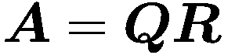

其中，`Q` 是正交矩阵（其列向量为单位向量，且满足 `Q^(-1) = Q'`），`R` 是上三角矩阵。如果 `A` 可逆，并且要求 `R` 的对角线元素为正（即 `R` 中的对角线元素均为正数），则该分解是唯一的。如果 `A` 具有 *n* 个线性无关的列，则 `Q` 的前 *n* 列构成 `A` 列空间的一组标准正交基。更一般地，对于任意 1 ≤ *k* ≤ *n*，`Q` 的前 *k* 列构成 `A` 的前 *k* 列张成空间的一组标准正交基。`A` 的任意第 *k* 列仅依赖于 `Q` 的前 *k* 列这一事实，决定了 `R` 的三角形式。

有多种方法可实现 QR 分解，例如通过 Gram-Schmidt 过程（`GramSchmidt` 类）、Householder 变换（`Householder` 类）或 Givens 旋转（`GivensMatrix` 类）。在 NM Dev 中，`QRDecomposition` 接口代表了不同 QR 算法的实现。其签名如下：

```java
public interface QRDecomposition {
/**
* 获取 P，即 QR 分解中的置换矩阵。
*
* @return P
*/
public PermutationMatrix P();
/**
* 获取 QR 分解中的正交矩阵 Q，即 A =
* QR。Q 的维度为 m x n，与待正交化的矩阵 A 相同。
*
* @return Q
*/
public Matrix Q();
/**
* 获取 QR 分解中的上三角矩阵 R，即 A =
* QR。R 的维度为 n x n，是一个方阵。
*
* @return R
*/
public UpperTriangularMatrix R();
/**
* 获取通过 QR 分解计算出的 A 的数值秩。
* 数值秩的判定需要一个准则来判断某个值何时应被视为零，因此需要一个精度参数。
* 这是一个实践性的选择，既取决于矩阵本身，也取决于应用场景。
* 例如，对于一个具有较大第一特征向量的矩阵，我们应相应降低精度来计算秩。
*
* @return A 的秩
*/
public int rank();
/**
* 获取方阵 Q。这是 QR 分解中 Q 矩阵的任意正交补全。
* 其维度为 m x m（方阵）。我们有 A = sqQ * tallR。
*
* @return 方阵 Q
*/
public Matrix squareQ();
/**
* 获取高矩阵 R。这是通过在 QR 分解中上三角方阵 R 的下方
* 绑定零行来补全得到的。其维度为 m x n。它可能不是方阵。
* 我们有 A = sqQ * tallR。
*
* @return 高矩阵 R
*/
public Matrix tallR();
}
```

到目前为止讨论的分解方法仅适用于方阵。QR 分解既适用于方阵，也适用于高矩阵，不过对后者略有不同。具体来说，对于一个 *m* × *n* 且 *m* ≥ *n* 的矩阵 `A`，可以执行以下操作：

![$$ \boldsymbol{A}=\boldsymbol{Q}\boldsymbol{R}=\boldsymbol{Q}\left[\begin{array}{c}{\boldsymbol{R}}_{\textbf{1}}\\ {}\textbf{0}\end{array}\right]=\left[{\boldsymbol{Q}}_{\textbf{1}}\kern0.5em {\boldsymbol{Q}}_{\textbf{2}}\right]\left[\begin{array}{c}{\boldsymbol{R}}_{\textbf{1}}\\ {}\textbf{0}\end{array}\right]={\boldsymbol{Q}}_{\textbf{1}}{\boldsymbol{R}}_{\textbf{1}} $$](images/528380_1_En_2_Chapter/528380_1_En_2_Chapter_TeX_Equba.png)

`Q` 是一个 *m* × *m* 的矩阵。`R` 是一个 *m* × *n* 的上三角矩阵。`R` 的底部 (*m* − *n*) 行全为零。`Q[1]` 是一个 *m* × *n* 的矩阵，而 `Q[2]` 是一个 *m* × (*m* − *n*) 的矩阵。`Q[1]` 和 `Q[2]` 的列向量都是正交的。`R[1]` 是一个 *n* × *n* 的矩阵。`Q()` 函数计算 *m* × *n* 的 `Q[1]` 矩阵。`R()` 函数计算 *n* × *n* 的 `R[1]` 矩阵。`squareQ()` 函数计算 *m* × *m* 的 `Q` 矩阵。`tallR()` 函数计算 *m* × *n* 的高矩阵 `R`。

NM Dev 类 `QR` 是一个封装类，用于执行 QR 分解。默认情况下，它使用 Householder QR 算法。与 Gram-Schmidt 过程相比，Householder 反射具有更好的数值稳定性。以下代码实现了此示例：

![$$ \left[\begin{array}{cc}3&amp; 2\\ {}1&amp; 2\end{array}\right]=\left[\begin{array}{cc}0.948683&amp; -0.316228\\ {}0.316228&amp; 0.948683\end{array}\right]\left[\begin{array}{cc}3.162278&amp; 2.529822\\ {}0&amp; 1.264911\end{array}\right] $$](images/528380_1_En_2_Chapter/528380_1_En_2_Chapter_TeX_Equbb.png)

```kotlin
val A: Matrix = DenseMatrix(
arrayOf(
doubleArrayOf(3.0, 2.0),
doubleArrayOf(1.0, 2.0)
)
)
// 使用 Householder QR 算法
val qr1: QRDecomposition = HouseholderQR(A, 0.0)
println("\nRank = " + qr1.rank())
val Q1: Matrix = qr1.Q()
println(String.format(
"\nQ = \n%s is orthogonal, %b",
Q1,
MatrixPropertyUtils.isOrthogonal(Q1, 1e-15)))
val R1: UpperTriangularMatrix = qr1.R()
println("\nR = \n" + R1)
```

输出如下：

```
rank = 2
Q =
2x2
[,1] [,2]
[1,] -0.948683, -0.316228,
[2,] -0.316228, 0.948683,  is orthogonal, true
R =
2x2
[,1] [,2]
[1,] -3.162278, -2.529822,
[2,] 0.000000, 1.264911,
// 验证 Q1R1 = A
val Q1R1: Matrix = Q1.multiply(R1)
println(String.format("\n%s = \n%s is %b",
A,
Q1R1,
MatrixPropertyUtils.areEqual(Q1R1, A, 1e-13)))
```

输出如下：

```
2x2
[,1] [,2]
[1,] 3.000000, 2.000000,
[2,] 1.000000, 2.000000,  =
2x2
[,1] [,2]
[1,] 3.000000, 2.000000,
[2,] 1.000000, 2.000000,  is true
// 使用 Gram-Schmidt QR 算法
val qr2: QRDecomposition = GramSchmidt(A)
println("\nRank = " + qr2.rank())
```

输出如下：

```
rank = 2
val Q2: Matrix = qr2.Q()
println(String.format(
"\nQ = \n%s is orthogonal, %b",
Q2,
MatrixPropertyUtils.isOrthogonal(Q2, 1e-15)))
val R2: UpperTriangularMatrix = qr2.R()
println("\nR = \n" + R2)
```

输出如下：

```
Q =
2x2
[,1] [,2]
[1,] 0.948683, -0.316228,
[2,] 0.316228, 0.948683,  is orthogonal, true
R =
2x2
[,1] [,2]
[1,] 3.162278, 2.529822,
[2,] 0.000000, 1.264911,
// 验证 Q2R2 = A
val Q2R2: Matrix = Q2.multiply(R2)
println(String.format("%s = \n%s is %b",
A,
Q2R2,
MatrixPropertyUtils.areEqual(Q2R2, A, 1e-13)))
```

输出如下：

```
2x2
[,1] [,2]
[1,] 3.000000, 2.000000,
[2,] 1.000000, 2.000000,  =
2x2
[,1] [,2]
[1,] 3.000000, 2.000000,
[2,] 1.000000, 2.000000,  is true
```

下面是一个高矩阵的示例：

![$$ \left[\begin{array}{ccc}1&amp; 2&amp; 3\\ {}6&amp; 7&amp; 8\\ {}11&amp; 12&amp; 13\\ {}16&amp; 17&amp; 18\\ {}21&amp; 22&amp; 23\end{array}\right] $$](images/528380_1_En_2_Chapter/528380_1_En_2_Chapter_TeX_Equbc.png)

![$$ =\left[\begin{array}{ccc}-0.034199&amp; -0.773841&amp; -0.359539\\ {}-0.205196&amp; -0.507833&amp; -0.031675\\ {}-0.376192&amp; -0.241825&amp; 0.868055\\ {}-0.547188&amp; 0.024183&amp; -0.202929\\ {}-0.718185&amp; 0.290191&amp; -0.273913\end{array}\right]\left[\begin{array}{ccc}-29.240383&amp; -31.121343&amp; -33.002304\\ {}0&amp; -1.209127&amp; -2.418254\\ {}0&amp; 0&amp; 0\end{array}\right] $$](images/528380_1_En_2_Chapter/528380_1_En_2_Chapter_TeX_Equbd.png)


![$$ =\left[\begin{array}{ccccc}-0.034199&amp; -0.773841&amp; -0.359539&amp; -0.365120&amp; -0.370701\\ {}-0.205196&amp; -0.507833&amp; -0.031675&amp; 0.361174&amp; 0.754023\\ {}-0.376192&amp; -0.241825&amp; 0.868055&amp; -0.145512&amp; -0.159079\\ {}-0.547188&amp; 0.024183&amp; -0.202929&amp; 0.667982&amp; -0.461107\\ {}-0.718185&amp; 0.290191&amp; -0.273913&amp; -0.518524&amp; 0.236864\end{array}\right] $$](images/528380_1_En_2_Chapter/528380_1_En_2_Chapter_TeX_Eqube.png)

![$$ \times \left[\begin{array}{ccc}-29.240383&amp; -31.121343&amp; -33.002304\\ {}0&amp; -1.209127&amp; -2.418254\\ {}0&amp; 0&amp; 0\\ {}0&amp; 0&amp; 0\\ {}0&amp; 0&amp; 0\end{array}\right] $$](images/528380_1_En_2_Chapter/528380_1_En_2_Chapter_TeX_Equbf.png)

解决该问题的 NM Dev 代码如下：

```
val A: Matrix = DenseMatrix(
arrayOf(
doubleArrayOf(1.0, 2.0, 3.0),
doubleArrayOf(6.0, 7.0, 8.0),
doubleArrayOf(11.0, 12.0, 13.0),
doubleArrayOf(16.0, 17.0, 18.0),
doubleArrayOf(21.0, 22.0, 23.0)
)
)
val qr: QRDecomposition = QR(A, 1e-14)
println("\nRank = " + qr.rank())
val Q1: Matrix = qr.Q()
println("\nQ1 = \n" + Q1)
val R1: UpperTriangularMatrix = qr.R()
println("\nR1 = \n" + R1)
```

输出结果如下：

```
rank = 2
Q1 =
5x3
[,1] [,2] [,3]
[1,] -0.034199, -0.773841, -0.359539,
[2,] -0.205196, -0.507833, -0.031675,
[3,] -0.376192, -0.241825, 0.868055,
[4,] -0.547188, 0.024183, -0.202929,
[5,] -0.718185, 0.290191, -0.273913,
R1 =
3x3
[,1] [,2] [,3]
[1,] -29.240383, -31.121343, -33.002304,
[2,] 0.000000, -1.209127, -2.418254,
[3,] 0.000000, 0.000000, 0.000000,
// 验证 Q1R1 = A
val Q1R1: Matrix = Q1.multiply(R1)
println(String.format("%s = \n%s is %b",
A,
Q1R1,
MatrixPropertyUtils.areEqual(Q1R1, A, 1e-13)))
val Q: Matrix = qr.squareQ()
println("\nQ = \n" + Q)
val R: Matrix = qr.tallR()
println("\nR = \n" + R)
```

输出结果如下：

```
5x3
[,1] [,2] [,3]
[1,] 1.000000, 2.000000, 3.000000,
[2,] 6.000000, 7.000000, 8.000000,
[3,] 11.000000, 12.000000, 13.000000,
[4,] 16.000000, 17.000000, 18.000000,
[5,] 21.000000, 22.000000, 23.000000,  =
5x3
[,1] [,2] [,3]
[1,] 1.000000, 2.000000, 3.000000,
[2,] 6.000000, 7.000000, 8.000000,
[3,] 11.000000, 12.000000, 13.000000,
[4,] 16.000000, 17.000000, 18.000000,
[5,] 21.000000, 22.000000, 23.000000,  is true
Q =
5x5
[,1] [,2] [,3] [,4] [,5]
[1,] -0.034199, -0.773841, -0.359539, -0.365120, -0.370701,
[2,] -0.205196, -0.507833, -0.031675, 0.361174, 0.754023,
[3,] -0.376192, -0.241825, 0.868055, -0.145512, -0.159079,
[4,] -0.547188, 0.024183, -0.202929, 0.667982, -0.461107,
[5,] -0.718185, 0.290191, -0.273913, -0.518524, 0.236864,
R =
5x3
[,1] [,2] [,3]
[1,] -29.240383, -31.121343, -33.002304,
[2,] 0.000000, -1.209127, -2.418254,
[3,] 0.000000, 0.000000, 0.000000,
[4,] 0.000000, 0.000000, 0.000000,
[5,] 0.000000, 0.000000, 0.000000,
// 验证 QR = A
val QR: Matrix = Q.multiply(R)
println(String.format("%s = \n%s is %b",
A,
QR,
MatrixPropertyUtils.areEqual(QR, A, 1e-13)))
```

输出结果如下：

```
5x3
[,1] [,2] [,3]
[1,] 1.000000, 2.000000, 3.000000,
[2,] 6.000000, 7.000000, 8.000000,
[3,] 11.000000, 12.000000, 13.000000,
[4,] 16.000000, 17.000000, 18.000000,
[5,] 21.000000, 22.000000, 23.000000,  =
5x3
[,1] [,2] [,3]
[1,] 1.000000, 2.000000, 3.000000,
[2,] 6.000000, 7.000000, 8.000000,
[3,] 11.000000, 12.000000, 13.000000,
[4,] 16.000000, 17.000000, 18.000000,
[5,] 21.000000, 22.000000, 23.000000,  is true
```

### 2.3.5 特征值分解

给定一个线性变换或其矩阵 `A`，`A` 的一个特征向量 `v` 是满足以下条件的向量：

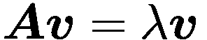

`λ` 被称为 `A` 的一个特征值，对应于特征向量 `v`。

从几何角度看，这意味着当对向量 `v` 施加线性变换 `A` 时，该变换只会拉伸（`λ` > 1）或压缩（`λ` < 1）该向量，而不会改变其方向（当 `λ` > 0 时），除非将其翻转至相反方向（`λ` < 0）。`Av` 与 `v` 平行。参见图 2-20。

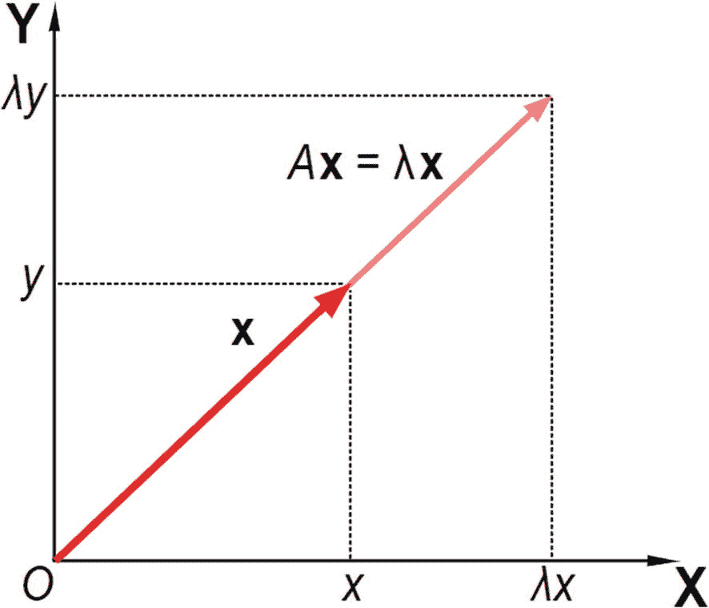

特征向量示意图。一个直角处的对角箭头表示方程 A X 等于 lambda X。

图 2-20

特征向量与特征值

为了理解其重要性，考虑一个启发性的例子。考虑 `ℝ²` 中的这个对角矩阵：

![$$ \boldsymbol{A}=\left[\begin{array}{cc}{a}_{11}&amp; 0\\ {}0&amp; {a}_{22}\end{array}\right] $$](images/528380_1_En_2_Chapter/528380_1_En_2_Chapter_TeX_Equbh.png)

如果将 `A` 乘以 x 轴 `u₁ = [1, 0]^T`，得到：

![$$ {\boldsymbol{Au}}_{\textbf{1}}=\left[\begin{array}{cc}{a}_{11}&amp; 0\\ {}0&amp; {a}_{22}\end{array}\right]\left[\begin{array}{c}1\\ {}0\end{array}\right]=\left[\begin{array}{c}{a}_{11}\\ {}0\end{array}\right]={a}_{11}\left[\begin{array}{c}1\\ {}0\end{array}\right] $$](images/528380_1_En_2_Chapter/528380_1_En_2_Chapter_TeX_Equbi.png)

`A u₁` 与 `u₁` 平行，因此 x 轴是一个特征向量。对应的特征值是 `a₁₁`。

同样地，如果将 `A` 乘以 y 轴 `u₂ = [0, 1]^T`，得到：

![$$ {\boldsymbol{Au}}_{\textbf{2}}=\left[\begin{array}{cc}{a}_{11}&amp; 0\\ {}0&amp; {a}_{22}\end{array}\right]\left[\begin{array}{c}0\\ {}1\end{array}\right]=\left[\begin{array}{c}0\\ {}{a}_{22}\end{array}\right]={a}_{22}\left[\begin{array}{c}0\\ {}1\end{array}\right] $$](images/528380_1_En_2_Chapter/528380_1_En_2_Chapter_TeX_Equbj.png)

`A u₂` 与 `u₂` 平行，因此 y 轴是一个特征向量。对应的特征值是 `a₂₂`。实际上，在所有（无限多个）其他可能的向量中，只有这两个向量成立。也就是说，对于对角矩阵，其特征向量就是其基向量。反之亦然。对于任何可对角化的矩阵，如果你在以其特征向量构成的新基下表示该矩阵，那么在新坐标系中的矩阵就是一个对角矩阵。

数学上，一个 `n × n` 的方阵 `A` 是可对角化的，如果存在一个 `n × n` 的方阵 `Q` 使得：

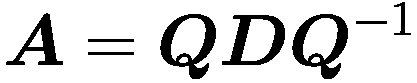

或者等价地：

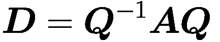

`Q` 是正交的，因此构成一组基。其列向量是 `A` 的特征向量，并且它们都是线性无关的。`D` 是一个对角矩阵，其对角线元素是对应的特征值。这称为矩阵 `A` 的*特征值分解*。这种分解可以从特征向量的基本性质推导出来：


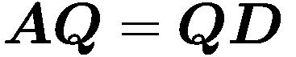


寻找特征值和特征向量非常重要，因为它们有着广泛的应用，例如在稳定性分析、振动分析、原子轨道和人脸识别中。

在机器学习或一般数据分析中，一个重要应用是降维或主成分分析（PCA）。PCA 是计算主成分并利用它们对数据进行基变换的过程，有时只使用前几个主成分而忽略其余部分。直观上，PCA 可以被认为是对数据拟合一个*p*维椭球体，通过旋转坐标轴，使得数据的大部分方差只落在少数几个坐标轴上。如果椭球体的一个（旋转后的）坐标轴很小，那么沿着该坐标轴的方差也很小。你可以移除这个维度，从而有效地将数据从高维空间投影到低维空间。

要找到椭球体的新坐标轴，你需要计算数据的协方差矩阵，然后计算该协方差矩阵的特征值和相应的特征向量。接着，你必须对每个正交的特征向量进行归一化，将它们转化为单位向量。完成这些步骤后，每个相互正交的单位特征向量都可以被解释为拟合数据椭球体的一个坐标轴。这种基的选择会将协方差矩阵变换为对角化形式，其中对角线元素代表每个坐标轴的方差。每个特征向量所代表的方差比例，可以通过将该特征向量对应的特征值除以所有特征值之和来计算。参见图 2-21。

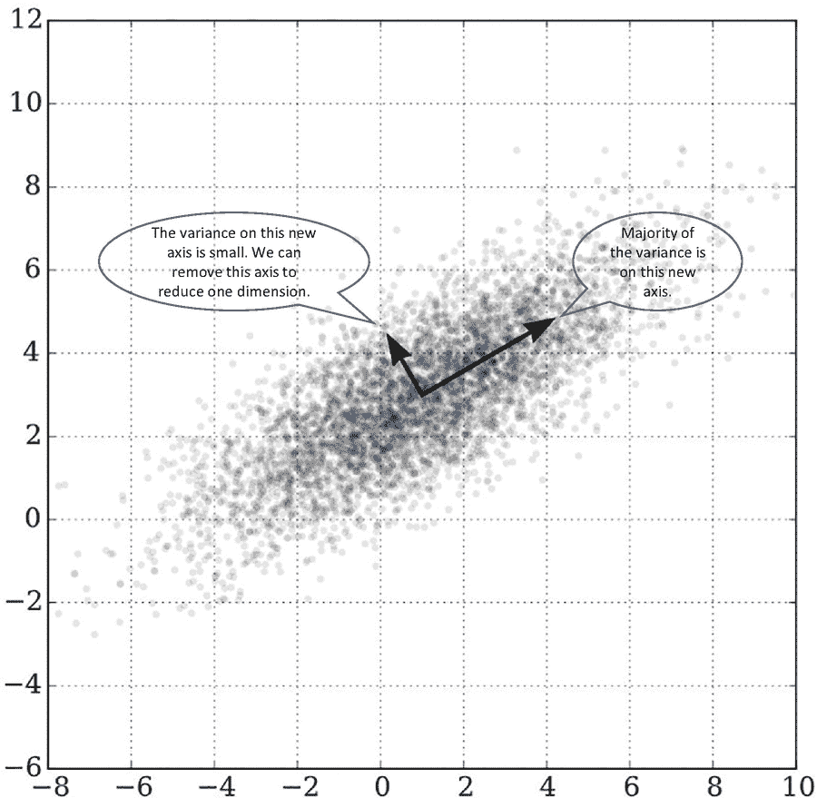

PCA 和降维的图。图中的两个箭头证实了保留新坐标轴的理由。

**图 2-21** PCA 和降维

有几种进行特征分解的方法，例如通过特征多项式（针对小矩阵）、`DQDS`算法（针对三对角矩阵）、`MR3`算法（针对对称矩阵）和`QR`算法（针对一般矩阵）。所有这些算法以及变换的实现都非常复杂。NM Dev 类`EigenDecomposition`封装了所有这些算法，并根据输入的矩阵自动应用合适的算法。其签名如下：

```java
/**
* 对方阵进行特征分解。
*
* @param A       一个可对角化的方阵
* @param epsilon 精度参数：当数值 |x| ≤ ε 时，视其为 0
*/
public EigenDecomposition(Matrix A, double epsilon)
/**
* 对方阵进行特征分解。
*
* @param A 一个可对角化的方阵
*/
public EigenDecomposition(Matrix A)
/**
* 获取对角矩阵 D，满足 Q * D * Q' = A。
*
* 注意，目前仅支持实数特征值。
*
* @return D
*/
public DiagonalMatrix D()
/**
* 获取矩阵 Q，满足 Q * D * Q' = A。
*
* 注意，目前仅支持实数特征值。
*
* @return Q
*/
public Matrix Q()
/**
* 获取矩阵 Q'，满足 Q * D * Q' = A。
*
* 注意，目前仅支持实数特征值。
*
* @return {@code Q.t()}
*/
public Matrix Qt()
```

以下代码实现了这个例子：

![$$ \left[\begin{array}{cc}5&amp; 2\\ {}2&amp; 5\end{array}\right]=\left[\begin{array}{cc}0.707107&amp; -0.707107\\ {}0.707107&amp; 0.707107\end{array}\right]\left[\begin{array}{cc}7&amp; 0\\ {}0&amp; 3\end{array}\right]\left[\begin{array}{cc}0.707107&amp; 0.707107\\ {}-0.707107&amp; 0.707107\end{array}\right] $$](images/528380_1_En_2_Chapter/528380_1_En_2_Chapter_TeX_Equbp.png)

```kotlin
val A: Matrix = DenseMatrix(
arrayOf(
doubleArrayOf(5.0, 2.0),
doubleArrayOf(2.0, 5.0)
)
)
// 进行特征分解
val eigen: EigenDecomposition = EigenDecomposition(A)
val D: Matrix = eigen.D()
println("\nD = \n" + D)
val Q: Matrix = eigen.Q()
println("\nQ = \n" + Q)
val Qt: Matrix = eigen.Qt()
println("\nQt = \n" + Qt)
```

输出如下：

```
D =
2x2
[,1] [,2]
[1,] 7.000000, 0.000000,
[2,] 0.000000, 3.000000,
Q =
2x2
[,1] [,2]
[1,] 0.707107, -0.707107,
[2,] 0.707107, 0.707107,
Qt =
2x2
[,1] [,2]
[1,] 0.707107, 0.707107,
[2,] -0.707107, 0.707107,
// 验证 QDQ' = A
val QDQt: Matrix = Q.multiply(D).multiply(Qt)
println(String.format("%s = \n%s is %b",
A,
QDQt,
MatrixPropertyUtils.areEqual(A, QDQt, 1e-14)))
```

输出如下：

```
2x2
[,1] [,2]
[1,] 5.000000, 2.000000,
[2,] 2.000000, 5.000000,  =
2x2
[,1] [,2]
[1,] 5.000000, 2.000000,
[2,] 2.000000, 5.000000,  is true
```

虽然`EigenDecomposition`类提供了分解，但提取特征向量和对应的特征值并不方便。要操作特征向量和特征值，你需要使用`Eigen`和`EigenProperty`类。

`Eigen`的签名如下：

```java
/**
* 计算方阵的特征值和特征向量。
* 对于每个特征值，存在无限多个与之相关的特征向量，它们构成一个向量空间。
* 此实现计算一组线性无关的基，这些基向量的任意线性组合都可作为特征向量。
*
* <p>
* TODO: 目前，我们同时计算实数和复数特征值，
* 但暂不支持复数特征值对应的特征向量计算。
* </p>
*
* @param A       一个方阵
* @param method  特征分解算法，参见 {@link Method}
* @param epsilon 精度参数：当数值 |x| ≤ ε 时，视其为 0
* @throws IllegalArgumentException 如果 A 不是方阵
*/
public Eigen(Matrix A, Method method, final double epsilon)
/**
* 默认使用 {@link Method#QR} 方法。
*
* @param A       一个方阵
* @param epsilon 精度参数：当数值 |x| ≤ ε 时，视其为 0
* @see #Eigen(dev.nm.algebra.linear.matrix.doubles.Matrix, double)
*/
public Eigen(Matrix A, double epsilon)
/**
* 计算方阵的特征值和特征向量。
*
* @param A      一个方阵
* @param method 特征分解算法，参见 {@link Method}
*/
public Eigen(Matrix A, Method method)
/**
* 计算方阵的特征值和特征向量。
*
* @param A 一个方阵
* @see Wikipedia: QR
* algorithm
*/
public Eigen(Matrix A)
/**
* 获取所有特征值，包括实数和复数。
*
* @return 特征值列表
*/
List getEigenvalues();
/**
* 获取所有实数特征值。
* 特征值按降序排列。
*
* @return 所有实数特征值
*/
public double[] getRealEigenvalues()
/**
* 根据特征值获取对应的 {@link EigenProperty}。
* 注意，传入的数值必须与特征值的二进制表示完全相同。
* 传入近似值（精度范围内）可能导致匹配失败，即返回 {@code null}。
*
* @param eigenvalue 一个特征值
* @return 该特征值的 {@code EigenProperty}
*/
public EigenProperty getProperty(Number eigenvalue)
```

`EigenProperty`的签名如下：


```java
/**
* `EigenProperty` 是一个只读结构，包含关于特定特征值的信息，
* 例如其重数和特征向量。
*
* @author Haksun Li
*/
public class EigenProperty {
/**
* 获取特征值。
*
* @return 特征值
*/
public Number eigenvalue()
/**
* 获取特征多项式根（特征值）的重数。
*
* @return 代数重数
*/
public int algebraicMultiplicity()
/**
* 获取由特征向量张成的向量空间的维数。
*
* @return 几何重数
*/
public int geometricMultiplicity()
/**
* 获取特征向量。
*
* @return 特征向量
*/
public List eigenbasis()
/**
* 获取一个特征向量。
* 注意，特征向量不是唯一的。
* 此实现始终返回基中的第一个向量。
* 要获取特征向量空间的完整基集，请使用
* `eigenbasis()`。
*
* @return 一个特征向量
*/
public Vector eigenVector()
```

注意，一个矩阵可能存在重复的特征值。一个特征值的重复次数称为该特征值的**代数重数**。一个特征值的几何重数是指与其关联的线性无关特征向量的数量。也就是说，它是由与该特征值关联的特征向量构成的基所张成的零空间的维数。几何重数始终小于或等于该特征值的代数重数。

以下 NM Dev 代码针对一个矩阵计算其特征值、对应的特征向量，以及由每组特征向量张成的线性空间。如果一个向量可以写成基向量的线性组合，则该向量属于这个线性空间。

以下矩阵：

![$$ \boldsymbol{A}=\left[\begin{array}{ccc}1&amp; -3&amp; 3\\ {}3&amp; -5&amp; 3\\ {}6&amp; -6&amp; 4\end{array}\right] $$](images/528380_1_En_2_Chapter/528380_1_En_2_Chapter_TeX_Equbq.png)

有两个特征值：4 和 -2。

对于特征值 4，有一个特征向量 ![$$ \left[\begin{array}{c}0.5\\ {}0.5\\ {}1\end{array}\right] $$](images/528380_1_En_2_Chapter/528380_1_En_2_Chapter_TeX_IEq8.png)。它张成的零空间是一维线性空间（一条直线）。

对于特征值 -2，有两个特征向量：![$$ \left[\begin{array}{c}1\\ {}1\\ {}0\end{array}\right] $$](images/528380_1_En_2_Chapter/528380_1_En_2_Chapter_TeX_IEq9.png) 和 ![$$ \left[\begin{array}{c}-1\\ {}0\\ {}1\end{array}\right] $$](images/528380_1_En_2_Chapter/528380_1_En_2_Chapter_TeX_IEq10.png)。它们张成的零空间是二维线性空间（一个平面）。

```
val A: Matrix = DenseMatrix(
arrayOf(
doubleArrayOf(1.0, -3.0, 3.0),
doubleArrayOf(3.0, -5.0, 3.0),
doubleArrayOf(6.0, -6.0, 4.0),
)
)
// 执行特征分解
val eigen: Eigen = Eigen(A)
eigen.getEigenvalues().forEach {
println("特征值 = " + it)
}
// 第一个特征值
val eigenvalue0: Number = eigen.getEigenvalue(0) // 从 0 开始计数
println("特征值 0 = " + eigenvalue0)
// 获取与该特征值相关的属性
val prop0: EigenProperty = eigen.getProperty(eigenvalue0)
println("代数重数 = " + prop0.algebraicMultiplicity())
println("几何重数 = " + prop0.geometricMultiplicity())
val basis0: List = prop0.eigenbasis()
basis0.forEach {
println("基向量 = " + it)
}
val vs0: RealVectorSpace = RealVectorSpace(basis0, 1e-15)
// 检查该向量是否属于该向量空间，即是否为基向量的线性组合
val in0: Boolean = vs0.isSpanned(
DenseVector(arrayOf(-0.4, -0.4, -0.8)))
println("是否在向量空间中 = " + in0)
```

输出如下：

```
特征值 = 4.0
特征值 = -2.0
特征值 0 = 4.0
代数重数 = 1
几何重数 = 1
基向量 = [0.500000, 0.500000, 1.000000]
是否在向量空间中 = true
// 第二个特征值
val eigenvalue1: Number = eigen.getEigenvalue(1) // 从 1 开始计数
println("特征值 1 = " + eigenvalue1)
val prop1: EigenProperty = eigen.getProperty(eigenvalue1)
println("代数重数 = " + prop1.algebraicMultiplicity())
println("几何重数 = " + prop1.geometricMultiplicity())
val basis1: List = prop1.eigenbasis()
basis1.forEach {
println("基向量 = " + it)
}
val vs1: RealVectorSpace = RealVectorSpace(basis1, 1e-15)
val in1: Boolean = vs1.isSpanned(DenseVector(arrayOf(-0.4, 0.4, 0.8)))
println("是否在向量空间中 = " + in1)
val in2: Boolean = vs1.isSpanned(DenseVector(arrayOf(-0.5, 0.5, 1.0)))
println("是否在向量空间中 = " + in2)
```

输出如下：

```
特征值 1 = -2.0
代数重数 = 2
几何重数 = 2
基向量 = [1.000000, 1.000000, 0.000000]
基向量 = [-1.000000, 0.000000, 1.000000]
是否在向量空间中 = true
是否在向量空间中 = true
```


### 2.3.6 奇异值分解

到目前为止讨论的所有分解都适用于方阵。奇异值分解（SVD）可以看作是特征分解的一种扩展，但 SVD 适用于任何矩阵，无论是方阵、高矩阵还是宽矩阵。也就是说，SVD 适用于任何线性变换。具体来说，一个 *m* × *n* 矩阵 ***A*** 的 SVD 是三个矩阵的乘积：

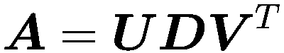

***U*** 是一个 *m* × *m* 的正交矩阵。***D*** 是一个 *m* × *n* 的对角矩阵。***V*** 是一个 *n* × *n* 的正交矩阵。对角线元素 *σ*[*i*] = ***D***[*ii*] 被称为 ***A*** 的*奇异值*。非零奇异值的数量等于 ***A*** 的秩。***U*** 的列和 ***V*** 的列分别被称为 ***A*** 的左奇异向量和右奇异向量。通常，你会选择一个分解，使得奇异值 ***D***[*ii*] 按降序排列。在这种情况下，***D***（但不总是 ***U*** 和 ***V***）由 ***A*** 唯一确定。SVD 的数学应用包括计算伪逆、矩阵近似、以及确定矩阵的秩、值域和零空间。SVD 在科学、工程和统计学的所有领域也广泛有用，例如信号处理、数据的最小二乘拟合以及过程控制。

从几何角度看，SVD 说明任何线性变换都可以分解为三个步骤：即先旋转（***V***^(*T*)），然后拉伸/缩放（***D***）（不必在所有的方向上使用相同的量；你可以将 x 轴拉伸的比例是 y 轴的两倍），然后再旋转（***U***）。

例如，要将一个正方形变换成一个平行四边形，你可以先顺时针旋转 *θ* 角（只要选取一个合理的数值，这个值不是特别重要，因为旋转矩阵不唯一），然后沿不同坐标轴按不同比例缩放，最后再逆时针旋转 *θ* 角。在降维方面，你先通过旋转“选择合适的坐标轴”。然后通过忽略（或用 0 代替）最小的奇异值来投影掉次要的维度。请参见图 2-22。

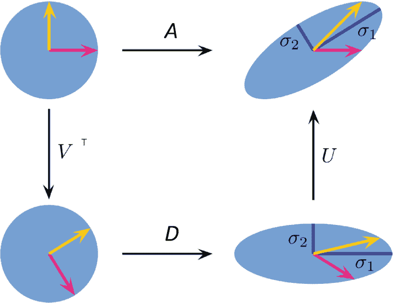

**图 2-22** SVD 几何解释

有几种进行 SVD 的方法，例如针对高矩阵的 Golub-Kahan 算法，针对对称矩阵的 QR 算法，以及针对双对角矩阵的多重相对稳健表示（MRRR）。所有这些算法和变换的实现都非常复杂。一个名为 `SVDDecomposition` 的 NM Dev 接口代表了不同的实现。其签名如下：

```
public interface SVDDecomposition {
/**
* 获取归一化（因此为正）的奇异值。如果此计算关闭了归一化，它们可能与 D 中的值不同。
*
* @return 奇异值
*/
public double[] getSingularValues();
/**
* 获取 SVD 分解中的 D 矩阵。
*
* @return D
*/
public DiagonalMatrix D();
/**
* 获取 SVD 分解中的 U 矩阵。
*
* @return U
*/
public Matrix U();
/**
* 获取 U 的转置，即 {@code U().t()}。
*
* @return {@code U().t()}
*/
public Matrix Ut();
/**
* 获取 SVD 分解中的 V 矩阵。
*
* @return V
*/
public Matrix V();
}
```

`SVD` 类封装了所有这些算法，并根据输入矩阵应用适当的一种。由于 `SVD` 继承自 `SVDDecomposition`，它具有相同的签名。以下 NM Dev 代码计算了此示例：

![$$ \left[\begin{array}{ccccc}1&amp; 0&amp; 0&amp; 0&amp; 2\\ {}0&amp; 0&amp; 3&amp; 0&amp; 0\\ {}0&amp; 0&amp; 0&amp; 0&amp; 0\\ {}0&amp; 2&amp; 0&amp; 0&amp; 0\end{array}\right]=\left[\begin{array}{cccc}0&amp; -1&amp; 0&amp; 0\\ {}-1&amp; 0&amp; 0&amp; 0\\ {}0&amp; 0&amp; 0&amp; -1\\ {}0&amp; 0&amp; -1&amp; 0\end{array}\right]\left[\begin{array}{ccccc}3&amp; 0&amp; 0&amp; 0&amp; 0\\ {}0&amp; \sqrt{5}&amp; 0&amp; 0&amp; 0\\ {}0&amp; 0&amp; 2&amp; 0&amp; 0\\ {}0&amp; 0&amp; 0&amp; 0&amp; 0\end{array}\right]\left[\begin{array}{ccccc}0&amp; 0&amp; 1&amp; 0&amp; 0\\ {}\sqrt{0.2}&amp; 0&amp; 0&amp; 0&amp; \sqrt{0.8}\\ {}0&amp; 1&amp; 0&amp; 0&amp; 0\\ {}0&amp; 0&amp; 0&amp; 1&amp; 0\end{array}\right] $$](images/528380_1_En_2_Chapter/528380_1_En_2_Chapter_TeX_Equbs.png)

```kotlin
val A: Matrix = DenseMatrix(
arrayOf(
doubleArrayOf(1.0, 0.0, 0.0, 0.0, 2.0),
doubleArrayOf(0.0, 0.0, 3.0, 0.0, 0.0),
doubleArrayOf(0.0, 0.0, 0.0, 0.0, 0.0),
doubleArrayOf(0.0, 2.0, 0.0, 0.0, 0.0)
)
)
// 执行 SVD
val svd: SVD = SVD(A, true, 1e-15)
val U: Matrix = svd.U()
println("\nU = \n" + U)
val D: DiagonalMatrix = svd.D()
println("\nD = \n" + D)
val V: Matrix = svd.V()
println("\nVt = \n" + V.t())
val Ut: Matrix = svd.Ut()
println("\nUt = \n" + Ut)
```

输出如下：

```
U =
4x4
[,1] [,2] [,3] [,4]
[1,] 0.000000, 1.000000, 0.000000, 0.000000,
[2,] 1.000000, 0.000000, 0.000000, 0.000000,
[3,] 0.000000, 0.000000, 0.000000, 1.000000,
[4,] 0.000000, 0.000000, 1.000000, 0.000000,
D =
4x4
[,1] [,2] [,3] [,4]
[1,] 3.000000, 0.000000, 0.000000, 0.000000,
[2,] 0.000000, 2.236068, 0.000000, 0.000000,
[3,] 0.000000, 0.000000, 2.000000, 0.000000,
[4,] 0.000000, 0.000000, 0.000000, 0.000000,
Vt =
4x5
[,1] [,2] [,3] [,4] [,5]
[1,] 0.000000, 0.000000, 1.000000, 0.000000, 0.000000,
[2,] 0.447214, 0.000000, 0.000000, 0.000000, 0.894427,
[3,] 0.000000, 1.000000, 0.000000, 0.000000, 0.000000,
[4,] 0.000000, 0.000000, 0.000000, 1.000000, 0.000000,
Ut =
4x4
[,1] [,2] [,3] [,4]
[1,] 0.000000, 1.000000, 0.000000, 0.000000,
[2,] 1.000000, 0.000000, 0.000000, 0.000000,
[3,] 0.000000, 0.000000, 0.000000, 1.000000,
[4,] 0.000000, 0.000000, 1.000000, 0.000000,
// 验证 UDVt = A
val UDVt: Matrix = U.multiply(D).multiply(V.t())
println(String.format("%s = \n%s is %b",
A,
UDVt,
MatrixPropertyUtils.areEqual(UDVt, A, 1e-14)))
```

输出如下：

```
4x5
[,1] [,2] [,3] [,4] [,5]
[1,] 1.000000, 0.000000, 0.000000, 0.000000, 2.000000,
[2,] 0.000000, 0.000000, 3.000000, 0.000000, 0.000000,
[3,] 0.000000, 0.000000, 0.000000, 0.000000, 0.000000,
[4,] 0.000000, 2.000000, 0.000000, 0.000000, 0.000000,  =
4x5
[,1] [,2] [,3] [,4] [,5]
[1,] 1.000000, 0.000000, 0.000000, 0.000000, 2.000000,
[2,] 0.000000, 0.000000, 3.000000, 0.000000, 0.000000,
[3,] 0.000000, 0.000000, 0.000000, 0.000000, 0.000000,
[4,] 0.000000, 2.000000, 0.000000, 0.000000, 0.000000,  为 true
// 验证 UtAV = D
val UtAV: Matrix = Ut.multiply(A).multiply(V)
println(String.format("%s = \n%s is %b",
A,
UtAV,
MatrixPropertyUtils.areEqual(UtAV, D, 1e-14)))
```

输出如下：

```
4x5
[,1] [,2] [,3] [,4] [,5]
[1,] 1.000000, 0.000000, 0.000000, 0.000000, 2.000000,
[2,] 0.000000, 0.000000, 3.000000, 0.000000, 0.000000,
[3,] 0.000000, 0.000000, 0.000000, 0.000000, 0.000000,
[4,] 0.000000, 2.000000, 0.000000, 0.000000, 0.000000,  =
4x4
[,1] [,2] [,3] [,4]
[1,] 3.000000, 0.000000, 0.000000, 0.000000,
[2,] 0.000000, 2.236068, 0.000000, 0.000000,
[3,] 0.000000, 0.000000, 2.000000, 0.000000,
[4,] 0.000000, 0.000000, 0.000000, 0.000000,  为 true
```


