# 2.4 线性方程组

线性方程组（或线性系统）是涉及同一组变量的一个或多个线性方程的集合。以下是一个示例：

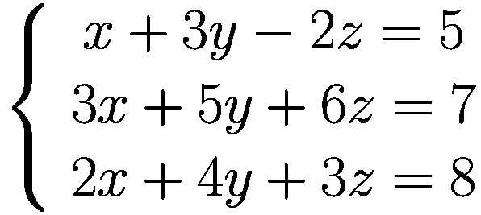

这是一个包含三个变量 `x`、`y` 和 `z` 的三个方程的方程组。线性方程组的解是对变量的赋值，使得所有方程同时成立。上述方程组的一个解如下所示：

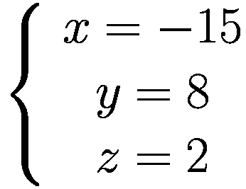

因为它使所有三个方程都成立。`系统`一词表示这些方程被视为一个整体，而非单独个体。

线性系统理论是线性代数的基础和基本组成部分，而线性代数在现代数学的大多数领域都有应用。非线性方程组通常可以近似为线性系统，这是在建立相对复杂系统的数学模型或计算机模拟时的一种有用技术。求解的计算算法是数值线性代数的重要组成部分，并在工程、物理、化学、计算机科学和经济学中发挥着显著作用。

一个包含 `m` 个方程和 `n` 个未知数的一般线性系统可以写成如下形式：

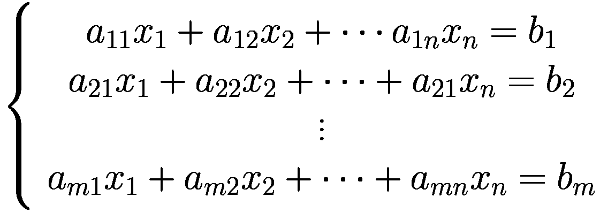

`x[1]`、`x[2]`、…、`x[n]` 是 `n` 个未知数；`a[11]`、`a[12]`、…、`a[mn]` 是系统的 `m` × `n` 个系数；`b[1]`、`b[2]`、…、`b[m]` 是 `m` 个常数项。

将每个未知数视为线性组合中一个列向量的权重是很有帮助的。这使你可以从向量空间或线性空间的角度来考虑问题。例如，左侧向量所有可能线性组合的集合被称为它们的`张成空间`，当右侧向量位于该张成空间内或存在于该张成的向量空间中时，方程组有解。如果该张成空间中的每个向量都能唯一地表示为给定左侧向量的线性组合，那么任何解都是唯一的。

等价地，你可以将向量方程写成矩阵形式：


其中

![$$ \boldsymbol{A}=\left[\begin{array}{cccc}{a}_{11}&amp; {a}_{12}&amp; \dots &amp; {a}_{1n}\\ {}{a}_{21}&amp; {a}_{22}&amp; \dots &amp; {a}_{2n}\\ {}\vdots &amp; \vdots &amp; \ddots &amp; \vdots \\ {}{a}_{m1}&amp; {a}_{m2}&amp; \dots &amp; {a}_{mn}\end{array}\right] $$](images/528380_1_En_2_Chapter/528380_1_En_2_Chapter_TeX_IEq11.png), ![$$ \boldsymbol{x}=\left[\begin{array}{c}{x}_1\\ {}{x}_2\\ {}\vdots \\ {}{x}_n\end{array}\right] $$](images/528380_1_En_2_Chapter/528380_1_En_2_Chapter_TeX_IEq12.png), ![$$ \boldsymbol{b}=\left[\begin{array}{c}{b}_1\\ {}{b}_2\\ {}\vdots \\ {}{b}_m\end{array}\right] $$](images/528380_1_En_2_Chapter/528380_1_En_2_Chapter_TeX_IEq13.png)

张成空间的基中向量的数量现在表示为矩阵的`秩`，该秩小于 `m` 和 `n`。

线性方程组的解是对变量 `x[1]`、`x[2]`、…、`x[n]` 的赋值，使得每个方程都成立。所有可能解的集合称为`解集`。一个线性系统可能表现为以下三种情况之一：

- 系统有无限多个解。

- 系统有且仅有一个唯一解。

- 系统无解。

从几何角度看，对于包含两个变量（`x` 和 `y`）的方程组，每个线性方程在 `xy` 平面上确定一条直线。因为线性方程组的解必须满足所有方程，所以解集是这些直线的交点，因此可能是一条线、一个点或空集。见图 2-23。

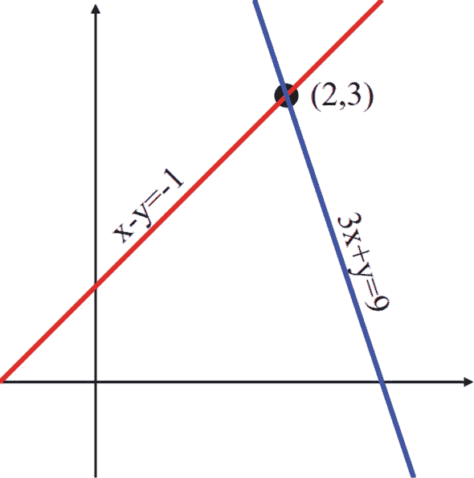

方程组解的图示。该图将两个方程描述为两条直线，它们在点 (2,3) 处相交。

图 2-23

两个线性方程组的解

对于三个变量，每个线性方程在三维空间中确定一个平面，解集是这些平面的交集。因此，解集可能是一个平面、一条线、一个点或空集。例如，三个平行平面没有公共点，则其方程组的解集为空。如果三个平面相交于一点，解集为一个点。如果三个平面通过两个点，则它们的方程至少有两个公共解；实际上，解集是无限的，由通过这两点的直线上的所有点组成。对于 `n` 个变量，每个线性方程在 `n` 维空间中确定一个`超平面`。解集是这些超平面的交集，这是一个维度低于 `n` 的仿射（或欧几里得）子空间。

一般来说，线性系统的行为由方程数 `m` 和未知数 `n` 之间的关系决定。具体来说：

1. 如果 `m` = `n`，系统有且仅有一个唯一解。
2. 如果 `m` > `n`，系统无解。这种系统也称为`超定`系统。
3. 如果 `m` < `n`，系统有无限多个解，但也可能无解。这种系统称为`欠定`系统。解集的维数等于 `n` − `m`。

图 2-24 以两个变量为例说明了这种三分法。第一个系统有无限多个解，即蓝色线上的所有点。第二个系统有唯一的解，即两条线的交点。第三个系统无解，因为三条线没有公共点。见图 2-24。

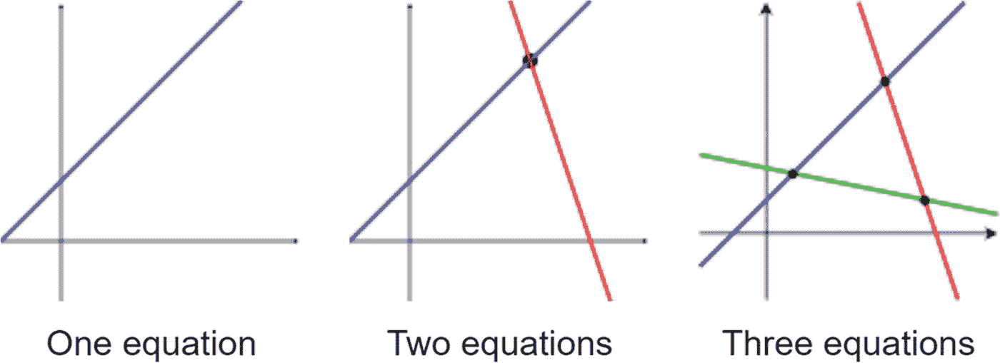

三张图片的图示。一个方程有一条线，两个方程有两条相交的线，三个方程有三个点。

图 2-24

两个线性方程组的可能解

重要的是要注意，图 2-24 中的图像仅显示最常见的情况（一般情况）。如果方程线性相关（平行线/平面）或系统不一致（无解），线性方程组的行为会不同于一般情况。例如，两个方程两个未知数的系统可能无解（如果两条线平行），或者三个方程两个未知数的系统可能有解（如果三条线相交于一点）。见图 2-25。

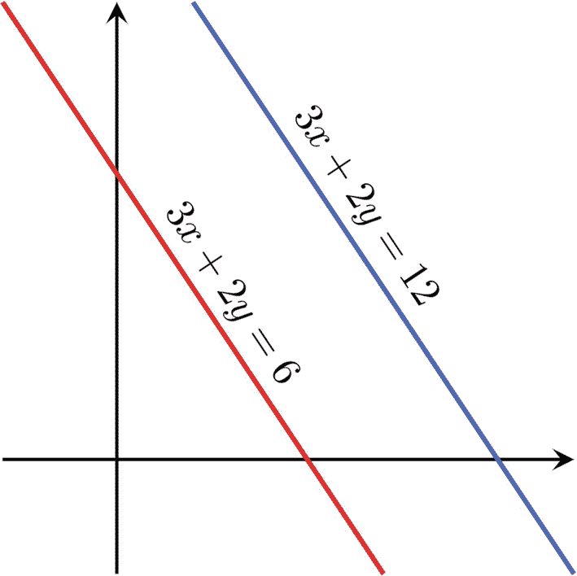

两条平行线的系统图示。两条平行线代表两个方程。

图 2-25

两条平行线的方程组是不一致的，因此无解

`NM Dev` 提供了一套工具来解决各种类型的线性方程组。它可以求解方阵系统、`欠定`系统和`超定`系统。针对每种类型的系统，有多种算法（以及同一算法的多种实现）可供求解。

### 2.4.1 行阶梯形矩阵与简化行阶梯形矩阵

让我们考虑一个解之前方程组的实际例子：


你可以用另外两个变量表示`x`，然后将其代入第二和第三个方程。即：

```
x = 5 - 3y + 2z
```

然后得到：

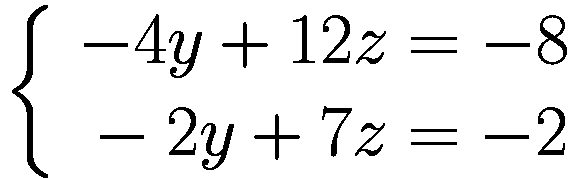

你重复这个步骤，解出`y`，然后将其代入第二个方程。即：

```
y = 2 + 3z
```

然后得到：

```
z = 2
```

已知`z`后，你将其回代到`y`的方程中求得`y`。已知`y`后，再将其回代到`x`的方程中求得`x`。最终得到一个解：

## 行阶梯形矩阵与简化行阶梯形矩阵

你可以将这个步骤一般化，并构造一个通用的算法来求解方程组。首先，你需要了解几个概念。

如果一个矩阵满足以下两个条件，则称其为行阶梯形矩阵：

- 所有元素全为零的行位于矩阵的底部。
- 非零行的首非零元（也称为*主元*）总是严格位于其上一行首非零元的右边。

这两个条件意味着，在首非零元所在的列下方，所有元素均为零。下面是一个 3 × 5 矩阵处于行阶梯形（但不是简化行阶梯形）的例子：

$$ \left[\begin{array}{ccccc}1&amp; {a}_0&amp; {a}_1&amp; {a}_2&amp; {a}_3\\ {}0&amp; 0&amp; 2&amp; {a}_4&amp; {a}_5\\ {}0&amp; 0&amp; 0&amp; 1&amp; {a}_6\end{array}\right] $$

如果一个矩阵满足以下条件，则称其为简化行阶梯形矩阵（也称为*行规范形*）：

- 它是行阶梯形矩阵。
- 每个非零行的首元为 1（称为首 1）。
- 包含首 1 的列中，所有其他元素均为零。

这是一个处于简化行阶梯形的矩阵示例：

$$ \left[\begin{array}{cccc}1&amp; 0&amp; {a}_1&amp; {b}_1\\ {}0&amp; 1&amp; {a}_2&amp; {b}_2\\ {}0&amp; 0&amp; 1&amp; {b}_3\end{array}\right] $$

一旦你将方程组化为简化行阶梯形，就容易计算或直接读出解了。上述矩阵实际上表示如下方程组：

$$ \left\{\begin{array}{c}{x}_1+{a}_1{x}_3={b}_1\\ {}{x}_2+{a}_2{x}_3={b}_2\\ {}{x}_3={b}_3\end{array}\right. $$

你可以从第三个方程读出 `x[3]` 的解。一旦知道了 `x[3]`，就可以将其简单地回代到另外两个方程中，得到 `x[1]` 和 `x[2]`。

### 2.4.2 回代法

回代法通过一个迭代过程求解形如 `Ux = b` 的矩阵方程，其中 `U` 是一个上三角矩阵。这个过程之所以得名，是因为对于一个上三角矩阵，你首先计算出 `x[n]`，然后将其向后代入下一个方程以求解 `x[n−1]`，最后重复此过程直到得到 `x[1]`。请注意，如果方程组是相容的，`U` 中的某些对角线元素可以为 0。下面是一个例子：

$$ \left[\begin{array}{ccc}1&amp; 2&amp; 3\\ {}0&amp; 0&amp; 5\\ {}0&amp; 0&amp; 0\end{array}\right]\times \left[\begin{array}{c}10\\ {}0\\ {}0\end{array}\right]=\left[\begin{array}{c}10\\ {}0\\ {}0\end{array}\right] $$

NM Dev 库中名为 `BackwardSubstitution` 的类实现了一个回代算法。以下代码求解了这个例子：

```kotlin
val U: UpperTriangularMatrix = UpperTriangularMatrix(
    arrayOf(
        doubleArrayOf(1.0, 2.0, 3.0),
        doubleArrayOf(0.0, 5.0),
        doubleArrayOf(0.0)
    )
)
val b: Vector = DenseVector(arrayOf(10.0, 0.0, 0.0))
val solver: BackwardSubstitution = BackwardSubstitution()
val x: Vector = solver.solve(U, b)
println("x = " + x)
// 验证 Ux = b
val Ux: Vector = U.multiply(x)
println(String.format("%s = \n%s is %b",
    Ux,
    b,
    MatrixPropertyUtils.areEqual(Ux, b, 1e-14))) // MatrixPropertyUtils.areEqual 也适用于向量
```

输出结果如下：

```
x = [10.000000, 0.000000, 0.000000]
[10.000000, 0.000000, 0.000000]  =
[10.000000, 0.000000, 0.000000]  is true
```

### 2.4.3 前向代入

类似地，你可以使用前向代入法，通过迭代过程求解下三角矩阵 `L` 的矩阵方程 `Lx = b`。该方法得名于此：对于下三角矩阵，你先计算 `x[1]`，然后将该值前向代入下一个方程以求解 `x[2]`，并重复此过程直至求出 `x[n]`。请注意，只要方程组一致，`L` 中的某些对角线元素可以为 0。下面是一个示例：

$$ \left[\begin{array}{ccc}0 &amp; 0 &amp; 0\\ {}2 &amp; 0 &amp; 0\\ {}4 &amp; 5 &amp; 6\end{array}\right]\times \left[\begin{array}{c}0\\ {}0\\ {}30\end{array}\right]=\left[\begin{array}{c}0\\ {}0\\ {}30\end{array}\right] $$

NM Dev 库中名为 `ForwardSubstitution` 的类实现了前向代入算法。以下代码求解了此示例：

```kotlin
val L: LowerTriangularMatrix = LowerTriangularMatrix(
    arrayOf(
        doubleArrayOf(1.0),
        doubleArrayOf(2.0, 3.0),
        doubleArrayOf(4.0, 5.0, 6.0)
    )
)
val b: Vector = DenseVector(arrayOf(10.0, 20.0, 30.0))
val solver: ForwardSubstitution = ForwardSubstitution()
val x: Vector = solver.solve(L, b)
println("x = " + x)
// 验证 Lx = b
val Lx: Vector = L.multiply(x)
println(String.format("%s = \n%s is %b",
    Lx,
    b,
    MatrixPropertyUtils.areEqual(Lx, b, 1e-14))) // MatrixPropertyUtils.areEqual 同样适用于向量
```

输出结果如下：

```
x = [10.000000, 0.000000, -1.666667]
[10.000000, 20.000000, 30.000000]  =
[10.000000, 20.000000, 30.000000]  is true
```

通常，NM Dev 库的 `LUSolver` 类可处理上三角矩阵和下三角矩阵。以下代码复现了前面两个问题。

# 一个 LSProblem

一个 `LSProblem` 代码示例：

```kotlin
// 一个 LSProblem
val L: LowerTriangularMatrix = LowerTriangularMatrix(
    arrayOf(
        doubleArrayOf(1.0),
        doubleArrayOf(2.0, 3.0),
        doubleArrayOf(4.0, 5.0, 6.0)
    )
)
val b1: Vector = DenseVector(arrayOf(10.0, 20.0, 30.0))
val solver1: LUSolver = LUSolver()
val x1: Vector = solver1.solve(
    // 构建线性系统问题: Lx = b1
    LSProblem(L, b1)
)
println("x1 = " + x1)
// 验证 Ux = b
val Lx: Vector = L.multiply(x1)
println(String.format("%s = \n%s is %b",
    Lx,
    b1,
    MatrixPropertyUtils.areEqual(Lx, b1, 1e-14))) // MatrixPropertyUtils.areEqual 同样适用于向量
```

输出结果如下：

```
x1 = [10.000000, 0.000000, -1.666667]
[10.000000, 20.000000, 30.000000]  =
[10.000000, 20.000000, 30.000000]  is true
```

另一个 `LSProblem` 示例：

```kotlin
// 另一个 LSProblem
val U: UpperTriangularMatrix = UpperTriangularMatrix(
    arrayOf(
        doubleArrayOf(1.0, 2.0, 3.0),
        doubleArrayOf(0.0, 5.0),
        doubleArrayOf(0.0),
    )
)
val b2: Vector = DenseVector(arrayOf(10.0, 0.0, 0.0))
val solver2: LUSolver = LUSolver()
val x2: Vector = solver2.solve(
    // 构建线性系统问题: Ux = b2
    LSProblem(U, b2)
)
println("x2 = " + x2)
// 验证 Ux = b
val Ux: Vector = U.multiply(x2)
println(String.format("%s = \n%s is %b",
    Ux,
    b2,
    MatrixPropertyUtils.areEqual(Ux, b2, 1e-14))) // MatrixPropertyUtils.areEqual 同样适用于向量
```

输出结果如下：

```
x2 = [10.000000, 0.000000, -0.000000]
[10.000000, 0.000000, 0.000000]  =
[10.000000, 0.000000, 0.000000]  is true
```

### 2.4.4 初等运算

通过一系列初等行运算，你可以将任何矩阵转换为（简化）行阶梯形矩阵。初等运算共有三种类型：

*   `行交换`：交换第 `i` 行与第 `j` 行。
*   `行乘法或缩放`：将第 `i` 行乘以一个非零常数。
*   `行加法`：用第 `i` 行加上第 `j` 行的倍数，替换第 `i` 行。

#### 行交换变换

对单位矩阵执行该运算，即可得到对应于该变换的初等矩阵。初等矩阵是与单位矩阵仅差一个初等行运算的矩阵。

例如，对应的初等矩阵交换了 3 × 3 单位矩阵的第二行和第三行。即：

![$$ \boldsymbol{P}=\left[\begin{array}{ccc}1 &amp; 0 &amp; 0\\ {}0 &amp; 0 &amp; 1\\ {}0 &amp; 1 &amp; 0\end{array}\right] $$](images/528380_1_En_2_Chapter/528380_1_En_2_Chapter_TeX_Equci.png)

如果你将任何 3 × 3 矩阵左乘（右乘）`P`，其第二行和第三行（列）将被交换。下面是一个示例：

![$$ \left[\begin{array}{ccc}1 &amp; 0 &amp; 0\\ {}0 &amp; 0 &amp; 1\\ {}0 &amp; 1 &amp; 0\end{array}\right]\times \left[\begin{array}{ccc}{a}_{11} &amp; {a}_{12} &amp; {a}_{13}\\ {}{a}_{21} &amp; {a}_{22} &amp; {a}_{23}\\ {}{a}_{31} &amp; {a}_{32} &amp; {a}_{33}\end{array}\right]=\left[\begin{array}{ccc}{a}_{11} &amp; {a}_{12} &amp; {a}_{13}\\ {}{a}_{31} &amp; {a}_{32} &amp; {a}_{33}\\ {}{a}_{21} &amp; {a}_{22} &amp; {a}_{23}\end{array}\right] $$](images/528380_1_En_2_Chapter/528380_1_En_2_Chapter_TeX_Equcj.png)

#### 行乘法变换

类似地，要将第 `i` 行缩放为非零常数 `m`，相应的初等矩阵是一个对角矩阵，其对角线上除第 `i` 个位置为 `m` 外，其余均为 1。例如，对应的初等矩阵将 3 × 3 单位矩阵的第二行缩放 2 倍。即：

![$$ \boldsymbol{D}=\left[\begin{array}{ccc}1 &amp; 0 &amp; 0\\ {}0 &amp; 2 &amp; 0\\ {}0 &amp; 0 &amp; 1\end{array}\right] $$](images/528380_1_En_2_Chapter/528380_1_En_2_Chapter_TeX_Equck.png)

下面是一个示例：

![$$ \left[\begin{array}{ccc}1 &amp; 0 &amp; 0\\ {}0 &amp; 2 &amp; 0\\ {}0 &amp; 0 &amp; 1\end{array}\right]\times \left[\begin{array}{ccc}{a}_{11} &amp; {a}_{12} &amp; {a}_{13}\\ {}{a}_{21} &amp; {a}_{22} &amp; {a}_{23}\\ {}{a}_{31} &amp; {a}_{32} &amp; {a}_{33}\end{array}\right]=\left[\begin{array}{ccc}{a}_{11} &amp; {a}_{12} &amp; {a}_{13}\\ {}2{a}_{21} &amp; 2{a}_{22} &amp; 2{a}_{23}\\ {}{a}_{31} &amp; {a}_{32} &amp; {a}_{33}\end{array}\right] $$](images/528380_1_En_2_Chapter/528380_1_En_2_Chapter_TeX_Equcl.png)

#### 行加法变换

要将第 `j` 行乘以标量 `m` 后加到第 `i` 行，对应的初等矩阵是单位矩阵，但 `a[ij] = m`。例如，要将 3 × 3 矩阵的第二行乘以 2 后加到第一行，对应的初等矩阵如下：

![$$ \boldsymbol{L}=\left[\begin{array}{ccc}1 &amp; 2 &amp; 0\\ {}0 &amp; 1 &amp; 0\\ {}0 &amp; 0 &amp; 1\end{array}\right] $$](images/528380_1_En_2_Chapter/528380_1_En_2_Chapter_TeX_Equcm.png)

下面是一个示例：

![$$ \left[\begin{array}{ccc}1 &amp; 2 &amp; 0\\ {}0 &amp; 1 &amp; 0\\ {}0 &amp; 0 &amp; 1\end{array}\right]\times \left[\begin{array}{ccc}{a}_{11} &amp; {a}_{12} &amp; {a}_{13}\\ {}{a}_{21} &amp; {a}_{22} &amp; {a}_{23}\\ {}{a}_{31} &amp; {a}_{32} &amp; {a}_{33}\end{array}\right]=\left[\begin{array}{ccc}{a}_{11}+2{a}_{21} &amp; {a}_{12}+2{a}_{22} &amp; {a}_{13}+2{a}_{23}\\ {}{a}_{21} &amp; {a}_{22} &amp; {a}_{23}\\ {}{a}_{31} &amp; {a}_{32} &amp; {a}_{33}\end{array}\right] $$](images/528380_1_En_2_Chapter/528380_1_En_2_Chapter_TeX_Equcn.png)

### 高斯消元法与高斯-若尔当消元法

高斯-若尔当消元法是一种用于求解线性方程组的算法。它还可用于计算矩阵的秩、方阵的行列式以及可逆矩阵的逆矩阵。要对矩阵执行行化简，你需要使用一系列初等行变换来修改矩阵，直到矩阵的左下角尽可能被零填满。

利用这些变换，矩阵总能被转换为上三角矩阵，实际上就是行阶梯形矩阵。当所有主元系数（每一行最左边的非零元）均为 1，并且所有包含主元的列在其他位置均为零时，该矩阵被称为简化行阶梯形矩阵。这种最终形式是唯一的；换句话说，它与所采用的行变换顺序无关。

*高斯消元法*指的是该过程的第一步，直到矩阵变为上三角矩阵或（非简化）行阶梯形矩阵。在这种形式下，你可以判断一个线性方程组是无解、有唯一解还是有无穷多解。高斯-若尔当消元法（即第二步）则继续使用行变换，直到求出解。换句话说，它将矩阵化为简化行阶梯形矩阵。

等价地，你可以看到行化简过程产生了原矩阵的一种矩阵分解。初等行变换可被视为在原矩阵左侧乘以初等矩阵。另一种观点是，将单行化简的一系列初等变换视为乘以一个弗罗贝尼乌斯矩阵。那么，算法计算的第一部分得到了一个 LU 分解，而第二部分则将原矩阵写为一个唯一确定的可逆矩阵与一个唯一确定的简化行阶梯矩阵的乘积。

名为 `GaussianElimination` 的 NM Dev 类执行初等行变换，将矩阵化简为行阶梯形。这等价于在左侧将原矩阵乘以可逆矩阵。对于方阵，该算法本质上是计算一个 LU 分解。你会得到如下结果：


其中 `T` 是变换矩阵，它是一系列初等矩阵/变换的乘积。`U` 是行阶梯形矩阵。

或者，你也可以得到如下结果：

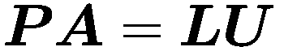

其中 `P` 是置换矩阵，`L` 是下三角矩阵，`U` 是行阶梯形矩阵。

其签名如下：

```java
/**
 * 运行高斯消元算法。
 *
 * @param A           一个矩阵
 * @param usePivoting 若为 {@code true}，则使用部分主元法，例如用于数值稳定性。
 *                    通常情况下，不使用主元意味着不进行行交换。
 *                    只有当高斯消元从未遇到对角线上的零元素时，才能进行无主元操作。
 *                    由于除以零是致命错误，我们通常避免无主元操作。
 * @param epsilon     一个精度参数：当数字 |x| ≤ ε 时，被视为 0
 */
public GaussianElimination(Matrix A, boolean usePivoting, double epsilon)
/**
 * 使用部分主元法运行高斯消元算法。
 *
 * @param A 一个矩阵
 */
public GaussianElimination(Matrix A)
/**
 * 获取变换矩阵 T，满足 T * A = U。
 *
 * @return T
 */
public Matrix T()
/**
 * 获取上三角矩阵 U，满足 T * A = U 和 P * A = L * U。
 *
 * @return U
 */
public Matrix U()
/**
 * 获取下三角矩阵 L，满足 P * A = L * U。
 *
 * @return L
 */
public Matrix L()
/**
 * 获取置换矩阵 P，满足 P * A = L * U。
 *
 * @return P
 */
public PermutationMatrix P()
```

例如，以下 NM Dev 代码计算了这个示例：

![$$ \left[\begin{array}{ccc}0&amp; 0&amp; 1\\ {}0&amp; 1&amp; -0.5\\ {}1&amp; -0.6&amp; -0.2\end{array}\right]\times \left[\begin{array}{ccc}2&amp; 1&amp; 1\\ {}2&amp; 2&amp; -1\\ {}4&amp; -1&amp; 6\end{array}\right]=\left[\begin{array}{ccc}4&amp; -1&amp; 6\\ {}0&amp; 2.5&amp; -4\\ {}0&amp; 0&amp; 0.4\end{array}\right] $$](images/528380_1_En_2_Chapter/528380_1_En_2_Chapter_TeX_Equcq.png)

![$$ \left[\begin{array}{ccc}0&amp; 0&amp; 1\\ {}0&amp; 1&amp; 0\\ {}1&amp; 0&amp; 0\end{array}\right]\times \left[\begin{array}{ccc}2&amp; 1&amp; 1\\ {}2&amp; 2&amp; -1\\ {}4&amp; -1&amp; 6\end{array}\right]=\left[\begin{array}{ccc}1&amp; 0&amp; 0\\ {}0.5&amp; 1&amp; 0\\ {}0.5&amp; 0.6&amp; 1\end{array}\right]\left[\begin{array}{ccc}4&amp; -1&amp; 6\\ {}0&amp; 2.5&amp; -4\\ {}0&amp; 0&amp; 0.4\end{array}\right] $$](images/528380_1_En_2_Chapter/528380_1_En_2_Chapter_TeX_Equcr.png)

# 高斯消元与高斯-约当消元

下面的代码示例展示了如何使用 `GaussianElimination` 类。

```kotlin
val A: Matrix = DenseMatrix(
    arrayOf(
        doubleArrayOf(2.0, 1.0, 1.0),
        doubleArrayOf(2.0, 2.0, -1.0),
        doubleArrayOf(4.0, -1.0, 6.0),
    )
)
val ops: GaussianElimination = GaussianElimination(A, true, 0.0)
val T: Matrix = ops.T()
println("T = \n" + T)
val P: PermutationMatrix = ops.P()
println("P = \n" + P)
val U: Matrix = ops.U()
println(
    String.format("U = %s is upper triangular, %b",
        U,
        MatrixPropertyUtils.isUpperTriangular(U, 0.0)))
val L: Matrix = ops.L()
println(
    String.format("L = %s is lower triangular, %b",
        L,
        MatrixPropertyUtils.isLowerTriangular(L, 0.0)))
// verify that TA = U
val TA: Matrix = T.multiply(A)
println(String.format("%s = \n%s is %b",
    TA,
    U,
    MatrixPropertyUtils.areEqual(TA, U, 1e-15)))
// verify that PA = LU
val PA: Matrix = P.multiply(A)
val LU: Matrix = L.multiply(U)
println(String.format("%s = \n%s is %b",
    PA,
    LU,
    MatrixPropertyUtils.areEqual(PA, LU, 0.0)))
```

输出如下：

```
T =
3x3
[,1] [,2] [,3]
[1,] 0.000000, 0.000000, 1.000000,
[2,] 0.000000, 1.000000, -0.500000,
[3,] 1.000000, -0.600000, -0.200000,
P =
3x3
[,1] [,2] [,3]
[1,] 0.000000, 0.000000, 1.000000,
[2,] 0.000000, 1.000000, 0.000000,
[3,] 1.000000, 0.000000, 0.000000,
U = 3x3
[,1] [,2] [,3]
[1,] 4.000000, -1.000000, 6.000000,
[2,] 0.000000, 2.500000, -4.000000,
[3,] 0.000000, 0.000000, 0.400000,  is upper triangular, true
L = 3x3
[,1] [,2] [,3]
[1,] 1.000000, 0.000000, 0.000000,
[2,] 0.500000, 1.000000, 0.000000,
[3,] 0.500000, 0.600000, 1.000000,  is lower triangular, true
3x3
[,1] [,2] [,3]
[1,] 4.000000, -1.000000, 6.000000,
[2,] 0.000000, 2.500000, -4.000000,
[3,] 0.000000, 0.000000, 0.400000,  =
3x3
[,1] [,2] [,3]
[1,] 4.000000, -1.000000, 6.000000,
[2,] 0.000000, 2.500000, -4.000000,
[3,] 0.000000, 0.000000, 0.400000,  is true
3x3
[,1] [,2] [,3]
[1,] 4.000000, -1.000000, 6.000000,
[2,] 2.000000, 2.000000, -1.000000,
[3,] 2.000000, 1.000000, 1.000000,  =
3x3
[,1] [,2] [,3]
[1,] 4.000000, -1.000000, 6.000000,
[2,] 2.000000, 2.000000, -1.000000,
[3,] 2.000000, 1.000000, 1.000000,  is true
```

名为 `GaussianElimination` 的 NM Dev 类执行初等行变换，将矩阵化为行阶梯形。即：

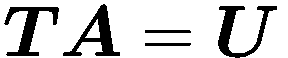

其中 `T` 是变换矩阵，是一系列初等矩阵/运算的乘积。`U` 是行阶梯形矩阵。此实现确保主元 1 在数值上精确为 1，以便于比较。假设一个主元 `u[i][j]` 等于 1，那么 `U.get(i, j) == 1` 总是返回 `true`。

例如，以下 NM Dev 代码计算了这个示例：

![$$ \left[\begin{array}{ccc}-2.75&amp; 1.75&amp; 0.75\\ {}4&amp; -2&amp; -1\\ {}2.5&amp; -1.5&amp; -0.5\end{array}\right]\times \left[\begin{array}{ccc}2&amp; 1&amp; 1\\ {}2&amp; 2&amp; -1\\ {}4&amp; -1&amp; 6\end{array}\right]=\left[\begin{array}{ccc}1&amp; 0&amp; 0\\ {}0&amp; 1&amp; 0\\ {}0&amp; 0&amp; 1\end{array}\right] $$](images/528380_1_En_2_Chapter/528380_1_En_2_Chapter_TeX_Equct.png)

```kotlin
val A: Matrix = DenseMatrix(
    arrayOf(
        doubleArrayOf(2.0, 1.0, 1.0),
        doubleArrayOf(2.0, 2.0, -1.0),
        doubleArrayOf(4.0, -1.0, 6.0),
    )
)
val ops: GaussJordanElimination = GaussJordanElimination(A, true, 0.0)
val U: Matrix = ops.U()
println(
    String.format("U = %s is in reduced row echelon form, %b",
        U,
        MatrixPropertyUtils.isReducedRowEchelonForm(U, 0.0)))
val T: Matrix = ops.T()
println("T = \n" + T)
// verify that TA = U
val TA: Matrix = T.multiply(A)
println(String.format("%s = \n%s is %b",
    TA,
    U,
    MatrixPropertyUtils.areEqual(TA, U, 1e-15)))
```

输出如下：

```
U = 3x3
[,1] [,2] [,3]
[1,] 1.000000, 0.000000, 0.000000,
[2,] 0.000000, 1.000000, 0.000000,
[3,] 0.000000, 0.000000, 1.000000,  is in reduced row echelon form, true
T =
3x3
[,1] [,2] [,3]
[1,] -2.750000, 1.750000, 0.750000,
[2,] 4.000000, -2.000000, -1.000000,
[3,] 2.500000, -1.500000, -0.500000,
3x3
[,1] [,2] [,3]
[1,] 1.000000, 0.000000, 0.000000,
[2,] 0.000000, 1.000000, 0.000000,
[3,] 0.000000, -0.000000, 1.000000,  =
3x3
[,1] [,2] [,3]
[1,] 1.000000, 0.000000, 0.000000,
[2,] 0.000000, 1.000000, 0.000000,
[3,] 0.000000, 0.000000, 1.000000,  is true
```

## 齐次与非齐次线性系统

通常，一个相容的线性方程组有方程数（`m`）小于或等于变量数（`n`），即 `m ≤ n`。否则，它就是一个超定系统，通常无解。为了理解线性方程组，如下所示：

# 线性映射的核与像

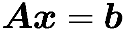

你可以将 `A` 视为一个线性变换或一个函数，它将一个线性空间 `V` 映射到另一个线性空间 `W`。线性映射的核，或称为*零空间*，即 `ker(A)`，是定义域的一个线性子空间，使得该函数将其所有元素映射到 0。

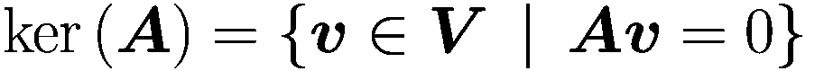

秩-零化度定理指出，核的维度与像的维度之和等于定义域的维度。见图 2-26。

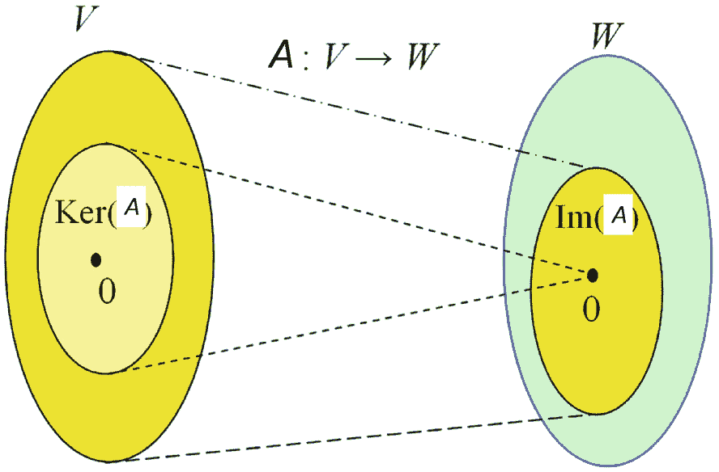

*一个线性映射及其核的示意图。核中有两个椭圆形状，一个小一个大，它们与像中的两个椭圆相连。*

**图 2-26** 线性映射的核与像

## 齐次线性方程组

对于任意齐次线性方程组，如下所示：

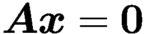

至少存在一个解，称为零解（或平凡解），通过将每个变量赋值为零得到。即 `A0 = 0`。如果方程组具有非奇异矩阵（`det(A) ≠ 0`），则这也是唯一解。如果方程组具有奇异矩阵（`A` 不是满秩的），则 `A` 核的维度或秩不为 0，即 `ker(A) > 0`。此时存在一个包含无限多个解的解集。核中的每个向量都是一个非平凡解。该解集具有以下附加性质：

- 如果 `u` 和 `v` 是表示齐次方程组解的两个向量，那么向量和 `u + v` 也是该方程组的一个解。
- 如果 `u` 是表示齐次方程组解的一个向量，且 `c` 是任意标量，那么 `c*u` 也是该方程组的一个解。

## 非齐次线性方程组

对于非齐次线性方程组，有如下形式：


假设 `p` 是该线性方程组的一个特解，即 `Ap = b`；那么整个解集可以描述如下：

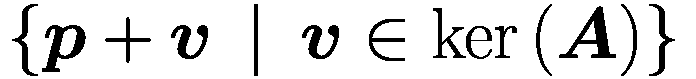

从几何角度看，这意味着非齐次方程组 `Ax = b` 的解集是齐次方程组 `Ax = 0` 解集的一个平移。具体来说，第一个方程组的平坦子空间或欧几里得子空间可以通过将齐次方程组的线性子空间沿向量 `p` 平移得到。这个推理仅当方程组至少有一个解时才成立。当且仅当向量 `b` 位于线性变换 `A` 的像中时，才会出现这种情况。

## 线性方程组的求解

NM Dev 类 `LinearSystemSolver` 用于求解形如 `Ax = b` 的线性方程组。假设在行化简之后，`A` 的行数不超过列数。也就是说，该系统不能是超定的。

注意，以下系统并非超定系统。其中有一行是线性相关的：

![$$ \left[\begin{array}{ccc}1&amp; -1&amp; 0\\ {}0&amp; -2&amp; 0\\ {}0&amp; 0&amp; -1\\ {}0&amp; 0&amp; -2\end{array}\right]\textbf{x}=\left[\begin{array}{c}-0.8\\ {}-1.6\\ {}0.8\\ {}1.6\end{array}\right] $$](images/528380_1_En_2_Chapter/528380_1_En_2_Chapter_TeX_Equcz.png)

线性方程组的求解分两步进行：

1. 首先，求解齐次方程组 `Ax = 0`，寻找非平凡解。
2. 然后，求解 `Ax = b`，得到一个特解。

如果 `A` 是满秩的，该实现将通过 LU 分解求解方程组。否则，通过 `p = Tb` 找到一个特解，其中 `T` 是将 `A` 化为简化行阶梯形的变换矩阵。最终解如下：

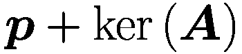

因此，这个解可以看作是 `A` 的零空间沿向量 `p` 的平移。

### 示例

例如，对于以下线性方程组：

![$$ \left[\begin{array}{cccc}0&amp; 1&amp; 2&amp; -1\\ {}1&amp; 0&amp; 1&amp; 1\\ {}-1&amp; 1&amp; 0&amp; -1\\ {}0&amp; 2&amp; 3&amp; -1\end{array}\right]\boldsymbol{x}=\left[\begin{array}{c}1\\ {}4\\ {}2\\ {}7\end{array}\right] $$](images/528380_1_En_2_Chapter/528380_1_En_2_Chapter_TeX_Equdb.png)

核的基满足：

![$$ \left[\begin{array}{cccc}0&amp; 1&amp; 2&amp; -1\\ {}1&amp; 0&amp; 1&amp; 1\\ {}-1&amp; 1&amp; 0&amp; -1\\ {}0&amp; 2&amp; 3&amp; -1\end{array}\right]\left[\begin{array}{c}-2\\ {}-1\\ {}1\\ {}1\end{array}\right]=\left[\begin{array}{c}0\\ {}0\\ {}0\\ {}0\end{array}\right] $$](images/528380_1_En_2_Chapter/528380_1_En_2_Chapter_TeX_Equdc.png)

一个特解满足：

![$$ \left[\begin{array}{cccc}0&amp; 1&amp; 2&amp; -1\\ {}1&amp; 0&amp; 1&amp; 1\\ {}-1&amp; 1&amp; 0&amp; -1\\ {}0&amp; 2&amp; 3&amp; -1\end{array}\right]\left[\begin{array}{c}9\\ {}11\\ {}-5\\ {}0\end{array}\right]=\left[\begin{array}{c}1\\ {}4\\ {}2\\ {}7\end{array}\right] $$](images/528380_1_En_2_Chapter/528380_1_En_2_Chapter_TeX_Equdd.png)

以下 NM Dev 代码求解此示例：

```kotlin
val A: Matrix = DenseMatrix(
arrayOf(
doubleArrayOf(0.0, 1.0, 2.0, -1.0),
doubleArrayOf(1.0, 0.0, 1.0, 1.0),
doubleArrayOf(-1.0, 1.0, 0.0, -1.0),
doubleArrayOf(0.0, 2.0, 3.0, -1.0)
)
)
val b: Vector = DenseVector(arrayOf(1.0, 4.0, 2.0, 7.0))
// 构造一个线性系统求解器
val solver: LinearSystemSolver = LinearSystemSolver(1e-15) // 精度
// 求解齐次线性系统
val soln: LinearSystemSolver.Solution = solver.solve(A)
// 得到一个特解
val p: Vector = soln.getParticularSolution(b)
println("p = \n" + p)
// 验证 Ap = b
val Ap: Vector = A.multiply(p)
println(String.format("%s = \n%s is %b",
Ap,
b,
MatrixPropertyUtils.areEqual(Ap, b, 1e-15)))
// 获取零空间的基
val kernel: List = soln.getHomogeneousSoln()
// println("kernel size = " + kernel.size())
// 验证 A * kernel = 0
val k: Vector = kernel.get(0)
println("kernel basis = " + k)
val Ak: Vector = A.multiply(k)
println("Ak = 0, " + Ak)
```

输出如下：

```
p =
[9.000000, 11.000000, -5.000000, 0.000000]
[1.000000, 4.000000, 2.000000, 7.000000]  =
[1.000000, 4.000000, 2.000000, 7.000000]  is true
kernel size = 1
kernel basis = [-2.000000, -1.000000, 1.000000, 1.000000]
Ak = 0, [0.000000, 0.000000, 0.000000, 0.000000]
```

`LinearSystemSolver` 的签名如下：

```java
/**
 * 构造一个用于求解线性方程组的求解器。
 *
 * @param epsilon 精度参数：当数值 |x| ≤ ε 时，视其为 0
 */
public LinearSystemSolver(double epsilon)
/**
 * 获取线性系统 Ax = b 的一个解。
 *
 * @param A0 表示线性方程组（齐次部分）的矩阵
 * @return 线性系统的一个解
 */
public Solution solve(final Matrix A0)
```

请注意，`solve`函数返回一个`LinearSystemSolver::Solution`类的对象。该对象包含由输入矩阵定义的线性系统的齐次解和非齐次解。其签名如下：

```
/**
 * This is the solution to a linear system of equations.
 */
public static interface Solution {
    /**
     * Get a particular solution for the linear system.
     *
     * @param b a vector
     * @return a particular solution
     */
    Vector getParticularSolution(Vector b);
    /**
     * Get the basis of the homogeneous solution for the linear system,
     * Ax = b.
     * That is, the solutions for Ax = 0.
     *
     * @return the homogeneous solution
     */
    List getHomogeneousSoln();
}
```

## 2.4.7 超定线性系统

如果方程的数量多于未知数的数量，则该方程组是超定的；即，*m* > *n*，其中*m*是方程的数量，*n*是未知数的数量。*m* × *n* 的矩阵***A***是一个高矩阵：


超定系统通常是不一致的（无解）。唯一的例外是某些方程在系统中多次出现，或者等价地，某些方程是其他方程的线性组合。一般来说，每个未知数提供一个自由度。引入系统的每个方程限制一个自由度。因此，当方程的数量和自由变量的数量相等时，会出现临界情况。对于每个提供自由度的变量，都存在一个相应的约束。如果一致，这个方形方程组可以有一个唯一解。当系统被过度约束时，即方程数量超过未知数数量时，就会出现超定情况。

例如，图 2-27 显示了三个线性无关的方程，使得系统不一致，因此无解。

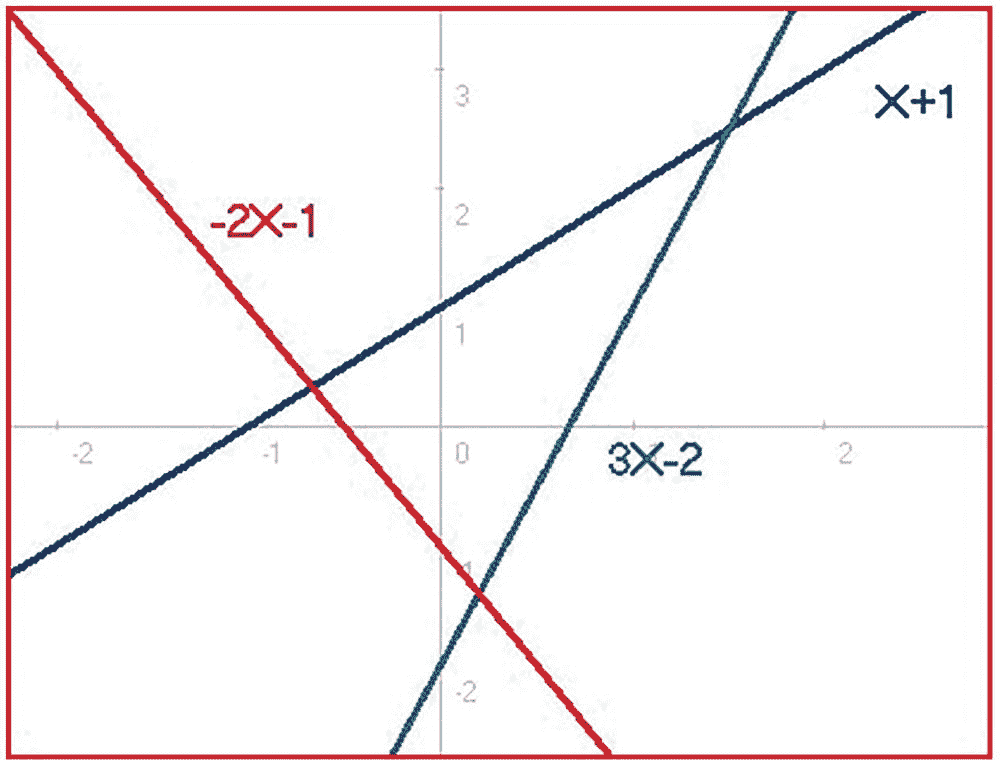

一个超定系统的图示。三条线代表三个线性方程。

**图 2-27** 一个超定系统

在图 2-28 中，一个方程线性依赖于（实际上等同于）另一个方程。该系统有两个变量和两个（线性无关的）约束，因此系统是一致的，并有一个解。

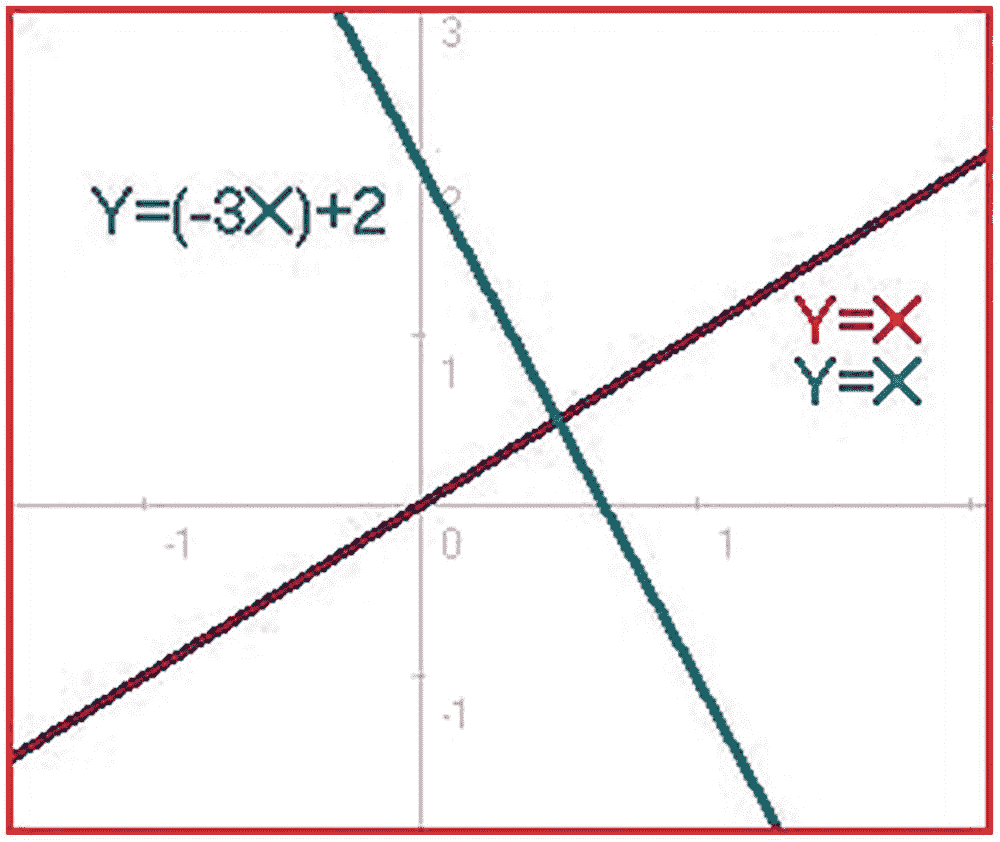

一个图。它包含两条线，其中一条代表两个相关方程的组合。

**图 2-28** 一个方程线性依赖于另一个方程；一个解

对于一个不存在解的超定系统，你应该尝试寻找“最佳近似”。定义“最佳近似”的方法有很多。普通最小二乘法（OLS）找到最小化最小平方的***x***解。即：

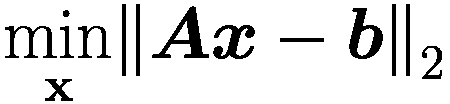

从几何角度讲，OLS 在数据点{(***x***, ***)}***之间画一条（高维）线（或超平面），使得平方距离之和最小。见图 2-29。

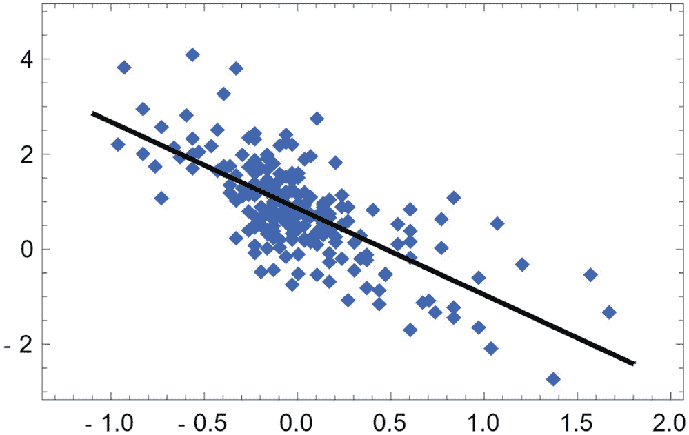

不同值的散点图显示在图表上，沿着一条从最高值到最低值的对角线。

**图 2-29** 超定系统的 OLS 解

解由以下公式给出：

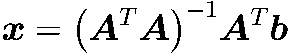

使用此公式，当不存在精确解时会找到一个近似解，而当存在精确解时它会给出一个精确解，前提是(***A***^(*T*)***A***)^(−1)存在（或等价地，***A***具有满列秩）。然而，在实践中，由于计算(***A***^(*T*)***A***)^(−1)时存在数值稳定性问题，我们不使用这个公式。相反，我们使用正交分解方法。

NM Dev 提供了两种正交分解方法的实现，一种基于 QR 分解，另一种基于 SVD 分解。

使用 QR 分解，你可以将***A***写成如下形式：