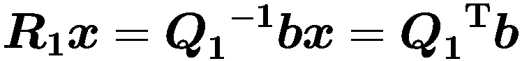
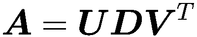
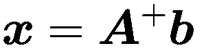

# QR 分解与 SVD 分解在超定线性系统中的应用

![$$ \boldsymbol{A}=\boldsymbol{Q}\boldsymbol{R}=\boldsymbol{Q}\left[\begin{array}{c}{\boldsymbol{R}}_{\textbf{1}}\\ {}\textbf{0}\end{array}\right]=\left[{\boldsymbol{Q}}_{\textbf{1}}\kern0.5em {\boldsymbol{Q}}_{\textbf{2}}\right]\left[\begin{array}{c}{\boldsymbol{R}}_{\textbf{1}}\\ {}\textbf{0}\end{array}\right]={\boldsymbol{Q}}_{\textbf{1}}{\boldsymbol{R}}_{\textbf{1}} $$](images/528380_1_En_2_Chapter/528380_1_En_2_Chapter_TeX_Equdh.png)

超定线性系统`Ax = b`可以重写为`Q₁R₁x = b`。由于`Q₁`是正交矩阵，可得：



由于`R₁`是上三角矩阵，可以使用回代法求解该系统。

以下 NM Dev 代码使用 QR 方法求解该超定系统：

![$$ \left[\begin{array}{cc}1&amp; 1\\ {}1&amp; 2\\ {}1&amp; 3\\ {}1&amp; 4\end{array}\right]\boldsymbol{x}=\left[\begin{array}{c}6\\ {}5\\ {}7\\ {}10\end{array}\right] $$](images/528380_1_En_2_Chapter/528380_1_En_2_Chapter_TeX_Equdj.png)

```
// define an overdetermined system of linear equations
val A: Matrix = DenseMatrix(
    arrayOf(
        doubleArrayOf(1.0, 1.0),
        doubleArrayOf(1.0, 2.0),
        doubleArrayOf(1.0, 3.0),
        doubleArrayOf(1.0, 4.0)
    )
)
val b: Vector = DenseVector(arrayOf(6.0, 5.0, 7.0, 10.0))
val problem: LSProblem = LSProblem(A, b)
// solve the system using QR method
val solver1: OLSSolverByQR = OLSSolverByQR(0.0) // precision
// compute the OLS solution
val x1: Vector = solver1.solve(problem)
println("the OLS solution = " + x1)
```

输出如下：

```
the OLS solution = [3.500000, 1.400000]
```

使用 SVD 分解，`A`可以写成：



伪逆为`A⁺ = VD⁺Uᵀ`，其中`D⁺`通过对角线上每个非零元素取倒数得到，零元素保持不变。在数值计算中，只有大于某个小容差的元素才被认为是非零的，其余的被替换为零。超定线性系统`Ax = b`可以按如下方式求解：



以下 NM Dev 代码求解与之前相同的示例：

```
// solve the system using SVD method
val solver2: OLSSolverBySVD = OLSSolverBySVD(0.0) // precision
// compute the OLS solution
val x2: Vector = solver2.solve(problem)
// verify that Ax2 = b
// val Ax2: Vector = A.multiply(x2)
println("The OLS solution = " + x2)
```

输出如下：

```
the OLS solution = [3.500000, 1.400000]
```

输出结果与使用 QR 方法时完全相同。

## `LSProblem`类

NM Dev 中的`LSProblem`类构造了一个线性系统问题，可以通过多种求解器求解。该类使用构建器设计模式来构造一个`LSProblem`，该问题可自定义求解器的行为，例如迭代次数、精度、初始猜测以及左、右预处理器。预处理器是一种变换的应用，它将问题转化为更适合数值求解方法的形式。这个过程称为*预处理*。预处理通常用于减少数值问题的条件数。预处理后的问题通常通过迭代方法求解。`LSProblem`的签名如下：

```
/**
 * 构造一个线性方程组 Ax = b。
 *
 * @param A 线性方程组的齐次部分，即系数矩阵
 * @param b 线性方程组的非齐次部分，即右侧向量
 */
public LSProblem(Matrix A, Vector b)

/**
 * 获取线性方程组的齐次部分，即系数矩阵。
 *
 * @return 系数矩阵
 */
public ImmutableMatrix A()

/**
 * 获取线性方程组的非齐次部分，即右侧向量。
 *
 * @return 向量
 */
public ImmutableVector b()

/**
 * 获取线性方程组中变量的个数。
 *
 * @return 变量个数
 */
public int size()

/**
 * 覆盖最大迭代次数。
 *
 * @param maxIteration 最大迭代次数
 * @return 覆盖了最大迭代次数的新问题
 */
public LSProblem withMaxIteration(int maxIteration)

/**
 * 获取指定的最大迭代次数。
 *
 * @return 最大迭代次数
 */
public int getMaxIteration()

/**
 * 覆盖容差实例。
 *
 * @param tolerance 判定解收敛并停止迭代的标准
 * @return 覆盖了容差的新问题
 */
public LSProblem withTolerance(Tolerance tolerance)

/**
 * 获取指定的 {@link Tolerance} 实例。
 *
 * @return {@link Tolerance} 实例
 */
public Tolerance getTolerance()

/**
 * 覆盖解的初始猜测。
 *
 * @param initialGuess 解的初始猜测
 * @return 覆盖了初始猜测的新问题
 */
public LSProblem withInitialGuess(Vector initialGuess)

/**
 * 获取该问题的解的初始猜测。
 *
 * @return 初始猜测
 */
public Vector getInitialGuess()

/**
 * 覆盖左预处理器。如果使用右预处理，请将其保留为默认值 - {@link IdentityPreconditioner}。
 *
 * @param preconditioner 预处理器
 * @return 覆盖了左预处理器的新问题
 */
public LSProblem withLeftPreconditioner(Preconditioner preconditioner)

/**
 * 获取左预处理器。
 *
 * @return 左预处理器
 */
public Preconditioner getLeftPreconditioner()

/**
 * 覆盖右预处理器。如果使用左预处理，请将其保留为默认值 - {@link IdentityPreconditioner}。
 *
 * @param preconditioner 预处理器
 * @return 覆盖了右预处理器的新问题
 */
public LSProblem withRightPreconditioner(Preconditioner preconditioner)

/**
 * 获取右预处理器。
 *
 * @return 右预处理器
 */
public Preconditioner getRightPreconditioner()
```


