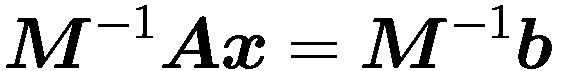
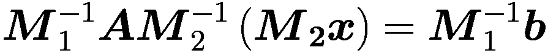

# 2.5 稀疏矩阵

在数值计算中，稀疏矩阵（向量）是指大部分元素为零的矩阵（向量）。对于矩阵中需要有多少个零元素才能被视为稀疏，并没有严格的定义，但一个常见的标准是，非零元素的数量大致与行数或列数相当。相比之下，如果大部分元素都是非零的，则该矩阵被视为稠密矩阵。零值元素数量除以总元素数量，有时被称为矩阵的*稀疏度*。例如，下面的稀疏矩阵只包含 9 个非零元素，而有 26 个零元素。其稀疏度为 74%，稠密度为 26%。

![$$ \left[\begin{array}{ccccccc}11&amp; 22&amp; &amp; &amp; &amp; &amp; \\ {}&amp; 33&amp; 44&amp; &amp; &amp; &amp; \\ {}&amp; &amp; 55&amp; 66&amp; 77&amp; &amp; \\ {}&amp; &amp; &amp; &amp; &amp; 88&amp; \\ {}&amp; &amp; &amp; &amp; &amp; &amp; 99\end{array}\right] $$](images/528380_1_En_2_Chapter/528380_1_En_2_Chapter_TeX_Equdm.png)

从概念上讲，稀疏性对应于具有少量成对交互的系统。例如，考虑一排用弹簧依次连接的球：这是一个稀疏系统，因为只有相邻的球是耦合的。相比之下，如果同一排球中每个球都与其他所有球有弹簧连接，那么这个系统就对应一个稠密矩阵。稀疏性这一概念在组合数学以及网络理论和数值分析等应用领域中非常有用，这些领域通常具有较低密度的重要数据或连接。在求解偏微分方程和优化问题时，大型稀疏矩阵经常出现在科学或工程应用中。

在计算机上存储和操作稀疏矩阵时，采用能够利用矩阵稀疏结构的专用算法和数据结构是有益且通常必要的。使用标准的稠密矩阵结构和算法来处理大型稀疏矩阵是缓慢且低效的，因为处理能力和内存在零元素上被浪费了。稀疏数据本质上更容易压缩，因此所需存储空间显著减少。一些非常大的稀疏矩阵实际上无法使用标准的稠密矩阵算法进行操作。

通常，对于一个 *m* × *n* 的矩阵，以稠密格式存储该矩阵所需的内存量与 *m* × *n* 成正比（忽略矩阵维度本身也需要存储这一事实）。对于稀疏矩阵，可以通过仅存储非零条目来实现内存需求的显著降低。根据非零条目的数量和分布，可以使用不同的数据结构，与基本方法相比，可以大幅节省内存。其代价是访问单个元素变得更加复杂，并且需要额外的结构来明确地恢复原始矩阵。

NM Dev 库支持两种格式组。

* 支持高效修改的格式，例如键字典和列表的列表。这些通常用于构建矩阵。
* 支持高效访问和矩阵运算的格式，例如压缩稀疏行格式。这些通常用于支持矩阵运算。

## 2.5.1 键字典

键字典（DOK）由一个将（行，列）对映射到元素值的字典组成。也就是说，非零值被哈希化，以便可以在常数时间内完成添加、删除和检索操作。字典中缺失的元素被视为零。这种格式适用于以随机顺序增量式地构建稀疏矩阵，但不适合按字典序迭代非零值。您通常使用这种格式构建矩阵，然后将其转换为另一种更高效的格式进行处理。

以下 NM Dev 代码使用 DOK 以两种方式为此矩阵构建稀疏矩阵。您可以使用数组或列表来指定非零条目。

![$$ \boldsymbol{A}=\left[\begin{array}{cccc}1&amp; 2&amp; 0&amp; 0\\ {}0&amp; 3&amp; 9&amp; 0\\ {}0&amp; 1&amp; 4&amp; 0\end{array}\right] $$](images/528380_1_En_2_Chapter/528380_1_En_2_Chapter_TeX_Equdn.png)

```
// the target matrix in dense representation
val A: Matrix = DenseMatrix(arrayOf(
doubleArrayOf(1.0, 2.0, 0.0, 0.0),
doubleArrayOf(0.0, 3.0, 9.0, 0.0),
doubleArrayOf(0.0, 1.0, 4.0, 0.0)
))
// DOK
val B1: SparseMatrix = DOKSparseMatrix(3, 4, // 3x4 dimension
listOf( // specify only the non-zero entries
SparseMatrix.Entry(MatrixCoordinate(3, 3), 4.0),
SparseMatrix.Entry(MatrixCoordinate(2, 2), 3.0),
SparseMatrix.Entry(MatrixCoordinate(1, 1), 1.0),
SparseMatrix.Entry(MatrixCoordinate(3, 2), 1.0),
SparseMatrix.Entry(MatrixCoordinate(2, 3), 9.0),
SparseMatrix.Entry(MatrixCoordinate(1, 2), 2.0))
)
//verify that B1 = A
println(String.format(
"B1 = A, %b",
MatrixPropertyUtils.areEqual(B1, A, 1e-15)))
val B2: SparseMatrix = DOKSparseMatrix(3, 4, // 3x4 dimension
listOf( // specify only the non-zero entries
SparseMatrix.Entry(MatrixCoordinate(3, 3), 4.0),
SparseMatrix.Entry(MatrixCoordinate(2, 2), 3.0),
SparseMatrix.Entry(MatrixCoordinate(1, 1), 1.0),
SparseMatrix.Entry(MatrixCoordinate(3, 2), 1.0),
SparseMatrix.Entry(MatrixCoordinate(2, 3), 9.0),
SparseMatrix.Entry(MatrixCoordinate(1, 2), 2.0))
)
//verify that B2 = A
println(String.format(
"B2 = A, %b",
MatrixPropertyUtils.areEqual(B2, A, 1e-15)))
```

输出如下：

```
B1 = A, true
B2 = A, true
```

## 2.5.2 列表的列表

列表的列表（LIL）为每行存储一个列表，每个条目包含列索引和值。通常，这些条目按列索引排序以加快查找速度。这是另一种适合增量式矩阵构建的格式。

以下 NM Dev 代码使用 LIL 以两种方式为前面所示的 *A* 构建稀疏矩阵。您可以使用数组或列表来指定非零条目。

```
// LIL
val C1: SparseMatrix = LILSparseMatrix(3, 4, // 3x4 dimension
listOf( // specify only the non-zero entries
SparseMatrix.Entry(MatrixCoordinate(3, 3), 4.0),
SparseMatrix.Entry(MatrixCoordinate(2, 2), 3.0),
SparseMatrix.Entry(MatrixCoordinate(1, 1), 1.0),
SparseMatrix.Entry(MatrixCoordinate(3, 2), 1.0),
SparseMatrix.Entry(MatrixCoordinate(2, 3), 9.0),
SparseMatrix.Entry(MatrixCoordinate(1, 2), 2.0))
)
//verify that C1 = A
println(String.format(
"C1 = A, %b",
MatrixPropertyUtils.areEqual(C1, A, 1e-15)))
val C2: SparseMatrix = LILSparseMatrix(3, 4, // 3x4 dimension
listOf( // specify only the non-zero entries
SparseMatrix.Entry(MatrixCoordinate(3, 3), 4.0),
SparseMatrix.Entry(MatrixCoordinate(2, 2), 3.0),
SparseMatrix.Entry(MatrixCoordinate(1, 1), 1.0),
SparseMatrix.Entry(MatrixCoordinate(3, 2), 1.0),
SparseMatrix.Entry(MatrixCoordinate(2, 3), 9.0),
SparseMatrix.Entry(MatrixCoordinate(1, 2), 2.0)))
//verify that C2 = A
println(String.format(
"C2 = A, %b",
MatrixPropertyUtils.areEqual(C2, A, 1e-15)))
```

输出如下：

```
C1 = A, true
C2 = A, true
```


### 2.5.3 压缩稀疏行

压缩稀疏行（CSR）或压缩行存储（CRS）或耶鲁格式通过三个（一维）数组来表示一个矩阵，这些数组分别包含非零值、行的范围以及列索引。这种格式支持快速的行访问和矩阵-向量乘法`***Av***`。CSR 格式使用三个（一维）数组（`V`、`COL_INDEX`、`ROW_INDEX`）以行形式存储一个稀疏的 `*m* × *n*` 矩阵`***A***`。设`NNZ`为`***A***`中非零条目的数量。数组`V`和`COL_INDEX`的长度为`NNZ`，分别包含非零值以及这些值对应的列索引。

以下 NM Dev 代码通过两种方式使用 CSR 构造之前提到的`***A***`的稀疏矩阵。你可以使用数组或列表来指定非零条目。

```
// CSR
val D1: SparseMatrix = CSRSparseMatrix(3, 4, // 3x4 dimension
listOf( // specify only the non-zero entries
SparseMatrix.Entry(MatrixCoordinate(3, 3), 4.0),
SparseMatrix.Entry(MatrixCoordinate(2, 2), 3.0),
SparseMatrix.Entry(MatrixCoordinate(1, 1), 1.0),
SparseMatrix.Entry(MatrixCoordinate(3, 2), 1.0),
SparseMatrix.Entry(MatrixCoordinate(2, 3), 9.0),
SparseMatrix.Entry(MatrixCoordinate(1, 2), 2.0))
)
//verify that D1 = A
println(String.format(
"D1 = A, %b",
MatrixPropertyUtils.areEqual(D1, A, 1e-15)))
val D2: SparseMatrix = CSRSparseMatrix(3, 4, // 3x4 dimension
listOf( // specify only the non-zero entries
SparseMatrix.Entry(MatrixCoordinate(3, 3), 4.0),
SparseMatrix.Entry(MatrixCoordinate(2, 2), 3.0),
SparseMatrix.Entry(MatrixCoordinate(1, 1), 1.0),
SparseMatrix.Entry(MatrixCoordinate(3, 2), 1.0),
SparseMatrix.Entry(MatrixCoordinate(2, 3), 9.0),
SparseMatrix.Entry(MatrixCoordinate(1, 2), 2.0)))
//verify that D2 = A
println(String.format(
"D2 = A, %b",
MatrixPropertyUtils.areEqual(D2, A, 1e-15)))
```

输出如下：

```
D1 = A, true
D2 = A, true
```

### 2.5.4 稀疏矩阵/向量运算

在 NM Dev 中，你可以使用`SparseVector`类创建稀疏向量。示例如下：

```
// sparse vector construction
val v1: SparseVector = SparseVector(
99, // vector size
listOf(
SparseVector.Entry(1, 11.0),
SparseVector.Entry(3, 22.0),
SparseVector.Entry(53, 33.0),
SparseVector.Entry(79, 44.0),
SparseVector.Entry(99, 55.0)
)
)
println("v = " + v1)
```

输出如下：

```
v1 = size: 99
[1] 11.0000
[3] 22.0000
[53] 33.0000
[79] 44.0000
[99] 55.0000
```

所有这些稀疏矩阵和向量数据结构与所有其他矩阵及向量数据结构完全互操作。稀疏数据结构完全支持所有矩阵和向量运算，例如加法和乘法。示例如下：

```
// addition
val M1: Matrix = B1.add(A)
println("M1 = " + M1)
```

输出如下：

```
M1 = 3x4
[,1] [,2] [,3] [,4]
[1,] 2.000000, 4.000000, 0.000000, 0.000000,
[2,] 0.000000, 6.000000, 18.000000, 0.000000,
[3,] 0.000000, 2.000000, 8.000000, 0.000000,
val M2: DOKSparseMatrix = B1.add(B2) as DOKSparseMatrix
println("M2 = " + M2)
```

输出如下：

```
M2 = 3x4 nnz = 6
(1, 1): 2.0
(1, 2): 4.0
(2, 2): 6.0
(2, 3): 18.0
(3, 2): 2.0
(3, 3): 8.0
val M3: LILSparseMatrix = C1.minus(C2) as LILSparseMatrix
println("M3 = " + M3)
```

输出如下：

```
M3 = 3x4 nnz = 0
val M4: CSRSparseMatrix = D1.multiply(D2.t()) as CSRSparseMatrix
println("M4 = " + M4)
```

输出如下：

```
M4 = 3x3 nnz = 9
(1, 1): 5.0
(1, 2): 6.0
(1, 3): 2.0
(2, 1): 6.0
(2, 2): 90.0
(2, 3): 39.0
(3, 1): 2.0
(3, 2): 39.0
(3, 3): 17.0
val v2: SparseVector = SparseVector(
4, // vector size
listOf(
SparseVector.Entry(1, 11.0)
)
)
println("v2 = " + v2)
```

输出如下：

```
v2 = size: 4
[1] 11.0000
val v3: Vector = B1.multiply(v2)
println("ve = " + v3)
```

输出如下：

```
ve = size: 3
[1] 11.0000
```

NM Dev 还支持多种其他针对特殊结构的矩阵，如下所示：

*   `DiagonalMatrix`
*   `BidiagonalMatrix`
*   `TridiagonalMatrix`
*   `LowerTriangularMatrix`
*   `UpperTriangularMatrix`
*   `SymmetricMatrix`
*   `PermutationMatrix`

这些数据结构具有其专属的运算，但它们也与所有其他矩阵和向量数据结构完全互操作。它们也完全支持所有矩阵和向量运算，例如加法和乘法。


### 2.5.5 求解稀疏矩阵方程

求解线性方程组是数值计算的基础。你可以利用问题的稀疏性来处理原本无法应对的更大规模问题。例如，前面章节讨论的求解器——如`LU`、`QR`和`SVD`分解——都适用于稠密矩阵。它们会用零填充整个矩阵（想象一下百万乘以百万规模的矩阵），并且需要反复填充大量的零元素。这些稠密矩阵可能无法装入计算机内存。对这些满矩阵的操作效率低下，且浪费在零元素上。求解线性方程组的算法通常是迭代法，这类方法利用稀疏矩阵的优势，不会改变稀疏模式，因为它们只涉及矩阵-向量乘积，不会产生填充。

求解 *n* × *n*（或非方阵）线性系统 ***Ax*** = ***b*** 的迭代方法，涉及一系列矩阵-向量乘法。从解的初始猜测开始，每次迭代都会返回一个新的解估计值。希望经过 *k* 次迭代后，估计值能收敛到令人满意的解（在容差范围内）。对于稠密矩阵 ***A***，每次迭代需要 *O*(*n*²) 次运算。一个迭代方法需要 *O*(*kn*²) 次运算才能收敛。对于稀疏系统，矩阵-向量乘法只需要 *O*(#nonZeros) 次运算，其中 #nonZeros 是稀疏矩阵中非零元素的个数。因此，迭代法可能比传统的直接法（如求逆）求解线性方程组快得多。使用稀疏矩阵的迭代法比使用稠密矩阵的迭代法快得多。

`NM Dev` 支持多种稀疏矩阵线性系统求解器。它们如下：

- 双共轭梯度求解器（`BiCG`）
- 双共轭梯度稳定求解器（`BiCGSTAB`）
- 共轭梯度求解器（`CG`）
- 共轭梯度法向误差求解器（`CGNE`）
- 共轭梯度法向残差求解器（`CGNR`）
- 共轭梯度平方求解器（`CGS`）
- 高斯-赛德尔求解器
- 广义共轭残差求解器（`GRES`）
- 广义最小残差求解器（`GMRES`）
- 雅可比求解器
- 最小残差求解器（`MINRES`）
- 拟最小残差求解器（`QMR`）
- 最速下降求解器
- 逐次超松弛求解器（`SOR`）
- 对称逐次超松弛求解器（`SSOR`）

以下是选择稀疏系统迭代求解器的一些指南。对于埃尔米特问题，如果系统是正定的，使用`CG`或`MINRES`；否则，使用`MINRES`。为了避免在`CG`或`MINRES`中计算内积，你可以选择定常方法，如`Jacobi`、`Gauss-Seidel`、`SOR`或`SSOR`。这些方法在每次迭代中节省了计算成本，但迭代次数可能会增加，除非有良好的预处理。

对于非埃尔米特问题，选择就没那么容易了。如果矩阵-向量乘法非常昂贵，`GMRES`可能是最佳选择，因为它执行的乘法次数最少。次优的选择是`QMR`或`BiCG`。`QMR`在数值上比`BiCG`更稳定。当矩阵转置不可用时，有免转置的方法，如`CGS`或`BiCGSTAB`。对于非方阵系统，有用于求解超定系统的`CG`方法，如`CGNR`，以及用于求解欠定系统的方法，如`CGNE`。

使用预处理可以显著提高迭代方法的收敛速度。预处理将一个线性系统转化为另一个等价的系统（即具有相同解）。转化后的系统具有更有利的谱性质，从而影响收敛速度。特别地，预处理矩阵 ***M*** 近似于系数矩阵 ***A***，且转化后的系统更容易求解。以下是一个示例：



该方程组与原系统具有相同的解。其系数矩阵 ***M***^(−1)***A*** 的谱性质可能更有利。另一种预处理系统的方式如下：



矩阵 ***M***[**1**] 和 ***M***[**2**] 分别称为左预处理和右预处理。有三种预处理方式：左预处理、右预处理或分裂预处理。左预处理将 ***M***[**2**] 设置为 `IdentityPreconditioner`。（当不应用任何预处理时，使用此单位预处理。）同样，右预处理将 ***M***[**1**] 设置为 `IdentityPreconditioner`。

在 `NM Dev` 中，所有稀疏矩阵线性系统求解器都继承自 `IterativeLinearSystemSolver` 接口。其签名如下：

```
public interface IterativeLinearSystemSolver {
/**
* 这是一个使用迭代求解器求解线性方程组的解。
*/
public static interface Solution extends IterativeMethod {
@Override
public IterationMonitor step() throws ConvergenceFailure;//覆盖返回和异常类型
@Override
public Vector search(Vector... initials) throws ConvergenceFailure;//覆盖异常类型
}
/**
* 迭代求解
* 
* Ax = b
* 
* 直到解收敛，即残差 (b - Ax) 的范数小于等于阈值。
*
* @param problem 一个线性方程组
* @param monitor 一个迭代监视器
* @return 线性问题的一个（近似）解
* @throws ConvergenceFailure 如果算法未能收敛
*/
public Solution solve(LSProblem problem, IterationMonitor monitor) throws ConvergenceFailure;
}
```

以下 `NM Dev` 代码使用多个非定常稀疏线性系统求解器求解一个稀疏线性系统。一般步骤是：首先使用 `LSProblem` 定义一个线性系统问题。然后为该问题构建一个求解器。这里有很多选择。求解问题会得到 `IterativeLinearSystemSolver.Solution`。利用该解对象，你可以从初始猜测（在这些示例中为 0）开始迭代搜索。搜索算法返回一个向量 *x* 作为解。通过使用 *ℓ*[2]-范数比较 *Ax* 与 *b* 之间的差异来验证结果的有效性。示例如下：


```kotlin
// 对称矩阵：
// 8x8
// [,1] [,2] [,3] [,4] [,5] [,6] [,7] [,8]
// [1,] 7.000000, 0.000000, 1.000000, 0.000000, 0.000000, 2.000000, 7.000000, 0.000000,
// [2,] 0.000000, -4.000000, 8.000000, 0.000000, 2.000000, 0.000000, 0.000000, 0.000000,
// [3,] 1.000000, 8.000000, 1.000000, 0.000000, 0.000000, 0.000000, 0.000000, 5.000000,
// [4,] 0.000000, 0.000000, 0.000000, 7.000000, 0.000000, 0.000000, 9.000000, 0.000000,
// [5,] 0.000000, 2.000000, 0.000000, 0.000000, 5.000000, 1.000000, 5.000000, 0.000000,
// [6,] 2.000000, 0.000000, 0.000000, 0.000000, 1.000000, -1.000000, 0.000000, 5.000000,
// [7,] 7.000000, 0.000000, 0.000000, 9.000000, 5.000000, 0.000000, 11.000000, 0.000000,
// [8,] 0.000000, 0.000000, 5.000000, 0.000000, 0.000000, 5.000000, 0.000000, 5.000000,
val A: Matrix = CSRSparseMatrix(8, 8, // 矩阵维度
    listOf(
        SparseMatrix.Entry(MatrixCoordinate(1, 1), 7.0),
        SparseMatrix.Entry(MatrixCoordinate(1, 3), 1.0),
        SparseMatrix.Entry(MatrixCoordinate(1, 6), 2.0),
        SparseMatrix.Entry(MatrixCoordinate(1, 7), 7.0),
        SparseMatrix.Entry(MatrixCoordinate(2, 2), -4.0),
        SparseMatrix.Entry(MatrixCoordinate(2, 3), 8.0),
        SparseMatrix.Entry(MatrixCoordinate(2, 5), 2.0),
        SparseMatrix.Entry(MatrixCoordinate(3, 1), 1.0),
        SparseMatrix.Entry(MatrixCoordinate(3, 2), 8.0),
        SparseMatrix.Entry(MatrixCoordinate(3, 3), 1.0),
        SparseMatrix.Entry(MatrixCoordinate(3, 8), 5.0),
        SparseMatrix.Entry(MatrixCoordinate(4, 4), 7.0),
        SparseMatrix.Entry(MatrixCoordinate(4, 7), 9.0),
        SparseMatrix.Entry(MatrixCoordinate(5, 2), 2.0),
        SparseMatrix.Entry(MatrixCoordinate(5, 5), 5.0),
        SparseMatrix.Entry(MatrixCoordinate(5, 6), 1.0),
        SparseMatrix.Entry(MatrixCoordinate(5, 7), 5.0),
        SparseMatrix.Entry(MatrixCoordinate(6, 1), 2.0),
        SparseMatrix.Entry(MatrixCoordinate(6, 5), 1.0),
        SparseMatrix.Entry(MatrixCoordinate(6, 6), -1.0),
        SparseMatrix.Entry(MatrixCoordinate(6, 8), 5.0),
        SparseMatrix.Entry(MatrixCoordinate(7, 1), 7.0),
        SparseMatrix.Entry(MatrixCoordinate(7, 4), 9.0),
        SparseMatrix.Entry(MatrixCoordinate(7, 5), 5.0),
        SparseMatrix.Entry(MatrixCoordinate(7, 7), 11.0),
        SparseMatrix.Entry(MatrixCoordinate(8, 3), 5.0),
        SparseMatrix.Entry(MatrixCoordinate(8, 6), 5.0),
        SparseMatrix.Entry(MatrixCoordinate(8, 8), 5.0)
    )
)
val b: Vector = DenseVector( // 注意我们仍然可以使用稠密数据结构
    arrayOf(1.0, 1.0, 1.0, 1.0, 1.0, 1.0, 1.0, 1.0)
)
// 构造一个待求解的线性系统问题
val problem: LSProblem = LSProblem(A, b)
// 构造一个稀疏矩阵线性系统求解器
val BiCG: BiconjugateGradientSolver
    = BiconjugateGradientSolver(
    10, // 最大迭代次数
    AbsoluteTolerance(1e-8) // 精度
)
val soln1: IterativeLinearSystemSolver.Solution = BiCG.solve(problem)
val x1: Vector = soln1.search(SparseVector(A.nCols())) // 使用 0 作为初始猜测
println("x = " + x1)
val Ax1_b: Vector = A.multiply(x1).minus(b) // 验证 Ax = b
println("||Ax - b|| = " + Ax1_b.norm()) // 应（接近）为 0
```

输出如下：

```
x = [-0.041860, -0.003413, 0.117250, -0.112640, 0.024172, -0.107633, 0.198720, 0.190383]
||Ax - b|| = 3.4321107842718707E-13
```

```kotlin
// 构造一个稀疏矩阵线性系统求解器
val BiCGSTAB: BiconjugateGradientStabilizedSolver
    = BiconjugateGradientStabilizedSolver(
    10, // 最大迭代次数
    AbsoluteTolerance(1e-7) // 较低精度
)
val soln2: IterativeLinearSystemSolver.Solution = BiCGSTAB.solve(problem)
val x2: Vector = soln2.search(SparseVector(A.nCols())) // 使用 0 作为初始猜测
println("x = " + x2)
val Ax2_b: Vector = A.multiply(x2).minus(b) // 验证 Ax = b
println("||Ax - b|| = " + Ax2_b.norm()) // 应（接近）为 0
```

输出如下：

```
x = [-0.041860, -0.003413, 0.117250, -0.112640, 0.024172, -0.107633, 0.198720, 0.190383]
||Ax - b|| = 6.001732649867594E-8
```

```kotlin
val CGNE: ConjugateGradientNormalErrorSolver
    = ConjugateGradientNormalErrorSolver(
    10, // 最大迭代次数
    AbsoluteTolerance(1e-8) // 精度
)
val soln3: IterativeLinearSystemSolver.Solution = CGNE.solve(problem)
val x3: Vector = soln3.search(SparseVector(A.nCols())) // 使用 0 作为初始猜测
println("x = " + x3)
val Ax3_b: Vector = A.multiply(x3).minus(b) // 验证 Ax = b
println("||Ax - b|| = " + Ax3_b.norm()) // 应（接近）为 0
```

输出如下：

```
x = [-0.041860, -0.003413, 0.117250, -0.112640, 0.024172, -0.107633, 0.198720, 0.190383]
||Ax - b|| = 1.6870268466872934E-9
```

```kotlin
val CGNR: ConjugateGradientNormalResidualSolver
    = ConjugateGradientNormalResidualSolver(
    10, // 最大迭代次数
    AbsoluteTolerance(1e-8) // 精度
)
val soln4: IterativeLinearSystemSolver.Solution = CGNR.solve(problem)
val x4: Vector = soln4.search(SparseVector(A.nCols())) // 使用 0 作为初始猜测
println("x = " + x4)
val Ax4_b: Vector = A.multiply(x4).minus(b) // 验证 Ax = b
println("||Ax - b|| = " + Ax4_b.norm()) // 应（接近）为 0
```

输出如下：

```
x = [-0.041860, -0.003413, 0.117250, -0.112640, 0.024172, -0.107633, 0.198720, 0.190383]
||Ax - b|| = 6.817480703009663E-10
```

```kotlin
val CG: ConjugateGradientSolver
    = ConjugateGradientSolver(
    10, // 最大迭代次数
    AbsoluteTolerance(1e-8) // 精度
)
val soln5: IterativeLinearSystemSolver.Solution = CG.solve(problem)
val x5: Vector = soln5.search(SparseVector(A.nCols())) // 使用 0 作为初始猜测
println("x = " + x5)
val Ax5_b: Vector = A.multiply(x5).minus(b) // 验证 Ax = b
println("||Ax - b|| = " + Ax5_b.norm()) // 应（接近）为 0
```

输出如下：

```
x = [-0.041860, -0.003413, 0.117250, -0.112640, 0.024172, -0.107633, 0.198720, 0.190383]
||Ax - b|| = 3.4321107842718707E-13
```

```kotlin
val CGS: ConjugateGradientNormalResidualSolver
    = ConjugateGradientNormalResidualSolver(
    10, // 最大迭代次数
    AbsoluteTolerance(1e-8) // 精度
)
val soln6: IterativeLinearSystemSolver.Solution = CGS.solve(problem)
val x6: Vector = soln6.search(SparseVector(A.nCols())) // 使用 0 作为初始猜测
println("x = " + x6)
val Ax6_b: Vector = A.multiply(x6).minus(b) // 验证 Ax = b
println("||Ax - b|| = " + Ax6_b.norm()) // 应（接近）为 0
```

输出如下：

```
x = [-0.041860, -0.003413, 0.117250, -0.112640, 0.024172, -0.107633, 0.198720, 0.190383]
||Ax - b|| = 6.817480703009663E-10
```

```kotlin
val GRES: GeneralizedConjugateResidualSolver
    = GeneralizedConjugateResidualSolver(
    10, // 最大迭代次数
    AbsoluteTolerance(1e-8) // 精度
)
val soln7: IterativeLinearSystemSolver.Solution = GRES.solve(problem)
val x7: Vector = soln7.search(SparseVector(A.nCols())) // 使用 0 作为初始猜测
println("x = " + x7)
val Ax7_b: Vector = A.multiply(x7).minus(b) // 验证 Ax = b
println("||Ax - b|| = " + Ax7_b.norm()) // 应（接近）为 0
```

输出如下：

```
x = [-0.041860, -0.003413, 0.117250, -0.112640, 0.024172, -0.107633, 0.198720, 0.190383]
||Ax - b|| = 1.0175362097255202E-15
```

```kotlin
val GMRES: GeneralizedMinimalResidualSolver
    = GeneralizedMinimalResidualSolver(
    10, // 最大迭代次数
    AbsoluteTolerance(1e-8) // 精度
)
val soln8: IterativeLinearSystemSolver.Solution = GMRES.solve(problem)
val x8: Vector = soln8.search(SparseVector(A.nCols())) // 使用 0 作为初始猜测
println("x = " + x8)
val Ax8_b: Vector = A.multiply(x8).minus(b) // 验证 Ax = b
println("||Ax - b|| = " + Ax8_b.norm()) // 应（接近）为 0
```

输出如下：

```
x = [-0.041860, -0.003413, 0.117250, -0.112640, 0.024172, -0.107633, 0.198720, 0.190383]
||Ax - b|| = 1.0175362097255202E-15
```


```kotlin
x = [-0.041860, -0.003413, 0.117250, -0.112640, 0.024172, -0.107633, 0.198720, 0.190383]
||Ax - b|| = 1.0053497077208614E-15

val MINRES: MinimalResidualSolver = MinimalResidualSolver(
    10, // 最大迭代次数
    AbsoluteTolerance(1e-8) // 精度
)
val monitor: CountMonitor = CountMonitor()
val soln9: IterativeLinearSystemSolver.Solution = MINRES.solve(problem, monitor)
val x9: Vector = soln9.search(SparseVector(A.nCols())) // 使用 0 作为初始猜测
println("x = " + x9)
val Ax9_b: Vector = A.multiply(x9).minus(b) // 验证 Ax = b
println("||Ax - b|| = " + Ax9_b.norm()) // 应（接近）为 0
```

输出如下：

```
x = [-0.041860, -0.003413, 0.117250, -0.112640, 0.024172, -0.107633, 0.198720, 0.190383]
||Ax - b|| = 2.392209894095706E-13
```

```kotlin
val QMR: QuasiMinimalResidualSolver
    = QuasiMinimalResidualSolver(
        10, // 最大迭代次数
        AbsoluteTolerance(1e-8) // 精度
    )
val soln10: IterativeLinearSystemSolver.Solution = QMR.solve(problem)
val x10: Vector = soln10.search(SparseVector(A.nCols())) // 使用 0 作为初始猜测
println("x = " + x10)
val Ax10_b: Vector = A.multiply(x10).minus(b) // 验证 Ax = b
println("||Ax - b|| = " + Ax10_b.norm()) // 应（接近）为 0
```

输出如下：

```
x = [-0.041860, -0.003413, 0.117250, -0.112640, 0.024172, -0.107633, 0.198720, 0.190383]
||Ax - b|| = 5.933770145831627E-13
```

以下 NM Dev 代码使用多个**稳态稀疏线性系统求解器**求解一个稀疏线性系统：

```kotlin
println("使用稳态迭代求解器求解稀疏线性系统")
var A: Matrix = SymmetricMatrix(arrayOf(
    doubleArrayOf(4.0),
    doubleArrayOf(1.0, 3.0)))
val b = DenseVector(arrayOf(1.0, 2.0))
// 构造待求解的线性系统问题
val problem: LSProblem = LSProblem(A, b)
// 构造一个稀疏矩阵线性系统求解器
val gauss_seidel: GaussSeidelSolver = GaussSeidelSolver(10, AbsoluteTolerance(1e-4))
val soln1: IterativeLinearSystemSolver.Solution = gauss_seidel.solve(problem)
val x1 = soln1.search(SparseVector(A.nCols())) // 使用 0 作为初始猜测
println("x = " + x1)
val Ax1_b = A.multiply(x1).minus(b) // 验证 Ax = b
println("||Ax - b|| = " + Ax1_b.norm()) // 应（接近）为 0
```

输出如下：

```
x = [0.090917, 0.636361]
||Ax - b|| = 2.8131430040989613E-5
```

```kotlin
// 构造一个稀疏矩阵线性系统求解器
val jacobi: JacobiSolver = JacobiSolver(10, AbsoluteTolerance(1e-4))
val soln2: IterativeLinearSystemSolver.Solution = jacobi.solve(problem)
val x2 = soln2.search(SparseVector(A.nCols()))
println("x = " + x2)
val Ax2_b = A.multiply(x1).minus(b) // 验证 Ax = b
println("||Ax - b|| = " + Ax2_b.norm()) // 应（接近）为 0
```

输出如下：

```
x = [0.090917, 0.636365]
||Ax - b|| = 2.8131430040989613E-5
```

```kotlin
val SOR: SuccessiveOverrelaxationSolver = SuccessiveOverrelaxationSolver(
    1.5,
    20, // 需要更多迭代
    AbsoluteTolerance(1e-4))
val soln3: IterativeLinearSystemSolver.Solution = SOR.solve(problem)
val x3 = soln3.search(SparseVector(A.nCols())) // 使用 0 作为初始猜测
println("x = " + x3)
val Ax3_b = A.multiply(x3).minus(b) // 验证 Ax = b
println("||Ax - b|| = " + Ax3_b.norm()) // 应（接近）为 0
```

输出如下：

```
x = [0.090909, 0.636344]
||Ax - b|| = 6.462981890138403E-5
```

```kotlin
val SSOR: SymmetricSuccessiveOverrelaxationSolver
    = SymmetricSuccessiveOverrelaxationSolver(
        1.5,
        20, // 需要更多迭代
        AbsoluteTolerance(1e-4))
val soln4: IterativeLinearSystemSolver.Solution = SSOR.solve(problem)
val x4 = soln4.search(SparseVector(A.nCols())) // 使用 0 作为初始猜测
println("x = " + x4)
val Ax4_b = A.multiply(x4).minus(b) // 验证 Ax = b
println("||Ax - b|| = " + Ax4_b.norm()) // 应（接近）为 0
```

输出如下：

```
x = [0.090904, 0.636348]
||Ax - b|| = 6.213495416129946E-5
```

