# 3. 求方程的根

**求根算法**是一种数值算法，用于为给定函数 `f` 找到满足 `f(x) = 0` 的值 `x`。这一过程也称为*求零点*。因此，你可能得到无解、一个解或多个解。NM Dev 提供了几种方法来寻找此类根。它们包括 `Jenkins-Traub` 算法、`二分法`、`Brent 法`、`牛顿-拉夫逊法`和`哈雷法`。除多项式外，`Jenkins-Traub` 算法可以计算多项式的所有根。一般来说，函数的零点无法精确计算，或者不存在闭式解。即使根可能存在，大多数算法也无法保证找到根。求根算法是一种迭代算法，它依次逼近根，利用前一个根来寻找新根（第一个根需要用户提供初始猜测），直到函数值在预先指定的容差内接近零。算法的效率取决于函数本身（连续性、光滑性，即可微性、以及根的个数）、初始猜测、迭代次数，以及一点点运气。在实践中，对同一问题尝试几种算法，比较它们的结果，并采用最佳解，这可能是一个好主意。

本章的源代码可在 S2 平台上运行，网址如下：

[`https://s21.nm.dev/hub/user-redirect/lab/tree/s2-public/Numerical%20Methods%20Using%20Kotlin/chapter3.ipynb`](https://s21.nm.dev/hub/user-redirect/lab/tree/s2-public/Numerical%20Methods%20Using%20Kotlin/chapter3.ipynb)

源代码可在 GitHub 上找到：

[`https://github.com/apress/numerical-methods-kotlin`](https://github.com/apress/numerical-methods-kotlin)

## 3.1 单变量方程

求根的第一步是构造待求解的方程。一个方程可以用一个多项式或一个（通用）函数来表示。见图 3-1。

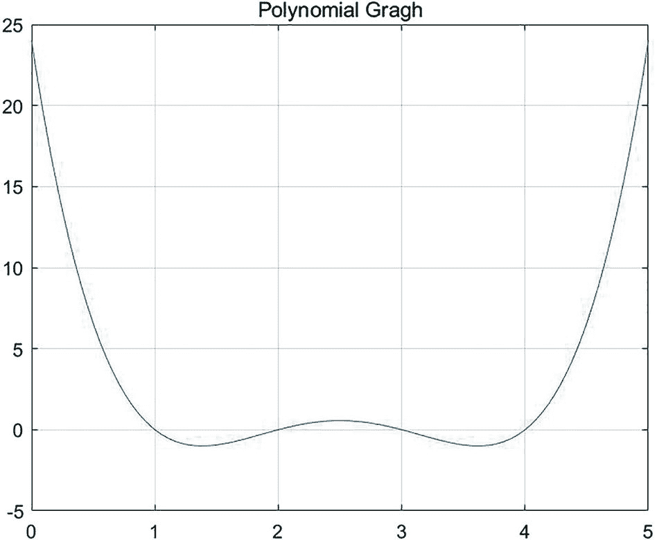
**图 3-1**
`x⁴ − 10x³ + 35x² − 50x + 24 = 0`

在 NM Dev 中，多项式由 `Polynomial` 类表示。例如，要表示多项式 `p(x) = x⁴ − 10x³ + 35x² − 50x + 24`，你可以构造一个 `Polynomial` 实例，从最高次项开始向构造函数提供系数。

```kotlin
val p: Polynomial = Polynomial(1.0, -10.0, 35.0, -50.0, 24.0)
println("p(1) = " + p.evaluate(1.0))
```

输出如下：
```
p(1) = 0.0
```

在 NM Dev 中，函数由 `UnivariateRealFunction` 接口表示。通常，你可以使用 `AbstractUnivariateRealFunction` 类来简化实现。例如，要表示函数 `f(x) = x sin x – 3`，你可以构造一个 `AbstractUnivariateRealFunction` 的实例。

```kotlin
val f: UnivariateRealFunction = object : AbstractUnivariateRealFunction() {
    override fun evaluate(x: Double): Double {
        return Math.sin(x) * x - 3
    }
}
println("f(1) = " + f.evaluate(1.0))
```

输出如下：
```
f(1) = -2.1585290151921033
```

见图 3-2。

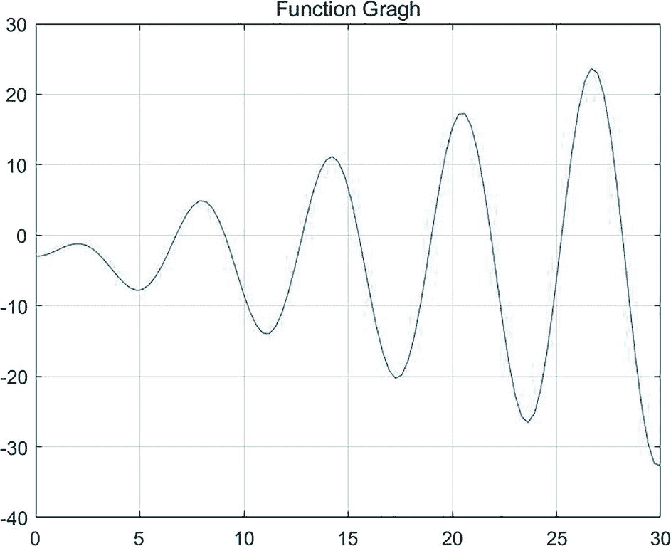
**图 3-2**
`x sin x − 3 = 0`

一个实现了 `UnivariateRealFunction` 的函数可以与 NM Dev 中几乎所有的类、函数和工具一起使用。它是 NM 数值库中最基本的构建模块。

## 3.2 Jenkins-Traub 算法

`Jenkins-Traub` 多项式求根算法是一种快速、全局收敛的迭代方法，由 Michael A. Jenkins 和 Joseph F. Traub（1970 年）发表。该算法依次求出各个根。每找到一个根 *r* 后，就将多项式除以 *r* 的线性因子（*x* − *r*）。降阶后的多项式次数恰好减少 1。重复这个过程 *n* 次，其中 *n* 是多项式的次数。根据代数基本定理，可以保证所有 *n* 个根都被找到，并且每个根只计算一次。

`PolyRoot` 是我们对 `Jenkins-Traub` 算法的实现。由于当前 `Polynomial` 类的实现仅支持实系数，因此它只适用于实系数多项式，但可以同时求解实根和复根。

例如，图 3-1 中多项式的根分别为 1、2、3 和 4（从图中可以明显看出）。要找出它的所有零点，可以编写如下代码：

```kotlin
val p: Polynomial = Polynomial(1.0, -10.0, 35.0, -50.0, 24.0)
val solver = PolyRoot()
val roots: List = solver.solve(p)
println(Arrays.toString(roots.toTypedArray()))
```

输出结果如下：
```
[3.000000-0.000000i, 4.000000+0.000000i, 1.000000-0.000000i, 2.000000+0.000000i]
```

以下示例求解一个具有复根的多项式，*p*(*x*) = *x*² + 1。根为 *i* 和 −*i*。

```kotlin
val p: Polynomial = Polynomial(1.0, 0.0, 1.0) // x² + 1 = 0
val solver = PolyRoot()
val roots0: List = solver.solve(p)
println(Arrays.toString(roots0.toTypedArray()))
val roots1: List = PolyRoot.getComplexRoots(roots0)
println(Arrays.toString(roots1.toTypedArray()))
```

输出结果如下：
```
[0.000000+1.000000i, 0.000000-1.000000i]
[0.000000+1.000000i, 0.000000-1.000000i]
```

## 3.3 二分法

最简单的求根算法是二分法。设 *f* 为一个连续函数，已知区间 [*a*, *b*] 内包含一个根。也就是说，在 *a* 和 *b* 之间的某处满足 *f* = 0。因此，我们知道 *f*(*a*) 和 *f*(*b*) 符号相反，从而构成一个区间。令 *c* 为区间的中点，即 `c = (a + b) / 2`。那么，要么 *f*(*a*) 和 *f*(*c*) 符号相反，要么 *f*(*c*) 和 *f*(*b*) 符号相反。根将位于这两个子区间之一。虽然二分法很稳健，但每次迭代仅能提高一位精度。在适当条件下，其他方法可能效率更高。

具体来说，对于方程 *f*(*x*) = 0，需要给出一个区间 [*a*, *b*]，使得 *f*(*a*) 和 *f*(*b*) 符号相反。可以通过以下算法找到该区间内的根：

1. 选择上界和下界的值，*l* = *a*，*u* = *b*。
2. 计算中点 `p = (l + u) / 2`。
3. 如果 *f*(*p*) = 0，则根已找到，*x* = *p*。停止。
4. 否则 *f*(*p*) ≠ 0。
    1. 如果 *f*(*p*) * *f*(*l*) > 0，则 *l* = *p*，*u* = *u*。
    2. 如果 *f*(*p*) * *f*(*u*) > 0，则 *l* = *l*，*u* = *p*。
5. 重复步骤 2 到 4，直到满足预设的容差或达到最大迭代次数。

`BisectionRoot` 类是我们对二分法的实现。使用该类有两个步骤。首先，需要构造一个 `BisectionRoot` 求解器，并用于指定其属性：精度容差（或收敛阈值）和最大迭代次数。求解器的属性与其求解的问题无关。求解器实例可以重复使用，以求解多个问题实例。

获得 `BisectionRoot` 实例后，调用 `solve` 方法来求解特定方程。还需要提供上界、下界，以及可选的根的初始猜测值。函数的签名如下：

```
/**
 * 用收敛容差和最大迭代次数构造一个实例。
 *
 * @param tol           容差
 * @param maxIterations 最大迭代次数
 */
public BisectionRoot(double tol, int maxIterations);
/**
 * 在区间 [lower, upper] 中搜索根 x，使得 f(x) = 0。
 *
 * @param f     单变量函数
 * @param lower 区间下界
 * @param upper 区间上界
 * @param guess 根在 [lower, upper] 内的初始猜测值。
 *              注意 {@code guess} 是一个 {@code double[]} 类型。
 *              此签名允许为某些类型的单根算法（例如 Brent 算法）提供多个初始猜测值。
 * @return 近似的根
 * @throws NoRootFoundException 当搜索未能找到根时抛出
 */
public double solve(
UnivariateRealFunction f,
double lower,
double upper,
double... guess
) throws NoRootFoundException;
```

以下代码展示了如何使用 `BisectionRoot` 求解图 3-2 中的函数，`x sin x − 3 = 0`：

```kotlin
val f: UnivariateRealFunction = object: AbstractUnivariateRealFunction() {
override fun evaluate(x: Double): Double {
return x * Math.sin(x) - 3 // x * six(x) - 3 = 0
}
}
val solver = BisectionRoot(1e-8, 30)
val root: Double = solver.solve(f, 12.0, 14.0)
val fx: Double = f.evaluate(root)
println(String.format("f(%f) = %f", root, fx))
```

输出结果如下：

```
f(12.802892) = -0.000000
```

如果你打印出每次迭代的区间和近似根，就可以看到二分法的实际运行过程。从初始区间 [12, 14] 开始，根位于该区间内的某处，如图 3-3 所示。

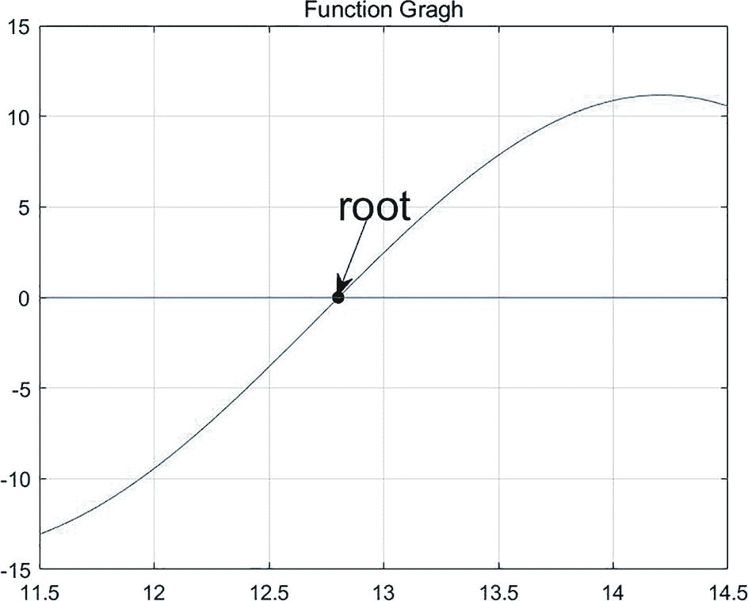

一个函数图像。线性模型曲线从-12 开始，上升至 11。根的位置已标记。

**图 3-3** 根在 `[12,14]` 区间内的位置

中点为 13。可以判断根位于左子区间。因此，可将下一个区间更新为 `[12, 13]`，如图 3-4 所示。

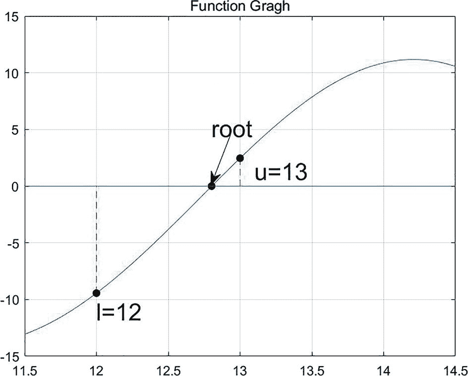

一个函数图像。线性曲线上绘制了两个点，其中 `I` 等于 2，`U` 等于 13。

**图 3-4** 根在 `[12,13]` 区间内的位置

中点为 12.5。可以判断根位于右子区间。因此，可将下一个区间更新为 `[12.5, 13]`，如图 3-5 所示。

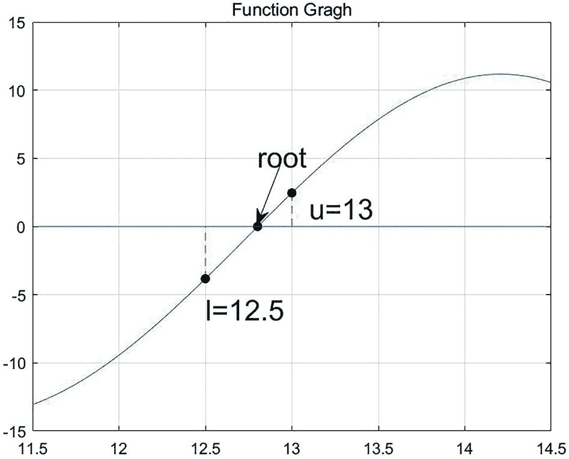

一个函数图像。线性曲线上有三个点，根位于中间，`l` 等于 12.5，`u` 等于 13。

**图 3-5** 根在 `[12.5,13]` 区间内的位置

中点为 12.75。可以判断根位于右子区间。因此，可将下一个区间更新为 `[12.75, 13]`，如图 3-6 所示。

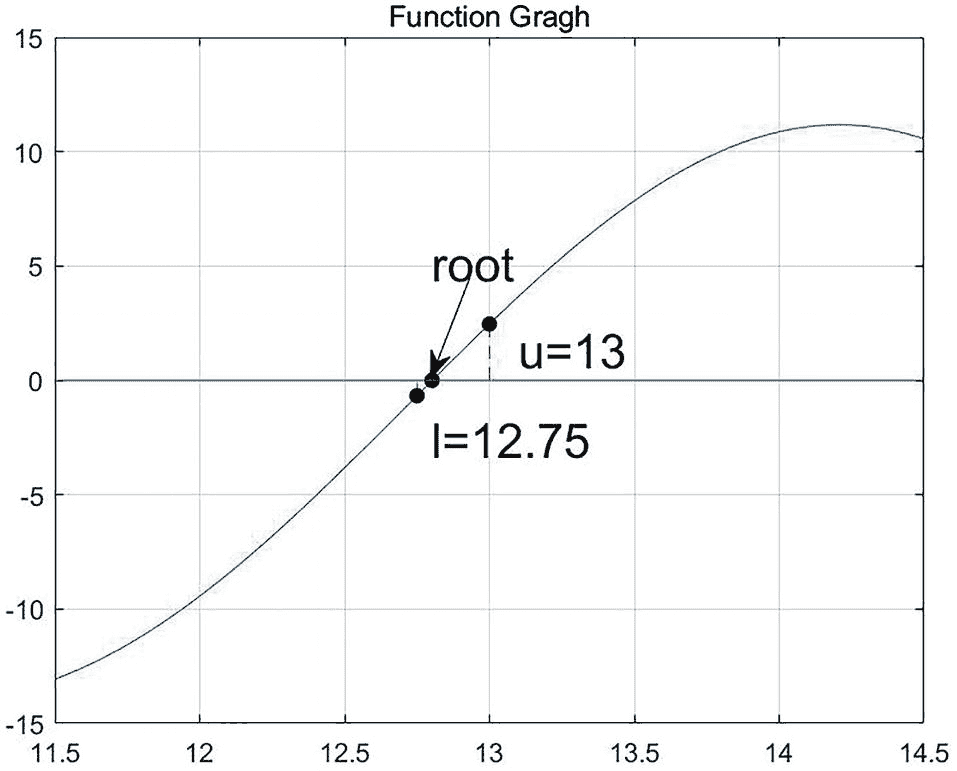

一个函数图像。线性曲线上有三个点，根位于中心，`I` 等于 12.75，`u` 等于 13。

**图 3-6** 根在 `[12.75,13]` 区间内的位置

前十次迭代结果如下：

| 迭代次数 | `l` | `u` | `p` |
| --- | --- | --- | --- |
| 1 | 12 | 14 | 13 |
| 2 | 12 | 13 | 12.5 |
| 3 | 12.5 | 13 | 12.75 |
| 4 | 12.75 | 13 | 12.875 |
| 5 | 12.75 | 12.875 | 12.8125 |
| 6 | 12.75 | 12.8125 | 12.78125 |
| 7 | 12.78125 | 12.8125 | 12.796875 |
| 8 | 12.79688 | 12.8125 | 12.8046875 |
| 9 | 12.79688 | 12.80469 | 12.80078125 |
| 10 | 12.80078 | 12.80469 | 12.802734375 |

经过十次迭代后，近似根为 12.802734375。值得一提的是，大约需要 30 次迭代才能达到八位小数的精度，即 12.802892。二分法反复对区间进行二分，然后选择根必然存在的子区间进行进一步搜索。这是一种简单且稳健的方法，但与牛顿-拉夫逊法等更高效的方法相比，速度相对较慢。每一步都会将绝对误差减半，因此该方法以线性速度收敛。

## 3.4 布伦特方法

布伦特方法是一种求根方法，它结合了二分法、割线法和逆二次插值法。只要有可能，它就会使用割线法或逆二次插值法，因为这两种方法收敛速度更快，但在必要时，它会回退到更稳健的二分法。因此，它既具有二分法的可靠性，又能像一些不那么可靠的方法一样快速。

### 3.4.1 线性插值法、假位法、割线法

线性插值法使用一条连接两个已知量的直线来确定这两个已知量之间未知量的值。用线性插值法求根的方法类似于二分法。它不是对区间进行二分，而是一种通过割线逼近曲线来求解方程根的迭代方法。曲线的*割线*是一条与曲线至少相交于两个不同点的直线。其基本思路如下：与其直接求解函数的零点（这可能很复杂），不如先求解逼近直线的零点（这很简单）。然后期望直线的零点接近函数的零点。

如图 3-7 所示，使用一条直线逼近曲线的一段。两个端点为 (`u`, `f(u)`) 和 (`l`, `f(l)`)。然后通过计算割线与水平轴的交点 (`p`, `f(p)`) 来求解其零点。

```
p = u - f(u) * (l - u) / (f(l) - f(u))
```

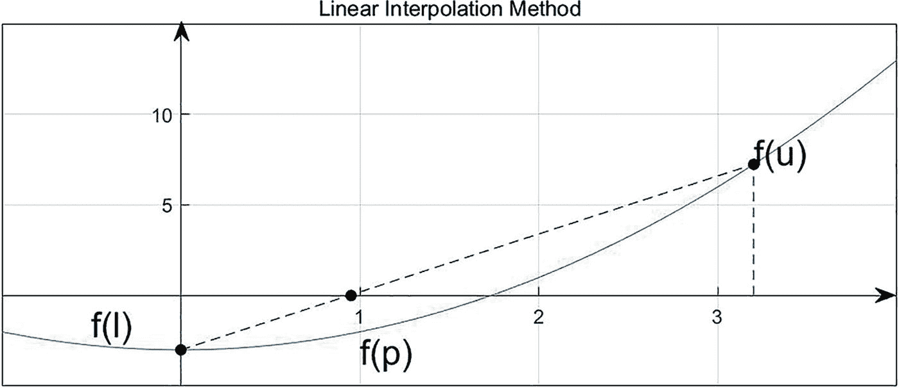

一幅用于线性插值法的图，绘有三个点 `f(l)`、`f(p)` 和 `f(u)`。

**图 3-7** 函数 `f(x) = x² − 3` 的一条割线

其思想是，`p` 应该接近函数的根。类似于二分法，根据 `f(p)` 来选择有根子区间。

1. 如果 `f(p) == 0`，则根为 `p`。

2. 如果 `f(p) * f(l) > 0`，则 `l = p`，`u = u`。

3. 如果 `f(p) * f(u) > 0`，则 `l = l`，`u = p`。

重复此过程，直到满足精度阈值或达到最大迭代次数。见图 3-8 和图 3-9。

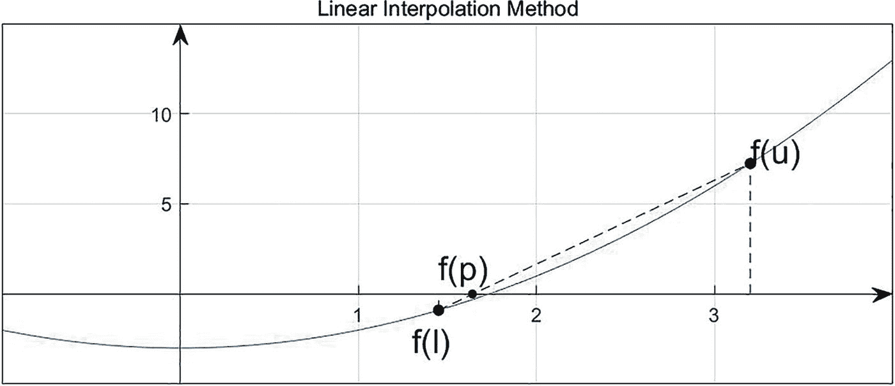

线性插值法的图像。两个曲线点 `f(l)` 和 `f(p)` 之间的距离比 `f(u)` 更近。

**图 3-9** 设置 `l = p` 后的第三次迭代

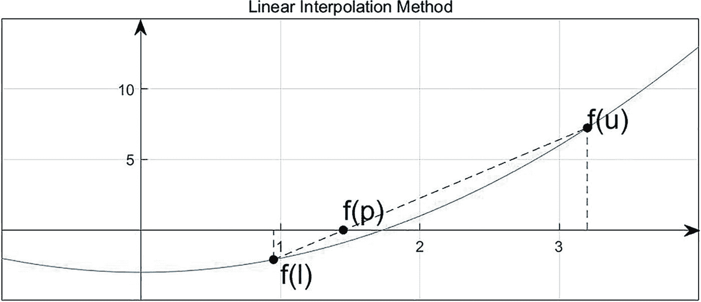

线性插值法的绘图。曲线有三个点：`f(l)`、`f(p)` 和 `f(u)`。

**图 3-8** 设置 `l = p` 后的第二次迭代

### 3.4.2 反二次插值法

反二次插值法是割线法的一种增强版本。它不再使用直线来逼近曲线，而是使用二次函数。然后，同样地，通过闭式解轻松求解该二次函数的根，以逼近原函数的根。当二次函数与 x 轴无交点（无实根）时，会进行微小的调整。

确定一个二次函数 `y` 需要三个点：(`x[i - 2]`， `f(x[i - 2])`) (`x[i - 1]`， `f(x[i - 1])`) (`x[i]`， `f(x[i])`)。然后计算其反函数：`x = y^(-1)(y)`。为了在迭代中求解（近似）根，令其等于 0，即 `y = 0`。

具体来说，反函数也称为*拉格朗日多项式*，其形式如下：


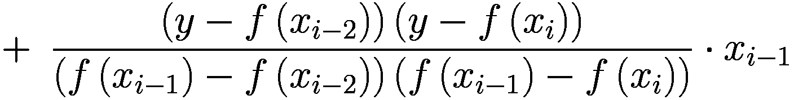

令 `y = 0`，即可得到下一次迭代的根，如下所示：


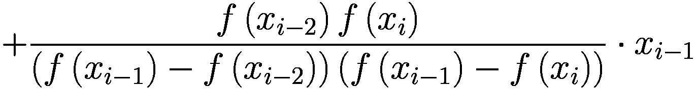

重复此过程，直到满足精度阈值或达到最大迭代次数。参见图 3-10。

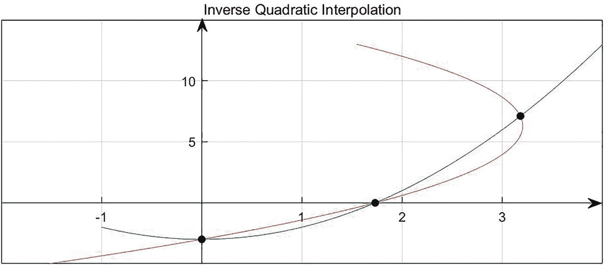

反二次插值法的图示。图中绘制了三个点，反曲线和直线在此相交。

**图 3-10** `f(x) = x² - 3` 的反二次插值法

其渐近行为通常非常好。一旦迭代值 `x[i]` 接近实际根，收敛速度会很快。然而，如果初始值不接近根，性能通常会很差。例如，如果函数值 `f(x[i])`、`f(x[i - 1])` 和 `f(x[i - 2])` 中有两个相同，该算法就会失败。因此，反二次插值法不单独用作算法，而是作为布伦特方法的一部分使用。

### 3.4.3 布伦特方法的实现

布伦特方法是一种混合方法，它结合了**括号法**的可靠性和**插值法**（如割线法或反二次插值法）的速度。

同样，你需要从一个包含根的括号区间（`a[0]`， `b[0]`）开始，使得 `f(a[0]) * f(b[0]) < 0`。假设 `|f(a[0])| < |f(b[0])|`；否则，交换标记。

每次迭代需要四个点：

-   `a[k]`：对齐点，满足 `|f(a[k])| < |f(b[k])|` 且 `f(a[k]) * f(b[k]) < 0`。
-   `b[k]`：当前迭代的根估计值。
-   `b[k - 1]`：上一次迭代的根估计值；第一次迭代时设置 `b[k - 1] = a[0]`。
-   `b[k - 2]`：上上次迭代的根估计值（无需初始化）。
-   `s`：本次迭代的中间值；它被取作区间的一个端点，即 `a[k]` 或 `b[k]`，这两个端点都被用作 `a[k + 1]` 和 `b[k + 1]`，并满足 `|f(a[k + 1])| < |f(b[k + 1])|` 和 `f(a[k + 1]) * f(b[k + 1]) < 0`。
-   `ε`：预设的用于收敛的精度容差。

需要检查以下四个不等式条件：

1.  `|ε| < |b[k] - b[k - 1]|`
2.  `|ε| < |b[k - 1] - b[k - 2]|`
3.  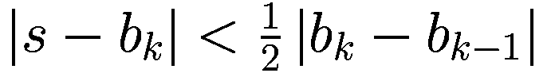
4.  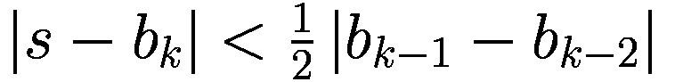

如果满足以下五个条件中的任何一个，则本次迭代使用二分法求根：

-   上次迭代使用了二分法，且不等式 1 不成立。
-   上次迭代使用了插值法，且不等式 2 不成立。
-   上次迭代使用了二分法，且不等式 3 不成立。
-   上次迭代使用了插值法，且不等式 4 不成立。
-   通过插值计算出的临时值 `s` 不在 ![$$ \left[\frac{3{a}_k+{b}_k}{4},{b}_k\right] $$](images/528380_1_En_3_Chapter/528380_1_En_3_Chapter_TeX_IEq5.png) 范围内。

否则，本次迭代使用插值法。选择哪种插值法的过程如下：如果三个点各不相同，则使用反二次插值法；否则，使用线性插值。

在 NM Dev 中，`BrentRoot` 类实现了布伦特方法。这是一个两步过程：先构建求解器，然后调用 `solve` 函数。函数的签名如下：

```
/**
* 构造布伦特根查找算法的实例。
*
* @param tol           收敛容差
* @param maxIterations 最大迭代次数
*/
public BrentRoot(double tol, int maxIterations)
/**
* 在区间 [lower, upper] 内搜索根 x，使得 f(x) = 0。
*
* @param f     一个单变量函数
* @param lower 括号区间的下界
* @param upper 括号区间的上界
* @param guess 对 [lower, upper] 内根的一个初始猜测。
*              注意：{@code guess} 是一个 {@code double[]} 类型。
*              这种签名允许为某些类型的求根算法（例如布伦特算法）提供多个初始猜测。
* @return 近似根
* @throws NoRootFoundException 当搜索未能找到根时抛出
*/
public double solve(
UnivariateRealFunction f,
double lower,
double upper,
double... guess
) throws NoRootFoundException;
```

以下示例调用 `BrentRoot` 来求解图 3-10 中的函数 `f(x) = x² - 3`：

```
val f: UnivariateRealFunction = object : AbstractUnivariateRealFunction() {
override fun evaluate(x: Double): Double {
return x * x - 3 // x² - 3 = 0
}
}
val solver = BrentRoot(1e-8, 10)
val root: Double = solver.solve(f, 0.0, 4.0)
val fx: Double = f.evaluate(root)
println(String.format("f(%f) = %f", root, fx))
```

输出如下：

```
f(1.732051) = 0.000000
```