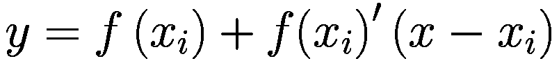
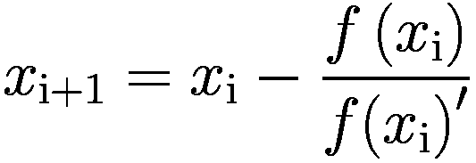
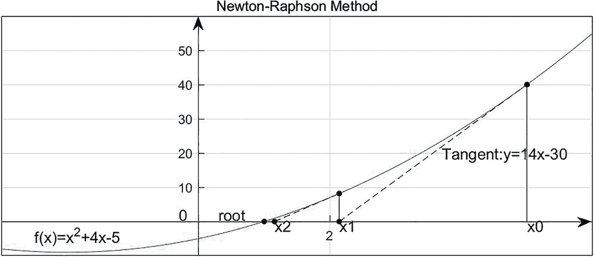

# 3.5 牛顿-拉弗森法

牛顿-拉弗森法的描述如下。首先，你选择一个与真实根相当接近的初始猜测值，然后用该点的切线（可通过微积分工具计算）来逼近函数，接着计算该切线与 x 轴的交点（即根，通过基础代数即可轻松完成）。这个 x 轴截距通常比初始猜测值更接近函数的根，并且该过程可以迭代进行。它具有以下特性。

对于方程 `f(x) = 0`，你选择 `x[i]` 作为根的初始近似值，或者来自上一次迭代的迭代值。然后，过点 `(x[i], f(x[i]))` 作曲线的切线 `L`。



(L)

计算 `L` 与 x 轴交点的横坐标。



`x[i + 1]` 是比 `x[i]` 更精确的根近似值。

牛顿-拉弗森法通过线性化处理，是一种求解非线性方程零点的有效方法。可以证明，如果函数是连续的且零点是孤立的，那么在零点周围存在一个区域，只要初始值位于该区域内，算法就保证收敛。牛顿-拉弗森法具有平方收敛的性能。粗略地说，这意味着每迭代一次，结果的有效精度将翻倍。

在 NM Dev 中，`NewtonRoot` 类实现了牛顿-拉弗森求根算法，并附带一个 `solve` 函数。其签名如下：

```
/**
* 构造牛顿求根算法的一个实例。
*
* @param tol           收敛容差
* @param maxIterations 最大迭代次数
*/
public NewtonRoot(double tol, int maxIterations)
/**
* 在区间 [lower, upper] 内搜索根 x，使得 f(x) = 0。
*
* @param f     一个单变量函数
* @param lower 包围区间下界
* @param upper 包围区间上界
* @param guess 在 [lower, upper] 内的初始根猜测值。
*              注意 {@code guess} 是一个 {@code double[]} 类型。
*              此签名允许为某些类型的单根算法（例如 Brent 算法）提供多个初始猜测值。
* @return 一个近似根
* @throws NoRootFoundException 当搜索未能找到根时抛出
*/
public double solve(
UnivariateRealFunction f,
double lower,
double upper,
double... guess
) throws NoRootFoundException;
/**
* 在区间 [lower, upper] 内搜索根 x，使得 f(x) = 0。
*
* @param f     一个单变量函数
* @param df_   f 的一阶导数
* @param guess 在 [lower, upper] 内的初始根猜测值
* @return 一个近似根
* @throws NoRootFoundException 当搜索未能找到根时抛出
*/
public double solve(
UnivariateRealFunction f,
UnivariateRealFunction df_,
double guess
) throws NoRootFoundException
```

请注意，第二个 `solve` 函数允许你为 `f` 提供导函数 `f'`。否则，代码会自动生成一个使用有限差分法计算的导函数（尽管速度较慢）。

这个例子使用牛顿-拉弗森法来求解 `x² + 4x - 5 = 0` 的根。首先，你选择一个初始猜测值 `x[0] = 5`。过该点的切线为 `y = 14x - 30`。计算与 x 轴的交点，得到根的近似值 `x[1]`。重复该过程，直到满足精度阈值或达到最大迭代次数。见图 3-11。



牛顿-拉弗森法求解 `f(x) = x² + 4x - 5` 的图形。图上分别标出了根、`x[2]`、`x[1]` 和 `x[0]` 的位置（值为 0、0、10 和 40）。图中还绘制了切线 `y = 14x - 30`。

图 3-11

牛顿-拉弗森法求解 `f(x) = x² + 4x - 5`

```
val f: UnivariateRealFunction = object : AbstractUnivariateRealFunction() {
override fun evaluate(x: Double): Double {
return x * x + 4 * x - 5 // x² +4x - 5 = 0
}
}
val df: UnivariateRealFunction = object : AbstractUnivariateRealFunction() {
override fun evaluate(x: Double): Double {
return 2 * x + 4 // 2x + 4
}
}
val solver = NewtonRoot(1e-8, 5)
val root: Double = solver.solve(f, df, 5.0)
val fx: Double = f.evaluate(root)
println(String.format("f(%f) = %f", root, fx))
```

输出如下：

```
f(1.000000) = 0.000000
```

从以下迭代结果可以看出，该算法在第四次迭代时就达到了良好结果，因此效率很高。

| 迭代次数 i | `x[i]` | `ε` |
| --- | --- | --- |
| 0 | 5 |  |
| 1 | 2.142857143 | 1.33E+00 |
| 2 | 1.157635468 | 8.51E-01 |
| 3 | 1.003934739 | 1.53E-01 |
| 4 | 1.000002577 | 3.93E-03 |
| 5 | 1.000000000001107 | 2.58E-06 |
| 6 | 0.9999999999999999 | 1.11E-12 |

### 3.5.1 哈雷法

哈雷法的推导方式与牛顿-拉夫森法类似，适用于任意 `C²` 函数。也就是说，它求解的是具有连续二阶导数的单变量函数的零点。哈雷法以等于或超过 3 的收敛阶收敛到函数的正则零点。

在 NM Dev 中，`HalleyRoot` 类实现了哈雷法。其签名如下：

# Halley 求根算法

## 构造方法

```java
/**
 * 构造一个哈雷求根算法的实例。
 *
 * @param tol           收敛容差
 * @param maxIterations 最大迭代次数
 */
public HalleyRoot(double tol, int maxIterations)
```

## 求解方法

在区间 `[lower, upper]` 内搜索根 `x`，使得 `f(x) = 0`。

```java
/**
 * @param f     一个单变量函数
 * @param lower 包围区间下限
 * @param upper 包围区间上限
 * @param guess 在 [lower, upper] 内的初始根猜测。
 *              注意 {@code guess} 是 {@code double[]} 类型。
 *              此签名允许为某些类型的单根算法（例如 Brent 算法）提供多个初始猜测。
 * @return 一个近似根
 * @throws NoRootFoundException 当搜索未能找到根时抛出
 */
public double solve(
    UnivariateRealFunction f,
    double lower,
    double upper,
    double... guess
) throws NoRootFoundException;
```

或者：

```java
/**
 * @param f     一个单变量函数
 * @param guess 在 [lower, upper] 内的初始根猜测
 * @return 一个近似根
 * @throws NoRootFoundException 当搜索未能找到根时抛出
 */
public double solve(
    UnivariateRealFunction f,
    double guess
) throws NoRootFoundException
```

或者，同时接受一阶和二阶导数函数：

```java
/**
 * @param f     一个单变量函数
 * @param df    一阶导数
 * @param d2f   二阶导数
 * @param guess 在 [lower, upper] 内的初始根猜测
 * @return 一个近似根
 * @throws NoRootFoundException 当搜索未能找到根时抛出
 */
public double solve(
    UnivariateRealFunction f,
    UnivariateRealFunction df,
    UnivariateRealFunction d2f,
    double guess
) throws NoRootFoundException
```

注意，第三个 `solve` 函数同时接受一阶和二阶导数函数。如果未提供，库将使用有限差分法生成它们。

## 使用示例

此示例使用 `HalleyRoot` 求解 `f(x) = x² + 4x − 5`：

```kotlin
val f: UnivariateRealFunction = object : AbstractUnivariateRealFunction() {
    override fun evaluate(x: Double): Double {
        return x * x + 4 * x - 5 // x² +4x - 5 = 0
    }
}
val df: UnivariateRealFunction = object : AbstractUnivariateRealFunction() {
    override fun evaluate(x: Double): Double {
        return 2 * x + 4 // 2x + 4
    }
}
val d2f: UnivariateRealFunction = object : AbstractUnivariateRealFunction() {
    override fun evaluate(x: Double): Double {
        return 2.0 // 2
    }
}
val solver = HalleyRoot(1e-8, 3)
val root: Double = solver.solve(f, df, d2f, 5.0)
val fx: Double = f.evaluate(root)
println(String.format("f(%f) = %f", root, fx))
```

输出如下所示。它仅用三次迭代就收敛了。

```
f(1.000000) = 0.000000
```