# 4. 求方程组的根

多变量方程组的求根算法可以找到 (x[1], x[2], …, x[n]) 的值，使得方程组中 n 个方程的值都等于 0。

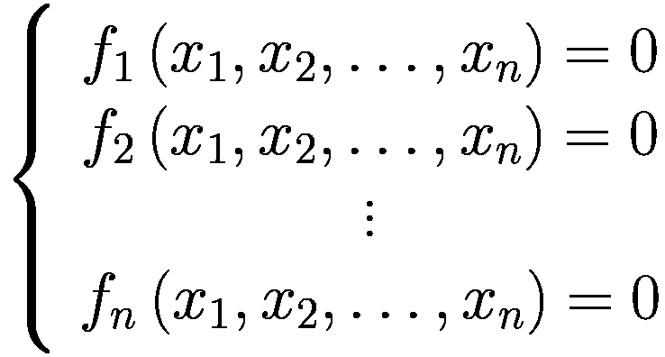

方程组可能无解、有唯一解或多个解。非线性方程组可以通过牛顿法进行数值求解，该方法使用一阶导数或雅可比矩阵，是单变量方程的牛顿-拉夫森法的扩展。其思想也是在每次迭代中，添加一个与一阶导数的负倒数成正比的增量，不过是在多变量情境下。

本章的源代码可以在 S2 平台运行，地址如下：[`https://s21.nm.dev/hub/user-redirect/lab/tree/s2-public/Numerical%20Methods%20Using%20Kotlin/chapter4.ipynb`](https://s21.nm.dev/hub/user-redirect/lab/tree/s2-public/Numerical%2520Methods%2520Using%2520Kotlin/chapter4.ipynb)

源代码可在 GitHub 上找到：[`https://github.com/apress/numerical-methods-kotlin`](https://github.com/apress/numerical-methods-kotlin)

## 4.1 方程组

多元方程是指包含多个变量的方程。例如， 是一个包含变量 (`x1`, `x2`, `x3`) 的多元方程。在 NM Dev 中，多元函数通过实现 `RealScalarFunction` 接口来构建。你需要在 `RealScalarFunction` 中指定定义域 `dimensionOfDomain`。为简化实现，你可以使用 `AbstractRealScalarFunction`、`AbstractBiRealFunction` 和 `AbstractTrivariateRealFunction`。对于后两者，其维度已为你配置好。

例如，以下实现都表示同一个函数 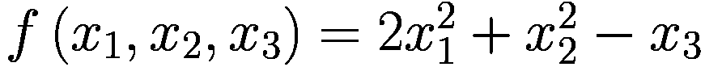，即一个三次多项式：

```kotlin
val f1: RealScalarFunction = object : AbstractRealScalarFunction(3) {
    override fun evaluate(x: Vector): Double {
        val x1: Double = x.get(1)
        val x2: Double = x.get(2)
        val x3: Double = x.get(3)
        return 2 * x1 * x1 + x2 * x2 - x3
    }
}
println("f1(1,2,3) = " + f1.evaluate(DenseVector(1.0, 2.0, 3.0)))
```

输出如下：

```
f1(1,2,3) = 3.0
```

```kotlin
val f2: TrivariateRealFunction = object : AbstractTrivariateRealFunction() {
    override fun evaluate(x1: Double, x2: Double, x3: Double): Double {
        return 2 * x1 * x1 + x2 * x2 - x3
    }
}
println("f2(1,2,3) = " + f2.evaluate(DenseVector(1.0, 2.0, 3.0)))
```

输出如下：

```
f2(1,2,3) = 3.0
```

一个含有 n 个未知数 x[1], x[2], …, x[n] 的 n 元方程组形式如下：


其中，`f` (x[1], x[2], …, x[n]) 是关于 x[1], x[2], …, x[n] 的函数。方程组可以简单地表示为一个 `RealScalarFunction[]` 数组。或者，你也可以将其实现为一个从 R^n 到 R^m 的向量函数，即实现 `RealVectorFunction` 接口。下面两个实现 `F` 和 `G` 是等价的。

```kotlin
val f1: TrivariateRealFunction = object : AbstractTrivariateRealFunction() {
    override fun evaluate(x: Double, y: Double, z: Double): Double {
        return Math.pow(x, 2.0) + Math.pow(y, 3.0) - z - 6
    }
}
val f2: TrivariateRealFunction = object : AbstractTrivariateRealFunction() {
    override fun evaluate(x: Double, y: Double, z: Double): Double {
        return 2 * x + 9 * y - z - 17
    }
}
val f3: TrivariateRealFunction = object : AbstractTrivariateRealFunction() {
    override fun evaluate(x: Double, y: Double, z: Double): Double {
        return Math.pow(x, 4.0) + 5 * y + 6 * z - 29
    }
}
val x: Vector = DenseVector(1.5, 2.5, 3.5)
val f1_x: Double = f1.evaluate(x)
val f2_x: Double = f2.evaluate(x)
val f3_x: Double = f3.evaluate(x)
val F_x = doubleArrayOf(f1_x, f2_x, f3_x)
println("F(x) = " + Arrays.toString(F_x))
```

输出如下：

```
F(x) = [8.375, 5.0, 9.5625]
```

对于 `G`，你需要指定定义域 `dimensionOfDomain` 和值域 `dimensionOfRange`，在此例中两者均为 `3`。

```kotlin
val G: RealVectorFunction = object : AbstractRealVectorFunction(3, 3) {
    override fun evaluate(v: Vector): Vector {
        val x: Double = v.get(1)
        val y: Double = v.get(2)
        val z: Double = v.get(3)
        val g1: Double = Math.pow(x, 2.0) + Math.pow(y, 3.0) - z - 6
        val g2: Double = 2 * x + 9 * y - z - 17
        val g3: Double = Math.pow(x, 4.0) + 5 * y + 6 * z - 29
        val g: Vector = DenseVector(g1, g2, g3)
        return g
    }
}
val Gx: Vector = G.evaluate(x)
println("G(x) = " + Gx)
```

输出如下：

```
G(x) = [8.375000, 5.000000, 9.562500]
```

## 4.2 求解二元非线性方程组的根

一个包含两个未知数的二元方程组通常可以表示为：

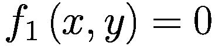

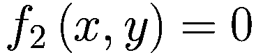

你首先需要在 `f[1]` 和 `f[2]` 的交点附近选择一个初始猜测点 (`x[1]`, `y[1]`)。假设 `x[2]` 和 `y[2]` 是实际解，使得 `f[1]` 和 `f[2]` 等于零。如果 `x[1]` 足够接近 `x[2]` 并且 `y[1]` 足够接近 `y[2]`，那么 `x[2] − x[1]` 和 `y[2] − y[1]` 就会很小。通过泰勒级数展开，可以得到：

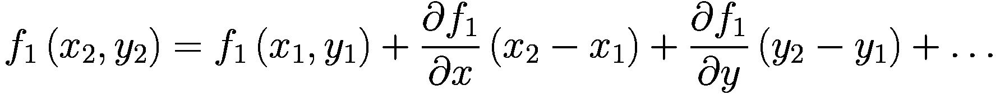

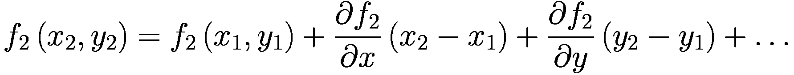

其中，忽略了包含小量 `x[2] − x[1]` 和 `y[2] − y[1]` 更高次幂的项。令 `∆x` = `x[2] − x[1]` 且 `∆y` = `y[2] − y[1]`，并考虑到 `f1` = 0 和 `f2` = 0，可以将前面的方程重写为：

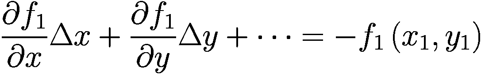

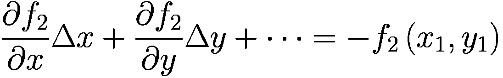

这可以表示为：

![$$ {\left[\begin{array}{cc}\frac{\partial {f}_1}{\partial x}&amp; \frac{\partial {f}_1}{\partial y}\\ {}\frac{\partial {f}_2}{\partial x}&amp; \frac{\partial {f}_2}{\partial y}\end{array}\right]}_{\left({x}_1,{y}_1\right)}\left(\begin{array}{l}\Delta x\\ {}\Delta y\end{array}\right)={\left(\begin{array}{l}-{f}_1\\ {}-{f}_2\end{array}\right)}_{\left({x}_1,{y}_1\right)} $$](images/528380_1_En_4_Chapter/528380_1_En_4_Chapter_TeX_Equi.png)

这个矩阵：

![$$ J\left({f}_1,{f}_2\right)=\left[\begin{array}{cc}\frac{\partial {f}_1}{\partial x}&amp; \frac{\partial {f}_1}{\partial y}\\ {}\frac{\partial {f}_2}{\partial x}&amp; \frac{\partial {f}_2}{\partial y}\end{array}\right] $$](images/528380_1_En_4_Chapter/528380_1_En_4_Chapter_TeX_Equj.png)

被称为 `f[1]` 和 `f[2]` 的雅可比矩阵。

这是一个线性系统，只要系数矩阵非奇异，就可以求解 `∆x` 和 `∆y`。因此，必须满足以下条件：

![$$ \det \left\{{\left[J\left({f}_1,{f}_2\right)\right]}_{\left({x}_1,{y}_1\right)}\right\}\ne 0 $$](images/528380_1_En_4_Chapter/528380_1_En_4_Chapter_TeX_Equk.png)

由于雅可比矩阵和 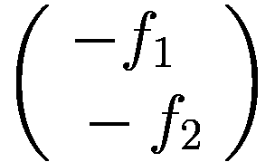 是已知的，可以求解出 `∆x` 和 `∆y`，进而得到 `x[2]` = `x[1]` + `∆x` 和 `y[2]` = `y[1]` + `∆y`。(`x[2]`, `y[2]`) 将比 (`x[1]`, `y[1]`) 更接近实际解。然后将 (`x[2]`, `y[2]`) 作为解的新估计值。重复此过程，直到满足精度阈值或达到最大迭代次数。注意，在每一步迭代中，雅可比矩阵必须是非奇异的。

一个合理的终止条件如下：

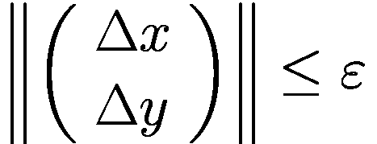

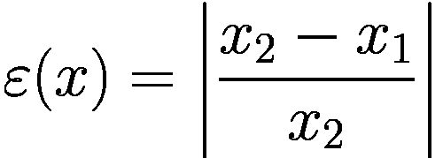

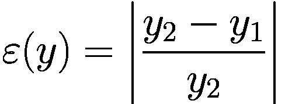

其中 `ε` 表示容差，`ε(x)` 针对 `x`，`ε(y)` 针对 `y`。

在 NM Dev 中，`NewtonSystemRoot` 类实现了用于求解方程组的牛顿法。如果未找到解，则会抛出 `NoRootFoundException` 异常。其签名如下：

```
/**
 * 构造一个用于非线性方程组的牛顿寻根算法实例。
 *
 * @param accuracy 收敛容差
 * @param maxIter  最大迭代次数
 */
public NewtonSystemRoot(double accuracy, int maxIter) {
    this.tol = accuracy;
    this.maxIterations = maxIter;
}

/**
 * 寻找根 x，使得 f(x) = 0。
 *
 * @param f     一个多元函数
 * @param guess 根的初始猜测值
 * @return 近似根
 * @throws NoRootFoundException 当搜索失败时抛出
 */
public Vector solve(
        RealVectorFunction f,
        Vector guess
) throws NoRootFoundException

/**
 * 寻找根 x，使得 f(x) = 0。
 *
 * @param f     一个方程组
 * @param guess 根的初始猜测值
 * @return 近似根
 * @throws NoRootFoundException 当搜索失败时抛出
 */
public Vector solve(
        final RealScalarFunction[] f,
        Vector guess
) throws NoRootFoundException
```

见图 4-1。

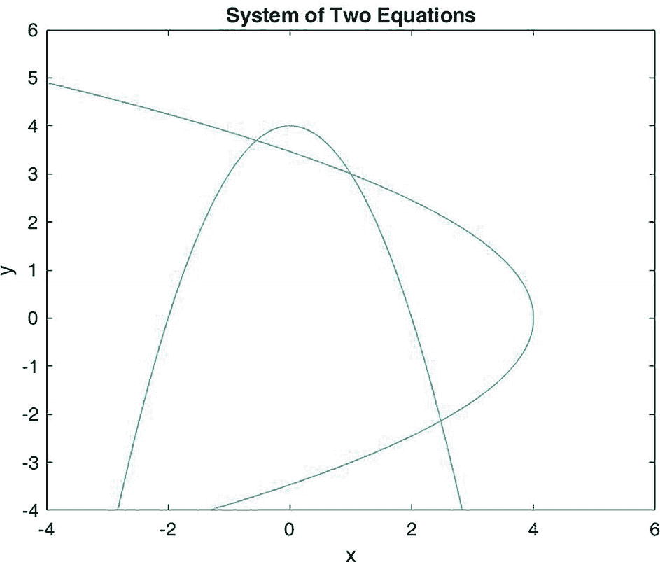

此图表示一条垂直抛物线和一条水平抛物线。顶部文字为：两个方程的方程组。x 轴和 y 轴的数字范围均为 -4 到 6。

**图 4-1** 两个方程与两个未知数的方程组

本示例求解以下方程组的根 (`x`, `y`)：

### 求解两个方程的方程组

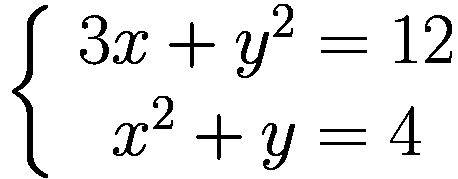

等价于求解：

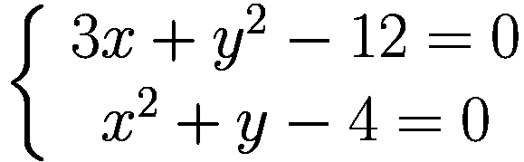

观察图 4-1 中的图形，可将初始猜测值 (`x[1]`, `y[1]`) 设为 (0, 0)。同时，可将精度设为 1 × 10^(−8)，最大迭代次数设为 10（即循环运行十次后停止）。

```kotlin
val f1: BivariateRealFunction = object : AbstractBivariateRealFunction() {
    override fun evaluate(x: Double, y: Double): Double {
        return 3 * x + y * y - 12
    }
}

val f2: BivariateRealFunction = object : AbstractBivariateRealFunction() {
    override fun evaluate(x: Double, y: Double): Double {
        return x * x + y - 4
    }
}

val solver: NewtonSystemRoot = NewtonSystemRoot(1e-8, 10)
val initial: Vector = DenseVector(arrayOf(0.0, 0.0)) // (0, 0)
val root: Vector = solver.solve(arrayOf(f1, f2), initial)
println(String.format("f(%s) = (%f, %f)", root.toString(), f1.evaluate(root), f2.evaluate(root)))
```

然后使用 `solve` 方法求解该方程组的根。结果如下：

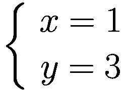

输出如下：

```
f([1.000000, 3.000000] ) = (0.000000, 0.000000)
```

## 4.3 求解三个或更多方程的方程组

你可以将求解两个方程组的数学方法扩展应用于求解 *n* 个方程。一个包含 *n* 个未知数的 *n* 个方程组成的方程组通常可以写成如下形式：

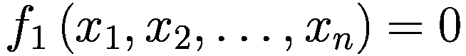

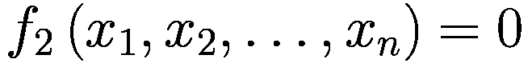


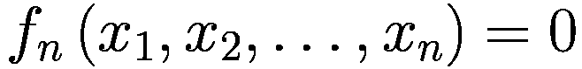

设初始猜测值为 (`x[11]`, `x[21]`, …, `x[n1]`)。

![$$ {\left[\begin{array}{ccc}\frac{\partial {f}_1}{\partial {x}_1}&amp; \cdots &amp; \frac{\partial {f}_1}{\partial {x}_n}\\ {}\vdots &amp; \ddots &amp; \vdots \\ {}\frac{\partial {f}_n}{\partial {x}_1}&amp; \cdots &amp; \frac{\partial {f}_n}{\partial {x}_n}\end{array}\right]}_{\left({x}_{11},{x}_{21},\dots, {x}_{n1}\right)}\left(\begin{array}{l}\Delta {x}_1\\ {}\begin{array}{c}\vdots \\ {}\Delta {x}_n\end{array}\end{array}\right)={\left(\begin{array}{l}-{f}_1\\ {}\begin{array}{c}\vdots \\ {}-{f}_n\end{array}\end{array}\right)}_{\left({x}_{11},{x}_{21},\dots, {x}_{n1}\right)} $$](images/528380_1_En_4_Chapter/528380_1_En_4_Chapter_TeX_Equv.png)

该矩阵即为雅可比矩阵 `J`(`f[1]`, `f[2]`, …, `f[n]`)，如下所示：

![$$ J\left({f}_1,{f}_2,\dots, {f}_n\right)=\left[\begin{array}{ccc}\frac{\partial {f}_1}{\partial {x}_1}&amp; \cdots &amp; \frac{\partial {f}_1}{\partial {x}_n}\\ {}\vdots &amp; \ddots &amp; \vdots \\ {}\frac{\partial {f}_n}{\partial {x}_1}&amp; \cdots &amp; \frac{\partial {f}_n}{\partial {x}_n}\end{array}\right] $$](images/528380_1_En_4_Chapter/528380_1_En_4_Chapter_TeX_Equw.png)

求解 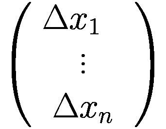 后，可通过加上增量得到下一个估计值，如下所示：


牛顿法的步骤总结如下：

1.  为包含 *n* 个方程和 *n* 个未知数的方程组选择一个根初始猜测值。
2.  在当前最佳解 `X[1]` 处计算雅可比矩阵，其中 `X[1]` 是一个 *n* 维向量，且 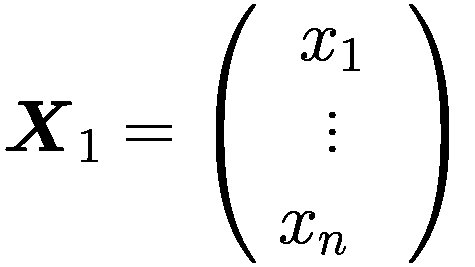。
3.  求解线性系统 `J(X[1])∆X = -f(X[1])`，其中 `∆X = X[2] - X[1]`。
4.  通过加上增量得到 `X[2]`，即 `X[2] = X[1] + ∆X`。
5.  重复此过程，直至满足精度阈值或达到最大迭代次数。
6.  返回最佳解。

以下代码求解了一个包含三个非线性方程的方程组（见图 4-2）：

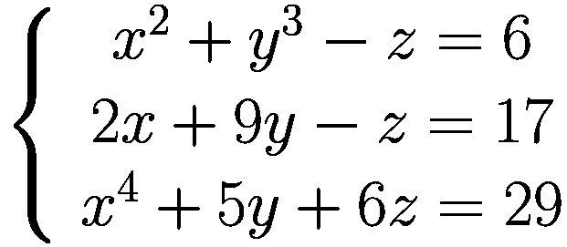

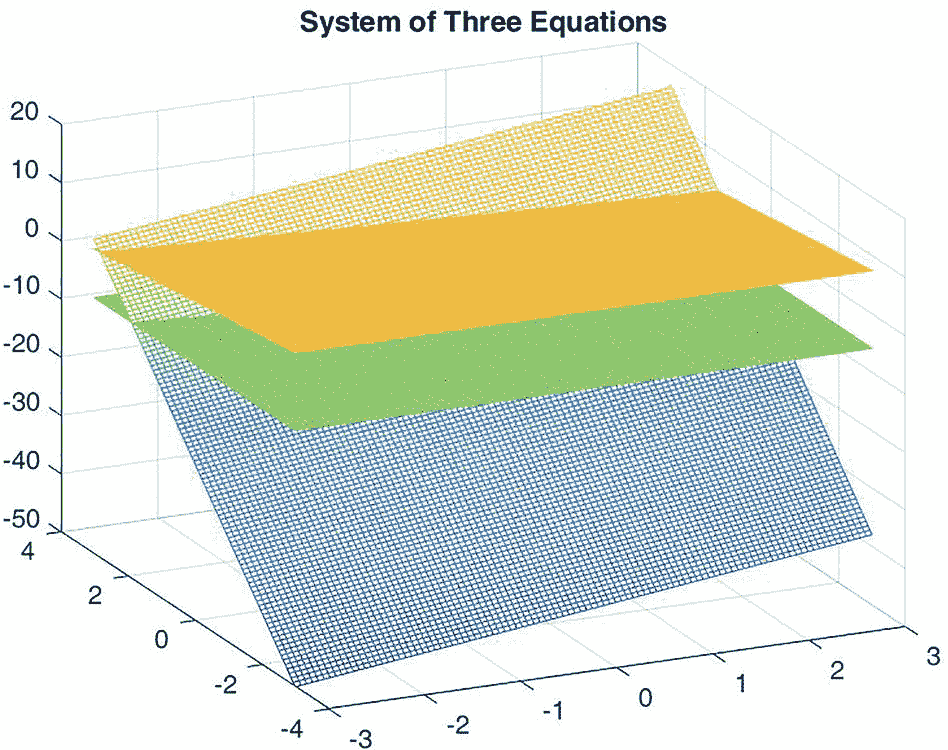

### 问题描述

一个三维图形，表示三个不同方程对应的三个矩形曲面。其中两个曲面相互平行，第三个曲面与它们倾斜相交。顶部文字为：三个方程的方程组。

**图 4-2** 三个方程与三个未知数的方程组

```
val G: RealVectorFunction = object : AbstractRealVectorFunction(3, 3) {
    override fun evaluate(v: Vector): Vector {
        val x: Double = v.get(1)
        val y: Double = v.get(2)
        val z: Double = v.get(3)
        val g1: Double = Math.pow(x, 2.0) + Math.pow(y, 3.0) - z - 6
        val g2: Double = 2 * x + 9 * y - z - 17
        val g3: Double = Math.pow(x, 4.0) + 5 * y + 6 * z - 29
        val g: Vector = DenseVector(g1, g2, g3)
        return g
    }
}

val solver: NewtonSystemRoot = NewtonSystemRoot(1e-8, 15)
val initial: Vector = DenseVector(arrayOf(0.0, 0.0, 0.0)) // (0, 0, 0)
val root: Vector = solver.solve(G, initial)
println(String.format("f(%s) = %s", root.toString(), G.evaluate(root).toString()))
```

输出如下：

```
f([-4.580190, -4.307120, -64.924460] ) = [0.000000, -0.000000, 0.000000]
```