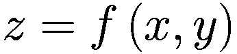
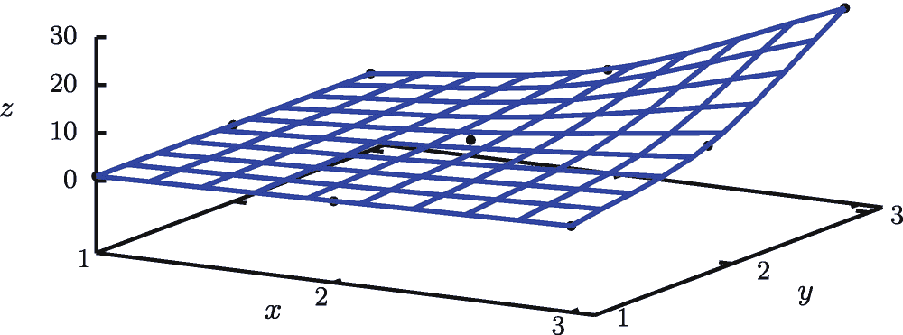

# 5.3 多元插值

多元插值是指对包含多个变量的函数进行插值。它是一元插值情形的推广。

## 5.3.1 双变量插值

我们从双变量情形开始。假设有一组 *n* × *n* 个数据点：(*x*[1], *y*[1], *z*[11])、(*x*[1], *y*[2], *z*[12])、……、(*x*[*n*], *y*[*n*], *z*[*nn*])。注意，(*x*[1], *y*[1], *z*[11]) 表示在位置 (*x*[1], *y*[1]) 处的数据值为 *z*[11]。也就是说，



对一个双变量函数进行插值的一般步骤如下：

1.  固定一个维度，例如固定 *y* = *y*[1] 为常数。针对这一特定的数据切片（现在是一维的），对另一个维度 *x* 进行插值。
2.  对于另一个维度 *x* 中的值，对步骤 1 得到的结果进行插值。

例如，首先固定维度 *y*，然后对 *x* 进行插值。在 *y* = *y*[1] 处，有数据点 (*x*[1], *z*[11])、(*x*[2], *z*[12])、……、(*x*[*n*], *z*[1*n*])。运用第 5.2 节讨论的任何一种一元插值算法，可以得到 *f**y*1，这是在位置 *y* = *y*[1] 处关于 *x* 的一个插值函数。对维度 *y* 中的每个位置重复此过程，我们得到 *f**y*1、*f**y*2、……、*f**yn*，这是一组平行于 x 轴的曲线。

第二步是对这个数据集 (*y*[1], *f**y*1)、(*y*[2], *f**y*2)、……、(*y*[*n*], *f**yn*) 针对 *x* 值进行插值。这同样可以通过应用任何一元插值算法来完成。这样就得到了 *f* (*x*, *y*)。

因此，双变量插值函数的性质和结果取决于其内部应用的（两个）一元插值函数。例如，双线性插值使用线性插值对单个维度进行两次插值。双三次样条和双三次插值则分别使用三次样条插值和三次埃尔米特插值。

插值函数 *f* (*x*, *y*) 是一个曲面，如图 5-18 所示，其中对大小为 3 × 3 的数据集应用了双三次插值。黑色点为数据点；蓝色线条构成的网络即为插值曲面。



此三维图形展示了用于双三次插值的方形图案矩形网格。

**图 5-18** 双三次插值

NM Dev 实现了双线性插值、双三次样条插值和双三次插值。以下代码片段展示了这三种方法：

```
val grids: BivariateGrid = BivariateArrayGrid(
arrayOf(
doubleArrayOf(1.0, 1.0, 1.0), // z(1, 1) = 1, z(1, 2) = 1, z(1, 3) = 1
doubleArrayOf(2.0, 4.0, 8.0), // z(2, 1) = 2, z(2, 2) = 4, z(2, 3) = 8
doubleArrayOf(3.0, 9.0, 27.0) // z(3, 1) = 3, z(3, 2) = 9, z(3, 3) = 27
),
doubleArrayOf(1.0, 2.0, 3.0), // x
doubleArrayOf(1.0, 2.0, 3.0) // y
)
val bl: BivariateGridInterpolation = BilinearInterpolation()
val f1: RealScalarFunction = bl.interpolate(grids) // f3(1.5, 1.5) = 2.0
println(f1.evaluate(DenseVector(arrayOf(1.5, 1.5))))
val bs: BivariateGridInterpolation = BicubicSpline()
val f2: RealScalarFunction = bs.interpolate(grids) // f2(1.5, 1.5) = 1.8828125
println(f2.evaluate(DenseVector(arrayOf(1.5, 1.5))))
val bi: BivariateGridInterpolation = BicubicInterpolation()
val f3: RealScalarFunction = bi.interpolate(grids) // f1(1.5, 1.5) = 1.90625
println(f3.evaluate(DenseVector(arrayOf(1.5, 1.5))))
```

输出结果如下：

```
2.0
1.8828125
1.90625
```

`BivariateGrid` 类定义了一个三维空间中的网格，*z* = *f* (*x*, *y*)。第一个输入 *z* 是一个二维数组。它是 *x* 和 *y*（即第二和第三个数组输入）中值的笛卡尔积或叉积。*z* 中的第 [1, 1] 个元素是位置 *x*[1] 和 *y*[1] 处的 *z* 值。在此例中，*x*[1] = 1，*y*[1] = 1，因此 *z*(1, 1) = 1。

`BivariateArrayGrid` 类可以定义一个矩形网格，这意味着网格线不一定等间距。`BivariateRegularGrid` 类仅定义具有等间距网格线的规则网格。它们的签名如下：

```
/**
 * 使用给定的二维网格值数组以及沿 x 轴和 y 轴的网格线位置值构造一个新网格。
 *
 * @param z 网格值
 * @param x 沿 x 轴的网格线位置
 * @param y 沿 y 轴的网格线位置
 */
public BivariateArrayGrid(double[][] z, double[] x, double[] y)
/**
 * 构造一个新网格，其中因变量的值取自给定的二维数组，自变量的值由其起始值
 * 以及相邻值之间的差值指定。
 *
 * 输入数组的第一个索引对应于 x，第二个索引对应于 y，其大小将根据数组
 * 的大小推断得出。
 *
 * @param z      包含因变量值的二维数组
 * @param x0     自变量 x 的第一个值
 * @param y0     自变量 y 的第一个值
 * @param deltaX 沿 x 轴相邻点之间的距离
 * @param deltaY 沿 y 轴相邻点之间的距离
 */
public BivariateRegularGrid(
    double[][] z,
    double x0,
    double y0,
    double deltaX,
    double deltaY
)
```

`BicubicInterpolation` 类的构造函数如下：

```
/**
 * 构造一个新实例，该实例使用给定的导数进行插值。注意，这些导数不必完全精确，
 * 但它们将成为插值曲面中存在的导数。
 *
 * @param derivatives 用于插值的导数
 */
public BicubicInterpolation(PartialDerivatives derivatives)
```

注意，它可以将函数在网格点处的偏导数作为输入。`BicubicInterpolation.PartialDerivatives` 接口如下：

```
/**
 * 指定在 {@link BivariateGrid} 上的点处定义的偏导数。
 */
public interface PartialDerivatives {
    /**
     * 获取网格中给定位置处的偏导数 \(\frac{\partial z}{\partial x}\)。
     *
     * @param grid 要获取偏导数的网格
     * @param i    x 轴方向的索引
     * @param j    y 轴方向的索引
     * @return 给定点处的 \(\frac{\partial z}{\partial x}\)
     */
    double dx(BivariateGrid grid, int i, int j);
    /**
     * 获取网格中给定位置处的偏导数 \(\frac{\partial z}{\partial y}\)。
     *
     * @param grid 要获取偏导数的网格
     * @param i    x 轴方向的索引
     * @param j    y 轴方向的索引
     * @return 给定点处的 \(\frac{\partial z}{\partial y}\)
     */
    double dy(BivariateGrid grid, int i, int j);
    /**
     * 获取网格中给定位置处的混合偏导数 \(\frac{\partial² z}{\partial x \partial y}\)。
     *
     * @param grid 要获取偏导数的网格
     * @param i    x 轴方向的索引
     * @param j    y 轴方向的索引
     * @return 给定点处的 \(\frac{\partial² z}{\partial x \partial y}\)
     */
    double dxdy(BivariateGrid grid, int i, int j);
}
```

此示例拟合了一个双变量数据集以及辅助的雅可比矩阵。


好的，作为一名高级文档工程师和翻译员，我将严格遵循您的格式要求，将以下英文文本翻译成中文。


以下是对给定文本的规范化排版结果：

```kotlin
// derivatives and answers from Michael Flanagan's library
val z = arrayOf(
    doubleArrayOf(1.0, 3.0, 5.0),
    doubleArrayOf(2.0, 4.0, 8.0),
    doubleArrayOf(9.0, 10.0, 11.0),
)
val dx = arrayOf(
    doubleArrayOf(6.0, 2.0, 2.0),
    doubleArrayOf(6.0, 7.0, 8.0),
    doubleArrayOf(6.0, 12.0, 14.0),
)
val dy = arrayOf(
    doubleArrayOf(8.0, 8.0, 8.0),
    doubleArrayOf(16.0, 12.0, 8.0),
    doubleArrayOf(4.0, 4.0, 4.0),
)
val dxdy = arrayOf(
    doubleArrayOf(16.0, 8.0, 0.0),
    doubleArrayOf(-4.0, -4.0, -4.0),
    doubleArrayOf(-24.0, -16.0, -8.0),
)
val deriv: BicubicInterpolation.PartialDerivatives = object : BicubicInterpolation.PartialDerivatives {
    override fun dx(grid: BivariateGrid, i: Int, j: Int): Double {
        return getDeriv(dx, i, j) // for some reason the y-axis is written in reverse...
    }
    override fun dy(grid: BivariateGrid, i: Int, j: Int): Double {
        return getDeriv(dy, i, j)
    }
    override fun dxdy(grid: BivariateGrid, i: Int, j: Int): Double {
        return getDeriv(dxdy, i, j)
    }
    private fun getDeriv(dx: Array, i: Int, j: Int): Double {
        return dx[i][2 - j]
    }
}
val interpolation: BivariateGridInterpolation = BicubicInterpolation(deriv)
val grid: BivariateGrid = BivariateRegularGrid(z, 0.0, 0.0, 0.5, 0.25)
val f: RealScalarFunction = interpolation.interpolate(grid)
println(f.evaluate(DenseVector(0.0, 0.0))) // 1.0
println(f.evaluate(DenseVector(0.0, 0.125))) // 2.0
println(f.evaluate(DenseVector(0.0, 0.25))) // 3.0
println(f.evaluate(DenseVector(0.0, 0.375))) // 4.0
println(f.evaluate(DenseVector(0.0, 0.5))) // 5.0
println(f.evaluate(DenseVector(0.25, 0.0))) // 1.125
println(f.evaluate(DenseVector(0.25, 0.125))) // 2.078125
println(f.evaluate(DenseVector(0.25, 0.25))) // 3.1875
println(f.evaluate(DenseVector(0.25, 0.375))) // 4.765625
println(f.evaluate(DenseVector(0.25, 0.5))) // 6.5
println(f.evaluate(DenseVector(0.5, 0.0))) // 2.0
println(f.evaluate(DenseVector(0.5, 0.125))) // 2.875
println(f.evaluate(DenseVector(0.5, 0.25))) // 4.0
println(f.evaluate(DenseVector(0.5, 0.375))) // 5.875
println(f.evaluate(DenseVector(0.5, 0.5))) // 8.0
println(f.evaluate(DenseVector(0.75, 0.0))) // 5.125
println(f.evaluate(DenseVector(0.75, 0.125))) // 5.828125
println(f.evaluate(DenseVector(0.75, 0.25))) // 6.6875
println(f.evaluate(DenseVector(0.75, 0.375))) // 8.015625
println(f.evaluate(DenseVector(0.75, 0.5))) // 9.5
println(f.evaluate(DenseVector(1.0, 0.0))) // 9.0
println(f.evaluate(DenseVector(1.0, 0.125))) // 9.5
println(f.evaluate(DenseVector(1.0, 0.25))) // 10.0
println(f.evaluate(DenseVector(1.0, 0.375))) // 10.5
println(f.evaluate(DenseVector(1.0, 0.5))) // 11.0
```

输出结果如下：

```
1.0
2.0
3.0
4.0
5.0
1.125
2.078125
3.1875
4.765625
6.5
2.0
2.875
4.0
5.875
8.0
5.125
5.828125
6.6875
8.015625
9.5
9.0
9.5
10.0
10.5
11.0
```

### 5.3.2 多元插值 (Multivariate Interpolation)

上一节中针对双变量情况描述的过程，稍加修改后也可应用于更高维度的情况。你需要以递归方式应用该过程。我们以三维情况为例。

假设你有这样一个 `n` × `n` × `n` 的数据集：(`x[1]`, `y[1]`, `z[1]`, `w[111]`), (`x[1]`, `y[1]`, `z[2]`, `w[112]`), … , (`x[n]`, `y[n]`, `z[n]`, `w[nnn]`)。首先，你将 `x` 维度固定为常数。在位置 `x = x[1]` 处，你有 (`y[1]`, `z[1]`, `w[111]`), (`y[1]`, `z[2]`, `w[112]`), … , (`y[n]`, `z[n]`, `w[1nn]`) 需要进行插值。此时，这个切片数据集是双变量的。接着，你再固定另一个维度，比如 `y`。那么在位置 `y = y[1]` 处，你有 (`z[1]`, `w[111]`), (`z[2]`, `w[112]`), … , (`z[n]`, `w[11n]`) 需要进行插值。这个切片数据集是单变量的。你可以应用任何单变量插值算法来得到插值器 `fx1y1`。对所有 `y` 值重复此过程，你将得到 `fx1y1`, `fx1y2`, … , `fx1yn`。接下来，就像在双变量情况中一样，你对 (`y[1]`, `fx1y1`), (`y[2]`, `fx1y2`), … , (`y[n]`, `fx1yn`) 进行插值，从而得到插值器 `fx1`。对所有 `x` 值重复此过程，你将得到 `fx1`, `fx2`, … , `fxn`。最后，对 (`x[1]`, `fx1`), (`x[2]`, `fx2`), … , (`x[n]`, `fxn`) 进行插值，你将得到插值器 `f(x, y, z)`。

NM Dev 实现了这种算法，以递归方式进行低阶插值，直到可以对一维切片数据集应用单变量算法。然而，计算成本会随着维度的增加呈指数级增长。这对于高维数据来说并不实用。

下面的代码示例展示了如何应用该算法进行多元线性插值：

```kotlin
// the data set
val mda: MultiDimensionalArray
    = MultiDimensionalArray(2, 2, 2)
mda.set(1.0, 0, 0, 0) // mda[0][0][0] = 1
mda.set(2.0, 1, 0, 0)
mda.set(3.0, 0, 1, 0)
mda.set(4.0, 0, 0, 1)
mda.set(5.0, 1, 1, 0)
mda.set(6.0, 1, 0, 1)
mda.set(7.0, 0, 1, 1)
mda.set(8.0, 1, 1, 1)
val mvGrid: MultivariateArrayGrid = MultivariateArrayGrid(
    mda,
    doubleArrayOf(1.0, 2.0),
    doubleArrayOf(1.0, 2.0),
    doubleArrayOf(1.0, 2.0)
)
val rgi: RecursiveGridInterpolation
    = RecursiveGridInterpolation(LinearInterpolation())
val f: RealScalarFunction = rgi.interpolate(mvGrid)
println(f.evaluate(DenseVector(arrayOf(1.5, 1.5, 1.5)))) // f(1.5, 1.5, 1.5) = 4.5
```

输出结果如下：

```
4.5
```

`RecursiveGridInterpolation` 类的签名如下：

```kotlin
/**
 * 使用给定的单变量插值算法构造一个 n 维插值器。
 *
 * @param univariate 一个单变量插值算法
 */
public RecursiveGridInterpolation(Interpolation univariate)
```

它接收一个 `Interpolation` 对象作为输入。在前面的代码示例中，你提供了一个 `LinearInterpolation` 对象。当数据集被降维到一维切片数据时，该代码将应用线性插值。


