# 6.8 龙贝格积分法

龙贝格求积公式也称为逐次半分加速法。它基于梯形公式、辛普森公式以及高阶牛顿-柯特斯公式之间的关系，构造了一种加速计算积分的方法。龙贝格算法是一种外推方法，在将积分区间逐次对分的过程中，将之前的近似值进行组合，以生成更精确的近似值。它在不增加计算量的情况下提高了积分的精度。

根据梯形规则的误差估计可知，积分（近似）值 `T[n]` 的截断误差大致与 `h²` 成正比。因此，当步长减半（子区间数量加倍）时，截断误差 `I − T[n]` 将减小为原始误差的 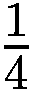。即：

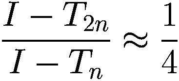

你可以重新整理各项，得到下式：

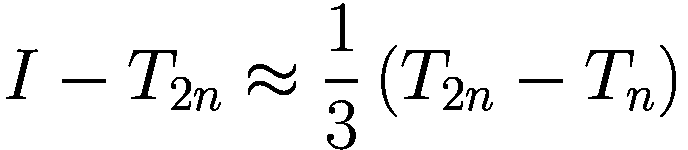

由此可见，只要进一步划分区间前后的两个连续积分值 `T[n]` 和 `T[2n]` 足够接近，`T[2n]` 计算结果 的误差就会很小。`T[2n]` 的误差大致等于 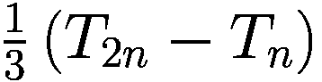。你可以用这个误差来补偿 `T[2n]`，从而得到更好的估计。也就是说，一个更精确的近似值如下：

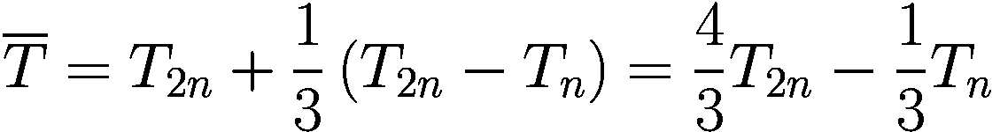

也就是说，你可以将使用梯形规则计算出的两个积分值 `T[n]` 和 `T[2n]` 进行线性组合，得到更精确的近似值。你甚至可以更进一步。

通过对梯形序列 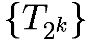 中的值进行线性组合，你可以生成一个辛普森序列 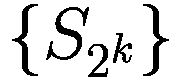。辛普森序列的收敛速度比梯形序列更快。

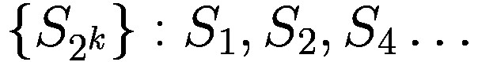

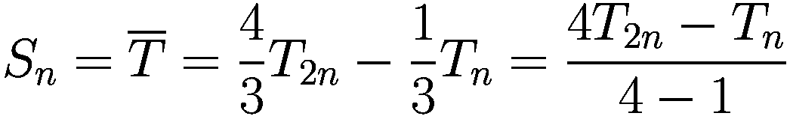

通过类似的计算可以证明：

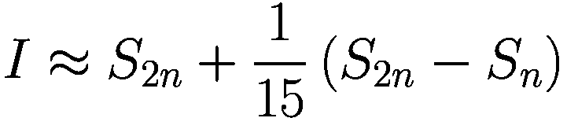

你可以更进一步，通过对辛普森序列中的值进行线性组合，生成一个收敛速度更快的柯特斯序列 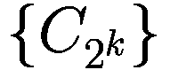。可以证明：

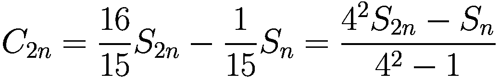

通过类似的计算可以证明：

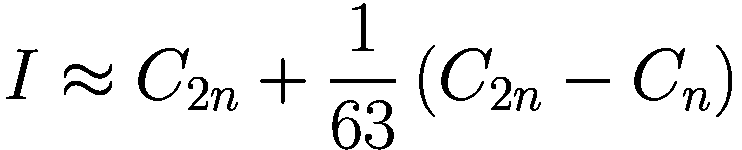

你甚至可以再次推进，通过对柯特斯序列中的值进行线性组合，生成一个收敛速度更快的龙贝格序列 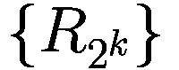。

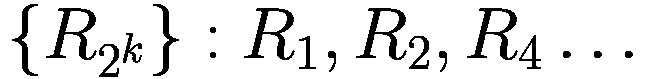

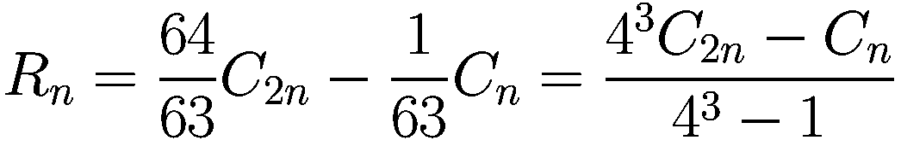

通过在变步长过程中使用加速公式，你将粗糙的梯形值 `T[n]` 逐步处理为较精细的辛普森值 `S[n]`，再处理为更精细的柯特斯值 `C[n]`，最后处理为精度最高的龙贝格值 `R[n]`。图 6-21 展示了这个推进序列。

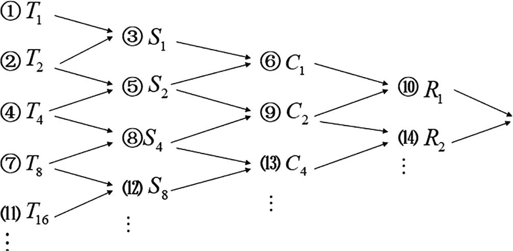

一个由 `T`、`S`、`C` 和 `R` 的不同组合构成的图表，分别带有 8、6、4 和 2 个箭头，共展示了十四个元素，用以说明龙贝格公式。

**图 6-21** 龙贝格公式

让我们重复第 6.7.3 节中使用积分计算 `π` 的例子。以下是产生的梯形值、辛普森值、柯特斯值和龙贝格值的序列。见图 6-22。

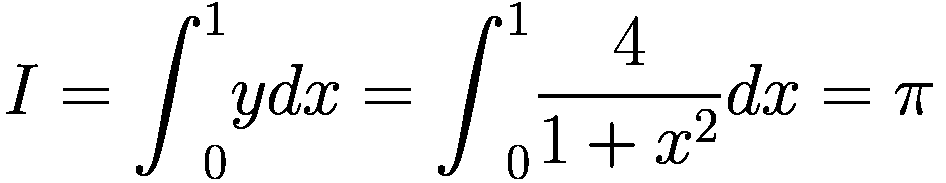

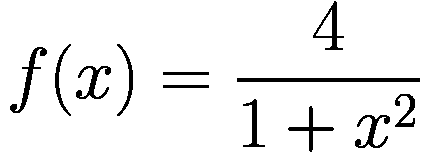

![$$ {T}_1=\frac{1}{2}\left[f(0)+f(1)\right]=3 $$](images/528380_1_En_6_Chapter/528380_1_En_6_Chapter_TeX_Equdp.png)

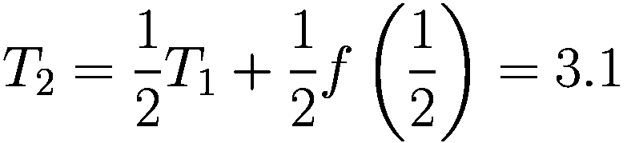

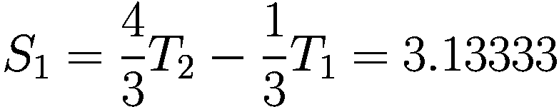

![$$ {T}_4=\frac{1}{2}{T}_2+\frac{1}{4}\left[f\left(\frac{1}{4}\right)+f\left(\frac{3}{4}\right)\right]=3.131177 $$](images/528380_1_En_6_Chapter/528380_1_En_6_Chapter_TeX_Equds.png)

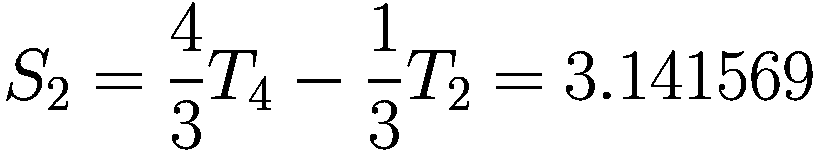

![$$ {T}_8=\frac{1}{2}{T}_4+\frac{1}{8}\left[f\left(\frac{1}{8}\right)+f\left(\frac{3}{8}\right)+f\left(\frac{5}{8}\right)+f\left(\frac{7}{8}\right)\right]=3.138989 $$](images/528380_1_En_6_Chapter/528380_1_En_6_Chapter_TeX_Equdu.png)

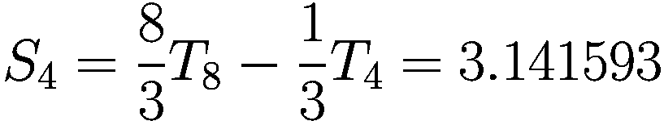

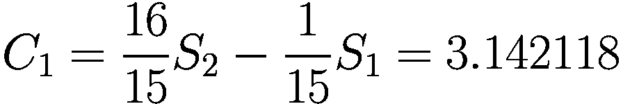

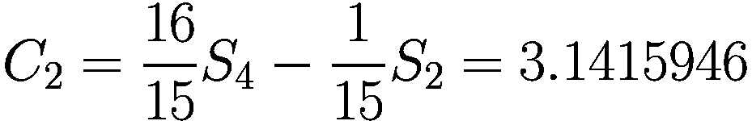

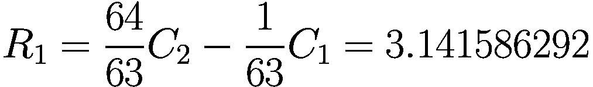

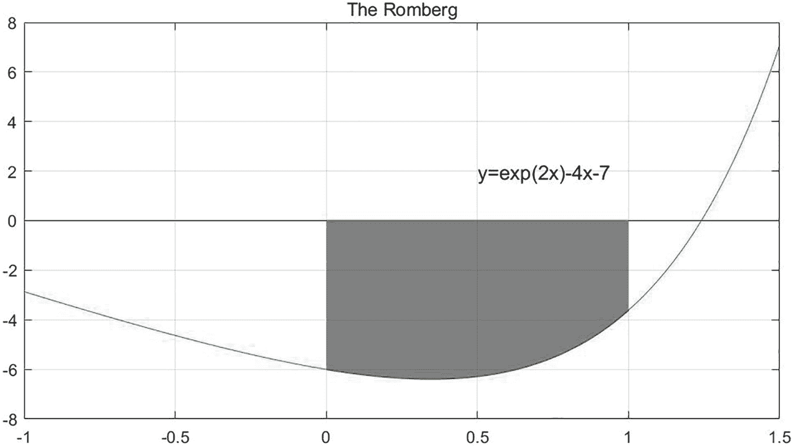
**图 6-23** 龙贝格积分

一张图表显示了一条指数曲线，该曲线在 (0.5, 负 6) 点之后先下降后上升。提到了一个阴影区域。

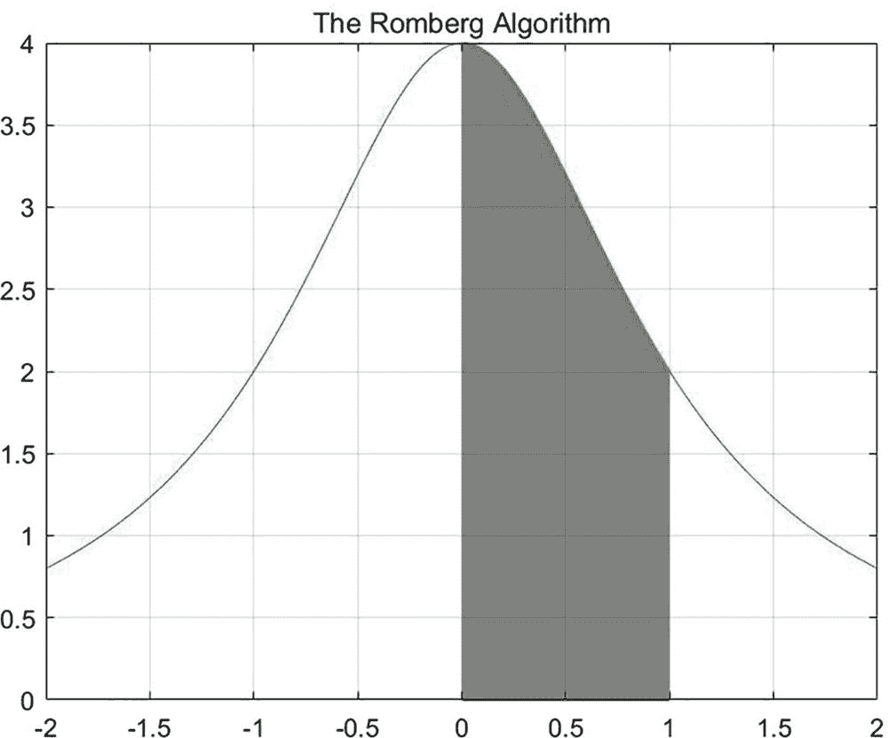
**图 6-22** 龙贝格积分

一张图表显示了一条钟形曲线，该曲线以相同方式先上升后下降。在 X 轴的 0 和 1 处投影了两条线，并且该区域被着色。

在 NM Dev 中，执行龙贝格积分的类是 `Romberg`。以下代码使用龙贝格积分计算这个积分值。

```kotlin
val f: UnivariateRealFunction = object : AbstractUnivariateRealFunction() {
override fun evaluate(x: Double): Double {
return exp(2.0 * x) - 4.0 * x - 7.0
}
}
val integrator1: IterativeIntegrator = Trapezoidal(1e-8, 20) // 使用梯形法则
val integrator2: Integrator = Simpson(1e-8, 20) // 使用辛普森法则
val integrator3: Integrator = Romberg(integrator1)
// 积分区间
val a: Double = 0.0
val b: Double = 1.0
// 积分运算
val I1: Double = integrator1.integrate(f, a, b)
println(String.format("S_[%.0f,%.0f] f(x) dx = %.16f, 使用梯形法则", a, b, I1))
val I2: Double = integrator2.integrate(f, a, b)
println(String.format("S_[%.0f,%.0f] f(x) dx = %.16f, 使用辛普森法则", a, b, I2))
val I3: Double = integrator3.integrate(f, a, b)
println(String.format("S_[%.0f,%.0f] f(x) dx = %.16f, 使用龙贝格公式", a, b, I3))
```

输出如下：

```
S_[0,1] f(x) dx = -5.8054719346672840, 使用梯形法则
S_[0,1] f(x) dx = -5.8054719494768790, 使用辛普森法则
S_[0,1] f(x) dx = -5.8054719505327520, 使用龙贝格公式
```

函数签名如下：

```kotlin
/**
 * 使用龙贝格方法扩展一个积分器。
 *
 * @param integrator 一个迭代积分器，必须至少执行 2 次迭代
 */
public Romberg(IterativeIntegrator integrator)
```

## 6.9 高斯求积

上一节介绍的牛顿-柯特斯族求积公式的特点是，`n` + 1 个节点（`x[0]`, `x[1]`, ⋯, `x[n]`）是等距的。因此，它们的求积公式很容易构造。另一方面，这也限制了这些公式的精度。当 `n` 为奇数时，代数精度为 `n`。当 `n` 为偶数时，代数精度为 `n` + 1。如果适当地选择这 `n` + 1 个节点（即不一定是等距的），代数精度能否更大？可以证明，只要选择正确的节点，代数精度最高可以达到 2`n` + 1。

从图 6-24 可以看出，使用梯形法则进行积分的误差相对较大。如果像图 6-25 那样巧妙地放置节点，就可以使用另一种直线近似来平衡正负误差。

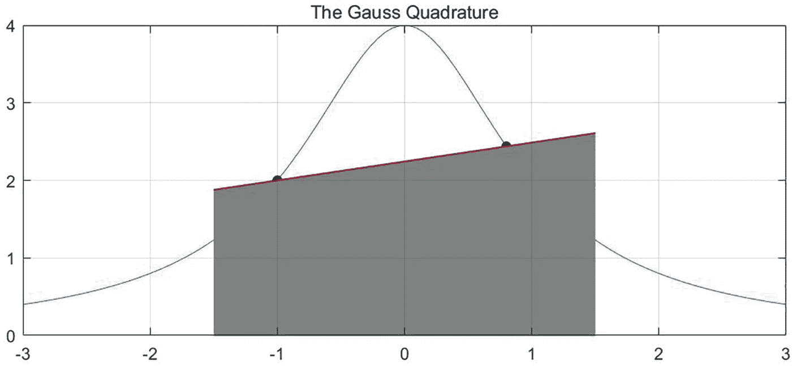
**图 6-25** 高斯求积与梯形法则对比

一张图表显示了一条上凸曲线，其中有一个阴影区域，直线大约从 (-1, 2) 和 (0.8, 2.5) 投影出来。

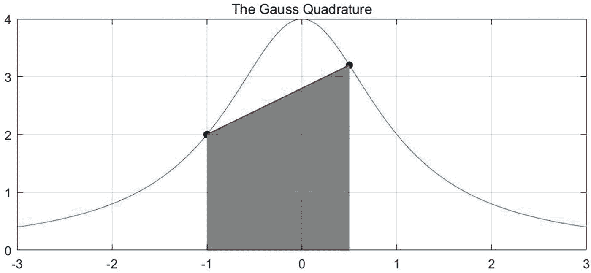
**图 6-24** 高斯求积与梯形法则对比

一张图表显示了一条上凸曲线，其中有一个阴影区域，直线大约从 (-1, 2) 和 (0.5, 3) 投影出来。

考虑一个积分这个多项式的例子：

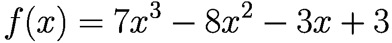

其积分值如下：

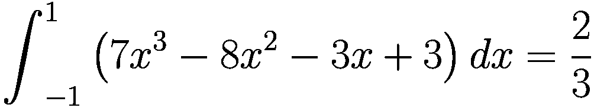

参见图 6-26。

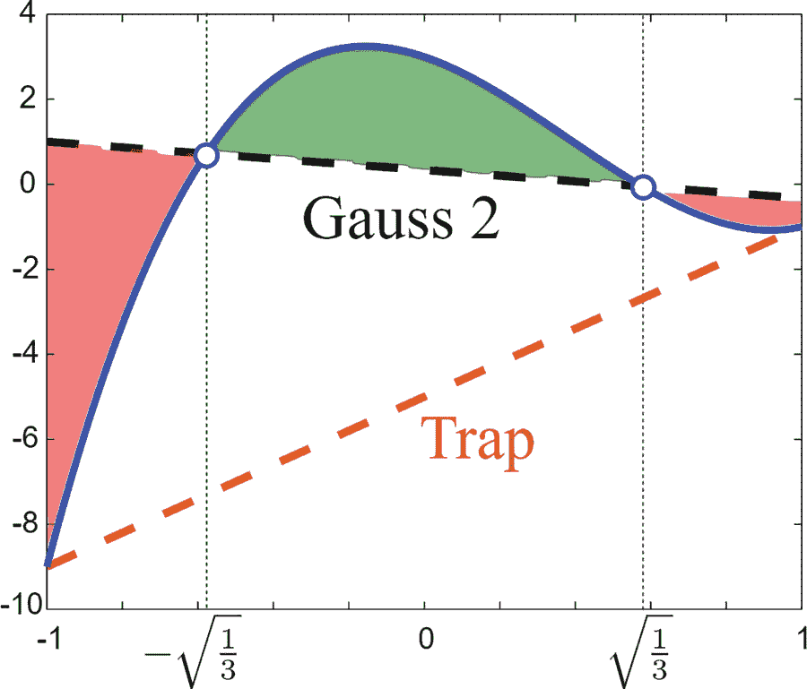
**图 6-26** 高斯求积与梯形法则对比

一条曲线图，曲线先上升，在到达 (0, 3) 后下降。两条虚线斜线分别标记为“高斯 2 点”和“梯形”。三个区域被阴影覆盖。

使用梯形法则，橙色直线近似该多项式，得到如下结果：

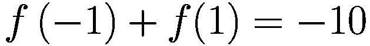

两点高斯求积法则使用黑色虚线来近似该多项式，并给出了精确结果。绿色区域的面积等于红色区域的面积之和。

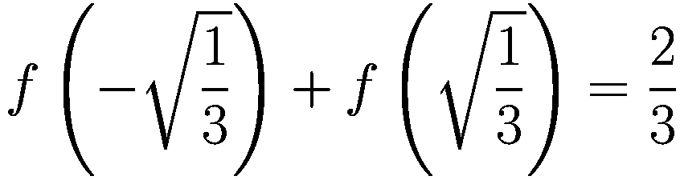

一般来说，对于以下形式的积分，高斯求积公式（注意符号从 `A[k]` 变为 `w[k]`，因为系数或权重的计算方法现在不同了）如下：

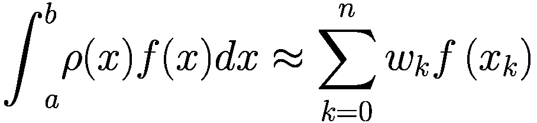

如果你选择正确的节点集，它可以达到至少 `n` 且最高为 2`n` + 1 的代数精度。这些节点 `{x[k]}` 被称为高斯点，系数 `{w[k]}` 被称为高斯系数。节点和系数都不依赖于被积函数。节点 `{x[k]}` 是根据被积函数的形式或 `ρ(x)` 从多项式的根计算出来的。

### 高斯-勒让德求积公式

高斯-勒让德求积公式用于求解当 `ρ(x) = 1` 时，如下形式的积分：

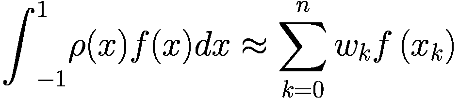

高斯节点是勒让德多项式 `Pn` 的根。

`Pn` 是一个次数为 `n` 的多项式，并且它们彼此正交。两个多项式或函数当且仅当满足以下条件时正交：

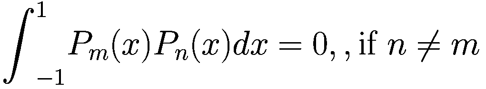

图 6-27 展示了前 11 个勒让德多项式（`n = 0, ..., 10`）。

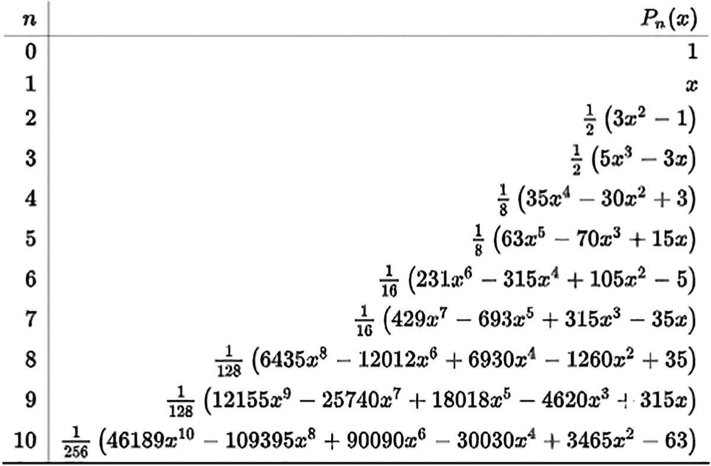
**图 6-27** 前 11 个勒让德多项式

一个表格包含 11 个关于 x 的函数，n 的值从 0 到 10 右对齐。

前六个多项式的图形绘制在图 6-28 中。

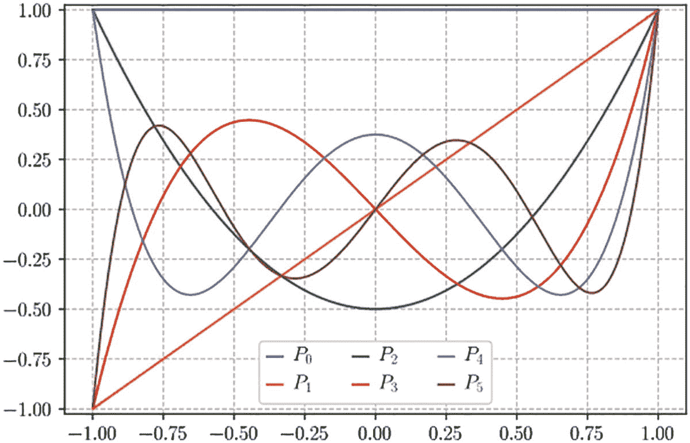
**图 6-28** 前六个勒让德多项式

一个图表展示了六条曲线，标记为 P 下标 0 到 5。P 下标 0 的线是直线，并在顶部被提及。

权重 `{w[k]}` 如下：

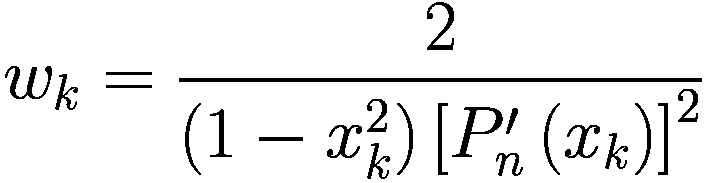

图 6-29 在区间 `[-1, 1]` 上列出了一些低阶求积规则。

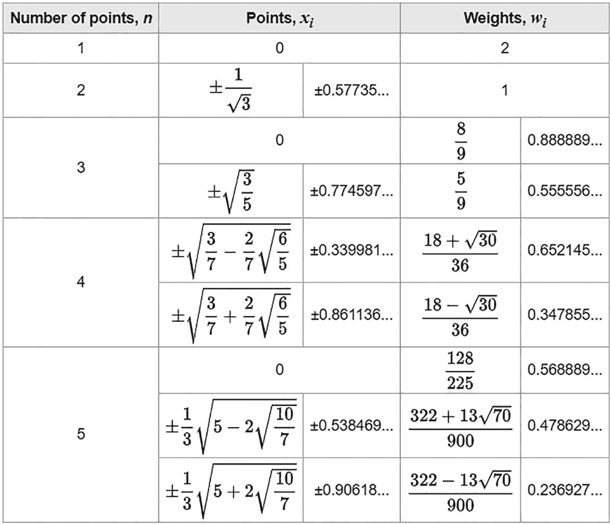
**图 6-29** 低阶高斯-勒让德求积规则

一个表格有 3 列 5 行，展示了 n 从 0 到 5 时的点和权重。

利用高斯节点和高斯权重，高斯-勒让德求积公式如下：

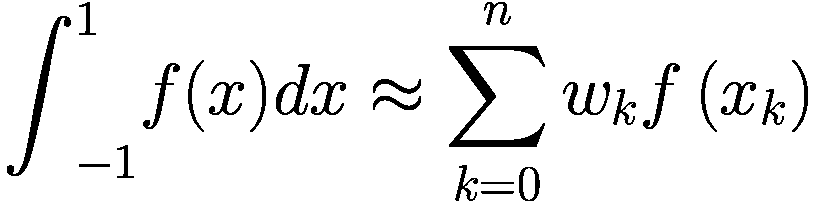

实际上，对于次数不超过 `2n + 1` 的多项式函数，该等式的计算结果是精确的。

# 高斯求积法在 NM Dev 中的实现

在 NM Dev 中，执行高斯-勒让德求积的类是 `GaussLegendreQuadrature`。以下代码计算这个积分：

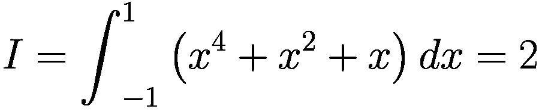

```kotlin
val f: UnivariateRealFunction = object : AbstractUnivariateRealFunction() {
override fun evaluate(x: Double): Double {
return 4 * x * x * x + 2 * x + 1 // x⁴ + x² + x
}
}
// 积分器
val integrator1: Integrator = Trapezoidal(1e-8, 20) // 使用梯形法则
val integrator2: Integrator = Simpson(1e-8, 20) // 使用辛普森法则
val integrator3: Integrator = GaussLegendreQuadrature(2)
// 积分限
val a: Double = -1.0
val b: Double = 1.0
// 积分计算
val I1: Double = integrator1.integrate(f, a, b)
println(String.format("S_[%.0f,%.0f] f(x) dx = %.16f, 使用梯形法则", a, b, I1))
val I2: Double = integrator2.integrate(f, a, b)
println(String.format("S_[%.0f,%.0f] f(x) dx = %.16f, 使用辛普森法则", a, b, I2))
val I3: Double = integrator3.integrate(f, a, b)
println(String.format("S_[%.0f,%.0f] f(x) dx = %.16f, 使用高斯-勒让德求积", a, b, I3))
```

输出结果如下：

```
S_[-1,1] f(x) dx = 2.0000000000000000, 使用梯形法则
S_[-1,1] f(x) dx = 2.0000000000000000, 使用辛普森法则
S_[-1,1] f(x) dx = 2.0000000000000000, 使用高斯-勒让德求积
```

`GaussLegendreQuadrature` 的类签名如下：

```java
/**
* 构造一个 n 阶的积分器。
*
* @param n 求积规则中的点数
*/
public GaussLegendreQuadrature(final int n)
```

## 高斯-拉盖尔求积公式

高斯-拉盖尔求积公式用于数值计算以下形式的积分：

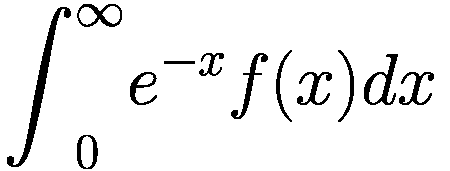

高斯节点 `{x[k]}` 是拉盖尔多项式 `Ln` 的根。

图 6-30 展示了前几个拉盖尔多项式。

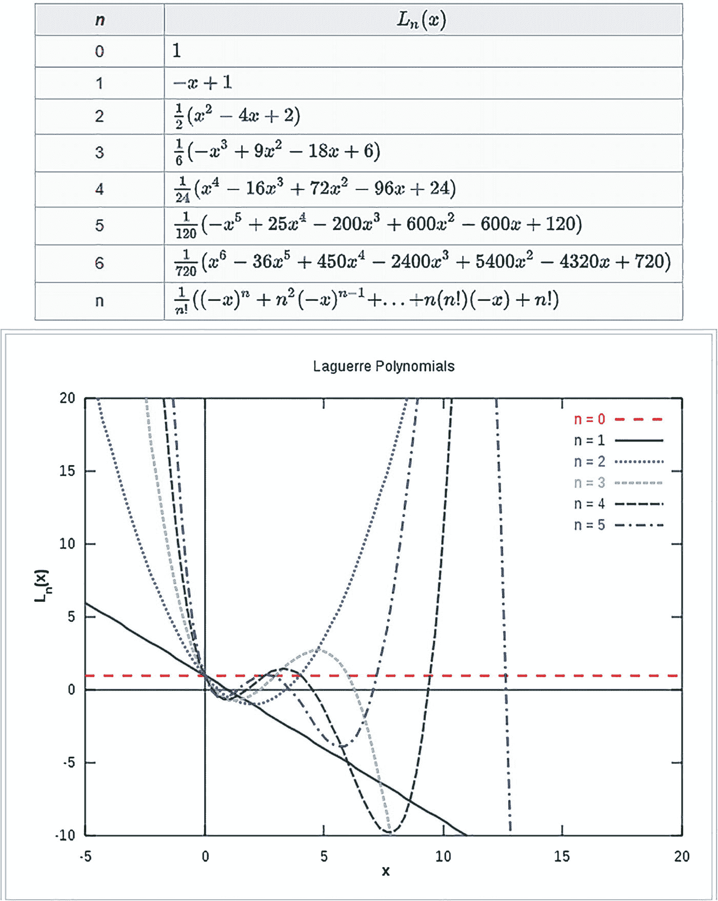

一个表格和一个图表。表格有 2 列 8 行。函数图显示了变量 x 的自然对数与 x 的关系，展示了 n 从 0 到 5 的六条曲线。
**图 6-30** 拉盖尔多项式

高斯系数 `{w[k]}` 如下：

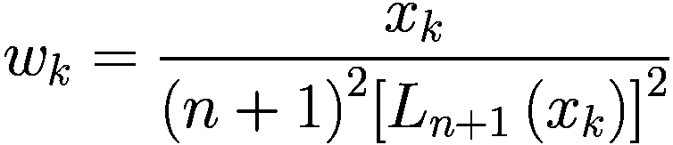

在 NM Dev 中，执行高斯-拉盖尔求积的类是 `GaussLaguerreQuadrature`。以下代码计算这个积分：

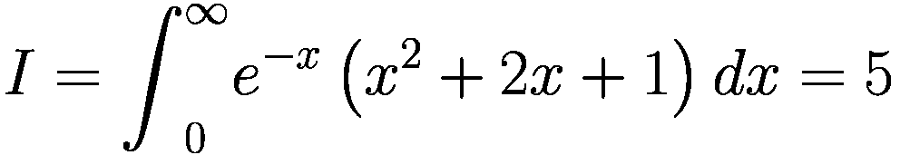

```kotlin
val poly: Polynomial = Polynomial(1.0, 2.0, 1.0) // x² + 2x + 1
val f: UnivariateRealFunction = object : AbstractUnivariateRealFunction() {
override fun evaluate(x: Double): Double {
return exp(-x) * poly.evaluate(x) // e^-x * (x² + 2x + 1)
}
}
// 积分器
val integrator1: Integrator = Trapezoidal(1e-8, 20) // 使用梯形法则
val integrator2: Integrator = Simpson(1e-8, 20) // 使用辛普森法则
val integrator3: Integrator = GaussLaguerreQuadrature(2, 1e-8)
// 积分限
val a: Double = 0.0
val b: Double = Double.POSITIVE_INFINITY
// 积分计算
val I1: Double = integrator1.integrate(f, a, b)
println(String.format("S_[%.0f,%.0f] f(x) dx = %.16f, 使用梯形法则", a, b, I1))
val I2: Double = integrator2.integrate(f, a, b)
println(String.format("S_[%.0f,%.0f] f(x) dx = %.16f, 使用辛普森法则", a, b, I2))
val I3: Double = integrator3.integrate(f, a, b)
println(String.format("S_[%.0f,%.0f] f(x) dx = %.16f, 使用高斯-拉盖尔求积", a, b, I3))
```

输出结果如下：

```
S_[0,Infinity] f(x) dx = NaN, 使用梯形法则
S_[0,Infinity] f(x) dx = NaN, 使用辛普森法则
S_[0,Infinity] f(x) dx = 5.0000000000000000, 使用高斯-拉盖尔求积
```

有趣的是，梯形法则和辛普森法则都无法计算这个（反常）积分，因为它的一个积分限是正无穷大。你无法将半实数轴 `[0, ∞]` 进行分割。

`GaussLaguerreQuadrature` 的类签名如下：

```java
/**
* 构造一个 n 阶的积分器。
*
* @param n         求积规则中的点数
* @param precision 系数估计的精度
*/
public GaussLaguerreQuadrature(final int n, final double precision)
```

## 高斯-埃尔米特求积公式

高斯-埃尔米特求积公式用于数值计算以下形式的积分：

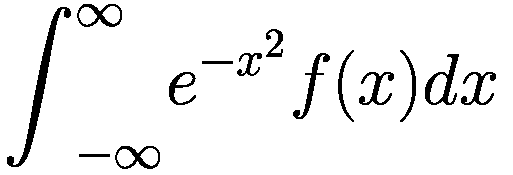

高斯节点 `{x[k]}` 是物理学家版本埃尔米特多项式 `Hn` 的根。

图 6-31 和图 6-32 展示了前几个埃尔米特多项式。

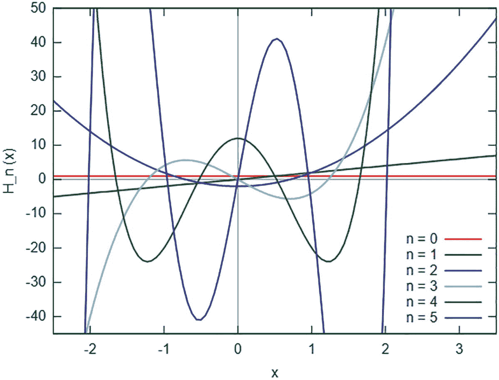

一幅埃尔米特多项式关于 x 的图形，显示了 n 从 0 到 5 的六条相互交叠的曲线。

**图 6-32**
前六个埃尔米特多项式


一幅包含 H 下标 0 到 10 对 x 的十个多项式方程的图形。

**图 6-31**
前十个埃尔米特多项式

高斯系数 `{w[k]}` 如下所示：

![$$ {w}_k=\frac{2^{n-1}n!\sqrt{\pi }}{n²{\left[{H}_{n-1}\left({x}_k\right)\right]}²} $$](images/528380_1_En_6_Chapter/528380_1_En_6_Chapter_TeX_Equen.png)

在 NM Dev 中，用于执行高斯-埃尔米特求积的类是 `GaussHermiteQuadrature`。以下代码计算了这个积分：


# 高斯求积公式

### 6.9.4 高斯-切比雪夫求积公式

高斯-切比雪夫求积公式用于数值计算以下形式的积分：


高斯节点 `{x[k]}` 如下所示：


高斯系数 `{w[k]}` 如下所示：


在 `NM Dev` 中，用于执行高斯-切比雪夫求积的类是 `GaussChebyshevQuadrature`。以下代码计算了这个积分：


```kotlin
val poly: Polynomial = Polynomial(1.0, 2.0, 1.0) // x² + 2x + 1
val f: UnivariateRealFunction = object : AbstractUnivariateRealFunction() {
    override fun evaluate(x: Double): Double {
        // second order polynomial divided by weighting can be reproduced exactly
        return poly.evaluate(x) / sqrt(1 - x * x)
    }
}

// the integrators
val integrator1: Integrator = Trapezoidal(1e-8, 20) // using the trapezoidal rule
val integrator2: Integrator = Simpson(1e-8, 20) // using the Simpson rule
val integrator3: Integrator = GaussChebyshevQuadrature(2)

// the limits
val a: Double = -1.0
val b: Double = 1.0

// the integrations
val I1: Double = integrator1.integrate(f, a, b)
println(String.format("S_[%.0f,%.0f] f(x) dx = %.16f, using the trapezoidal rule", a, b, I1))

val I2: Double = integrator2.integrate(f, a, b)
println(String.format("S_[%.0f,%.0f] f(x) dx = %.16f, using the Sampson rule", a, b, I2))

val  I3: Double = integrator3.integrate(f, a, b)
println(String.format("S_[%.0f,%.0f] f(x) dx = %.16f, using the Gauss Hermite quadrature", a, b, I3))
```

输出结果如下：

```
S_[-1,1] f(x) dx = NaN, using the trapezoidal rule
S_[-1,1] f(x) dx = NaN, using the Simpson rule
S_[-1,1] f(x) dx = 4.7123889803846900, using the Gauss Hermite quadrature
```

请注意，梯形法则和辛普森法则都无法计算这个积分。