# 6.10 换元积分法

第 6.9 节中的函数形式是受限的。例如，应用高斯-勒让德公式的区间是 [−1, 1]。通常情况下，你会希望区间有更大的灵活性。其他形式从无穷远处积分或积分至无穷远，这使得应用像梯形法则或辛普森法则这样更简单的求积规则变得不可行。许多被积函数因为复杂而难以计算。还有一些函数由于奇异性而在某些点上无法求值。

换元积分法将积分写成更简单的形式，从而使其更容易计算，例如，通过避免奇异性。它可以将区间变换到期望的范围，并避免无穷大。此外，它还通过减少收敛所需的迭代次数来加速计算。换元法则指出，你需要找到一个变量变换，如下所示：

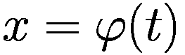

使得

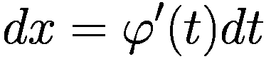

然后你可以将关于 *t* 的积分替换为关于 *x* 的积分。

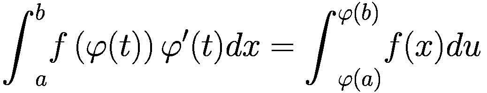

一个例子会使它更容易理解。假设你要计算以下积分：

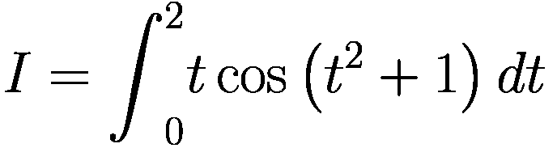

请注意，如果你设置：

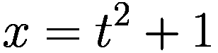

你会得到：

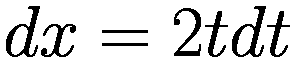

或者：

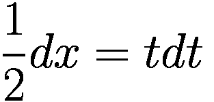

将这些代入原始积分并消去 *t*，你会得到：

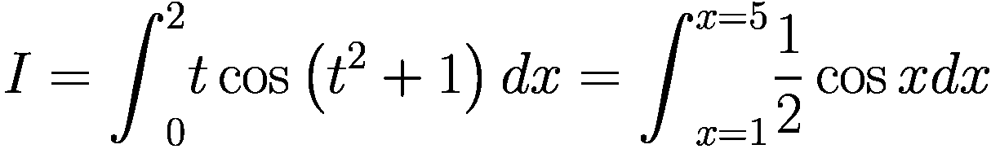

关于 *x* 的新积分远没有那么令人生畏。

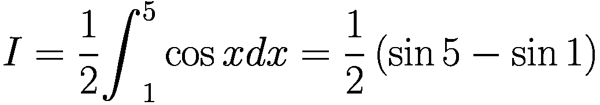

要在 NM Dev 中实现换元积分，你需要通过继承 `SubstitutionRule` 接口来指定变量变换。

```java
public interface SubstitutionRule {
/**
* 变换：x(t)
*
* @return x(t)
*/
public UnivariateRealFunction x();
/**
* 变换的一阶导数：x'(t) = dx(t)/dt
*
* @return x'(t) = dx(t)/dt
*/
public UnivariateRealFunction dx();
/**
* 积分的下限。
*
* @return 下限
*/
public double ta();
/**
* 积分的上限。
*
* @return 上限
*/
public double tb();
}
```

变量变换在 `x()` 中指定。你还需要在 `dx()` 中指定变量变换的微分，以及上下限 `ta()` 和 `tb()`。

NM Dev 有一套现成的替换规则可以直接使用。

## 6.10.1 标准区间

这种变换将积分区间从 [*a*, *b*] 映射到 [−1, 1]。替换规则如下：

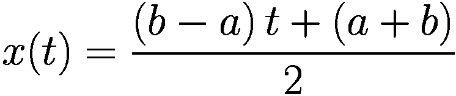

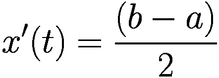

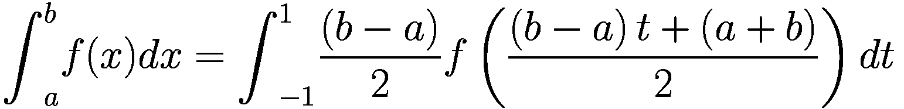

这是一个示例：

```kotlin
val a: Double = 0.0
val b: Double = 10.0 // 积分限
val integrator1: Integrator
= NewtonCotes(3, NewtonCotes.Type.OPEN, 1e-8, 10)
val integrator2: Integrator
= ChangeOfVariable(StandardInterval(a, b), integrator1)
val f: UnivariateRealFunction = object : AbstractUnivariateRealFunction() {
override fun evaluate(t: Double): Double {
return t // 原始被积函数
}
}
val I: Double = integrator2.integrate(
f,
a,
b // 原始积分限
)
println(String.format("S_[%.0f,%.0f] f(x) dx = %f", a, b, I))
```

输出如下：

```
S_[0,10] f(x) dx = 50.000000
```

## 6.10.2 变量取倒数

当以下情况发生时，这种变换很有用：

1.  *b* → ∞ , *a* > 0

2.  *a* → − ∞ , *b* < 0

3.  任何向无穷大衰减的速度快于 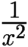 的函数

此替换的积分器应使用开型公式，以避免计算 *t* = 0 处的端点。变换如下：

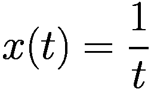

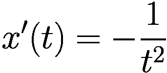

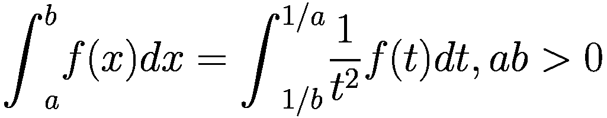

这是一个示例：

```kotlin
val a: Double = 1.0
val b: Double = Double.POSITIVE_INFINITY // 积分限
val integrator1: NewtonCotes
= NewtonCotes(3, NewtonCotes.Type.OPEN, 1e-15, 10)
val integrator2: ChangeOfVariable
= ChangeOfVariable(InvertingVariable(a, b), integrator1)
val f: UnivariateRealFunction = object : AbstractUnivariateRealFunction() {
override fun evaluate(x: Double): Double {
return 1 / x / x // 原始被积函数
}
}
val  I: Double = integrator2.integrate( // I = 1
f,
a,
b // 原始积分限
)
println(String.format("S_[%.0f,%.0f] f(x) dx = %f", a, b, I))
```

输出如下：

```
S_[1,Infinity] f(x) dx = 1.000000
```

## 6.10.3 指数变换

当下限有限、上限无限且被积函数呈指数衰减时，这种变换很有用。此替换的积分器应使用开型公式，以避免计算 *t* = 0 处的端点。变换如下：

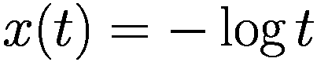

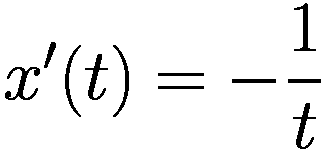

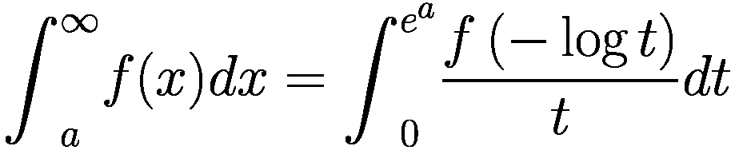

这是一个示例：

```kotlin
val a: Double = 0.0
val b: Double = Double.POSITIVE_INFINITY // 积分限
val integrator1: NewtonCotes
= NewtonCotes(3, NewtonCotes.Type.OPEN, 1e-15, 15)
val integrator2: ChangeOfVariable
= ChangeOfVariable(Exponential(a), integrator1)
val f: UnivariateRealFunction = object :  AbstractUnivariateRealFunction() {
override fun evaluate(x: Double): Double {
return sqrt(x) * exp(-x) // 原始被积函数
}
}
val I: Double = integrator2.integrate( // I = sqrt(PI)/2
f,
a,
b // 原始积分限
)
println(String.format("S_[%.0f,%.0f] f(x) dx = %f", a, b, I))
```

输出如下：

```
S_[0,Infinity] f(x) dx = 0.886227
```

### 6.10.4 混合规则

混合规则适用于在无穷远处快速衰减的函数，例如 `e^x` 或 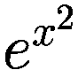。积分区间为 $[0, \infty)$。使用此变换的难点在于找出 `t` 的合适范围。如果有关于被积函数的信息，应重写 `SubstitutionRule.ta()` 和 `SubstitutionRule.tb()`。变换如下：

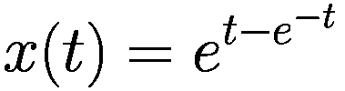

示例如下：

```kotlin
val f: UnivariateRealFunction = object : AbstractUnivariateRealFunction() {
override fun evaluate(x: Double): Double {
return exp(-x) * x.pow(-1.5) * sin(x / 2)
}
}
val a: Double = 0.0
val b: Double = Double.POSITIVE_INFINITY // the limits
val integrator1: NewtonCotes
= NewtonCotes(2, NewtonCotes.Type.CLOSED, 1e-15, 7) // only 7 iteration!
val integrator2: ChangeOfVariable
= ChangeOfVariable(MixedRule(f, a, b, 1.0), integrator1)
val I: Double = integrator2.integrate(f, a, b) // I = sqrt(PI * (sqrt(5) - 2))
println(String.format("S_[%.0f,%.0f] f(x) dx = %f", a, b, I))
```

输出如下：

```
S_[0,Infinity] f(x) dx = 0.861179
```

### 6.10.5 双指数变换

此变换可指数级地加速梯形规则的收敛。它适用于有限积分区间 $[a, b]$。使用此变换的难点在于找出 `t` 的合适范围。如果有关于被积函数的信息，应重写 `SubstitutionRule.ta()` 和 `SubstitutionRule.tb()`。变换如下：

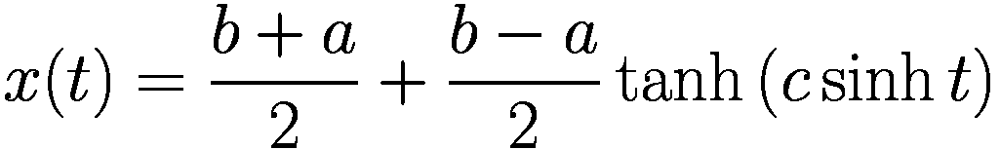

示例如下：

```kotlin
val f: UnivariateRealFunction = object : AbstractUnivariateRealFunction() {
override fun evaluate(x: Double): Double {
return ln(x) * ln(1 - x)
}
}
val a: Double = 0.0
val b: Double = 1.0 // the limits
val integrator1: NewtonCotes
= NewtonCotes(2, NewtonCotes.Type.CLOSED, 1e-15, 6) // only 6 iterations!
val integrator2: ChangeOfVariable
= ChangeOfVariable(DoubleExponential(f, a, b, 1.0), integrator1)
val I: Double = integrator2.integrate(f, a, b) // I = 2 - PI * PI / 6
println(String.format("S_[%.0f,%.0f] f(x) dx = %f", a, b, I))
```

输出如下：

```
S_[0,1] f(x) dx = 0.355066
```

### 6.10.6 实数轴上的双指数变换

此变换适用于区间 $(-\infty, \infty)$。使用此变换的难点在于找出 `t` 的合适范围。如果有关于被积函数的信息，应重写 `SubstitutionRule.ta()` 和 `SubstitutionRule.tb()`。变换如下：

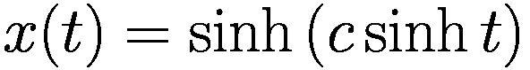

示例如下：

```kotlin
val f: UnivariateRealFunction = object : AbstractUnivariateRealFunction() {
override fun evaluate(x: Double): Double {
return exp(-x * x)
}
}
val a: Double = Double.NEGATIVE_INFINITY
val b: Double = Double.POSITIVE_INFINITY // the limits
val integrator1: NewtonCotes
= NewtonCotes(3, NewtonCotes.Type.CLOSED, 1e-15, 6)//only 6 iterations!
val integrator2: ChangeOfVariable
= ChangeOfVariable(DoubleExponential4RealLine(f, a, b, 1.0), integrator1)
val I: Double = integrator2.integrate(f, a, b) // sqrt(PI)
println(String.format("S_[%.0f,%.0f] f(x) dx = %f", a, b, I))
```

输出如下：

```
S_[-Infinity,Infinity] f(x) dx = 1.772454
```

### 6.10.7 半实数轴上的双指数变换

此变换适用于区间 $(0, \infty)$。使用此变换的难点在于找出 `t` 的合适范围。如果有关于被积函数的信息，应重写 `SubstitutionRule.ta()` 和 `SubstitutionRule.tb()`。变换如下：

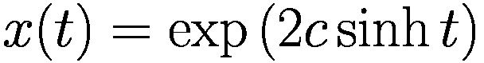

示例如下：


```
val f: UnivariateRealFunction = object :  AbstractUnivariateRealFunction() {
override fun evaluate(x: Double): Double {
return x / (exp(x) - 1)
}
}
val a: Double = Double.NEGATIVE_INFINITY
val b: Double = Double.POSITIVE_INFINITY // the limits
val integrator: NewtonCotes
= NewtonCotes(3, NewtonCotes.Type.OPEN, 1e-15, 15)
val instance: ChangeOfVariable
= ChangeOfVariable(DoubleExponential4HalfRealLine(f, a, b, 1.0), integrator)
val I: Double = instance.integrate(f, a, b) // PI * PI / 6
println(String.format("S_[%.0f,%.0f] f(x) dx = %f", a, b, I))
```

输出如下：

```
S_[-Infinity,Infinity] f(x) dx = 1.644936
```

### 6.10.8 幂律奇异性

此变换适用于在一个端点处发散（发散）的积分。

对于下限处的奇异性，`(x - a)^(-γ)` 在 `x = a` 附近发散。0 ≤ `γ` ≤ 1。变换规则如下：

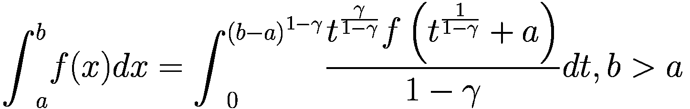

对于上限处的奇异性，`(x - b)^(-γ)` 在 `x = b` 附近发散。0 ≤ `γ` ≤ 1。变换规则如下：

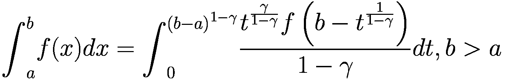

一个常见的情况是 `γ` = 0.5。

示例如下：

```
val a: Double = 1.0
val b: Double = 2.0 // the limits
val integrator1: NewtonCotes
= NewtonCotes(3, NewtonCotes.Type.OPEN, 1e-15, 15)
val integrator2 = ChangeOfVariable(
PowerLawSingularity(
PowerLawSingularity.PowerLawSingularityType.LOWER,
0.5, // gamma = 0.5
a, b),
integrator1)
val f: UnivariateRealFunction = object : AbstractUnivariateRealFunction() {
override fun evaluate(x: Double): Double {
return 1 / sqrt(x - 1)
}
}
val I: Double = integrator2.integrate( // I = 2
f,
a,
b
)
println(String.format("S_[%.0f,%.0f] f(x) dx = %f", a, b, I))
```

输出如下：

```
S_[1,2] f(x) dx = 2.000000
```

脚注 1 2
