# 7. 常微分方程

常微分方程是涉及一个自变量导数的方程。术语“常”与偏微分方程（PDE）相对，后者涉及多个自变量。微分方程在数学和科学的许多领域中出现。通常情况下，描述系统的变化、动态或变异比描述系统本身更容易。系统本身可能复杂，但其动态可能简单（或更简单）。例如，一开始确定物体的轨迹并不总是容易（甚至可行）。相比之下，牛顿著名的第二运动定律可以用一个常微分方程的简单表达式描述从足球到行星的任何物体的轨迹。

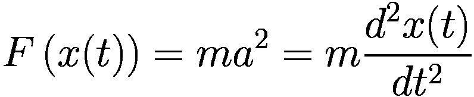

此外，许多现象从根本上将不同的微分量联系起来，例如变化率或梯度，或曲率。例如，上述常微分方程连接了这些量：位置（或位移）随时间变化 `x(t)`、力 `F`、时间 `t` 和质量 `m`。位置函数对时间的一阶导数是速度；二阶导数是加速度 `a`。常微分方程在几乎所有科学领域都无处不在，例如物理学和天文学（天体力学）、气象学（天气建模）、化学（反应速率）、生物学（传染病、遗传变异）、生态学和种群建模（种群竞争）以及经济学（股票趋势、利率和市场均衡价格变化）。

常微分方程的数值解是计算数学的一个分支，用于解决常微分方程问题。也就是说，你需要找到一个满足该常微分方程的函数。数值解之所以重要，是因为许多常微分方程无法解析求解。即使可以，其解也可能无法用初等函数表示。在这些情况下，你只能求助于数值求解。数值解是对常微分方程真实解在特定离散点上的近似。我们需要研究这种数值解的存在性、唯一性和稳定性。

## 7.1 单步法

初值问题是常微分方程问题的一类。初值问题是一个常微分方程，并附带一个初始条件，该条件指定了未知函数在定义域内某一点的值。在物理学或其他科学中对系统进行建模通常等同于求解一个初值问题。在此背景下，微分方程是一个指定系统如何随时间演化的方程，前提是系统在零时刻的初始条件。数学上，初值问题是一个微分方程，如下所示：

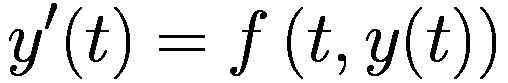

这附带初始条件，如下所示：

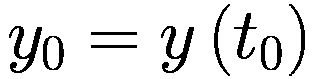

初值问题的解是一个函数 `y`，它既是微分方程的解，也满足初始条件。通过将导数视为独立函数，该概念可以推广到高阶。对于一个二阶常微分方程，你有：

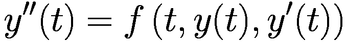

通常，假设函数 `f(x, y)` 满足利普希茨条件，如下所示：

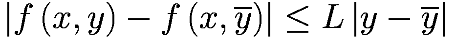

`L` 是一个常数。该条件基本上是说函数 `f` 不能变化太快。该条件保证了该常微分方程有且仅有一个解。

例如，你可以求解以下常微分方程：

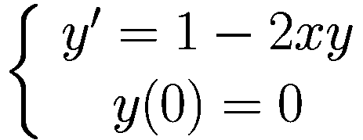

数值解给出 `y(x)` 在一组离散点上的近似值 `y[1]`， `y[2]`， …， `y[n]`， `y[n + 1]`，如下所示：

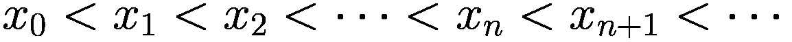

`h[i] = x[i + 1] – x[i]` 被称为步长。除非另有说明，否则假设步长相等且间隔均匀。

从概念上讲，你可以通过以下方式求解常微分方程。你从初始条件已知值 `y(x[0]) = y[0]`。要找到 `y(x[1]) = y(x[0] + h)`，你可以使用一个近似：`∆y(x) ≈ y^′(x)h`。因此，你得到：

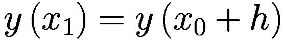

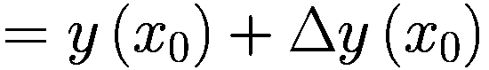

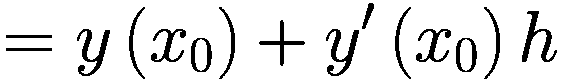

你可以重复此过程，依次迭代求 `y(x[2]) = y(x[1]) + y^′(x[1])h`、`y(x[3]) = y(x[2]) + y^′(x[2])h`，等等。这就是求解常微分方程数值解的一般思路。这类方法被称为步进法。图 7-1 展示了该问题的数值解。

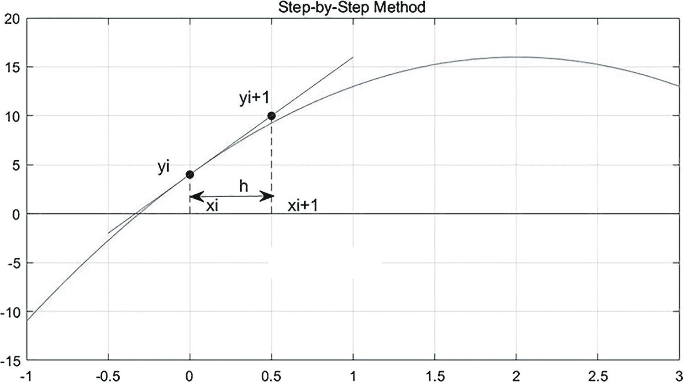

一张折线图展示了一条上升曲线上的两个点以及一条与之相切的直线。这两个点是 `x_i`、`y_i`、`x_i + 1` 和 `y_i + 1`。这些点之间的水平距离是 `h`。

**图 7-1** 使用步进法求解初值问题的数值解

### 7.1.1 欧拉法（多边形法）

欧拉法（多边形法）是一种一阶数值过程，用于求解具有给定初始值的常微分方程。它是用于常微分方程数值积分最基本的一种显式方法，也是最简单的龙格-库塔法（将在第 7.1.2 节讨论）。作为一种一阶方法，其局部误差（每步误差）与步长的平方成正比，全局误差（给定时刻或数值处的误差）与步长成正比。其精度不高。它还面临稳定性问题。由于这些原因，欧拉法在实践中并不常用。然而，它阐明了数值积分中的一些基本概念。欧拉法是构造更复杂方法的基础。

#### 欧拉公式

你可以使用泰勒展开来推导欧拉公式。

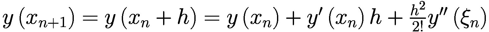, \( \xi_n \in (x_n, x_{n+1}) \)

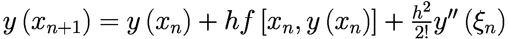, \( n = 0, 1, 2, \cdots \)

当 \( h \) 足够小时，可以忽略高阶项 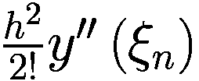 并得到一个近似公式，如下所示：

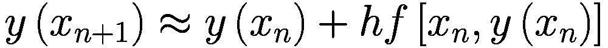

使用记号 \( y_{n+1} \approx y(x_{n+1}) \)，欧拉公式如下：

\[ y_{n+1} = y_n + h f(x_n, y_n), \quad n = 0, 1, 2, \cdots \]

该公式的局部截断误差是第 \( n \) 步产生的误差，由  给出，该误差与步长的平方 \( h² \) 成正比。另一方面，全局误差是从开始到当前步累积的误差。请参见图 7-2。

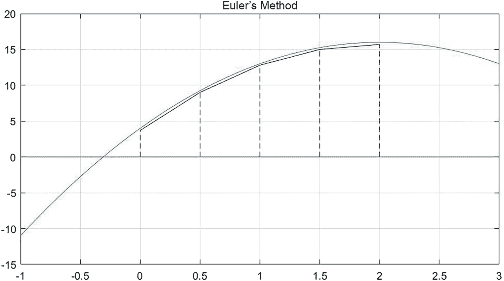

折线图表示增长趋势。曲线在 X 轴上的投影线分别为 0、0.5、1、1.5 和 2。

**图 7-2** 欧拉方法及其近似误差

欧拉方法是一种折线法，而非切线法。除第一个点是曲线上的切线外，函数由分段折线近似表示。

#### 隐式欧拉公式

你可以推导出欧拉方法的隐式公式或后向公式。其差商如下所示：

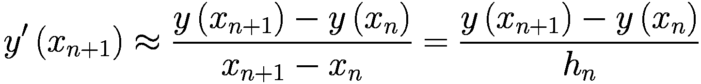

假设 \( y_n = y(x_n) \) 并且已知 \( y'(x_{n+1}) = f(x_{n+1}, y(x_{n+1})) \)，则隐式（后向）欧拉公式如下：

\[ y_{n+1} = y_n + h f(x_{n+1}, y_{n+1}), \quad n = 0, 1, 2, \cdots \]

该公式被称为隐式公式，因为等式左右两边都包含 \( y_{n+1} \)。与显式公式不同——显式公式只需代入数值即可计算出 \( y_{n+1} \)——使用隐式公式进行计算需要求解关于 \( y_{n+1} \) 的方程。

求解该方程的一种方法是使用迭代法。首先对 \( y_{n+1} \) 的可能值进行初始猜测 \( y_{n+1}^{(0)} \)。然后将其代入右侧，计算下一个更接近的估计值 \( y_{n+1}^{(1)} \)。重复此过程直到收敛。具体迭代公式如下：

\[

\begin{cases}

# 隐式公式的局部截断误差

我们研究隐式公式的局部截断误差。已知：
```
y_{n+1} = y_n + h f(x_{n+1}, y_{n+1}) = y_n + h y'(x_{n+1})
```
```
y'(x_{n+1}) = y'(x_n + h) = y'(x_n) + y''(\xi_n) h
```
将第二个方程代入第一个方程，得到：
```
y_{n+1} = y_n + h y'(x_n) + h² y''(\xi_n)
```
同样地，有：
```
y(x_{n+1}) = y(x_n) + h f(x_n, y(x_n)) + \frac{h²}{2!} y''(\xi_n)
```
假设 `y_n = y(x_n)`，并用第二个方程减去第一个方程，得到局部截断误差如下：
```
y(x_{n+1}) - y_{n+1} = -\frac{h²}{2} y''(\xi_n)
```
或者，隐式欧拉公式的局部截断误差近似为：
```
-\frac{h²}{2!} y''(x_n)
```

## 梯形公式

请注意，显式与隐式方法的局部截断误差仅相差一个负号，即：
```
{y}_{n+1}={y}_n+ hf\left({x}_n,{y}_n\right)+\frac{h²}{2!}{y}^{\prime \prime}\left({x}_n\right)+o\left({h}³\right)
```
```
{y}_{n+1}={y}_n+ hf\left({x}_{n+1},{y}_{n+1}\right)-\frac{h²}{2!}{y}^{\prime \prime}\left({x}_n\right)+o\left({h}³\right)
```
将这两个方程相加并除以 2，就能消去 `\frac{h²}{2!}{y}^{{\prime\prime}}\left({x}_n\right)`，得到：
```
{y}_{n+1}={y}_n+\frac{h}{2}\left[f\left({x}_n,{y}_n\right)+f\left({x}_{n+1},{y}_{n+1}\right)\right]+o\left({h}³\right)
```
忽略 `o(h³)`，梯形公式如下：
```
{y}_{n+1}={y}_n+\frac{h}{2}\left[f\left({x}_n,{y}_n\right)+f\left({x}_{n+1},{y}_{n+1}\right)\right]
```
梯形公式也是一个隐式公式。可通过如下迭代法求解：
```
\left\{\begin{array}{c}{y}_{n+1}^{(0)}={y}_n+ hf\left({x}_n,{y}_n\right)\\ {}{y}_{n+1}^{\left(k+1\right)}={y}_n+\frac{h}{2}\left[f\left({x}_n,{y}_n\right)+f\left({x}_{n+1},{y}_{n+1}^{(k)}\right)\right]\end{array}\right.
```
，`k = 0, 1, ⋯`
此迭代方法会收敛，因为：
```
\left|{y}_{n+1}-{y}_{n+1}^{\left(k+1\right)}\right|=\frac{h}{2}\left|f\left({x}_{n+1},{y}_{n+1}\right)-f\left({x}_{n+1},{y}_{n+1}^{(k)}\right)\right|
```
此处假设 `f(x, y)` 满足利普希茨条件。
```
\left|f\left(x,y\right)-f\left(x,\overline{y}\right)\right|\le L\left|y-\overline{y}\right|
```
即：
```
\left|{y}_{n+1}-{y}_{n+1}^{\left(k+1\right)}\right|\le \frac{Lh}{2}\left|{y}_{n+1}-{y}_{n+1}^{(k)}\right|
```
取 `\frac{Lh}{2}<1`，则有：
```
\left|{y}_{n+1}-{y}_{n+1}^{\left(k+1\right)}\right|\le \left|{y}_{n+1}-{y}_{n+1}^{(k)}\right|
```
因此，就实现了（有条件的）收敛。梯形公式比显式欧拉法或隐式向后欧拉公式（一阶精度 `o(h²)`）更精确，它具有二阶精度 `o(h³)`。

## 预测-校正法

虽然梯形公式具有良好的精度 `o(h³)`，但计算量太大。预测-校正法使用梯形公式对欧拉法进行改进，但只进行一轮迭代。具体如下：

- 预测：`{\overline{y}}_{n+1}={y}_n+ hf\left({x}_n,{y}_n\right)`
- 校正：`{y}_{n+1}={y}_n+\frac{h}{2}\left[f\left({x}_n,{y}_n\right)+f\left({x}_{n+1},{\overline{y}}_{n+1}\right)\right]`

该公式也称为改进的欧拉公式。

通常，预测-校正系统使用显式公式进行预测，并结合显式与隐式公式的结果以获得更优结果。
```
\left\{\begin{array}{c}{y}_p={y}_n+ hf\left({x}_n,{y}_n\right)\\ {}{y}_c={y}_n+ hf\left({x}_{n+1},{y}_p\right)\\ {}{y}_{n+1}=\frac{1}{2}\left({y}_p+{y}_c\right)\end{array}\right.
```
以下是使用预测-校正系统的另一个例子。它使用中心差商重新推导了隐式欧拉公式。
```
\frac{y\left({x}_{n+1}\right)-y\left({x}_{n-1}\right)}{2h}\approx {y}^{\prime}\left({x}_n\right)
```
取出近似值并整理项，如下所示：
```
y\left({x}_{n+1}\right)-y\left({x}_{n-1}\right)=2 hf\left({x}_n,{y}_n\right)
```
由此得到：
```
{y}_{n+1}={y}_{n-1}+2 hf\left({x}_n,{y}_n\right)
```
这个显式公式给出了预测值。将其与隐式梯形公式结合，得到如下预测-校正系统：

预测：`{\overline{y}}_{n+1}={y}_{n-1}+2 hf\left({x}_n,{y}_n\right)`

校正：![$$ {y}_{n+1}={y}_n+\frac{h}{2}\left[f\left({x}_n,{y}_n\right)+f\left({x}_{n+1},{\overline{y}}_{n+1}\right)\right] $$](images/528380_1_En_7_Chapter/528380_1_En_7_Chapter_TeX_IEq14.png)

这是一个同时涉及`y[n-1]`和`y[n]`的两步公式的例子。（之前的所有公式都是单步公式。）两步公式，或更一般的多步公式，需要使用单步公式从`n = 1`开始启动计算。

NM Dev 库支持多种常微分方程求解器。可以通过实现`DerivativeFunction`接口来构造一个 ODE。其签名如下：

```java
public interface DerivativeFunction {
    /**
     * 计算给定点 x 处的导数。
     *
     * @param x 自变量，x
     * @param y 因变量，y
     * @return 导数 F(x, y)
     */
    Vector evaluate(double x, Vector y);
    /**
     * 获取 y 的维度。
     *
     * @return y 的维度
     */
    int dimension();
}
```

结合 ODE 定义、初始条件和积分区间，可以构造一个初值问题。`ODE1stOrder`类用于构造一个 IVP。

```java
/**
 * 使用给定的向量值函数及其初始值构造一个一阶 ODE。求解
 * \[
 * y' = F(x, y) \\
 * y(x_0) = y_0
 * \]
 *
 * @param dy 一阶导数函数 y' = F(x, y)
 * @param y0 y0
 * @param x0 积分区间 [x0, x1] 的起点
 * @param x1 积分区间 [x0, x1] 的终点
 */
public ODE1stOrder(DerivativeFunction dy, Vector y0, double x0, double x1)
```

以下示例代码使用欧拉法求解此 IVP：

，`x ∈ [0, 1]`

```kotlin
// 定义待求解的常微分方程
val dy: DerivativeFunction = object : DerivativeFunction {
    override fun evaluate(x: Double, y: Vector): Vector {
        val dy: Vector = y.scaled(-2.0 * x)
        return dy.add(1.0) // y' = 1 - 2xy
    }
    override fun dimension(): Int {
        return 1
    }
}
// 初始条件，y0=0
val y0: Vector = DenseVector(0.0)
val x0: Double = 0.0
val x1: Double = 1.0 // 求解域
val h: Double = 0.1 // 步长
// 定义一个初值问题
val ivp: ODE1stOrder = ODE1stOrder(dy, y0, x0, x1)
// 使用欧拉法构造 ODE 求解器
val solver: ODESolver = EulerMethod(h)
// 求解 ODE
val soln: ODESolution = solver.solve(ivp)
// 打印离散点处的解函数 y
val x: DoubleArray = soln.x()
val y: Array = soln.y()
for (i in x.indices) {
    println(String.format("y(%f) = %s", x[i], y[i]))
}
```

输出结果如下（见图 7-3）：

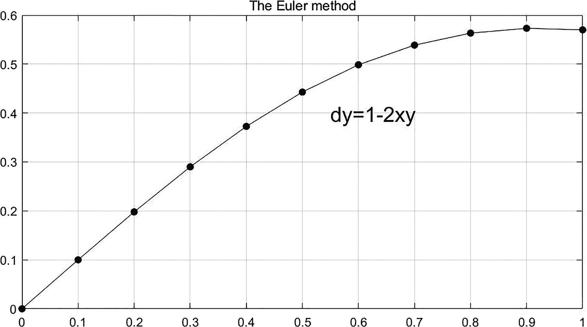

一张使用欧拉法求解方程 d y = 1 - 2 x y 的折线图，趋势呈上升状态，图上标记了 11 个节点。

**图 7-3** 使用欧拉法求解初值问题的解

```
y(0.000000) = [0.000000]
y(0.100000) = [0.100000]
y(0.200000) = [0.198000]
y(0.300000) = [0.290080]
y(0.400000) = [0.372675]
y(0.500000) = [0.442861]
y(0.600000) = [0.498575]
y(0.700000) = [0.538746]
y(0.800000) = [0.563322]
y(0.900000) = [0.573190]
y(1.000000) = [0.570016]
```

`ODESolver` 类用于求解一阶初值问题。其签名如下：

```java
public interface ODESolver {
    /**
     * 求解初值问题。
     *
     * @param ivp 初值问题
     * @return 解
     */
    ODESolution solve(ODE1stOrder ivp);
}
```

### 7.1.2 龙格-库塔族

在推导欧拉公式和龙格-库塔方法时，我们略去了泰勒展开中的 `o(h²)` 项。通常，积分公式中包含的项数越多（阶数越高），公式的精度就越高。假设使用前 `p` 阶导数构造一个显式公式：

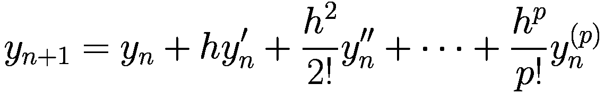

阶数为 `o(h^(p + 1))` 的局部截断误差如下：

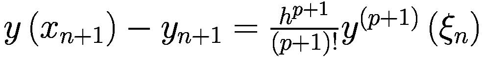，其中 `ξ[n]` ∈ (`x[n]`, `x[n + 1]`)

该积分公式具有 `p` 阶精度。显式欧拉公式的精度为 1 阶；隐式欧拉公式同样为 1 阶。梯形公式具有二阶精度。然而，在实际应用中，这种构造方法很少使用，因为寻找 `y` 的高阶导数并不容易。

龙格-库塔方法采用了不同的思路。根据中值定理，存在 0 < `θ` < 1 使得：

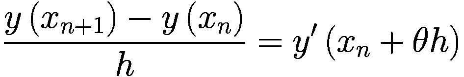

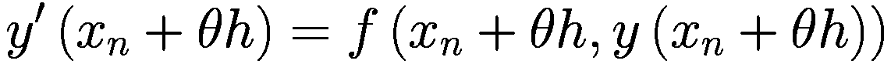

因此可得：

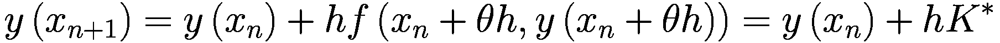

将 `K* = f (x[n] + θh, y(x[n] + θh))` 称为区间 [`x[n]`, `x[n + 1]`] 上的平均斜率。通过为 `K*` 选择不同的定义，可以构造出不同的积分公式。若 `θ = 0`，则取点 (`x[n]`, `y[n]`) 处的斜率作为整个区间 [`x[n]`, `x[n + 1]`] 的平均斜率。此时 `K* = f (x[n], y[n])`，积分公式为 `y[n + 1] = y[n] + hf (x[n], y[n])`。这就是欧拉公式。若 `θ = 1`，则取点 (`x[n + 1]`, `y[n + 1]`) 处的斜率作为整个区间 [`x[n]`, `x[n + 1]`] 的平均斜率。此时 `K* = f (x[n + 1], y[n + 1])`，积分公式为 `y[n + 1] = y[n] + hf (x[n + 1], y[n + 1])`。这就是隐式/后向欧拉公式。令 `K[1] = f (x[n], y[n])` 且 `K[2] = f (x[n + 1], y[n] + hf (x[n], y[n]))`。定义 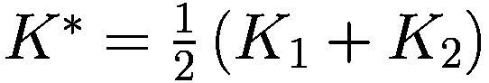。`K*` 是点 (`x[n]`, `y[n]`) 和 (`x[n + 1]`, `y[n + 1]`) 处斜率的算术平均值。将其用作整个区间 [`x[n]`, `x[n + 1]`] 的平均斜率，则相应的积分公式为梯形公式，即 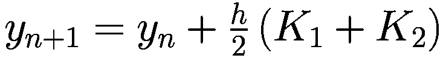。我们知道梯形公式具有二阶精度，而显式和隐式欧拉公式只有一阶精度。由此可见，使用区间内两点处斜率的算术平均值作为积分区间的平均斜率，比单纯使用任一端点处的斜率更为精确。因此可以设想，如果使用 [`x[n]`, `x[n + 1]`] 内多点处斜率的加权平均值作为平均斜率 `K*`，就有可能构造出精度更高的积分公式。这便是龙格-库塔方法的基本思想。

### 二阶龙格-库塔法

梯形公式是二阶龙格-库塔法的一个特例。它利用两个端点`x[n]`和`x[n + 1]`处的斜率值，并让区间平均斜率`K^*`成为它们的线性组合。你不必非要使用端点`x[n + 1]`。假设`0 < p ≤ 1`，`K[1] = f(x[n], y[n])`，且 `K[2] = f(x[n + p], y[n + p])`，其中`x[n + p] ∈ (x[n], x[n + 1]]`，而`y[n + p] = y[n] + phf(x[n], y[n])`。积分公式如下：

```
⎧ K₁ = f(xₙ, yₙ) = fₙ
⎨ K₂ = f(xₙ₊ₚ, yₙ + phK₁)
⎩ yₙ₊₁ = yₙ + h(λ₁K₁ + λ₂K₂)
```

该系统有三个待定参数：`λ[1]`、`λ[2]`、`p`。你需要找到一组参数，使该积分公式达到二阶精度。首先，将`K[2]`作为二元函数，在点`(x[n], y[n])`处进行泰勒展开。

```
K₂ = f(xₙ, yₙ) + ph(fₓ + f_y) + ...
```

将`K[1]`和`K[2]`代入积分公式，得到：

```
yₙ₊₁ = yₙ + h(λ₁K₁ + λ₂K₂)
= yₙ + h[λ₁fₙ + λ₂fₙ + λ₂ph(fₓ + f_y) + ...]
= yₙ + (λ₁ + λ₂)hfₙ + λ₂ph²(fₓ + f_y) + ...
```

将系数与二阶泰勒展开式进行对比，得到：

```
yₙ₊₁ = yₙ + hyₙ′ + (h²/2!)yₙ′′
```

可见，三个待定参数`λ[1]`、`λ[2]`和`p`必须满足以下条件：

```
⎧ λ₁ + λ₂ = 1
⎨ λ₂p = 1/2
```

任何满足上述条件的积分公式都称为*二阶*龙格-库塔公式。梯形公式是`λ₁ = λ₂ = 1/2`且`p = 1`时的特例。

### 三阶龙格-库塔法

你可以使用三个点而不是两个点来进一步提高精度。设区间`[x[n], x[n + 1]]`上的三个点为`x[n]`、`x[n + p]`和`x[n + q]`，其中`0 < p < q ≤ 1`。设这三个点的斜率分别为`K[1]`、`K[2]`和`K[3]`。平均斜率`K^*`是它们的线性组合。则定义如下：

```
⎧ K₁ = f(xₙ, yₙ)
⎨ K₂ = f(xₙ₊ₚ, yₙ + phK₁)
⎩ K₃ = f(xₙ₊_q, yₙ₊_q) = f(xₙ + qh, yₙ + qh(rK₁ + sK₂))
```

注意，对于`K[3]`，`y[n + q]`是根据`K[1]`和`K[2]`的平均斜率定义的。三阶积分公式如下：

```
yₙ₊₁ = yₙ + h(λ₁K₁ + λ₂K₂ + λ₃K₃)
```

待定参数为`λ[1]`、`λ[2]`、`λ[3]`、`p`、`q`、`r`和`s`。你可以重复推导二阶公式时的类似过程来推导三阶公式。首先对`K[1]`、`K[2]`和`K[3]`进行泰勒展开，并将它们代入`y[n + 1]`。通过对比`y[n + 1]`的三阶泰勒展开式的系数，可以推导出参数必须满足的方程组。

```
⎧ r + s = 1
⎪ λ₁ + λ₂ + λ₃ = 1
⎨ λ₂p + λ₃q = 1/2
⎪ λ₂p² + λ₃q² = 1/3
⎩ λ₃pqs = 1/6
```

任何满足这些条件的积分公式都称为*三阶龙格-库塔公式*。

### 高阶龙格-库塔法

一般来说，任意阶的龙格-库塔积分公式都表示为多个选定点斜率的线性组合。

```
⎧ yₙ₊₁ = yₙ + h Σᵢ₌₁ʳ λᵢKᵢ
⎨ K₁ = f(xₙ, yₙ)
⎩ Kᵢ = f(xₙ + pᵢh, yₙ + h Σⱼ₌₁ⁱ⁻¹ rᵢⱼKⱼ), i = 2, 3, …, r
```

例如，当`r = 4`时，四阶龙格-库塔公式如下：

```
⎧ yₙ₊₁ = yₙ + (h/6)(K₁ + 2K₂ + 2K₃ + K₄)
⎨ K₁ = f(xₙ, yₙ)
⎪ K₂ = f(xₙ + h/2, yₙ + (h/2)K₁)
⎪ K₃ = f(xₙ + h/2, yₙ + (h/2)K₂)
⎩ K₄ = f(xₙ + h, yₙ + hK₃)
```

可以证明，其截断误差为`o(h⁵)`。

需要注意的是，由于龙格-库塔公式是通过泰勒展开推导出来的，它们假设解函数`y(x)`足够光滑，并且存在高阶导数。否则，使用高阶龙格-库塔公式可能不如使用低阶龙格-库塔公式有效。

NM Dev 支持一系列龙格-库塔公式来求解常微分方程，从一阶到十阶。`RungeKutta`类接受一个实现龙格-库塔公式的`RungeKuttaStepper`对象。例如，`RungeKutta2`实现了二阶龙格-库塔积分公式。`RungeKutta`的签名如下：

```java
/**
 * 使用给定的积分器和固定步长构造一个龙格-库塔算法。
 *
 * @param stepper 积分器算法
 * @param h       固定步长
 */
public RungeKutta(RungeKuttaStepper stepper, final double h)
```

以下代码使用多种龙格-库塔公式，以数值方式求解`x ∈ [0, 1]`上的这个初值问题：

```
⎧ y′ = y - x + 1
⎨ y(0) = 1
```

解析解如下：

```
y = eˣ + x
```

```kotlin
// 定义要求解的常微分方程（ODE）
val dy: DerivativeFunction = object : DerivativeFunction {
    override fun evaluate(x: Double, v: Vector): Vector {
        val y: Double = v.get(1)
        val dy: Double = y - x + 1
        return DenseVector(dy)
    }
    override fun dimension(): Int {
        return 1
    }
}
// 初始条件，y0=1
val y0: Vector = DenseVector(1.0)
val x0: Double = 0.0
val x1: Double = 1.0 // 求解域
val h: Double = 0.1 // 步长
// 解析解
val y: UnivariateRealFunction = object : AbstractUnivariateRealFunction() {
    override fun evaluate(x: Double): Double {
        val y: Double = exp(x) + x
        return y
    }
}
// 定义一个初值问题（IVP）
val ivp: ODE1stOrder = ODE1stOrder(dy, y0, x0, x1)
// 使用一阶龙格-库塔公式
val stepper1: RungeKuttaStepper = RungeKutta1()
val solver1: ODESolver = RungeKutta(stepper1, h)
val soln1: ODESolution = solver1.solve(ivp)
// 使用二阶龙格-库塔公式
val stepper2: RungeKuttaStepper = RungeKutta2()
val solver2: ODESolver = RungeKutta(stepper2, h)
val soln2: ODESolution = solver2.solve(ivp)
// 使用三阶龙格-库塔公式
val stepper3: RungeKuttaStepper = RungeKutta3()
val solver3: ODESolver = RungeKutta(stepper3, h)
val soln3: ODESolution = solver3.solve(ivp)
val x: DoubleArray = soln1.x()
val y1: Array = soln1.y()
val y2: Array = soln2.y()
val y3: Array = soln3.y()
for (i in x.indices) {
    val yx: Double = y.evaluate(x[i]) // 解析解
    val diff1: Double = yx - y1[i].get(1) // 一阶误差
    val diff2: Double = yx - y2[i].get(1) // 二阶误差
    val diff3: Double = yx - y3[i].get(1) // 三阶误差
    println(
        String.format("y(%f) = %s (%.16f) = %s (%.16f) = %s (%.16f)",
            x[i], y1[i], diff1,
            y2[i], diff2,
            y3[i], diff3
        ))
}
```

输出结果如下：

```
y(0.000000) = [1.000000]  (0.0000000000000000); = [1.000000]  (0.0000000000000000); = [1.000000]  (0.0000000000000000)
y(0.100000) = [1.200000]  (0.0051709180756478); = [1.205000]  (0.0001709180756477); = [1.205167]  (0.0000042514089811)
y(0.200000) = [1.410000]  (0.0114027581601699); = [1.421025]  (0.0003777581601696); = [1.421393]  (0.0000093970490587)
y(0.300000) = [1.631000]  (0.0188588075760032); = [1.649233]  (0.0006261825760030); = [1.649843]  (0.0000155779880402)
y(0.400000) = [1.864100]  (0.0277246976412704); = [1.890902]  (0.0009226470162702); = [1.891802]  (0.0000229550749731)
y(0.500000) = [2.110510]  (0.0382112707001285); = [2.147447]  (0.0012745047595035); = [2.148690]  (0.0000317115406090)
y(0.600000) = [2.371561]  (0.0505578003905094); = [2.420429]  (0.0016901240261187); = [2.422077]  (0.0000420559260470)
y(0.700000) = [2.648717]  (0.0650356074704770); = [2.711574]  (0.0021790200878256); = [2.713698]  (0.0000542253798352)
y(0.800000) = [2.943589]  (0.0819521184924685); = [3.022789]  (0.0027520039346389); = [3.025472]  (0.0000684893686271)
y(0.900000) = [3.257948]  (0.1016554201569502); = [3.356182]  (0.0034213495205484); = [3.359518]  (0.0000851538519182)
y(1.000000) = [3.593742]  (0.1245393683590454); = [3.714081]  (0.0042009818508215); = [3.718177]  (0.0001045659774346)
```

上述输出展示了一阶、二阶和三阶龙格-库塔公式的近似值。近似值位于方括号内，误差位于圆括号内。请注意，阶数越高的公式得出的结果越精确（误差越小）。

图 7-4 比较了解析解与一阶龙格-库塔近似的结果。

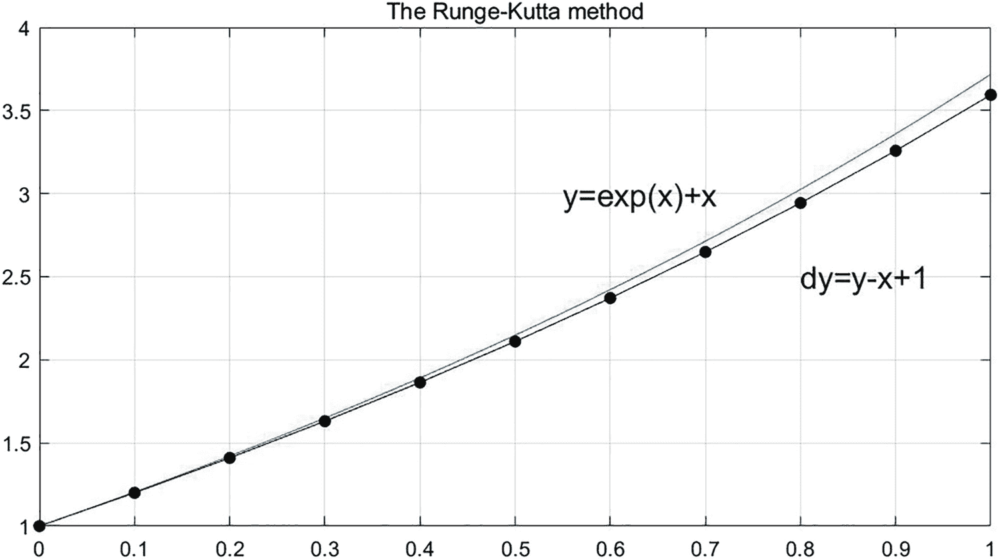

一幅呈上升趋势的折线图。顶部文字为“龙格-库塔方法”。该图比较了两个方程的曲线。`y` 等于 `x` 的指数 + `x`，`dy` 等于 `y` 减去 `x` + `1`。

**图 7-4** 比较解析解与一阶龙格-库塔

图 7-5 比较了解析解（蓝色）与一阶（黑色）、二阶（红色）和三阶（绿色）龙格-库塔近似的结果。二阶和三阶结果非常理想。由于它们几乎与精确解（蓝色线）重叠，因此线条几乎不可见。

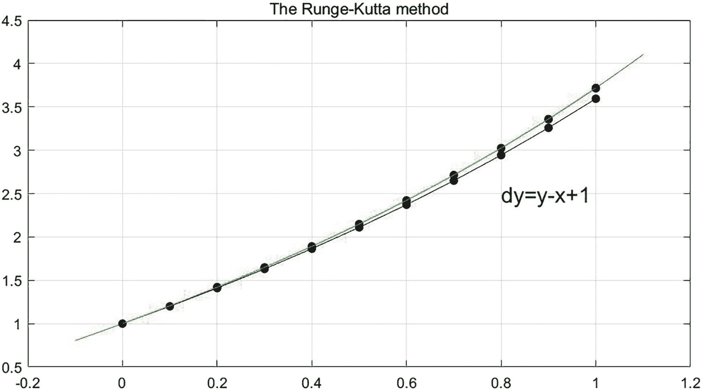

一幅呈上升趋势的折线图。顶部文字为“龙格-库塔方法”。图中包含两条曲线，每条有 11 个节点。方程显示 `dy` 等于 `y` 减去 `x` + `1`。

**图 7-5** 比较解析解与龙格-库塔

### 7.1.3 收敛性

对于单步法，若对于固定的 `x[n] = x[0] + nh`，积分公式 `y[n + 1] = y[n] + hϕ(x[n], y[n], h)` 满足以下条件，则称其收敛：

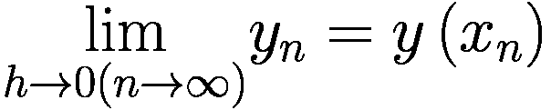

例如，考虑以下方程：

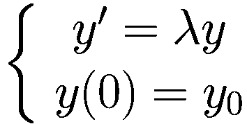

该常微分方程的欧拉公式如下：

`y[n + 1] = y[n] + hλy[n] = (1 + λh)y[n]`

因此，可得到：

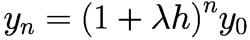

设 `x[0] = 0` 且 `x[n] = nh`，如下所示：

![$$ {y}_n={\left[{\left(1+\lambda h\right)}^{\frac{1}{\lambda h}}\right]}^{\lambda h n}{y}_0={\left[{\left(1+\lambda h\right)}^{\frac{1}{\lambda h}}\right]}^{\lambda {x}_n}{y}_0 $$](images/528380_1_En_7_Chapter/528380_1_En_7_Chapter_TeX_Equba.png)

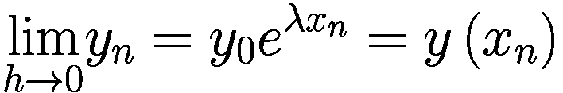

因此，对于此常微分方程，欧拉公式是收敛的。

假设某个单步法具有 `p` 阶精度。同时假设增量函数 `ϕ(x, y, h)` 关于 `y` 满足利普希茨条件。也就是说，对于任意 `y` 和 `ȳ`，存在常数 `L > 0`，使得以下条件成立：

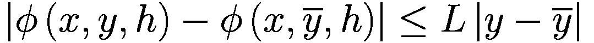

可以证明，该单步法收敛，且整体截断误差如下：

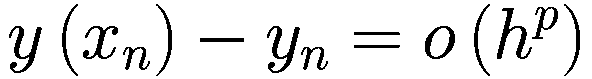

你可以应用此定理来证明梯形公式的收敛性。梯形公式的增量函数如下：

![$$ \phi \left(x,y,h\right)=\frac{1}{2}\left[f\left(x,y\right)+f\left(x+h,y+ hf\left(x,y\right)\right)\right] $$](images/528380_1_En_7_Chapter/528380_1_En_7_Chapter_TeX_Eqube.png)

以及：

![$$ \phi \left(x,\overline{y},h\right)=\frac{1}{2}\left[f\left(x,\overline{y}\right)+f\left(x+h,\overline{y}+ hf\left(x,\overline{y}\right)\right)\right] $$](images/528380_1_En_7_Chapter/528380_1_En_7_Chapter_TeX_Equbf.png)

将两式相减，得到：


由于函数 `f(x, y)` 关于 `y` 满足利普希茨条件，该不等式变为：

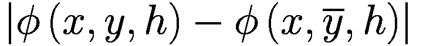

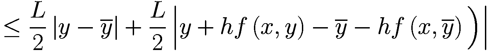

整理各项后得到：

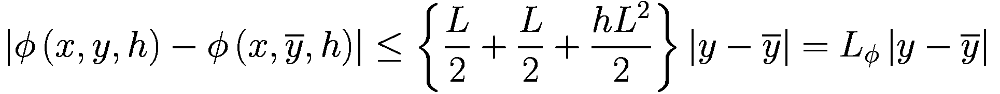

因此，梯形公式的增量函数关于 `y` 满足利普希茨条件，从而该公式是收敛的。

### 7.1.4 稳定性

如果一个常微分方程的解的误差（真实解与近似解之间的差异）不增长，则称该解是稳定的。

例如，考虑这个简单的常微分方程：

`y = λy, λ < 0`

其解析解如下：

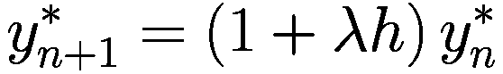

使用欧拉公式，数值解如下：

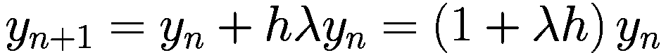

定义误差如下：

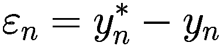

误差的递推关系如下：

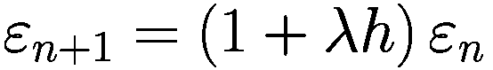

确保稳定性的条件如下：

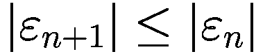

即：

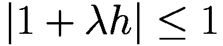

因此，（显式）欧拉公式的稳定区域如下：

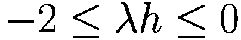

你可以对隐式欧拉公式进行类似的分析。

其解析解如下：

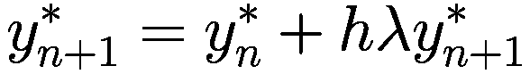

使用隐式欧拉公式，数值解如下：

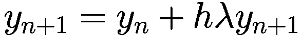

稳定性方程（由两式相减得到）如下：

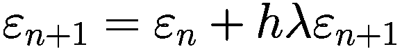

整理各项后，得到：

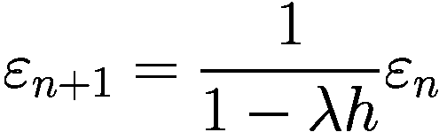

由于 `λ < 0`，对于任意步长 `h > 0`，有 `1/(1-λh) ≤ 1`。也就是说，稳定区域为 `-∞ < λh ≤ 0` 或 `h > 0`。隐式欧拉公式是无条件稳定的。显式和隐式欧拉公式都具有一阶精度。后者更受青睐，因为它是无条件稳定的，无论步长大小如何；而前者仅在 `h` 的特定取值范围内稳定。事实上，在（常微分和偏微分）方程的数值解法中，许多隐式方法都是无条件稳定的。例如，用于求解偏微分方程的 `Crank-Nicolson` 方法就是一种隐式方法，并且是无条件稳定的。因此，通常更倾向于使用隐式方法而非显式方法。

## 7.2 线性多步法

单步法（例如欧拉法）的局限性在于，它仅利用前一个节点处的信息（函数值和导数值）来计算当前节点的值。虽然像龙格-库塔公式这类方法会使用多个点，但它们仅将这些点作为中间值，在进入下一个节点之前就将其丢弃。相比之下，多步法试图通过保留并使用先前节点计算出的信息（函数值和导数值）来提高精度。对于线性多步法，它使用数个先前节点处的函数值和导数值的线性组合来确定当前节点的值。通用线性多步法的积分公式如下：

```
y_{n+1} = Σ_{k=0}^r α_k y_{n-k} + h Σ_{k=-1}^r β_k y'_{n-k}
```

```
y'_{n-k} = f(x_{n-k}, y_{n-k})
```

如果 `β_{-1} = 0`，则该积分公式是显式公式（`y_{n+1}` 不出现于等号右侧）；如果 `β_{-1} ≠ 0`，则该公式是隐式公式。通过适当选择未定参数，可以构建一族线性多步公式。与推导龙格-库塔公式族类似，可以通过与泰勒展开式进行系数比较来确定这些参数。令

```
y_{n-k} = y(x_{n-k}) = y(x_n - kh)
```

```
y'_{n-k} = y'(x_{n-k}) = y'(x_n - kh)
```

对 `y_{n-k}` 和 `y'_{n-k}` 在 `x_n` 处进行泰勒展开。

```
y_{n-k} = Σ_{j=0}^p [(-kh)^j / j!] y_n^{(j)} + [(-kh)^{p+1} / (p+1)!] y_n^{(p+1)} + ...
```

```
y'_{n-k} = Σ_{j=0}^p [(-kh)^{j-1} / (j-1)!] y_n^{(j)} + [(-kh)^p / p!] y_n^{(p+1)} + ...
```

将上述展开式代入积分公式并按项重新整理，如下所示：

```
y_{n+1} = (Σ_{k=0}^r α_k) y_n + Σ_{j=1}^p (h^j / j!)[Σ_{k=1}^r (-k)^j α_k + j Σ_{k=-1}^r (-k)^{j-1} β_k] y_n^{(j)} + (h^{p+1} / (p+1)!)[Σ_{k=1}^r (-k)^{p+1} α_k + (p+1) Σ_{k=-1}^r (-k)^p β_k] y_n^{(p+1)} + ...
```

你也可以对 `y(x_{n+1})` 在 `x_n` 处进行泰勒展开，得到以下结果：

```
y(x_{n+1}) = Σ_{j=0}^p (h^j / j!) y_n^{(j)} + (h^{p+1} / (p+1)!) y_n^{(p+1)} + ...
```

为了使积分公式具有 `p` 阶精度（即局部截断误差为 `O(h^{p+1})`），需要使 `y_{n+1}` 与 `y(x_{n+1})` 直到 `h^p` 项的系数相匹配。以下参数方程组必须成立：

```
Σ_{k=0}^r α_k = 1
Σ_{k=1}^r (-k)^j α_k + j Σ_{k=-1}^r (-k)^{j-1} β_k = 1
```

局部截断误差如下：

```
y(x_{n+1}) - y_{n+1} = (h^{p+1} / (p+1)!)[1 - Σ_{k=1}^r (-k)^{p+1} α_k - (p+1) Σ_{k=-1}^r (-k)^p β_k] y_n^{(p+1)} + ...
```

### 7.2.1 Adams-Bashforth 方法

Adams-Bashforth 方法是线性多步法的一个族。让我们考虑一个使用四个步骤（即使用最后四个节点）的显式公式（即公式右侧不包含 `y_{n+1}`）。其积分公式（参数仍未确定）如下：

```
y_{n+1} = α_0 y_n + α_1 y_{n-1} + α_2 y_{n-2} + h(β_0 y'_n + β_1 y'_{n-1} + β_2 y'_{n-2} + β_3 y'_{n-3})
```

为了使该公式具有四阶精度（在线性多步法框架中设定 `r = 3`），系数必须满足以下条件：

```
α_0 + α_1 + α_2 = 1
-α_1 - 2α_2 + β_0 + β_1 + β_2 + β_3 = 1
α_1 + 4α_2 - 2β_1 - 4β_2 - 6β_3 = 1
-α_1 - 8α_2 + 3β_1 + 12β_2 + 27β_3 = 1
α_1 + 16α_2 - 4β_1 - 32β_2 - 108β_3 = 1
```

由于有七个未知数而只有五个方程，该方程组的解并不唯一。一种常见的约定是设定 `α_1 = α_2 = 0`。从而得到：

```
α_0 = 1, β_0 = 55/24, β_1 = -59/24, β_2 = 37/24, β_3 = -9/24
```

积分公式变为：

```
y_{n+1} = y_n + (h/24)(55f_n - 59f_{n-1} + 37f_{n-2} - 9f_{n-3})
```

```
f_{n-k} = f(x_{n-k}, y_{n-k})
```

这就是四步四阶 Adams-Bashforth 显式公式。

一阶公式与欧拉公式相同：

```
y_{k+1} = y_k + h f_k
```

二阶公式如下：

```
y_{k+1} = y_k + (h/2)[3f_k - f_{k-1}]
```

三阶公式如下：

```
y_{k+1} = y_k + (h/12)[23f_k - 16f_{k-1} + 5f_{k-2}]
```

尽管这些公式是显式的，因此计算起来很方便，但它们的稳定性较差。

### Adams-Bashforth 隐式公式

考虑如下的四步隐式公式（基本是用 `y'_{n+1}` 替换了 `y'_{n-3}`）：

```
y_{n+1} = α₀ y_n + α₁ y_{n-1} + α₂ y_{n-2} + h (β_{-1} y'_{n+1} + β₀ y'_n + β₁ y'_{n-1} + β₂ y'_{n-2})
```

为了使该积分公式具有四阶精度，系数应满足以下条件：

```
α₀ + α₁ + α₂ = 1
-α₁ - 2α₂ + β_{-1} + β₀ + β₁ + β₂ = 1
α₁ + 4α₂ + 2β_{-1} - 2β₁ - 4β₂ = 1
-α₁ - 8α₂ + 3β_{-1} + 3β₁ + 12β₂ = 1
α₁ + 16α₂ + 4β_{-1} - 4β₁ - 32β₂ = 1
```

这里有七个未知数，却只有五个方程，因此解不唯一。一种常见的约定是令 `α₁ = α₂ = 0`，然后得到：

```
α₀ = 1, β_{-1} = 9/24, β₀ = 19/24, β₁ = -5/24, β₂ = 1/24
```

积分公式变为：

```
y_{n+1} = y_n + (h/24) (9 f_{n+1} + 19 f_n - 5 f_{n-1} + f_{n-2})
```

```
f_{n-k} = f(x_{n-k}, y_{n-k})
```

一阶 Adams-Bashforth 隐式公式与隐式 Euler 公式相同：

```
y_{k+1} = y_k + h f_{k+1}
```

二阶公式与梯形公式相同：

```
y_{k+1} = y_k + (h/2) [f_{k+1} + f_k]
```

三阶公式如下：

```
y_{k+1} = y_k + (h/12) [5 f_{k+1} + 8 f_k - f_{k-1}]
```

请注意，Adams-Bashforth 公式不是自启动的。需要使用单步法（如 Runge-Kutta 公式）来计算前几个点。

NM Dev 支持前五阶的 Adams-Bashforth 公式。以下代码用于求解第 7.1.2.3 节中给出的同一初值问题：

```kotlin
// 定义要求解的 ODE
val dy: DerivativeFunction = object : DerivativeFunction {
    override fun evaluate(x: Double, v: Vector): Vector {
        val y: Double = v.get(1)
        val dy: Double = y - x + 1
        return DenseVector(dy)
    }
    override fun dimension(): Int {
        return 1
    }
}

// 初始条件，y0=1
val y0: Vector = DenseVector(1.0)
val x0: Double = 0.0
val x1: Double = 1.0 // 解域
val h: Double = 0.1 // 步长

// 解析解
val y: UnivariateRealFunction = object : AbstractUnivariateRealFunction() {
    override fun evaluate(x: Double): Double {
        val y: Double = exp(x) + x
        return y
    }
}

// 定义初值问题
val ivp: ODE1stOrder = ODE1stOrder(dy, y0, x0, x1)

// 使用一阶 Adams-Bashforth 公式
val solver1: ODESolver = AdamsBashforthMoulton(ABMPredictorCorrector1(), h)
val soln1: ODESolution = solver1.solve(ivp)

// 使用二阶 Adams-Bashforth 公式
val solver2: ODESolver = AdamsBashforthMoulton(ABMPredictorCorrector2(), h)
val soln2: ODESolution = solver2.solve(ivp)

// 使用三阶 Adams-Bashforth 公式
val solver3: ODESolver = AdamsBashforthMoulton(ABMPredictorCorrector3(), h)
val soln3: ODESolution = solver3.solve(ivp)

// 使用四阶 Adams-Bashforth 公式
val solver4: ODESolver = AdamsBashforthMoulton(ABMPredictorCorrector4(), h)
val soln4: ODESolution = solver4.solve(ivp)

// 使用五阶 Adams-Bashforth 公式
val solver5: ODESolver = AdamsBashforthMoulton(ABMPredictorCorrector5(), h)
val soln5: ODESolution = solver5.solve(ivp)

val x: DoubleArray = soln1.x()
val y1: Array = soln1.y()
val y2: Array = soln2.y()
val y3: Array = soln3.y()
val y4: Array = soln4.y()
val y5: Array = soln5.y()

for (i in x.indices) {
    val yx: Double = y.evaluate(x[i]) // 解析解
    val diff1: Double = yx - y1[i].get(1) // 一阶误差
    val diff2: Double = yx - y2[i].get(1) // 二阶误差
    val diff3: Double = yx - y3[i].get(1) // 三阶误差
    val diff4: Double = yx - y4[i].get(1) // 四阶误差
    val diff5: Double = yx - y5[i].get(1) // 五阶误差
    println(
        String.format("y(%f) = %s (%.16f) = %s (%.16f) = %s (%.16f) = %s (%.16f) = %s (%.16f)",
            x[i], y1[i], diff1,
            y2[i], diff2,
            y3[i], diff3,
            y4[i], diff4,
            y5[i], diff5
        ))
}
```

输出结果如下：

```
y(0.000000) = [1.000000]  (0.0000000000000000); = [1.000000]  (0.0000000000000000); = [1.000000]  (0.0000000000000000); = [1.000000]  (0.0000000000000000); = [1.000000]  (0.0000000000000000)
y(0.100000) = [1.210000]  (-0.0048290819243522); = [1.205000]  (0.0001709180756477); = [1.205000]  (0.0001709180756477); = [1.205000]  (0.0001709180756477); = [1.205000]  (0.0001709180756477)
y(0.200000) = [1.432100]  (-0.0106972418398301); = [1.421288]  (0.0001152581601698); = [1.421025]  (0.0003777581601696); = [1.421025]  (0.0003777581601696); = [1.421025]  (0.0003777581601696)
y(0.300000) = [1.667631]  (-0.0177721924239969); = [1.649813]  (0.0000454013260032); = [1.649443]  (0.0004159690343364); = [1.649443]  (0.0004159690343364); = [1.649443]  (0.0004159690343364)
y(0.400000) = [1.918070]  (-0.0262457123587299); = [1.891865]  (-0.0000404310306048); = [1.891369]  (0.0004556955886803); = [1.891369]  (0.0004556955886803); = [1.891369]  (0.0004556955886803)
y(0.500000) = [2.185058]  (-0.0363368843998719); = [2.148866]  (-0.0001448257883485); = [2.148222]  (0.0004994814440833); = [2.148222]  (0.0004994814440833); = [2.148222]  (0.0004994814440833)
y(0.600000) = [2.470415]  (-0.0482957517704916); = [2.422390]  (-0.0002707386487995); = [2.421571]  (0.0005474439430126); = [2.421571]  (0.0005474439430126); = [2.421571]  (0.0005474439430126)
y(0.700000) = [2.776160]  (-0.0624074454282342); = [2.714174]  (-0.0004215417743363); = [2.713153]  (0.0005999698250871); = [2.713153]  (0.0005999698250871); = [2.713153]  (0.0005999698250871)
y(0.800000) = [3.104538]  (-0.0789968412251016); = [3.026142]  (-0.0006010786985646); = [3.024883]  (0.0006574888333333); = [3.024883]  (0.0006574888333333); = [3.024883]  (0.0006574888333333)
y(0.900000) = [3.458037]  (-0.0984338132295521); = [3.360417]  (-0.0008137261840067); = [3.358883]  (0.0007204702609296); = [3.358883]  (0.0007204702609296); = [3.358883]  (0.0007204702609296)
y(1.000000) = [3.839421]  (-0.1211391576099716); = [3.719346]  (-0.0010644638780861); = [3.717492]  (0.0007894268678772); = [3.717492]  (0.0007894268678772); = [3.717492]  (0.0007894268678772)
```

输出显示了使用一阶、二阶、三阶、四阶和五阶 `Adams-Bashforth` 公式得到的近似值。近似值显示在方括号内，误差显示在圆括号内。请注意，阶数越高的公式能得到更精确的结果（误差更小）。对于此示例，三阶、四阶和五阶公式产生了相同的结果。