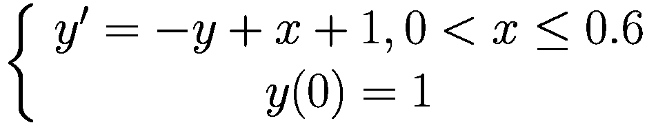
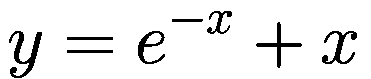
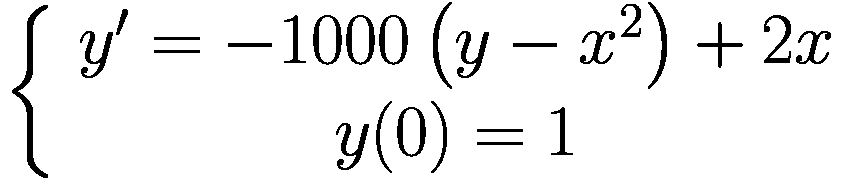
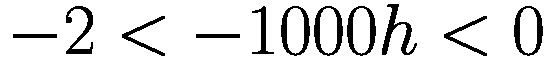
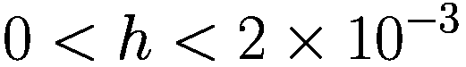

# 7.3 不同方法的比较

本节总结了使用本章介绍的不同方法求解以下初值问题的结果。该初值问题如下所示：

其解析解如下所示：

我们使用步长 `h = 0.1`，因此 `x[k] = kh` (`k = 0, 1, ..., 6`)。每种方法的计算结果和绝对误差如下表所示。

| **四步 Adams-Bashforth 公式** | | | |
| --- | --- | --- | --- |
| `n` | `x[n]` | **显式公式** | **隐式公式** |
| | | `y[n]` | ε | `y[n]` | ε |
| 4 | 0.4 | 1.070323 | 2.90e-06 | 1.07032 | 3.90e-07 |
| 5 | 0.5 | 1.106535 | 4.80e-06 | 1.10653 | 5.20e-07 |
| 6 | 0.6 | 1.148815 | 6.80e-06 | 1.148811 | 6.50e-07 |

| | **欧拉法** | **梯形公式** | **四阶龙格-库塔公式** |
| --- | --- | --- | --- |
| `x[n]` | `y[n]` | ε | `y[n]` | ε | `y[n]` | ε |
| --- | --- | --- | --- | --- | --- | --- |
| 0 | 1 | 0 | 1 | 0 | 1 | 0 |
| 0.1 | 1 | 4.80e-03 | 1.005 | 1.60e-04 | 1.0048375 | 8.00e-08 |
| 0.2 | 1.01 | 8.70e-03 | 1.019025 | 2.90e-04 | 1.0187309 | 1.50e-07 |
| 0.3 | 1.029 | 1.20e-03 | 1.041218 | 4.00e-04 | 1.04081842 | 2.00e-07 |
| 0.4 | 1.0561 | 1.40e-03 | 1.070802 | 4.80e-04 | 1.07032029 | 2.40e-07 |
| 0.5 | 1.09049 | 1.60e-03 | 1.107076 | 5.50e-04 | 1.10653093 | 2.70e-07 |
| 0.6 | 1.131441 | 1.80e-03 | 1.149404 | 5.90e-04 | 1.14881193 | 2.90e-07 |

通常，方法的阶数越高，解的精度越高。一阶的欧拉公式精度最低，而四阶龙格-库塔公式精度最高，实际上要好得多（1e-7 对 1e-3）。对于四阶 Adams-Bashforth 方法，隐式公式比显式公式略精确。

在计算量方面，四阶龙格-库塔方法的计算量最大。函数 `f` 在每一步中被求值四次。相比之下，精度相似的 Adams-Bashforth 方法仅对函数求值两次。因此，后者更可取。然而，它是一种四步法，因此初始值必须由另一种方法提供。其计算过程稍显复杂。

考虑使用欧拉公式求解以下初值问题：

注意，精确解给出 `y(1) = 1`。

取以下步长：`h = 10^(−1)`、`h = 10^(−2)`、`h = 10^(−3)` 和 `h = 10^(−4)`。结果如下表所示。首先，对于 `h = 10^(−1)` 和 `h = 10^(−2)`，结果完全失真。其次，从 `h = 10^(−3)` 到 `h = 10^(−4)`，计算工作量增加了十倍，但精度并未提高。`h = 10^(−4)` 及更小的步长是计算资源的浪费。

| `h` | `y` |
| --- | --- |
| 10^(−1) | 0.904382 × 10¹⁶ |
| 10^(−2) | >10³⁸ |
| 10^(−3) | 0.999999000001 |
| 10^(−4) | 0.999999000000 |

`h = 10^(−1)` 和 `h = 10^(−2)` 得到错误结果的原因在于稳定性区域。如第 7.1.4 节所述，`h` 需要满足以下条件：

或者等价地：

前两个步长不在稳定性区域内。

这些例子表明，在选择合适的求解微分方程的方法和参数时，有许多需要考虑的因素。这些选择会影响精度、计算工作量和稳定性。当步长过大时，解可能失真；当步长过小时，会不必要地增加计算量。良好的选择不仅取决于所使用的数值方法，还取决于待解微分方程的特性。

