# 7.4 常微分方程组与高阶常微分方程

考虑一个由 `N` 个一阶常微分方程及其初始条件组成的系统，如下所示：


为了求解此常微分方程组，您可以这样写：

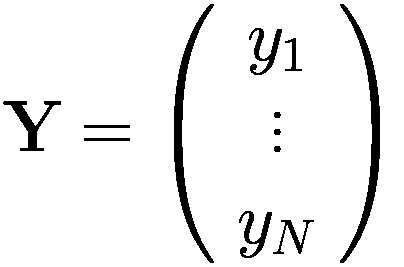

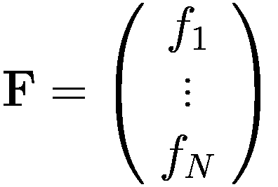

于是，该常微分方程组可以写成向量形式：

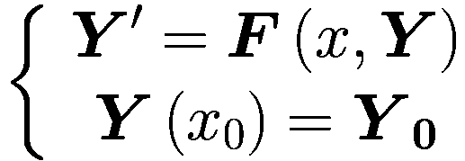

注意，该初值问题与本章讨论的其他常微分方程形式相同，只是变量和函数现在是向量。NM Dev 库中的类 `DerivativeFunction` 和 `ODE1stOrder` 支持向量形式。因此，您可以应用所有方法求解常微分方程组。例如，向量形式的欧拉公式如下：

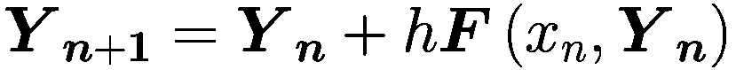

其分量形式如下：


例如，以下代码求解了这个常微分方程组：

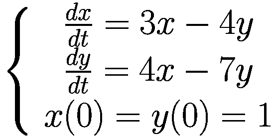

其解析解如下：

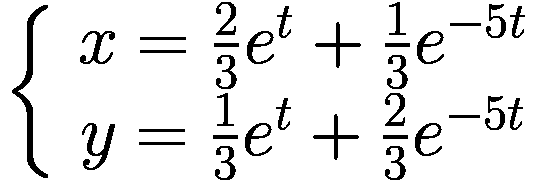


```kotlin
// 定义需要求解的常微分方程组
val dY: DerivativeFunction = object : DerivativeFunction {
override fun evaluate(t: Double, v: Vector): Vector {
val x: Double = v.get(1)
val y: Double = v.get(2)
val dx: Double  = 3.0 * x - 4.0 * y
val dy: Double  = 4.0 * x - 7.0 * y
return DenseVector(dx, dy)
}
override fun dimension(): Int {
return 2
}
}
// 初始条件，x0 = y0 = 1
val Y0: Vector = DenseVector(1.0, 1.0)
val x0: Double = 0.0
val x1: Double = 1.0 // 求解域
val h: Double = 0.1 // 步长
// 解析解
val F: RealVectorFunction = object : AbstractRealVectorFunction(1, 2) {
override fun evaluate(v: Vector): Vector {
val t: Double = v.get(1)
val x: Double = 2.0 / 3 * exp(t) + 1.0 / 3 * exp(-5.0 * t)
val y: Double = 1.0 / 3 * exp(t) + 2.0 / 3 * exp(-5.0 * t)
return DenseVector(x, y)
}
}
// 定义一个初值问题
val ivp: ODE1stOrder = ODE1stOrder(dY, Y0, x0, x1)
// 使用欧拉法构造常微分方程求解器
val solver: ODESolver = EulerMethod(h)
// 求解常微分方程
val soln: ODESolution = solver.solve(ivp)
// 打印离散点上的解函数 y
val t: DoubleArray = soln.x()
val v: Array = soln.y()
for (i in t.indices) {
println(String.format(
"y(%f) = %s vs %s",
t[i],
v[i],
F.evaluate(DenseVector(t[i]))
))
}
```

输出结果如下：

```
y(0.000000) = [1.000000, 1.000000]  vs [1.000000, 1.000000]
y(0.100000) = [0.900000, 0.700000]  vs [0.938957, 0.772744]
y(0.200000) = [0.890000, 0.570000]  vs [0.936895, 0.652387]
y(0.300000) = [0.929000, 0.527000]  vs [0.974283, 0.598706]
y(0.400000) = [0.996900, 0.529700]  vs [1.039662, 0.587498]
y(0.500000) = [1.084090, 0.557670]  vs [1.126509, 0.604297]
y(0.600000) = [1.186249, 0.600937]  vs [1.231342, 0.640564]
y(0.700000) = [1.301749, 0.654781]  vs [1.352568, 0.691382]
y(0.800000) = [1.430361, 0.717134]  vs [1.489799, 0.754057]
y(0.900000) = [1.572616, 0.787285]  vs [1.643438, 0.827274]
y(1.000000) = [1.729487, 0.865232]  vs [1.814434, 0.910586]
```

第一列向量为数值解，第二列包含解析解。你可以使用其他更高级的方法来提升精度。

考虑一个包含高阶导数的常微分方程，如下所示：


你可以通过设置 `y[1] = y`，`y[2] = y'`，……，`y[m] = y^(m-1)`，将这个*m*阶常微分方程转化为一阶常微分方程组。具体示例如下：

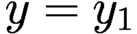

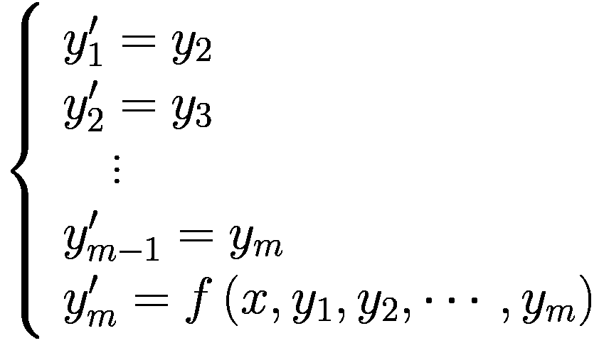

你可以使用 `DerivativeFunction` 和 `ODE1stOrder` 结合任意 NM Dev 常微分方程求解器，来求解一阶常微分方程组。

例如，以下代码求解了这个二阶常微分方程：

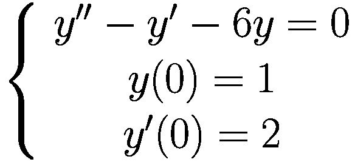

其解析解如下：

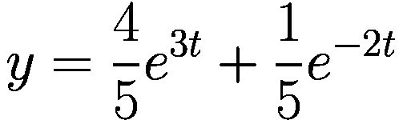

你可以将这个初值问题重写为一阶常微分方程组的形式。  
令 `y[1] = y` 和 `y[2] = y'`，得到如下结果：

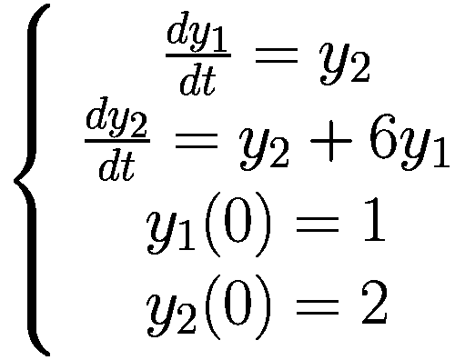

我们先用欧拉法求解这个方程组。

```kotlin
// 定义需要求解的等价常微分方程组
val dY: DerivativeFunction = object : DerivativeFunction {
override fun evaluate(t: Double, v: Vector): Vector {
val y_1: Double= v.get(1)
val y_2: Double= v.get(2)
val dy_1: Double = y_2
val dy_2: Double = y_2 + 6.0 * y_1
return DenseVector(dy_1, dy_2)
}
override fun dimension(): Int {
return 2
}
}
// 初始条件，y1(0) = 1, y2(0) = 2
val Y0: Vector = DenseVector(1.0, 2.0)
val t0: Double = 0.0
val t1: Double = 1.0 // 求解域
val h: Double = 0.1 // 步长
// 解析解
val f: UnivariateRealFunction = object : AbstractUnivariateRealFunction() {
override fun evaluate(t: Double): Double {
var f: Double = 0.8 * exp(3.0 * t)
f += 0.2 * exp(-2.0 * t)
return f
}
}
// 定义一个初值问题
val ivp: ODE1stOrder = ODE1stOrder(dY, Y0, t0, t1)
// 使用欧拉法构造常微分方程求解器
val solver: ODESolver = EulerMethod(h)
// 使用三阶龙格-库塔公式构造常微分方程求解器
// val stepper3: RungeKuttaStepper = RungeKutta3()
// val solver: ODESolver = RungeKutta(stepper3, h)
// 求解常微分方程
val soln: ODESolution = solver.solve(ivp)
// 打印离散点上的解函数 y
val t: DoubleArray = soln.x()
val v: Array = soln.y()
for (i in t.indices) {
val y1: Double = v[i].get(1) // 数值解
println(String.format(
"y(%f) = %f vs %f",
t[i],
y1,
f.evaluate(t[i])
))
}
```

输出结果如下：

```
y(0.000000) = 1.000000 vs 1.000000
y(0.100000) = 1.200000 vs 1.243633
y(0.200000) = 1.480000 vs 1.591759
y(0.300000) = 1.860000 vs 2.077445
y(0.400000) = 2.366800 vs 2.745959
y(0.500000) = 3.035880 vs 3.658927
y(0.600000) = 3.913876 vs 4.899957
y(0.700000) = 5.061824 vs 6.582255
y(0.800000) = 6.559400 vs 8.858920
y(0.900000) = 8.510443 vs 11.936845
y(1.000000) = 11.050154 vs 16.095497
```

请注意，使用欧拉公式的精度非常差。（我原以为是我的代码有 bug，但没发现任何问题。）

让我们改用三阶龙格-库塔公式再试一次。

```kotlin
// 定义需要求解的等价常微分方程组
val dY: DerivativeFunction = object : DerivativeFunction {
override fun evaluate(t: Double, v: Vector): Vector {
val y_1: Double= v.get(1)
val y_2: Double= v.get(2)
val dy_1: Double = y_2
val dy_2: Double = y_2 + 6.0 * y_1
return DenseVector(dy_1, dy_2)
}
override fun dimension(): Int {
return 2
}
}
// 初始条件，y1(0) = 1, y2(0) = 2
val Y0: Vector = DenseVector(1.0, 2.0)
val t0: Double = 0.0
val t1: Double = 1.0 // 求解域
val h: Double = 0.1 // 步长
// 解析解
val f: UnivariateRealFunction = object : AbstractUnivariateRealFunction() {
override fun evaluate(t: Double): Double {
var f: Double = 0.8 * exp(3.0 * t)
f += 0.2 * exp(-2.0 * t)
return f
}
}
// 定义一个初值问题
val ivp: ODE1stOrder = ODE1stOrder(dY, Y0, t0, t1)
// 使用欧拉法构造常微分方程求解器
// ODESolver solver = EulerMethod(h)
// 使用三阶龙格-库塔公式构造常微分方程求解器
val stepper3: RungeKuttaStepper = RungeKutta3()
val solver: ODESolver = RungeKutta(stepper3, h)
// 求解常微分方程
val soln: ODESolution = solver.solve(ivp)
// 打印离散点上的解函数 y
val t: DoubleArray = soln.x()
val v: Array = soln.y()
for (i in t.indices) {
val y1: Double = v[i].get(1) // 数值解
println(String.format(
"y(%f) = %f vs %f",
t[i],
y1,
f.evaluate(t[i])
))
}
```

输出结果如下：


```
y(0.000000) = 1.000000 vs 1.000000
y(0.100000) = 1.243333 vs 1.243633
y(0.200000) = 1.590963 vs 1.591759
y(0.300000) = 2.075850 vs 2.077445
y(0.400000) = 2.743108 vs 2.745959
y(0.500000) = 3.654136 vs 3.658927
y(0.600000) = 4.892215 vs 4.899957
y(0.700000) = 6.570082 vs 6.582255
y(0.800000) = 8.840160 vs 8.858920
y(0.900000) = 11.908375 vs 11.936845
y(1.000000) = 16.052815 vs 16.095497
```

使用龙格-库塔法得到的结果令人满意。

