# 8. 偏微分方程

偏微分方程（PDE）是在一个方程中将多元函数的值与其各个偏导数关联起来的等式。上一章讨论的常微分方程是偏微分方程的一个子类，因为常微分方程处理的是单变量函数。偏微分方程比常微分方程难解得多，因为一个简单的 PDE 就可能允许存在一大类解。例如，对于这个简单的 PDE：

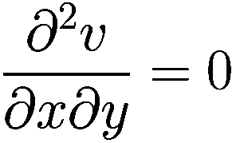

对于任意单变量函数 `f` 和 `g`，任何形如 `v(x, y) = f(x) + g(y)` 的函数都满足该方程。这远远超出了 ODE 解公式中通常允许自由选择一些数值或系数的范围。在 PDE 的研究中，通常可以自由选择函数。

一般来说，除了少数几类问题外，偏微分方程很少能解析求解。大多数 PDE 都没有通用的公式。因此，现代数学和科学研究中有大量关于用数值方法近似求解特定偏微分方程的研究。偏微分方程在数学、科学和工程学中无处不在。例如，它们是现代科学理解声音、热量、扩散、静电学、电动力学、流体动力学、空气动力学、弹性力学、广义相对论和量子力学的基础。许多纯数学领域的问题，如微分几何和变分法，也会引出偏微分方程。千禧年问题^(⁷)之一就是证明著名的偏微分方程——纳维-斯托克斯方程的存在性和唯一性。偏微分方程是一个非常庞大的主题。在本章中我们甚至无法浅尝辄止。我们将简要讨论偏微分方程的一个小子类（即二阶线性 PDE），并解释如何使用一种特定的数值方法（即有限差分法）来求解它们。

## 8.1 二阶线性 PDE

二阶 PDE 具有如下形式：

根据系数 `a(*)`、`b(*)`、`c(*)`、`d(*)`、`e(*)`、`f(*)` 和 `g(*)` 的函数形式，可以将其分为三类不同的类别。

如果系数仅依赖于变量而非导数，则该 PDE 是线性偏微分方程。即：

如果系数依赖于变量和低阶导数，则该 PDE 是拟线性偏微分方程。即：

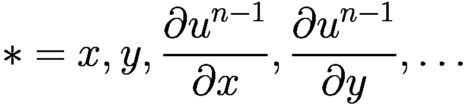

如果系数依赖于最高阶导数，则该 PDE 是非线性偏微分方程。即：

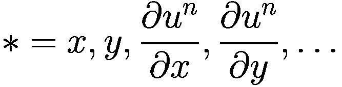

### 8.1.1 抛物型方程

如果满足以下条件，则二阶 PDE 是抛物型形式：

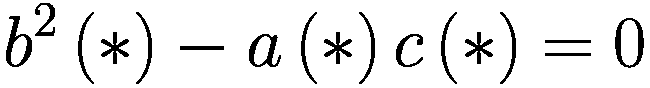

抛物型 PDE 最简单且最著名的例子之一是一维热方程，如下所示：

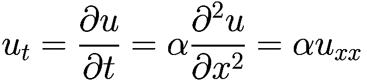

`u(t, x)` 是时刻 `t` 在细杆上位置 `x` 处的温度。`α` 是热扩散率，是一个正常数。热方程大致阐述了热力学第二定律：热量会从较热的物体流向相邻较冷的物体，其流量与温差以及两者之间材料的热导率成正比。当热量流入（流出）一种材料时，其温度会按比例升高（降低），比例系数为热量除以材料质量，这个比例因子称为材料的比热扩散率。简单来说，给定时刻和位置处的温度升高或降低的速率与该点温度与其附近平均温度之差成正比。这个概念可以使用三维热方程推广，如下所示：

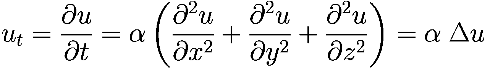

`∆` 是拉普拉斯算子，它是 n 维欧几里得空间中的一个二阶微分算子，定义为二次可微实值函数的梯度的散度。它给出了某点邻域内函数平均值与该点函数值的差异。在当前示例中，它衡量了温度偏离调和函数均值性质的程度。

一个 PDE 可以代表一大类方程或现象。热方程具有非常广泛的适用性。金融数学中的布莱克-斯科尔斯方程（它起源于价值数万亿美元的期权和衍生品市场）就是热方程的一个变体。量子力学中的薛定谔方程可以被视为虚时间中的热方程。在图像分析中，热方程用于解决像素化问题和识别边缘。热方程的解在流体动力冲击的数学公式中非常有用。

与求解常微分方程一样，求解偏微分方程需要一定的初始条件、边界条件或约束条件来缩小范围。有三种典型的边界条件对应于三类边值问题。

第一类边值问题的边界条件是在函数定义域的边界上指定函数值本身。这称为狄利克雷边界条件。例如，如果一根铁棒的一端保持恒温，那么问题区域中该空间点的值（计算该区域的热量或温度）就是已知的。见图 8-1。

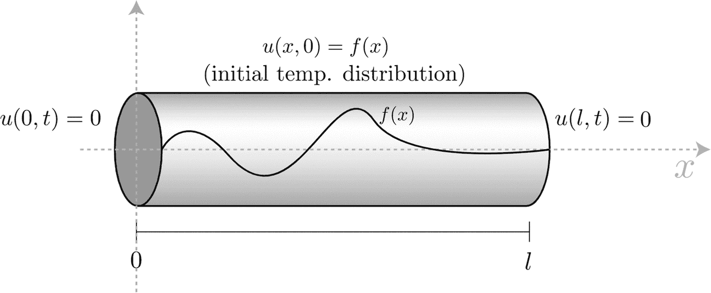

一个长度为 l 的三维圆柱形状。横截面轴线已标出，纵向形状位于 X 轴上。所有内容都显示了初始温度分布。

**图 8-1** 热方程的初始边值问题

从数学上，可以这样表示：

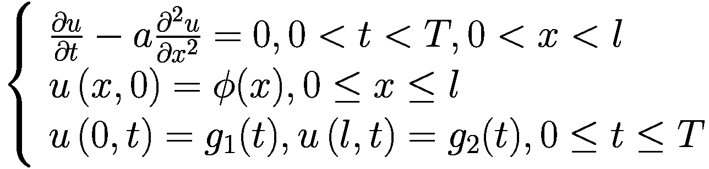

第一个（微分）方程描述了热系统的动力学特性。第二个方程是初始条件，描述了杆内任意位置的初始温度。第三个方程是边界条件，指定了杆两端在任意时刻的温度。边界条件`u(0, t) = g_1(t), u(l, t) = g_2(t)`被称为第一类边界条件。`φ(x)`、`g_1(t)`和`g_2(t)`是已知函数。它们也满足连接条件。

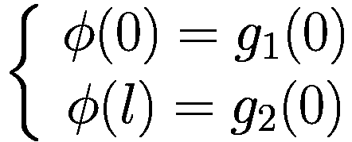

第二类边界条件称为诺伊曼边界条件。它指定了函数在边界上的法向导数值。法向导数是沿空间某个表面法线（即正交）方向的方向导数。如果法线方向，即边界`Γ`的外法线方向，用`n`表示，则函数`f`的方向导数有时表示如下：

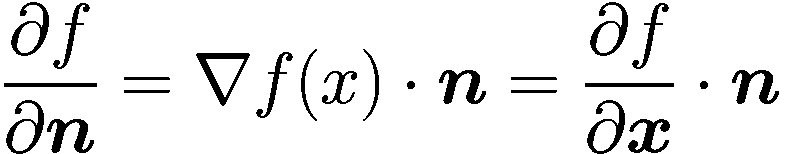

一个例子是，如果铁杆的一端有一个加热器，那么能量将以恒定速率增加，但实际温度是未知的。

第三类边界条件也称为柯西边界条件。它同时指定了域边界上的函数值和法向导数值。这相当于施加了狄利克雷和诺伊曼边界条件。

形式上，第二类和第三类边界条件可以表示如下：

![$$\left\{\begin{array}{c}{\left[\frac{\partial u}{\partial x}-{\lambda}_1(t)u\right]}_{x=0}={g}_1(t)\\ {}{\left[\frac{\partial u}{\partial x}-{\lambda}_2(t)u\right]}_{x=l}={g}_1(t)\end{array}\right.$$](images/528380_1_En_8_Chapter/528380_1_En_8_Chapter_TeX_Equl.png)

当`λ_1(t) = λ_2(t) = 0`时，为第二类边界条件。当`λ_1(t) ≥ 0`且`λ_2(t) ≥ 0`时，为第三类边界条件。

## 8.1.2 双曲型方程

如果满足以下条件，则二阶偏微分方程为双曲型：

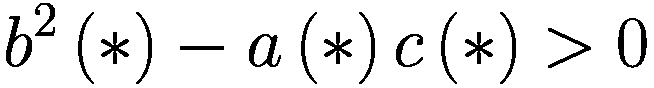

双曲型偏微分方程最简单也是最常见的例子是一维波动方程。

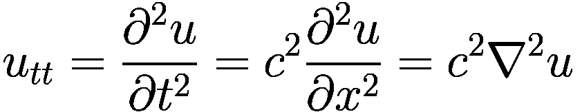

双曲型方程的解是“波状”的。如果在双曲型微分方程的初始数据中产生一个扰动，那么并非空间中的每一点都会同时感受到该扰动。相对于固定的时间坐标，扰动具有有限的传播速度。它们沿着方程的特征线传播。这一特性从本质上将双曲型方程与抛物型偏微分方程和椭圆型偏微分方程区分开来。椭圆型或抛物型方程的初始（或边界）数据发生扰动时，域内几乎所有点都会立即感受到。参见图 8-2。

一条曲线开始时平坦，急剧上升到峰值，然后急剧下降，最后变直。

**图 8-2** 传播脉冲可以用波动方程建模

仅波动方程本身并不能确定一个具体的物理解；通常需要通过设置带有额外条件的问题来获得唯一解，例如规定波振幅和相位的初始条件。另一类重要问题出现在由边界条件限定的封闭空间中，其解代表驻波或谐波，类似于乐器的谐波。

双曲型方程的初值问题如下：

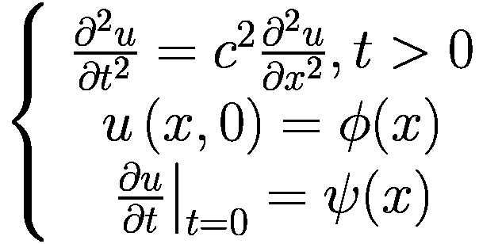

可以证明，该方程具有如下性质：如果`u`及其一阶时间导数在直线`t = 0`上由初始数据任意指定（且具有足够的光滑性），则对于所有时间`t`都存在一个解。

边值问题如下：

最后一组边界条件是第一类边界条件。

## 8.1.3 椭圆型方程

如果满足以下条件，则二阶偏微分方程为椭圆型：

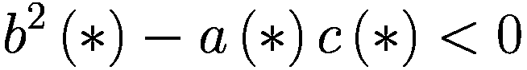

最简单的形式是泊松方程：

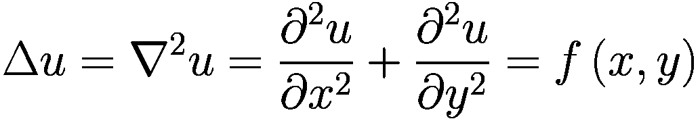

特别地，当`f(x, y) = 0`时，为拉普拉斯方程，也称为调和方程：

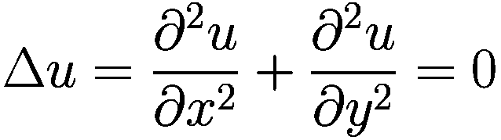

例如，联系标量势`φ`和吸引质量`ρ`的引力泊松方程如下：

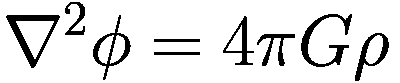

泊松方程的第一类边值问题如下：

`Ω`是求解域或区域；`Γ`是`Ω`的边界（或边缘）。`f(x, y)`和`φ(x, y)`是已知的、在`Ω ∪ Γ`上的连续函数。`u(x, y)`是您要求解的函数。

第二类和第三类边界条件可以表示如下：

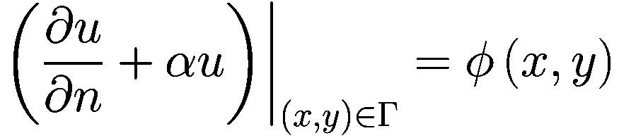

当`α = 0`时，为第二类边界条件。当`α ≠ 0`时，为第三类边界条件。

