# 8.2 有限差分法

计算偏微分方程数值解主要有三种数值方法：有限元法、有限体积法和有限差分法。截至本书撰写时，NM Dev 仅支持有限差分法，也称为网格法。

我们在第 6 章和第 7 章中介绍了有限差分法的基本概念。其核心思想相同，只是需要将其扩展到更高维度，以处理包含多个变量的偏微分方程。以下是步骤总结：

1.  在解域上施加一个网格或栅格。
2.  用一组有限的、离散的节点（网格节点）替换自变量的连续变量域。
3.  在网格节点上定义函数值。
4.  用差商替换网格节点上的导数值。
5.  偏微分方程现在简化为一个包含有限数量未知数的代数方程组，即差分方程。
6.  分析收敛性并估计误差。
7.  如果差分方程组有解，并且当网格无限小时，该解收敛于原始微分方程的解，那么差分方程的解就是原始问题的近似解（或数值解）。

## 8.2.1 双曲型方程的数值解

考虑以下一维波动方程：

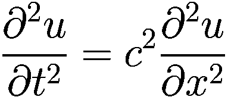

两端边界固定为 0。即：

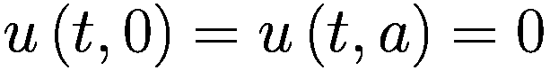

两个初始条件，即 *u* 及其在 *t* = 0 时的一阶时间导数 *u*[*t*]，如下所示：

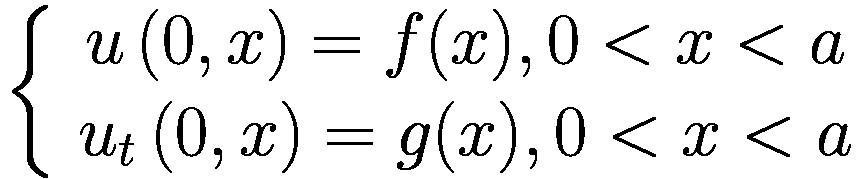

在 NM Dev 中，`WaveEquation1D` 类可用于构建此类一维波动方程。其签名如下：

```
/**
* 构造一个一维波动方程。
*
* @param c2 方程中的波动系数 c²
* @param T  关注的时间段 (0, T)
* @param a  关注的区域 (0, a)
* @param f  u 的初始条件，即 u(0, x)
* @param g  u 的时间导数的初始条件，即 ut(0,x)
*/
public WaveEquation1D(
double c2,
double T,
double a,
UnivariateRealFunction f,
UnivariateRealFunction g)
```

由于时间导数和空间导数都是二阶的，我们使用中心差分来逼近它们。设时间步长为 ∆*t*，空间步长为 ∆*x*。记  为网格点 (*k*, *j*) 处的近似值。差分公式如下：

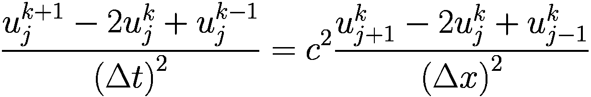

令

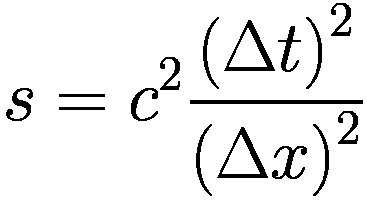

解出 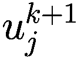 可得：

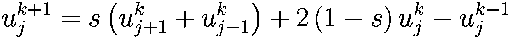

请注意，要计算每个 ，需要使用前两个时间步的四个节点。因此，这是一种求解 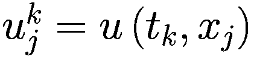 数值解的显式格式。

作为一种显式格式，它不是无条件稳定的。可以证明，只有当满足以下条件时，该格式才是稳定的：

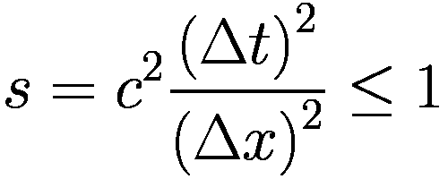

如果将 ∆*t*/∆*x* 定义为此格式的速度，那么稳定性条件意味着该格式的速度必须至少与波速 *c*（精确解的速度）一样大：

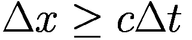

此方法称为中心差分法，是一种二阶方法，其截断误差阶数为 *O*((∆*t*)² + (∆*x*)²)。参见图 8-3：

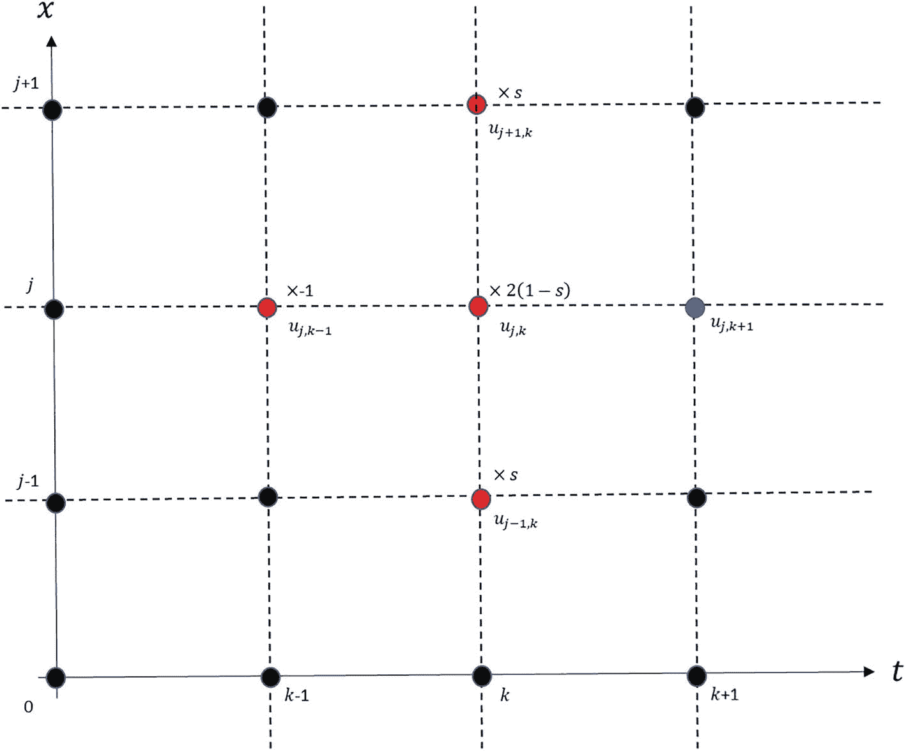

**图 8-3** 求解一维波动方程的显式格式

以下 NM Dev 代码在区域 [0, 1] × [0, 2] 内求解波动方程，其中 *c*² = 4，并使用以下初始条件：

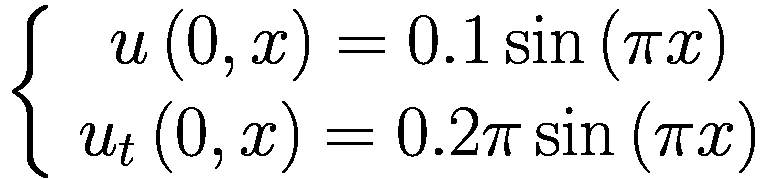


```kotlin
val f1: UnivariateRealFunction = object : AbstractUnivariateRealFunction() {
override fun evaluate(x: Double): Double {
return 0.1 * sin(PI * x) // 0.1 * sin(π x)
}
}
val f2: UnivariateRealFunction = object : AbstractUnivariateRealFunction() {
override fun evaluate(x: Double): Double {
return 0.2 * PI * sin(PI * x) // 0.2π * sin(π x)
}
}
val c2: Double = 4.0 // c²
val T: Double = 1.0 // 时间上界
val a: Double = 2.0 // x 方向上界
val pde: WaveEquation1D = WaveEquation1D(c2, T, a, f1, f2)
val m: Int = 80 // dt = T/m
val n: Int = 39 // dx = a/n
val soln: PDESolutionTimeSpaceGrid1D = ExplicitCentralDifference1D().solve(pde, m, n)
var t: Int = 0 // 时间索引
var x: Int = 1 // x 索引
println(String.format("u(%d,%d) = %f", t, x, soln.u(t, x)))
t = 0
x = 16
println(String.format("u(%d,%d) = %f", t, x, soln.u(t, x)))
t = 0
x = 31
println(String.format("u(%d,%d) = %f", t, x, soln.u(t, x)))
t = 20
x = 1
println(String.format("u(%d,%d) = %f", t, x, soln.u(t, x)))
t = 20
x = 16
println(String.format("u(%d,%d) = %f", t, x, soln.u(t, x)))
t = 20
x = 31
println(String.format("u(%d,%d) = %f", t, x, soln.u(t, x)))
t = 40
x = 1
println(String.format("u(%d,%d) = %f", t, x, soln.u(t, x)))
t = 40
x = 16
println(String.format("u(%d,%d) = %f", t, x, soln.u(t, x)))
t = 40
x = 31
println(String.format("u(%d,%d) = %f", t, x, soln.u(t, x)))
t = 60
x = 1
println(String.format("u(%d,%d) = %f", t, x, soln.u(t, x)))
t = 60
x = 16
println(String.format("u(%d,%d) = %f", t, x, soln.u(t, x)))
t = 60
x = 31
println(String.format("u(%d,%d) = %f", t, x, soln.u(t, x)))
```

输出结果如下：

```
u(0,1) = 0.015643
u(0,16) = 0.058779
u(0,31) = -0.098769
u(20,1) = 0.015691
u(20,16) = 0.058956
u(20,31) = -0.099066
u(40,1) = -0.015605
u(40,16) = -0.058636
u(40,31) = 0.098529
u(60,1) = -0.015728
u(60,16) = -0.059098
u(60,31) = 0.099305
```

`WaveEquation1D` 类用于构造一维波动方程偏微分方程。你需要指定解域和初始边界条件。其签名如下：

```
/**
* 构造一个一维波动方程。
*
* @param beta 方程中的波系数 β
* @param T    感兴趣的时间区间 (0, T)
* @param a    感兴趣的空间区间 (0, a)
* @param f    关于 u 的初始条件，即 u(0, x)
* @param g    关于 u 的时间导数的初始条件，
*             即 ut(0,x)
*/
public WaveEquation1D(
double beta,
double T,
double a,
UnivariateRealFunction f,
UnivariateRealFunction g)
```

`ExplicitCentralDifference1D` 是一个 PDE 求解器，使用中心差分法求解一维波动方程。其签名如下：

```
/**
* 用给定的解网格分辨率参数求解一维波动方程。
*
* @param pde 波动方程问题
* @param m   时间轴上的网格点数
* @param n   空间轴上的网格点数
* @return 解网格
*/
public PDESolutionTimeSpaceGrid1D solve(
WaveEquation1D pde,
final int m,
final int n
)
```

解由 `PDESolutionTimeSpaceGrid1D` 对象表示。它适用于那些将解表示为时间和空间网格的方法。其签名如下：

```
public interface PDESolutionTimeSpaceGrid1D {
/**
* 获取网格点 (tm, xn) 处的值。
*
* @param m 时间轴上的索引
* @param n 空间轴上的索引
* @return 该点的值
*/
double u(int m, int n);
/**
* 获取索引为 {@code k} 的时间轴上的值。
*
* @param m 网格点的索引
* @return tm
*/
double t(int m);
/**
* 获取索引为 {@code j} 的空间轴上的值。
*
* @param n 网格点的索引
* @return xn
*/
double x(int n);
/**
* 获取解中内部时间轴网格点的数量。
*
* @return 时间轴上的解网格点数量
*/
int M();
/**
* 获取解中内部空间轴网格点的数量。
*
* @return 空间轴上的解网格点数量
*/
int N();
}
```

NM Dev 支持求解高达二维的波动方程。二维波动方程问题定义如下：

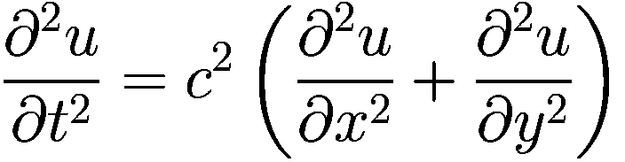

两个边界端点均固定为 0，即：

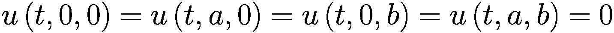

两个初始条件，即 *u* 及其在 *t* = 0 时的一阶时间导数 *u*[*t*]，如下所示：

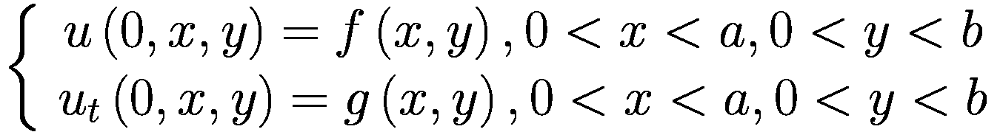

在 NM Dev 中，`WaveEquation2D` 类可用于构造这样的二维波动方程。其签名如下：

```
/**
* 构造一个二维波动方程。
*
* @param c2 方程中的 c²
* @param T  感兴趣的时间区间 (0, T)
* @param a  沿 x 轴的区域大小，x ∈ (0, a)
* @param b  沿 y 轴的区域大小，y ∈ (0, b)
* @param f  关于 u 的初始条件，即 u(0, x, y)
* @param g  关于 u 的时间导数的初始条件，
*           即 ut(0,x,y)
*/
public WaveEquation2D(
double c2,
double T,
double a,
double b,
BivariateRealFunction f,
BivariateRealFunction g
)
```

二维中心差分格式如下：

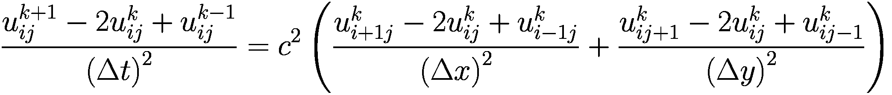

该格式在满足以下条件时是稳定的：

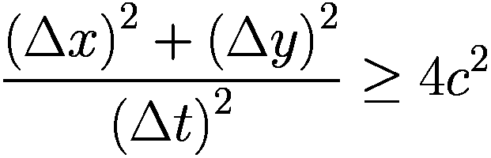

截断误差的阶数为 *O*((Δ*t*)² + (Δ*x*)² + (Δ*y*)²)。

例如，以下 NM Dev 代码在区域 [0, 2] × [0, 2] × [0, 2] 中求解了二维波动方程，其中 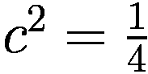，初始条件如下：


```kotlin
println("求解二维波动方程")
val f1: BivariateRealFunction = object : AbstractBivariateRealFunction() {
override fun evaluate(x: Double,y: Double): Double {
return 0.1 * sin(PI * x) * sin(PI * y / 2.0)
}
}
val f2: BivariateRealFunction = object : AbstractBivariateRealFunction() {
override fun evaluate(x: Double, y: Double): Double {
return 0.0
}
}
val c2: Double = 1.0 / 4 // 波速平方
val T: Double = 2.0
val a: Double = 2.0
val b: Double = 2.0 // 解域边界
val pde: WaveEquation2D = WaveEquation2D(
c2, T, a, b, f1, f2)
val m: Int = 40 // dt = T/m
val n: Int = 39 // dx = a/n
val p: Int = 39 // dy = b/p
val soln: PDESolutionTimeSpaceGrid2D = ExplicitCentralDifference2D().solve(pde, m, n, p)
var t: Int = 40 // 时间索引
var x: Int = 1 // x 索引
var y: Int = 1 // y 索引
println(String.format("u(%d,%d,%d) = %f", t, x, y, soln.u(t, x, y)))
t = 40 // 时间索引
x = 1 // x 索引
y = 16 // y 索引
println(String.format("u(%d,%d,%d) = %f", t, x, y, soln.u(t, x, y)))
t = 40 // 时间索引
x = 1 // x 索引
y = 31 // y 索引
println(String.format("u(%d,%d,%d) = %f", t, x, y, soln.u(t, x, y)))
t = 40 // 时间索引
x = 16 // x 索引
y = 1 // y 索引
println(String.format("u(%d,%d,%d) = %f", t, x, y, soln.u(t, x, y)))
t = 40 // 时间索引
x = 16 // x 索引
y = 16 // y 索引
println(String.format("u(%d,%d,%d) = %f", t, x, y, soln.u(t, x, y)))
t = 40 // 时间索引
x = 16 // x 索引
y = 31 // y 索引
println(String.format("u(%d,%d,%d) = %f", t, x, y, soln.u(t, x, y)))
t = 40 // 时间索引
x = 31 // x 索引
y = 1 // y 索引
println(String.format("u(%d,%d,%d) = %f", t, x, y, soln.u(t, x, y)))
t = 40 // 时间索引
x = 31 // x 索引
y = 16 // y 索引
println(String.format("u(%d,%d,%d) = %f", t, x, y, soln.u(t, x, y)))
t = 40 // 时间索引
x = 31 // x 索引
y = 31 // y 索引
println(String.format("u(%d,%d,%d) = %f", t, x, y, soln.u(t, x, y)))
```

输出如下：

```
u(40,1,1) = -0.001145
u(40,1,16) = -0.013877
u(40,1,31) = -0.009476
u(40,16,1) = -0.004302
u(40,16,16) = -0.052141
u(40,16,31) = -0.035606
u(40,31,1) = 0.007228
u(40,31,16) = 0.087616
u(40,31,31) = 0.059830
```

`ExplicitCentralDifference2D` 是一个偏微分方程求解器，使用中心差分法求解二维波动方程。其签名如下：

```java
/**
* 求解二维波动方程，并指定求解网格的分辨率参数。
*
* @param pde 波动方程问题
* @param m   沿时间轴的网格点数（不包括初始条件）
* @param n   沿 x 轴的网格点数（不包括两个边界）
* @param p   沿 y 轴的网格点数（不包括两个边界）
* @return 解网格
*/
public PDESolutionTimeSpaceGrid2D solve(
WaveEquation2D pde,
final int m,
final int n,
final int p
)
```

解由 `PDESolutionTimeSpaceGrid2D` 对象表示。它适用于将解生成为时间与空间网格的方法。其签名如下：

```java
public interface PDESolutionTimeSpaceGrid2D {
/**
* 获取网格点 (tk, xi, yj) 处的值。
*
* @param k 沿时间轴的索引
* @param i 沿 x 轴的索引
* @param j 沿 y 轴的索引
* @return 网格点的值
*/
double u(int k, int i, int j);
/**
* 获取索引为 @{code k} 的时间轴上的值。
*
* @param k 网格点的索引
* @return tk
*/
double t(int k);
/**
* 获取索引为 @{code i} 的 x 轴上的值。
*
* @param i 网格点的索引
* @return xi
*/
double x(int i);
/**
* 获取索引为 @{code j} 的 y 轴上的值。
*
* @param j 网格点的索引
* @return yj
*/
double y(int j);
/**
* 获取解中内部时间轴网格点的数量。
*
* @return 沿时间轴的解网格点数量
*/
int m();
/**
* 获取解中内部 x 轴网格点的数量。
*
* @return 沿 x 轴的解网格点数量
*/
int n();
/**
* 获取解中内部 y 轴网格点的数量。
*
* @return 沿 y 轴的解网格点数量
*/
int p();
}
```

## 8.2.2 椭圆型方程的数值解

考虑泊松方程的第一类边值问题（见图 8-4），如下所示：


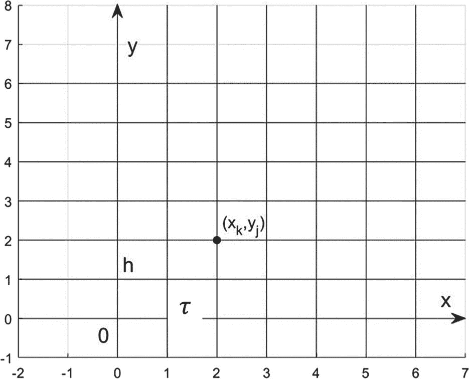

*图 8-4* 二维区域上的网格

取 `h` 和 `τ` 分别为 `x` 和 `y` 方向上的步长。网格内的节点记为 `{(x[k], y[j]) | x[k] = kh, y[j] = jτ, k, j ∈ Z}`，`(k, j = 0, ±1, ±2, ⋯)`。解域内部的节点称为内部节点。它们属于 `Ω ∪ Γ`。对于每个节点，有四个相邻节点，分别沿 `x` 和 `y` 方向相距一个步长，`(k, j = ±1, ±2)`。如果一个节点的所有四个相邻节点都是内部节点，则该节点称为正则内部节点。正则内部节点集记为 `Ω^((1))`。如果某个相邻节点不是内部节点，则该节点是非正则内部节点。非正则内部节点集记为 `Ω^((2))`。边界 `Γ` 与网格线的交点称为边界节点。偏微分方程的数值解需要确定函数 `u` 在所有内部节点上的值。

为简化记法，记 `f_j^k = f(x_k, y_j)`。对于正则内部节点 `(k, j) ∈ Ω^((1))`，二阶中心差商公式如下：


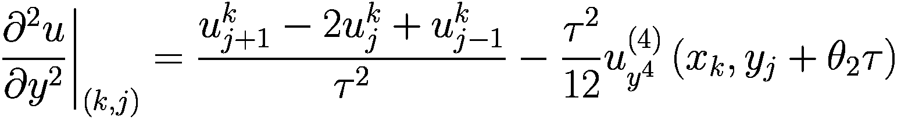

其中 `0 < θ[1], θ[2] < 1`。

泊松方程 `∂²u/∂x² + ∂²u/∂y² = f(x, y)` 在节点 `(k, j)` 处可表示为：

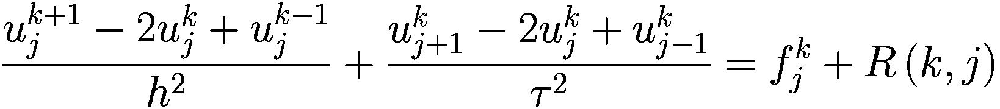

截断误差为：

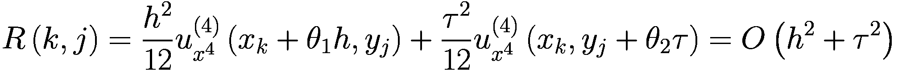

忽略误差项 `R(k, j)`，泊松方程的差分逼近式为：


差分方程的数量等于正则内部节点`u[k, j]`的数量。每个差分方程不仅包含正则内部节点处解的近似值`u[k, j]`，还包含非正则内部节点的近似值。因此，方程的数量小于待求解未知数的数量。非正则内部节点处的近似值由边界条件给出。处理边界条件有多种方案。接下来我们描述两种较简单的方案。

### 直接传递

将最接近非正则内部节点的边界节点集合中的`u`值，用作该节点处`u[k, j]`值的近似值。我们称此为边界条件的直接传递。

例如，假设节点`P(k, j)`是一个非正则内部节点，且最接近的边界节点是`Q`节点，那么有如下公式：

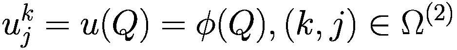

该公式可视为节点的零阶插值。它很简单，截断误差为`O(h + τ)`。使用上述替换后，方程数量等于未知数数量。现在可以求解该线性方程组。

### 线性插值

该方案通过线性插值边界节点`Q`和与节点`P`位于同一网格线上相邻的内部节点`R`，来近似非正则内部节点`P(k, j)`处的`u[k, j]`值。即：

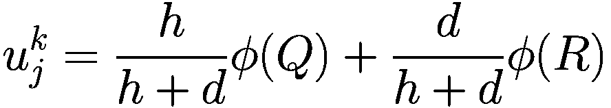

其中`d = |QR|`，截断误差为`O(h²)`。使用上述替换后，方程数量等于未知数数量。现在可以求解该线性方程组。

注意，每个差分方程涉及五个节点：`{u_j^(k+1), 2u_j^k, u_j^(k-1), u_(j+1)^k, u_(j-1)^k}`。这被称为网格中节点的五点模板或五点菱形格式。

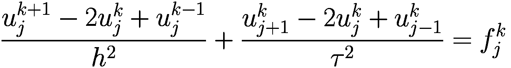

在实践中，通常设置`h = τ`。此时五点菱形格式简化为：

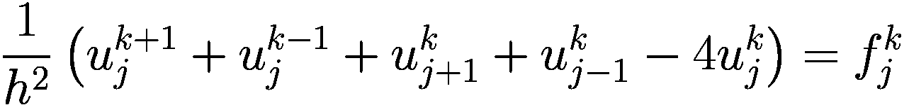

它缩写为：`1/h² ◇ u_j^k = f_j^k`，其中`◇ u_j^k = u_j^(k+1) + u_j^(k-1) + u_(j+1)^k + u_(j-1)^k - 4u_j^k`。参见图 8-5。

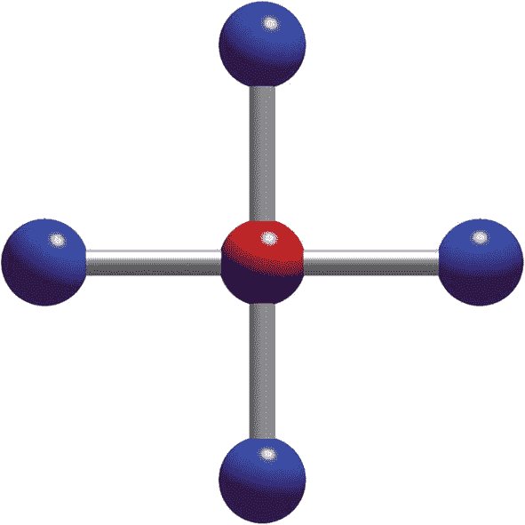

*图 8-5 网格中节点的五点模板*

例如，考虑使用五点菱形格式求解如下拉普拉斯方程的第一类边值问题：

![$$ \left\{\begin{array}{l}\frac{\partial²u}{\partial {x}²}+\frac{\partial²u}{\partial {y}²}=0\\ {}{\left.u\left(x,y\right)\right|}_{\Gamma}=\log \left[{\left(1+x\right)}²+{y}²\right]\end{array}\right. $$](images/528380_1_En_8_Chapter/528380_1_En_8_Chapter_TeX_Equav.png)

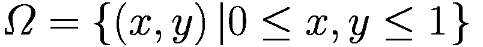

取`h = τ = 1/3`。网格中有四个内部节点（红色），均为正则内部节点。根据五点菱形格式，线性方程组如下：


边界值（蓝色）可从`u(x, y)|Γ`直接计算得出，如下所示：


该线性方程组的解如下所示（参见图 8-6）：


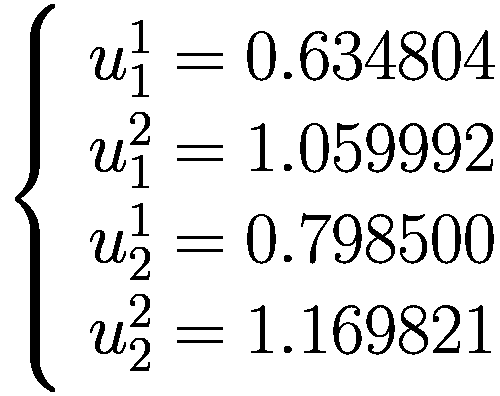

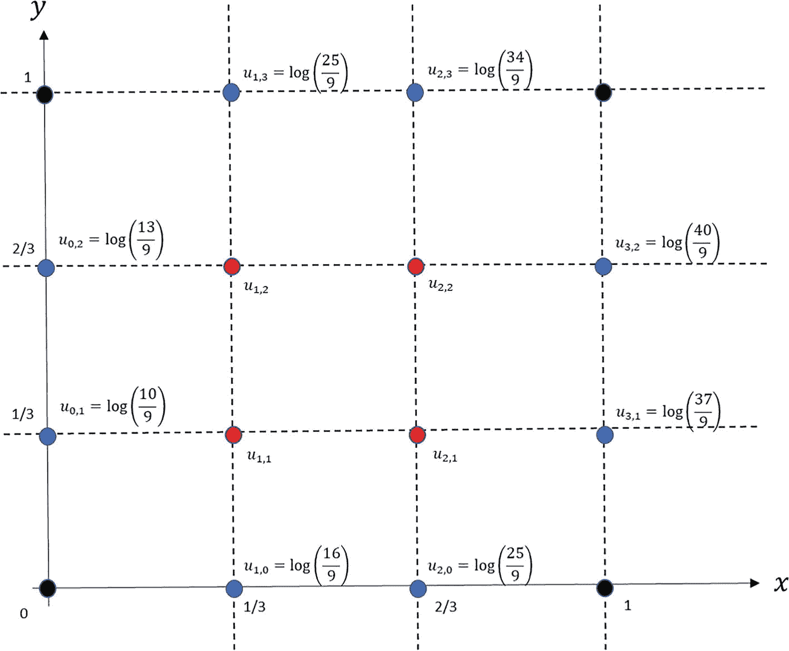

一张 `y` 相对于 `x` 的图表显示了 16 个不同节点，这些节点在相同间隔处位于不同点上。

**图 8-6** 网格与拉普拉斯方程的解

以下 NM Dev 代码求解了该示例：

```
val ZERO: BivariateRealFunction // 常量零函数，f = 0
= object : AbstractBivariateRealFunction() {
override fun evaluate(x: Double, y: Double): Double {
return 0.0
}
override fun evaluate(x: Vector): Double {
return 0.0
}
}
// 边界条件
val g: BivariateRealFunction = object : AbstractBivariateRealFunction() {
override fun evaluate(x: Double, y: Double): Double {
return ln((1.0 + x) * (1.0 + x) + y * y)
}
}
val a: Double = 1.0 // x 维度宽度
val b: Double = 1.0 // y 维度高度
val pde: PoissonEquation2D = PoissonEquation2D(a, b, ZERO, g)
val solver: IterativeCentralDifference = IterativeCentralDifference(
1e-8, // 精度
40) // 最大迭代次数
val soln: PDESolutionGrid2D = solver.solve(pde, 2, 2)
var k: Int = 1
var j: Int = 1 // 节点索引
val u_11: Double = soln.u(k, j) // x = 0.3, y = 0.3
println(String.format("u_%d,%d = u(%f,%f): %f", k, j, soln.x(k), soln.y(j), u_11))
k = 1
j = 2
val u_12: Double = soln.u(k, j) // x = 0.3, y = 0.6
println(String.format("u_%d,%d = u(%f,%f): %f", k, j, soln.x(k), soln.y(j), u_12))
k = 2
j = 1
val u_21: Double = soln.u(k, j) // x = 0.6, y = 0.3
println(String.format("u_%d,%d = u(%f,%f): %f", k, j, soln.x(k), soln.y(j), u_21))
k = 2
j = 2
val u_22: Double = soln.u(k, j) // x = 0.6, y = 0.6
println(String.format("u_%d,%d = u(%f,%f): %f", k, j, soln.x(k), soln.y(j), u_22))
```

输出结果如下：

```
u_1,1 = u(0.333333,0.333333): 0.634804
u_1,2 = u(0.333333,0.666667): 0.798500
u_2,1 = u(0.666667,0.333333): 1.059992
u_2,2 = u(0.666667,0.666667): 1.169821
```

要建立一个泊松偏微分方程问题，首先需要创建一个 `PoissonEquation2D` 对象。其签名如下：

```
/**
* 构建一个泊松方程问题。
*
* @param a 感兴趣的区域 [0, a]
* @param b 感兴趣的区域 [0, b]
* @param f 方程中的强迫项 f(x, y)
* @param g 狄利克雷边界条件 g(x, y)
*/
public PoissonEquation2D(
double a,
double b,
BivariateRealFunction f,
BivariateRealFunction g)
```

`f` 是泊松方程右侧的项。当 *f* = 0 时，方程变为拉普拉斯方程。`g` 指定了偏微分方程问题的第一类边界条件。`PoissonEquation2D` 类的求解域为 [0, *a*] × [0, *b*]。若需求解其他区域范围，用户需在编码前进行变换。

`IterativeCentralDifference` 是一个偏微分方程求解器，用于通过中心差分公式求解泊松方程问题。其签名如下：

```
/**
* 使用给定的精度作为收敛判据和允许的最大迭代次数，构造此方法的一个实例。
* 当连续两次迭代之间的差值在给定精度范围内时，迭代停止。
*
* @param precision     收敛阈值
* @param maxIterations 允许的最大迭代次数
*/
public IterativeCentralDifference(
double precision,
int maxIterations
) {
/**
* 求解泊松方程问题，并指定网格分辨率参数。
*
* 当迭代在允许的最大迭代次数内无法收敛至指定的误差限时，
* 将抛出 {@link UnsatisfiableErrorCriterionException}。
*
* @param pde 泊松方程
* @param m   网格沿 x 轴的内点数
* @param n   网格沿 y 轴的内点数
* @return 求解结果网格
*/
public PDESolutionGrid2D solve(
final PoissonEquation2D pde,
final int m,
final int n
)
```


在 NM Dev 中，使用有限差分法求解二维 PDE 问题会生成一个 `PDESolutionGrid2D` 对象。它包含关于网格、节点以及每个节点上近似值的所有信息。其签名如下：

```java
/**
* 一个双变量 PDE 的解，适用于通过二维网格形式生成解的方法。
* 索引的范围分别为 0 到 (m+1) 和 0 到 (n+1)。
*
*/
public interface PDESolutionGrid2D {
/**
* 获取位于 (xk, yj) 处网格点的值。
*
* @param k 沿 x 轴的索引
* @param j 沿 y 轴的索引
* @return 该点的值
*/
double u(int k, int j);
/**
* 获取索引 {@code k} 处 x 轴上的值。
*
* @param k 网格点的索引
* @return xk
*/
double x(int k);
/**
* 获取索引 {@code j} 处 y 轴上的值。
*
* @param j 网格点的索引
* @return yj
*/
double y(int j);
/**
* 获取解中 x 轴上的内部网格点数量。
*
* @return 沿 x 轴解网格点的数量
*/
int m();
/**
* 获取解中 y 轴上的内部网格点数量。
*
* @return 沿 y 轴解网格点的数量
*/
int n();
}
```

请注意，`double u(int k, int j)` 函数接收的是节点索引，而不是域值作为输入。`PDESolutionGrid2D` 仅包含网格节点处的信息。如果你需要函数在非网格节点处的近似值，则需要进行一些插值。

作为另一个示例，以下 NM Dev 代码求解了在 0 ≤ *x* ≤ 0.5，0 ≤ *y* ≤ 0.5 范围内具有初始条件和边界条件的拉普拉斯方程：

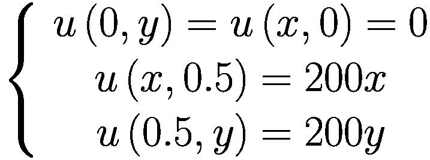

```kotlin
val ZERO: BivariateRealFunction // 一个恒零函数，f = 0
= object : AbstractBivariateRealFunction() {
override fun evaluate(x: Double, y: Double): Double {
return 0.0
}
override fun evaluate(x: Vector): Double {
return 0.0
}
}
// 边界条件
val EPSION: Double = 1e-8
val g: BivariateRealFunction = object : AbstractBivariateRealFunction() {
override fun evaluate(x: Double, y: Double): Double {
if (DoubleUtils.isZero(x, EPSION) || DoubleUtils.isZero(y, EPSION)) {
return 0.0
} else if (DoubleUtils.equal(x, 0.5, EPSION)) {
return 200.0 * y
} else if (DoubleUtils.equal(y, 0.5, EPSION)) {
return 200.0 * x
}
// 不可达，无关紧要
return Double.NaN
}
}
val a: Double = 0.5 // x 轴方向的宽度
val b: Double = 0.5 // y 轴方向的高度
val pde: PoissonEquation2D = PoissonEquation2D(a, b, ZERO, g)
val solver: IterativeCentralDifference = IterativeCentralDifference(
EPSION, // 精度
40) // 最大迭代次数
val soln: PDESolutionGrid2D = solver.solve(pde, 4, 4)
var k: Int = 1
var j: Int = 1 // 节点索引
val u_11: Double = soln.u(k, j)
println(String.format("u_%d,%d = u(%f,%f): %f", k, j, soln.x(k), soln.y(j), u_11))
k = 1
j = 2
val u_12: Double = soln.u(k, j)
println(String.format("u_%d,%d = u(%f,%f): %f", k, j, soln.x(k), soln.y(j), u_12))
k = 2
j = 1
val u_21: Double = soln.u(k, j)
println(String.format("u_%d,%d = u(%f,%f): %f", k, j, soln.x(k), soln.y(j), u_21))
k = 2
j = 2
val u_22: Double = soln.u(k, j)
println(String.format("u_%d,%d = u(%f,%f): %f", k, j, soln.x(k), soln.y(j), u_22))
k = 3
j = 3
val u_33: Double = soln.u(k, j)
println(String.format("u_%d,%d = u(%f,%f): %f", k, j, soln.x(k), soln.y(j), u_33))
k = 4
j = 4
val u_44: Double = soln.u(k, j)
println(String.format("u_%d,%d = u(%f,%f): %f", k, j, soln.x(k), soln.y(j), u_44))
k = 5
j = 5
val u_55: Double = soln.u(k, j)
println(String.format("u_%d,%d = u(%f,%f): %f", k, j, soln.x(k), soln.y(j), u_55))
```

输出如下（见图 8-7）：

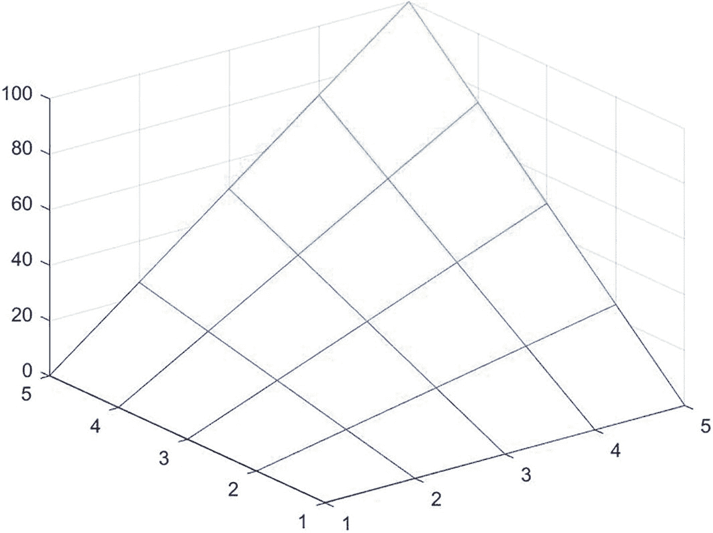

一个三维图形显示了维度为 1 到 1 的 5×5 网格图案。

**图 8-7**：5×5 解网格

```
u_1,1 = u(0.100000,0.100000): 4.000000
u_1,2 = u(0.100000,0.200000): 8.000000
u_2,1 = u(0.200000,0.100000): 8.000000
u_2,2 = u(0.200000,0.200000): 16.000000
u_3,3 = u(0.300000,0.300000): 36.000000
u_4,4 = u(0.400000,0.400000): 64.000000
u_5,5 = u(0.500000,0.500000): 100.000000
```


### 8.2.3 抛物型方程的数值解法

考虑如下一维热传导方程：

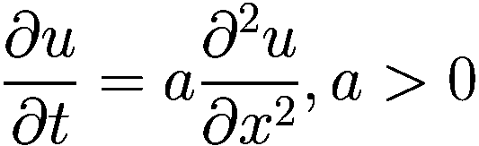

这个偏微分方程最为著名的、甚至改变了历史进程的应用，莫过于用于确定欧式期权价格的布莱克-舒尔斯方程。布莱克-舒尔斯方程催生了华尔街价值万亿美元的衍生品业务。经过变量变换后，布莱克-舒尔斯方程可以写成如下形式：

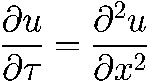

其中，`τ` 是期权的到期时间，期权在 `τ = 0` 时到期。`x` 是期权所参考的标的股票的价格。初始条件（`E` 为期权的行权价）其实就是收益函数，如下所示：

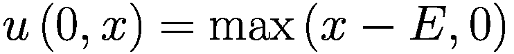

边界条件表明，当股票变得一文不值时，期权也同样一文不值。

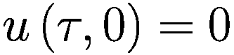

当股票价格远高于行权价时，期权的表现就如同股票本身。

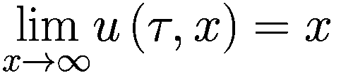

近似求解该偏微分方程的一种直接方法是，用前向差分替代时间导数，并用中心差分替代二阶导数。即：

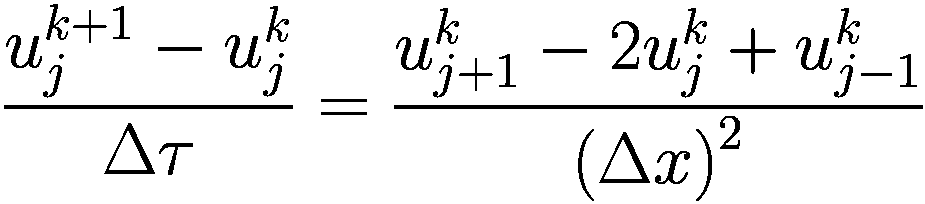

求解 `u_j^{k+1}`，你会得到如下表达式（参见图 8-8）：

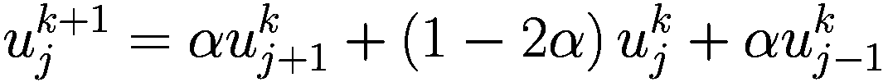

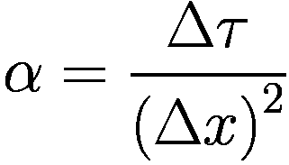

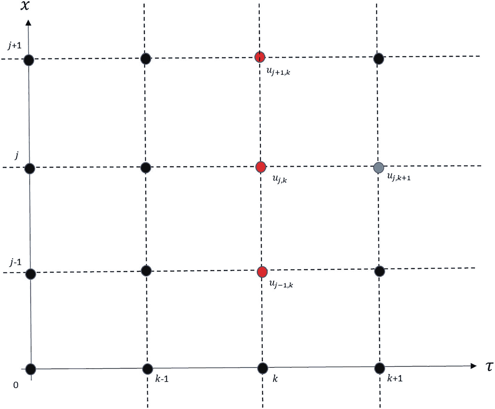

一张 x 相对于 tau 的图展示了 16 个不同的节点，这些节点在相同间隔下具有不同的点。

**图 8-8** 热传导方程的显式格式

这是一个显式公式，因为在时间步 `k`，你知道所有 `j` 对应的 `u_j^k`。你可以利用这个公式，使用三个节点（红色）显式地计算出 `u_j^{k+1}`（蓝色）。这种显式格式并非条件稳定。可以证明，仅当满足以下条件时，它才是稳定的：

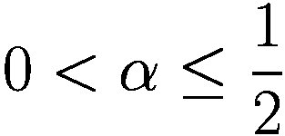

或者，等效于：

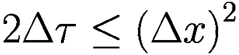

因此，如果你想将 `x` 方向上的节点数加倍，就需要将时间步长减为四分之一。每个时间步的计算耗时翻倍（因为 `x` 方向节点数加倍），同时时间步数增加为原来的四倍。这意味着，将 `x` 方向节点数加倍会导致求解耗时变为原来的八倍。

或者，你可以使用后向差分来近似时间导数。其差分方程近似如下：

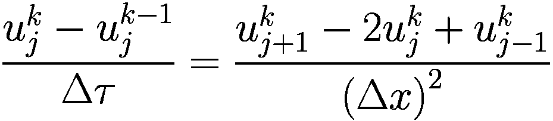

将时间 `k` 的项整理到等式左侧，你会得到如下表达式（参见图 8-9）：


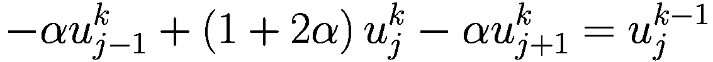

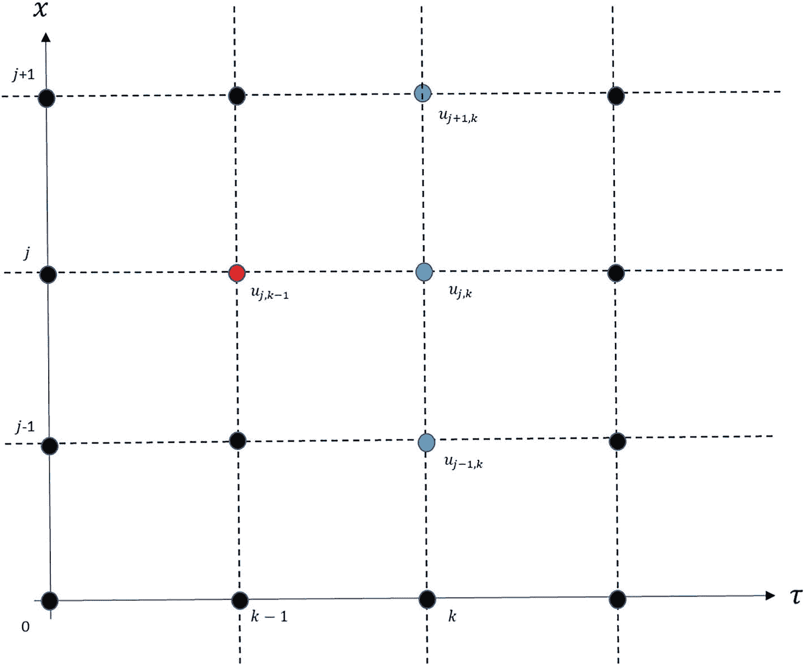

一张`x`与`τ`的关系图显示了 16 个不同的节点，这些节点在相同间隔内具有不同的坐标点。

**图 8-9**：热方程的隐式格式

下一时间步`k`的三个值无法通过`k − 1`时刻的旧值立即计算出来。你可以将时间步`k`和`k + 1`的值收集起来，并将其写成一个线性方程组。

![$$ \left[\begin{array}{ccccc}1+2\alpha &amp; -\alpha &amp; 0&amp; \cdots &amp; 0\\ {}-\alpha &amp; 1+2\alpha &amp; -\alpha &amp; &amp; 0\\ {}0&amp; -\alpha &amp; \ddots &amp; \ddots &amp; \\ {}\vdots &amp; &amp; \ddots &amp; \ddots &amp; -\alpha \\ {}0&amp; 0&amp; &amp; -\alpha &amp; 1+2\alpha \end{array}\right] \left[\begin{array}{c}{u}_{N^{-}+1}^k\\ {}\vdots \\ {}\begin{array}{c}{u}_0^k\\ {}\vdots \\ {}{u}_{N^{+}-1}^k\end{array}\end{array}\right] $$](images/528380_1_En_8_Chapter/528380_1_En_8_Chapter_TeX_Equbn.png)

![$$ = \left[\begin{array}{c}{u}_{N^{-}+1}^{k-1}\\ {}\vdots \\ {}{u}_0^{k-1}\\ {}\vdots \\ {}{u}_{N^{+}-1}^{k-1}\end{array}\right]+\alpha \left[\begin{array}{c}{u}_{N^{-}}^k\\ {}0\\ {}\vdots \\ {}0\\ {}{u}_{N^{+}}^k\end{array}\right]=\left[\begin{array}{c}{b}_{N^{-}+1}^k\\ {}\vdots \\ {}{b}_0^k\\ {}\vdots \\ {}{b}_{N^{+}-1}^k\end{array}\right] $$](images/528380_1_En_8_Chapter/528380_1_En_8_Chapter_TeX_Equbo.png)

`{u}_{N^{-}+1}^k`、`{u}_{N^{+}-1}^k`、`{u}_{N^{-}+1}^{k-1}`、`{u}_{N^{+}-1}^{k-1}`、`{u}_{N^{-}}^k`和`{u}_{N^{+}}^k`来自边界条件。以矩阵形式，你可以这样写：

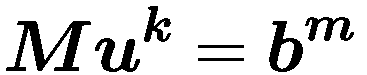

或者这样写：

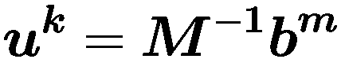

在实践中，你几乎从不会计算逆矩阵，因为求逆的计算开销非常大，并且容易受到舍入误差的影响。在计算量和存储方面，会使用更高效的方法，例如`LU`分解、逐次超松弛法（SOR）以及高斯-赛德尔方法。`NM Dev`库已经实现了所有这些方法。隐式有限差分算法是无条件稳定的。

克兰克-尼科尔森有限差分法进一步改进了显式方法和隐式方法，使得它既无条件稳定，又具有`O`((∆`τ`)²)阶的截断误差（而其他两种方法为`O`(∆`τ`)）。克兰克-尼科尔森有限差分法取前向差分近似和后向差分近似的平均值。这两个方程的平均值如下：

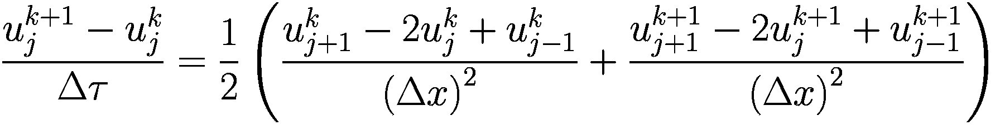

重新整理，将时间步`k + 1`的项放在左侧，时间步`k`的项放在右侧，得到：

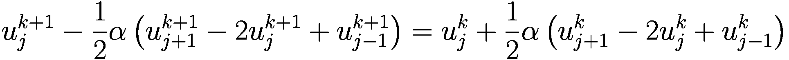

同样，你可以将这个线性方程组写成矩阵形式：

![$$ \left[\begin{array}{ccccc}1+\alpha &amp; -\frac{1}{2}\alpha &amp; 0&amp; \cdots &amp; 0\\ {}-\frac{1}{2}\alpha &amp; 1+\alpha &amp; -\frac{1}{2}\alpha &amp; &amp; 0\\ {}0&amp; -\frac{1}{2}\alpha &amp; \ddots &amp; \ddots &amp; \\ {}\vdots &amp; &amp; \ddots &amp; \ddots &amp; -\frac{1}{2}\alpha \\ {}0&amp; 0&amp; &amp; -\frac{1}{2}\alpha &amp; 1+\alpha \end{array}\right]\left[\begin{array}{c}{u}_{N^{-}+1}^{k+1}\\ {}\vdots \\ {}{u}_0^{k+1}\\ {}\vdots \\ {}{u}_{N^{+}-1}^{k+1}\end{array}\right] $$](images/528380_1_En_8_Chapter/528380_1_En_8_Chapter_TeX_Equbt.png)

![$$ =\left[\begin{array}{c}{Z}_{N^{-}+1}^k\\ {}\vdots \\ {}{Z}_0^k\\ {}\vdots \\ {}{Z}_{N^{+}-1}^k\end{array}\right]+\frac{1}{2}\alpha \left[\begin{array}{c}{u}_{N^{-}}^{k+1}\\ {}0\\ {}\vdots \\ {}0\\ {}{u}_{N^{+}}^{k+1}\end{array}\right] $$](images/528380_1_En_8_Chapter/528380_1_En_8_Chapter_TeX_Equbu.png)


然后，该方程组可通过 SOR（`NM Dev`中的默认方法）求解。

例如，以下`NM Dev`代码使用克兰克-尼科尔森方法在区间 [0, 6000] × [0, 1] 上求解该热方程：


```
val f1: UnivariateRealFunction = object : AbstractUnivariateRealFunction() {
override fun evaluate(x: Double): Double {
return 2.0 * x + sin(2.0 * PI * x) // 初始条件
}
}
val f2: UnivariateRealFunction = object : AbstractUnivariateRealFunction() {
override fun evaluate(t: Double): Double {
return 0.0 // 在 x = 0 处的边界条件
}
}
val f3: UnivariateRealFunction = object :  AbstractUnivariateRealFunction() {
override fun evaluate(t: Double): Double {
return 2.0 // 在 x = 6000 处的边界条件
}
}
val pde: HeatEquation1D = HeatEquation1D(
1e-5, // 热方程系数
1.0, 6000.0, // 解域边界
f1,
0.0,
f2,
0.0,
f3
)
// 对于狄利克雷边界条件，c_k 为 0
val m: Int = 50
val n: Int = 39
val soln: PDESolutionTimeSpaceGrid1D
= CrankNicolsonHeatEquation1D().solve(pde, m, n)
var t: Int = 0
var x: Int = 1
println(String.format("u(%d,%d) = %f", t, x, soln.u(t, x)))
t = 0
x = 16
println(String.format("u(%d,%d) = %f", t, x, soln.u(t, x)))
t = 0
x = 31
println(String.format("u(%d,%d) = %f", t, x, soln.u(t, x)))
t = 15
x = 1
println(String.format("u(%d,%d) = %f", t, x, soln.u(t, x)))
t = 15
x = 16
println(String.format("u(%d,%d) = %f", t, x, soln.u(t, x)))
t = 15
x = 31
println(String.format("u(%d,%d) = %f", t, x, soln.u(t, x)))
t = 30
x = 1
println(String.format("u(%d,%d) = %f", t, x, soln.u(t, x)))
t = 30
x = 16
println(String.format("u(%d,%d) = %f", t, x, soln.u(t, x)))
t = 30
x = 31
println(String.format("u(%d,%d) = %f", t, x, soln.u(t, x)))
t = 45
x = 1
println(String.format("u(%d,%d) = %f", t, x, soln.u(t, x)))
t = 45
x = 16
println(String.format("u(%d,%d) = %f", t, x, soln.u(t, x)))
t = 45
x = 31
println(String.format("u(%d,%d) = %f", t, x, soln.u(t, x)))
```

输出如下：

```
u(0,1) = 0.206434
u(0,16) = 1.387785
u(0,31) = 0.562312
u(15,1) = 0.126965
u(15,16) = 1.089188
u(15,31) = 1.064061
u(30,1) = 0.087867
u(30,16) = 0.942280
u(30,31) = 1.310920
u(45,1) = 0.068630
u(45,16) = 0.870001
u(45,31) = 1.432373
```

`HeatEquation1D`类用于构建这样一个热方程问题。其签名如下：


```java
/**
* 构造一个热方程问题。
*
* @param beta 方程中的 beta 参数
* @param a    感兴趣的区域 (0, a)
* @param T    感兴趣的时间段 (0, T)
* @param f    u 的初始条件，即 u(0,x)
* @param c1   在 x = 0 处混合边界条件的系数
* @param g1   在 x = 0 处的混合边界条件
* @param c2   在 x = a 处混合边界条件的系数
* @param g2   在 x = a 处的混合边界条件
*/
public HeatEquation1D(
double beta,
double a,
double T,
UnivariateRealFunction f,
double c1,
UnivariateRealFunction g1,
double c2,
UnivariateRealFunction g2)
```

`CrankNicolsonHeatEquation1D`类使用 Crank-Nicolson 有限差分算法求解一维热方程。其签名如下：

```java
/**
* 求解给定的一维热方程。
*
* @param pde 偏微分方程问题
* @param M   时间轴上的网格点数（不包括初始条件）
* @param N   空间轴上的网格点数（不包括两个边界）
* @return 网格点上的解 \(u(t,x)\)
*/
public PDESolutionTimeSpaceGrid1D solve(
final HeatEquation1D pde,
final int M,
final int N
)
```

此外，NM Dev 库支持求解二维热方程。其形式如下：


初始条件如下：


边界条件如下：


其中(*x*, *y*) ∈ *δR*，*δR*是曲面*R*的边界。

NM Dev 类`HeatEquation2D`构造这样一个对象。其签名如下：

```java
/**
* 构造一个二维热方程问题。
*
* @param beta 方程中的 beta 参数
* @param T    感兴趣的时间段 (0, T)
* @param a    沿 x 轴的区域大小，x ∈ (0, a)
* @param b    沿 y 轴的区域大小，y ∈ (0, b)
* @param f    u 的初始条件，即 u(0,x,y)
* @param g    在 x = 0, a 和 y = 0, b 处的边界条件
*/
public HeatEquation2D(
double beta,
double T,
double a,
double b,
BivariateRealFunction f,
TrivariateRealFunction g
)
```

NM Dev 类`AlternatingDirectionImplicitMethod`使用交替方向隐式（ADI）方法求解二维热方程。ADI 方法的思想是将有限差分方程拆分为两个，一个对*x*方向导数隐式处理，另一个对*y*方向导数隐式处理。这使得每一步都可以通过 LU 分解求解对称的三对角线性方程组。解是在三维网格（时间和*x*、*y*坐标）上计算的。ADI 是隐式方法，无条件稳定；它是二阶方法，截断误差为*O*(∆*t*² + ∆*x*² + ∆*y*²)。

以下代码求解这个示例 PDE 问题：


```kotlin
println("求解一个二维热方程")
// 求解域
val a: Double = 4.0
val b: Double = 4.0
// 时间域
val T: Double = 5000.0
// 热方程系数
val beta: Double = 1e-4
// 初始条件
val f: BivariateRealFunction = object : AbstractBivariateRealFunction() {
override fun evaluate(x1: Double, x2: Double): Double {
return 0.0
}
}
// 边界条件
val g: TrivariateRealFunction = object : AbstractTrivariateRealFunction() {
override fun evaluate(t: Double, x: Double, y: Double): Double {
return exp(y) * cos(x) - exp(x) * cos(y)
}
}
val PDE: HeatEquation2D = HeatEquation2D(beta, T, a, b, f, g)
val adi: AlternatingDirectionImplicitMethod
= AlternatingDirectionImplicitMethod(1e-5)
val soln: PDESolutionTimeSpaceGrid2D = adi.solve(PDE, 50, 39, 39)
var t: Int = 50
var x: Int = 1
var y: Int = 1
println(String.format("u(%d,%d,%d) = %f", t, x, y, soln.u(t, x, y)))
t = 50
x = 1
y = 16
println(String.format("u(%d,%d,%d) = %f", t, x, y, soln.u(t, x, y)))
t = 50
x = 1
y = 31
println(String.format("u(%d,%d,%d) = %f", t, x, y, soln.u(t, x, y)))
t = 50
x = 16
y = 1
println(String.format("u(%d,%d,%d) = %f", t, x, y, soln.u(t, x, y)))
t = 50
x = 16
y = 16
println(String.format("u(%d,%d,%d) = %f", t, x, y, soln.u(t, x, y)))
t = 50
x = 16
y = 31
println(String.format("u(%d,%d,%d) = %f", t, x, y, soln.u(t, x, y)))
t = 50
x = 31
y = 1
println(String.format("u(%d,%d,%d) = %f", t, x, y, soln.u(t, x, y)))
t = 50
x = 31
y = 16
println(String.format("u(%d,%d,%d) = %f", t, x, y, soln.u(t, x, y)))
t = 50
x = 31
y = 31
println(String.format("u(%d,%d,%d) = %f", t, x, y, soln.u(t, x, y)))
```

输出如下：

```
u(50,1,1) = -0.000000
u(50,1,16) = 4.771024
u(50,1,31) = 22.814937
u(50,16,1) = -4.771024
u(50,16,16) = -0.000000
u(50,16,31) = 2.415165
u(50,31,1) = -22.814937
u(50,31,16) = -2.415165
u(50,31,31) = -0.000000
```

`AlternatingDirectionImplicitMethod`类的签名如下：

```java
/**
* 使用给定的精度参数构造一个 ADI 方法。默认情况下，
* 使用多核并行计算以获得更高性能。
*
* @param epsilon 精度参数
*/
public AlternatingDirectionImplicitMethod(double epsilon)
/**
* 求解给定的二维热方程问题，使用网格中沿三个轴（时间、x 和 y）的给定点数。
*
* @param pde 热方程问题
* @param m   时间轴上的网格点数（不包括初始条件）
* @param n   x 轴上的网格点数（不包括边界）
* @param p   y 轴上的网格点数（不包括边界）
* @return 解网格
*/
public PDESolutionTimeSpaceGrid2D solve(
HeatEquation2D pde,
final int m,
final int n,
final int p
)
```

