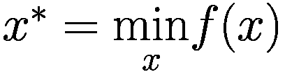

# 9. 无约束优化

无约束优化寻找一个变量（或一组变量），使其在无限制条件下最小化或最大化目标函数。数学上，它表示找到`x^∗`使得函数`f(x^∗)`取最小值。

`x`可以是标量（在ℝ¹中）或向量（在ℝ^n中）。`f(x)`始终是标量（在ℝ¹中）。无约束优化在科学的许多分支中都有应用。在金融领域，构建收益率曲线涉及寻找一组参数，以最小化债券理论价格与市场价格之间的差异。约束优化问题也可以通过将约束优化问题的约束转换为等价无约束优化问题目标函数中的惩罚项，来表述为无约束优化问题。此外，许多约束优化求解器或算法涉及将无约束优化问题作为子问题求解。NM Dev 拥有一套求解无约束优化问题的优化器或最小化器，适用于单变量和多变量问题，且可利用或不利用导数信息。此实现及其讨论主要基于 Antoniou & Lu (2007)。