## 9.3 区间分割法

单变量区间分割法用于解决单变量无约束优化问题。一个快速单变量方法在优化中至关重要。多变量约束优化问题通常可以转化为等价的多变量无约束优化问题。解决多变量无约束优化问题通常涉及解决多个单变量无约束优化问题，例如线搜索。后续章节中讨论的许多多变量无约束优化算法都使用线搜索。

最简单的单变量算法是区间搜索法。假设你有一个包含最小值的三点区间，`x[L] < x[a] < x[U]`，并且假设区间 `[x[L], x[U]]` 包含一个最小值。你按照区间划分方案计算第四个点 `x[b]`，形成两个重叠的子区间：`[x[L], x[a]]` 和 `[x[b], x[U]]`。选择包含新最小值的较小子区间。重复该过程来划分区间，直到收敛，即所选的子区间足够小。该算法在区间 `[x[L], x[U]]` 内对单峰函数最为有效。单峰函数是从 `x[L]` 开始增加（或减少）到某个点，然后向 `x[U]` 方向减少（或增加）的函数。它在区间内恰好包含一个最小值（或最大值）。

考虑一个在区间 `[x[L], x[U]]` 内有最小值的单峰函数。该区间称为不确定区间。通过四个点 `f(x[L])`、`f(x[a])`、`f(x[b])` 和 `f(x[U])`，你可以确定最小值的位置。二分法搜索指出：如果 `f(x[a]) < f(x[b])`，则 `x^*` 位于 `x[L] < x^* < x[b]`。有两种可能：`x[L] < x^* < x[b]`（如蓝色曲线所示）或 `x[a] < x^* < x[b]`（如橙色曲线所示）。综合两者得到 `x[L] < x^* < x[b]`。请参见图 9-1。

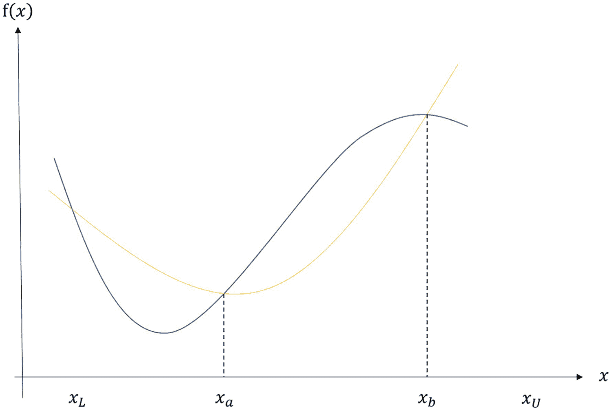

`x` 与 `x` 的函数关系图显示两条下垂曲线。它们相交处的两条投影线投影在 X 轴上，分别标记为 `x` 下标 `a` 和 `x` 下标 `b`。

`图 9-1`

`x^*` 在左侧区间

类似地，如果 `f(x[a]) > f(x[b])`，则得到 `x[a] < x^* < x[U]`，如图 9-2 所示。

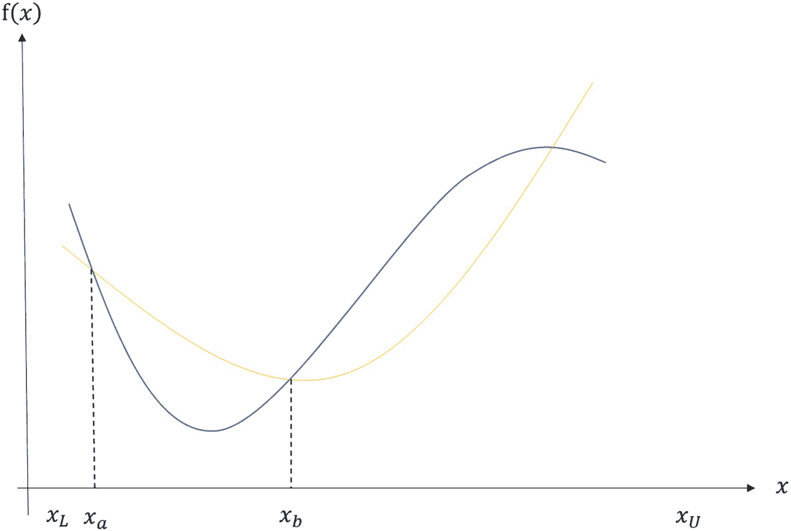

`x` 与 `x` 的函数关系图显示两条下垂曲线。它们相交处的两条投影线投影在 X 轴上，分别标记为 `x` 下标 `a` 和 `x` 下标 `b`。

`图 9-2`

`x^*` 在右侧区间

如果 `f(x[a]) = f(x[b])`，则得到 `x[a] < x^* < x[b]`。请参见图 9-3。

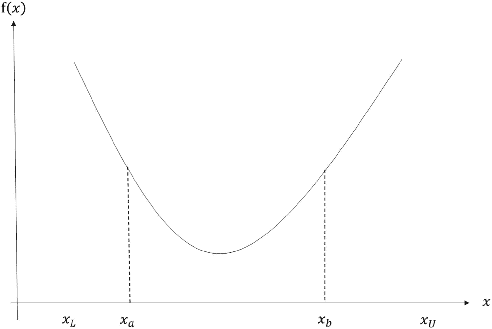

`x` 与 `x` 的函数关系图显示一条下垂曲线。两条投影线投影在 X 轴上，分别标记为 `x` 下标 `a` 和 `x` 下标 `b`。

`图 9-3`

`x[a] < x^* < x[b]`

简单的二分法搜索每次大致将区间对半划分。子区间的大小呈指数级递减（每次迭代减半）。大约经过七次迭代后，区间大小小于初始区间的 1%。总共需要计算 14 次函数值，因为每次迭代需要计算两次：`f(x[a])` 和 `f(x[b])`。NM Dev 实现了两种更复杂的区间划分方案。

### 9.3.1 斐波那契搜索法

我们首先分析区间大小。为简单起见，假设左右子区间长度相等。如图 9-4 所示。

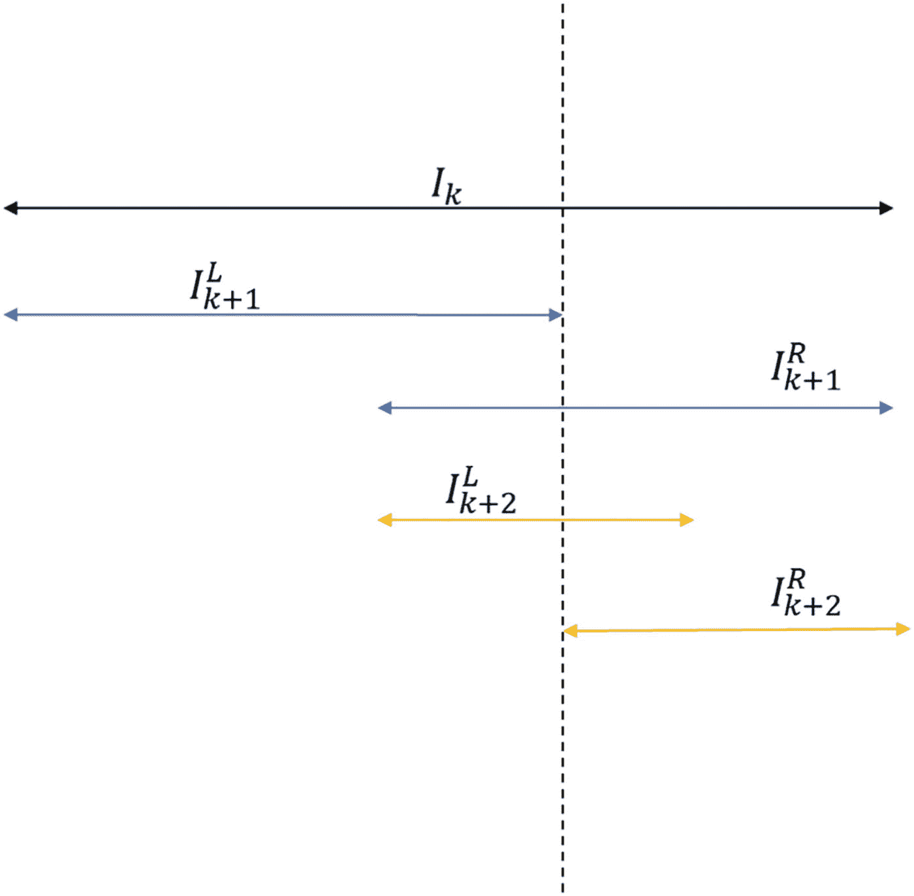

一条实心水平线和一条垂直虚线用于表示第 `k` 次迭代中的左右两个子区间。所有四次迭代均位于标有下标 `k` 的 `I` 线下方。

`图 9-4` - 第 `k, k+1, k+2` 次迭代中的子区间

由此得到：

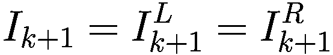

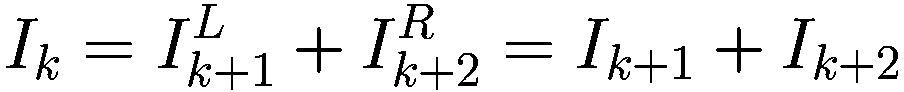

对于 `n` 次迭代，可得到以下递推关系：

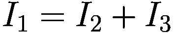

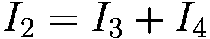


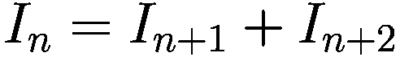

这里有 `n` 个方程，并且假设 `I[1]` 已知。共有 `n + 2` 个变量。可以通过施加一个额外条件来生成一个区间序列。

特别地，如果假设最后一次迭代的区间消失，即 `I[n + 2] = 0`，则生成斐波那契序列。

求解上述方程组可得到：

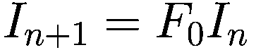

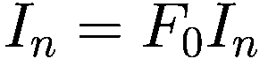

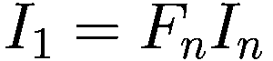


其中

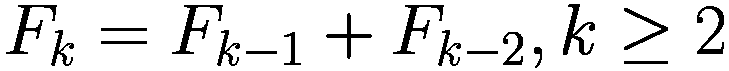

`F[k]` 是斐波那契数列的定义，即 {1, 1, 2, 3, 5, 8, 13, …}。

例如，如果 `n = 11`，则 `F[n] = 144`。`I[n] = I[1] / F[n]`。`I[n]` 缩减至 `I[1]` 的 0.69%。此外，通过选择左或右子区间，你已经得到两个端点和中间的一个点，即 {`x[L]`, `x[a]`, `x[b]`} 或 {`x[a]`, `x[b]`, `x[U]`}。只需要再确定一个点，因此只需计算一次函数值。对于 11 次迭代，总共需要 14 次计算，而朴素的二分法搜索则需要 22 次。

使用斐波那契序列的一个主要缺点是它需要预先知道 `n`。如果你希望 `x^*` 在预设的精度范围内，这是可行的。你使用公式 `I[n] = I[1] / F[n]` 来确定 `n`。但是，如果希望 `f(x^*)` 达到一定精度，你一开始并不知道 `n` 是多少。

### 9.3.2 黄金分割搜索法

与斐波那契分割法不同，黄金分割搜索法会持续迭代，直到达到函数精度要求。其递推关系与斐波那契法相同：`I[k] = I[k - 1] + I[k - 2]`。额外的条件是保持相邻两个区间的比率恒定。

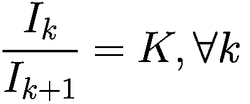

利用这两个方程，可以解出 `K`，如下所示：

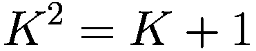

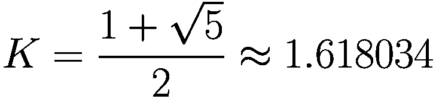

这个数字被称为黄金比例。区间序列如下：

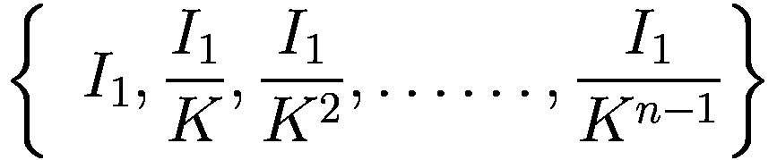

示例如下：{100, 61.8, 38.2, 23.6, 14.6, 9, …}。这个过程可以继续进行，无需预先确定 `n`。

让我们比较一下黄金分割搜索法和斐波那契搜索法的效率。`F[n]` 与 `K` 的关系为 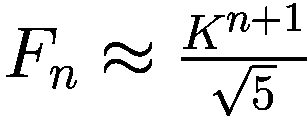。斐波那契搜索中的不确定性区域如下：

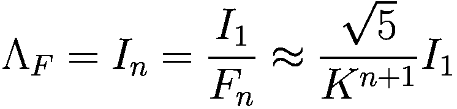

对于黄金分割搜索法，情况如下：

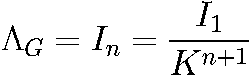

因此，可得到：

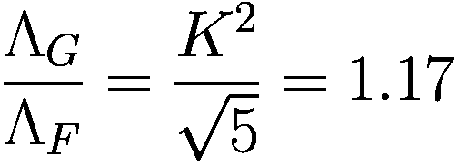

因此，要达到与斐波那契搜索法相同的精度，黄金分割搜索法需要更多的迭代次数。斐波那契搜索法更高效，但黄金分割搜索法无需预先知道 `n`。

### 9.3.3 布伦特搜索

黄金分割搜索具有线性收敛速度。我们即将讨论的抛物线搜索的收敛速度为 `1.325`，因此效率更高。在每个包围区间中，你再次选择三个点：`x[L] < x[m] < x[U]`。你用一个二次多项式（即抛物线）来近似该区间内的函数。

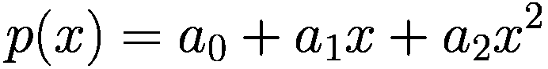

有了这三个点，你可以通过求解一个由三个线性方程组成的方程组来确定多项式系数。`p(x)` 的最小点  可以很容易地通过令其一阶导数为零来求解：

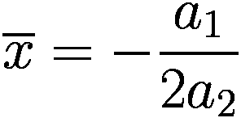

根据泰勒展开， 将非常接近 `x^*`；事实上，如果函数是二次的，它将精确等于 `x^*`。通过检查 ，你可以通过舍弃 `x[L]` 或 `x[U]` 并保留  来选择一个新的区间。重复此过程，直到所有三个点都足够接近（`x^*`）。参见图 9-5。

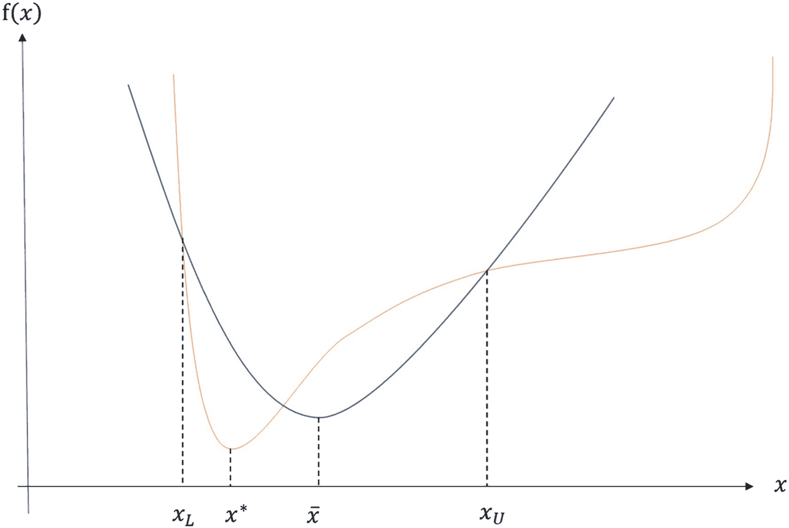

**图 9-5** 曲线段的抛物线近似

虽然抛物线搜索具有超线性收敛速度，但它并不总是收敛（即便只是到局部最小值）。例如，如果这三个点共线，那么得到的抛物线是退化的，因此无法提供新的候选点。因此，这种方法很少单独使用。

布伦特方法结合了抛物线搜索和黄金分割搜索。布伦特方法在适用时（例如，没有两个点是相同的）使用抛物线搜索。当条件不满足时，它会切换回使用黄金分割搜索。换句话说，布伦特方法结合了两者的优点：超线性收敛速度和保证能找到最小值。因此，在实践中，对于单变量优化，你几乎总是应该默认使用布伦特搜索。参见图 9-6。

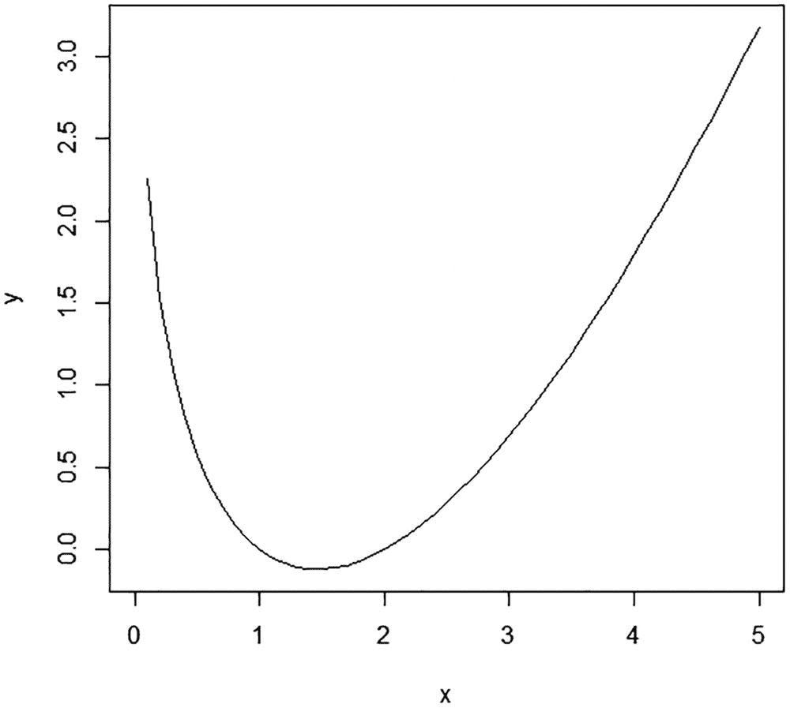

**图 9-6** 对数伽马函数

以下 `NM Dev` 代码使用斐波那契搜索、黄金分割搜索和布伦特搜索求解了对数伽马函数：

```
val logGamma = LogGamma() // the log-gamma function
// Using the Fibonacc method
val solver1 = FibonaccMinimizer(1e-8, 15)
val soln1: UnivariateMinimizer.Solution = solver1.solve(logGamma)
val x_min_1: Double = soln1.search(0.0, 5.0)
println(String.format("f(%f) = %f", x_min_1, logGamma.evaluate(x_min_1)))
```

输出如下：

```
f(1.463682) = -0.121484
```

```
// Using the Golden section method
val solver2 = GoldenMinimizer(1e-8, 15)
val soln2: UnivariateMinimizer.Solution = solver2.solve(logGamma)
val x_min_2: Double = soln2.search(0.0, 5.0)
println(String.format("f(%f) = %f", x_min_2, logGamma.evaluate(x_min_2)))
```

输出如下：

```
f(1.460813) = -0.121486
```

```
// Using Brent's method
val solver3 = BrentMinimizer(1e-8, 10) // fewer itertaions than that of Fibonacci or golden search
val soln3: UnivariateMinimizer.Solution = solver3.solve(logGamma)
val x_min_3: Double = soln3.search(0.0, 5.0)
println(String.format("f(%f) = %f", x_min_3, logGamma.evaluate(x_min_3)))
```

输出如下：

```
f(1.461632) = -0.121486
```

它们的签名如下：

`FibonaccMinimizer(double epsilon, int maxIterations)`

`GoldenMinimizer(double epsilon, int maxIterations)`

`BrentMinimizer(double epsilon, int maxIterations)`

```
/**
 * 使用斐波那契方法构造一个单变量最小化器。
 *
 * @param epsilon       一个精度参数：当数字 |x| ≤ ε 时，视其为 0
 * @param maxIterations 最大迭代次数
 */
public FibonaccMinimizer(double epsilon, int maxIterations)
/**
 * 使用黄金分割方法构造一个单变量最小化器。
 *
 * @param epsilon       一个精度参数：当数字 |x| ≤ ε 时，视其为 0
 * @param maxIterations 最大迭代次数
 */
public GoldenMinimizer(double epsilon, int maxIterations)
/**
 * 使用布伦特算法构造一个单变量最小化器。
 *
 * @param epsilon       一个精度参数：当数字 |x| ≤ ε 时，视其为 0
 * @param maxIterations 最大迭代次数
 */
public BrentMinimizer(double epsilon, int maxIterations)
/**
 * 这是单变量最小化问题的解。
 */
public static interface Solution extends MinimizationSolution {
/**
 * 在区间 [lower, upper] 内搜索最小值。
 *
 * @param lower   包围区间（包含最小值）的下界
 * @param initial 一个初始猜测值
 * @param upper   包围区间（包含最小值）的上界
 * @return 近似最小化点
 */
public double search(double lower, double initial, double upper);
/**
 * 在区间 [lower, upper] 内搜索最小值。
 *
 * @param lower 包围区间（包含最小值）的下界
 * @param upper 包围区间（包含最小值）的上界
 * @return 近似最小化点
 */
public double search(double lower, double upper);
}
```

您可以调用 `search` 方法来寻找单变量函数最小化的最小化点。