# 最速下降法

寻找最小值的通用思路通常是从一个初始点开始，然后调整某些参数以找到下一个（有望）使函数值更小的点。如果没有任何信息，盲目搜索的效率会很低。有两种信息非常有用：梯度`g`和海森矩阵`H`。

最速下降算法是一类利用梯度和海森矩阵信息，沿着能使函数值下降最快的方向进行搜索的算法。我们首先讨论仅使用梯度信息的一阶方法。考虑以下优化问题：

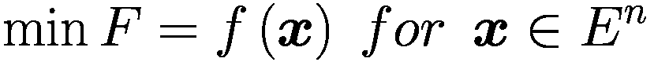

泰勒展开给出以下结果：

`F + ΔF = f(x + δ) ≈ f(x) + g^T δ + O(δ^T δ)`，当`∥δ∥ → 0`时，`ΔF ≈ g^T δ`

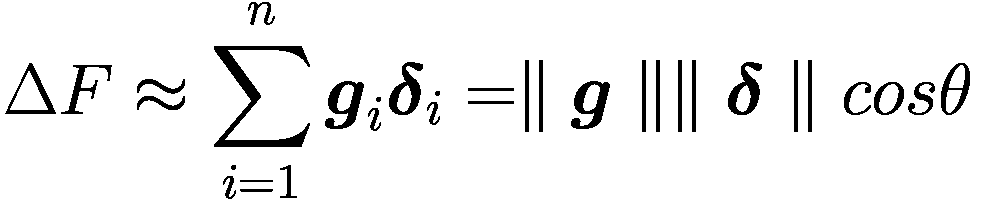

对于任意向量`δ`，当`θ = 0`时，`ΔF`取最大值，这意味着`δ`与`g`方向相同。当`θ = π`时，`ΔF`取最小值，这意味着`δ`与`g`方向相反，或者沿`-g`方向。它们分别被称为最陡上升方向和最陡下降方向，如图 9-7 所示。

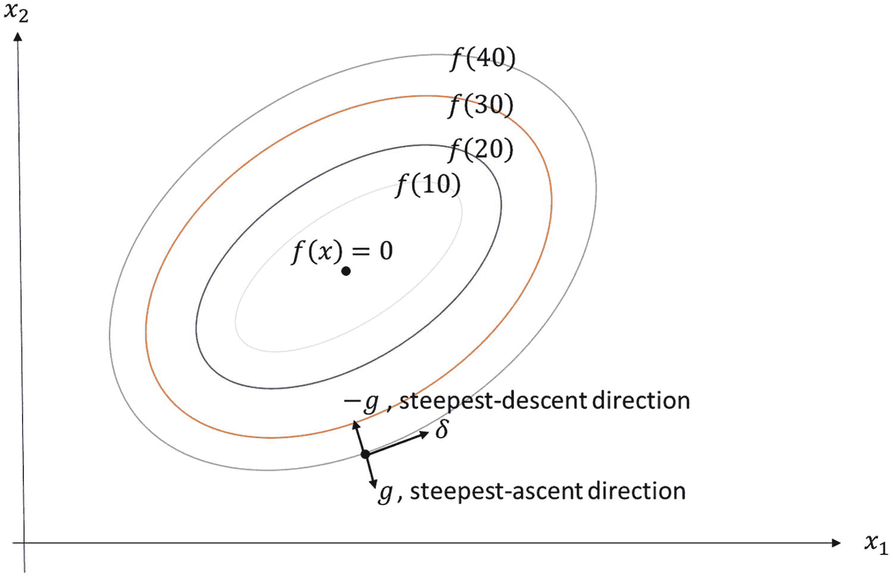

`x2`相对于`x1`的图显示了函数`x`四个不同取值对应的四个同心圆。中心函数值为 0。最陡下降方向也已标出。

**图 9-7** 最陡下降方向与最陡上升方向

最速下降算法的一般框架如下：

1.  指定初始点`x[0]`和容差`ε`。
2.  计算梯度`g[k]`，并设置牛顿方向向量`d[k] = -g[k]`。
3.  关于`α`最小化`f(x[k] + αd[k])`，以计算增量`α[k]`。
4.  设置下一个点`x[k + 1] = x[k] + α[k]d[k]`，并计算下一个函数值`f[k + 1] = f(x[k + 1])`。
5.  如果`∥α[k]d[k]∥ < ε`，则：
    -   完成。`x* = x[k + 1]`且`f(x*) = f[k + 1]`。
    -   否则，重复步骤 2。

在步骤 3 中，可以使用一维优化算法中的线搜索来计算`α[k]`。在本实现中，我们使用弗莱彻非精确线搜索方法。许多优化算法已证明对线搜索的不精确性具有相当强的容忍度。或者，`α[k]`也可以通过解析方法计算。

以下 NM Dev 代码使用一阶最速下降法最小化此函数：

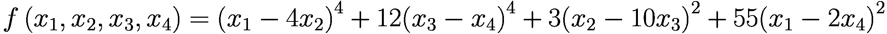

```
// 目标函数
// 全局最小值点位于 x = [0,0,0,0]
val f = object : RealScalarFunction {
override fun evaluate(x: Vector): Double {
val x1: Double = x.get(1)
val x2: Double = x.get(2)
val x3: Double = x.get(3)
val x4: Double = x.get(4)
var result: Double = (x1 - 4 * x2).pow(4)
result += 12 * (x3 - x4).pow(4)
result += 3 * (x2 - 10 * x3).pow(2)
result += 55 * (x1 - 2 * x4).pow(2)
return result
}
override fun dimensionOfDomain(): Int {
return 4
}
override fun dimensionOfRange(): Int {
return 1
}
}
// 梯度函数
val g = object : RealVectorFunction {
override fun evaluate(x: Vector): Vector {
val x1 = x.get(1)
val x2 = x.get(2)
val x3 = x.get(3)
val x4 = x.get(4)
var result = ArrayList(4)
result.add(0, 4 * (x1 - 4 * x2).pow(3) + 110 * (x1 - 2 * x4))
result.add(1, -16 * (x1 - 4 * x2).pow(3) + 6 * (x2 - 10 * x3))
result.add(2, 48 * (x3 - x4).pow(3) - 60 * (x2 - 10 * x3))
result.add(3, -48 * (x3 - x4).pow(3) - 220 * (x1 - 2 * x4))
return DenseVector(result)
}
override fun dimensionOfDomain(): Int {
return 4
}
override fun dimensionOfRange(): Int {
return 4
}
}
val problem = C2OptimProblemImpl(f, g) // 仅使用梯度信息
val firstOrderMinimizer: SteepestDescentMinimizer
= FirstOrderMinimizer(
FirstOrderMinimizer.Method.IN_EXACT_LINE_SEARCH,
// FirstOrderMinimizer.Method.ANALYTIC
1e-8,
)
val soln: IterativeSolution = firstOrderMinimizer.solve(problem)
val xmin: Vector = soln.search(DenseVector(1.0, -1.0, -1.0, 1.0))
val f_xmin: Double = f.evaluate(xmin)
println(String.format("f(%s) = %f", xmin.toString(), f_xmin))
```

输出结果如下：

```
f([0.046380, 0.016330, 0.001634, 0.023189] ) = 0.000003
```

这大约需要 40,000 次迭代，速度太慢了。

`FirstOrderMinimizer`的签名如下。

```
/**
* 使用一阶方法构造一个多元最小化器。
*
* @param method        执行线搜索的方法
* @param epsilon       精度参数：当数值 |x| &le;
*                      &epsilon; 时，视为 0
* @param maxIterations 最大迭代次数
*/
public FirstOrderMinimizer(Method method, double epsilon, int maxIterations)
```

`Method` 指定是使用线搜索还是解析表达式来计算`α[k]`。


### 9.4.1 牛顿-拉弗森法

二阶方法除了使用梯度外，还使用（非奇异的）海森矩阵来确定最速下降框架中的方向向量 `d[k]` 和增量 `α[k]`，以加速收敛。牛顿-拉弗森法将泰勒级数展开到二阶。令 `δ` 为 `x` 的变化量，可得：


对 `f(x + δ)` 关于 `δ[k]` 求导以最小化 `f(x + δ)`，可得：

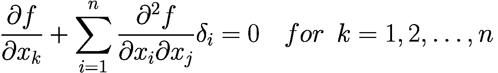

将其重写为矩阵形式如下：

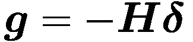

`x` 的最优变化量如下：

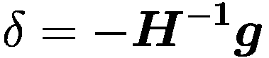

使用线性搜索来计算沿着该方向 `f(x)` 的最大减量。下一个点 `x[k+1]` 如下：

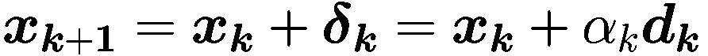

其中满足：

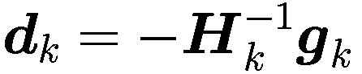

`α[k]` 是使 `f(x[k] + α * d[k])` 最小的 `α` 值。

与一阶方法相比，牛顿-拉弗森法利用海森矩阵信息加速收敛，特别是在接近解时效果显著。以下 NM Dev 代码使用牛顿-拉弗森法最小化同一个函数：

```
// 目标函数
// 全局最小值点位于 x = [0,0,0,0]
val f = object : RealScalarFunction {
override fun evaluate(x: Vector): Double {
val x1: Double = x.get(1)
val x2: Double = x.get(2)
val x3: Double = x.get(3)
val x4: Double = x.get(4)
var result: Double = (x1 - 4 * x2).pow(4)
result += 12 * (x3 - x4).pow(4)
result += 3 * (x2 - 10 * x3).pow(2)
result += 55 * (x1 - 2 * x4).pow(2)
return result
}
override fun dimensionOfDomain(): Int {
return 4
}
override fun dimensionOfRange(): Int {
return 1
}
}
// 梯度函数
val g = object : RealVectorFunction {
override fun evaluate(x: Vector): Vector {
val x1: Double = x.get(1)
val x2: Double = x.get(2)
val x3: Double = x.get(3)
val x4: Double = x.get(4)
var result = ArrayList(4)
result.add(0, 4 * (x1 - 4 * x2).pow(3) + 110 * (x1 - 2 * x4))
result.add(1, -16 * (x1 - 4 * x2).pow(3) + 6 * (x2 - 10 * x3))
result.add(2, 48 * (x3 - x4).pow(3) - 60 * (x2 - 10 * x3))
result.add(3, -48 * (x3 - x4).pow(3) - 220 * (x1 - 2 * x4))
return DenseVector(result)
}
override fun dimensionOfDomain(): Int {
return 4
}
override fun dimensionOfRange(): Int {
return 4
}
}
val problem = C2OptimProblemImpl(f, g) // 使用数值海森矩阵
val newtonRaphsonMinimizer: SteepestDescentMinimizer
= NewtonRaphsonMinimizer(
1e-8,

)
val soln: IterativeSolution = newtonRaphsonMinimizer.solve(problem)
val xmin: Vector = soln.search(DenseVector(1.0, -1.0, -1.0, 1.0))
val f_xmin: Double = f.evaluate(xmin)
println(String.format("f(%s) = %f", xmin.toString(), f_xmin))
```

输出如下：

```
f([0.000134, -0.000009, -0.000001, 0.000067] ) = 0.000000
```

值得指出的是，牛顿-拉弗森法的收敛速度远快于一阶方法。它仅用 20 次迭代就能达到比 40,000 次迭代更高的精度。

`NewtonRaphsonMinimizer` 的签名如下：

```
/**
* 使用牛顿-拉弗森法构造一个多元最小化器。
*
* @param epsilon       精度参数：当数值 |x| &le;
*                      &epsilon; 时，视为 0
* @param maxIterations 最大迭代次数
*/
public NewtonRaphsonMinimizer(double epsilon, int maxIterations)
```


### 9.4.2 高斯-牛顿方法

高斯-牛顿方法用于最小化如下形式的目标函数：

![$$ \boldsymbol{f}={\left[{f}_1(x)\;{f}_2(x)\dots \dots {f}_m(x)\right]}^T $$](images/528380_1_En_9_Chapter/528380_1_En_9_Chapter_TeX_Equad.png)

其解为一个点`x`，使得所有`fp`同时归零。

你可以构造一个实值函数`F`，当`F`被最小化时，函数`fp`也在最小二乘意义上被最小化。

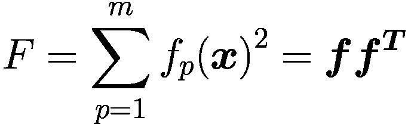

其梯度的雅可比矩阵如下：

![$$ \textbf{J}=\left[\begin{array}{ccc}\frac{\partial {f}_1}{\partial {x}_1}&amp; \cdots &amp; \frac{\partial {f}_m}{\partial {x}_1}\\ {}\vdots &amp; \ddots &amp; \vdots \\ {}\frac{\partial {f}_1}{\partial {x}_n}&amp; \cdots &amp; \frac{\partial {f}_m}{\partial {x}_n}\end{array}\right] $$](images/528380_1_En_9_Chapter/528380_1_En_9_Chapter_TeX_Equaf.png)

对`F`关于`x[i]`求导，得到：

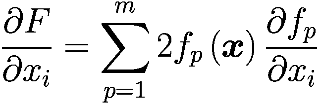

或者，用矩阵形式表示，得到的梯度向量如下：

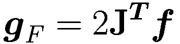

再次求导，得到：

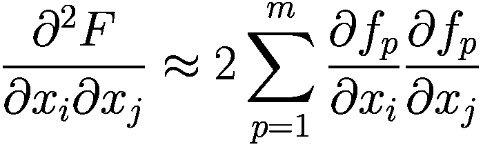

海森矩阵`H[F]`如下所示，它需要是非奇异且正定的：

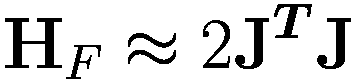

下一个点由递归关系给出：

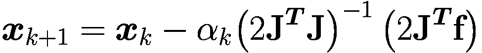

以下代码使用高斯-牛顿方法求解相同的极小化问题：

```
// 目标函数
// 全局最小值点位于 x = [0,0,0,0]
val f = object : RealVectorFunction {
override fun evaluate(x: Vector): Vector {
val x1: Double = x.get(1)
val x2: Double = x.get(2)
val x3: Double = x.get(3)
val x4: Double = x.get(4)
var fx = ArrayList(4)
fx.add(0, (x1 - 4 * x2).pow(2))
fx.add(1, sqrt(12.0) * (x3 - x4).pow(2))
fx.add(2, sqrt(3.0) * (x2 - 10 * x3))
fx.add(3, sqrt(55.0) * (x1 - 2 * x4))
return DenseVector(fx)
}
override fun dimensionOfDomain(): Int {
return 4
}
override fun dimensionOfRange(): Int {
return 4
}
}
// 雅可比矩阵
val J = object : RntoMatrix {
override fun evaluate(x: Vector): Matrix {
val x1: Double = x.get(1)
val x2: Double = x.get(2)
val x3: Double = x.get(3)
val x4: Double = x.get(4)
var Jx: Matrix = DenseMatrix(4, 4)
var value: Double = 2 * (x1 - 4 * x2)
Jx.set(1, 1, value)
value = -8 * (x1 - 4 * x2)
Jx.set(1, 2, value)
value = 2 * sqrt(12.0) * (x3 - x4)
Jx.set(2, 3, value)
Jx.set(2, 4, -value)
Jx.set(3, 2, sqrt(3.0))
Jx.set(3, 3, -10 * sqrt(3.0))
Jx.set(4, 1, sqrt(55.0))
Jx.set(4, 4, -2 * sqrt(55.0))
return Jx
}
override fun dimensionOfDomain(): Int {
return 4
}
override fun dimensionOfRange(): Int {
return 1
}
}
val optim1 = GaussNewtonMinimizer(1e-8, 10)
val soln: IterativeSolution = optim1.solve(f, J)//解析梯度
val xmin: Vector = soln.search(DenseVector(1.0, -1.0, -1.0, 1.0))
println(String.format("f(%s) = %s", xmin.toString(), f.evaluate(xmin).toString()))
```

输出结果如下：

```
f([0.000007, -0.000000, -0.000000, 0.000003] ) = [0.000000, 0.000000, -0.000000, -0.000000]
```

高斯-牛顿方法比牛顿-拉弗森方法更高效。对于前述问题，它大约需要十次迭代，而牛顿-拉弗森方法则需要二十次。

`GaussNewtonMinimizer`的签名如下：

```
/**
* 构造一个使用高斯-牛顿方法的多变量极小化器。
*
* @param epsilon       精度参数：当一个数 |x| &le;
*                      &epsilon; 时，视为 0
* @param maxIterations 最大迭代次数
*/
public GaussNewtonMinimizer(double epsilon, int maxIterations)
```

## 9.5 共轭方向方法

在最速下降法中，连续的搜索方向可能相关，也可能不相关。此外，它们完全由目标函数的局部性质（即梯度和海森矩阵）决定（Hestenes & Stiefel, 1952）。另一方面，在共轭方向方法中，连续的搜索方向之间存在严格的数学关系。共轭方法最初是为求解具有如下目标函数的二次优化问题而开发的：

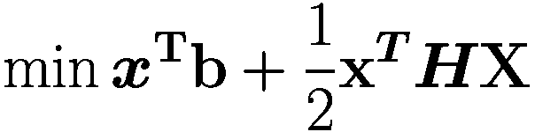

其中，`H`是一个`n * n`的对称正定矩阵，对应一个包含`n`个变量的函数。

对于一个二次问题，搜索过程将在有限次迭代内收敛到最小值。此后，共轭方法被推广用于求解更一般的优化问题。


### 9.5.1 共轭方向

对于对称矩阵 `H`，如果对于所有 `i ≠ j`，有限向量集 `{d[0], d[1], …, d[k]}` 满足 `d[i]^T H d[j] = 0`，则称它们关于 `H` 共轭，或**H-正交**。如果 `H` 是正定的，这些向量线性无关。如果 `H = I`，则这些向量正交。

对于前述二次型最小化问题，当 `H` 正定时，简单的微积分知识表明解是唯一的，并且可以通过求解线性方程组解析计算：

```
H x* = b
```

由于共轭向量集线性无关，因此张成 `n` 维空间 `E^n`，`x*` 可以表示为这些向量的线性组合：

```
x* = α_0 d[0] + … + α_{n-1} d[n-1]
```

两边乘以 `H` 并与 `d[i]` 作标量积，得到：

```
α_i = - (d[i]^T H x*) / (d[i]^T H d[i]) = - (d[i]^T b) / (d[i]^T H d[i])
```

等价地：

```
x* = Σ_{i=0}^{n-1} (d[i]^T b / (d[i]^T H d[i])) * d[i]
```

`x*` 的这种展开可视为一个求和过程，或一个逐步添加 `α[i] d[i]` 的 `n` 步迭代过程。

**共轭方向定理**

设 `{d[i]}_{i=0}^{n-1}` 是一组非零的 `H`-正交向量。对于任意 `x[0] ∈ E^n`，按以下方式生成的序列 `{x[i]}`：

```
x_{k+1} = x_k + α_k d_k,  k ≥ 0
```

其中：

```
α_k = - (g_k^T d_k) / (d_k^T H d_k)
```

并且：

```
g_k = b + H x_k
```

该序列在 `n` 步后收敛到 `H x = b` 的唯一解 `x*`，即 `x[n] = x*`。

利用该定理以及多种生成共轭向量的方法，可以设计出多种共轭方向法。此外，还需要将该定理推广以解决非二次问题。共轭方向法非常适合最速下降法的框架，两者仅在方向向量 `d[k]` 及其对应的步长 `α[k]` 的计算方式上有所不同。此处我们使用共轭方向而非最速下降方向，但迭代地向 `x[k]` 添加增量 `α[k] d[k]` 以生成 `x[k+1]` 的思想是相同的。

### 9.5.2 共轭梯度法

Hestenes 与 Stiefel (1952) 提出了共轭梯度法。在该方法中，新方向是前一方向与负梯度的加权和。

```
d[0] = -g[0] = -(b + H x[0])
```

```
d_k = -g_k + β_k d_{k-1}
```

```
g_k = b + H x_k
```

```
β_k = (g_k^T H d_k) / (d_k^T H d_k)
```

```
α_k = - (g_k^T d_k) / (d_k^T H d_k)
```

该方法具有以下优点：

- 梯度是有限的，并且除了找到解的情况外，与所有先前的方向向量线性无关。
- 计算新方向向量相对容易。
- 无需进行线搜索。
- 对于二次问题，可在 `n` 步内收敛。
- 第一个方向与最速下降法相同，即 `d[0] = -g[0]`，可提供良好的初始下降。
- 无需对海森矩阵求逆。

以下为其缺点：

- 必须提供、存储并操作海森矩阵。
- 对于非二次问题，收敛性无法保证。事实上，如果初始点远离解，搜索可能会在某个次优区域徘徊，因为不可靠的方向会随着迭代累积。稍后的代码示例中您将看到，对于 Himmelblau 函数，共轭梯度法需要最多的迭代次数才能收敛。

### 9.5.3 弗莱彻-里夫斯法

弗莱彻-里夫斯法是共轭梯度法的一个变体。主要区别在于：`α[k]` 通过最小化 `f(X + α[k] d[k])` 的线搜索计算得到，并且 `d[k]` 是关于 `{d[0], d[1], …, d[k]}` 的共轭方向，而非最速下降方向或牛顿方向。因此，该算法与共轭梯度法类似，但由于线搜索而需要更多计算，这是一个缺点。然而，它有两个优点。

- 该改进型算法在非二次函数的最小化中表现更好，因为在解邻域之外的点上，沿 `d[k]` 方向可以使 `f(x)` 获得更大的下降。
- 该算法不需要海森矩阵。


### 9.5.4 鲍威尔方法

鲍威尔算法通过一维搜索生成一系列共轭方向。

设 `x_a*` 和 `x_b*` 是以下凸二次函数：

```
f(x) = x^T b + 1/2 x^T H x
```

分别在方向 `d[a]` 和 `d[b]` 上对参数 `α` 进行最小化后得到的极小点：

```
x = x_a + α * d_a
```

以及下式：

```
x = x_b + α * d_b
```

如果 `d[a] = d[b]`，则向量 `x_b* - x_a*` 与 `d[a]` 共轭。参见图 9-8。

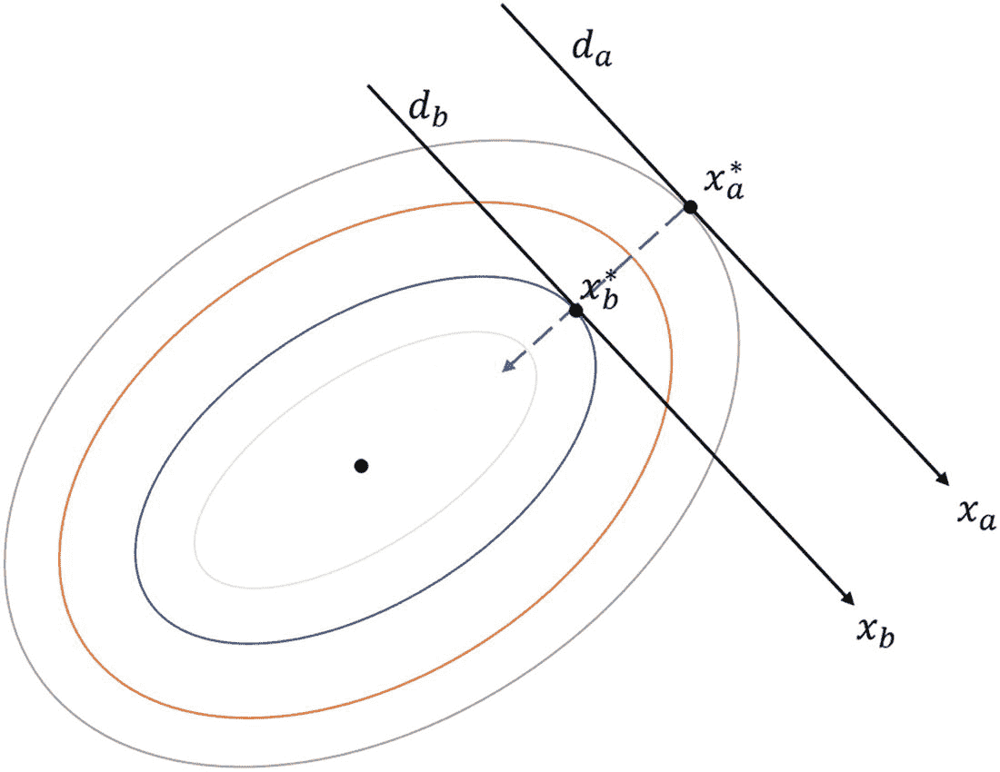

一个由同心圆组成的图像包含四层。在第二和第四个圆上绘制了两条平行切线。一条垂直于这些切线的虚线穿过所有圆。

**图 9-8** 共轭方向的生成

在该算法中，假设初始点 `x[00]` 和 `n` 个线性无关的方向 `{d[0], d[1], …, d[n]}`（通常取坐标方向），并在每次迭代中执行一系列一维搜索。在第一次迭代中，从点 `x[00]` 开始，依次沿方向 `{d[0], d[1], …, d[n]}` 对 `f(x)` 进行最小化，得到点 `x[01]`, `x[02]`, …, `x[0n]`。然后按如下方式生成一个新方向 `d[0(n+1)]`：

```
d_0(n+1) = x_0n - x_00
```

并沿此方向对 `f(x)` 进行最小化，得到一个新点 `x[0(n+1)]`。通过如下设置更新方向（见图 9-9）：

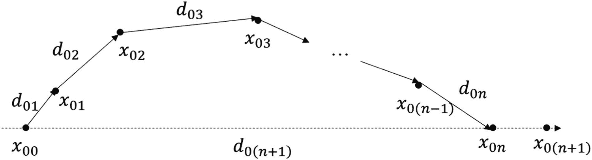

鲍威尔算法第一次迭代中 `d_0(n+1)` 和 `x_0(n+1)` 的图解。线条表示 `d` 函数，节点表示 `x` 函数。

**图 9-9** 鲍威尔算法中的第一次迭代

```
d_11 = d_02
d_12 = d_03
...
d_1(n-1) = d_0n
d_1n = d_0(n+1)
```

相同的流程在第二次迭代中重复，该迭代从点 `x[10] = x[0(n+1)]` 开始。依次沿方向 `{d[11], d[12], …, d[1n]}` 对 `f(x)` 进行最小化，得到点 `x[11]`, `x[12]`, …, `x[1n]`。然后按如下方式生成一个新方向 `d[1(n+1)]`（见图 9-10）：

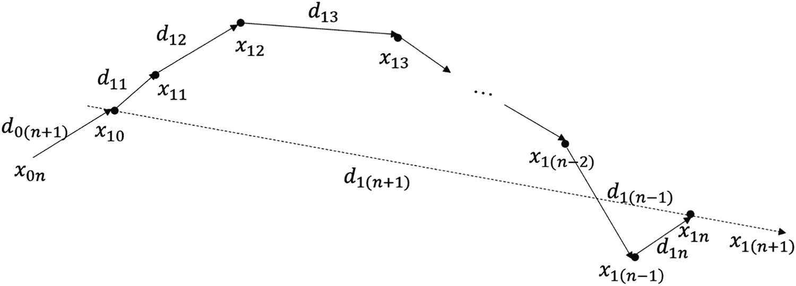

鲍威尔算法第二次迭代中 `d_1(n+1)` 和 `x_1(n+1)` 的图解。线条表示 `d` 函数，节点表示 `x` 函数。

**图 9-10** 鲍威尔算法中的第二次迭代

```
d_1(n+1) = x_1n - x_10
```

按相同方式继续，每次新迭代将增加一个共轭方向并移除另一个方向，从而实现替换。由于每次迭代需要 `(n + 1)` 次一维搜索，鲍威尔方法在 `n` 次迭代中共执行 `n * (n + 1)` 次一维搜索。

鲍威尔方法的优点在于它不需要提供、存储或操作海森矩阵，甚至不需要梯度。然而，该方法可能无法生成一组张成 `E^(n)` 的线性无关方向，并且算法可能无法收敛到解。


### Zangwill 方法

Zangwill 算法是 Powell 算法的一个改进版本。其改进之处在于生成一组始终线性无关的共轭方向。因此，它消除了 Powell 算法中的缺点。

改进措施如下：首先，选择坐标方向集，使其行列式为 1。其次，将新方向归一化至单位长度。第三，方向替换必须确保方向向量矩阵的行列式为正，且小于等于 1。最后一点保证了方向向量始终线性无关。

以下代码对 Himmelblau 函数进行最小化（见图 9-11）：

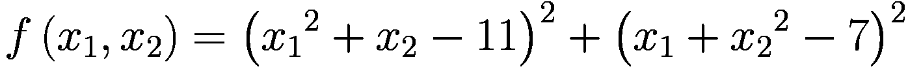

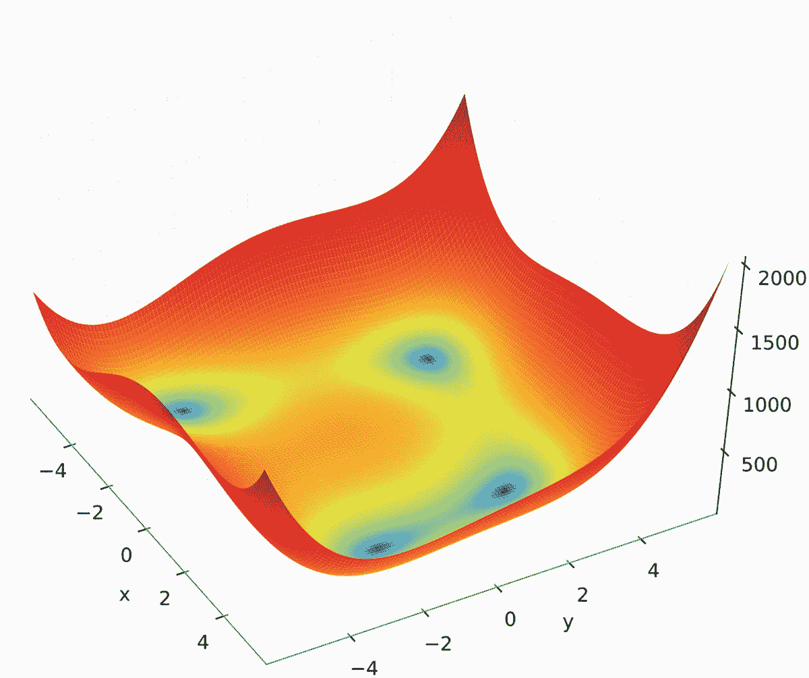

具有四个极小点的 Himmelblau 函数三维图，极小点已用圆形标记。

**图 9-11** 具有四个极小点的 Himmelblau 函数

共有四个极小点。它们分别是：

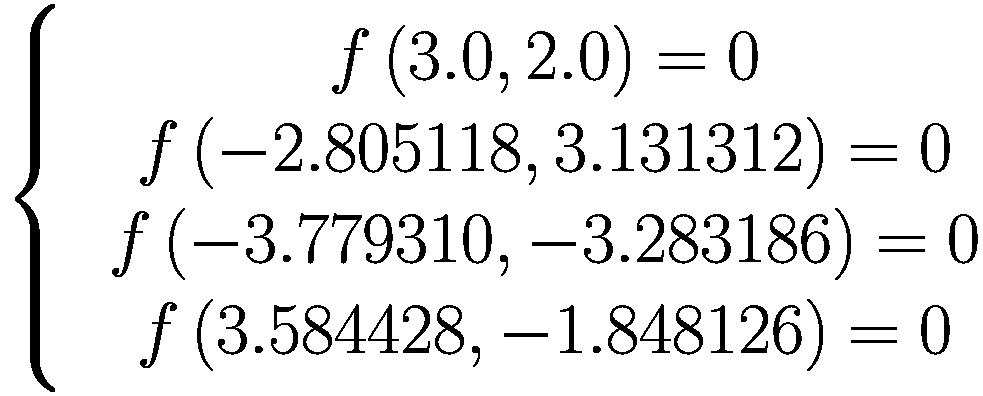

```
/**
* Himmelblau 函数：f(x) = (x1² + x2 - 11)² + (x1 + x2² - 7)²
*/
val f = object : RealScalarFunction {
override fun evaluate(x: Vector): Double {
val x1: Double = x.get(1)
val x2: Double = x.get(2)
var result: Double = (x1 * x1 + x2 - 11).pow(2)
result += (x1 + x2 * x2 - 7).pow(2)
return result
}
override fun dimensionOfDomain(): Int {
return 2
}
override fun dimensionOfRange(): Int {
return 1
}
}
val g = object : RealVectorFunction {
override fun evaluate(x: Vector): Vector {
val x1: Double = x.get(1)
val x2: Double = x.get(2)
val w1: Double = x1 * x1 + x2 - 11
val w2: Double = x1 + x2 * x2 - 7
var result = ArrayList(2)
result.add(0, 4 * w1 * x1 + 2 * w2)
result.add(1, 2 * w1 + 4 * w2 * x2)
return DenseVector(result)
}
override fun dimensionOfDomain(): Int {
return 2
}
override fun dimensionOfRange(): Int {
return 2
}
}
val problem = C2OptimProblemImpl(f, g)
// 使用共轭梯度法
val ConjugateGradientMinimizer
= ConjugateGradientMinimizer(1e-16, 40)
val soln1: IterativeSolution = ConjugateGradientMinimizer.solve(problem)
val xmin1: Vector = soln1.search(DenseVector(6.0, 6.0))
val f_xmin1: Double = f.evaluate(xmin1)
println(String.format("f(%s) = %.16f", xmin1.toString(), f_xmin1))
```

输出如下：

```
f([3.000000, 2.000000] ) = 0.0000000000013999
```

```kotlin
// 使用 Fletcher-Reeves 方法
val fletcherReevesMinimizer
= FletcherReevesMinimizer(1e-16, 20)
val soln2: IterativeSolution = fletcherReevesMinimizer.solve(problem)
val xmin2: Vector = soln2.search(DenseVector(6.0, 6.0))
val f_xmin2: Double = f.evaluate(xmin2)
println(String.format("f(%s) = %.16f", xmin2.toString(), f_xmin2))
```

输出如下：

```
f([3.000002, 1.999998] ) = 0.0000000001278725
```

```kotlin
// 使用 Powell 方法
val powellMinimizer: SteepestDescentMinimizer
= PowellMinimizer(1e-16, 20)
val soln3: IterativeSolution = powellMinimizer.solve(problem)
val xmin3: Vector = soln3.search(DenseVector(6.0, 6.0))
val f_xmin3: Double = f.evaluate(xmin3)
println(String.format("f(%s) = %.16f", xmin3.toString(), f_xmin3))
```

输出如下：

```
f([-2.805114, 3.131310] ) = 0.0000000007791914
```

```kotlin
// 使用 Zangwill 方法
val zangwillMinimizer: SteepestDescentMinimizer
= ZangwillMinimizer(1e-16, 1e-16, 20)
val soln4: IterativeSolution = zangwillMinimizer.solve(problem)
val xmin4: Vector = soln4.search(DenseVector(6.0, 6.0))
val f_xmin4: Double = f.evaluate(xmin4)
println(String.format("f(%s) = %.16f", xmin4.toString(), f_xmin4))
```

输出如下：

```
f([-2.805117, 3.131311] ) = 0.0000000001359077
```

找到的两个极小点为 (3, 2) 和 (−2.805118, 3.131312)。

这些最小化器的签名如下：

```java
/**
* 使用共轭梯度法构造一个多变量最小化器。
*
* @param epsilon       精度参数：当数 |x| ≤ ε 时，视为 0
* @param maxIterations 最大迭代次数
*/
public ConjugateGradientMinimizer(double epsilon, int maxIterations)
/**
* 使用 Fletcher-Reeves 方法构造一个多变量最小化器。
*
* @param epsilon       精度参数：当数 |x| ≤ ε 时，视为 0
* @param maxIterations 最大迭代次数
*/
public FletcherReevesMinimizer(double epsilon, int maxIterations)
/**
* 使用 Powell 方法构造一个多变量最小化器。
*
* @param epsilon       精度参数：当数 |x| ≤ ε 时，视为 0
* @param maxIterations 最大迭代次数
*/
public PowellMinimizer(double epsilon, int maxIterations)
/**
* 使用 Zangwill 方法构造一个多变量最小化器。
*
* @param epsilon       精度参数：当数 |x| ≤ ε 时，视为 0
* @param epsilon2      用于判断共轭方向之间是否存在线性相关的精度参数
* @param maxIterations 最大迭代次数
*/
public ZangwillMinimizer(double epsilon, double epsilon2, int maxIterations)
```


