# 5. 曲线拟合与插值

我们通常观测到的数据来自（通常不可观测的）总体样本，而通常我们无法获得所有输入值。很多时候，我们希望获取那些无法直接观测到或无法从样本中直接获取的值。曲线拟合和插值等技术可以帮助我们对缺失值进行有依据的推测，从而绘制出一条穿过数据点的线，即一个函数。通过在任何输入点评估该函数，可以估计出给定数据点之间的值。见图 5-1。

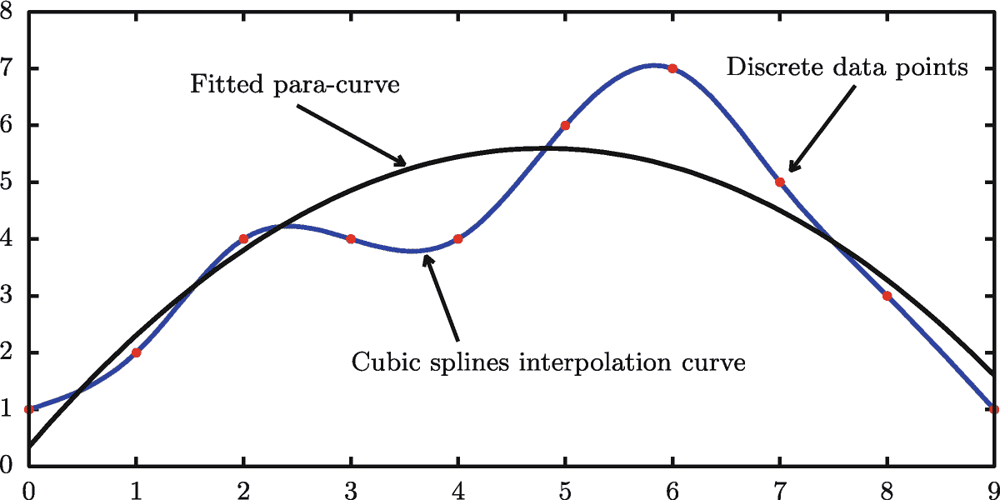

该图展示了抛物线拟合曲线、三次样条插值曲线，以及三次样条插值曲线上的十个节点，这些节点代表离散数据点。

**图 5-1**：曲线拟合与插值

曲线拟合与插值的主要区别在于拟合曲线是否穿过所有观测数据点。在曲线拟合的情况下，其策略是推导出一条代表数据总体趋势的曲线。拟合曲线穿过数据集，但并不精确适配每一个数据点。该曲线旨在以最佳方式描述整体数据。由于它并不穿过所有点，因此通常用于数据本身存在较大固有误差的情况，例如从实验测量中收集的数据，如果精确穿过每个点，则不可避免地也会捕获所有不良噪声。一个例子是线性回归，它广泛应用于统计分析中，所收集的数据可能包含显著误差，包括系统误差和样本误差。曲线拟合可用于辅助数据可视化，基于样本数据进行预测，并推断两个或多个变量之间的关系。

相比之下，插值用于拟合一条或一系列精确穿过所有点的曲线。它适用于已知数据是准确的情况，即不存在噪声。一个例子是，对不同期限的贴现率数据拟合零息票曲线。我们常常需要插值出市场上无法直接观测到的那些期限的未知贴现率。通过评估拟合函数，我们在两个已知输入点之间插值或计算未知输入点的值。另一个重要的应用场景是，我们希望用一个相对简单的函数（通常是多项式）来表示一个复杂的函数，以避免高昂的计算成本。例如，你可以使用插值法，通过原始复杂函数生成的数据点，来拟合出一个更简单函数的曲线。

本章的源代码可以在 S2 平台上运行，网址如下：

`https://s21.nm.dev/hub/user-redirect/lab/tree/s2-public/Numerical%20Methods%20Using%20Kotlin/chapter5.ipynb`

源代码可在 GitHub 上找到：

`https://github.com/apress/numerical-methods-kotlin`

## 5.1 最小二乘曲线拟合

进行曲线拟合的方法有很多种。最基本且最常用的是最小二乘法。假设你有一组如下所示的数据点：

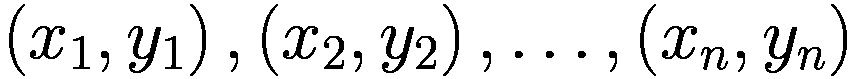

曲线拟合的第一步是选择一个有前景或预期的函数形式`f(x)`，本质上是一个参数化函数，来拟合这些数据点。NM Dev 实现了最广泛使用的形式，即多项式函数形式，如下所示：

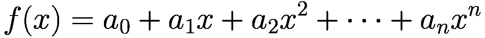

公式中的系数`a[0]`、`a[1]`、`a[2]`、…、`a[n]`需要被确定。实际上，你在曲线拟合中所做的，就是找到一组这样的系数，使得该函数最佳地拟合给定的数据。确定“最佳”的含义也有许多可能的标准。最小二乘法会使均方根误差最小化。

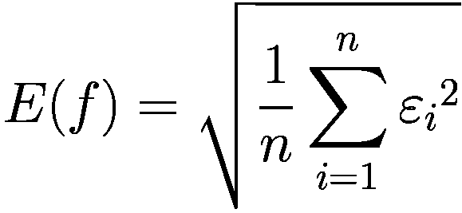

`ε[i]`是第`i`个点处的误差，即数据值`y[i]`与曲线上拟合值`ŷ_i = f(x_i)`之间的距离。见图 5-2。

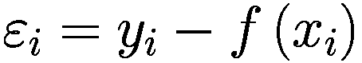

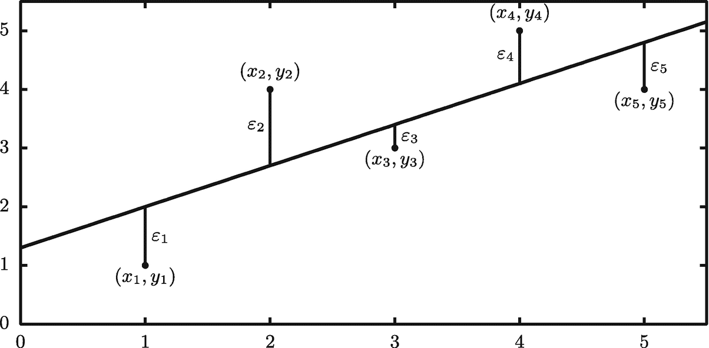

拟合误差图展示在一条倾斜的直线上。该直线上标出了五个具有不同`x`和`y`坐标的误差点。

**图 5-2**：曲线拟合误差

最小二乘法会找到一组系数`â_0`、`â_1`、…、`â_n`，使得均方根误差最小。其结果是，拟合曲线如下所示：

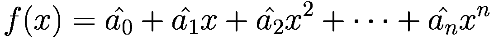

例如，假设你想根据下面这组数据拟合一条曲线：

| x | y |
| --- | --- |
| 0 | 0.0 |
| 1 | 1.0 |
| 2 | 1.414 |
| 3 | 1.732 |
| 4 | 2.0 |
| 5 | 2.236 |

首先，你需要决定将使用哪种函数形式来拟合数据。数据分析（以及可能解决任何问题）的第一步是绘制图形。将数据点绘制在图形上，可以让你直观地了解`x`和`y`之间的关系。见图 5-3。

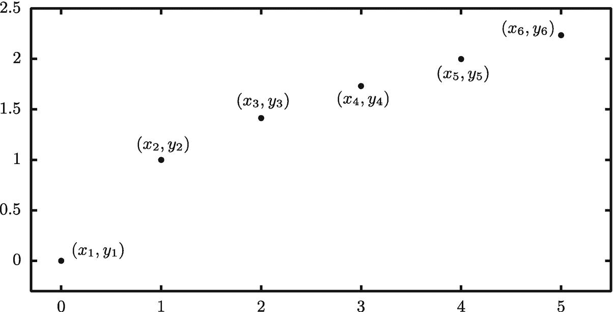

该图由六个节点组成，展示了不同`x`和`y`坐标下的增长趋势。它大致从 (0, 0) 开始，到 (5, 2.3) 结束。

**图 5-3**：数据点可视化

从图 5-3 中可以看出，数据显然呈现非线性关系。因此，你可以使用次数大于 1 的多项式，例如 2 次。值得指出的是，阶数的选择非常重要。一般来说，我们希望拟合尽可能简单的函数，以避免从数据中拾取噪声。换句话说，你需要避免过拟合。

*过拟合*是一种建模错误，当函数过于紧密地拟合一组数据点时就会发生。由于错误（记录、测量等）或随机性，数据集通常包含噪声。试图让曲线过于贴近数据，可能会因为“拟合噪声”而使曲线模型充满显著误差，从而降低其预测能力。

请考虑图 5-4 中的对比。一个五阶多项式`f1`和一个线性多项式`f2`被拟合到同一组数据。由于有六个数据点，五阶多项式`f1`可以精确穿过所有点。（通常，对于`n`个数据点，一个`(n-1)`阶多项式可以完美拟合所有数据点。）因此，`f1`完美拟合了数据。然而，这个完美曲线是否比更简单的曲线`f2`更好？答案是否定的。显然，`f2`更好地表示了`x`和`y`之间的正相关关系。也就是说，当`x`增加时，`y`也增加。此外，当`x`低于 0 或高于 5 时，五阶多项式`f1`完全丧失了预测能力。这两个尾部完全是人为的，仅是由所选的函数形式造成的，而与数据本身无关。参见图 5-4。

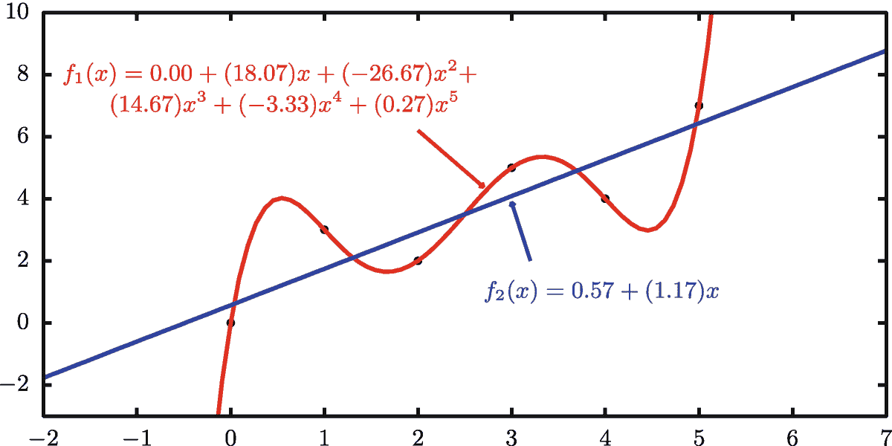

该图展示了线性曲线和高阶多项式拟合曲线分别对应两种不同的函数方程。拟合曲线上标记了五个节点。

**图 5-4** 曲线拟合中的线性多项式与高阶多项式对比

现在回到这个例子。数据点呈现凸关系。你可以使用抛物线来拟合它，如图 5-5 所示。拟合曲线为`f(x) = 0.1 + 0.81*x - 0.08*x²`。

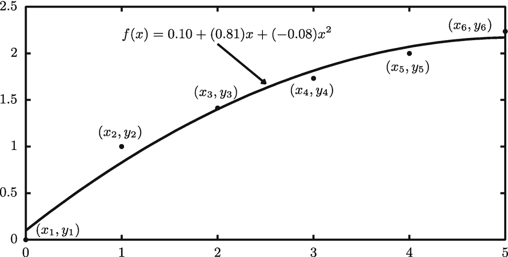

该图由一条上升的`x`函数抛物线曲线和六个标记了不同`x`和`y`坐标的节点组成。

**图 5-5** 抛物线拟合

拟合值`ŷ = f(x)`和误差`ε`如下表所示：

| x | y | f(x) | ε |
| :--- | :--- | :--- | :--- |
| 0 | 0.0 | 0.1 | -0.1 |
| 1 | 1.0 | 0.83 | 0.17 |
| 2 | 1.414 | 1.4 | 0.014 |
| 3 | 1.732 | 1.81 | -0.078 |
| 4 | 2.0 | 2.07 | -0.07 |
| 5 | 2.236 | 2.17 | 0.066 |

NM Dev 代码如下。首先构造一个`LeastSquares`对象，将多项式函数的预期阶数`m`作为参数传入。在此例中，`m = 2`。然后，在一组数据点上调用该对象的`fit`方法，得到一个`UnivariateRealFunction`对象，该对象代表拟合出的函数曲线。这个函数可用于在任何输入点求值。

# 5.2 插值

**插值**是一种基于离散已知数据点的范围来构造（寻找）新数据点的方法。在工程和科学领域，我们经常通过采样或实验获得一些数据点，这些数据点表示函数在自变量有限个数值上的值。通常需要插值，即估计该函数在自变量的某个未知中间值处的值。

另一个重要的应用是用简单函数来逼近复杂函数。假设某个给定函数的公式已知，但计算效率太低。可以从原函数中取出少量数据点进行插值，以生成一个更简单且仍与原函数相当接近的函数。由此获得的简便性可能超过插值误差带来的损失，并在计算过程中获得更佳的性能。

## 5.2.1 线性插值

最简单的方法之一是线性插值。插值函数是一个分段函数，在每两个相邻数据点之间呈线性关系。给定一组数据点 `(*x*[1], *y*[1])`、`(*x*[2], *y*[2])`、…、`(*x*[*n*], *y*[*n*])`，插值函数如下所示：


图 5-6 中的曲线展示了利用 `*f*(*x*) = sin(*x*)` 在范围 `*x* ∈ [0, 6.3]` 内生成的一组数据点经线性插值后的曲线。

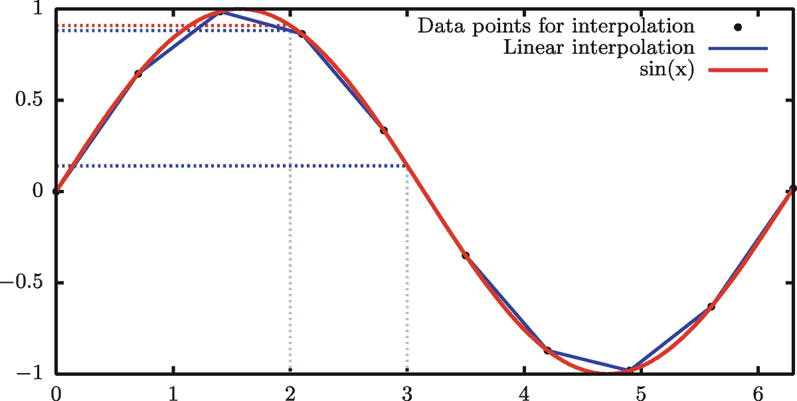

该图由两条重叠曲线构成，分别代表线性插值和 `sin x`，并且在曲线精确重叠的部分有六个节点，用于表示插值的数据点。

**图 5-6** 线性插值

如图所示，线性插值易于计算。它仅用直线段连接每两个相邻的点。其主要缺点是在原始数据远非线性的情况下，预测效果可能不佳。例如，在 `*x* = 2` 时，`sin(2) = 0.909297`，而插值得到的值为 0.880672，误差超过 3%。相比之下，在 `*x* = 3` 处（由于原始数据接近线性，即 `*f*(*x*) = sin(*x*)` 的曲率或二阶导数为 `*f* ^(′′)(*x*) = − sin(*x*)`，在 `*x* = 3` 附近其值约为 0），`sin(3) = 0.141120`，而插值得到的值为 0.139053，误差仅为 1.5%。

重现上述示例的代码如下。首先构建一个 `LinearInterpolation` 对象；然后调用成员方法 `fit` 来拟合数据。该方法返回一个表示插值曲线的 `UnivariateRealFunction` 对象。

```kotlin
// 数据集
val data = SortedOrderedPairs(
doubleArrayOf(0.0, 0.7, 1.4, 2.1, 2.8, 3.5, 4.2, 4.9, 5.6, 6.3),
doubleArrayOf(0.0, 0.644218, 0.98545, 0.863209, 0.334988, -0.350783, -0.871576, -0.982453, -0.631267, 0.0168139)
)
val li: LinearInterpolation = LinearInterpolation()
val f: UnivariateRealFunction = li.fit(data)
println(f.evaluate(2.0)) // f(2) = 0.880672
println(f.evaluate(3.0)) // f(3) = 0.139053
// 绘制插值曲线
val N = 100
val gridSize: Double = (6.5 - 0.0) / (N - 1)
var x: Double = 0.0
val xValues = ArrayList(N)
val yValues = ArrayList(N)
for(i in 0 until N) {
val y = f.evaluate(x)
xValues.add(i, x)
yValues.add(i, y)
x += gridSize
}
val plotData = mapOf(
"x" to xValues,
"y" to yValues,
)
val plot = ggplot(plotData) {x = "x"; y = "y"} + geomLine()
plot
```

输出结果如下：

```
0.880672
0.13905342857142847
```

图 5-7 展示了线性插值的曲线图。

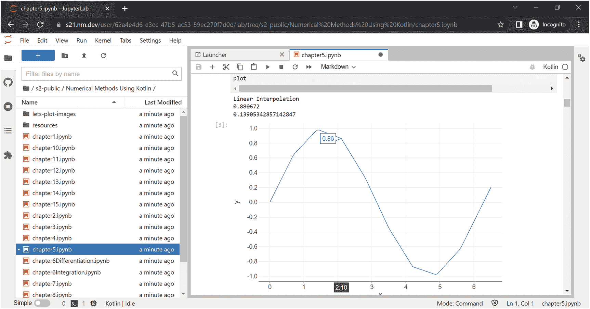

一个用于第 5 章的网页浏览器中打开的页面片段。它包含一个 y 对 x 的图形，展示了线性插值的下凹和上凸曲线。

**图 5-7** 线性插值曲线图

该类只有一个无参的默认构造函数。`fit` 函数的签名如下：

```java
@Override
public UnivariateRealFunction fit(OrderedPairs f)
```

线性插值的另一个主要缺点是插值函数在数据点处不平滑，因此存在拐点。由于相邻线性函数在交汇点处的一阶导数不一致，导致斜率发生突变。这在图 5-7 中表现得十分明显。相比之下，使用更高次的多项式样条可以规避这一问题。二次样条可以保证在节点处一阶导数连续，但无法保证二阶导数连续。三次样条则可以保证在节点处一阶和二阶导数均连续，因此在实践中应用最为广泛。

## 5.2.2 三次埃尔米特样条插值

## 5.2.2 三次埃尔米特样条插值

# 三次埃尔米特插值方法

三次埃尔米特是一种分段样条插值方法，其中每一段都是一个埃尔米特形式的三次多项式，即由该段区间两端点的函数值和一阶导数共同确定。

在单个区间 `[x[1], x[2]]` 上，给定 `x = x[1]` 处的函数值 `y[1]` 和 `x = x[2]` 处的函数值 `y[2]`，以及 `x = x[1]` 处的切线 `y[1]’` 和 `x = x[2]` 处的切线 `y[2]’`，该段的曲线可以定义如下：

![$$ f(x)={ax}³+{bx}²+ cx+d,\kern0.5em x\in \left[{x}_1,{x}_2\right] $$](images/528380_1_En_5_Chapter/528380_1_En_5_Chapter_TeX_Equg.png)

代入端点处的函数值和一阶导数，得到以下方程组：

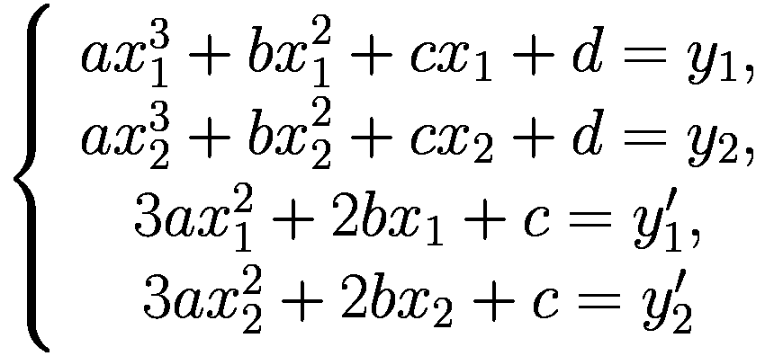

求解 `a`、`b`、`c`、`d`，即可得到区间 `[x[1], x[2]]` 上的插值曲线。

举一个简单的例子。假设 `x[1] = 0`，`x[2] = 1`。则有：

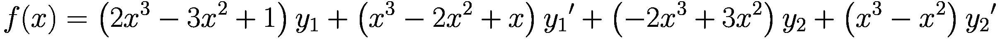

其中 `x ∈ [0, 1]`。为了验证，可以检查以下等式：

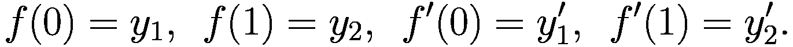

对数据集中每两个相邻的点重复上述过程，即可得到一个在每一区间上都是三次的分段插值函数。需要注意的是，三次埃尔米特样条仅以函数值和切线作为输入，没有其他要求。因此，它能保证一阶导数连续，但二阶导数不一定连续。

当只有数据点 `(x[1], y[1])`、`(x[2], y[2])`、…、`(x[n], y[n])` 时，需要根据这些数据估算切线。计算切线有多种方法，`NM Dev` 提供了两种方法：`Catmull-Rom` 样条和有限差分法。

1. `Catmull-Rom` 样条将切线估计为：

对于内部点 `k = 2, …, n − 1`，有

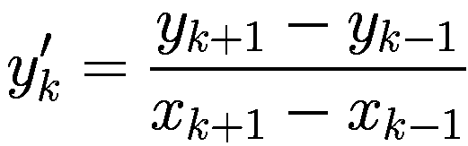

并在端点处有：


该方法在计算机图形学中广泛应用，用于在离散的关键帧之间实现平滑、连续的运动。它之所以流行，是因为计算相对简单。它还能确保每个关键帧位置被精确命中，并且生成的曲线在多个分段上的切线是连续的。

2. 有限差分法将切线估计为：

对于内部点 `k = 2, …, n − 1`，有

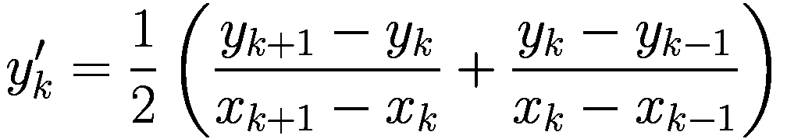

并在端点处使用单侧差分：

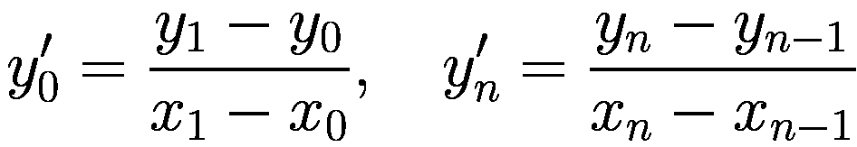

现在来看与 5.2.1 节相同的例子，即对由 `f(x) = sin(x)` 生成的数据进行插值。图 5-8 展示了应用带有 `Catmull-Rom` 切线的三次埃尔米特样条的结果。显然，与线性插值的结果相比，该曲线看起来平滑得多。

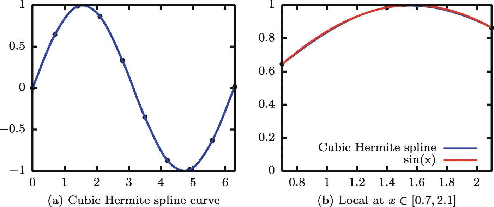

图 5-8 对 `sin(x)` 数据的三次埃尔米特样条插值

以下代码演示了如何使用 `Catmull-Rom` 切线进行三次埃尔米特样条插值。要改用有限差分切线，只需切换到注释掉的那一行代码。在这个特定例子中，切线方法的选择影响不大。

```
// the data set
val data = SortedOrderedPairs(
doubleArrayOf(0.0, 0.7, 1.4, 2.1, 2.8, 3.5, 4.2, 4.9, 5.6, 6.3),
doubleArrayOf(0.0, 0.644218, 0.98545, 0.863209, 0.334988, -0.350783, -0.871576, -0.982453, -0.631267, 0.0168139)
)
val spline: CubicHermite = CubicHermite(CubicHermite.Tangents.CATMULL_ROM)
// CubicHermite spline = CubicHermite(CubicHermite.Tangents.FINITE_DIFFERENCE)
val f: UnivariateRealFunction = spline.fit(data)
println(f.evaluate(2.0)) // f(2) = 0.906030
println(f.evaluate(3.0)) // f(3) = 0.145727
val N = 100
val gridSize: Double = (2.1 - 0.7) / (N - 1)
var x: Double = 0.7
val xValues = ArrayList(N)
val yValues = ArrayList(N)
for(i in 0 until N) {
val y = f.evaluate(x)
xValues.add(i, x)
yValues.add(i, y)
x += gridSize
}
val plotData = mapOf(
"x" to xValues,
"y" to yValues,
)
val plot = ggplot(plotData) {x = "x"; y = "y"} + geom_line()
plot
```

输出如下：

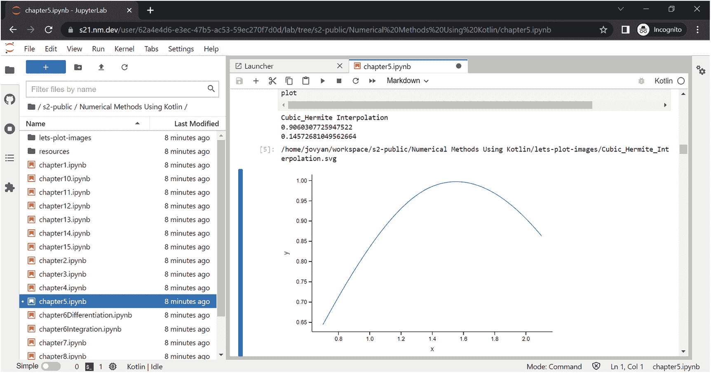

图 5-9 对 `sin(x)` 数据的三次埃尔米特样条曲线图

```
0.9060307725947522
0.14572681049562664
```

该类及其 `fit` 方法的签名如下：

```
/**
* Construct an instance with the given method to compute tangents.
*
* @param tangent computes the control tangents used for the interpolation
*/
public CubicHermite(Tangent tangent)
/**
* The interpolated function must pass through all the given points.
*
* @param f {@inheritDoc }
* @return the interpolated function
*/
@Override
UnivariateRealFunction fit(OrderedPairs f);
```

### 三次样条插值

三次样条是一种由分段三阶多项式组成的样条，其曲线在一阶和二阶导数上均保持连续。关于三次样条与三次埃尔米特样条的区别，已在第 5.2.2 节中讨论。三次埃尔米特样条保证一阶导数的连续性，而三次样条则保证一阶和二阶导数的连续性。

考虑一组包含 n + 1 个点 (*x*[0], *y*[0]), (*x*[1], *y*[1]), …, (*x*[*n*], *y*[*n*]) 的样条。令样条的第 i 段由下式表示：

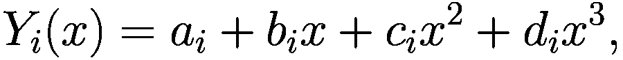

其中 *x* ∈ [*x*[*i*], *x*[*i* + 1]]，*i* = 0, …, *n* − 1，如图 5-10 所示。

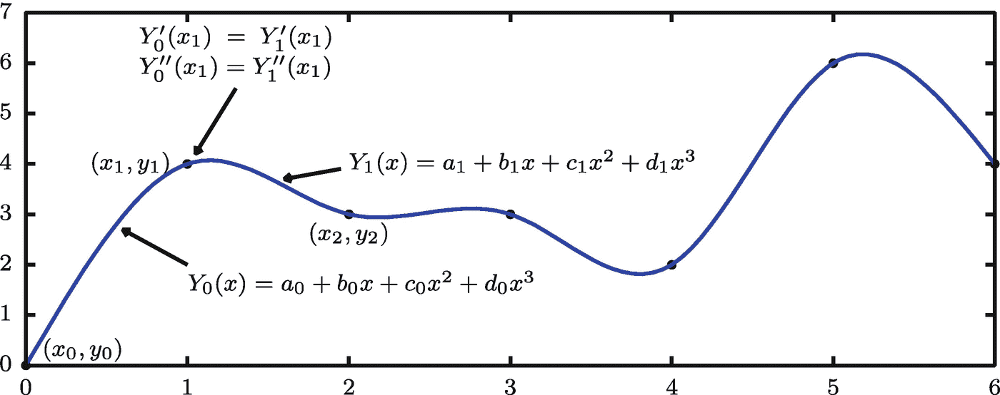

针对多项式方程不同函数的三次样条插值曲线图。曲线上标记了七个节点。

图 5-10：三次样条插值

共有 4*n* 个变量需要求解：(*a*[0], *b*[0], *c*[0], *d*[0], …, *a*[*n* − 1], *b*[*n* − 1], *c*[*n* − 1], *d*[*n* − 1])。因此，需要 4*n* 个方程。

首先，样条必须满足这些数据点的值：

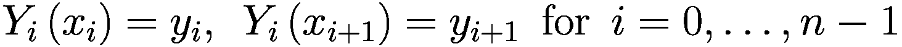

这提供了 2*n* 个方程。

其次，为确保曲线在一阶和二阶导数上连续，还需要满足另外的 2(*n* − 1) 个方程：

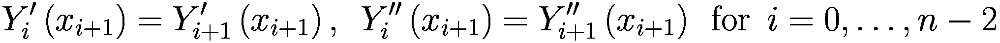

现在共有 4*n* − 2 个方程。边界条件再提供两个方程。常用的选项有自然样条、固定斜率样条和非扭结样条。

*   *自然样条*：曲线在端点处的二阶导数设为 0；即，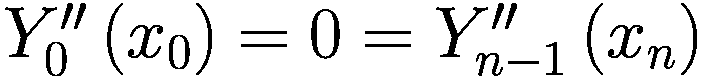。

*   *固定斜率样条*：指定曲线在端点处的一阶导数；即，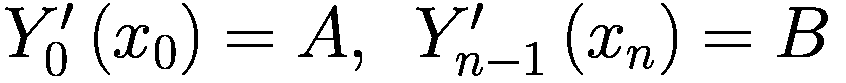。

*   *非扭结样条*：样条的三阶导数在 *x*[1] 和 *x*[*n* − 1] 处连续；即，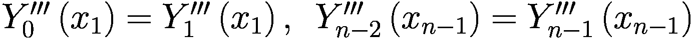。

加上边界条件后，总共有 4*n* 个方程。于是可以求解 4*n* 个变量 (*a*[0], *b*[0], *c*[0], *d*[0], …, *a*[*n* − 1], *b*[*n* − 1], *c*[*n* − 1], *d*[*n* − 1])，并获得函数 *Y*0, *Y*1, …, *Y**n* − 1。参见图 5-11。

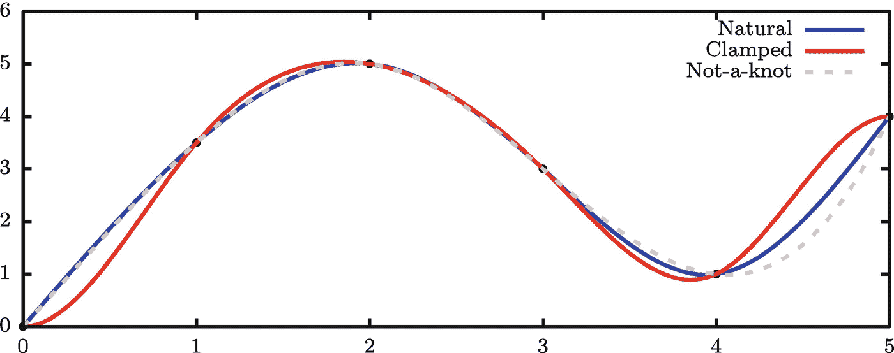

该曲线图由三种相似类型的曲线组成，分别向上凸起和向下凹陷，代表了自然、固定斜率及非扭结三种条件。

图 5-11：三次样条中不同边界条件的比较

以下代码演示了一个三次样条。`f1`、`f2` 和 `f3` 对象分别是使用自然、固定斜率以及非扭结边界条件的三次样条插值函数。

```
// the data set
val data = SortedOrderedPairs(
    doubleArrayOf(0.0, 1.0, 2.0, 3.0, 4.0, 5.0),
    doubleArrayOf(0.0, 3.5, 5.0, 3.0, 1.0, 4.0)
)
val cs1: CubicSpline = CubicSpline.natural()
val f1: UnivariateRealFunction = cs1.fit(data)
val cs2: CubicSpline = CubicSpline.clamped()
val f2: UnivariateRealFunction = cs2.fit(data)
val cs3: CubicSpline = CubicSpline.notAKnot()
val f3: UnivariateRealFunction = cs3.fit(data)
```

绘制的图形如图 5-12 所示。

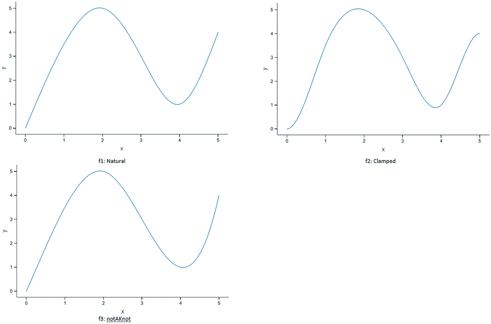

三个不同的三次样条插值曲线图：自然、固定斜率及非扭结。

图 5-12：不同三次样条插值的比较

函数签名如下：

```
/**
 * Constructs an instance with end conditions which fits natural
 * splines, meaning that the second derivative at both ends are zero.
 *
 * @return the instance
 */
public static CubicSpline natural()
/**
 * Constructs an instance with end conditions which fits clamped
 * splines, and the first derivative at both ends are zero.
 *
 * @return the instance
 */
public static CubicSpline clamped()
/**
 * Constructs an instance with end conditions which fits clamped
 * splines, meaning that the first derivative at both ends equal to the
 * given values.
 *
 * @param df1 the first derivative at the first point
 * @param dfn the first derivative at the last point
 * @return the instance
 */
public static CubicSpline clamped(double df1, double dfn)
/**
 * The interpolated function must pass through all the given points.
 *
 * @param f {@inheritDoc }
 * @return the interpolated function
 */
@Override
UnivariateRealFunction fit(OrderedPairs f);
```

### 5.2.4 牛顿多项式插值

牛顿多项式插值是用于对数据集进行插值的一种多项式方法。它有时被称为*牛顿差商插值多项式*，因为其多项式的系数是使用牛顿差商法计算的。与样条插值不同，牛顿多项式并非分段插值，而是构造一个 *n* 次多项式来对包含 n + 1 个点的数据集进行插值。给定一组 n + 1 个点 (*x*[0], *y*[0]), (*x*[1], *y*[1]), …, (*x*[*n*], *y*[*n*])，牛顿插值多项式是牛顿基多项式的线性组合。

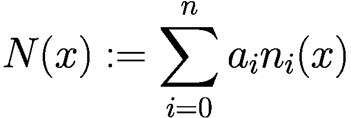

牛顿基多项式定义如下：

# 牛顿多项式

$$ {n}_i(x):= \prod \limits_{j=0}^{i-1}\left(x-{x}_j\right)\kern0.5em \textrm{for}\kern0.5em i>0,\textrm{and}\kern0.5em {n}_0(x)\equiv 1 $$
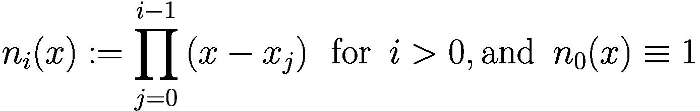

系数`a[i]`定义如下：

$$ {a}_i:= \left[{y}_0,\dots, {y}_i\right] $$


`[y[0], …, y[i]]`是差商的记号，其定义如下：

$$ \left[{y}_0\right]={y}_0 $$


$$ \left[{y}_0,{y}_1\right]=\frac{\left[{y}_1\right]-\left[{y}_0\right]}{x_1-{x}_0}=\frac{y_1-{y}_0}{x_1-{x}_0} $$


$$ \dots $$

$$ \left[{y}_0,\dots {y}_i\right]=\frac{\left[{y}_1,\dots, {y}_i\right]-\left[{y}_0,\dots, {y}_{i-1}\right]}{x_i-{x}_0} $$


#### 线性形式

图 5-13 展示了一个牛顿线性多项式。

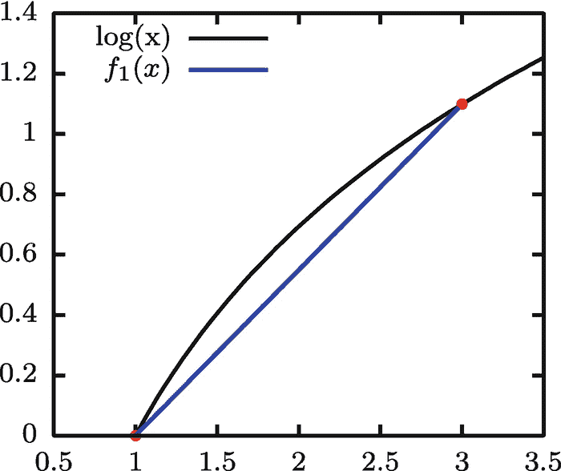

该图由一条表示`x`的对数函数的递增曲线和一条表示`x`的`f1`函数的递增直线组成。

*图 5-13* — 牛顿线性多项式

我们从最简单的情况——线性情况开始。给定两个点 (`x[1]`, `y[1]`) 和 (`x[2]`, `y[2]`)，牛顿多项式采用线性形式，如下所示：

$$ {f}_1(x)={y}_1+\frac{y_2-{y}_1}{x_2-{x}_1}\left(x-{x}_1\right) $$
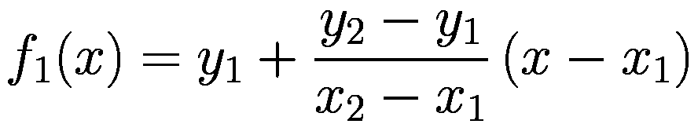

由于只有两个点，因此没有曲率信息。数据仅通过一条直线进行插值。注意，系数`y[1]`和$$ \frac{y_2-{y}_1}{x_2-{x}_1} $$分别是牛顿均差`[y[1]]`和`[y[1], y[2]]`，而常数 1（在第一项中）和 (`x` − `x[1]`) 是牛顿基多项式。

#### 二次形式

二次插值需要三个数据点，并将曲率引入函数，从而改进估计。利用前面给出的牛顿多项式定义，它可以定义为以下形式的二阶多项式：

$$ {f}_2(x)={a}_1+{a}_2\left(x-{x}_1\right)+{a}_3\left(x-{x}_1\right)\left(x-{x}_2\right) $$
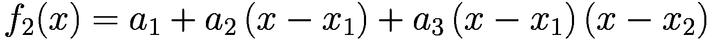

其中系数`a[1]`、`a[2]`、`a[3]`可以轻松确定。

代入`x` = `x[1]`，得到：

$$ {a}_1={f}_2\left({x}_1\right)={y}_1 $$
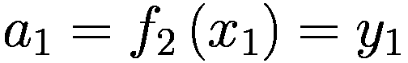

代入`x` = `x[2]`，得到：

$$ {a}_2=\frac{f_2\left({x}_2\right)-{a}_1}{x_2-{x}_1}=\frac{y_2-{y}_1}{x_2-{x}_1} $$
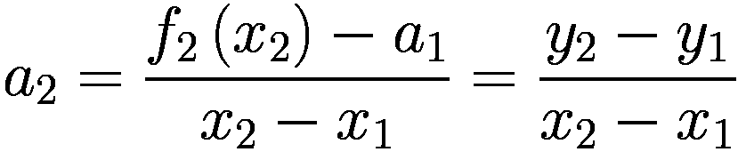

参见图 5-14。

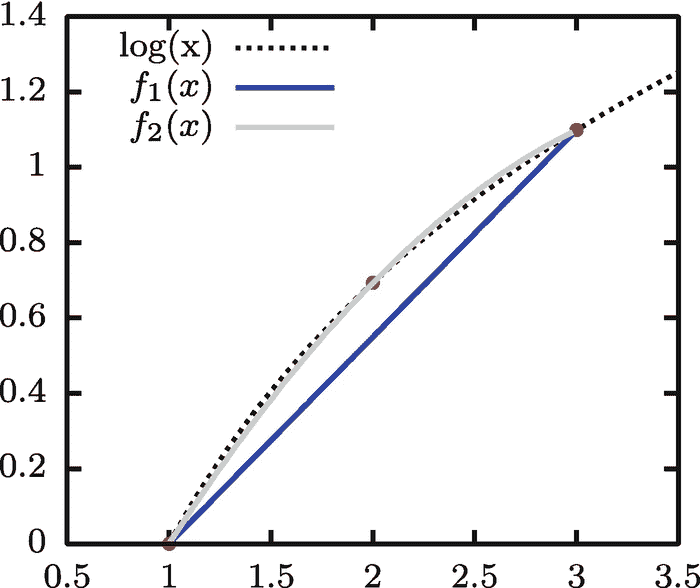

该图由一条表示`x`的对数函数的递增曲线、一条表示`x`的`f1`函数的递增直线，以及一条表示`x`的`f2`函数的递增曲线组成。

*图 5-14* — 牛顿二次多项式

代入`x` = `x[3]`，得到：

$$ {a}_3=\frac{f_2\left({x}_3\right)-{a}_1-{a}_2\left({x}_3-{x}_1\right)}{\left({x}_3-{x}_1\right)\left({x}_3-{x}_2\right)} $$
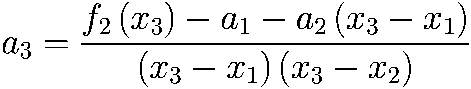

$$ =\frac{y_3-\left[{y}_2-{a}_2\left({x}_2-{x}_1\right)\right]-{a}_2\left({x}_3-{x}_1\right)}{\left({x}_3-{x}_1\right)\left({x}_3-{x}_2\right)} $$


$$ =\frac{y_3-{y}_2-{a}_2\left({x}_3-{x}_2\right)}{\left({x}_3-{x}_1\right)\left({x}_3-{x}_2\right)} $$
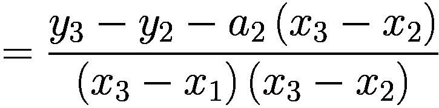

$$ =\frac{\frac{y_3-{y}_2}{x_3-{x}_2}-\frac{y_2-{y}_1}{x_2-{x}_1}}{\left({x}_3-{x}_1\right)} $$
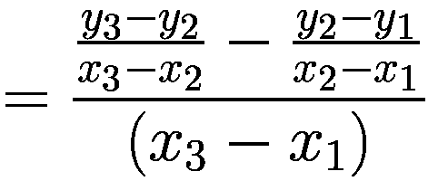

`f2(x)`有一个`f1(x)`没有的二次项，这为其赋予了曲率。二次项中系数`a[3]`的公式实际上是牛顿均差`[y[1], y[2], y[3]]`，它可以通过`[y[3], y[2]]`和`[y[2], y[1]]`计算得出。

$$ \left[{y}_1,{y}_2,{y}_3\right]=\frac{\left[{y}_3,{y}_2\right]-\left[{y}_2,{y}_1\right]}{x_3-{x}_1} $$


#### 一般形式

前面展示的线性和二次情况下的插值可以推广到拟合包含`n` + 1 个点的数据集，此时多项式将具有`n`阶。因此，牛顿均差插值公式如下：

$$ {f}_n(x)={y}_0+\left[{y}_0,{y}_1\right]\left(x-{x}_0\right)+\dots +\left[{y}_0,\dots, {y}_n\right]\left(x-{x}_0\right)\left(x-{x}_1\right)\dots \left(x-{x}_{n-1}\right) $$


均差通过以下公式以递归方式计算：

$$ \left[{y}_0,\dots {y}_i\right]=\frac{\left[{y}_1,\dots, {y}_i\right]-\left[{y}_0,\dots, {y}_{i-1}\right]}{x_i-{x}_0} $$


为了使递归过程更易于可视化，我们以表格形式给出计算`[y[0], y[1], y[2], y[3]]`的示例，如下所示：

![$$ {\displaystyle \begin{array}{l}\left({x}_0,{y}_0\right)\kern1em \left[{y}_0\right]\\ {}\kern10em \left[{y}_0,{y}_1\right]\\ {}\left({x}_1,{y}_1\right)\kern1em \left[{y}_1\right]\kern8em \left[{y}_0,{y}_1,{y}_2\right]\\ {}\kern10em \left[{y}_1,{y}_2\right]\kern10em \left[{y}_0,{y}_1,{y}_2,{y}_3\right]\end{array}} $$](images/528380_1_En_5_Chapter/528380_1_En_5_Chapter_TeX_Equaj.png)

![$$ {\displaystyle \begin{array}{l}\left({x}_2,{y}_2\right)\kern1em \left[{y}_2\right]\kern7.5em \left[{y}_1,{y}_2,{y}_3\right]\\ {}\kern10em \left[{y}_2,{y}_3\right]\\ {}\left({x}_3,{y}_3\right)\kern1em \left[{y}_3\right]\end{array}} $$](images/528380_1_En_5_Chapter/528380_1_En_5_Chapter_TeX_Equak.png)

该表显示了各差之间的关系。例如，`[y[0], y[1]]` 使用 `y[0]` 和 `y[1]` 计算；`[y[0], y[1], y[2], y[3]]` 使用 `[y[0], y[1], y[2]]` 和 `[y[1], y[2], y[3]]` 计算。

图 5-15 比较了给定大小为 7 的随机数据集下的牛顿多项式插值和自然三次样条。由于有七个点，牛顿插值是一个 6 次多项式，这导致其曲线中出现高次多项式常见的波峰和波谷。这可能导致较大的误差。随着数据点数量的增加和插值多项式次数的增加，波峰和波谷的范围和数量都会迅速增加。另一方面，由多个低次多项式拼接成的三次样条则稳定得多，在这种情况下具有令人满意的表现。

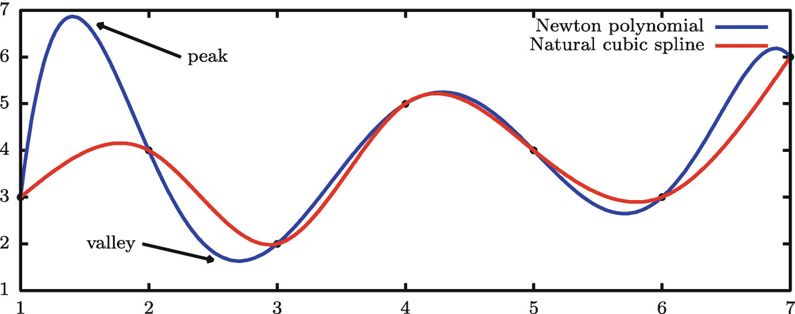

该图比较了牛顿多项式和自然三次样条曲线。重叠部分上标注了七个节点。在牛顿多项式曲线中标记了波峰和波谷。

*图 5-15* — 牛顿多项式与三次样条的比较

下面的代码片段演示了如何使用牛顿多项式插值：

```kotlin
// 2 个数据点，线性形式
val data1 = SortedOrderedPairs(
    doubleArrayOf(1.0, 3.0),
    doubleArrayOf(log10(1.0), log10(3.0))
)
val np1: Interpolation = NewtonPolynomial()
val f1: UnivariateRealFunction = np1.fit(data1)
// 3 个数据点，二次形式
val data2 = SortedOrderedPairs(
    doubleArrayOf(1.0, 2.0, 3.0),
    doubleArrayOf(log10(1.0), log10(2.0), log10(3.0))
)
val np2: Interpolation = NewtonPolynomial()
val f2: UnivariateRealFunction = np2.fit(data2)
```

对应的图显示在图 5-16 中。

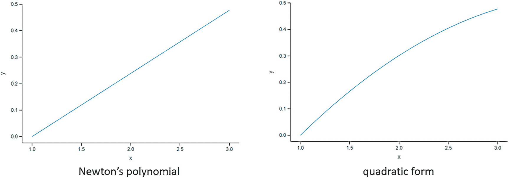

两张 y 随 x 变化的递增趋势图比较了牛顿多项式与二次形式。

*图 5-16* — 牛顿多项式与二次形式的比较

```kotlin
// 牛顿多项式与三次样条的比较
val data3 = SortedOrderedPairs(
    doubleArrayOf(1.0, 2.0, 3.0, 4.0, 5.0, 6.0, 7.0),
    doubleArrayOf(3.0, 4.0, 2.0, 5.0, 4.0, 3.0, 6.0)
)
val np3: Interpolation = NewtonPolynomial()
val f3_1: UnivariateRealFunction = np3.fit(data3)
val cs: Interpolation = CubicSpline.natural()
val f3_2: UnivariateRealFunction = cs.fit(data3)
```

对应的图显示在图 5-17 中。

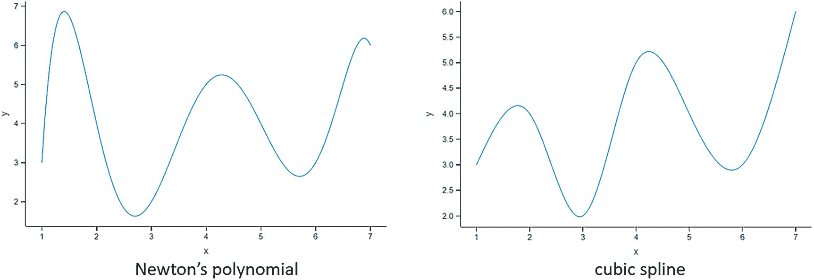

两张 y 随 x 变化的图比较了牛顿多项式与三次样条。

*图 5-17* — 牛顿多项式与三次样条的比较

# 5.3 多元插值

多元插值是指对包含多个变量的函数进行插值。它是一元插值情形的推广。

## 5.3.1 双变量插值

我们从双变量情形开始。假设有一组 `n` × `n` 个数据点：`(x[1], y[1], z[11])`、`(x[1], y[2], z[12])`、……、`(x[n], y[n], z[nn])`。注意，`(x[1], y[1], z[11])` 表示在位置 `(x[1], y[1])` 处的数据值为 `z[11]`。也就是说，

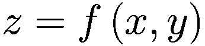

对一个双变量函数进行插值的一般步骤如下：

1.  固定一个维度，例如固定 `y = y[1]` 为常数。针对这一特定的数据切片（现在是一维的），对另一个维度 `x` 进行插值。

2.  对于另一个维度 `x` 中的值，对步骤 1 得到的结果进行插值。

例如，首先固定维度 `y`，然后对 `x` 进行插值。在 `y = y[1]` 处，有数据点 `(x[1], z[11])`、`(x[2], z[12])`、……、`(x[n], z[1n])`。运用第 5.2 节讨论的任何一种一元插值算法，可以得到 `f*y1`，这是在位置 `y = y[1]` 处关于 `x` 的一个插值函数。对维度 `y` 中的每个位置重复此过程，我们得到 `f*y1`、`f*y2`、……、`f*yn`，这是一组平行于 x 轴的曲线。

第二步是对这个数据集 `(y[1], f*y1)`、`(y[2], f*y2)`、……、`(y[n], f*yn)` 针对 `x` 值进行插值。这同样可以通过应用任何一元插值算法来完成。这样就得到了 `f(x, y)`。

因此，双变量插值函数的性质和结果取决于其内部应用的（两个）一元插值函数。例如，双线性插值使用线性插值对单个维度进行两次插值。双三次样条和双三次插值则分别使用三次样条插值和三次埃尔米特插值。

插值函数 `f(x, y)` 是一个曲面，如图 5-18 所示，其中对大小为 3 × 3 的数据集应用了双三次插值。黑色点为数据点；蓝色线条构成的网络即为插值曲面。

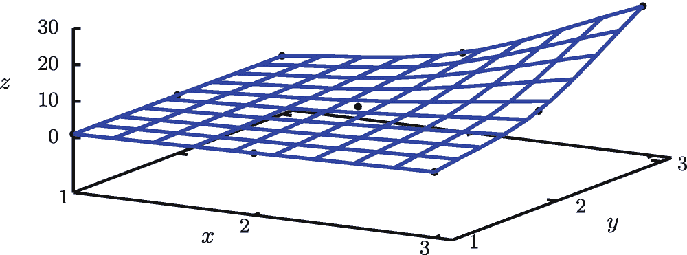

此三维图形展示了用于双三次插值的方形图案矩形网格。

**图 5-18** 双三次插值

NM Dev 实现了双线性插值、双三次样条插值和双三次插值。以下代码片段展示了这三种方法：

```kotlin
val grids: BivariateGrid = BivariateArrayGrid(
    arrayOf(
        doubleArrayOf(1.0, 1.0, 1.0), // z(1, 1) = 1, z(1, 2) = 1, z(1, 3) = 1
        doubleArrayOf(2.0, 4.0, 8.0), // z(2, 1) = 2, z(2, 2) = 4, z(2, 3) = 8
        doubleArrayOf(3.0, 9.0, 27.0) // z(3, 1) = 3, z(3, 2) = 9, z(3, 3) = 27
    ),
    doubleArrayOf(1.0, 2.0, 3.0), // x
    doubleArrayOf(1.0, 2.0, 3.0) // y
)

val bl: BivariateGridInterpolation = BilinearInterpolation()
val f1: RealScalarFunction = bl.interpolate(grids) // f1(1.5, 1.5) = 2.0
println(f1.evaluate(DenseVector(arrayOf(1.5, 1.5))))

val bs: BivariateGridInterpolation = BicubicSpline()
val f2: RealScalarFunction = bs.interpolate(grids) // f2(1.5, 1.5) = 1.8828125
println(f2.evaluate(DenseVector(arrayOf(1.5, 1.5))))

val bi: BivariateGridInterpolation = BicubicInterpolation()
val f3: RealScalarFunction = bi.interpolate(grids) // f3(1.5, 1.5) = 1.90625
println(f3.evaluate(DenseVector(arrayOf(1.5, 1.5))))
```

输出结果如下：

```
2.0
1.8828125
1.90625
```

`BivariateGrid` 类定义了一个三维空间中的网格，`z = f(x, y)`。第一个输入 `z` 是一个二维数组。它是 `x` 和 `y`（即第二和第三个数组输入）中值的笛卡尔积或叉积。`z` 中的第 `[1, 1]` 个元素是位置 `x[1]` 和 `y[1]` 处的 `z` 值。在此例中，`x[1] = 1`，`y[1] = 1`，因此 `z(1, 1) = 1`。

`BivariateArrayGrid` 类可以定义一个矩形网格，这意味着网格线不一定等间距。`BivariateRegularGrid` 类仅定义具有等间距网格线的规则网格。它们的签名如下：

```kotlin
/**
 * 使用给定的二维网格值数组以及沿 x 轴和 y 轴的网格线位置值构造一个新网格。
 *
 * @param z 网格值
 * @param x 沿 x 轴的网格线位置
 * @param y 沿 y 轴的网格线位置
 */
public BivariateArrayGrid(double[][] z, double[] x, double[] y)

/**
 * 构造一个新网格，其中因变量的值取自给定的二维数组，自变量的值由其起始值
 * 以及相邻值之间的差值指定。
 *
 * 输入数组的第一个索引对应于 x，第二个索引对应于 y，其大小将根据数组
 * 的大小推断得出。
 *
 * @param z      包含因变量值的二维数组
 * @param x0     自变量 x 的第一个值
 * @param y0     自变量 y 的第一个值
 * @param deltaX 沿 x 轴相邻点之间的距离
 * @param deltaY 沿 y 轴相邻点之间的距离
 */
public BivariateRegularGrid(
    double[][] z,
    double x0,
    double y0,
    double deltaX,
    double deltaY
)
```

`BicubicInterpolation` 类的构造函数如下：

```kotlin
/**
 * 构造一个新实例，该实例使用给定的导数进行插值。注意，这些导数不必完全精确，
 * 但它们将成为插值曲面中存在的导数。
 *
 * @param derivatives 用于插值的导数
 */
public BicubicInterpolation(PartialDerivatives derivatives)
```

注意，它可以将函数在网格点处的偏导数作为输入。`BicubicInterpolation.PartialDerivatives` 接口如下：

### 5.3.2 多元插值（Multivariate Interpolation）

```java
/**
 * 指定在 {@link BivariateGrid} 上的点处定义的偏导数。
 */
public interface PartialDerivatives {
    /**
     * 获取网格中给定位置处的偏导数 \(\frac{\partial z}{\partial x}\)。
     *
     * @param grid 要获取偏导数的网格
     * @param i    x 轴方向的索引
     * @param j    y 轴方向的索引
     * @return 给定点处的 \(\frac{\partial z}{\partial x}\)
     */
    double dx(BivariateGrid grid, int i, int j);
    /**
     * 获取网格中给定位置处的偏导数 \(\frac{\partial z}{\partial y}\)。
     *
     * @param grid 要获取偏导数的网格
     * @param i    x 轴方向的索引
     * @param j    y 轴方向的索引
     * @return 给定点处的 \(\frac{\partial z}{\partial y}\)
     */
    double dy(BivariateGrid grid, int i, int j);
    /**
     * 获取网格中给定位置处的混合偏导数 \(\frac{\partial² z}{\partial x \partial y}\)。
     *
     * @param grid 要获取偏导数的网格
     * @param i    x 轴方向的索引
     * @param j    y 轴方向的索引
     * @return 给定点处的 \(\frac{\partial² z}{\partial x \partial y}\)
     */
    double dxdy(BivariateGrid grid, int i, int j);
}
```

此示例拟合了一个双变量数据集以及辅助的雅可比矩阵。

```kotlin
// derivatives and answers from Michael Flanagan's library
val z = arrayOf(
    doubleArrayOf(1.0, 3.0, 5.0),
    doubleArrayOf(2.0, 4.0, 8.0),
    doubleArrayOf(9.0, 10.0, 11.0),
)
val dx = arrayOf(
    doubleArrayOf(6.0, 2.0, 2.0),
    doubleArrayOf(6.0, 7.0, 8.0),
    doubleArrayOf(6.0, 12.0, 14.0),
)
val dy = arrayOf(
    doubleArrayOf(8.0, 8.0, 8.0),
    doubleArrayOf(16.0, 12.0, 8.0),
    doubleArrayOf(4.0, 4.0, 4.0),
)
val dxdy = arrayOf(
    doubleArrayOf(16.0, 8.0, 0.0),
    doubleArrayOf(-4.0, -4.0, -4.0),
    doubleArrayOf(-24.0, -16.0, -8.0),
)
val deriv: BicubicInterpolation.PartialDerivatives = object : BicubicInterpolation.PartialDerivatives {
    override fun dx(grid: BivariateGrid, i: Int, j: Int): Double {
        return getDeriv(dx, i, j) // for some reason the y-axis is written in reverse...
    }
    override fun dy(grid: BivariateGrid, i: Int, j: Int): Double {
        return getDeriv(dy, i, j)
    }
    override fun dxdy(grid: BivariateGrid, i: Int, j: Int): Double {
        return getDeriv(dxdy, i, j)
    }
    private fun getDeriv(dx: Array, i: Int, j: Int): Double {
        return dx[i][2 - j]
    }
}
val interpolation: BivariateGridInterpolation = BicubicInterpolation(deriv)
val grid: BivariateGrid = BivariateRegularGrid(z, 0.0, 0.0, 0.5, 0.25)
val f: RealScalarFunction = interpolation.interpolate(grid)
println(f.evaluate(DenseVector(0.0, 0.0))) // 1.0
println(f.evaluate(DenseVector(0.0, 0.125))) // 2.0
println(f.evaluate(DenseVector(0.0, 0.25))) // 3.0
println(f.evaluate(DenseVector(0.0, 0.375))) // 4.0
println(f.evaluate(DenseVector(0.0, 0.5))) // 5.0
println(f.evaluate(DenseVector(0.25, 0.0))) // 1.125
println(f.evaluate(DenseVector(0.25, 0.125))) // 2.078125
println(f.evaluate(DenseVector(0.25, 0.25))) // 3.1875
println(f.evaluate(DenseVector(0.25, 0.375))) // 4.765625
println(f.evaluate(DenseVector(0.25, 0.5))) // 6.5
println(f.evaluate(DenseVector(0.5, 0.0))) // 2.0
println(f.evaluate(DenseVector(0.5, 0.125))) // 2.875
println(f.evaluate(DenseVector(0.5, 0.25))) // 4.0
println(f.evaluate(DenseVector(0.5, 0.375))) // 5.875
println(f.evaluate(DenseVector(0.5, 0.5))) // 8.0
println(f.evaluate(DenseVector(0.75, 0.0))) // 5.125
println(f.evaluate(DenseVector(0.75, 0.125))) // 5.828125
println(f.evaluate(DenseVector(0.75, 0.25))) // 6.6875
println(f.evaluate(DenseVector(0.75, 0.375))) // 8.015625
println(f.evaluate(DenseVector(0.75, 0.5))) // 9.5
println(f.evaluate(DenseVector(1.0, 0.0))) // 9.0
println(f.evaluate(DenseVector(1.0, 0.125))) // 9.5
println(f.evaluate(DenseVector(1.0, 0.25))) // 10.0
println(f.evaluate(DenseVector(1.0, 0.375))) // 10.5
println(f.evaluate(DenseVector(1.0, 0.5))) // 11.0
```

输出结果如下：

```
1.0
2.0
3.0
4.0
5.0
1.125
2.078125
3.1875
4.765625
6.5
2.0
2.875
4.0
5.875
8.0
5.125
5.828125
6.6875
8.015625
9.5
9.0
9.5
10.0
10.5
11.0
```

上一节中针对双变量情况描述的过程，稍加修改后也可应用于更高维度的情况。你需要以递归方式应用该过程。我们以三维情况为例。

假设你有这样一个 `n` × `n` × `n` 的数据集：(`x[1]`, `y[1]`, `z[1]`, `w[111]`), (`x[1]`, `y[1]`, `z[2]`, `w[112]`), … , (`x[n]`, `y[n]`, `z[n]`, `w[nnn]`)。首先，你将 `x` 维度固定为常数。在位置 `x = x[1]` 处，你有 (`y[1]`, `z[1]`, `w[111]`), (`y[1]`, `z[2]`, `w[112]`), … , (`y[n]`, `z[n]`, `w[1nn]`) 需要进行插值。此时，这个切片数据集是双变量的。接着，你再固定另一个维度，比如 `y`。那么在位置 `y = y[1]` 处，你有 (`z[1]`, `w[111]`), (`z[2]`, `w[112]`), … , (`z[n]`, `w[11n]`) 需要进行插值。这个切片数据集是单变量的。你可以应用任何单变量插值算法来得到插值器 `fx1y1`。对所有 `y` 值重复此过程，你将得到 `fx1y1`, `fx1y2`, … , `fx1yn`。接下来，就像在双变量情况中一样，你对 (`y[1]`, `fx1y1`), (`y[2]`, `fx1y2`), … , (`y[n]`, `fx1yn`) 进行插值，从而得到插值器 `fx1`。对所有 `x` 值重复此过程，你将得到 `fx1`, `fx2`, … , `fxn`。最后，对 (`x[1]`, `fx1`), (`x[2]`, `fx2`), … , (`x[n]`, `fxn`) 进行插值，你将得到插值器 `f(x, y, z)`。

NM Dev 实现了这种算法，以递归方式进行低阶插值，直到可以对一维切片数据集应用单变量算法。然而，计算成本会随着维度的增加呈指数级增长。这对于高维数据来说并不实用。

下面的代码示例展示了如何应用该算法进行多元线性插值：

```kotlin
// the data set
val mda: MultiDimensionalArray
    = MultiDimensionalArray(2, 2, 2)
mda.set(1.0, 0, 0, 0) // mda[0][0][0] = 1
mda.set(2.0, 1, 0, 0)
mda.set(3.0, 0, 1, 0)
mda.set(4.0, 0, 0, 1)
mda.set(5.0, 1, 1, 0)
mda.set(6.0, 1, 0, 1)
mda.set(7.0, 0, 1, 1)
mda.set(8.0, 1, 1, 1)
val mvGrid: MultivariateArrayGrid = MultivariateArrayGrid(
    mda,
    doubleArrayOf(1.0, 2.0),
    doubleArrayOf(1.0, 2.0),
    doubleArrayOf(1.0, 2.0)
)
val rgi: RecursiveGridInterpolation
    = RecursiveGridInterpolation(LinearInterpolation())
val f: RealScalarFunction = rgi.interpolate(mvGrid)
println(f.evaluate(DenseVector(arrayOf(1.5, 1.5, 1.5)))) // f(1.5, 1.5, 1.5) = 4.5
```

输出结果如下：

```
4.5
```

`RecursiveGridInterpolation` 类的签名如下：

```kotlin
/**
 * 使用给定的单变量插值算法构造一个 n 维插值器。
 *
 * @param univariate 一个单变量插值算法
 */
public RecursiveGridInterpolation(Interpolation univariate)
```

它接收一个 `Interpolation` 对象作为输入。在前面的代码示例中，你提供了一个 `LinearInterpolation` 对象。当数据集被降维到一维切片数据时，该代码将应用线性插值。

