# 6. 数值微分与数值积分

数值微分与数值积分是一种技术，适用于以下情况：你无法先验地知道函数，将函数视为黑箱，或者无法对该函数进行解析（或符号化、闭式）的微分与积分。该技术通过使用许多线性函数来近似函数，每个线性函数对应函数定义域上的一个微小区间。事实上，函数的逐段线性近似正是微积分的基础。当区间足够小，或者当你将函数充分放大时，函数看起来就像一条直线（这就是微分）。当你将这些“直线”拼接起来，并累加其下方的块面积（通常是矩形或梯形）时，就得到了积分。当区间长度趋近于无穷小时，这个概念就达到了极限。然而，在计算机上，你无法让区间长度任意小。你必须满足于足够好的近似或足够小的区间，因此就有了数值微分与数值积分。

在图 6-1 中，箭头是每个区间内函数的线性近似。它们看起来足够接近，可以表示函数在各区间内的斜率或导数。每个箭头下方的块面积也可以轻松计算（它们基本上是梯形）。你可以将它们相加得到函数的（定）积分。你拥有的子区间越多，数值导数和数值积分的精度就越高。

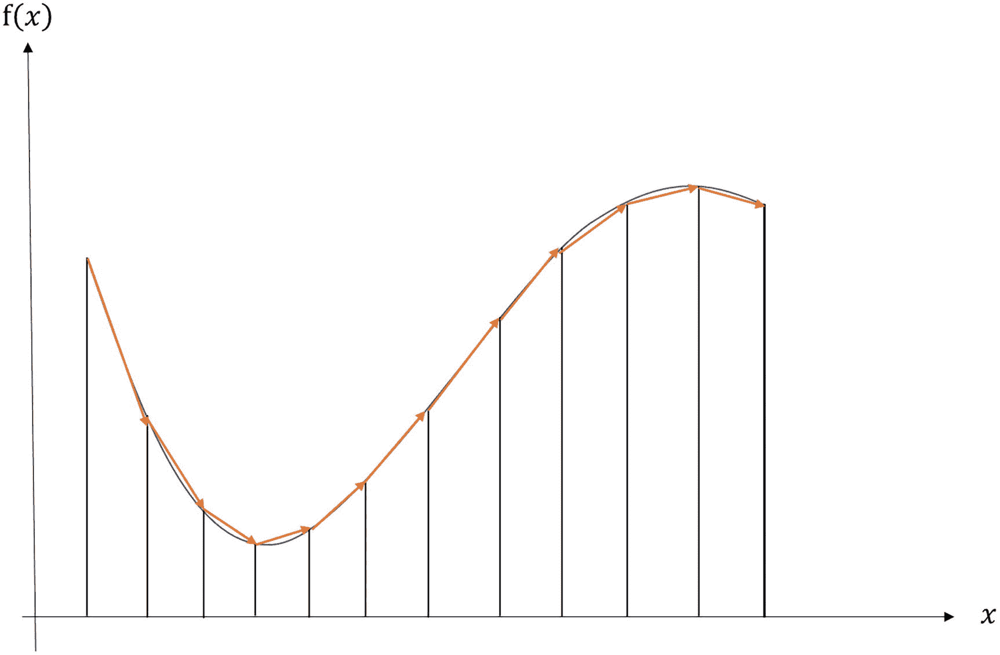

一张`f`关于`x`的曲线图。曲线先急剧下降，然后急剧上升，形成一条下垂曲线。从曲线上有12条线段投影到`X`轴上。

图 6-1  

数值微分与数值积分示例

本章的源代码可以在 S2 平台上运行，访问地址如下：

[`s21.nm.dev/hub/user-redirect/lab/tree/s2-public/Numerical%20Methods%20Using%20Kotlin/chapter6Differentiation.ipynb`](https://s21.nm.dev/hub/user-redirect/lab/tree/s2-public/Numerical%2520Methods%2520Using%2520Kotlin/chapter6Differentiation.ipynb)

[`s21.nm.dev/hub/user-redirect/lab/tree/s2-public/Numerical%20Methods%20Using%20Kotlin/chapter6Integration.ipynb`](https://s21.nm.dev/hub/user-redirect/lab/tree/s2-public/Numerical%2520Methods%2520Using%2520Kotlin/chapter6Integration.ipynb)

源代码也可以在 GitHub 上找到：

[`github.com/apress/numerical-methods-kotlin`](https://github.com/apress/numerical-methods-kotlin)

## 6.1 数值微分

数值微分以数值方式估算函数在某一点的导数。通常，使用差商来近似导数。构造这种差商的方法有很多种。泰勒展开可用于量化每种近似的误差项。此外，可以使用外推法来提高精度，将差商外推到分母无穷小的情形。本章还涵盖了一些在数学其他分支（如优化理论）中重要的导数。它们包括梯度向量、雅可比矩阵和海森矩阵。`NM Dev` 实现了一些特殊函数的一阶导数。由于精度问题，这些函数的导数无法使用通用方法进行数值计算。它们通常被写成无穷级数或连分数的形式。由于这些特殊函数的重要性和基础性，需要为它们提供专门的实现。

## 6.2 有限差分

有限差分是（可能）最流行的数值导数计算方法。它是数值求解许多常微分方程和偏微分方程的基础。该方法将连续的函数定义域离散化为有限数量的节点，从而形成一个网格。对于一维问题，即计算单变量函数的导数，它会沿着`x`轴选取一组点。对于二维问题，即计算双变量函数的偏导数，它会在平面上构建一个节点网格或网格。参见图 6-2。

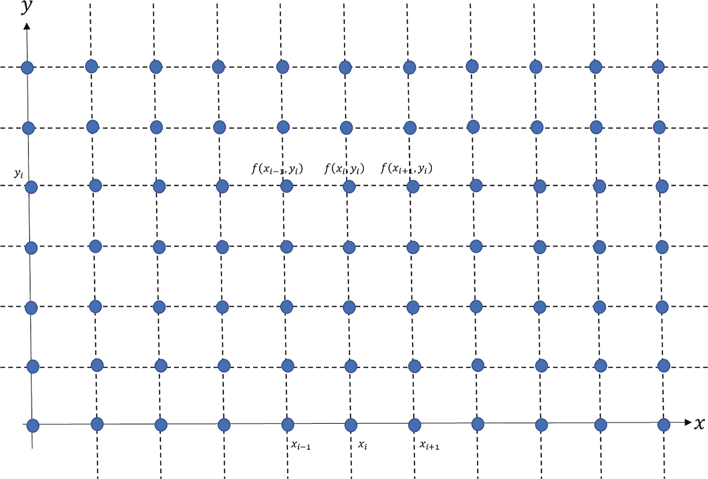

一张`y`关于`x`的曲线图，显示了一个由11行7列等间距节点组成的网格图案。

图 6-2  

为二维函数域选择的等距节点网格

在已知网格点上所有函数值的情况下，泰勒展开给出了你想要计算的导数的表达式，该表达式呈现为一个（如显式方法）或一套（如隐式方法，如克兰克-尼科尔森方法）代数方程的形式，并附带一个误差项。有限差分是一种近似的数值解法，它将微分问题转化为代数问题。这个数学概念很直观，表达式也很简单。

使用泰勒展开构造有限差分的方法有很多。基本类型包括一阶前向差分、一阶后向差分、一阶中心差分、二阶中心差分等。还有显式方法和隐式方法：显式方法只需代入数值即可得到结果；隐式方法则需要求解一个代数方程组才能得到结果。不同有限差分的误差可以是基于网格尺寸的一阶、二阶或更高阶。

单变量函数的一阶导数是最简单且最容易解释的。它表示函数在某一点的斜率。两点之间的斜率是这两个点之间函数值的变化量`Δf`除以这两个点之间的差值`Δx`所得的商`Δf/Δx`。连接这两点的线被称为函数在这两点之间的*割线*（图 6-3 中的红线）。当其中一个点向另一个点移动时，割线也随之移动。当一个点完全与另一个点重合时（即两点变成同一个点），割线就变成了函数在该点的切线（图 6-3 中的黑线）。该切线的斜率被定义为函数在该接触点处的斜率，因此也就是函数在该点的一阶导数。换句话说，一阶导数就是当步长`Δx`趋近于无穷小时的那个差商。当`Δx`足够小时，这个商就是对一阶导数`df/dx`的一个良好近似。根据你如何选取这两个点，你会得到不同的有限差分。

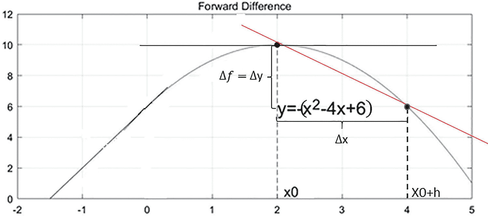

一张曲线图，展示了一条具有水平切线的上拱曲线，以及中心投影线之后的一条倾斜直线，用以说明前向差分。

图 6-3  

前向差分

### 6.2.1 前向差分

假设你要计算函数`f`在点`x[0]`处的导数。考虑点(`x[0]`, `f(x[0])`)和(`x[0] + h`, `f(x[0] + h)`)之间的线性插值。这两点之间割线的斜率通过前向（两点）差分来近似导数。

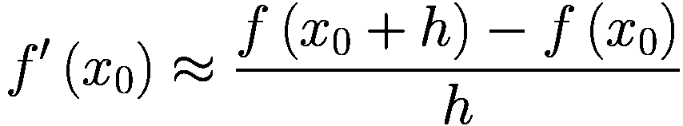

你可以通过泰勒展开来理解这个想法，如下所示：

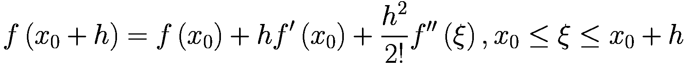

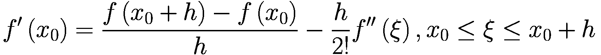

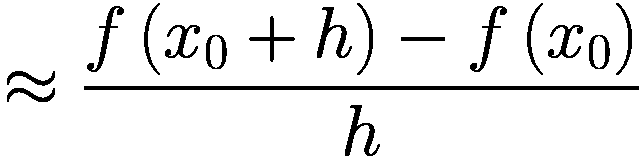

误差项如下：

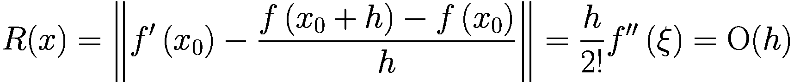

这里的大O符号表示误差项总是小于（有界于）一个常数乘以`h`，这个常数称为“`h`的大O”。换句话说，误差趋于零的速度快于一个常数乘以`h`。`h`越小，误差就越小。它们都以线性速率趋于零。误差项是一阶的。在使用单步预测-校正法求解常微分方程时，前向差分非常有用。

### 6.2.2 后向差分

考虑点(`x[0] − h`, `f(x[0] − h)` )和(`x[0]`, `f(x[0])` )之间的另一个线性插值。这两点之间割线的斜率近似导数，由后向（两点）差分给出。参见图 6-4。

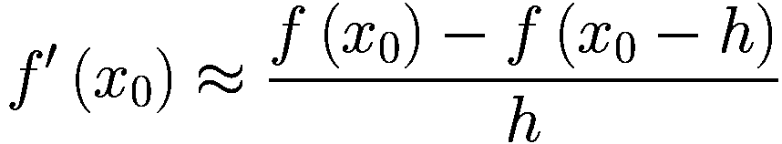

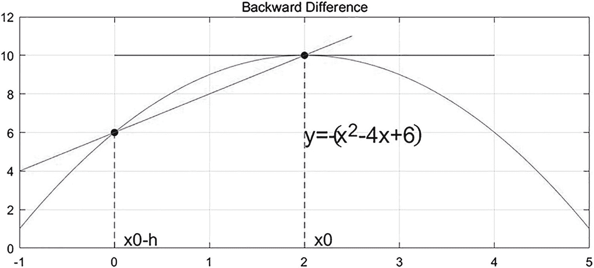

# 差分方法

一张图展示了一条具有水平切线的上凸曲线和一条在中心投影线之前的倾斜线，用以说明后向差分。

**图 6-4**

**后向差分**

根据泰勒展开，你可以得到：

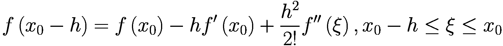

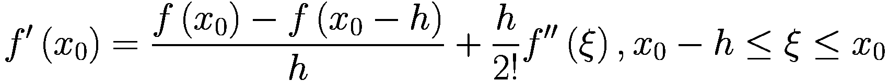

其误差项与前向差分相同。

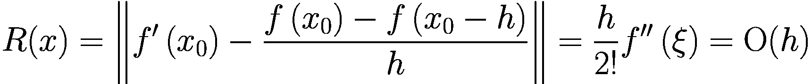

当未来的数据尚不可用时，后向差分非常有用。在某些控制问题中，未来的数据可能依赖于根据历史数据估计的导数。

### 6.2.3 中心差分

考虑点 (`x[0] − h`, `f(x[0] − h)`) 和 (`x[0] + h`, `f(x[0] + h)`) 之间的另一个线性插值。这两点之间割线的斜率通过中心（三点）差分来近似导数。

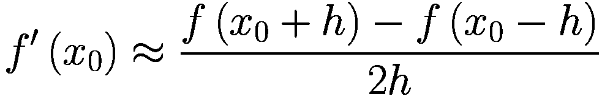

参见图 6-5。

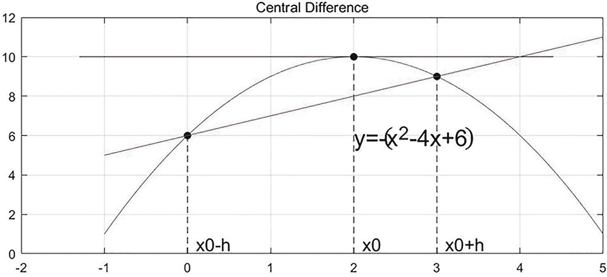

一张图展示了一条具有水平切线的上凸曲线和一条穿过中心投影线的倾斜线，用以说明中心差分。

**图 6-5**

**中心差分**

根据泰勒展开，你可以得到：

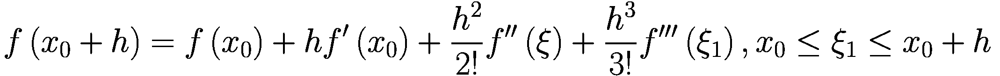

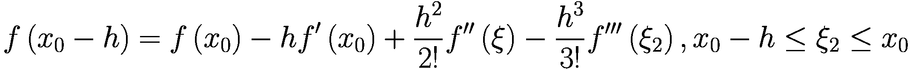

将这两个方程相减，你得到：

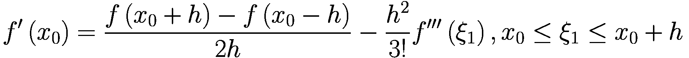

误差项如下：

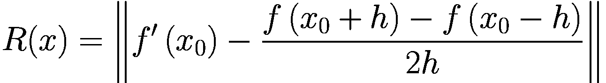

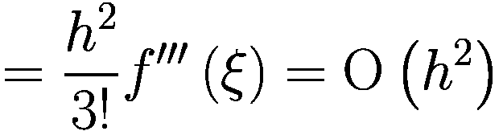

中心差分的误差是 `h`²的 大 O。这意味着误差以二次速率（快于线性速率）趋于零。这个误差项比前向和后向差分都要小。中心差分比前向和后向差分更精确，因此，如果过去和未来的数据值都可获得，则更倾向于使用中心差分。

对于之前的例子，你想计算以下函数在 `x = 2` 处的一阶导数：

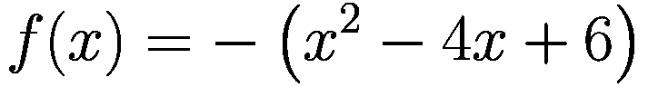

前向差分给出负结果，因为割线是向下倾斜的；后向差分给出正结果，因为割线是向上倾斜的；而中心差分给出 `df/dx = 0`，这是正确答案。

如果数据值是等间距的，那么中心差分就是前向差分和后向差分的平均值。中心差分常用于求解偏微分方程。

### 6.2.4 高阶导数

如果函数 `f(x)` 的一阶导函数 `f'(x)` 也是可微的，那么 `f'(x)` 的导数就称为函数 `f(x)` 的二阶导数。即：

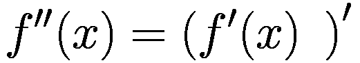

通过归纳，如果 `f(x)` 的 `(n-1)` 阶导数存在且可微，则定义其 `n` 阶导数如下：

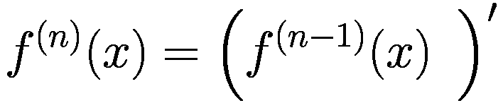

如果函数 `f` 是连续的，则称 `f ∈ C⁰`。如果 `f'` 存在且连续，则称 `f` 是光滑函数，并且 `f ∈ C¹`。如果 `f` 可以无限次微分（因此必然连续），则称 `f ∈ C^∞`。`f(x) = e^(x)` 属于 `C^∞`。

下面列出了一些高阶导数的有限差分公式。

二阶导数前向差分：

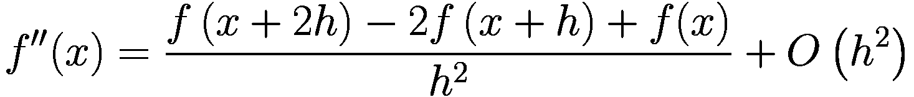

二阶导数后向差分：

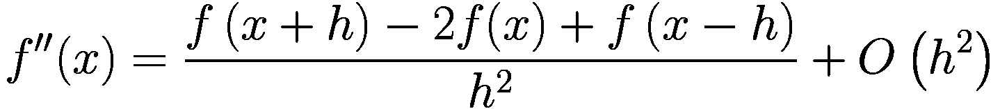

二阶导数中心差分：

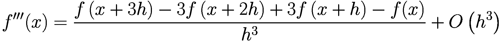

三阶导数前向差分：

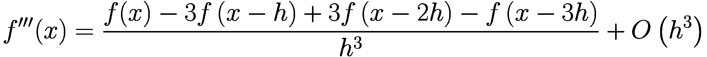

三阶导数后向差分：

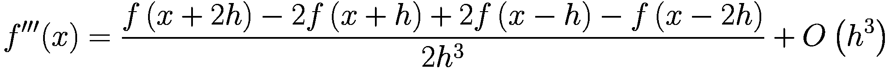

三阶导数中心差分：

# 有限差分法

一般地，可以得到如下公式。

## n阶导数差分公式

### n阶导数前向差分
`Δ_h^n[f]` 公式如下：

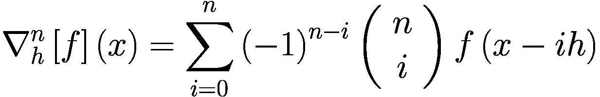

### n阶导数后向差分
`∇_h^n[f]` 公式如下：

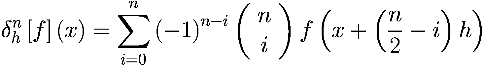

### n阶导数中心差分
`δ_h^n[f]` 公式如下：

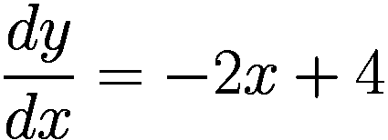

`(n choose i)` 是二项式系数。杨辉三角的每一行提供了每个 `i` 值对应的系数。

## 公式的一般性与构造

到目前为止提供的公式使用两个点来计算二阶导数，使用三个点来计算三阶导数。还存在使用三个点计算二阶导数、四个点计算三阶导数的公式。一般而言，利用线性代数，你可以构建有限差分近似，该近似对于任意阶导数，都可以在评估点的左侧使用任意数量的点，并在右侧使用（可能不同）数量的点。这涉及求解一个线性系统，使得这些点在评估点附近的泰勒展开最能逼近所需导数的泰勒展开。这在网格上对函数进行微分时非常有用，因为当你接近网格边缘时，你必须在某一侧采样越来越少的点。

## 在NM Dev中的实现

在 NM Dev 中，`FiniteDifference` 类用于计算给定函数的指定阶导数函数。

### 一阶导数示例
以下使用 NM Dev 的代码片段计算了前面例子的一阶导数：

```kotlin
val f: UnivariateRealFunction = object : AbstractUnivariateRealFunction() {
    override fun evaluate(x: Double): Double {
        return -(x * x - 4 * x + 6) // -(x² - 4x + 6)
    }
}
val x: Double = 2.0
val df1_forward: UnivariateRealFunction
    = FiniteDifference(f, 1, FiniteDifference.Type.FORWARD)
var dfdx: Double = df1_forward.evaluate(x) // evaluate at x
println(String.format("df/dx(x=%f) = %.16f using forward difference", x, dfdx))
val df1_backward: UnivariateRealFunction
    = FiniteDifference(f, 1, FiniteDifference.Type.BACKWARD)
dfdx = df1_backward.evaluate(x) // evaluate at x
println(String.format("df/dx(x=%f) = %.16f using backward difference", x, dfdx))
val df1_central: UnivariateRealFunction
    = FiniteDifference(f, 1, FiniteDifference.Type.CENTRAL)
dfdx = df1_central.evaluate(x) // evaluate at x
println(String.format("df/dx(x=%f) = %.16f using central difference", x, dfdx))
```

解析地，一阶导函数如下：

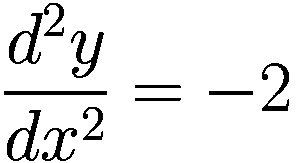

输出结果如下：

```text
df/dx(x=2.000000) = -0.0000000298023224 using forward difference
df/dx(x=2.000000) = 0.0000000298023224 using backward difference
df/dx(x=2.000000) = 0.0000000000000000 using central difference
```

请注意，前向差分结果略微为负，因为割线是向下倾斜的；后向差分结果略微为正，因为割线也是向下倾斜的。中心差分给出了正确答案，即 0。

### 二阶导数示例
解析地，二阶导函数如下：

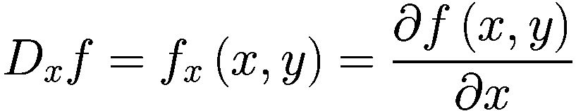

以下代码片段计算了二阶导数：

```kotlin
val f: UnivariateRealFunction = object : AbstractUnivariateRealFunction() {
    override fun evaluate(x: Double): Double {
        return -(x * x - 4 * x + 6) // -(x² - 4x + 6)
    }
}
val x: Double = 2.0
println("differentiate univariate functions")
val df1_forward: UnivariateRealFunction
    = FiniteDifference(f, 2, FiniteDifference.Type.FORWARD)
var dfdx: Double = df1_forward.evaluate(x) // evaluate at x
println(String.format("d2f/dx2(x=%f) = %.16f using forward difference", x, dfdx))
val df1_backward: UnivariateRealFunction
    = FiniteDifference(f, 2, FiniteDifference.Type.BACKWARD)
dfdx = df1_backward.evaluate(x) // evaluate at x
println(String.format("d2f/dx2(x=%f) = %.16f using backward difference", x, dfdx))
val df1_central: UnivariateRealFunction
    = FiniteDifference(f, 2, FiniteDifference.Type.CENTRAL)
dfdx = df1_central.evaluate(x) // evaluate at x
println(String.format("d2f/d2x(x=%f) = %.16f using central difference", x, dfdx))
```

输出结果如下：

```text
d2f/dx2(x=2.000000) = -2.0000015520433827 using forward difference
d2f/dx2(x=2.000000) = -1.9999985243161564 using backward difference
d2f/d2x(x=2.000000) = -1.9999985243161564 using central difference
```

## 类的签名

`FiniteDifference` 数值计算给定函数指定阶数的导函数。它本身是一个函数，可用于计算任意点的导数值。`FiniteDifference` 的签名如下：

# 多元有限差分

多元函数的偏导数是指函数关于其中一个变量的导数，同时保持其他变量为常数。例如，二元函数关于 `x` 的偏导数表示为：


与第 6.2 节中一元函数的求法类似，这些偏导数可以使用有限差分法进行数值计算，区别在于你需要在平面或更高维度的域上（而非数轴上）施加一个网格。

关于 `x` 的二阶偏导数表示为：

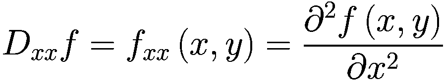

二阶混合偏导数是指先对一个变量求导，再对另一个变量求导。例如，先对 `x` 求导再对 `y` 求导的二阶混合偏导数表示为：

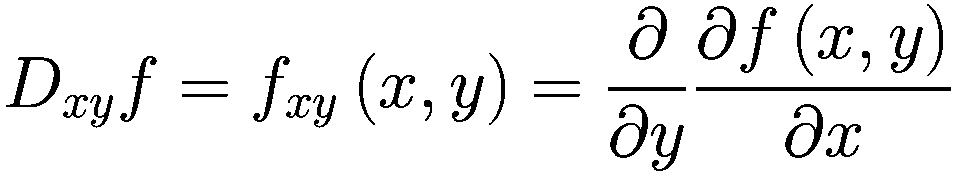

高阶偏导数和混合偏导数的形式如下：

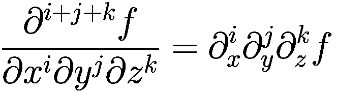

NM Dev 通过在函数上递归应用一阶中心有限差分法来数值计算这些导数。该类为 `MultivariateFiniteDifference`，其签名如下：

```java
/**
* Constructs the partial derivative of a multi-variable function.
* For example,
* varidx = new int[]{1, 2} means
* \[
* f_{x_1,x_2} = {\partial² \over \partial x_2 \partial x_1} = {\partial
* \over \partial x_2}({\partial \over \partial x_1})
* \]
* @param f      the real multivariate function to take derivative of
* @param varidx the variable indices of the derivative, counting from 1 up
*               to the domain dimension of f
*/
public MultivariateFiniteDifference(RealScalarFunction f, int[] varidx)
```

`varidx` 参数接受变量的索引，该类将按照该顺序对这些变量依次求导。

以下是一个示例：

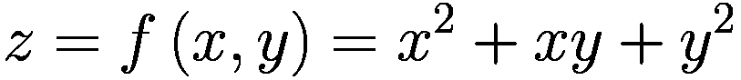

该函数的图形在欧几里得空间中定义了一个曲面。在该曲面的每一个点上，都存在无数条切线。偏微分就是选择其中一条线并求出其斜率。通常，最受关注的线是那些与 `xz` 平面平行（保持 `y` 为常数）以及与 `yz` 平面平行（保持 `x` 为常数）的线。参见图 6-6。

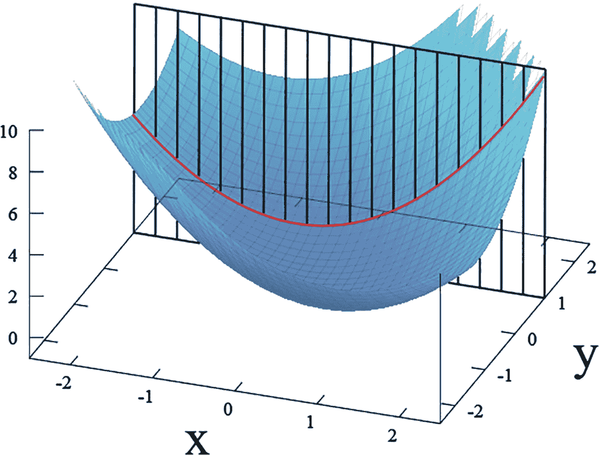

**图 6-6**
`z = x² + xy + y²` 的图形。对于在点 (1, 1) 处保持 `y` 为常数的偏导数，对应的切线平行于 `xz` 平面。

为了找到函数在点 (1, 1) 处平行于 `xz` 平面的切线斜率，你将 `y` 视为常数。通过在假设 `y` 为常数的条件下求方程的导数，你会发现函数 `f` 在点 (`x`, `y`) 处的斜率为：

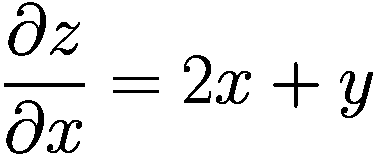

参见图 6-7。

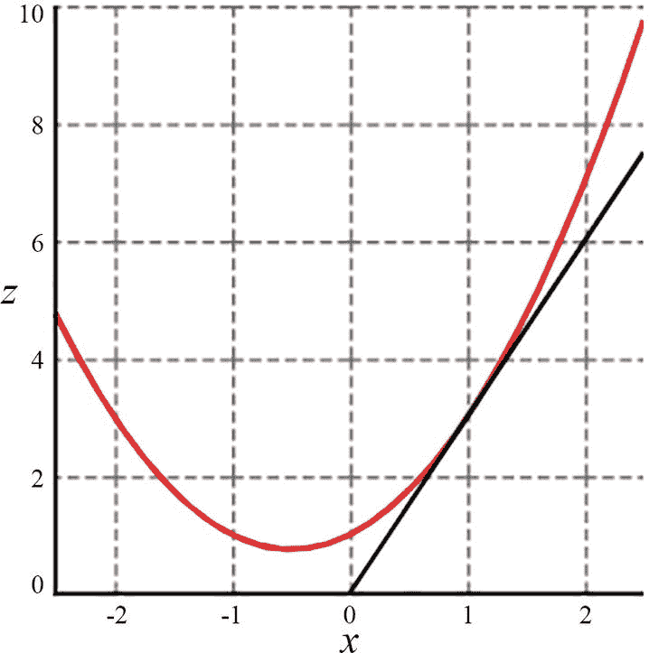

**图 6-7**
上图是函数在 `y = 1` 的 `xz` 平面上的切片，注意两轴采用了不同比例尺。切线的斜率为 3。

在点 (1, 1) 处计算结果为 3。以下代码片段解决了这个问题：

```java
/**
* Constructs an approximate derivative function for f using finite
* difference.
*
* @param f     a univariate function
* @param order the order of the derivative
* @param type  the type of finite difference to use, c.f., {@link Type}
*/
public FiniteDifference(UnivariateRealFunction f, int order, Type type)
@Override
public double evaluate(double x)
/**
* Evaluates numerically the derivative of f at point x,
* f'(x), with step size h.
* It could be challenging to automatically determine the step size
* h, esp. when |x| is near 0.
* It may, for example, require an analysis that involves f' and
* f''.
* The user may want to experiment with different hs by calling this
* function.
*
* @param x the point to evaluate the derivative of f at
* @param h step size
* @return f'(x), the numerical derivative of f at point
* x with step size h
*/
public double evaluate(double x, double h)
```

支持的类型如下：

*   `FiniteDifference.FORWARD`

*   `FiniteDifference.BACKWARD`

*   `FiniteDifference.CENTRAL`

在计算机上使用浮点运算计算导函数时，一个重要的实践考量是步长 `h` 的选择。若 `h` 过小，减法运算会产生较大的舍入误差。计算机中只有有限数量的实数可表示。两个非常接近但不同的实数会因有限的二进制表示而表示为相同的浮点数。因此，所有有限差分公式都是病态的，当 `h` 足够小时，由于抵消效应，结果将为 0。另一方面，若 `h` 过大，割线与切线将不匹配，导致近似值偏差较大。对于基本的中心差分法，最优步长是机器精度 `ε` 的立方根。对于在 `x` 和 `x + h` 处求值的数值导数公式，一个既小又不会产生较大舍入误差的 `h` 选择是 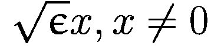。对于双精度浮点数，机器精度 `ε` 通常约为 1e-16。如果你调用第一个 `evaluate` 函数，NM Dev 会为你自动选择 `h`。或者，如果你调用第二个 `evaluate` 函数，你可以自己实现选择 `h` 的逻辑。

一般来说，对于有限差分法，计算导数时使用的点数越多，结果越精确。同时，导数的阶数越高，精度越低。例如，从之前的代码示例可以看出，近似二阶导数比近似一阶导数的精度低。

### 6.3.1 梯度

以下代码计算简单二元函数 `f = x² + xy + y²` 的偏导数 `df/dx`：

```kotlin
// f = x² + xy + y²
val f: RealScalarFunction = object : AbstractBivariateRealFunction() {
    override fun evaluate(x: Double, y: Double): Double {
        return x * x + x * y + y * y
    }
}
// df/dx = 2x + y
val dx: MultivariateFiniteDifference
        = MultivariateFiniteDifference(f, intArrayOf(1))
println(String.format("Dxy(1.0,1.0) %f", dx.evaluate(DenseVector(1.0, 1.0))))
```

输出结果如下：

```
Dxy(1.,1.) 3.000000
```

关于多元函数微分的另一个示例，请参考以下内容：

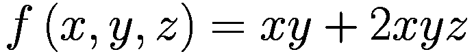

以下代码片段计算了这两个混合偏导数：

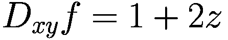

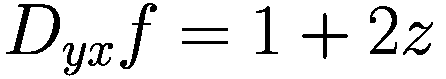

```kotlin
// f = xy + 2xyz
val f: RealScalarFunction = object : RealScalarFunction {
    override fun evaluate(v: Vector): Double {
        return v.get(1) * v.get(2) + 2 * v.get(1) * v.get(2) * v.get(3)
    }
    override fun dimensionOfDomain(): Int {
        return 3
    }
    override fun dimensionOfRange(): Int {
        return 1
    }
}
val dxy: MultivariateFiniteDifference // 1 + 2z
        // differentiate the first variable and then the second one
        = MultivariateFiniteDifference(f, intArrayOf(1, 2))
println(String.format("Dxy(1.0,1.0,1.0) %f", dxy.evaluate(DenseVector(1.0, 1.0, 1.0))))
println(String.format("Dxy(-100.0,0.0,-1.5) %f", dxy.evaluate(DenseVector(-100.0, 0.0, -1.5))))
//continuous function allows switching the order of differentiation by Clairaut's theorem
val dyx: MultivariateFiniteDifference // 1 + 2z
        // differentiate the second variable and then the first one
        = MultivariateFiniteDifference(f, intArrayOf(2, 1))
println(String.format("Dyx(1.0,1.0,1.0) %f", dyx.evaluate(DenseVector(1.0, 1.0, 1.0))))
println(String.format("Dyx(-100.0,0.0,-1.5) %f", dyx.evaluate(DenseVector(-100.0, 0.0, -1.5))))
```

输出结果如下：

```
Dxy(1.,1.,1.) 3.000001
Dxy(-100.,0.,-1.5) -2.000000
Dyx(1.,1.,1.) 3.000001
Dyx(-100.,0.,-1.5) -2.000000
```

存在若干重要且广泛使用的混合偏导向量和矩阵，即梯度向量、雅可比矩阵和海森矩阵。

多元实值函数 `f` 的梯度函数 `∇f` 是一个向量值函数（或向量场），从 `ℝ^n` 映射到 `ℝ^n`。它接收 `ℝ^n` 中的一个点 `x = (x[1], ⋯, x[n])`，并输出一个 `ℝ^n` 中的向量。任一点处的梯度 `∇f(x)` 是一个向量，其分量是 `f` 在 `x` 处的偏导数，即：

![$$ \nabla f\left(\boldsymbol{x}\right)=\left[\begin{array}{c}\frac{\partial f}{\partial {x}_1}\left(\boldsymbol{x}\right)\\ {}\vdots \\ {}\frac{\partial f}{\partial {x}_n}\left(\boldsymbol{x}\right)\end{array}\right] $$](images/528380_1_En_6_Chapter/528380_1_En_6_Chapter_TeX_Equam.png)

每个分量 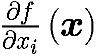 是函数沿某一坐标轴的偏导数，表示该方向上的变化率。因此，梯度向量类似于一阶导数或斜率（对于单变量函数而言则是切线）。它可被解释为函数增长最快的方向及其变化率。如果函数在点 `x` 处的梯度非零，则梯度方向即为函数从 `x` 出发增长最快的方向，而梯度幅值就是该方向上的增长率，即最大的绝对方向导数。此外，当且仅当某点是驻点（导数消失的点）时，该点的梯度为零向量。因此梯度在优化理论中扮演着基础性角色。你将在第[9](http://dx.doi.org/10.1007/978-1-4842-6797-4_9)章看到，许多优化算法（如梯度下降法）都使用了梯度。

例如，考虑一个房间，其温度由标量场 `T` 表示，即该多元函数或场接收点 `(x, y, z)` 并输出温度值 `T(x, y, z)`。在房间的每一点处，`T` 的梯度指示了从该点出发温度上升最快的方向，而梯度幅值则决定了该方向上升的速度。更一般地，若多元函数 `f` 可微，则 `∇f` 与单位向量 `v` 的点积就是函数沿 `v` 方向的斜率或变化率，称为 `f` 沿 `v` 的方向导数。泰勒展开的多元形式表明，函数的最佳线性近似可用梯度表达：

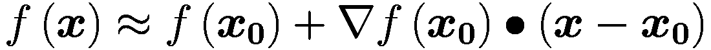

`x` 与 `x[0]` 是 `ℝ^n` 空间中的点。`f` 将 `ℝ^n` 映射到 `ℝ`，`∇f: ℝ^n → ℝ^n`。最后一项的点积结果为实数。

NM Dev 支持计算多元函数的梯度以及梯度函数，相关类为 `Gradient` 和 `GradientFunction`，其签名如下：

```java
/**
* 构造多元函数 f 在点 x 处的梯度向量。
*
* @param f 一个多元函数
* @param x 计算 f 梯度的点
*/
public Gradient(RealScalarFunction f, Vector x)

/**
* 构造实标量函数 f 的梯度函数。
*
* @param f 一个实标量函数
*/
public GradientFunction(RealScalarFunction f)
```

例如，考虑以下函数：

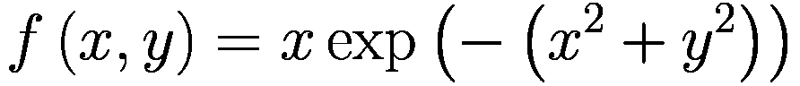

参见图 6-8。

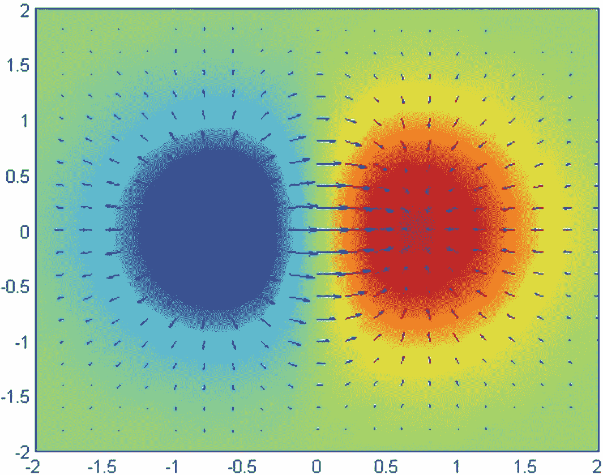

一个图表展示了两个圆形图案，分别带有密集的输入和输出箭头。两个轴上的数值范围均从 -2 到 2。

**图 6-8** 二维函数 `f(x, y) = xe^(−(x² + y²))` 的梯度以蓝色箭头绘制在函数的伪彩色图上。

以下代码计算该函数的梯度及其梯度函数：

// f = x * exp(-(x² + y²))
`val f: RealScalarFunction = object : AbstractBivariateRealFunction() {`
`override fun evaluate(x: Double, y: Double): Double {`
`return x * exp(-(x * x + y * y))`
`}`
`}`
`val x1: Vector = DenseVector(0.0, 0.0)`
`val g1_0: Vector = Gradient(f, x1)`
`println(String.format("\ngradient at %s = %s", x1, g1_0))`
`val df: GradientFunction = GradientFunction(f)`
`val g1_1: Vector = df.evaluate(x1)`
`println(String.format("gradient at %s = %s", x1, g1_1))`
`val x2: Vector = DenseVector(-1.0, 0.0)`
`val g2: Vector = df.evaluate(x2)`
`println(String.format("gradient at %s = %s", x2, g2))`
`val x3: Vector = DenseVector(1.0, 0.0)`
`val g3: Vector = df.evaluate(x3)`
`println(String.format("gradient at %s = %s", x3, g3))`

输出结果如下：

```
gradient at [0.000000, 0.000000]  = [1.000000, 0.000000]
gradient at [0.000000, 0.000000]  = [1.000000, 0.000000]
gradient at [-1.000000, 0.000000]  = [-0.367879, 0.000000]
gradient at [1.000000, 0.000000]  = [-0.367879, 0.000000]
```

再考虑另一个函数，如下所示：

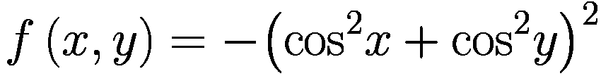

参见图 6-9。

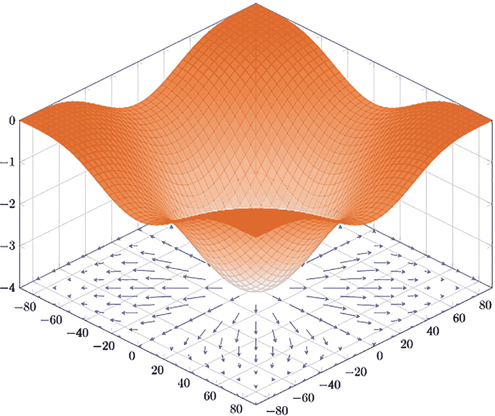

一个三维图形展示了具有四个极小值的网格图案。中央凹陷触碰到 XY 平面的中心，并呈现不同的输出箭头。

**图 6-9** 函数 `f(x,y) = −(cos²x + cos²y)²` 的梯度在底部平面上以投影向量场的形式描绘。

以下代码计算该函数的梯度及其梯度函数：

```
// f = -((cos(x))² + (cos(y))²)²
val f: RealScalarFunction = object : AbstractBivariateRealFunction() {
override fun evaluate(x: Double, y: Double): Double {
var z: Double = cos(x) * cos(x)
z += cos(y) * cos(y)
z = -z * z
return z
}
}
val x1: Vector = DenseVector(0.0, 0.0)
val g1_0: Vector = Gradient(f, x1)
println(String.format("\ngradient at %s = %s", x1, g1_0))
val df: GradientFunction = GradientFunction(f)
val g1_1: Vector = df.evaluate(x1)
println(String.format("gradient at %s = %s", x1, g1_1))
val x2: Vector = DenseVector(-1.0, 0.0)
val g2: Vector = df.evaluate(x2)
println(String.format("gradient at %s = %s", x2, g2))
val x3: Vector = DenseVector(1.0, 0.0)
val g3: Vector = df.evaluate(x3)
println(String.format("gradient at %s = %s", x3, g3))
```

输出结果如下：

```
gradient at [0.000000, 0.000000]  = [0.000000, 0.000000]
gradient at [0.000000, 0.000000]  = [0.000000, 0.000000]
gradient at [-1.000000, 0.000000]  = [-2.349491, 0.000000]
gradient at [1.000000, 0.000000]  = [2.349491, 0.000000]
```

### 6.3.2 雅可比矩阵

正如将单变量标量值函数的导数推广到多变量标量值函数的梯度，你还可以将这一概念进一步推广到多变量向量值函数。假设有一个向量值函数 **f**: ℝ^*n* → ℝ^*m*，它输入 ℝ^*n* 空间中的点 **x** = (*x*[1], ⋯, *x*[*n*])，并输出 ℝ^*m* 空间中的向量 **f**(**x**)。**f** 的雅可比矩阵定义为一个 *m* × *n* 矩阵，记作 **J**，其第 (*i*, *j*) 个元素如下：


或者显式地表示为：

![$$ \boldsymbol{J}=\left[\frac{\partial \boldsymbol{f}}{\partial {x}_1}\cdots \frac{\partial \boldsymbol{f}}{\partial {x}_n}\right] $$](images/528380_1_En_6_Chapter/528380_1_En_6_Chapter_TeX_Equar.png)

![$$ =\left[\begin{array}{c}{\nabla}^T{f}_1\\ {}\vdots \\ {}{\nabla}^T{f}_m\end{array}\right] $$](images/528380_1_En_6_Chapter/528380_1_En_6_Chapter_TeX_Equas.png)

![$$ =\left[\begin{array}{ccc}\frac{\partial {f}_1}{\partial {x}_1}& \cdots & \frac{\partial {f}_1}{\partial {x}_n}\\ \vdots & \ddots & \vdots \\ \frac{\partial {f}_m}{\partial {x}_1}& \cdots & \frac{\partial {f}_m}{\partial {x}_n}\end{array}\right] $$](images/528380_1_En_6_Chapter/528380_1_En_6_Chapter_TeX_Equat.png)

其中 ∇^*T**f*[*i*] 是第 *i* 个分量梯度的转置（行向量）。

雅可比矩阵是由所有一阶偏导数构成的矩阵。它表示了 **f** 在其可微点处的微分。它是 **f** 在 **x** 邻域内变化的最佳线性近似。也就是说，对于所有靠近 **x** 的点 **y**，它是 **f**(**y**) 的最佳线性近似。这引出了以下形式的泰勒展开：


当 **y** 趋近于 **x** 时，误差项趋近于零的速度远快于 **y** 与 **x** 之间距离的趋近速度。从这个意义上说，雅可比矩阵可以被视为多变量向量值函数的一种“一阶导数”。

# 雅可比矩阵

如果`m` = `n`，那么`f`是从 ℝ*<sup>n</sup>到自身的一个函数，雅可比矩阵就是一个方阵。此时可以计算其行列式，称为雅可比行列式。雅可比行列式有时简称为“雅可比”。给定点处的雅可比行列式提供了关于`f`在该点附近局部行为的重要信息。例如，反函数定理指出，如果连续可微函数`f`在点`x` ∈ ℝ<sup>`n`</sup>处的雅可比行列式非零，则`f`在`x`附近是可逆的。此外，如果点`x`处的雅可比行列式为正，则`f`在`x`附近保持定向；如果为负，则`f`反转定向。点`x`处雅可比行列式的绝对值给出了函数`f`在`x`附近膨胀或收缩体积的倍数。

## NM Dev 支持

NM Dev 支持计算多元向量值函数的雅可比矩阵和雅可比函数。相关的类是`Jacobian`和`JacobianFunction`。它们的签名如下：

```java
/**
 * 为多元函数 f 在某点 x 处构建雅可比矩阵。
 *
 * @param f 一个多元函数
 * @param x 计算雅可比矩阵的点
 */
public Jacobian(RealVectorFunction f, Vector x)

/**
 * 为多元函数 f 在某点 x 处构建雅可比矩阵。
 *
 * @param f 以单变量函数数组形式表示的多元函数
 * @param x 计算雅可比矩阵的点
 */
public Jacobian(final RealScalarFunction[] f, Vector x)

/**
 * 为多元函数 f 在某点 x 处构建雅可比矩阵。
 *
 * @param f 以单变量函数列表形式表示的多元函数
 * @param x 计算雅可比矩阵的点
 */
public Jacobian(final List f, Vector x)

/**
 * 构建一个实标量函数 f 的雅可比函数。
 *
 * @param f 一个实标量函数
 */
public JacobianFunction(RealVectorFunction f)
```

在 NM Dev 中，一个多元向量值函数可以通过`RealVectorFunction`、`RealScalarFunction`数组或`RealScalarFunction`列表来表示。

## 示例 1: ℝ² → ℝ²

考虑这个函数`F`: ℝ² → ℝ²:

![$$ \boldsymbol{F}\left(\left[\begin{array}{c}x\\ {}y\end{array}\right]\right)=\left[\begin{array}{c}{f}_1\left(x,y\right)\\ {}{f}_2\left(x,y\right)\end{array}\right]=\left[\begin{array}{c}{x}²y\\ {}5x+\sin y\end{array}\right] $$](images/528380_1_En_6_Chapter/528380_1_En_6_Chapter_TeX_Equav.png)

其雅可比矩阵如下：

![$$ {\boldsymbol{J}}_{\boldsymbol{F}}\left(x,y\right)=\left[\begin{array}{cc}\frac{\partial {f}_1}{\partial x}& \frac{\partial {f}_1}{\partial y}\\ {}\frac{\partial {f}_2}{\partial x}& \frac{\partial {f}_2}{\partial y}\end{array}\right]=\left[\begin{array}{cc}2 xy& {x}²\\ {}5& \cos y\end{array}\right] $$](images/528380_1_En_6_Chapter/528380_1_En_6_Chapter_TeX_Equaw.png)

雅可比行列式如下：


以下代码解决了这个示例：

```java
val F: RealVectorFunction = object : RealVectorFunction {
    override fun evaluate(v: Vector): Vector {
        val x: Double= v.get(1)
        val y: Double= v.get(2)
        val f1: Double = x * x * y
        val f2: Double = 5.0 * x + sin(y)
        return DenseVector(f1, f2)
    }

    override fun dimensionOfDomain(): Int {
        return 2
    }

    override fun dimensionOfRange(): Int {
        return 2
    }
}

val x0: Vector = DenseVector(0.0, 0.0)
val J00: Matrix = Jacobian(F, x0)
println(String.format(
    "\n 在 %s 处的雅可比矩阵 = %s，行列式 = %f",
    x0,
    J00,
    MatrixMeasure.det(J00)))

val J: RntoMatrix = JacobianFunction(F) // [2xy, x²], [5, cosy]
val J01: Matrix = J.evaluate(x0)
println(String.format(
    "\n 在 %s 处的雅可比矩阵 = %s，行列式 = %f",
    x0,
    J01,
    MatrixMeasure.det(J01)))

val x1: Vector = DenseVector(1.0, PI)
val J1: Matrix = J.evaluate(x1)
println(String.format(
    "在 %s 处的雅可比矩阵 = %s，行列式 = %f",
    x1,
    J1,
    MatrixMeasure.det(J1)))
```

输出如下：

```
在 [0.000000, 0.000000] 处的雅可比矩阵  = 2x2
[,1] [,2]
[1,] 0.000000, 0.000000,
[2,] 5.000000, 1.000000, ，行列式 = 0.000000
在 [0.000000, 0.000000] 处的雅可比矩阵  = 2x2
[,1] [,2]
[1,] 0.000000, 0.000000,
[2,] 5.000000, 1.000000, ，行列式 = 0.000000
在 [1.000000, 3.141593] 处的雅可比矩阵  = 2x2
[,1] [,2]
[1,] 6.283185, 1.000000,
[2,] 5.000000, -1.000000, ，行列式 = -11.283185
```

## 示例 2: ℝ³ → ℝ³

考虑这个函数`F`: ℝ³ → ℝ³:

![$$ \boldsymbol{F}\left(\left[\begin{array}{c}{x}_1\\ {}{x}_2\\ {}{x}_3\end{array}\right]\right)=\left[\begin{array}{c}5{x}_2\\ {}4{x_1}²-2\sin \left({x}_2{x}_3\right)\\ {}{x}_2{x}_3\end{array}\right] $$](images/528380_1_En_6_Chapter/528380_1_En_6_Chapter_TeX_Equay.png)

其雅可比矩阵如下：

![$$ {\textbf{J}}_{\textbf{F}}\left(x,y\right)=\left[\begin{array}{ccc}0& 5& 0\\ {}8{x}_1& -2{x}_3\cos \left({x}_2{x}_3\right)& -2{x}_2\cos \left({x}_2{x}_3\right)\\ {}0& {x}_3& {x}_2\end{array}\right] $$](images/528380_1_En_6_Chapter/528380_1_En_6_Chapter_TeX_Equaz.png)

雅可比行列式如下：


以下代码解决了这个示例：

### 6.3.3 海森矩阵

你可以将单变量函数二阶导数的概念推广到多变量实值函数。首先计算标量函数的梯度（从某种意义上说，即求一阶导数）。然后计算梯度函数的雅可比矩阵（从某种意义上说，即求二阶导数）。这个雅可比矩阵被称为海森矩阵。海森矩阵是一个标量值函数或标量场的二阶偏导数构成的方阵。它描述了多变量函数的局部曲率。即：


具体来说，假设 *f*: ℝ^(*n*) → ℝ。如果 *f* 的所有二阶偏导数存在且在其定义域上连续，那么 *f* 的海森矩阵 ***H*** 是一个 *n* × *n* 方阵，通常按如下方式定义和排列：

![$$ {\boldsymbol{H}}_f=\left[\begin{array}{cccc}\frac{\partial²f}{\partial {x}_1²}&amp; \frac{\partial²f}{\partial {x}_1\partial {x}_2}&amp; \cdots &amp; \frac{\partial²f}{\partial {x}_1\partial {x}_n}\\ {}\frac{\partial²f}{\partial {x}_2\partial {x}_1}&amp; \frac{\partial²f}{\partial {x}_2²}&amp; \cdots &amp; \frac{\partial²f}{\partial {x}_2\partial {x}_n}\\ {}\vdots &amp; \vdots &amp; \ddots &amp; \vdots \\ {}\frac{\partial²f}{\partial {x}_n\partial {x}_1}&amp; \frac{\partial²f}{\partial {x}_n\partial {x}_2}&amp; \cdots &amp; \frac{\partial²f}{\partial {x}_n²}\end{array}\right] $$](images/528380_1_En_6_Chapter/528380_1_En_6_Chapter_TeX_Equbc.png)

简写形式如下：


海森矩阵是一个对称矩阵。二阶导数连续的假设意味着求导顺序无关紧要（根据克莱罗定理）。海森矩阵的行列式被称为海森行列式。海森矩阵用于解决牛顿类方法中的优化问题，因为它们是函数局部泰勒展开中二次项的系数。即：


我们将在第[11](http://dx.doi.org/10.1007/978-1-4842-6797-4_11)章更详细地讨论如何在优化中使用海森矩阵。

NM Dev 支持计算多变量实值函数的海森矩阵和海森函数。相关的类是 `Hessian` 和 `HessianFunction`。它们的签名如下：

```kotlin
/**
* 为多变量函数 f 在点 x 处构造海森矩阵。
*
* @param f 一个多变量函数
* @param x 要计算 f 的海森矩阵的点
*/
public Hessian(RealScalarFunction f, Vector x)
/**
* 构造实标量函数 f 的海森函数。
*
* @param f 一个实标量函数
*/
public HessianFunction(RealScalarFunction f)
```

以下示例代码计算了 *f*(*x*, *y*) = *xy* 的海森矩阵和海森函数：

```kotlin
val F: RealVectorFunction = object : RealVectorFunction {
    override fun evaluate(v: Vector): Vector {
        val x1: Double = v.get(1)
        val x2: Double = v.get(2)
        val x3: Double = v.get(3)
        val f1: Double = 5.0 * x2
        val f2: Double = 4.0 * x1 * x1 - 2.0 * sin(x2 * x3)
        val f3: Double = x2 * x3
        return DenseVector(f1, f2, f3)
    }

    override fun dimensionOfDomain(): Int {
        return 3
    }

    override fun dimensionOfRange(): Int {
        return 3
    }
}

val x0: Vector = DenseVector(0.0, 0.0, 1.0)
val J: RntoMatrix = JacobianFunction(F)
val J0: Matrix = J.evaluate(x0)
println(String.format(
    "\n 在 %s 处的雅可比矩阵 = %s，行列式 = %f",
    x0,
    J0,
    MatrixMeasure.det(J0)))

val x1: Vector = DenseVector(1.0, 2.0, 3.0)
val J1: Matrix = J.evaluate(x1)
println(String.format(
    "在 %s 处的雅可比矩阵 = %s，行列式 = %f",
    x1,
    J1,
    MatrixMeasure.det(J1)))
```

输出如下：

```
在 [0.000000, 0.000000, 1.000000] 处的雅可比矩阵  = 3x3
[,1] [,2] [,3]
[1,] 0.000000, 5.000000, 0.000000,
[2,] 0.000000, -2.000000, 0.000000,
[3,] 0.000000, 1.000000, 0.000000, ，行列式 = 0.000000
在 [1.000000, 2.000000, 3.000000] 处的雅可比矩阵  = 3x3
[,1] [,2] [,3]
[1,] 0.000000, 5.000000, 0.000000,
[2,] 8.000000, -5.761022, -3.840681,
[3,] 0.000000, 3.000000, 2.000000, ，行列式 = -80.000000
```

由此可见，`F` 在 `x[1]` 和 `x[2]` 符号相同的那些点附近会反转定向。除了在 `x[1] = 0` 或 `x[2] = 0` 的点附近外，该函数在其余各处都是局部可逆的。直观地说，如果你以点 `(1, 2, 3)` 周围的一个微小物体开始，并对其应用 `F`，你将得到一个体积大约是原始物体体积的 40 × 1 × 2 = 80 倍的新物体，并且定向被反转。

## 6.4 里德方法

里德方法通过对一系列近似值进行外推，改进了有限差分法的估算。要计算数值导数，首先必须使用一系列递减的步长来计算一系列近似值。然后，里德方法使用内维尔算法将步长外推至零。通常，它能比简单的（一次性）有限差分法提供更高的精度。

初始步长 `h[0]` 的选择至关重要。如果 `h[0]` 太大，计算出的值可能不精确。如果 `h[0]` 太小，由于舍入误差，对于不同的步长，你可能反复计算得到“相同”的值。

以下代码片段比较了使用里德方法与简单有限差分法计算的、在 `x` = 0.5 处对数函数的一至九阶导数值。

```kotlin
val f: UnivariateRealFunction = object : AbstractUnivariateRealFunction() {
    override fun evaluate(x: Double): Double {
        return ln(x)
    }
}
val x: Double = 0.5
for (order in 1..9) {
    val fd: FiniteDifference = FiniteDifference(f, order, FiniteDifference.Type.CENTRAL)
    val ridder: Ridders = Ridders(f, order)
    println(String.format(
        "Ridder 法计算的 %d 阶导数 @ %f = %.16f", order, x, ridder.evaluate(x)))
    println(String.format(
        "有限差分法计算的 %d 阶导数 @ %f = %.16f", order, x, fd.evaluate(x)))
}
```

输出如下：

```
Ridder 法计算的 1 阶导数 @ 0.500000 = 2.0000000000000000
有限差分法计算的 1 阶导数 @ 0.500000 = 2.0000000000000000
Ridder 法计算的 2 阶导数 @ 0.500000 = -4.0000004374066640
有限差分法计算的 2 阶导数 @ 0.500000 = -4.0000031040867650
Ridder 法计算的 3 阶导数 @ 0.500000 = 16.0000016378464240
有限差分法计算的 3 阶导数 @ 0.500000 = 16.0002441406250000
Ridder 法计算的 4 阶导数 @ 0.500000 = -95.9999555891298100
有限差分法计算的 4 阶导数 @ 0.500000 = -95.9874881885177200
Ridder 法计算的 5 阶导数 @ 0.500000 = 767.9383982440593000
有限差分法计算的 5 阶导数 @ 0.500000 = 767.5675271157362000
Ridder 法计算的 6 阶导数 @ 0.500000 = -7681.9174458835320000
有限差分法计算的 6 阶导数 @ 0.500000 = -7686.1197112745450000
Ridder 法计算的 7 阶导数 @ 0.500000 = 92116.9184885280300000
有限差分法计算的 7 阶导数 @ 0.500000 = 92428.4022426225400000
Ridder 法计算的 8 阶导数 @ 0.500000 = -1290356.2663459945000000
有限差分法计算的 8 阶导数 @ 0.500000 = -1300812.8634378603000000
Ridder 法计算的 9 阶导数 @ 0.500000 = 20941653.5495638000000000
有限差分法计算的 9 阶导数 @ 0.500000 = 21347177.7802486680000000
```

前四阶导数的解析结果精确为 2、-4、16 和 -96。请注意，里德方法提供了更好的精度，尤其是对于通常对有限差分法具有挑战性的高阶导数。

里德方法也适用于多变量函数。以下示例比较了里德方法与第 6.3 节示例中有限差分法的结果。

```kotlin
val f: RealScalarFunction = object : AbstractBivariateRealFunction() {
    override fun evaluate(x: Double, y: Double): Double {
        return x * y // f = xy
    }
}
val x1: Vector = DenseVector(1.0, 1.0)
val H1: Hessian = Hessian(f, x1)
println(String.format(
    "\n 在 %s 处的海森矩阵 = %s, 行列式 = %f",
    x1,
    H1,
    MatrixMeasure.det(H1)))
val H: RntoMatrix = HessianFunction(f)
val Hx1: Matrix = H.evaluate(x1)
println(String.format(
    "\n 在 %s 处的海森矩阵 = %s, 行列式 = %f",
    x1,
    Hx1,
    MatrixMeasure.det(Hx1)))
val x2: Vector = DenseVector(0.0, 0.0)
val H2: Hessian = Hessian(f, x2)
println(String.format(
    "\n 在 %s 处的海森矩阵 = %s, 行列式 = %f",
    x2,
    H2,
    MatrixMeasure.det(H2)))
val Hx2: Matrix = H.evaluate(x2)
println(String.format(
    "\n 在 %s 处的海森矩阵 = %s, 行列式 = %f",
    x2,
    Hx2,
    MatrixMeasure.det(Hx2)))
```

输出如下：

```
在 [1.000000, 1.000000] 处的海森矩阵 = 2x2
[,1] [,2]
[1,] 0.000000, 1.000000,
[2,] 1.000000, 0.000000, , 行列式 = -0.999999
在 [1.000000, 1.000000] 处的海森矩阵 = 2x2
[,1] [,2]
[1,] 0.000000, 1.000000,
[2,] 1.000000, 0.000000, , 行列式 = -0.999999
在 [0.000000, 0.000000] 处的海森矩阵 = 2x2
[,1] [,2]
[1,] 0.000000, 1.000000,
[2,] 1.000000, 0.000000, , 行列式 = -1.000000
在 [0.000000, 0.000000] 处的海森矩阵 = 2x2
[,1] [,2]
[1,] 0.000000, 1.000000,
[2,] 1.000000, 0.000000, , 行列式 = -1.000000
```

## 6.5 特殊函数的导数函数

`NM Dev` 支持许多特殊函数及其一阶导数函数。特殊函数通常指无法通过有限个初等函数（如有限个多项式、有理函数、三角函数、指数函数及其反函数的和、积或复合）计算出的函数。其导数函数也是如此。由于这些函数在许多应用中的重要性（例如统计学中的高斯函数），您必须能够精确计算这些函数，而无法承受使用有限差分法带来的不精确。针对特殊函数，有专门的计算技术，例如连分数。`NM Dev` 支持的特殊函数及其一阶导数函数包括：高斯函数、误差函数、贝塔函数、正则化不完全贝塔函数和伽马函数。

### 6.5.1 高斯导数函数

高斯函数定义如下：


计算高斯函数的类是 `Gaussian`，其签名如下：

```java
/**
* 构造一个高斯函数的实例。
*
* @param a a
* @param b b
* @param c c
*/
public Gaussian(double a, double b, double c)
```

计算高斯函数导数的类是 `DGaussian`，其签名如下：

```java
/**
* 构造高斯函数的导数函数。
*
* @param phi 一个 {@link Gaussian} 函数
*/
public DGaussian(Gaussian phi)
```

示例如下：

```kotlin
val G: Gaussian = Gaussian(1.0, 0.0, 1.0) // 标准高斯函数
val dG: DGaussian = DGaussian(G)
var x: Double = -0.5
println(String.format("dG/dx(%f) = %f", x, dG.evaluate(x)))
x = 0.0
println(String.format("dG/dx(%f) = %f", x, dG.evaluate(x)))
x = 0.5
println(String.format("dG/dx(%f) = %f", x, dG.evaluate(x)))
```

输出结果如下：

```
dG/dx(-0.500000) = 0.176033
dG/dx(0.000000) = -0.000000
dG/dx(0.500000) = -0.176033
```

### 6.5.2 误差导数函数

误差函数定义如下：


计算误差函数的类是 `Erf`。计算误差函数导数的类是 `DErf`。这两个类都从 `AbstractUnivariateRealFunction` 继承了 `evaluate(double x)` 方法。它们的构造函数不带任何参数。

示例如下：

```kotlin
val z: Double = 0.5
val E: Erf = Erf()
val dE: DErf = DErf()
println(String.format("erf(%f) = %f", z, E.evaluate(z)))
println(String.format("dErf/dz(%f) = %f", z, dE.evaluate(z)))
```

输出结果如下：

```
erf(0.500000) = 0.520500
dErf/dz(0.500000) = 0.878783
```

### 6.5.3 贝塔导数函数

贝塔函数也称为第一类欧拉积分。对于任意实数 `x`，`y` > 0，其定义如下：


计算贝塔函数的类是 `Beta`。计算贝塔函数导数的类是 `DBeta`。这两个类都从 `AbstractBivariateRealFunction` 继承了 `evaluate(double x, double y)` 方法。它们的构造函数不带任何参数。

示例如下：

```kotlin
// f = xy + 2xyz
val f: RealScalarFunction = object : RealScalarFunction {
    override fun evaluate(v: Vector): Double {
        return v.get(1) * v.get(2) + 2 * v.get(1) * v.get(2) * v.get(3)
    }
    override fun dimensionOfDomain(): Int {
        return 3
    }
    override fun dimensionOfRange(): Int {
        return 1
    }
}
val dxy_ridder: Ridders = Ridders(f, intArrayOf(1, 2))
val dxy: MultivariateFiniteDifference // 1 + 2z
// 先对第一个变量求导，再对第二个变量求导
= MultivariateFiniteDifference(f, intArrayOf(1, 2))
val x0: Vector = DenseVector(1.0, 1.0, 1.0)
println(String.format("Dxy(%s) by Ridder = %.16f", x0, dxy_ridder.evaluate(x0)))
println(String.format("Dxy(%s) by FD =  %.16f", x0, dxy.evaluate(x0)))
val x1: Vector = DenseVector(-100.0, 0.0, -1.5)
println(String.format("Dxy(%s) by FD = %.16f", x1, dxy_ridder.evaluate(x1)))
println(String.format("Dxy(%s) by FD = %.16f", x1, dxy.evaluate(x1)))
// 由克莱罗定理，连续函数允许交换求导顺序
val dyx_ridder: Ridders = Ridders(f, intArrayOf(2, 1))
val dyx: MultivariateFiniteDifference // 1 + 2z
// 先对第二个变量求导，再对第一个变量求导
= MultivariateFiniteDifference(f, intArrayOf(2, 1))
println(String.format("Dyx(%s) by Ridder = %.16f", x0, dyx_ridder.evaluate(x0)))
println(String.format("Dyx(%s) by FD = %.16f", x0, dyx.evaluate(x0)))
println(String.format("Dyx(%s) by Ridder = %.16f", x1, dyx_ridder.evaluate(x1)))
println(String.format("Dyx(%s) by FD = %.16f", x1, dyx.evaluate(x1)))
```

输出结果如下：

```
Dxy([1.000000, 1.000000, 1.000000] ) by Ridder = 2.9999999941935465
Dxy([1.000000, 1.000000, 1.000000] ) by FD =  3.0000013187575885
Dxy([-100.000000, 0.000000, -1.500000] ) by FD = -2.0000000000032907
Dxy([-100.000000, 0.000000, -1.500000] ) by FD = -1.9999999999865270
Dyx([1.000000, 1.000000, 1.000000] ) by Ridder = 2.9999999941935465
Dyx([1.000000, 1.000000, 1.000000] ) by FD = 3.0000013187575885
Dyx([-100.000000, 0.000000, -1.500000] ) by Ridder = -2.0000000000044610
Dyx([-100.000000, 0.000000, -1.500000] ) by FD = -1.9999999999748960
```

解析结果分别为 3 和 -2。注意，Ridders 方法比有限差分法具有更好的精度。

```kotlin
val x: Double = 1.5
val y: Double = 2.5
val B: Beta = Beta()
val dB: DBeta = DBeta()
println(String.format("Beta(%f) = %f", x, B.evaluate(x, y)))
println(String.format("dBeta/dz(%f) = %f", x, dB.evaluate(x, y)))
```

输出结果如下：

```
Beta(1.500000) = 0.196350
dBeta/dz(1.500000) = -0.239473
```

### 6.5.4 正则化不完全贝塔导数函数

不完全贝塔函数是贝塔函数的一种推广，定义如下：


当 `x` = 1 时，不完全贝塔函数与完全贝塔函数重合。

正则化不完全贝塔函数（简称正则化贝塔函数）由不完全贝塔函数和完全贝塔函数定义：


正则化不完全贝塔函数是贝塔分布的累积分布函数。

计算正则化不完全贝塔函数的类是 `BetaRegularized`，其签名如下：

```java
/**
* 构造一个具有参数 p 和 q 的 Ix(p,q) 实例。
*
* @param p p > 0，形状参数
* @param q q > 0，形状参数
*/
public BetaRegularized(final double p, final double q)
```

计算正则化不完全贝塔函数导数的类是 `DBetaRegularized`，其签名如下：

```java
/**
* 构造正则化不完全贝塔函数 {@link BetaRegularized} 的导数函数。
*
* @param p 形状参数
* @param q 形状参数
*/
public DBetaRegularized(double p, double q)
```

示例如下：

```kotlin
val p: Double = 0.5
val q: Double = 2.5
val I: BetaRegularized = BetaRegularized(p, q)
val dI: DBetaRegularized = DBetaRegularized(p, q)
val x: Double = 1.0
println(String.format("BetaRegularized(%f) = %f", x, I.evaluate(x)))
println(String.format("dBetaRegularized/dz(%f) = %f", x, dI.evaluate(x)))
```

输出结果如下：

```
BetaRegularized(1.000000) = 1.000000
dBetaRegularized/dz(1.000000) = 0.000000
```

### 6.5.5 Gamma 导数函数

`Gamma` 函数是阶乘函数向实数和复数领域的推广，其自变量下移了 1。对于实数，其定义如下：


用于计算 Gamma 函数的类是 `Gamma`。用于计算 Gamma 函数导数函数的类是 `DGamma`。两个类都继承自 `AbstractUnivariateRealFunction` 的 `evaluate(double x)` 方法。它们的构造方法不接受任何参数。NM Dev 提供了多种 Gamma 函数的实现。它们在精度和性能方面具有不同的特性。默认选择是 Lanczos 算法，所有计算均使用 `double` 完成。

示例如下：

```kotlin
val z: Double = 0.5
// 维基百科：Lanczos 近似
val G: Gamma = GammaLanczosQuick()
val dG: DGamma = DGamma()
println(String.format("Gamma(%f) = %f", z, G.evaluate(z)))
println(String.format("dGamma/dz(%f) = %f", z, dG.evaluate(z)))
```

输出结果如下：

```
Gamma(0.500000) = 1.772454
dGamma/dz(0.500000) = -3.480231
```

### 6.5.6 多项式导数函数

多项式并非严格意义上的特殊函数。我们在此将其收录，是因为 NM Dev 不使用有限差分法来计算多项式的导数函数。对多项式求导存在闭式解。


用于计算多项式的类是 `Polynomial`，其签名如下：

```java
/**
 * 根据系数数组构造一个多项式。
 * 第一个/索引为 0 的项对应 x^n 项。
 * 最后一个/索引为 n 的项对应常数项。
 * 多项式的次数为 n，即数组长度减 1。
 *
 * 例如，
 *
 * new Polynomial(1, -2, 3, 2)
 *
 * 将创建一个表示 x³ - 2x² + 3x + 2 的 {@code Polynomial} 实例。
 *
 * @param coefficients 多项式系数
 */
public Polynomial(double... coefficients)
```

用于计算多项式导数函数的类是 `DPolynomial`，其签名如下。多项式的导数函数仍然是一个多项式。

```java
/**
 * 构造一个 {@link Polynomial} 的导数函数，该导数函数本身也是一个多项式。
 *
 * @param polynomial 一个多项式
 */
public DPolynomial(Polynomial polynomial)
```

示例如下：

```kotlin
val p: Polynomial = Polynomial(1.0, 2.0, 1.0) // x² + 2x + 1
val dp: Polynomial = DPolynomial(p) // 2x + 2
val x: Double = 1.0
println(String.format("dp/dx(%f) = %f", x, dp.evaluate(x)))
```

输出结果如下：

```
dp/dx(1.000000) = 4.000000
```

## 6.6 数值积分

定积分是曲线或函数 `f(x)`（称为 `被积函数`）在实数轴上两点 `[a, b]` 之间所形成的（有符号）面积。其定义如下：


符号 `dx`，称为变量 `x` 的微分，表示积分变量是 `x`。它表示 `x` 的一个微小变化，如同微分中的概念。积分就是计算定积分值的过程。微积分第一基本定理表明，积分的导数就是被积函数。因此，积分有时也被称为函数的反导数。见图 6-10。


在曲线下方，三个区域（正面积和负面积）在 X Y 轴上从 a 到 b 的距离处被阴影标出，对应 `f(x)`。

**图 6-10.** 积分作为曲线下的有符号面积

黎曼给出了积分的第一个严格定义。黎曼积分的基本思想是将面积划分成许多矩形来近似面积，然后将它们求和（因此得名积分）。通过采用越来越好的近似，比如说无穷多个无穷小的矩形，你可以说“在极限情况下”，你就得到了曲线下的精确面积。图 6-11 展示了一个区间上规则划分的一系列黎曼和。顶部的数字是矩形的总面积，它收敛于函数的积分。


六幅具有不同 A 值的图通过六个步骤减小 A 值，展示了柱状图随着下降和上升曲线的组合而依次增加的过程。

# 黎曼和与数值积分

**图 6-11.** 一系列黎曼和

从数学上讲，区间 [*a*, *b*] 的一个划分是一组有限点序列：


在每个子区间内，有一个选定点 `t[i]` ∈ [`x[i]`, `x[i+1]`] 用于确定矩形 `f(t[i])` 的高度。因此，矩形面积为 `f(t[i])` (`x[i+1] - x[i]`)。函数 `f` 相对于该划分的黎曼和定义为所有矩形面积之和。


当取 `n` 趋于无穷大的极限时，黎曼和就变成了积分值：


数值积分是一种使用类似划分概念来近似定积分的技术：使用被积函数有限样本值的加权平均近似来替换函数值。数值积分之所以重要，是因为（通常）无法解析地找到（闭式）反导数。即使反导数存在，由于它们可能无法由初等函数构成，计算起来也可能并不容易。计算数值近似值比计算用特殊函数或无穷级数表示的反导数要容易得多。此外，被积函数可能仅在特定点（例如通过采样获得）已知。出于这个原因，一些嵌入式系统和其他计算机应用程序可能需要数值积分。

传统上，计算面积大小的数学方法被称为*求积*。现在它已成为积分的同义词，但使用较少。数值积分公式仍然被称为数值求积公式。进行数值积分的方法有很多种。它们的区别在于将区间划分成多少份、划分是否等距、如何选择选定点、是开式（不使用端点）还是闭式（使用端点），以及是否（以及如何）进行外推。本章只能浅尝辄止，介绍一些最基本的变体。

## 6.7 牛顿-柯特斯家族

牛顿-柯特斯公式，也称为牛顿-柯特斯求积法则或简称为牛顿-柯特斯法则，是一组基于在等距点上计算被积函数值的数值积分公式。它们以艾萨克·牛顿和罗杰·柯特斯的名字命名。如果被积函数在等距点上的值可用，那么牛顿-柯特斯公式会很有用。如果可能使用一组不同的（可能不等距的）点，那么其他方法（如高斯求积）可能更精确。牛顿-柯特斯公式有多种推导方式。其中最著名的两个是梯形求积公式和辛普森求积公式。

### 6.7.1 梯形求积公式

梯形公式通过用一条直线代替函数，本质上是将函数下方的区域近似为梯形并计算其面积。参见图 6-12。


梯形公式的图示展示了一条方程 `y = x² + 4x + 6` 的向上凸曲线。两条垂直线投影到 X 轴上，形成了一个带阴影的梯形。

**图 6-12** 梯形公式

通过 `a` 点和 `b` 点的直线方程如下：


直线下方的面积就是梯形的面积，计算方法为：底边（平行边）之和乘以高（底边之间的垂直距离），然后除以 2。你也可以通过正规的积分运算得到相同结果。

用 `L1(x)` 替换 `f(x)`，得到：


![$$ ={\int}_a^b\left[\frac{f(b)-f(a)}{b-a}\left(x-a\right)+f(a)\right] dx $$](images/528380_1_En_6_Chapter/528380_1_En_6_Chapter_TeX_Equbu.png)


对于函数 `f(x)` 和区间 `[a, b]`，可以将区间划分为 `N` 个子区间。然后对每个子区间应用梯形法则并将结果求和。

令


可以证明，假设 `f''(x)` 在 `[a, b]` 上存在且连续，则对于某个 `ξ` ∈ `[a, b]`，使用梯形法则的误差如下：


在 NM Dev 中，执行梯形积分的类是 `Trapezoidal`。下面的示例解决了图 6-12 中的问题：

```kotlin
val f: UnivariateRealFunction = object : AbstractUnivariateRealFunction() {
    override fun evaluate(x: Double): Double {
        return -(x * x - 4 * x - 6) // -(x² - 4x - 6)
    }
}
// 积分上下限
val a: Double = 1.5
val b: Double = 3.5
// 使用梯形法则的积分器
val integrator: Integrator = Trapezoidal(1e-8, 20) // 精度，最大迭代次数
// 执行积分
val I: Double = integrator.integrate(f, a, b)
println(String.format("S_[%.1f,%.1f] f(x) dx = %f", a, b, I))
```

输出如下：

```
S_[1.5,3.5] f(x) dx = 18.833333
```

`Trapezoidal` 类的签名如下：

```java
/**
 * 构造一个实现梯形法则的积分器。
 *
 * @param precision     收敛阈值
 * @param maxIterations 最大迭代次数
 */
public Trapezoidal(double precision, int maxIterations)
```

在 NM Dev 中，所有积分器（算法）的实现都继承自 `Integrator` 类。它们都调用 `integrate` 来执行任务。

```java
/**
 * 对函数 f 从 a 到 b 进行积分，
 * \[
 * \int_a^b\! f(x)\, dx
 * \]
 *
 * @param f 一个一元函数
 * @param a 积分下限
 * @param b 积分上限
 * @return \(\int_a^b\! f(x)\, dx\)
 */
public double integrate(UnivariateRealFunction f, double a, double b);
```

### 6.7.2 辛普森求积公式

辛普森公式不是用一条直线，而是用一个二次函数或抛物线来替换 `f(x)`。区间被分成两个部分，产生三个点：`a`、`b` 和中点 `m = (a + b) / 2`。该二次函数如下：


从几何角度来看，辛普森公式计算抛物线所围成的曲边梯形的面积，用以近似 `f(x)` 所围成的面积。参见图 6-13。


图示借助两条曲线和一个阴影区域说明了辛普森求积公式。一条曲线对应方程 `y = 0.5x³ + 3x² - 4x + 3`，另一条表示误差。

**图 6-13** 辛普森公式

用 `L2(x)` 替换 `f(x)`，得到：


![$$ =\frac{b-a}{6}\left[f(a)+4f\left(\frac{a+b}{2}\right)+f(b)\right] $$](images/528380_1_En_6_Chapter/528380_1_En_6_Chapter_TeX_Equcc.png)

![$$ =\frac{h}{3}\left[f(a)+4f\left(\frac{a+b}{2}\right)+f(b)\right] $$](images/528380_1_En_6_Chapter/528380_1_En_6_Chapter_TeX_Equcd.png)

`h = (b - a) / 2` 是每个子区间的步长。由于公式中存在 `1/3`，该辛普森法则通常被称为辛普森的 1/3 法则。

对于函数 `f(x)` 和区间 `[a, b]`，可以将区间划分为 `N` 个子区间。然后对每个子区间应用辛普森法则并将结果求和。得到以下公式：

![$$ {\int}_a^bf(x) dx\approx \frac{h}{3}\sum \limits_{j=1}^{N/2}\left[f\left({x}_{2j-2}\right)+4f\left({x}_{2j-1}\right)+f\left({x}_{2j}\right)\right] $$](images/528380_1_En_6_Chapter/528380_1_En_6_Chapter_TeX_Equce.png)

对于二阶连续可微的函数，辛普森法则有望比梯形法则更优。但对于较粗糙的函数，梯形法则可能更可取。可以证明，假设四阶导数 `f⁴(x)` 在 `[a, b]` 上存在且连续，则对于某个 `ξ` ∈ `[a, b]`，使用辛普森 1/3 法则的误差如下：


在 NM Dev 中，执行辛普森 1/3 积分法的类是 `Simpson`。下面的示例求解了图 6-12 中的问题：

```kotlin
val f: UnivariateRealFunction = object : AbstractUnivariateRealFunction() {
    override fun evaluate(x: Double): Double {
        return -(x * x - 4 * x + 6) // -(x² - 4x + 6)
    }
}
// 积分上下限
val a: Double = 1.5
val b: Double = 3.5
// 使用辛普森法则的积分器
val integrator: Integrator = Simpson(1e-8, 20) // 精度，最大迭代次数
// 执行积分
val I: Double = integrator.integrate(f, a, b)
println(String.format("S_[%.0f,%.0f] f(x) dx = %f", a, b, I))
```

输出如下：

```
S_[1.5,3.5] f(x) dx = 18.833333
```

`Simpson` 类的签名如下：

```java
/**
 * 构造一个实现辛普森法则的积分器。
 *
 * @param precision     收敛阈值
 * @param maxIterations 最大迭代次数
 */
public Simpson(double precision, int maxIterations)
```

### 6.7.3 牛顿-柯特斯求积公式

可以想象，你可以将区间 `[a, b]` 划分为多于一个子区间（如梯形法则的情况）或多于两个子区间（如辛普森法则的情况）。你可以将其划分为 `n` 个区间。你也可以使用包含端点 `a` 和 `b` 的闭型公式，或者由于 `f(a)` 和 `f(b)` 可能不存在而不使用端点的开型公式。牛顿-柯特斯公式就是这样的一个推广。它将区间 `[a, b]` 划分为 `n` 个相等的子区间。对于闭型公式，等距节点如下所示：

```
x[i] = a + ih
h = (b - a) / n
```

对于开型公式，等距节点如下所示：

```
x[i] = a + (i + 1)h
h = (b - a) / (n + 2)
```

对于闭型公式，可以构造一个 `n` 次差分多项式，如下所示：

```
L_n(x) = ∑_{k=0}^n (w(x) / ((x - x_k) * w'(x_k))) * f(x_k)
```

其中 `w(x) = (x - x[0])(x - x[1])⋯(x - x[n])`。

用 `L_n(x)` 替换 `f(x)`，得到以下结果：

```
∫_a^b f(x) dx ≈ ∫_a^b L_n(x) dx = ∫_a^b (∑_{k=0}^n (w(x) / ((x - x_k) * w'(x_k))) * f(x_k)) dx
= ∑_{i=0}^n (∫_a^b (w(x) / ((x - x_k) * w'(x_k))) dx) * f(x_k)
= ∑_{i=0}^n A_k * f(x_k)
```

其中系数 `A_k = ∫_a^b (w(x) / ((x - x_k) * w'(x_k))) dx`。

该公式称为牛顿-柯特斯公式。这些系数称为牛顿-柯特斯系数。要使用该公式，你需要计算系数 `A[k]`。代入 `x = a + th`，得到：

```
w(x) = w(a + th) = h^(n+1) * t * (t - 1) * ... * (t - n)
w'(x) = h^n * (-1)^(n-1) * (k!) * (n - k)!
A_k = ∫_a^b (w(x) / ((x - x_k) * w'(x_k))) dx
= ∫_0^n (h^(n+1) * t * (t - 1) * ... * (t - n)) / (h^n * (-1)^(n-1) * (k!) * (n - k)! * h * (t - k)) * h dt
```

设

```
C_k^(n) = ((-1)^(n-k)) / (n * (k!) * (n - k)!) * ∫_0^n (t * (t - 1) * ... * (t - n)) / (t - k) dt
```

因此

```
A_k = (b - a) * C_k^(n)
```

注意，`A[k]` 是一个常数，仅取决于区间 `[a, b]` 和划分的子区间数 `n`，而与函数无关。因此，牛顿-柯特斯系数可以预先计算。

梯形公式和辛普森公式是牛顿-柯特斯公式的特例。当 `n = 1` 时，牛顿-柯特斯公式如下：

```
L_1(x) = (b - a) / 2 * [f(a) + f(b)]
```

这就是梯形公式。

当 `n = 2` 时，牛顿-柯特斯公式如下：

```
L_2(x) = (b - a) / 6 * [f(a) + 4f((a + b) / 2) + f(b)]
```

这就是辛普森公式。

当 `n = 4` 时，牛顿-柯特斯公式如下：

```
C = (b - a) / 90 * [7f(x_0) + 32f(x_1) + 12f(x_2) + 32f(x_3) + 7f(x_4)]
```

并且 `x[i] = a + kh`（`k = 0, 1, 2, 3, 4`），`h = (b - a) / 4`。

参见图 6-14。

图表用两条曲线展示了 `n` 等于 2 和 4 时的牛顿-柯特斯公式。标记了五个节点，两条曲线在此重合。

**图 6-14** `n=2` 和 `n=4` 时的牛顿-柯特斯公式

代数精度是衡量数值积分公式逼近效果的一种方法。注意，牛顿-柯特斯系数 `A[k]` 取决于 `n`，但不依赖于被积函数本身。对于 `n = 1`，梯形公式是一个 1 次多项式。如果牛顿-柯特斯公式中的 `f(x)` 是次数不超过 `n` 的多项式，则等号成立。

```
∫_a^b f(x) dx ≈ ∑_{k=0}^n A_k * f(x_k)
```

如果 `f(x)` 是一个 `n + 1` 次多项式，则右侧只是一个近似。称该求积公式具有 `n` 次代数精度。

对于 `n = 1`，梯形求积规则的误差如下，并称其具有一次代数精度。

```
ε = -((b - a)³) / (12N) * f''(ξ), a ≤ ξ ≤ b
```

对于 `n = 2`，辛普森求积规则的误差如下，并称其具有三次代数精度。

### 误差项与代数精度

对于一般的 `n`，误差项如下：

```
ε = (f^(n+1)(ξ)) / ((n + 1)!) * w(x), a ≤ ξ ≤ b
```

如果 `f(x)` 是 `n` 次多项式，那么 `f^(n+1)(x) = 0`。因此，误差 `ε = 0`。牛顿-柯特斯求积公式的代数精度至少为 `n`。有一个定理指出：当 `n` 为奇数时，代数精度为 `n`。当 `n` 为偶数时，代数精度为 `n + 1`。例如，当 `n = 2` 时，辛普森公式的代数精度为 3。当 `n = 4` 时，代数精度为 5。

假设 `f(x[i])`（`x[i]` 为格点）的舍入误差为 `ε_i, ε_max = max(0 ≤ i ≤ n) |ε_i|`，则牛顿-柯特斯公式的误差如下：

```
ε = |b - a| * |∑_{i=0}^n C_i^(n) * ε_i| ≤ |(b - a)| * ε_max * |∑_{i=0}^n C_i^(n)|
```

最后一项 `∑_{i=0}^n |C_i^(n)|` 随着 `n` 的增大而增大。这将导致近似误差增大，因此牛顿-柯特斯公式对于较大的 `n` 值是不稳定的。因此，在实践中，牛顿-柯特斯公式很少用于 `n ≥ 8` 的情况。

### 数值示例：计算 π

考虑这个积分示例：

```
I = ∫_0¹ y dx = ∫_0¹ (4 / (1 + x²)) dx = π
```

参见图 6-15。


一张图描绘了一条下凹曲线，其中部分区域被着色，以展示π的定积分。两条线投影到 X 轴上，形成了一个着色区域。

**图 6-15** π的定积分

使用梯形公式，得到如下结果：

![$$ {\int}_0¹ ydx\approx \frac{1-0}{2}\left[\frac{4}{1+1}+\frac{4}{1+0}\right]=3 $$](images/528380_1_En_6_Chapter/528380_1_En_6_Chapter_TeX_Equcz.png)

参见图 6-16。


一张图描绘了一条下凹曲线，其中部分区域被着色，以展示π的梯形求积公式。两条线投影到 X 轴上，形成了一个着色区域。

**图 6-16** π的梯形公式

使用辛普森公式，得到如下结果：

![$$ {\int}_0¹ ydx\approx \frac{1-0}{6}\left[\frac{4}{1+1}+4\frac{4}{1+\frac{1}{4}}+\frac{4}{1+0}\right]\approx 3.1333 $$](images/528380_1_En_6_Chapter/528380_1_En_6_Chapter_TeX_Equda.png)

参见图 6-17 和图 6-18。


一张图描绘了两条递减曲线和一个着色区域，以展示π的辛普森求积公式。三个节点被标记并投影到 X 轴上。

**图 6-18** π的辛普森公式


一张图描绘了两条曲线，以展示π的辛普森求积公式。三个节点被标记在两条曲线重合的位置。

**图 6-17** π的辛普森公式

使用 `n = 4` 的牛顿-柯特斯公式，得到如下结果：


![$$ {\int}_0¹ ydx\approx \frac{b-a}{90}\left[7f\left({x}_0\right)+32f\left({x}_1\right)+12f\left({x}_2\right)+32f\left({x}_3\right)+7f\left({x}_4\right)\right]\approx 3.1421 $$](images/528380_1_En_6_Chapter/528380_1_En_6_Chapter_TeX_Equdc.png)

参见图 6-19 和图 6-20。


一张图展示了两条曲线同时先上升后下降一段时间的趋势。五个节点被标记在曲线重叠部分，并投影到 X 轴上，形成了一个着色区域。

**图 6-20** π的 `n=4` 牛顿-柯特斯公式


一张图展示了两条曲线同时先上升后下降一段时间的趋势。五个节点被标记在曲线重叠部分。

**图 6-19** π的 `n=4` 牛顿-柯特斯公式

### NM Dev 代码实现

以下 NM Dev 代码解决了这个示例：

```kotlin
val f: UnivariateRealFunction = object : AbstractUnivariateRealFunction() {
    override fun evaluate(x: Double): Double {
        return 4.0 / (1.0 + x * x) // 4/(1+x²)
    }
}
// 积分限
val a: Double = 0.0
val b: Double = 1.0
val integrator1: Integrator = Trapezoidal(1e-8, 20) // 使用梯形法则
val integrator2: Integrator = Simpson(1e-8, 20) // 使用辛普森法则
val integrator3: Integrator = NewtonCotes(3, NewtonCotes.Type.CLOSED, 1e-8, 20) // 使用牛顿-柯特斯封闭法则
val integrator4: Integrator = NewtonCotes(3, NewtonCotes.Type.OPEN, 1e-8, 20) // 使用牛顿-柯特斯开放法则
// 积分计算
val I1: Double = integrator1.integrate(f, a, b)
println(String.format("S_[%.0f,%.0f] f(x) dx = %.16f, 使用梯形法则", a, b, I1))
val I2: Double = integrator2.integrate(f, a, b)
println(String.format("S_[%.0f,%.0f] f(x) dx = %.16f, 使用辛普森法则", a, b, I2))
val I3: Double = integrator3.integrate(f, a, b)
println(String.format("S_[%.0f,%.0f] f(x) dx = %.16f, 使用牛顿-柯特斯封闭法则", a, b, I3))
val I4: Double = integrator4.integrate(f, a, b)
println(String.format("S_[%.0f,%.0f] f(x) dx = %.16f, 使用牛顿-柯特斯开放法则", a, b, I4))
```

输出如下：

```
S_[0,1] f(x) dx = 3.1415926436556850, 使用梯形法则
S_[0,1] f(x) dx = 3.1415926535528365, 使用辛普森法则
S_[0,1] f(x) dx = 3.1415926497180000, 使用牛顿-柯特斯封闭法则
S_[0,1] f(x) dx = 3.1415926674370604, 使用牛顿-柯特斯开放法则
```

`NewtonCotes` 类的签名如下：

```java
/**
* 构造一个牛顿-柯特斯求积的实例。
*
* @param rate          进一步细分积分区间的比率。
*                      例如，当 {@code rate = 2} 时，将 [xi, xi+1]
*                      细分为两个等长区间。这等价于梯形法则。
* @param type          指定使用 CLOSED（封闭）还是 OPEN（开放）公式
* @param precision     所需精度，例如 {@code 1e-8}
* @param maxIterations 最大迭代次数
*/
public NewtonCotes(int rate, Type type, double precision, int maxIterations)
```

## 积分公式的准确性与性能

积分的准确性和性能不仅取决于使用哪种求积公式，还取决于被积函数本身。一般来说，梯形公式的准确性不如辛普森公式。低阶的牛顿-柯特斯公式计算简单、使用方便，且具有较高的精度。另一方面，高阶的牛顿-柯特斯公式不仅计算复杂，而且稳定性差。因此，它们很少被使用。在实践中，我们通常更喜欢使用像辛普森法则这样的低阶公式。

# 6.8 龙贝格积分法

龙贝格求积公式也称为逐次半分加速法。它基于梯形公式、辛普森公式以及高阶牛顿-柯特斯公式之间的关系，构造了一种加速计算积分的方法。龙贝格算法是一种外推方法，在将积分区间逐次对分的过程中，将之前的近似值进行组合，以生成更精确的近似值。它在不增加计算量的情况下提高了积分的精度。

根据梯形规则的误差估计可知，积分（近似）值 `T[n]` 的截断误差大致与 `h²` 成正比。因此，当步长减半（子区间数量加倍）时，截断误差 `I − T[n]` 将减小为原始误差的 。即：


你可以重新整理各项，得到下式：


由此可见，只要进一步划分区间前后的两个连续积分值 `T[n]` 和 `T[2n]` 足够接近，`T[2n]` 计算结果 的误差就会很小。`T[2n]` 的误差大致等于 。你可以用这个误差来补偿 `T[2n]`，从而得到更好的估计。也就是说，一个更精确的近似值如下：


也就是说，你可以将使用梯形规则计算出的两个积分值 `T[n]` 和 `T[2n]` 进行线性组合，得到更精确的近似值。你甚至可以更进一步。

通过对梯形序列  中的值进行线性组合，你可以生成一个辛普森序列 。辛普森序列的收敛速度比梯形序列更快。


通过类似的计算可以证明：


你可以更进一步，通过对辛普森序列中的值进行线性组合，生成一个收敛速度更快的柯特斯序列 。可以证明：


通过类似的计算可以证明：


你甚至可以再次推进，通过对柯特斯序列中的值进行线性组合，生成一个收敛速度更快的龙贝格序列 。


通过在变步长过程中使用加速公式，你将粗糙的梯形值 `T[n]` 逐步处理为较精细的辛普森值 `S[n]`，再处理为更精细的柯特斯值 `C[n]`，最后处理为精度最高的龙贝格值 `R[n]`。图 6-21 展示了这个推进序列。


一个由 `T`、`S`、`C` 和 `R` 的不同组合构成的图表，分别带有 8、6、4 和 2 个箭头，共展示了十四个元素，用以说明龙贝格公式。

**图 6-21** 龙贝格公式

让我们重复第 6.7.3 节中使用积分计算 `π` 的例子。以下是产生的梯形值、辛普森值、柯特斯值和龙贝格值的序列。见图 6-22。


![$$ {T}_1=\frac{1}{2}\left[f(0)+f(1)\right]=3 $$](images/528380_1_En_6_Chapter/528380_1_En_6_Chapter_TeX_Equdp.png)


![$$ {T}_4=\frac{1}{2}{T}_2+\frac{1}{4}\left[f\left(\frac{1}{4}\right)+f\left(\frac{3}{4}\right)\right]=3.131177 $$](images/528380_1_En_6_Chapter/528380_1_En_6_Chapter_TeX_Equds.png)


![$$ {T}_8=\frac{1}{2}{T}_4+\frac{1}{8}\left[f\left(\frac{1}{8}\right)+f\left(\frac{3}{8}\right)+f\left(\frac{5}{8}\right)+f\left(\frac{7}{8}\right)\right]=3.138989 $$](images/528380_1_En_6_Chapter/528380_1_En_6_Chapter_TeX_Equdu.png)


**图 6-23** 龙贝格积分

一张图表显示了一条指数曲线，该曲线在 (0.5, 负 6) 点之后先下降后上升。提到了一个阴影区域。


**图 6-22** 龙贝格积分

一张图表显示了一条钟形曲线，该曲线以相同方式先上升后下降。在 X 轴的 0 和 1 处投影了两条线，并且该区域被着色。

在 NM Dev 中，执行龙贝格积分的类是 `Romberg`。以下代码使用龙贝格积分计算这个积分值。

```kotlin
val f: UnivariateRealFunction = object : AbstractUnivariateRealFunction() {
override fun evaluate(x: Double): Double {
return exp(2.0 * x) - 4.0 * x - 7.0
}
}
val integrator1: IterativeIntegrator = Trapezoidal(1e-8, 20) // 使用梯形法则
val integrator2: Integrator = Simpson(1e-8, 20) // 使用辛普森法则
val integrator3: Integrator = Romberg(integrator1)
// 积分区间
val a: Double = 0.0
val b: Double = 1.0
// 积分运算
val I1: Double = integrator1.integrate(f, a, b)
println(String.format("S_[%.0f,%.0f] f(x) dx = %.16f, 使用梯形法则", a, b, I1))
val I2: Double = integrator2.integrate(f, a, b)
println(String.format("S_[%.0f,%.0f] f(x) dx = %.16f, 使用辛普森法则", a, b, I2))
val I3: Double = integrator3.integrate(f, a, b)
println(String.format("S_[%.0f,%.0f] f(x) dx = %.16f, 使用龙贝格公式", a, b, I3))
```

输出如下：

```
S_[0,1] f(x) dx = -5.8054719346672840, 使用梯形法则
S_[0,1] f(x) dx = -5.8054719494768790, 使用辛普森法则
S_[0,1] f(x) dx = -5.8054719505327520, 使用龙贝格公式
```

函数签名如下：

```kotlin
/**
 * 使用龙贝格方法扩展一个积分器。
 *
 * @param integrator 一个迭代积分器，必须至少执行 2 次迭代
 */
public Romberg(IterativeIntegrator integrator)
```

## 6.9 高斯求积

上一节介绍的牛顿-柯特斯族求积公式的特点是，`n` + 1 个节点（`x[0]`, `x[1]`, ⋯, `x[n]`）是等距的。因此，它们的求积公式很容易构造。另一方面，这也限制了这些公式的精度。当 `n` 为奇数时，代数精度为 `n`。当 `n` 为偶数时，代数精度为 `n` + 1。如果适当地选择这 `n` + 1 个节点（即不一定是等距的），代数精度能否更大？可以证明，只要选择正确的节点，代数精度最高可以达到 2`n` + 1。

从图 6-24 可以看出，使用梯形法则进行积分的误差相对较大。如果像图 6-25 那样巧妙地放置节点，就可以使用另一种直线近似来平衡正负误差。


**图 6-25** 高斯求积与梯形法则对比

一张图表显示了一条上凸曲线，其中有一个阴影区域，直线大约从 (-1, 2) 和 (0.8, 2.5) 投影出来。


**图 6-24** 高斯求积与梯形法则对比

一张图表显示了一条上凸曲线，其中有一个阴影区域，直线大约从 (-1, 2) 和 (0.5, 3) 投影出来。

考虑一个积分这个多项式的例子：


其积分值如下：


参见图 6-26。


**图 6-26** 高斯求积与梯形法则对比

一条曲线图，曲线先上升，在到达 (0, 3) 后下降。两条虚线斜线分别标记为“高斯 2 点”和“梯形”。三个区域被阴影覆盖。

使用梯形法则，橙色直线近似该多项式，得到如下结果：


两点高斯求积法则使用黑色虚线来近似该多项式，并给出了精确结果。绿色区域的面积等于红色区域的面积之和。


一般来说，对于以下形式的积分，高斯求积公式（注意符号从 `A[k]` 变为 `w[k]`，因为系数或权重的计算方法现在不同了）如下：


如果你选择正确的节点集，它可以达到至少 `n` 且最高为 2`n` + 1 的代数精度。这些节点 `{x[k]}` 被称为高斯点，系数 `{w[k]}` 被称为高斯系数。节点和系数都不依赖于被积函数。节点 `{x[k]}` 是根据被积函数的形式或 `ρ(x)` 从多项式的根计算出来的。

### 高斯-勒让德求积公式

高斯-勒让德求积公式用于求解当 `ρ(x) = 1` 时，如下形式的积分：


高斯节点是勒让德多项式 `Pn` 的根。

`Pn` 是一个次数为 `n` 的多项式，并且它们彼此正交。两个多项式或函数当且仅当满足以下条件时正交：


图 6-27 展示了前 11 个勒让德多项式（`n = 0, ..., 10`）。


**图 6-27** 前 11 个勒让德多项式

一个表格包含 11 个关于 x 的函数，n 的值从 0 到 10 右对齐。

前六个多项式的图形绘制在图 6-28 中。


**图 6-28** 前六个勒让德多项式

一个图表展示了六条曲线，标记为 P 下标 0 到 5。P 下标 0 的线是直线，并在顶部被提及。

权重 `{w[k]}` 如下：


图 6-29 在区间 `[-1, 1]` 上列出了一些低阶求积规则。


**图 6-29** 低阶高斯-勒让德求积规则

一个表格有 3 列 5 行，展示了 n 从 0 到 5 时的点和权重。

利用高斯节点和高斯权重，高斯-勒让德求积公式如下：


实际上，对于次数不超过 `2n + 1` 的多项式函数，该等式的计算结果是精确的。

# 高斯求积法在 NM Dev 中的实现

在 NM Dev 中，执行高斯-勒让德求积的类是 `GaussLegendreQuadrature`。以下代码计算这个积分：


```kotlin
val f: UnivariateRealFunction = object : AbstractUnivariateRealFunction() {
override fun evaluate(x: Double): Double {
return 4 * x * x * x + 2 * x + 1 // x⁴ + x² + x
}
}
// 积分器
val integrator1: Integrator = Trapezoidal(1e-8, 20) // 使用梯形法则
val integrator2: Integrator = Simpson(1e-8, 20) // 使用辛普森法则
val integrator3: Integrator = GaussLegendreQuadrature(2)
// 积分限
val a: Double = -1.0
val b: Double = 1.0
// 积分计算
val I1: Double = integrator1.integrate(f, a, b)
println(String.format("S_[%.0f,%.0f] f(x) dx = %.16f, 使用梯形法则", a, b, I1))
val I2: Double = integrator2.integrate(f, a, b)
println(String.format("S_[%.0f,%.0f] f(x) dx = %.16f, 使用辛普森法则", a, b, I2))
val I3: Double = integrator3.integrate(f, a, b)
println(String.format("S_[%.0f,%.0f] f(x) dx = %.16f, 使用高斯-勒让德求积", a, b, I3))
```

输出结果如下：

```
S_[-1,1] f(x) dx = 2.0000000000000000, 使用梯形法则
S_[-1,1] f(x) dx = 2.0000000000000000, 使用辛普森法则
S_[-1,1] f(x) dx = 2.0000000000000000, 使用高斯-勒让德求积
```

`GaussLegendreQuadrature` 的类签名如下：

```java
/**
* 构造一个 n 阶的积分器。
*
* @param n 求积规则中的点数
*/
public GaussLegendreQuadrature(final int n)
```

## 高斯-拉盖尔求积公式

高斯-拉盖尔求积公式用于数值计算以下形式的积分：


高斯节点 `{x[k]}` 是拉盖尔多项式 `Ln` 的根。

图 6-30 展示了前几个拉盖尔多项式。


一个表格和一个图表。表格有 2 列 8 行。函数图显示了变量 x 的自然对数与 x 的关系，展示了 n 从 0 到 5 的六条曲线。
**图 6-30** 拉盖尔多项式

高斯系数 `{w[k]}` 如下：


在 NM Dev 中，执行高斯-拉盖尔求积的类是 `GaussLaguerreQuadrature`。以下代码计算这个积分：


```kotlin
val poly: Polynomial = Polynomial(1.0, 2.0, 1.0) // x² + 2x + 1
val f: UnivariateRealFunction = object : AbstractUnivariateRealFunction() {
override fun evaluate(x: Double): Double {
return exp(-x) * poly.evaluate(x) // e^-x * (x² + 2x + 1)
}
}
// 积分器
val integrator1: Integrator = Trapezoidal(1e-8, 20) // 使用梯形法则
val integrator2: Integrator = Simpson(1e-8, 20) // 使用辛普森法则
val integrator3: Integrator = GaussLaguerreQuadrature(2, 1e-8)
// 积分限
val a: Double = 0.0
val b: Double = Double.POSITIVE_INFINITY
// 积分计算
val I1: Double = integrator1.integrate(f, a, b)
println(String.format("S_[%.0f,%.0f] f(x) dx = %.16f, 使用梯形法则", a, b, I1))
val I2: Double = integrator2.integrate(f, a, b)
println(String.format("S_[%.0f,%.0f] f(x) dx = %.16f, 使用辛普森法则", a, b, I2))
val I3: Double = integrator3.integrate(f, a, b)
println(String.format("S_[%.0f,%.0f] f(x) dx = %.16f, 使用高斯-拉盖尔求积", a, b, I3))
```

输出结果如下：

```
S_[0,Infinity] f(x) dx = NaN, 使用梯形法则
S_[0,Infinity] f(x) dx = NaN, 使用辛普森法则
S_[0,Infinity] f(x) dx = 5.0000000000000000, 使用高斯-拉盖尔求积
```

有趣的是，梯形法则和辛普森法则都无法计算这个（反常）积分，因为它的一个积分限是正无穷大。你无法将半实数轴 `[0, ∞]` 进行分割。

`GaussLaguerreQuadrature` 的类签名如下：

```java
/**
* 构造一个 n 阶的积分器。
*
* @param n         求积规则中的点数
* @param precision 系数估计的精度
*/
public GaussLaguerreQuadrature(final int n, final double precision)
```

## 高斯-埃尔米特求积公式

高斯-埃尔米特求积公式用于数值计算以下形式的积分：


高斯节点 `{x[k]}` 是物理学家版本埃尔米特多项式 `Hn` 的根。

图 6-31 和图 6-32 展示了前几个埃尔米特多项式。


一幅埃尔米特多项式关于 x 的图形，显示了 n 从 0 到 5 的六条相互交叠的曲线。

**图 6-32**
前六个埃尔米特多项式


一幅包含 H 下标 0 到 10 对 x 的十个多项式方程的图形。

**图 6-31**
前十个埃尔米特多项式

高斯系数 `{w[k]}` 如下所示：

![$$ {w}_k=\frac{2^{n-1}n!\sqrt{\pi }}{n²{\left[{H}_{n-1}\left({x}_k\right)\right]}²} $$](images/528380_1_En_6_Chapter/528380_1_En_6_Chapter_TeX_Equen.png)

在 NM Dev 中，用于执行高斯-埃尔米特求积的类是 `GaussHermiteQuadrature`。以下代码计算了这个积分：


# 高斯求积公式

### 6.9.4 高斯-切比雪夫求积公式

高斯-切比雪夫求积公式用于数值计算以下形式的积分：


高斯节点 `{x[k]}` 如下所示：


高斯系数 `{w[k]}` 如下所示：


在 `NM Dev` 中，用于执行高斯-切比雪夫求积的类是 `GaussChebyshevQuadrature`。以下代码计算了这个积分：


```kotlin
val poly: Polynomial = Polynomial(1.0, 2.0, 1.0) // x² + 2x + 1
val f: UnivariateRealFunction = object : AbstractUnivariateRealFunction() {
    override fun evaluate(x: Double): Double {
        // second order polynomial divided by weighting can be reproduced exactly
        return poly.evaluate(x) / sqrt(1 - x * x)
    }
}

// the integrators
val integrator1: Integrator = Trapezoidal(1e-8, 20) // using the trapezoidal rule
val integrator2: Integrator = Simpson(1e-8, 20) // using the Simpson rule
val integrator3: Integrator = GaussChebyshevQuadrature(2)

// the limits
val a: Double = -1.0
val b: Double = 1.0

// the integrations
val I1: Double = integrator1.integrate(f, a, b)
println(String.format("S_[%.0f,%.0f] f(x) dx = %.16f, using the trapezoidal rule", a, b, I1))

val I2: Double = integrator2.integrate(f, a, b)
println(String.format("S_[%.0f,%.0f] f(x) dx = %.16f, using the Sampson rule", a, b, I2))

val  I3: Double = integrator3.integrate(f, a, b)
println(String.format("S_[%.0f,%.0f] f(x) dx = %.16f, using the Gauss Hermite quadrature", a, b, I3))
```

输出结果如下：

```
S_[-1,1] f(x) dx = NaN, using the trapezoidal rule
S_[-1,1] f(x) dx = NaN, using the Simpson rule
S_[-1,1] f(x) dx = 4.7123889803846900, using the Gauss Hermite quadrature
```

请注意，梯形法则和辛普森法则都无法计算这个积分。

# 6.10 换元积分法

第 6.9 节中的函数形式是受限的。例如，应用高斯-勒让德公式的区间是 [−1, 1]。通常情况下，你会希望区间有更大的灵活性。其他形式从无穷远处积分或积分至无穷远，这使得应用像梯形法则或辛普森法则这样更简单的求积规则变得不可行。许多被积函数因为复杂而难以计算。还有一些函数由于奇异性而在某些点上无法求值。

换元积分法将积分写成更简单的形式，从而使其更容易计算，例如，通过避免奇异性。它可以将区间变换到期望的范围，并避免无穷大。此外，它还通过减少收敛所需的迭代次数来加速计算。换元法则指出，你需要找到一个变量变换，如下所示：


使得


然后你可以将关于 *t* 的积分替换为关于 *x* 的积分。


一个例子会使它更容易理解。假设你要计算以下积分：


请注意，如果你设置：


你会得到：


或者：


将这些代入原始积分并消去 *t*，你会得到：


关于 *x* 的新积分远没有那么令人生畏。


要在 NM Dev 中实现换元积分，你需要通过继承 `SubstitutionRule` 接口来指定变量变换。

```java
public interface SubstitutionRule {
/**
* 变换：x(t)
*
* @return x(t)
*/
public UnivariateRealFunction x();
/**
* 变换的一阶导数：x'(t) = dx(t)/dt
*
* @return x'(t) = dx(t)/dt
*/
public UnivariateRealFunction dx();
/**
* 积分的下限。
*
* @return 下限
*/
public double ta();
/**
* 积分的上限。
*
* @return 上限
*/
public double tb();
}
```

变量变换在 `x()` 中指定。你还需要在 `dx()` 中指定变量变换的微分，以及上下限 `ta()` 和 `tb()`。

NM Dev 有一套现成的替换规则可以直接使用。

## 6.10.1 标准区间

这种变换将积分区间从 [*a*, *b*] 映射到 [−1, 1]。替换规则如下：


这是一个示例：

```kotlin
val a: Double = 0.0
val b: Double = 10.0 // 积分限
val integrator1: Integrator
= NewtonCotes(3, NewtonCotes.Type.OPEN, 1e-8, 10)
val integrator2: Integrator
= ChangeOfVariable(StandardInterval(a, b), integrator1)
val f: UnivariateRealFunction = object : AbstractUnivariateRealFunction() {
override fun evaluate(t: Double): Double {
return t // 原始被积函数
}
}
val I: Double = integrator2.integrate(
f,
a,
b // 原始积分限
)
println(String.format("S_[%.0f,%.0f] f(x) dx = %f", a, b, I))
```

输出如下：

```
S_[0,10] f(x) dx = 50.000000
```

## 6.10.2 变量取倒数

当以下情况发生时，这种变换很有用：

1.  *b* → ∞ , *a* > 0

2.  *a* → − ∞ , *b* < 0

3.  任何向无穷大衰减的速度快于  的函数

此替换的积分器应使用开型公式，以避免计算 *t* = 0 处的端点。变换如下：


这是一个示例：

```kotlin
val a: Double = 1.0
val b: Double = Double.POSITIVE_INFINITY // 积分限
val integrator1: NewtonCotes
= NewtonCotes(3, NewtonCotes.Type.OPEN, 1e-15, 10)
val integrator2: ChangeOfVariable
= ChangeOfVariable(InvertingVariable(a, b), integrator1)
val f: UnivariateRealFunction = object : AbstractUnivariateRealFunction() {
override fun evaluate(x: Double): Double {
return 1 / x / x // 原始被积函数
}
}
val  I: Double = integrator2.integrate( // I = 1
f,
a,
b // 原始积分限
)
println(String.format("S_[%.0f,%.0f] f(x) dx = %f", a, b, I))
```

输出如下：

```
S_[1,Infinity] f(x) dx = 1.000000
```

## 6.10.3 指数变换

当下限有限、上限无限且被积函数呈指数衰减时，这种变换很有用。此替换的积分器应使用开型公式，以避免计算 *t* = 0 处的端点。变换如下：


这是一个示例：

```kotlin
val a: Double = 0.0
val b: Double = Double.POSITIVE_INFINITY // 积分限
val integrator1: NewtonCotes
= NewtonCotes(3, NewtonCotes.Type.OPEN, 1e-15, 15)
val integrator2: ChangeOfVariable
= ChangeOfVariable(Exponential(a), integrator1)
val f: UnivariateRealFunction = object :  AbstractUnivariateRealFunction() {
override fun evaluate(x: Double): Double {
return sqrt(x) * exp(-x) // 原始被积函数
}
}
val I: Double = integrator2.integrate( // I = sqrt(PI)/2
f,
a,
b // 原始积分限
)
println(String.format("S_[%.0f,%.0f] f(x) dx = %f", a, b, I))
```

输出如下：

```
S_[0,Infinity] f(x) dx = 0.886227
```

### 6.10.4 混合规则

混合规则适用于在无穷远处快速衰减的函数，例如 `e^x` 或 。积分区间为 $[0, \infty)$。使用此变换的难点在于找出 `t` 的合适范围。如果有关于被积函数的信息，应重写 `SubstitutionRule.ta()` 和 `SubstitutionRule.tb()`。变换如下：


示例如下：

```kotlin
val f: UnivariateRealFunction = object : AbstractUnivariateRealFunction() {
override fun evaluate(x: Double): Double {
return exp(-x) * x.pow(-1.5) * sin(x / 2)
}
}
val a: Double = 0.0
val b: Double = Double.POSITIVE_INFINITY // the limits
val integrator1: NewtonCotes
= NewtonCotes(2, NewtonCotes.Type.CLOSED, 1e-15, 7) // only 7 iteration!
val integrator2: ChangeOfVariable
= ChangeOfVariable(MixedRule(f, a, b, 1.0), integrator1)
val I: Double = integrator2.integrate(f, a, b) // I = sqrt(PI * (sqrt(5) - 2))
println(String.format("S_[%.0f,%.0f] f(x) dx = %f", a, b, I))
```

输出如下：

```
S_[0,Infinity] f(x) dx = 0.861179
```

### 6.10.5 双指数变换

此变换可指数级地加速梯形规则的收敛。它适用于有限积分区间 $[a, b]$。使用此变换的难点在于找出 `t` 的合适范围。如果有关于被积函数的信息，应重写 `SubstitutionRule.ta()` 和 `SubstitutionRule.tb()`。变换如下：


示例如下：

```kotlin
val f: UnivariateRealFunction = object : AbstractUnivariateRealFunction() {
override fun evaluate(x: Double): Double {
return ln(x) * ln(1 - x)
}
}
val a: Double = 0.0
val b: Double = 1.0 // the limits
val integrator1: NewtonCotes
= NewtonCotes(2, NewtonCotes.Type.CLOSED, 1e-15, 6) // only 6 iterations!
val integrator2: ChangeOfVariable
= ChangeOfVariable(DoubleExponential(f, a, b, 1.0), integrator1)
val I: Double = integrator2.integrate(f, a, b) // I = 2 - PI * PI / 6
println(String.format("S_[%.0f,%.0f] f(x) dx = %f", a, b, I))
```

输出如下：

```
S_[0,1] f(x) dx = 0.355066
```

### 6.10.6 实数轴上的双指数变换

此变换适用于区间 $(-\infty, \infty)$。使用此变换的难点在于找出 `t` 的合适范围。如果有关于被积函数的信息，应重写 `SubstitutionRule.ta()` 和 `SubstitutionRule.tb()`。变换如下：


示例如下：

```kotlin
val f: UnivariateRealFunction = object : AbstractUnivariateRealFunction() {
override fun evaluate(x: Double): Double {
return exp(-x * x)
}
}
val a: Double = Double.NEGATIVE_INFINITY
val b: Double = Double.POSITIVE_INFINITY // the limits
val integrator1: NewtonCotes
= NewtonCotes(3, NewtonCotes.Type.CLOSED, 1e-15, 6)//only 6 iterations!
val integrator2: ChangeOfVariable
= ChangeOfVariable(DoubleExponential4RealLine(f, a, b, 1.0), integrator1)
val I: Double = integrator2.integrate(f, a, b) // sqrt(PI)
println(String.format("S_[%.0f,%.0f] f(x) dx = %f", a, b, I))
```

输出如下：

```
S_[-Infinity,Infinity] f(x) dx = 1.772454
```

### 6.10.7 半实数轴上的双指数变换

此变换适用于区间 $(0, \infty)$。使用此变换的难点在于找出 `t` 的合适范围。如果有关于被积函数的信息，应重写 `SubstitutionRule.ta()` 和 `SubstitutionRule.tb()`。变换如下：


示例如下：


```
val f: UnivariateRealFunction = object :  AbstractUnivariateRealFunction() {
override fun evaluate(x: Double): Double {
return x / (exp(x) - 1)
}
}
val a: Double = Double.NEGATIVE_INFINITY
val b: Double = Double.POSITIVE_INFINITY // the limits
val integrator: NewtonCotes
= NewtonCotes(3, NewtonCotes.Type.OPEN, 1e-15, 15)
val instance: ChangeOfVariable
= ChangeOfVariable(DoubleExponential4HalfRealLine(f, a, b, 1.0), integrator)
val I: Double = instance.integrate(f, a, b) // PI * PI / 6
println(String.format("S_[%.0f,%.0f] f(x) dx = %f", a, b, I))
```

输出如下：

```
S_[-Infinity,Infinity] f(x) dx = 1.644936
```

### 6.10.8 幂律奇异性

此变换适用于在一个端点处发散（发散）的积分。

对于下限处的奇异性，`(x - a)^(-γ)` 在 `x = a` 附近发散。0 ≤ `γ` ≤ 1。变换规则如下：


对于上限处的奇异性，`(x - b)^(-γ)` 在 `x = b` 附近发散。0 ≤ `γ` ≤ 1。变换规则如下：


一个常见的情况是 `γ` = 0.5。

示例如下：

```
val a: Double = 1.0
val b: Double = 2.0 // the limits
val integrator1: NewtonCotes
= NewtonCotes(3, NewtonCotes.Type.OPEN, 1e-15, 15)
val integrator2 = ChangeOfVariable(
PowerLawSingularity(
PowerLawSingularity.PowerLawSingularityType.LOWER,
0.5, // gamma = 0.5
a, b),
integrator1)
val f: UnivariateRealFunction = object : AbstractUnivariateRealFunction() {
override fun evaluate(x: Double): Double {
return 1 / sqrt(x - 1)
}
}
val I: Double = integrator2.integrate( // I = 2
f,
a,
b
)
println(String.format("S_[%.0f,%.0f] f(x) dx = %f", a, b, I))
```

输出如下：

```
S_[1,2] f(x) dx = 2.000000
```

脚注 1 2


