# 9. 无约束优化

无约束优化寻找一个变量（或一组变量），使其在无限制条件下最小化或最大化目标函数。数学上，它表示找到`x^∗`使得函数`f(x^∗)`取最小值。

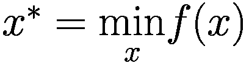

`x`可以是标量（在ℝ¹中）或向量（在ℝ^n中）。`f(x)`始终是标量（在ℝ¹中）。无约束优化在科学的许多分支中都有应用。在金融领域，构建收益率曲线涉及寻找一组参数，以最小化债券理论价格与市场价格之间的差异。约束优化问题也可以通过将约束优化问题的约束转换为等价无约束优化问题目标函数中的惩罚项，来表述为无约束优化问题。此外，许多约束优化求解器或算法涉及将无约束优化问题作为子问题求解。NM Dev 拥有一套求解无约束优化问题的优化器或最小化器，适用于单变量和多变量问题，且可利用或不利用导数信息。此实现及其讨论主要基于 Antoniou & Lu (2007)。

# 9.1 暴力搜索

最简单且可能最容易理解的求解器是暴力搜索。即，你只需遍历函数定义域中所有可能的取值`x`，枚举`f(x)`的所有可能值。然后选择对应最小`f(x)`的那个`x`。可能存在多个解。然而，这种方法很少使用，因为它并不实用。一个要求是定义域必须是可枚举的。大多数实际优化问题都是在连续的定义域（如实数集）上求解的。你无法枚举无穷多个数值。规避这个问题的一种方法是离散化。你从无穷的定义域中选择有限个点。例如，你可以将单位区间`[0, 1]`离散化为11个离散值：0、0.1、0.2、……、1.0。离散化最明显的缺点是，当所选的点不包含最优解时，你很可能会得到一个次优解。事实上，如果定义域是无界的`(-∞, +∞)`，则如何选择点来包含一个解并不明显。此外，除了极小的极简问题外，其性能都非常慢。假设你要对十个变量进行求解；那么问题的维度是`n^10`，其中`n`是每个维度选择的离散化点的数量。问题的复杂度呈指数级增长。尽管如此，暴力搜索很容易理解。因此我们首先从它开始介绍。

以下NM Dev代码大致演示了如何使用该库解决一个优化问题。假设你想要最小化函数`f(x) = x² – 4`。

```
// 使用目标函数定义优化问题
val problem: OptimProblem = object : OptimProblem {
    override fun dimension(): Int {
        return 1
    }
    override fun f(): RealScalarFunction {
        return object : RealScalarFunction {
            // 目标函数
            override fun evaluate(v: Vector): Double {
                val x: Double = v.get(1)
                val polynomial: Polynomial = Polynomial(1.0, 0.0, -4.0) // f(x) = x² – 4
                val fx: Double = polynomial.evaluate(x)
                return fx
            }
            override fun dimensionOfDomain(): Int {
                return 1
            }
            override fun dimensionOfRange(): Int {
                return 1
            }
        }
    }
}
// 设置要使用的求解器及解决方案
val solver: DoubleBruteForceMinimizer = DoubleBruteForceMinimizer(false)
val soln = solver.solve(problem)
// 对于暴力搜索，我们需要显式枚举定义域中的值
val domain = mutableListOf(
    DenseVector(-2.0),
    DenseVector(-1.0),
    DenseVector(0.0), // 最小化点
    DenseVector(1.0),
    DenseVector(2.0)
)
soln.setDomain(domain)
println(String.format("f(%s) = %f", soln.minimizer(), soln.min()))
```

输出结果如下：

```
f([0.000000] ) = -4.000000
```

在NM Dev中使用求解器解决优化问题需要遵循以下步骤：

1.  通过实现`OptimProblem`接口来定义一个优化问题。你需要在实现中给出目标函数。
2.  构建要使用的求解器，例如`DoubleBruteForceMinimizer`。
3.  调用`solve`函数，利用优化问题从求解器构造一个`Solution`对象。换句话说，求解器对象是一个工厂，它为优化问题（称为`OptimProblem`）创建一个称为`Solution`的解。求解器可以复用于其他问题，但一个解仅对应一个问题。
4.  向`Solution`对象提供任何与问题相关的信息。在此例中，对于暴力搜索，你需要列出待搜索的可能值，即定义域。
5.  调用`minimizer`函数来运行算法以计算最小化点`x^∗`，或调用`min`函数返回函数`f(x^∗)`的最小值。

上述流程适用于NM Dev库中的所有求解器。所有NM求解器都是用于最小化的。要进行最大化，你只需将目标函数乘以-1取反即可。通常，`OptimProblem`、求解器和`Solution`的签名如下所示：

```
public interface OptimProblem {
    /**
     * 获取变量数量。
     *
     * @return 变量数量。
     */
    public int dimension();
    /**
     * 获取目标函数。
     *
     * @return 目标函数
     */
    public RealScalarFunction f();
}
public interface MultivariateMinimizer> extends Minimizer {
    /**
     * 求解优化问题，例如 {@link OptimProblem}。
     *
     * @param problem 一个优化问题
     * @return 优化问题的解
     * @throws Exception 当求解问题出现错误时
     */
    public S solve(P problem) throws Exception;
}
public interface MinimizationSolution {
    /**
     * 获取（近似）找到的最小值。
     *
     * @return （近似）找到的最小值
     */
    public double minimum();
    /**
     * 获取最小化问题的最小化点（解）。
     *
     * @return 最小化点
     */
    public T minimizer();
}
```

`DoubleBruteForceMinimizer`具有如下签名：

```
public DoubleBruteForceMinimizer(boolean isParallel);
@Override
public BruteForceMinimizer.Solution solve(OptimProblem problem) throws Exception
```

当`isParallel`标志设置为`true`时，代码会使用多线程并行运行搜索，在所有可用的线程上搜索所有提供的定义域值。

暴力搜索可用于解决单变量优化问题，如前面示例所示，也可用于解决多变量优化问题。以下是一个求解示例：

`f(x, y) = x² + y²`


```
val problem = object : OptimProblem {
    override fun dimension(): Int {
        return 2
    }
    override fun f(): RealScalarFunction {
        return object : RealScalarFunction {
            override fun evaluate(v: Vector): Double {
                val x: Double = v.get(1)
                val y: Double = v.get(2)
                val fx: Double = x * x + y * y
                return fx
            }
            override fun dimensionOfDomain(): Int {
                return 2
            }
            override fun dimensionOfRange(): Int {
                return 1
            }
        }
    }
}
val bf = DoubleBruteForceMinimizer(true)
val soln = bf.solve(problem)
val domain = mutableListOf(
    DenseVector(-2.0, -2.0),
    DenseVector(-1.0, -1.0),
    DenseVector(0.0, 0.0), // 最小化点
    DenseVector(1.0, 1.0),
    DenseVector(2.0, 2.0)
)
soln.setDomain(domain)
println(String.format("f(%s) = %f", soln.minimizer(), soln.min()))
```

输出结果如下：

```
f([0.000000, 0.000000] ) = 0.000000
```

正如这个示例所示，除非你神奇地知道解（在此例中是 (0, 0)）并将其放入定义域列表中，否则暴力搜索将无法找到该解。在这种情况下，如果你已经知道了答案，那就不需要优化器了。


# 9.2 C²优问题

`OptimProblem`类有些难以设置，并且在大多数情况下使用起来不方便。C⁰函数是连续函数。C¹函数是光滑函数。C²函数是连续、光滑且具有二阶导数的函数。它也被称为二次可微函数。如果你要优化这样的函数，`C2OptimProblemImpl`提供了一个便捷的包装器来创建`OptimProblem`对象。其签名如下：

```java
/**
* Construct an optimization problem with an objective function.
* This uses a numerical gradient and a numerical Hessian, if needed.
*
* @param f the objective function to be minimized
*/
public C2OptimProblemImpl(RealScalarFunction f)
```

你可以使用简化的代码重写之前的示例。

对于单变量函数 `f(x) = x² − 4`，代码如下：

```kotlin
// set up the solver to use and the solution
val solver = DoubleBruteForceMinimizer(false)
val soln = solver.solve(C2OptimProblemImpl(Polynomial(1.0, 0.0, -4.0))) // f(x) = x² - 4
// for brute force search, we need to explicitly enumerate the values in the domain
val domain = mutableListOf(
    DenseVector(-2.0),
    DenseVector(-1.0),
    DenseVector(0.0), // the minimizer
    DenseVector(1.0),
    DenseVector(2.0)
)
soln.setDomain(domain)
println(String.format("f(%s) = %f", soln.minimizer(), soln.min()))
```

输出如下：

```
f([0.000000] ) = -4.000000
```

对于多变量函数 `f(x, y) = x² + y²`，代码如下：

```kotlin
val bf = DoubleBruteForceMinimizer(true)
val soln = bf.solve(
    C2OptimProblemImpl(
        object : AbstractBivariateRealFunction() {
            override fun evaluate(x: Double, y: Double): Double {
                val fx: Double  = x * x + y * y
                return fx
            }
        }))
val domain = mutableListOf(
    DenseVector(-2.0, -2.0),
    DenseVector(-1.0, -1.0),
    DenseVector(0.0, 0.0), // the minimizer
    DenseVector(1.0, 1.0),
    DenseVector(2.0, 2.0)
)
soln.setDomain(domain)
println(String.format("f(%s) = %f", soln.minimizer(), soln.min()))
```

输出如下：

```
f([0.000000, 0.000000] ) = 0.000000
```

## 9.3 区间分割法

单变量区间分割法用于解决单变量无约束优化问题。一个快速单变量方法在优化中至关重要。多变量约束优化问题通常可以转化为等价的多变量无约束优化问题。解决多变量无约束优化问题通常涉及解决多个单变量无约束优化问题，例如线搜索。后续章节中讨论的许多多变量无约束优化算法都使用线搜索。

最简单的单变量算法是区间搜索法。假设你有一个包含最小值的三点区间，`x[L] < x[a] < x[U]`，并且假设区间 `[x[L], x[U]]` 包含一个最小值。你按照区间划分方案计算第四个点 `x[b]`，形成两个重叠的子区间：`[x[L], x[a]]` 和 `[x[b], x[U]]`。选择包含新最小值的较小子区间。重复该过程来划分区间，直到收敛，即所选的子区间足够小。该算法在区间 `[x[L], x[U]]` 内对单峰函数最为有效。单峰函数是从 `x[L]` 开始增加（或减少）到某个点，然后向 `x[U]` 方向减少（或增加）的函数。它在区间内恰好包含一个最小值（或最大值）。

考虑一个在区间 `[x[L], x[U]]` 内有最小值的单峰函数。该区间称为不确定区间。通过四个点 `f(x[L])`、`f(x[a])`、`f(x[b])` 和 `f(x[U])`，你可以确定最小值的位置。二分法搜索指出：如果 `f(x[a]) < f(x[b])`，则 `x^*` 位于 `x[L] < x^* < x[b]`。有两种可能：`x[L] < x^* < x[b]`（如蓝色曲线所示）或 `x[a] < x^* < x[b]`（如橙色曲线所示）。综合两者得到 `x[L] < x^* < x[b]`。请参见图 9-1。

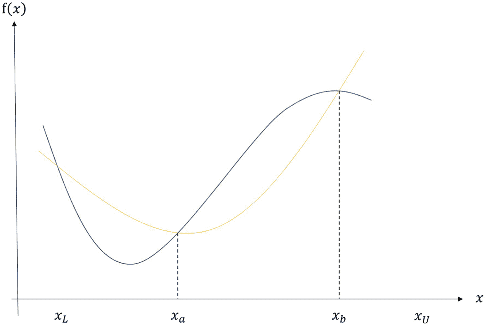

`x` 与 `x` 的函数关系图显示两条下垂曲线。它们相交处的两条投影线投影在 X 轴上，分别标记为 `x` 下标 `a` 和 `x` 下标 `b`。

`图 9-1`

`x^*` 在左侧区间

类似地，如果 `f(x[a]) > f(x[b])`，则得到 `x[a] < x^* < x[U]`，如图 9-2 所示。

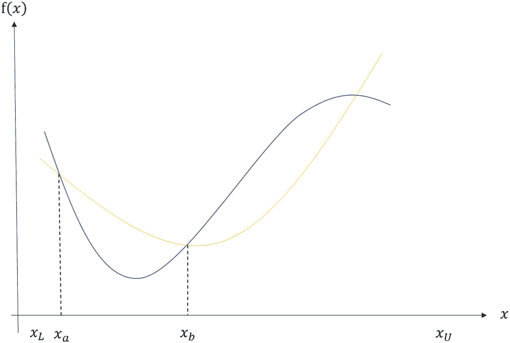

`x` 与 `x` 的函数关系图显示两条下垂曲线。它们相交处的两条投影线投影在 X 轴上，分别标记为 `x` 下标 `a` 和 `x` 下标 `b`。

`图 9-2`

`x^*` 在右侧区间

如果 `f(x[a]) = f(x[b])`，则得到 `x[a] < x^* < x[b]`。请参见图 9-3。

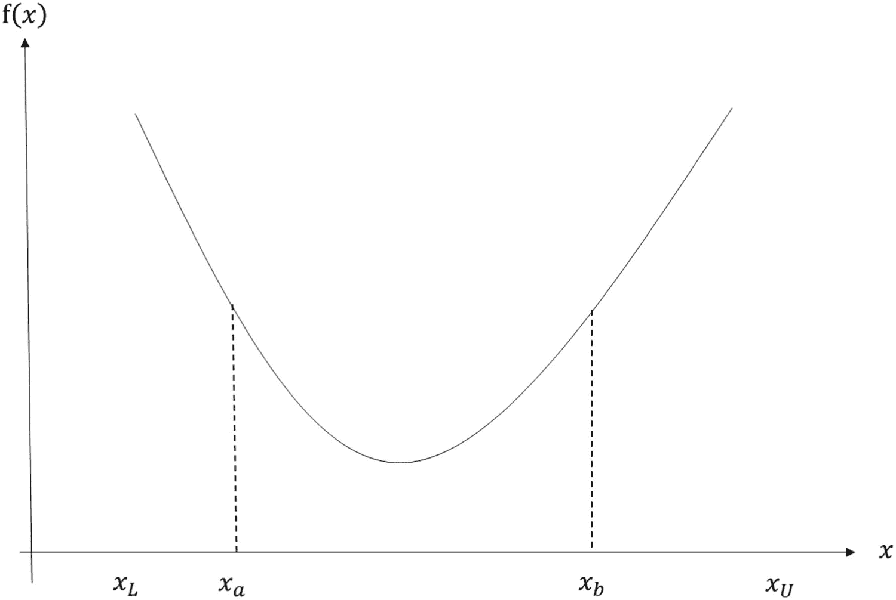

`x` 与 `x` 的函数关系图显示一条下垂曲线。两条投影线投影在 X 轴上，分别标记为 `x` 下标 `a` 和 `x` 下标 `b`。

`图 9-3`

`x[a] < x^* < x[b]`

简单的二分法搜索每次大致将区间对半划分。子区间的大小呈指数级递减（每次迭代减半）。大约经过七次迭代后，区间大小小于初始区间的 1%。总共需要计算 14 次函数值，因为每次迭代需要计算两次：`f(x[a])` 和 `f(x[b])`。NM Dev 实现了两种更复杂的区间划分方案。

### 9.3.1 斐波那契搜索法

我们首先分析区间大小。为简单起见，假设左右子区间长度相等。如图 9-4 所示。

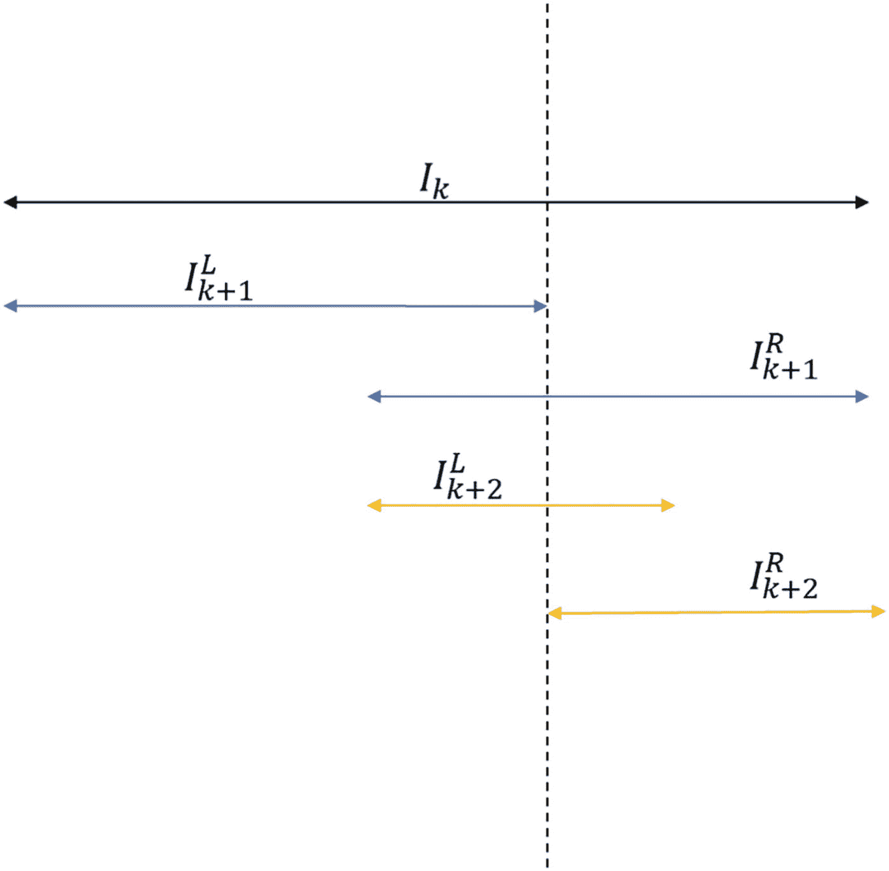

一条实心水平线和一条垂直虚线用于表示第 `k` 次迭代中的左右两个子区间。所有四次迭代均位于标有下标 `k` 的 `I` 线下方。

`图 9-4` - 第 `k, k+1, k+2` 次迭代中的子区间

由此得到：

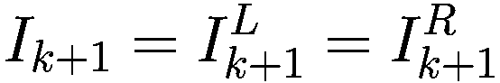

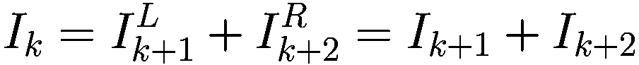

对于 `n` 次迭代，可得到以下递推关系：

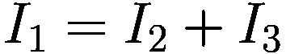

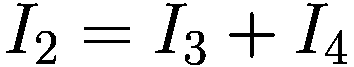


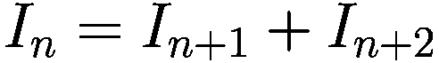

这里有 `n` 个方程，并且假设 `I[1]` 已知。共有 `n + 2` 个变量。可以通过施加一个额外条件来生成一个区间序列。

特别地，如果假设最后一次迭代的区间消失，即 `I[n + 2] = 0`，则生成斐波那契序列。

求解上述方程组可得到：

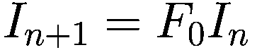

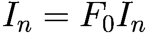

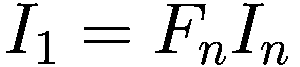


其中

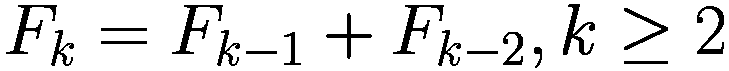

`F[k]` 是斐波那契数列的定义，即 {1, 1, 2, 3, 5, 8, 13, …}。

例如，如果 `n = 11`，则 `F[n] = 144`。`I[n] = I[1] / F[n]`。`I[n]` 缩减至 `I[1]` 的 0.69%。此外，通过选择左或右子区间，你已经得到两个端点和中间的一个点，即 {`x[L]`, `x[a]`, `x[b]`} 或 {`x[a]`, `x[b]`, `x[U]`}。只需要再确定一个点，因此只需计算一次函数值。对于 11 次迭代，总共需要 14 次计算，而朴素的二分法搜索则需要 22 次。

使用斐波那契序列的一个主要缺点是它需要预先知道 `n`。如果你希望 `x^*` 在预设的精度范围内，这是可行的。你使用公式 `I[n] = I[1] / F[n]` 来确定 `n`。但是，如果希望 `f(x^*)` 达到一定精度，你一开始并不知道 `n` 是多少。

### 9.3.2 黄金分割搜索法

与斐波那契分割法不同，黄金分割搜索法会持续迭代，直到达到函数精度要求。其递推关系与斐波那契法相同：`I[k] = I[k - 1] + I[k - 2]`。额外的条件是保持相邻两个区间的比率恒定。

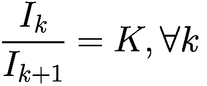

利用这两个方程，可以解出 `K`，如下所示：

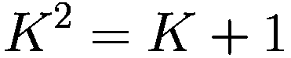

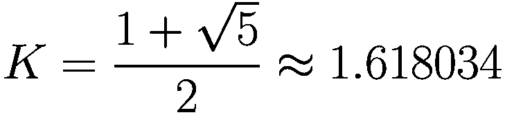

这个数字被称为黄金比例。区间序列如下：

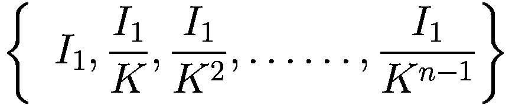

示例如下：{100, 61.8, 38.2, 23.6, 14.6, 9, …}。这个过程可以继续进行，无需预先确定 `n`。

让我们比较一下黄金分割搜索法和斐波那契搜索法的效率。`F[n]` 与 `K` 的关系为 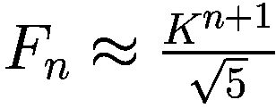。斐波那契搜索中的不确定性区域如下：

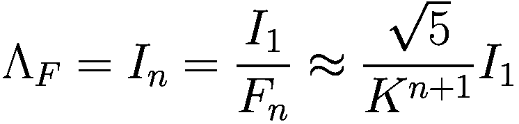

对于黄金分割搜索法，情况如下：

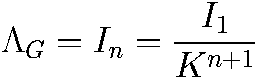

因此，可得到：

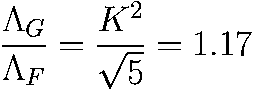

因此，要达到与斐波那契搜索法相同的精度，黄金分割搜索法需要更多的迭代次数。斐波那契搜索法更高效，但黄金分割搜索法无需预先知道 `n`。

### 9.3.3 布伦特搜索

黄金分割搜索具有线性收敛速度。我们即将讨论的抛物线搜索的收敛速度为 `1.325`，因此效率更高。在每个包围区间中，你再次选择三个点：`x[L] < x[m] < x[U]`。你用一个二次多项式（即抛物线）来近似该区间内的函数。

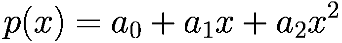

有了这三个点，你可以通过求解一个由三个线性方程组成的方程组来确定多项式系数。`p(x)` 的最小点  可以很容易地通过令其一阶导数为零来求解：

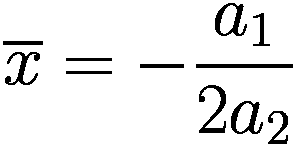

根据泰勒展开， 将非常接近 `x^*`；事实上，如果函数是二次的，它将精确等于 `x^*`。通过检查 ，你可以通过舍弃 `x[L]` 或 `x[U]` 并保留  来选择一个新的区间。重复此过程，直到所有三个点都足够接近（`x^*`）。参见图 9-5。

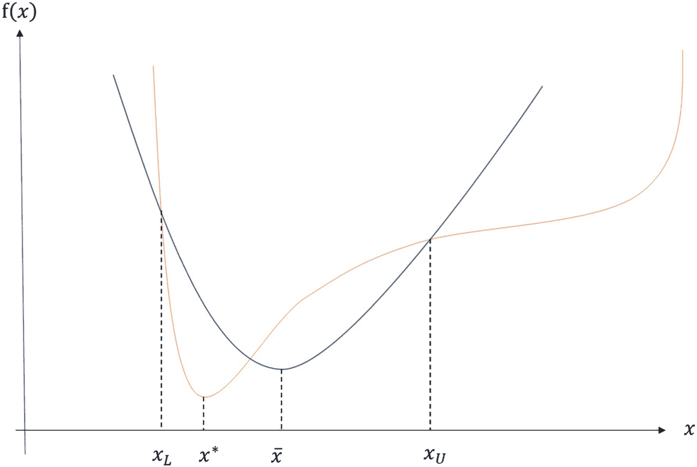

**图 9-5** 曲线段的抛物线近似

虽然抛物线搜索具有超线性收敛速度，但它并不总是收敛（即便只是到局部最小值）。例如，如果这三个点共线，那么得到的抛物线是退化的，因此无法提供新的候选点。因此，这种方法很少单独使用。

布伦特方法结合了抛物线搜索和黄金分割搜索。布伦特方法在适用时（例如，没有两个点是相同的）使用抛物线搜索。当条件不满足时，它会切换回使用黄金分割搜索。换句话说，布伦特方法结合了两者的优点：超线性收敛速度和保证能找到最小值。因此，在实践中，对于单变量优化，你几乎总是应该默认使用布伦特搜索。参见图 9-6。

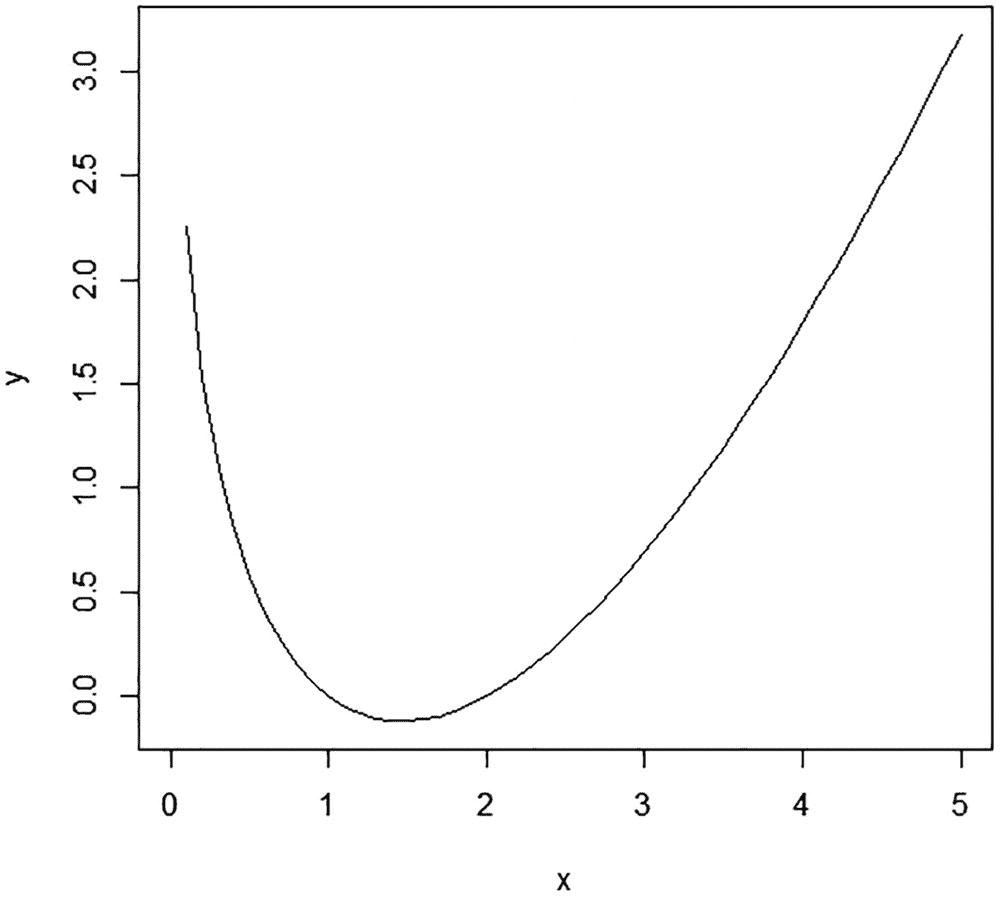

**图 9-6** 对数伽马函数

以下 `NM Dev` 代码使用斐波那契搜索、黄金分割搜索和布伦特搜索求解了对数伽马函数：

```
val logGamma = LogGamma() // the log-gamma function
// Using the Fibonacc method
val solver1 = FibonaccMinimizer(1e-8, 15)
val soln1: UnivariateMinimizer.Solution = solver1.solve(logGamma)
val x_min_1: Double = soln1.search(0.0, 5.0)
println(String.format("f(%f) = %f", x_min_1, logGamma.evaluate(x_min_1)))
```

输出如下：

```
f(1.463682) = -0.121484
```

```
// Using the Golden section method
val solver2 = GoldenMinimizer(1e-8, 15)
val soln2: UnivariateMinimizer.Solution = solver2.solve(logGamma)
val x_min_2: Double = soln2.search(0.0, 5.0)
println(String.format("f(%f) = %f", x_min_2, logGamma.evaluate(x_min_2)))
```

输出如下：

```
f(1.460813) = -0.121486
```

```
// Using Brent's method
val solver3 = BrentMinimizer(1e-8, 10) // fewer itertaions than that of Fibonacci or golden search
val soln3: UnivariateMinimizer.Solution = solver3.solve(logGamma)
val x_min_3: Double = soln3.search(0.0, 5.0)
println(String.format("f(%f) = %f", x_min_3, logGamma.evaluate(x_min_3)))
```

输出如下：

```
f(1.461632) = -0.121486
```

它们的签名如下：

`FibonaccMinimizer(double epsilon, int maxIterations)`

`GoldenMinimizer(double epsilon, int maxIterations)`

`BrentMinimizer(double epsilon, int maxIterations)`

```
/**
 * 使用斐波那契方法构造一个单变量最小化器。
 *
 * @param epsilon       一个精度参数：当数字 |x| ≤ ε 时，视其为 0
 * @param maxIterations 最大迭代次数
 */
public FibonaccMinimizer(double epsilon, int maxIterations)
/**
 * 使用黄金分割方法构造一个单变量最小化器。
 *
 * @param epsilon       一个精度参数：当数字 |x| ≤ ε 时，视其为 0
 * @param maxIterations 最大迭代次数
 */
public GoldenMinimizer(double epsilon, int maxIterations)
/**
 * 使用布伦特算法构造一个单变量最小化器。
 *
 * @param epsilon       一个精度参数：当数字 |x| ≤ ε 时，视其为 0
 * @param maxIterations 最大迭代次数
 */
public BrentMinimizer(double epsilon, int maxIterations)
/**
 * 这是单变量最小化问题的解。
 */
public static interface Solution extends MinimizationSolution {
/**
 * 在区间 [lower, upper] 内搜索最小值。
 *
 * @param lower   包围区间（包含最小值）的下界
 * @param initial 一个初始猜测值
 * @param upper   包围区间（包含最小值）的上界
 * @return 近似最小化点
 */
public double search(double lower, double initial, double upper);
/**
 * 在区间 [lower, upper] 内搜索最小值。
 *
 * @param lower 包围区间（包含最小值）的下界
 * @param upper 包围区间（包含最小值）的上界
 * @return 近似最小化点
 */
public double search(double lower, double upper);
}
```

您可以调用 `search` 方法来寻找单变量函数最小化的最小化点。

# 最速下降法

寻找最小值的通用思路通常是从一个初始点开始，然后调整某些参数以找到下一个（有望）使函数值更小的点。如果没有任何信息，盲目搜索的效率会很低。有两种信息非常有用：梯度 `g` 和海森矩阵 `H`。

最速下降算法是一类利用梯度和海森矩阵信息，沿着能使函数值下降最快的方向进行搜索的算法。我们首先讨论仅使用梯度信息的一阶方法。考虑以下优化问题：
$$ \min F=f\left(\boldsymbol{x}\right)\; for\kern0.5em \boldsymbol{x}\in {E}^n $$

泰勒展开给出以下结果：
`F + ΔF = f(x + δ) ≈ f(x) + g^T δ + O(δ^T δ)`，当`∥δ∥ → 0`时，`ΔF ≈ g^T δ`
$$ \Delta F\approx \sum \limits_{i=1}^n{\boldsymbol{g}}_i{\boldsymbol{\delta}}_i=\parallel \boldsymbol{g}\parallel \parallel \boldsymbol{\delta} \parallel cos\theta $$

对于任意向量 `δ`，当 `θ = 0` 时，`ΔF` 取最大值，这意味着 `δ` 与 `g` 方向相同。当 `θ = π` 时，`ΔF` 取最小值，这意味着 `δ` 与 `g` 方向相反，或者沿 `-g` 方向。它们分别被称为最陡上升方向和最陡下降方向，如图 9-7 所示。
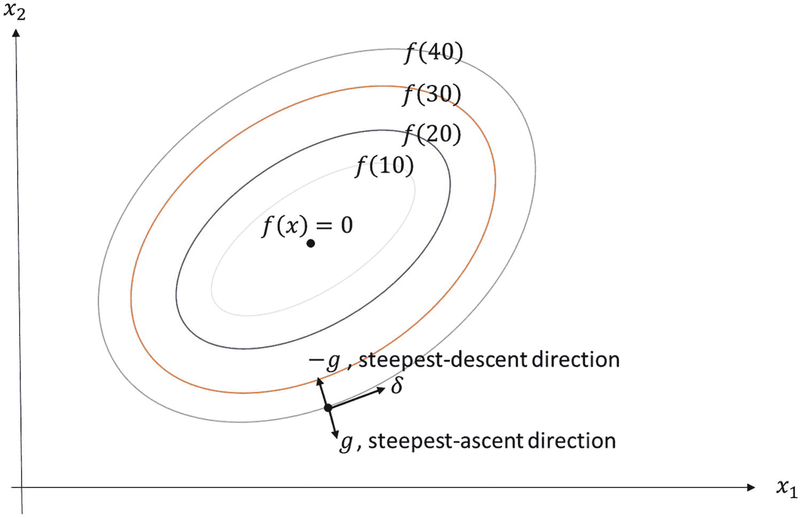
`x2` 相对于 `x1` 的图显示了函数 `x` 四个不同取值对应的四个同心圆。中心函数值为 0。最陡下降方向也已标出。
**图 9-7** 最陡下降方向与最陡上升方向

最速下降算法的一般框架如下：
1. 指定初始点 `x[0]` 和容差 `ε`。
2. 计算梯度 `g[k]`，并设置牛顿方向向量 `d[k] = -g[k]`。
3. 关于 `α` 最小化 `f(x[k] + αd[k])`，以计算增量 `α[k]`。
4. 设置下一个点 `x[k + 1] = x[k] + α[k]d[k]`，并计算下一个函数值 `f[k + 1] = f(x[k + 1])`。
5. 如果 `∥α[k]d[k]∥ < ε`，则：
    - 完成。`x* = x[k + 1]` 且 `f(x*) = f[k + 1]`。
    - 否则，重复步骤 2。

在步骤 3 中，可以使用一维优化算法中的线搜索来计算 `α[k]`。在本实现中，我们使用弗莱彻非精确线搜索方法。许多优化算法已证明对线搜索的不精确性具有相当强的容忍度。或者，`α[k]` 也可以通过解析方法计算。

以下 NM Dev 代码使用一阶最速下降法最小化此函数：
$$ f\left({x}_1,{x}_2,{x}_3,{x}_4\right)={\left({x}_1-4{x}_2\right)}⁴+12{\left({x}_3-{x}_4\right)}⁴+3{\left({x}_2-10{x}_3\right)}²+55{\left({x}_1-2{x}_4\right)}² $$

```
// 目标函数
// 全局最小值点位于 x = [0,0,0,0]
val f = object : RealScalarFunction {
    override fun evaluate(x: Vector): Double {
        val x1: Double = x.get(1)
        val x2: Double = x.get(2)
        val x3: Double = x.get(3)
        val x4: Double = x.get(4)
        var result: Double = (x1 - 4 * x2).pow(4)
        result += 12 * (x3 - x4).pow(4)
        result += 3 * (x2 - 10 * x3).pow(2)
        result += 55 * (x1 - 2 * x4).pow(2)
        return result
    }
    override fun dimensionOfDomain(): Int {
        return 4
    }
    override fun dimensionOfRange(): Int {
        return 1
    }
}
// 梯度函数
val g = object : RealVectorFunction {
    override fun evaluate(x: Vector): Vector {
        val x1 = x.get(1)
        val x2 = x.get(2)
        val x3 = x.get(3)
        val x4 = x.get(4)
        var result = ArrayList(4)
        result.add(0, 4 * (x1 - 4 * x2).pow(3) + 110 * (x1 - 2 * x4))
        result.add(1, -16 * (x1 - 4 * x2).pow(3) + 6 * (x2 - 10 * x3))
        result.add(2, 48 * (x3 - x4).pow(3) - 60 * (x2 - 10 * x3))
        result.add(3, -48 * (x3 - x4).pow(3) - 220 * (x1 - 2 * x4))
        return DenseVector(result)
    }
    override fun dimensionOfDomain(): Int {
        return 4
    }
    override fun dimensionOfRange(): Int {
        return 4
    }
}
val problem = C2OptimProblemImpl(f, g) // 仅使用梯度信息
val firstOrderMinimizer: SteepestDescentMinimizer
    = FirstOrderMinimizer(
    FirstOrderMinimizer.Method.IN_EXACT_LINE_SEARCH,
    // FirstOrderMinimizer.Method.ANALYTIC
    1e-8,
)
val soln: IterativeSolution = firstOrderMinimizer.solve(problem)
val xmin: Vector = soln.search(DenseVector(1.0, -1.0, -1.0, 1.0))
val f_xmin: Double = f.evaluate(xmin)
println(String.format("f(%s) = %f", xmin.toString(), f_xmin))
```

输出结果如下：
```
f([0.046380, 0.016330, 0.001634, 0.023189] ) = 0.000003
```

这大约需要 40,000 次迭代，速度太慢了。

`FirstOrderMinimizer` 的签名如下。
```
/**
* 使用一阶方法构造一个多元最小化器。
*
* @param method        执行线搜索的方法
* @param epsilon       精度参数：当数值 |x| &le;
*                      &epsilon; 时，视为 0
* @param maxIterations 最大迭代次数
*/
public FirstOrderMinimizer(Method method, double epsilon, int maxIterations)
```

`Method` 指定是使用线搜索还是解析表达式来计算 `α[k]`。

### 9.4.1 牛顿-拉弗森法

二阶方法除了使用梯度外，还使用（非奇异的）海森矩阵来确定最速下降框架中的方向向量 `d[k]` 和增量 `α[k]`，以加速收敛。牛顿-拉弗森法将泰勒级数展开到二阶。令 `δ` 为 `x` 的变化量，可得：
$$ f\left(\boldsymbol{x}+\boldsymbol{\delta} \right)\approx f\left(\boldsymbol{x}\right)+\sum \limits_{j=1}^n\frac{\partial f}{\partial {x}_i}{\delta}_i+\frac{1}{2}\sum \limits_{i=1}^n\sum \limits_{j=1}^n\frac{\partial²f}{\partial {x}_i\partial {x}_j}{\delta}_i{\delta}_j $$

对 `f(x + δ)` 关于 `δ[k]` 求导以最小化 `f(x + δ)`，可得：

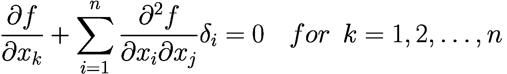

将其重写为矩阵形式如下：

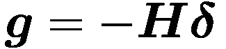

`x` 的最优变化量如下：

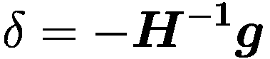

使用线性搜索来计算沿着该方向 `f(x)` 的最大减量。下一个点 `x[k+1]` 如下：

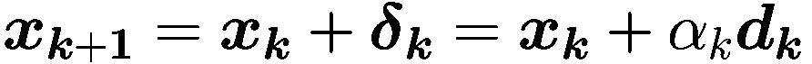

其中满足：

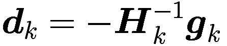

`α[k]` 是使 `f(x[k] + α * d[k])` 最小的 `α` 值。

与一阶方法相比，牛顿-拉弗森法利用海森矩阵信息加速收敛，特别是在接近解时效果显著。以下 NM Dev 代码使用牛顿-拉弗森法最小化同一个函数：

```kotlin
// 目标函数
// 全局最小值点位于 x = [0,0,0,0]
val f = object : RealScalarFunction {
    override fun evaluate(x: Vector): Double {
        val x1: Double = x.get(1)
        val x2: Double = x.get(2)
        val x3: Double = x.get(3)
        val x4: Double = x.get(4)
        var result: Double = (x1 - 4 * x2).pow(4)
        result += 12 * (x3 - x4).pow(4)
        result += 3 * (x2 - 10 * x3).pow(2)
        result += 55 * (x1 - 2 * x4).pow(2)
        return result
    }
    override fun dimensionOfDomain(): Int {
        return 4
    }
    override fun dimensionOfRange(): Int {
        return 1
    }
}
// 梯度函数
val g = object : RealVectorFunction {
    override fun evaluate(x: Vector): Vector {
        val x1: Double = x.get(1)
        val x2: Double = x.get(2)
        val x3: Double = x.get(3)
        val x4: Double = x.get(4)
        var result = ArrayList(4)
        result.add(0, 4 * (x1 - 4 * x2).pow(3) + 110 * (x1 - 2 * x4))
        result.add(1, -16 * (x1 - 4 * x2).pow(3) + 6 * (x2 - 10 * x3))
        result.add(2, 48 * (x3 - x4).pow(3) - 60 * (x2 - 10 * x3))
        result.add(3, -48 * (x3 - x4).pow(3) - 220 * (x1 - 2 * x4))
        return DenseVector(result)
    }
    override fun dimensionOfDomain(): Int {
        return 4
    }
    override fun dimensionOfRange(): Int {
        return 4
    }
}
val problem = C2OptimProblemImpl(f, g) // 使用数值海森矩阵
val newtonRaphsonMinimizer: SteepestDescentMinimizer
    = NewtonRaphsonMinimizer(
        1e-8,
    )
val soln: IterativeSolution = newtonRaphsonMinimizer.solve(problem)
val xmin: Vector = soln.search(DenseVector(1.0, -1.0, -1.0, 1.0))
val f_xmin: Double = f.evaluate(xmin)
println(String.format("f(%s) = %f", xmin.toString(), f_xmin))
```

输出如下：

```
f([0.000134, -0.000009, -0.000001, 0.000067] ) = 0.000000
```

值得指出的是，牛顿-拉弗森法的收敛速度远快于一阶方法。它仅用 20 次迭代就能达到比 40,000 次迭代更高的精度。

`NewtonRaphsonMinimizer` 的签名如下：

```java
/**
 * 使用牛顿-拉弗森法构造一个多元最小化器。
 *
 * @param epsilon       精度参数：当数值 |x| &le;
 *                      &epsilon; 时，视为 0
 * @param maxIterations 最大迭代次数
 */
public NewtonRaphsonMinimizer(double epsilon, int maxIterations)
```

### 9.4.2 高斯-牛顿方法

高斯-牛顿方法用于最小化如下形式的目标函数：

![$$ \boldsymbol{f}={\left[{f}_1(x)\;{f}_2(x)\dots \dots {f}_m(x)\right]}^T $$](images/528380_1_En_9_Chapter/528380_1_En_9_Chapter_TeX_Equad.png)

其解为一个点 `x`，使得所有 `fp` 同时归零。

你可以构造一个实值函数 `F`，当 `F` 被最小化时，函数 `fp` 也在最小二乘意义上被最小化。

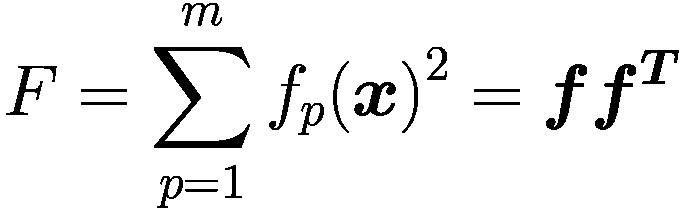

其梯度的雅可比矩阵如下：

![$$ \textbf{J}=\left[\begin{array}{ccc}\frac{\partial {f}_1}{\partial {x}_1}&amp; \cdots &amp; \frac{\partial {f}_m}{\partial {x}_1}\\ {}\vdots &amp; \ddots &amp; \vdots \\ {}\frac{\partial {f}_1}{\partial {x}_n}&amp; \cdots &amp; \frac{\partial {f}_m}{\partial {x}_n}\end{array}\right] $$](images/528380_1_En_9_Chapter/528380_1_En_9_Chapter_TeX_Equaf.png)

对 `F` 关于 `x[i]` 求导，得到：

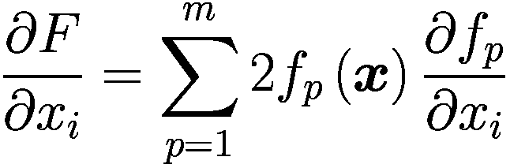

或者，用矩阵形式表示，得到的梯度向量如下：

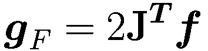

再次求导，得到：

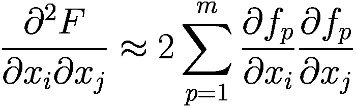

海森矩阵`H[F]`如下所示，它需要是非奇异且正定的：

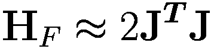

下一个点由递归关系给出：

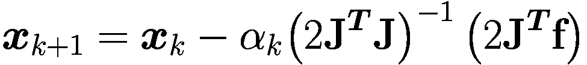

以下代码使用高斯-牛顿方法求解相同的极小化问题：

```kotlin
// 目标函数
// 全局最小值点位于 x = [0,0,0,0]
val f = object : RealVectorFunction {
    override fun evaluate(x: Vector): Vector {
        val x1: Double = x.get(1)
        val x2: Double = x.get(2)
        val x3: Double = x.get(3)
        val x4: Double = x.get(4)
        var fx = ArrayList(4)
        fx.add(0, (x1 - 4 * x2).pow(2))
        fx.add(1, sqrt(12.0) * (x3 - x4).pow(2))
        fx.add(2, sqrt(3.0) * (x2 - 10 * x3))
        fx.add(3, sqrt(55.0) * (x1 - 2 * x4))
        return DenseVector(fx)
    }

    override fun dimensionOfDomain(): Int {
        return 4
    }

    override fun dimensionOfRange(): Int {
        return 4
    }
}

// 雅可比矩阵
val J = object : RntoMatrix {
    override fun evaluate(x: Vector): Matrix {
        val x1: Double = x.get(1)
        val x2: Double = x.get(2)
        val x3: Double = x.get(3)
        val x4: Double = x.get(4)
        var Jx: Matrix = DenseMatrix(4, 4)
        var value: Double = 2 * (x1 - 4 * x2)
        Jx.set(1, 1, value)
        value = -8 * (x1 - 4 * x2)
        Jx.set(1, 2, value)
        value = 2 * sqrt(12.0) * (x3 - x4)
        Jx.set(2, 3, value)
        Jx.set(2, 4, -value)
        Jx.set(3, 2, sqrt(3.0))
        Jx.set(3, 3, -10 * sqrt(3.0))
        Jx.set(4, 1, sqrt(55.0))
        Jx.set(4, 4, -2 * sqrt(55.0))
        return Jx
    }

    override fun dimensionOfDomain(): Int {
        return 4
    }

    override fun dimensionOfRange(): Int {
        return 1
    }
}

val optim1 = GaussNewtonMinimizer(1e-8, 10)
val soln: IterativeSolution = optim1.solve(f, J)//解析梯度
val xmin: Vector = soln.search(DenseVector(1.0, -1.0, -1.0, 1.0))
println(String.format("f(%s) = %s", xmin.toString(), f.evaluate(xmin).toString()))
```

输出结果如下：

```
f([0.000007, -0.000000, -0.000000, 0.000003] ) = [0.000000, 0.000000, -0.000000, -0.000000]
```

高斯-牛顿方法比牛顿-拉弗森方法更高效。对于前述问题，它大约需要十次迭代，而牛顿-拉弗森方法则需要二十次。

`GaussNewtonMinimizer`的签名如下：

```java
/**
 * 构造一个使用高斯-牛顿方法的多变量极小化器。
 *
 * @param epsilon       精度参数：当一个数 |x| &le;
 *                      &epsilon; 时，视为 0
 * @param maxIterations 最大迭代次数
 */
public GaussNewtonMinimizer(double epsilon, int maxIterations)
```

## 9.5 共轭方向方法

在最速下降法中，连续的搜索方向可能相关，也可能不相关。此外，它们完全由目标函数的局部性质（即梯度和海森矩阵）决定（Hestenes & Stiefel, 1952）。另一方面，在共轭方向方法中，连续的搜索方向之间存在严格的数学关系。共轭方法最初是为求解具有如下目标函数的二次优化问题而开发的：

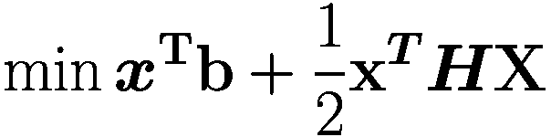

其中，`H`是一个`n * n`的对称正定矩阵，对应一个包含`n`个变量的函数。

对于一个二次问题，搜索过程将在有限次迭代内收敛到最小值。此后，共轭方法被推广用于求解更一般的优化问题。

### 9.5.1 共轭方向

对于对称矩阵 `H`，如果对于所有 `i ≠ j`，有限向量集 `{d[0], d[1], …, d[k]}` 满足 `d[i]^T H d[j] = 0`，则称它们关于 `H` 共轭，或 `H-正交`。如果 `H` 是正定的，这些向量线性无关。如果 `H = I`，则这些向量正交。

对于前述二次型最小化问题，当 `H` 正定时，简单的微积分知识表明解是唯一的，并且可以通过求解线性方程组解析计算：

```
H x* = b
```

由于共轭向量集线性无关，因此张成 `n` 维空间 `E^n`，`x*` 可以表示为这些向量的线性组合：

```
x* = α_0 d[0] + … + α_{n-1} d[n-1]
```

两边乘以 `H` 并与 `d[i]` 作标量积，得到：

```
α_i = - (d[i]^T H x*) / (d[i]^T H d[i]) = - (d[i]^T b) / (d[i]^T H d[i])
```

等价地：

```
x* = Σ_{i=0}^{n-1} (d[i]^T b / (d[i]^T H d[i])) * d[i]
```

`x*` 的这种展开可视为一个求和过程，或一个逐步添加 `α[i] d[i]` 的 `n` 步迭代过程。

**共轭方向定理**

设 `{d[i]}_{i=0}^{n-1}` 是一组非零的 `H`-正交向量。对于任意 `x[0] ∈ E^n`，按以下方式生成的序列 `{x[i]}`：

```
x_{k+1} = x_k + α_k d_k,  k ≥ 0
```

其中：

```
α_k = - (g_k^T d_k) / (d_k^T H d_k)
```

并且：

```
g_k = b + H x_k
```

该序列在 `n` 步后收敛到 `H x = b` 的唯一解 `x*`，即 `x[n] = x*`。

利用该定理以及多种生成共轭向量的方法，可以设计出多种共轭方向法。此外，还需要将该定理推广以解决非二次问题。共轭方向法非常适合最速下降法的框架，两者仅在方向向量 `d[k]` 及其对应的步长 `α[k]` 的计算方式上有所不同。此处我们使用共轭方向而非最速下降方向，但迭代地向 `x[k]` 添加增量 `α[k] d[k]` 以生成 `x[k+1]` 的思想是相同的。

### 9.5.2 共轭梯度法

Hestenes 与 Stiefel (1952) 提出了共轭梯度法。在该方法中，新方向是前一方向与负梯度的加权和。

```
d[0] = -g[0] = -(b + H x[0])
```

```
d_k = -g_k + β_k d_{k-1}
```

```
g_k = b + H x_k
```

```
β_k = (g_k^T H d_k) / (d_k^T H d_k)
```

```
α_k = - (g_k^T d_k) / (d_k^T H d_k)
```

该方法具有以下优点：

- 梯度是有限的，并且除了找到解的情况外，与所有先前的方向向量线性无关。

- 计算新方向向量相对容易。

- 无需进行线搜索。

- 对于二次问题，可在 `n` 步内收敛。

- 第一个方向与最速下降法相同，即 `d[0] = -g[0]`，可提供良好的初始下降。

- 无需对海森矩阵求逆。

以下为其缺点：

- 必须提供、存储并操作海森矩阵。

- 对于非二次问题，收敛性无法保证。事实上，如果初始点远离解，搜索可能会在某个次优区域徘徊，因为不可靠的方向会随着迭代累积。稍后的代码示例中您将看到，对于 `Himmelblau` 函数，共轭梯度法需要最多的迭代次数才能收敛。

### 9.5.3 弗莱彻-里夫斯法

弗莱彻-里夫斯法是共轭梯度法的一个变体。主要区别在于：`α[k]` 通过最小化 `f(X + α[k] d[k])` 的线搜索计算得到，并且 `d[k]` 是关于 `{d[0], d[1], …, d[k]}` 的共轭方向，而非最速下降方向或牛顿方向。因此，该算法与共轭梯度法类似，但由于线搜索而需要更多计算，这是一个缺点。然而，它有两个优点。

- 该改进型算法在非二次函数的最小化中表现更好，因为在解邻域之外的点上，沿 `d[k]` 方向可以使 `f(x)` 获得更大的下降。

- 该算法不需要海森矩阵。

### 9.5.4 鲍威尔方法

鲍威尔算法通过一维搜索生成一系列共轭方向。

设 `x_a*` 和 `x_b*` 是以下凸二次函数：

```
f(x) = x^T b + 1/2 x^T H x
```

分别在方向 `d[a]` 和 `d[b]` 上对参数 `α` 进行最小化后得到的极小点：

```
x = x_a + α * d_a
```

以及下式：

```
x = x_b + α * d_b
```

如果 `d[a] = d[b]`，则向量 `x_b* - x_a*` 与 `d[a]` 共轭。参见图 9-8。

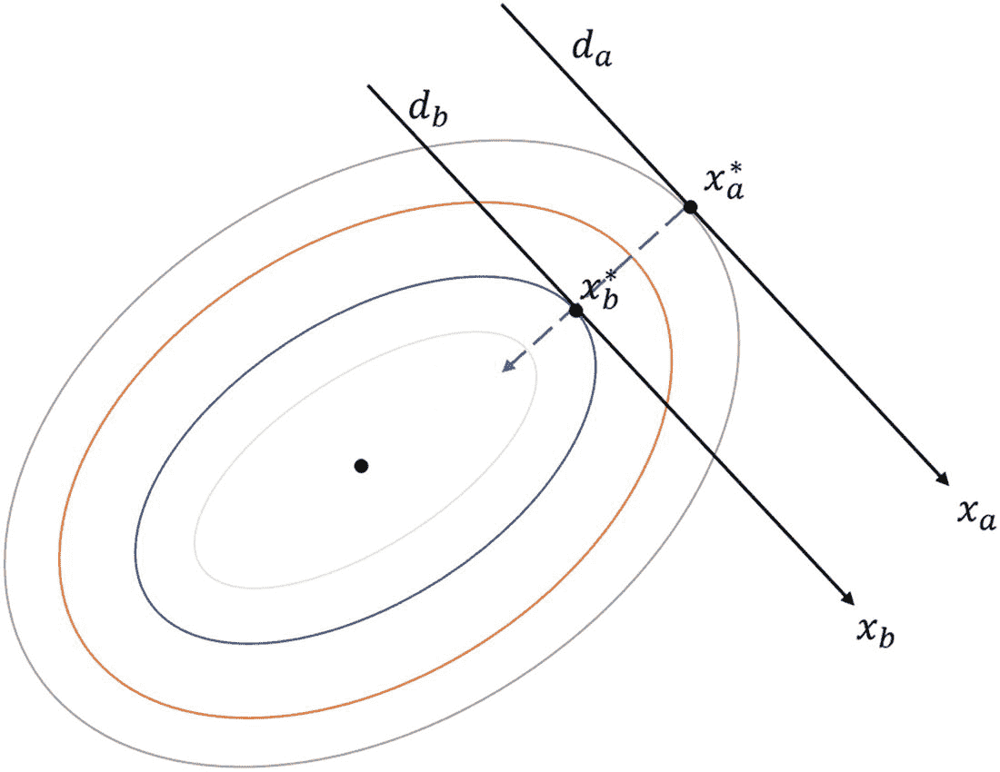

一个由同心圆组成的图像包含四层。在第二和第四个圆上绘制了两条平行切线。一条垂直于这些切线的虚线穿过所有圆。

图 9-8 共轭方向的生成

在该算法中，假设初始点 `x[00]` 和 `n` 个线性无关的方向 `{d[0], d[1], …, d[n]}`（通常取坐标方向），并在每次迭代中执行一系列一维搜索。在第一次迭代中，从点 `x[00]` 开始，依次沿方向 `{d[0], d[1], …, d[n]}` 对 `f(x)` 进行最小化，得到点 `x[01]`, `x[02]`, …, `x[0n]`。然后按如下方式生成一个新方向 `d[0(n+1)]`：

```
d_0(n+1) = x_0n - x_00
```

并沿此方向对 `f(x)` 进行最小化，得到一个新点 `x[0(n+1)]`。通过如下设置更新方向（见图 9-9）：

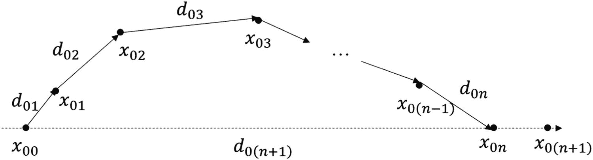

鲍威尔算法第一次迭代中 `d_0(n+1)` 和 `x_0(n+1)` 的图解。线条表示 `d` 函数，节点表示 `x` 函数。

图 9-9 鲍威尔算法中的第一次迭代

```
d_11 = d_02
d_12 = d_03
...
d_1(n-1) = d_0n
d_1n = d_0(n+1)
```

相同的流程在第二次迭代中重复，该迭代从点 `x[10] = x[0(n+1)]` 开始。依次沿方向 `{d[11], d[12], …, d[1n]}` 对 `f(x)` 进行最小化，得到点 `x[11]`, `x[12]`, …, `x[1n]`。然后按如下方式生成一个新方向 `d[1(n+1)]`（见图 9-10）：

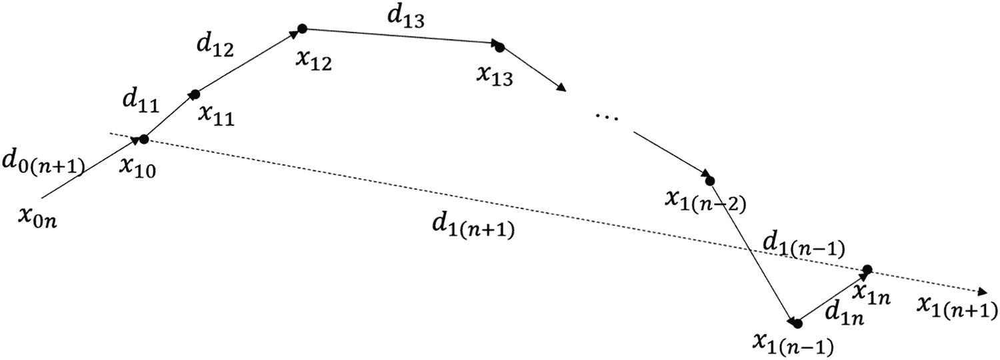

鲍威尔算法第二次迭代中 `d_1(n+1)` 和 `x_1(n+1)` 的图解。线条表示 `d` 函数，节点表示 `x` 函数。

图 9-10 鲍威尔算法中的第二次迭代

```
d_1(n+1) = x_1n - x_10
```

按相同方式继续，每次新迭代将增加一个共轭方向并移除另一个方向，从而实现替换。由于每次迭代需要 `(n + 1)` 次一维搜索，鲍威尔方法在 `n` 次迭代中共执行 `n * (n + 1)` 次一维搜索。

鲍威尔方法的优点在于它不需要提供、存储或操作海森矩阵，甚至不需要梯度。然而，该方法可能无法生成一组张成 `E^(n)` 的线性无关方向，并且算法可能无法收敛到解。

### Zangwill 方法

Zangwill 算法是 Powell 算法的一个改进版本。其改进之处在于生成一组始终线性无关的共轭方向。因此，它消除了 Powell 算法中的缺点。

改进措施如下：首先，选择坐标方向集，使其行列式为 1。其次，将新方向归一化至单位长度。第三，方向替换必须确保方向向量矩阵的行列式为正，且小于等于 1。最后一点保证了方向向量始终线性无关。

以下代码对 `Himmelblau` 函数进行最小化（见图 9-11）：

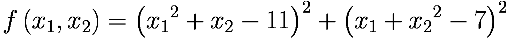

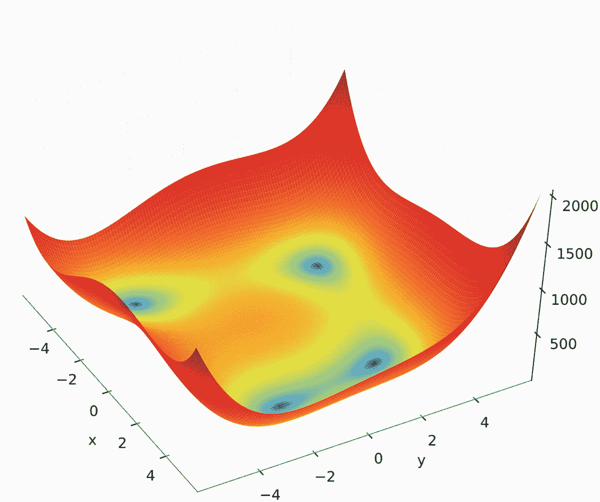

具有四个极小点的 Himmelblau 函数三维图，极小点已用圆形标记。

图 9-11 具有四个极小点的 Himmelblau 函数

共有四个极小点。它们分别是：

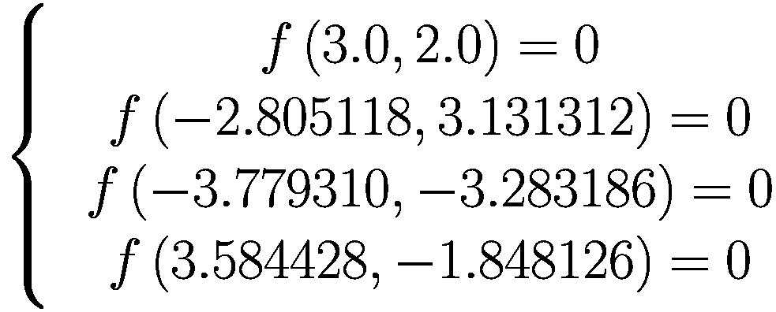
```

# Himmelblau 函数与最小化问题

以下代码定义了 Himmelblau 函数及其梯度，并使用多种最小化器求解。

```kotlin
/**
* Himmelblau 函数：f(x) = (x1² + x2 - 11)² + (x1 + x2² - 7)²
*/
val f = object : RealScalarFunction {
override fun evaluate(x: Vector): Double {
val x1: Double = x.get(1)
val x2: Double = x.get(2)
var result: Double = (x1 * x1 + x2 - 11).pow(2)
result += (x1 + x2 * x2 - 7).pow(2)
return result
}
override fun dimensionOfDomain(): Int {
return 2
}
override fun dimensionOfRange(): Int {
return 1
}
}
val g = object : RealVectorFunction {
override fun evaluate(x: Vector): Vector {
val x1: Double = x.get(1)
val x2: Double = x.get(2)
val w1: Double = x1 * x1 + x2 - 11
val w2: Double = x1 + x2 * x2 - 7
var result = ArrayList(2)
result.add(0, 4 * w1 * x1 + 2 * w2)
result.add(1, 2 * w1 + 4 * w2 * x2)
return DenseVector(result)
}
override fun dimensionOfDomain(): Int {
return 2
}
override fun dimensionOfRange(): Int {
return 2
}
}
val problem = C2OptimProblemImpl(f, g)
```

### 使用共轭梯度法

```kotlin
// 使用共轭梯度法
val ConjugateGradientMinimizer
= ConjugateGradientMinimizer(1e-16, 40)
val soln1: IterativeSolution = ConjugateGradientMinimizer.solve(problem)
val xmin1: Vector = soln1.search(DenseVector(6.0, 6.0))
val f_xmin1: Double = f.evaluate(xmin1)
println(String.format("f(%s) = %.16f", xmin1.toString(), f_xmin1))
```

输出如下：

```
f([3.000000, 2.000000] ) = 0.0000000000013999
```

### 使用 Fletcher-Reeves 方法

```kotlin
// 使用 Fletcher-Reeves 方法
val fletcherReevesMinimizer
= FletcherReevesMinimizer(1e-16, 20)
val soln2: IterativeSolution = fletcherReevesMinimizer.solve(problem)
val xmin2: Vector = soln2.search(DenseVector(6.0, 6.0))
val f_xmin2: Double = f.evaluate(xmin2)
println(String.format("f(%s) = %.16f", xmin2.toString(), f_xmin2))
```

输出如下：

```
f([3.000002, 1.999998] ) = 0.0000000001278725
```

### 使用 Powell 方法

```kotlin
// 使用 Powell 方法
val powellMinimizer: SteepestDescentMinimizer
= PowellMinimizer(1e-16, 20)
val soln3: IterativeSolution = powellMinimizer.solve(problem)
val xmin3: Vector = soln3.search(DenseVector(6.0, 6.0))
val f_xmin3: Double = f.evaluate(xmin3)
println(String.format("f(%s) = %.16f", xmin3.toString(), f_xmin3))
```

输出如下：

```
f([-2.805114, 3.131310] ) = 0.0000000007791914
```

### 使用 Zangwill 方法

```kotlin
// 使用 Zangwill 方法
val zangwillMinimizer: SteepestDescentMinimizer
= ZangwillMinimizer(1e-16, 1e-16, 20)
val soln4: IterativeSolution = zangwillMinimizer.solve(problem)
val xmin4: Vector = soln4.search(DenseVector(6.0, 6.0))
val f_xmin4: Double = f.evaluate(xmin4)
println(String.format("f(%s) = %.16f", xmin4.toString(), f_xmin4))
```

输出如下：

```
f([-2.805117, 3.131311] ) = 0.0000000001359077
```

找到的两个极小点为 `(3, 2)` 和 `(-2.805118, 3.131312)`。

## 最小化器签名

这些最小化器的签名如下：

```java
/**
* 使用共轭梯度法构造一个多变量最小化器。
*
* @param epsilon       精度参数：当数 |x| ≤ ε 时，视为 0
* @param maxIterations 最大迭代次数
*/
public ConjugateGradientMinimizer(double epsilon, int maxIterations)
/**
* 使用 Fletcher-Reeves 方法构造一个多变量最小化器。
*
* @param epsilon       精度参数：当数 |x| ≤ ε 时，视为 0
* @param maxIterations 最大迭代次数
*/
public FletcherReevesMinimizer(double epsilon, int maxIterations)
/**
* 使用 Powell 方法构造一个多变量最小化器。
*
* @param epsilon       精度参数：当数 |x| ≤ ε 时，视为 0
* @param maxIterations 最大迭代次数
*/
public PowellMinimizer(double epsilon, int maxIterations)
/**
* 使用 Zangwill 方法构造一个多变量最小化器。
*
* @param epsilon       精度参数：当数 |x| ≤ ε 时，视为 0
* @param epsilon2      用于判断共轭方向之间是否存在线性相关的精度参数
* @param maxIterations 最大迭代次数
*/
public ZangwillMinimizer(double epsilon, double epsilon2, int maxIterations)
```

# 9.6 拟牛顿法

拟牛顿法是另一类无需显式计算海森矩阵的算法框架。它建立在 9.4.1 节的牛顿法基础之上，区别在于搜索方向基于一个 `n` ∗ `n` 矩阵 `S`，该矩阵起到与牛顿法中逆海森矩阵相同的作用。即：

```
x_{k+1} = x_k - α_k * S_k * g_k
```

当 `S[k] = I` 时，该算法即为最速下降法。当 `S[k] = H^(-1)` 时，则为牛顿法。当海森矩阵不可用时，`S` 基于现有数据推导得出，旨在作为 `H^(-1)` 的近似。事实上，可以证明，当 `S[k] = H^(-1)` 时，上述更新 `x[k+1]` 的算法收敛速度最快。拟牛顿法结合了最速下降法和共轭方向法的优点，并采用了有效的方向更新规则。它是本章讨论的所有方法中效率最高的，并被广泛应用于众多实际问题中。

假设连续两次 `x[k]` 的差值为：

```
δ_k = x_{k+1} - x_k
```

连续两次梯度 `g[k]` 的差值为：

```
γ_k = g_{k+1} - g_k
```

则可得到：

```
γ_k = H * δ_k
```

牛顿法按如下方式确定方向向量：

```
d_k = - S_k * g_k
```

步长 `α[k]` 可以通过一维搜索最小化以下函数来确定：

```
f(x_k + α * d_k)
```

我们希望避免在每次迭代中计算 `S[k] = H^(-1)` 这种矩阵求逆操作，并确保 `S[k]` 是正定的。我们希望得到一个简单的 `S[k+1]` 更新规则：

```
S_{k+1} = S_k + C_k
```

`C[k]` 是一个 `n` ∗ `n` 的修正矩阵，可以从现有数据中计算得出。在任何 `C[k]` 的定义中，`S[k+1]` 必须满足以下三个性质：

- `S[k+1] * γ[k] = δ[k]`。
- 向量组 `{δ[0], δ[1], ..., δ[n-1]}` 必须是共轭方向。
- 正定的 `S[k]` 必须能生成正定的 `S[k+1]`。

第二个性质确保了共轭方向搜索的优良特性同样适用于拟牛顿搜索。第三个性质保证了每次迭代中的方向向量是有效的。定义 `C[k]` 的方法有很多种，它们衍生出拟牛顿法的不同变体。本章将根据计算 `C[k]` 或更新 `S[k]` 的方式，介绍几种变体。

## 9.6.1 秩一方法

秩一方法的特点在于修正矩阵 `C[k]` 的秩为 1。

假设如下：

```
S_{k+1} * γ_k = δ_k
```

令

```
S_{k+1} = S_k + β * ξ_k * ξ_k^T
```

`ξ[k]` 是一个列向量，`β[k]` 是一个常数。修正矩阵 `β * ξ_k * ξ_k^T` 是对称的，且秩为 1。将两个方程结合，可得：

```
δ_k = S_k * γ_k + β * ξ_k * ξ_k^T * γ_k
```

进而得到：

```
γ_k^T * (δ_k - S_k * γ_k) = β_k * γ_k^T * ξ_k * ξ_k^T * γ_k = β_k * (ξ_k^T * γ_k)²
```

```
(δ_k - S_k * γ_k) * (δ_k - S_k * γ_k)^T = β_k * (ξ_k^T * γ_k)² * β_k * ξ_k * ξ_k^T
```

于是得到：

```
β_k * ξ_k * ξ_k^T = ( (δ_k - S_k * γ_k) * (δ_k - S_k * γ_k)^T ) / (γ_k^T * (δ_k - S_k * γ_k))
```

因此，可得：

```
S_{k+1} = S_k + ( (δ_k - S_k * γ_k) * (δ_k - S_k * γ_k)^T ) / (γ_k^T * (δ_k - S_k * γ_k))
```

这种方法存在两个严重问题。第一，正定的 `S[k]` 可能无法生成正定的 `S[k+1]`。如果出现这种情况，下一个方向就不是一个良好的方向。第二，修正公式中的分母可能趋近于零或等于零。如果发生这种情况，该方法会因为 `S[k+1]` 无定义而失效。

## 9.6.2 戴维登-弗莱彻-鲍威尔方法

戴维登-弗莱彻-鲍威尔（DFP）方法与秩一方法类似，但它有一个重要优势：如果初始矩阵 `S[0]` 是正定的，那么后续的矩阵将始终是正定的。与秩一方法不同，它的每一个新方向都是下降方向。

DFP 更新公式如下：

```
S_{k+1} = S_k + (δ_k * δ_k^T) / (δ_k^T * γ_k) - (S_k * γ_k * γ_k^T * S_k) / (γ_k^T * S_k * γ_k)
```

该修正项是一个秩为二的 `n` ∗ `n` 对称矩阵。

### 9.6.3 Broyden-Fletcher-Goldfarb-Shanno 方法

BFGS 更新公式如下：

```
S_{k+1} = S_k + (1 + (γ_k^T S_k γ_k) / (γ_k^T δ_k)) * (δ_k δ_k^T) / (γ_k^T δ_k) - (δ_k γ_k^T S_k + S_k γ_k δ_k^T) / (γ_k^T δ_k)
```

BFGS 方法具有以下性质：

1. `S[k + 1]` 在 `k = n - 1` 时与 `H^(-1)` 相同。
2. 方向 `{δ[i]}`（其中 `i = 1, 2, …, n - 1`）构成一个共轭集合。
3. 如果 `S[k]` 是正定的，那么 `S[k + 1]` 也是正定的。
4. `δ_k^T γ_k = δ_k^T g_{k+1} - δ_k^T g_k > 0`

BFGS 求解器是所有求解器中最好的。它是许多 NM 无约束优化应用中的默认选择。

### 9.6.4 黄族方法（秩一法、DFP、BFGS、Pearson、McCormick）

黄更新公式是一个通用公式，包含了秩一法、DFP、BFGS、Pearson 和 McCormick 方法。其形式如下：

```
S_{k+1} = S_k + (δ_k (θ δ_k + ϕ S_k^T γ_k)^T) / ((θ δ_k + ϕ S_k^T γ_k)^T γ_k) - (S_k γ_k (φ δ_k + ω S_k^T γ_k)^T) / ((φ δ_k + ω S_k^T γ_k)^T γ_k)
```

`θ`、`ϕ`、`φ` 和 `ω` 是独立参数。

令 `θ = 1`、`ϕ = -1`、`ψ = 1`、`ω = -1`，即可得到秩一法公式。

令 `θ = 1`、`ϕ = 0`、`ψ = 0`、`ω = 1`，即可得到 DFP 公式。

令 `ϕ / θ = (-γ_k δ_k^T) / (γ_k δ_k^T + γ_k^T S_k γ_k)`，`ψ = 1`，`ω = 0`，即可得到 BFGS 公式。

令 `θ = 1`、`ϕ = 0`、`ψ = 1`、`ω = 0`，即可得到 McCormick 公式。

令`θ = 0`、`ϕ = 1`、`ψ = 0`、`ω = 1`，即可得到 Pearson 公式。

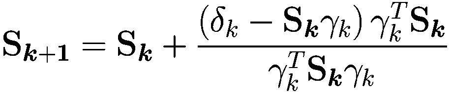

NM Dev 提供了一套拟牛顿方法。以下代码使用不同的拟牛顿方法求解图 9-11 中的 Himmelblau 函数：

```kotlin
/**
* Himmelblau 函数: f(x) = (x1² + x2 - 11)² + (x1 + x2² -
* 7)²
*/
val f = object : RealScalarFunction {
override fun evaluate(x: Vector): Double {
val x1: Double = x.get(1)
val x2: Double = x.get(2)
var result: Double = (x1 * x1 + x2 - 11).pow(2)
result += (x1 + x2 * x2 - 7).pow(2)
return result
}
override fun dimensionOfDomain(): Int {
return 2
}
override fun dimensionOfRange(): Int {
return 1
}
}
val g = object : RealVectorFunction {
override fun evaluate(x: Vector): Vector {
val x1: Double = x.get(1)
val x2: Double = x.get(2)
val w1: Double = x1 * x1 + x2 - 11
val w2: Double = x1 + x2 * x2 - 7
var result = ArrayList(2)
result.add(0, 4 * w1 * x1 + 2 * w2)
result.add(1, 2 * w1 + 4 * w2 * x2)
return DenseVector(result)
}
override fun dimensionOfDomain(): Int {
return 2
}
override fun dimensionOfRange(): Int {
return 2
}
}
val problem = C2OptimProblemImpl(f, g)
// 使用秩一法
val rankOneMinimizer: QuasiNewtonMinimizer = RankOneMinimizer(1e-16, 15)
val soln1: IterativeSolution = rankOneMinimizer.solve(problem)
var xmin: Vector = soln1.search(DenseVector(6.0, 6.0))
var f_xmin: Double = f.evaluate(xmin)
println(String.format("f(%s) = %.16f", xmin.toString(), f_xmin))
```

输出结果如下：

```
f([3.000000, 2.000000] ) = 0.0000000000000000
```

使用 DFP 方法：

```kotlin
val dfpMinimizer: QuasiNewtonMinimizer = DFPMinimizer(1e-16, 15)
val soln2: IterativeSolution = dfpMinimizer.solve(problem)
xmin = soln2.search(DenseVector(6.0, 6.0))
f_xmin = f.evaluate(xmin)
println(String.format("f(%s) = %.16f", xmin.toString(), f_xmin))
```

输出结果如下：

```
f([3.000000, 2.000000] ) = 0.0000000000000000
```

使用 BFGS 方法：

```kotlin
val bfgsMinimizer: QuasiNewtonMinimizer = BFGSMinimizer(false, 1e-16, 15)
val soln3: IterativeSolution = bfgsMinimizer.solve(problem)
xmin = soln3.search(DenseVector(6.0, 6.0))
f_xmin = f.evaluate(xmin)
println(String.format("f(%s) = %.16f", xmin.toString(), f_xmin))
```

输出结果如下：

```
f([3.000000, 2.000000] ) = 0.0000000000000000
```

使用 Huang 方法：

```kotlin
val huangMinimizer: QuasiNewtonMinimizer = HuangMinimizer(0.0, 1.0, 0.0, 1.0, 1e-16, 15)
val soln4: IterativeSolution = huangMinimizer.solve(problem)
xmin = soln4.search(DenseVector(6.0, 6.0))
f_xmin = f.evaluate(xmin)
println(String.format("f(%s) = %.16f", xmin.toString(), f_xmin))
```

输出结果如下：

```
f([3.000000, 2.000000] ) = 0.0000000000000000
```

使用 Pearson 方法：

```kotlin
val pearsonMinimizer: QuasiNewtonMinimizer = PearsonMinimizer(1e-16, 15)
val soln5: IterativeSolution = pearsonMinimizer.solve(problem)
xmin = soln5.search(DenseVector(6.0, 6.0))
f_xmin = f.evaluate(xmin)
println(String.format("f(%s) = %.16f", xmin.toString(), f_xmin))
```

输出结果如下：

```
f([3.000000, 2.000000] ) = 0.0000000000000000
```

拟牛顿方法似乎比任何共轭方向方法都高效得多。它们所需的迭代次数更少（15 次对比 20 次），并且精度更高。

这些求解器的签名如下：

```markdown
## 使用秩一方法构建一个多元最小化器

```java
/**
* 使用秩一方法构建一个多元最小化器。
*
* @param epsilon       精度参数：当某个数 |x| ≤ ε 时，视为 0
* @param maxIterations 最大迭代次数
*/
public RankOneMinimizer(double epsilon, int maxIterations)
```

## 使用 DFP 方法构建一个多元最小化器

```java
/**
* 使用 DFP 方法构建一个多元最小化器。
*
* @param epsilon       精度参数：当某个数 |x| ≤ ε 时，视为 0
* @param maxIterations 最大迭代次数
*/
public DFPMinimizer(double epsilon, int maxIterations)
```

## 使用 BFGS 方法构建一个多元最小化器

```java
/**
* 使用 BFGS 方法构建一个多元最小化器。
*
* @param epsilon          精度参数：当某个数 |x| ≤ ε 时，视为 0
* @param maxIterations    最大迭代次数
* @param isFletcherSwitch 指示是否使用 Fletcher 开关
*/
public BFGSMinimizer(boolean isFletcherSwitch, double epsilon, int maxIterations)
```

## 使用 Huang 方法构建一个多元最小化器

```java
/**
* 使用 Huang 方法构建一个多元最小化器。
*
* @param theta         Huang 公式中的 θ
* @param phi           Huang 公式中的 φ
* @param psi           Huang 公式中的 ψ
* @param omega         Huang 公式中的 ω
* @param epsilon       精度参数：当某个数 |x| ≤ ε 时，视为 0
* @param maxIterations 最大迭代次数
*/
public HuangMinimizer(
double theta,
double phi,
double psi,
double omega,
double epsilon,
int maxIterations
)
```

## 使用 Pearson 方法构建一个多元最小化器

```java
/**
* 使用 Pearson 方法构建一个多元最小化器。
*
* @param epsilon       精度参数：当某个数 |x| ≤ ε 时，视为 0
* @param maxIterations 最大迭代次数
*/
public PearsonMinimizer(double epsilon, int maxIterations)
```
```

