# 10. 约束优化

优化在数学和工业应用的许多分支中无处不在。例如，回归和最大似然估计等许多统计理论都归结为优化问题。量化金融通过最大化投资组合的收益风险比来进行资产配置。在我们公司 NM Limited，我们构建数据驱动的决策系统，以协助管理层做出科学而非临时的业务决策。例如，为钢铁制造厂构建资源分配系统以优化原材料、机器和人力；路径规划器以寻找取送邮件的最佳路线；以及安排车辆及其班次的调度系统。

本章的源代码可以在 S2 平台上运行：[`https://s21.nm.dev/hub/user-redirect/lab/tree/s2-public/Numerical%20Methods%20Using%20Kotlin/chapter10.ipynb`](https://s21.nm.dev/hub/user-redirect/lab/tree/s2-public/Numerical%20Methods%20Using%20Kotlin/chapter10.ipynb)

源代码可以在 GitHub 上找到：[`https://github.com/apress/numerical-methods-kotlin`](https://github.com/apress/numerical-methods-kotlin)

## 10.1 优化问题

通常，约束优化问题是要找到一个满足以下条件的向量 **x** ^∗ ：

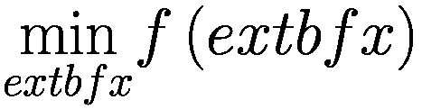

受限于以下条件：

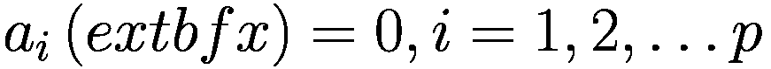

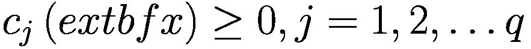

假设 `ai` 和 `cj` 是二次可微的连续函数。这些约束共同定义了优化问题的可行域 `R`。也就是说，**x** ^∗ ∈ `R`。该可行域被假定为凸集。

凸集是一种集合，对于集合中的任意两点 **x** 和 **y**，连接这两点的任意线段 (1 − `t`)**x +** `t` **y** 都在该集合中。图 10-1 展示了一个凸集的例子。

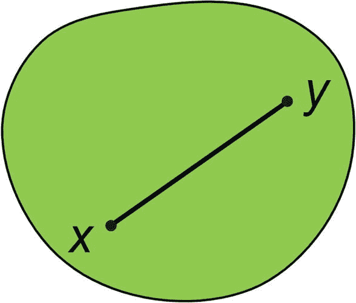

*一个凸集的示意图。圆形中连接两点 x 和 y 的线段。*

**图 10-1** - 一个凸集

图 10-2 展示了一个非凸集的例子。

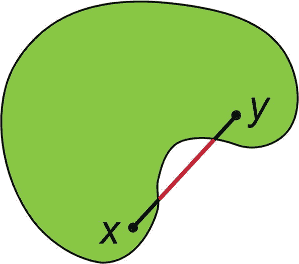

*一个非凸集的示意图。图中展示了连接两点 x 和 y 的一条线段。*

**图 10-2** - 一个非凸集

以下是一个约束优化问题的示例：

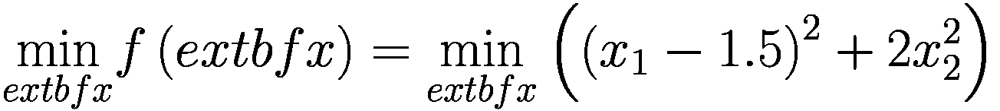

受限于以下条件：

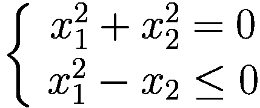

图 10-3 展示了由约束条件中两条曲线相交所定义的可行域。

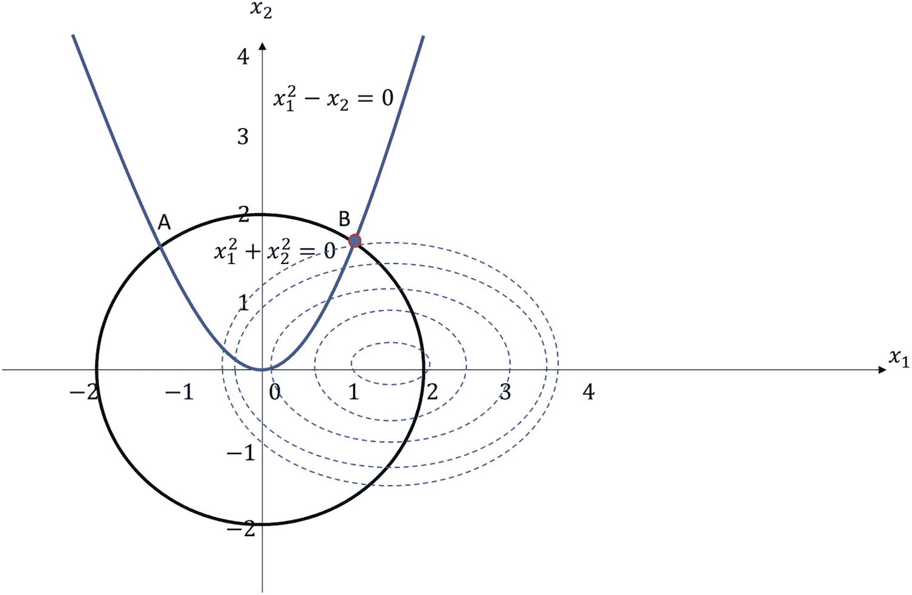

*由约束条件定义的可行域图。*

**图 10-3** - 由约束条件定义的可行域

等高线图（虚线）是目标函数可能取到的（相同）值。不等式（小于等于）约束将解限制在抛物线曲线上方。等式约束则要求解位于圆周上。因此，可行域仅为抛物线曲线内的圆弧 AB。点 B 处的圆点表示目标函数在该弧线上取得最小值的解。

### 10.1.1 通用优化算法

通常，寻找优化问题解的过程是一个迭代过程（除非你拥有解析表达式，但通常你并没有）。因此，你从一个初始点或初始猜测开始尝试。如果不行，就再试另一个。在任何数值优化算法中，核心部分都是如何选择下一个要尝试的点。决定第 *k* 次迭代搜索点的因素有两个。它们是方向 ***d*** [***k***] 以及在该方向上变化的幅度 *α* [*k*]。因此，下一个搜索点如下所示：

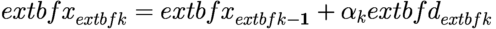

重复此过程，直到满足收敛准则。该准则可以是目标函数值的变化量过小。

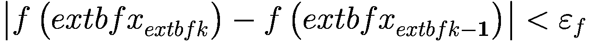

或者，也可以是 ***x*** [***k***] 的变化量过小。

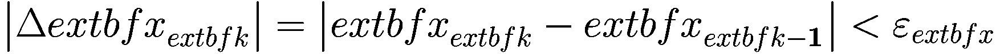

### 10.1.2 约束条件

在 NM Dev 中，一组等式约束或不等式约束由一个实值多元函数列表表示。该接口称为 `Constraints`。其类签名如下：

```
public interface Constraints {
    /**
     * 获取约束函数列表。
     *
     * @return 约束函数列表
     */
    public List getConstraints();
    /**
     * 获取变量数量。
     *
     * @return 变量数量
     */
    public int dimension();
    /**
     * 获取约束数量。
     *
     * @return 约束数量
     */
    public int size();
}
```

#### 等式约束

等式约束的集合如下所示：


或者以向量形式表示如下：

![ $$ a\left( extbf{x}\right)={\left[{a}_1\left( extbf{x}\right),{a}_2\left( extbf{x}\right),\dots, {a}_p\left( extbf{x}\right)\right]}^T=0 $$ ](images/528380_1_En_10_Chapter/528380_1_En_10_Chapter_TeX_Equj.png)

这在 *R* ^(*n*) 空间中定义了一个超曲面。

如果点 ***x*** 满足约束条件，且列向量 ∇*a* 1、∇*a* 2、...、∇*a* *p* 线性无关，则称点 ***x*** 为等式约束的正则点。也就是说，***x*** 是一个解：

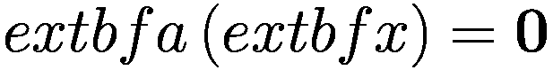

并且雅可比矩阵如下所示：

![ $$ {\textbf{J}}_{\textbf{e}}\left( extbf{x}\right)=\left[\nabla {a}_1\left( extbf{x}\right),\nabla {a}_2\left( extbf{x}\right),\dots, \nabla {a}_p\left( extbf{x}\right)\right] $$ ](images/528380_1_En_10_Chapter/528380_1_En_10_Chapter_TeX_Equl.png)

# 正则点与等式约束

## 满行秩与正则点

该矩阵具有满行秩 *p*。

如果 *p* > *n*，那么 **J** [**e**] 不可能是满行秩的，也就不存在正则点。如果 *p* = *n*，则只存在有限个正则点，那么优化问题就变得微不足道了。因此，通常可以假设 *p* < *n*。如果 `x` 是一组等式约束的正则点，它便定义了该约束超曲面的一个切平面。

Antoniou & Lu (2007) 给出了以下示例：
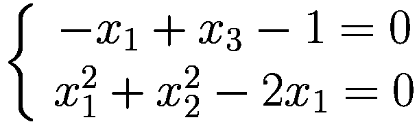

雅可比矩阵如下：
![ $$ {\textbf{J}}_{\textbf{e}}\left( extbf{x}\right)=\left[\begin{array}{ccc}-1&amp; 0&amp; 1\\ {}2{x}_1-2&amp; 2{x}_2&amp; 0\end{array}\right] $$ ](images/528380_1_En_10_Chapter/528380_1_En_10_Chapter_TeX_Equo.png)

除了点 `x` = [1 0 `x` [3]]^(*T*)（因为它不满足约束条件）之外，该矩阵的秩均为 2。因此，任何其他点都是正则点。

## NM Dev 中的等式约束

在 NM Dev 中，`EqualityConstraints` 接口是一个标记，用于表示一组等式约束。其签名如下：

```
public interface EqualityConstraints extends Constraints {
}
```

`GeneralEqualityConstraints` 类实现了一组等式约束。其类签名如下：

```
public class GeneralEqualityConstraints extends GeneralConstraints implements EqualityConstraints {
/**
* 从一个实值函数集合构造一个等式约束实例。
*
* @param constraints 等式约束
*/
public GeneralEqualityConstraints(Collection constraints) {
super(constraints);
}
/**
* 从一个实值函数数组构造一个等式约束实例。
*
* @param constraints 等式约束
*/
public GeneralEqualityConstraints(RealScalarFunction... constraints) {
super(constraints);
}
}
```

以下代码片段表示了前面的示例：

```
// 非线性约束
val a = GeneralEqualityConstraints(
// 第一个等式约束
object : AbstractRealScalarFunction(3) { // 定义域维度
override fun evaluate(x: Vector): Double {
val x1: Double = x.get(1)
val x3: Double = x.get(3)
val a1: Double = -x1 + x3 + 1
return a1
}
},
// 第二个等式约束
object : AbstractRealScalarFunction(3) { // 定义域维度
override fun evaluate(x: Vector): Double {
val x1: Double = x.get(1)
val x2: Double = x.get(2)
val a2: Double = x1 * x1 + x2 * x2 - 2.0 * x1
return a2
}
}
)
```

## 线性等式约束

如果所有等式约束都是线性的，则可以写成如下形式：
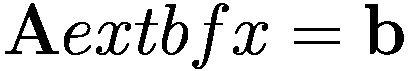

`**A**` 是一个 *p* × *n* 的矩阵。`**b**` 是一个 *p* × 1 的向量。雅可比矩阵 `**J** [**e**]` 与常数矩阵 `**A**` 相同。因此，如果 `rank(`**A**`)` = *p*，那么线性系统 `**A** x = **b**` 的任意解都是正则点。否则，对于 `rank(`**A**`)` = *p*′ < *p* 的情况，存在两种可能性。

如果 `rank([**A b**])` > *p*，则线性系统无解。需要仔细检查以消除矛盾。如果 `rank([**A b**])` = `rank(`**A**`)` = *p* ^′ < *p*，那么你可以将约束条件简化为一组更小但等价的等式约束。
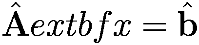
其中 `**Â**` 是一个 *p*′ × *n* 矩阵，`**b̂**` 是一个 *p*′ × 1 向量。

### 奇异值分解（SVD）方法

一种方法是对方阵 `**A**` 应用奇异值分解（SVD）。更详细的信息请参见第 2 章。你可以将 `**A**` 分解如下：
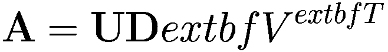
其中 `**U**` 是一个 *p* × *p* 的正交矩阵，`**V**` 是一个 *n* × *n* 的正交矩阵。
![**D** = [[**D̂**, 0], [0, 0]]](images/528380_1_En_10_Chapter/528380_1_En_10_Chapter_TeX_Equs.png)
其中 `**D̂**` 包含所有正的奇异值。
![**A** = **UDV**^T = **U** [[**Â**], [0]]](images/528380_1_En_10_Chapter/528380_1_En_10_Chapter_TeX_Equt.png)
![**Â** = **D̂**[**v₁**, …, **v_p′**]^T](images/528380_1_En_10_Chapter/528380_1_En_10_Chapter_TeX_Equu.png)
`**v** [**i**]` 是 `**V** ^(***T***)` 中的列。`**Â**` 是一个 *p* ^′ × *n* 的矩阵。
![[[**Â**], [0]] x = [[**b̂**], [0]]](images/528380_1_En_10_Chapter/528380_1_En_10_Chapter_TeX_Equv.png)
`**b̂**` 是 `**U** ^(***T***)` `**b**` 的前 *p* ^′ 项。

### 示例 10.2

以下代码片段复现了 Antoniou & Lu (2007) 中的示例 10.2：
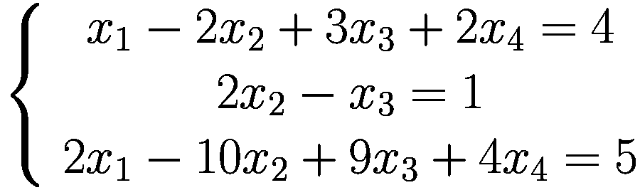
该线性系统的秩为 2，因此是可约的。简化后的等式约束如下：
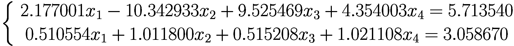

```kotlin
/** 示例 10.2，第 270 页。《实用优化：算法与
* 工程应用》。Andreas Antoniou, Wu-Sheng Lu */
// 线性约束
val `A`: Matrix = DenseMatrix(
arrayOf(
doubleArrayOf(1.0, -2.0, 3.0, 2.0),
doubleArrayOf(0.0, 2.0, -1.0, 0.0),
doubleArrayOf(2.0, -10.0, 9.0, 4.0)
)
)
val `b`: Vector = DenseVector(4.0, 1.0, 5.0)
val `A_eq` = LinearEqualityConstraints(`A`, `b`)
println("原始等式约束：")
println(`A_eq`)
// 进行 SVD 分解以简化等式约束
val `svd`: SVD = SVD(`A`, true)
val `U`: Matrix = `svd`.U()
println("\nU = ")
println(`U`)
val `D`: Matrix = `svd`.D()
println("\nD = ")
println(`D`)
val `V`: Matrix = `svd`.V()
println("\nV = ")
println(`V`)
// 检查原始等式约束是否可约
val `epsilon`: Double = 1e-8 // 精度参数，小于此值视为 0
val `isReducible`: Boolean = `A_eq`.isReducible()
println(`isReducible`)
val `r`: Int = MatrixMeasure.rank(
`A`,
`epsilon`
)
println(String.format("A 的秩 = %d%n", `r`))
```

输出如下：

```
原始等式约束：
3x4
[,1] [,2] [,3] [,4]
[1,] 1.000000, -2.000000, 3.000000, 2.000000,
[2,] 0.000000, 2.000000, -1.000000, 0.000000,
[3,] 2.000000, -10.000000, 9.000000, 4.000000,  * x =
[4.000000, 1.000000, 5.000000]
U =
3x3
[,1] [,2] [,3]
[1,] 0.271659, 0.800304, -0.534522,
[2,] -0.136451, 0.581828, 0.801784,
[3,] 0.952671, -0.144875, 0.267261,
D =
3x3
[,1] [,2] [,3]
[1,] 14.879768, 0.000000, 0.000000,
[2,] 0.000000, 1.610126, 0.000000,
[3,] 0.000000, 0.000000, 0.000000,
V =
4x3
[,1] [,2] [,3]
[1,] 0.146306, 0.317089, -0.936741,
[2,] -0.695100, 0.628398, 0.112540,
[3,] 0.640162, 0.319980, 0.225081,
[4,] 0.292612, 0.634179, 0.243290,
true
A 的秩 = 2
```

## 不等式约束

不等式约束的数学形式如下：


与等式约束不同，不等式约束的数量 `q` 不必小于 `n`。对于任意可行点 ``，存在两类不等式约束。满足 `cj > 0` 的约束集合被称为非活动约束，如图 10-2 中的 `` 和 ``。由于 `` 位于这些约束的边界上，下一个搜索点不能向违反约束的方向移动。因此，这些活动约束限制了 `` 邻域内的可行区域。另一方面，像 `` 这样的非活动约束距离 `` 很远，因此在 `` 的一个足够小的邻域内，它们对可行区域没有影响。参见图 10-4。

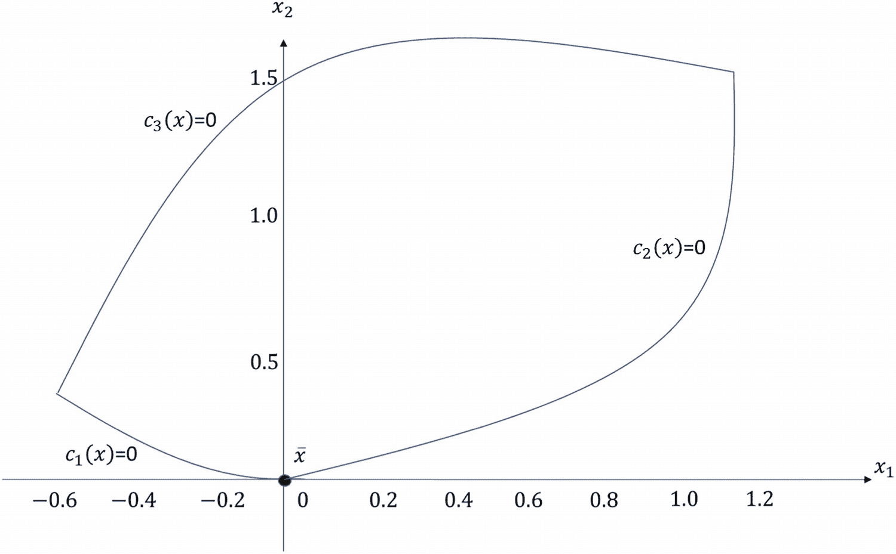

不等式约束示意图。图中针对三个方程绘制了三条直线。

图 10-4

不等式约束

在 NM Dev 中，`GreaterThanConstraints` 接口是一个标记，用于表示一组（大于等于）不等式约束。其签名如下：

```java
public interface GreaterThanConstraints extends Constraints {
/**
* 将大于等于约束转换为小于等于约束。
*
* @return 等价的小于等于约束
*/
public LessThanConstraints toLessThanConstraints();
}
```

等价地，你可以通过改变符号，将不等式约束写成小于等于不等式约束的形式：

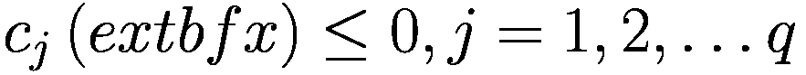

`LessThanConstraints` 接口是一个标记，用于表示一组小于等于不等式约束。其签名如下：

```java
public interface LessThanConstraints extends Constraints {
/**
* 将小于等于约束转换为大于等于约束。
*
* @return 等价的大于等于约束
*/
public GreaterThanConstraints toGreaterThanConstraints();
}
```

`GeneralGreaterThanConstraints` 类实现了一组大于等于不等式约束。该类的签名如下：

```java
public class GeneralGreaterThanConstraints
extends GeneralConstraints
implements GreaterThanConstraints {
/**
* 从一个实值函数集合构造一个大于等于不等式约束实例。
*
* @param constraints 大于等于不等式约束
*/
public GeneralGreaterThanConstraints(Collection constraints) {
super(constraints);
}
/**
* 从一个实值函数数组构造一个大于等于不等式约束实例。
*
* @param constraints 大于等于不等式约束
*/
public GeneralGreaterThanConstraints(RealScalarFunction... constraints) {
super(constraints);
}
...
}
```

例如，以下代码片段构造了这样的大于等于不等式约束：

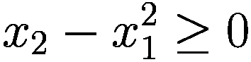

```kotlin
val c_gr = GeneralGreaterThanConstraints(
object : AbstractBivariateRealFunction() {
override fun evaluate(x1: Double, x2: Double): Double {
val c: Double = x2 - x1 * x1
return c
}
})
```

或者，你也可以使用 `GeneralLessThanConstraints` 类来构造相同的约束。该类签名如下：

# 约束类与示例

## 通用约束类

```java
public class GeneralLessThanConstraints
extends GeneralConstraints
implements LessThanConstraints {
    /**
     * 从一个实值函数集合构造一个小于等于不等式约束实例。
     *
     * @param constraints 小于等于不等式约束
     */
    public GeneralLessThanConstraints(Collection constraints) {
        super(constraints);
    }

    /**
     * 从一个实值函数数组构造一个小于等于不等式约束实例。
     *
     * @param constraints 小于等于不等式约束
     */
    public GeneralLessThanConstraints(RealScalarFunction... constraints) {
        super(constraints);
    }
    // ... (其他方法)
}
```

例如，相同的约束可以写成：

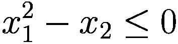

代码如下：

```kotlin
val c_less = GeneralLessThanConstraints(
    object : AbstractBivariateRealFunction() {
        override fun evaluate(x1: Double, x2: Double): Double {
            val c: Double = x1 * x1 - x2
            return c
        }
    })
```

## 线性约束类

如果所有的约束都是线性的，如下所示：


那么你可以使用 `LinearGreaterThanConstraints` 类。该类签名如下：

```java
public class LinearGreaterThanConstraints
extends LinearConstraints
implements GreaterThanConstraints {
    /**
     * 构造一组线性大于等于约束。
     *
     * @param A 不等式系数矩阵
     * @param b 不等式值向量
     */
    public LinearGreaterThanConstraints(Matrix A, Vector b);

    @Override
    public LinearLessThanConstraints toLessThanConstraints();

    /**
     * 给定一组线性大于等于约束以及一组等式约束，
     * 寻找满足约束的可行初始点。
     * 该实现求解参考书目中式 (11.25)。
     * 结果向量的前 (n-1) 个元素构成一个可行初始点。
     * 最后一个元素是单点扰动。
     *
     * @param equal 一组线性等式约束
     * @return 可行初始点及单点扰动（合并在一个向量中）
     * @see "Jorge Nocedal, Stephen Wright, p. 473, Numerical Optimization."
     * @see "Andreas Antoniou, Wu-Sheng Lu, Eq 11.25, Quadratic and Convex Programming, Practical Optimization: Algorithms and Engineering Applications."
     */
    public Vector getFeasibleInitialPoint(LinearEqualityConstraints equal);

    /**
     * 给定一组线性大于等于约束，寻找满足约束的可行初始点。
     * 该实现求解参考书目中式 (11.25)。
     * 结果向量的前 (n-1) 个元素构成一个可行初始点。
     * 最后一个元素是单点扰动。
     *
     * @return 可行初始点及单点扰动（合并在一个向量中）
     * @see "Andreas Antoniou, Wu-Sheng Lu, Eq 11.25, Quadratic and Convex Programming, Practical Optimization: Algorithms and Engineering Applications."
     */
    public Vector getFeasibleInitialPoint();
}
```

## 应用示例：投资组合优化

例如，在现代投资组合优化中，你通常会为每只股票设定一个最小权重，比如 0%。这表示不允许卖空。这个不等式约束可以写成：

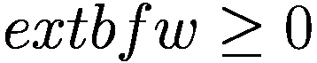

以下代码表示了这一组约束：

```kotlin
// w_i >= 0 表示不允许卖空
val A: Matrix = DenseMatrix(
    arrayOf(
        doubleArrayOf(1.0, 0.0, 0.0),
        doubleArrayOf(0.0, 1.0, 0.0),
        doubleArrayOf(0.0, 0.0, 1.0),
    )
)
val b1: Vector = DenseVector(0.0, 0.0, 0.0) // 3 只股票
val no_short_selling1 = LinearGreaterThanConstraints(A, b1)// w >= 0
println(no_short_selling1)
```

输出如下：

```
3x3
[,1] [,2] [,3]
[1,] 1.000000, 0.000000, 0.000000,
[2,] 0.000000, 1.000000, 0.000000,
[3,] 0.000000, 0.000000, 1.000000,  * x >=
[0.000000, 0.000000, 0.000000]
```

或者，你可以使用包装类 `LowerBoundConstraints` 来构造一组下界约束。

```kotlin
val no_short_selling2 = LowerBoundConstraints(3, 0.0);
println(no_short_selling2);
```

输出如下：

```
3x3
[,1] [,2] [,3]
[1,] 1.000000, 0.000000, 0.000000,
[2,] 0.000000, 1.000000, 0.000000,
[3,] 0.000000, 0.000000, 1.000000,  * x >=
[0.000000, 0.000000, 0.000000]
```

如果所有变量的下界都为 0，你可以直接使用 `NonNegativityConstraints` 类。例如，以下代码片段构造了完全相同的禁止卖空约束：

```kotlin
val no_short_selling3 = NonNegativityConstraints(3);
println(no_short_selling3);
```

输出如下：

```
3x3
[,1] [,2] [,3]
[1,] 1.000000, 0.000000, 0.000000,
[2,] 0.000000, 1.000000, 0.000000,
[3,] 0.000000, 0.000000, 1.000000,  * x >=
[0.000000, 0.000000, 0.000000]
```

类似地，`LinearLessThanConstraints` 类表示线性小于等于约束。

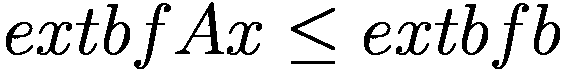

该类的签名如下：

## 10.2 线性规划

例如，你可能希望对投资组合中每只股票施加最大权重限制，以避免过度集中。以下不等式约束确保没有股票占比超过投资组合的 20%：

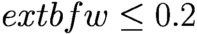

相应的代码片段如下：

```kotlin
// w_i <= 0.2
val A: Matrix = DenseMatrix(
    arrayOf(
        doubleArrayOf(1.0, 0.0, 0.0),
        doubleArrayOf(0.0, 1.0, 0.0),
        doubleArrayOf(0.0, 0.0, 1.0),
    )
)
val b2: Vector = DenseVector(0.2, 0.2, 0.2) // 3 只股票
val maximum_exposure = LinearLessThanConstraints(A, b2) // w <= 0.2
println(maximum_exposure)
```

输出如下：

```
3x3
[,1] [,2] [,3]
[1,] 1.000000, 0.000000, 0.000000,
[2,] 0.000000, 1.000000, 0.000000,
[3,] 0.000000, 0.000000, 1.000000,  * x <=
[0.200000, 0.200000, 0.200000]
```

线性规划在数学优化中非常重要。许多针对其他类型优化问题的算法都通过将 LP 问题作为子问题来求解。它广泛应用于商业、经济学和工程学。使用 LP 模型的行业包括交通运输、能源、电信和制造业。在规划、路线设计、调度、分配和设计等各类问题的建模中，LP 已被证明非常有用。例如，管理层利用 LP 在有限资源下实现利润最大化和成本最小化；YouTube 利用 LP 来稳定视频。众所周知，LP 问题的最优解必然是可行域的顶点之一。虽然理论上你可以使用暴力方法逐一检查所有顶点并进行比较，但这并不是一种实用的方法。一些大规模 LP 问题可能涉及多达 1200 万个变量。有许多高效的算法可以求解 LP 问题。在本节中，我们将介绍基本的单纯形法，这是求解 LP 问题的主要方法。

### 10.2.1 线性规划问题

标准形式的线性规划问题表述如下：


并满足以下约束条件：

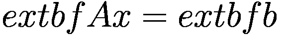


其中，`c ≠ 0` 是一个 `n × 1` 向量，`n` 是变量数量，`A` 是一个 `p × n` 矩阵，`p` 是约束条件数量，`b` 是一个 `p × 1` 向量。假设 `A` 是满秩的，即 `rank(A) = p < n`。目标函数 `f` 和所有约束条件均为线性函数。

对于一个固定的标量 `β`，`c^T x = β` 在 `n` 维欧几里得空间中定义了一个仿射（线性）流形。当 `n = 2` 时，它是一条直线。对于不同的 `β[i]`，`c^T x = β[i]` 代表一族平行线。这些直线的法线是 `c`，因此 `c` 通常被称为目标函数的法向量。

在 NM Dev 中，你可以使用 `LPStandardProblem` 类来构造标准形式的线性规划问题。该类的签名如下：

```java
public class LPStandardProblem extends LPProblemImpl1 {
    /**
     * 构造一个标准形式的线性规划问题。
     *
     * @param c     目标函数
     * @param equal 等式约束
     */
    public LPStandardProblem(Vector c, LinearEqualityConstraints equal);
}
```

例如，以下代码片段构造了这样一个线性规划问题：

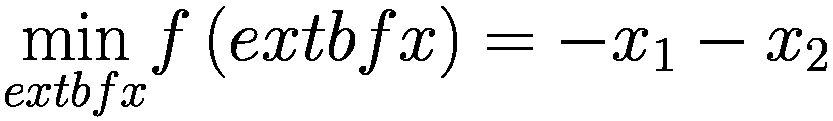

满足以下约束条件：

![ $$ \left[\begin{array}{cccc}7&amp; 1&amp; 1&amp; 0\\ {}-1&amp; 1&amp; 0&amp; 1\end{array}\right]\left[\begin{array}{c}{x}_1\\ {}{x}_2\\ {}{x}_3\\ {}{x}_4\end{array}\right]=\left[\begin{array}{c}15\\ {}1\end{array}\right] $$ ](images/528380_1_En_10_Chapter/528380_1_En_10_Chapter_TeX_Equak.png)


```kotlin
// 构造一个标准形式的线性规划问题
val problem1 = LPStandardProblem(
    DenseVector(-1.0, -1.0, 0.0, 0.0), // c
    LinearEqualityConstraints(
        DenseMatrix(
            arrayOf(
                doubleArrayOf(7.0, 1.0, 1.0, 0.0),
                doubleArrayOf(-1.0, 1.0, 0.0, 1.0)
            )
        ),
        DenseVector(15.0, 1.0) // b
    )
)
println(problem1)
```

输出结果如下：

现在，回到`LinearLessThanConstraints`类本身。

```java
public class LinearLessThanConstraints
    extends LinearConstraints
    implements LessThanConstraints {
    /**
     * 构造一组线性小于等于约束。
     *
     * @param A 小于等于不等式约束矩阵
     * @param b 小于等于不等式约束值
     */
    public LinearLessThanConstraints(Matrix A, Vector b) {
        super(A, b);
    }

    @Override
    public LinearGreaterThanConstraints toGreaterThanConstraints() {
        return new LinearGreaterThanConstraints(A().scaled(-1), b().scaled(-1));
    }

    /**
     * 给定一组线性小于等于约束以及一组等式约束，
     * 找到一个满足约束的可行初始点。
     * 该实现求解参考文献中的方程 11.25。
     * 前 (n-1) 个条目构成一个可行初始点。
     * 最后一个条目是单点扰动值。
     *
     * @param equal 一组线性等式约束
     * @return 可行初始点及单点扰动值（在一个向量中）
     * @see "Andreas Antoniou, Wu-Sheng Lu, "Eq 11.25, Quadratic and Convex
     * Programming," Practical Optimization: Algorithms and Engineering
     * Applications."
     */
    public Vector getFeasibleInitialPoint(LinearEqualityConstraints equal) {
        return this.toGreaterThanConstraints().getFeasibleInitialPoint(equal);
    }

    /**
     * 给定一组线性小于等于约束，
     * 找到一个满足约束的可行初始点。
     * 该实现求解参考文献中的方程 11.25。
     * 前 (n-1) 个条目构成一个可行初始点。
     * 最后一个条目是单点扰动值。
     *
     * @return 可行初始点及单点扰动值（在一个向量中）
     * @see "Andreas Antoniou, Wu-Sheng Lu, "Eq 11.25, Quadratic and Convex
     * Programming," Practical Optimization: Algorithms and Engineering
     * Applications."
     */
    public Vector getFeasibleInitialPoint() {
        return getFeasibleInitialPoint(null);
    }
}
```

# 线性规划问题的标准型

## 标准型的输出示例

以下是一个线性规划问题的标准型输出示例：

```
min. objective:
[-1.000000, -1.000000, 0.000000, 0.000000]
less-than-or-equal-to inequalities:
4x4
[,1] [,2] [,3] [,4]
[1,] -7.000000, -1.000000, -1.000000, -0.000000,
[2,] 1.000000, -1.000000, -0.000000, -1.000000,
[3,] 7.000000, 1.000000, 1.000000, 0.000000,
[4,] -1.000000, 1.000000, 0.000000, 1.000000,  * x <=
[-15.000000, -1.000000, 15.000000, 1.000000]
equalities:
free variables:
```

## 标准型的定义与转换

注意，输出结果实际上是线性规划问题的**标准型**。标准型表述如下：


它满足不等式约束：

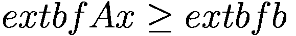

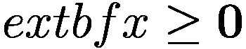

一个具有等式约束的标准形式，可以通过将等式约束转化为不等式约束，转换为标准型。


上述等式等价于：

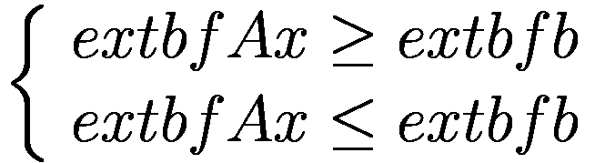

因此，标准型中的不等式约束如下：

![ $$ \left[\begin{array}{c} extbf{A}\\ {}- extbf{A}\end{array}\right] extbf{x}\ge \left[\begin{array}{c} extbf{b}\\ {}- extbf{b}\end{array}\right] $$ ](images/528380_1_En_10_Chapter/528380_1_En_10_Chapter_TeX_Equar.png)

类似地，通过引入一个 `p` 维的松弛向量变量 `y`，可以将标准型转换为标准形式，其中：

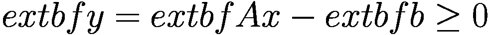

原始向量变量 `x` 可以分解为正部分 `x^+ ≥ 0` 和负部分 `x^− ≥ 0`。

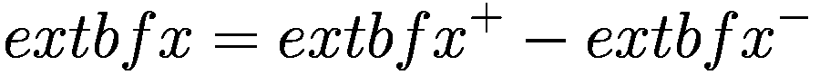

令：

![ $$ \hat{ extbf{x}}=\left[\begin{array}{c}{ extbf{x}}^{+}\\ {}{ extbf{x}}^{-}\\ {} extbf{y}\end{array}\right],\kern0.5em \hat{ extbf{c}}=\left[\begin{array}{c} extbf{c}\\ {}- extbf{c}\\ {}\textbf{0}\end{array}\right],\kern0.5em \hat{ extbf{A}}=\left[ extbf{A} - extbf{A} -{ extbf{I}}_{ extbf{p}}\right] $$ ](images/528380_1_En_10_Chapter/528380_1_En_10_Chapter_TeX_Equau.png)

那么等价的线性规划问题标准形式如下：

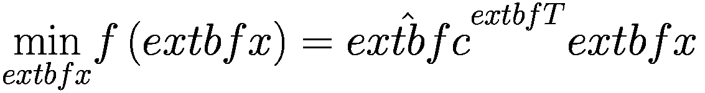

满足以下约束条件：

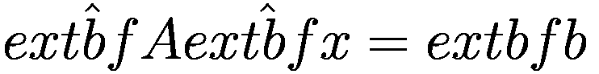

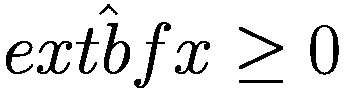

## NM Dev 实现示例

NM Dev 类 `LPCanonicalProblem1` 用于构造标准型线性规划问题。该类的签名如下：

```
public class LPCanonicalProblem1 extends LPProblemImpl1 {
/**
* 构造一个标准型线性规划问题。
*
* @param c 目标函数
* @param A 大于等于约束 A * x &ge; b 的系数矩阵 A
* @param b 大于等于约束 A * x &ge; b 的值向量 b
*/
public LPCanonicalProblem1(
Vector c,
Matrix A,
Vector b
);
/**
* 构造一个标准型线性规划问题。
*
* @param cost   目标函数
* @param greater 一组大于等于约束
*/
public LPCanonicalProblem1(
Vector cost,
LinearGreaterThanConstraints greater
);
/**
* 将线性规划问题从第二种标准型转换为第一种标准型。
*
* @param problem 一个第二种标准型的线性规划问题
*/
public LPCanonicalProblem1(LPCanonicalProblem2 problem);
/**
* 获取线性规划问题中的大于等于约束。
*
* @return 大于等于约束
*/
public LinearGreaterThanConstraints getGreaterThanConstraints();
}
```

以下代码片段构造了相同的标准型线性规划问题：

```
// 构造一个第一种标准型的线性规划问题
val problem2 = LPCanonicalProblem1(
DenseVector(-1.0, -1.0, 0.0, 0.0), // c
DenseMatrix(
arrayOf(
doubleArrayOf(7.0, 1.0, 1.0, 0.0),
doubleArrayOf(-1.0, 1.0, 0.0, 1.0),
doubleArrayOf(-7.0, -1.0, -1.0, 0.0),
doubleArrayOf(1.0, -1.0, 0.0, -1.0),
)
),
DenseVector(15.0, 1.0, -15.0, -1.0) // b
)
println(problem2)
```

输出结果如下：

```
min. objective:
[-1.000000, -1.000000, 0.000000, 0.000000]
less-than-or-equal-to inequalities:
4x4
[,1] [,2] [,3] [,4]
[1,] -7.000000, -1.000000, -1.000000, -0.000000,
[2,] 1.000000, -1.000000, -0.000000, -1.000000,
[3,] 7.000000, 1.000000, 1.000000, -0.000000,
[4,] -1.000000, 1.000000, -0.000000, 1.000000,  * x <=
[-15.000000, -1.000000, 15.000000, 1.000000]
equalities:
free variables:
```

该输出与之前用标准形式构造的输出结果相同。

NM Dev 提供了另一个名为 `LPCanonicalProblem2` 的类，用于使用小于等于不等式约束构造标准型线性规划问题。


这受限于以下条件：

## 10.2.2 一阶必要条件


以下代码片段构建了与前文相同的线性规划问题：

```
// construct an LP problem in canonical form 2
// construct an LP problem in canonical form 2
val problem3 = LPCanonicalProblem2(
DenseVector(-1.0, -1.0, 0.0, 0.0), // c
DenseMatrix(
arrayOf(
doubleArrayOf(-7.0, -1.0, -1.0, 0.0),
doubleArrayOf(1.0, -1.0, 0.0, -1.0),
doubleArrayOf(7.0, 1.0, 1.0, 0.0),
doubleArrayOf(-1.0, 1.0, 0.0, 1.0),
)
),
DenseVector(-15.0, -1.0, 15.0, 1.0) // b
)
println(problem3)
```

输出结果如下：

```
min. objective:
[-1.000000, -1.000000, 0.000000, 0.000000]
less-than-or-equal-to inequalities:
4x4
[,1] [,2] [,3] [,4]
[1,] -7.000000, -1.000000, -1.000000, 0.000000,
[2,] 1.000000, -1.000000, 0.000000, -1.000000,
[3,] 7.000000, 1.000000, 1.000000, 0.000000,
[4,] -1.000000, 1.000000, 0.000000, 1.000000,  * x <=
[-15.000000, -1.000000, 15.000000, 1.000000]
equalities:
free variables:
```

另一个示例，以下代码片段构建了这个线性规划问题：

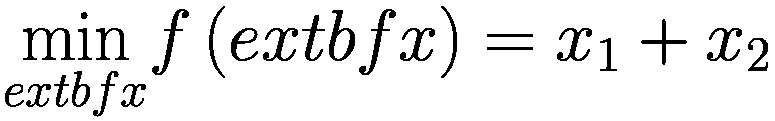

受限于以下条件：

![$$ \left[\begin{array}{cc}1& 1\\ {}1& 2\\ {}0& 3\end{array}\right]\left[\begin{array}{c}{x}_1\\ {}{x}_2\end{array}\right]\le \left[\begin{array}{c}150\\ {}170\\ {}180\end{array}\right] $$](images/528380_1_En_10_Chapter/528380_1_En_10_Chapter_TeX_Equbc.png)


```
// construct an LP problem in canonical form 2
val problem4 = LPCanonicalProblem2(
DenseVector(1.0, 1.0), // c
DenseMatrix(
arrayOf(
doubleArrayOf(1.0, 1.0),
doubleArrayOf(1.0, 2.0),
doubleArrayOf(0.0, 3.0)
)
),
DenseVector(150.0, 170.0, 180.0) // b
)
println(problem4)
```

输出结果如下：

```
min. objective:
[1.000000, 1.000000]
less-than-or-equal-to inequalities:
3x2
[,1] [,2]
[1,] 1.000000, 1.000000,
[2,] 1.000000, 2.000000,
[3,] 0.000000, 3.000000,  * x <=
[150.000000, 170.000000, 180.000000]
equalities:
free variables:
```

图 10-5 绘制了这些约束条件。可行域以阴影标出。

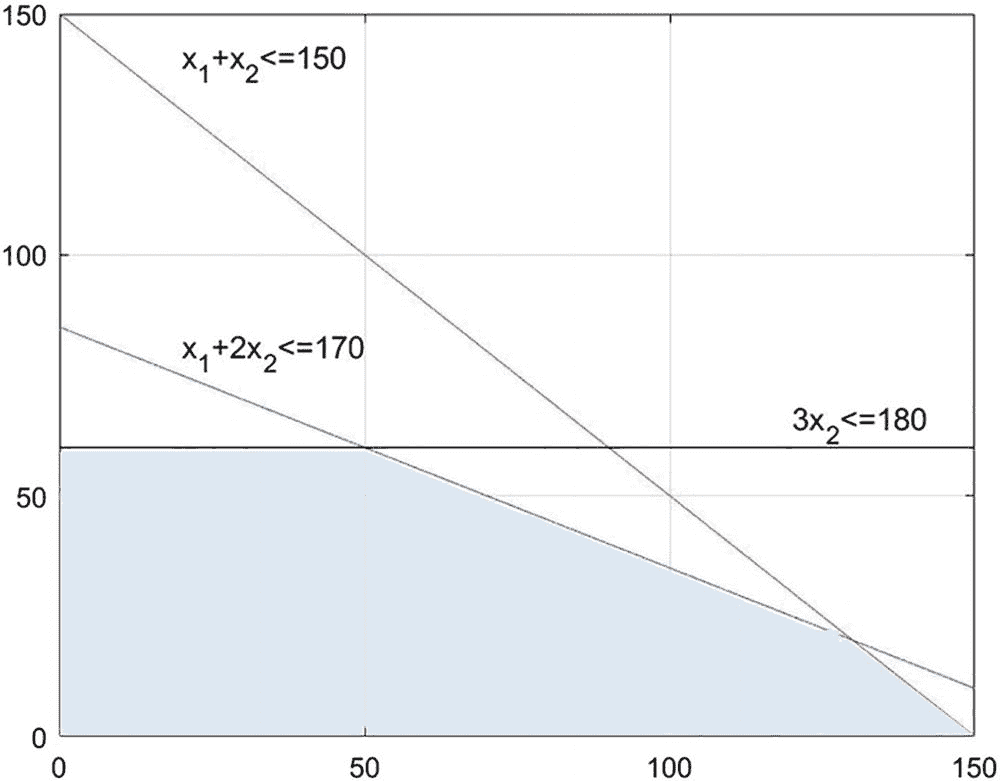

一个由三个方程组成的图形，绘制了三条线性直线，可行区域以阴影标出。

**图 10-5** 一个标准形式的线性规划问题

在数学优化中，拉格朗日乘子法是一种寻找函数在等式约束下的局部最大值和最小值的策略。它是一种用于极值点的一阶导数检验方法。它将目标函数的梯度与等式约束的梯度联系起来。

假设你要解决这个问题：


受限于以下条件：

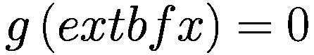

你构造拉格朗日函数，该函数是 `x` 和 `λ` 的函数：

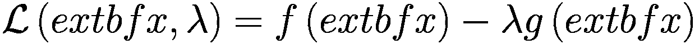

对应于原始约束优化问题的解 `x*` 始终是拉格朗日函数的一个鞍点⁸。因此，你得到：

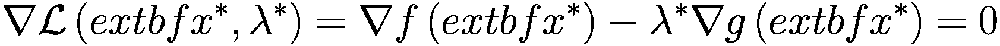

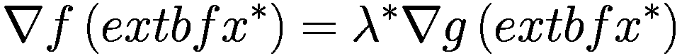

例如，假设你要解决这个问题：

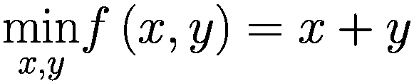

受限于以下条件：

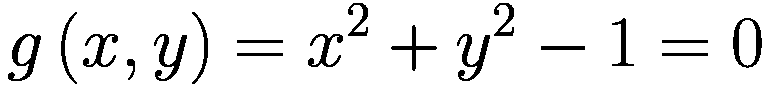

可行集是单位圆，`f` 的等高线是对角线（斜率为 −1）。图 10-6 以图形方式展示了最小值出现在 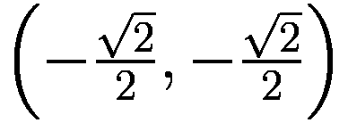。

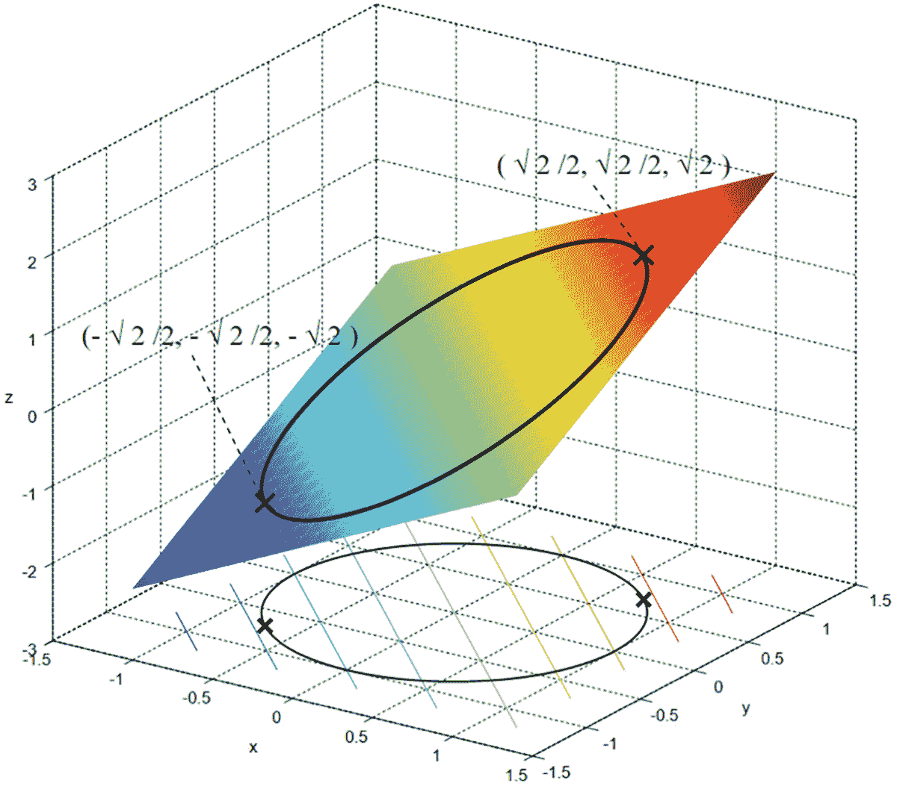

一个三维图形。两个图形的正负值在图形的两个括号中显示。

**图 10-6** 一个带有等式约束的最小化问题

应用拉格朗日乘子法，你得到：

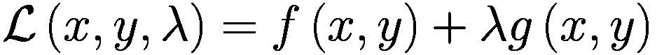

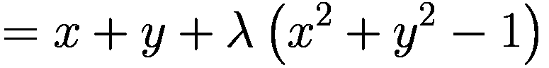

梯度如下：

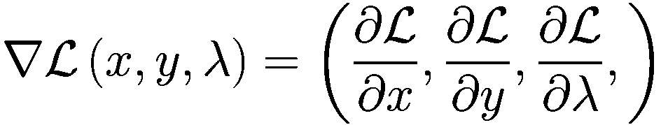

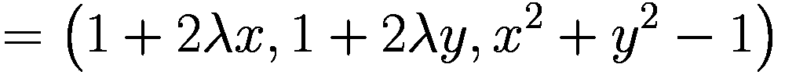

求解 `∇ℒ(x, y, λ) = 0` 得到：

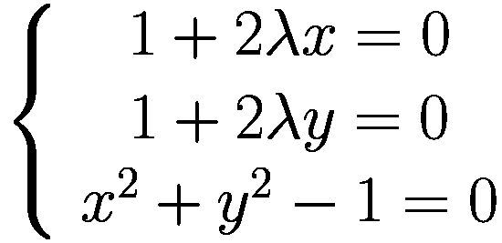

或等价地：


因此， 是最小值。

Karush-Kuhn-Tucker (KKT) 条件将拉格朗日乘数法进行了推广，使其也能处理不等式约束。与拉格朗日方法类似，有约束的最小化（最大化）问题被重写为一个拉格朗日函数，其最优点是一个鞍点，即在选择变量的定义域内是全局最小值（最大值），在乘数的定义域内是全局最大值（最小值）。KKT 条件指出，如果 `x*` 是以下问题的局部极小值点：

```
min_x f(x)
```

满足以下约束：

```
a_i(x) = 0, i = 1, 2, ..., p
c_j(x) >= 0, j = 1, 2, ..., q
```

那么存在拉格朗日乘数 `λ*` 和 `μ*`，使得以下拉格朗日函数：

```
L(x, λ, μ) = f(x) - λ a(x) - μ c(x)
```

在 `x*` 处有一个鞍点。也就是说：

```
∇L(x*, λ*, μ*) = ∇f(x*) - λ* ∇a(x*) - μ* ∇c(x*) = 0
```

或者：

```
∇f(x*) = λ* ∇a(x*) + μ* ∇c(x*)
```

此外：

```
λ* a(x*) = 0
μ* c(x*) = 0
```

并且：

```
μ_j* >= 0, j = 1, 2, ..., q
```

因此，对于非活跃约束 `c_j(x*) > 0`，`μ_j*` 必须为 0。

例如，为简单起见，假设优化问题没有等式约束，只有一个不等式约束。如果极小值点 `x*` 位于由 `c_1` 定义的可行域 `R` 内部，那么 `c_1` 就是一个非活跃约束。此时 `μ_1* = 0`。否则，如果极小值点位于 `c_1` 的边界上，即 `c_1(x*) = 0`，那么 `μ_1* > 0`。`∇f(x*) = μ_1* ∇c_1(x*)`。`f` 和 `c` 的梯度必须指向 `R` 内部的同一方向，如图 10-7 所示。


图 10-7：`x*` 是不等式约束边界上的极小值点。

### 10.2.3 单纯形法

当你将 KKT 条件应用于标准形式的线性规划问题时，形式如下：

```
min_x f(x) = c^T x
```

满足以下约束：

```
Ax = b
x >= 0
```

你会得到：

```
c = A^T λ* + μ*
```

以及：

```
μ_i* x_i* = 0, 1 <= i <= n
```

一个显而易见的观察结果是，解 `x*` 不可能位于可行域的内部。如果它在内部，那么就没有活跃约束，即 `μ* = 0`。那么你会得到：

```
c = A^T λ*
```

*n* 维向量 `c` 将位于由 `A^T` 的 *p* 列所张成的 *p* 维子空间中。由于 `p < n`，除非解在边界上，否则这种情况极不可能发生。因此，线性规划问题的任何解都极有可能位于可行域的边界上，即由不等式约束所定义的边界上。

此外，如果一个候选解位于可行域的边界上，你可以简单地沿着边界移动来减小目标函数值。换句话说，从一个位于边界上的候选解开始，你可以沿着边界滑下以寻找更小的值，直到到达该边界段的末端，即一个顶点。见图 10-8。


图 10-8：线性规划问题的解必然位于一个顶点上。

对于图 10-8 中的例子，假设你从 `v_1` 开始。你可以沿着函数值递减的方向（向左）移动。当到达顶点 `v_2` 时，你切换到另一条边，并继续沿着函数值递减的方向向下滑到 `v_3`，最后到达 `v_4`。`v_4` 是一条边的终点所在的顶点。从这个顶点移动到另一条边不会再降低函数值。事实上，你已经找到了极小值点 `v_4 = (0, 0)`。很容易看出 `x_1 + x_2 = 0 + 0 = 0` 是这个问题的解。

可以证明，对于标准形式的线性问题，如果目标函数在可行域内有最小值，那么它（至少）在其中一个顶点上取得该值。由于顶点数量是有限的，这便将问题简化为有限计算。原则上，你可以检查所有顶点的函数值以找到最小值。见图 10-9。


图 10-9：一组线性不等式定义了一个多面体作为可行域。单纯形算法从一个起始顶点开始，沿着多面体的边移动，直到到达最优解所在的顶点。

同样可以证明，如果一个顶点不是目标函数的最小值点，那么存在一条包含该顶点的边，使得目标函数的值沿着该边远离顶点时严格递减。如果该边是有限的，那么该边连接到另一个顶点，在该顶点处目标函数的值更小；否则，目标函数在该边上无下界，且该线性问题无解。单纯形法正是应用了这一洞见，沿着多面体（由约束条件定义的可行域）的边进行移动，逐步到达目标函数值越来越小的顶点。这个过程一直持续，直到达到最小值或遇到一条无界边（从而断定问题无解）。该算法一定会终止，因为多面体的顶点数量是有限的。此外，由于你总是在同一方向（目标函数的方向）上在顶点之间跳跃，因此希望所经过的顶点数量是少的。

对于一个规范形式的 LP 问题，如下所示：


满足以下约束：


可以通过引入松弛变量 `x_B` 将其转换为标准形式，如下所示：


（这里我们将原始变量 `x` 记为 `x_N`。）

标准形式的等价 LP 问题如下：


满足以下约束：


这里，`N = {1, 2, ..., n}` 是原始变量的索引集合，`B = {n + 1, ..., n + m}` 是松弛变量的索引集合。

我们将使用以下表格来表示标准 LP 问题：


解读此表格的方式是：最左侧的列包含因变量（或基本变量），最顶行的变量是自变量（或非基本变量）。示例如下：


紧凑形式下的表格如下：


Ferris、Mangasarian 和 Wright (2007) 提供了以下示例：


满足以下约束：


约束条件的松弛变量如下：


名为 `SimplexTable` 的 NM Dev 类用于为 LP 问题构建单纯形表。示例如下：

```kotlin
// 构建一个 LP 问题
val problem = LPCanonicalProblem1(
    DenseVector(3.0, -6.0), // c
    DenseMatrix(
        arrayOf(
            doubleArrayOf(1.0, 2.0),
            doubleArrayOf(2.0, 1.0),
            doubleArrayOf(1.0, -1.0),
            doubleArrayOf(1.0, -4.0),
            doubleArrayOf(-4.0, 1.0)
        )
    ),
    DenseVector(-1.0, 0.0, -1.0, -13.0, -23.0) // b
)
var tableau = SimplexTable(problem)
println(tableau)
```

输出如下：

| `x,1` | `x,2` | `B_2147483647` |
| --- | --- | --- |
| `x_slack,1` | `1.000000` | `2.000000` | `1.000000` |
| `x_slack,2` | `2.000000` | `1.000000` | `-0.000000` |
| `x_slack,3` | `1.000000` | `-1.000000` | `1.000000` |
| `x_slack,4` | `1.000000` | `-4.000000` | `13.000000` |
| `x_slack,5` | `-4.000000` | `1.000000` | `23.000000` |
| `COST_2147483647` | `3.000000` | `-6.000000` | `0.000000` |

在这个初始表格中，`x,1` 是 `x[1]`，`x,2` 是 `x[2]`。五个 `x_slack` 变量是五个不等式约束对应的松弛变量。参见图 10-10。


约束条件的交集在五个顶点之间形成了一个阴影区域。顶点 3 和顶点 4 之间的线段用 `z = -15` 标出。

图 10-10

这些顶点是约束条件的交点 (Ferris, Mangasarian, & Wright, 2007)

可行域多面体中的每个顶点都是 `n` 个由对应约束条件定义的超平面的交点。图 10-8 展示了这些顶点作为约束条件的交点。可以证明，这等价于将所有 `n` 个非基本变量设置为 0，即 `x[N] = 0`。例如，前面展示的初始表格对应于坐标系原点的顶点，此时所有原始变量均为 0，即 `x = x[N] = 0`。要使这个 `x` 成为可行解（不违反任何约束），`x[B] = -b` 中的松弛变量必须非负。也就是说，`b <= 0`。在这种情况下，目标值为 `f(0) = 0`。

为了考察另一个（相邻的）顶点，你可以将一个非基本变量与一个基本变量进行互换，实质上是将非基本变量的值从 0 增加到某个正值，同时将一个基本变量设置为 0。例如，假设你需要从 `x = (x[1], x[2]) = (0, 0)` 移动到下一个顶点。由于标准 LP 问题中变量的非负约束，你只能增加这些变量的值。例如，你可以尝试增加 `x[1]`。


那么，目标值变为：


增加 `x[1]` 实际上增加了 `f`，这与你期望的正好相反。所以，你可以尝试这样：


对于这个选择，你得到：


选择非基变量或主元列的过程称为 pricing（定价）。主元列被称为入基变量，因为它正在“进入”基变量。

为了确定哪个基变量应与入基变量交换，需要分析增加入基变量对每个基变量的影响。对于此示例，得到以下结果：


应尽量使 `λ` 变大，以最大限度地降低目标函数值，但 `λ` 不能过大，否则某些基变量会变为负值，从而违反约束条件。非负约束条件转化为以下形式：

# 单纯形法：主元选择与 Jordan 交换


在不违反任何约束条件的前提下，`λ` 能取到的最大非负值是 `λ = 1`。此外，注意到阻塞变量（即当 `λ` 超过其上限 1 时将变为负值的那个变量）是 `x[5]`。因此，应选择 `x[5]` 作为主元行。

选择基变量或主元行的过程称为 `ratio test`（比值测试）。主元行被称为离基变量，因为它正在“离开”基变量，成为非基变量并取值为 0。

在表格中，使用 Jordan 交换来交换 `x[5]`（第 3 行）和 `x[2]`（第 2 列）。对于线性系统，Jordan 交换是一种将独立变量与依赖变量互换的操作。考虑这个简单示例：


要交换 `x` 和 `y` 的角色，写成如下形式：


可以将这个想法推广到多元情况，其中独立变量 `x` ∈ ℝ^(*n*)，依赖变量 `y` ∈ ℝ^(*m*)。具体来说，假设有以下关系：


等价地，以表格形式，假设有：


交换第 `r` 行 (`y[r]`) 与第 `s` 列 (`x[s]`) 意味着用 `y[r]` 表示 `x[s]`，并保持其他 `x[i]` 不变。这可以通过求解一个关于 `x[s]` 的线性方程组来实现。得到的表格如下：

![ $$ {\displaystyle \begin{array}{ccccccccc}&amp; &amp; {x}_1&amp; \dots &amp; {x}_{s-1}&amp; {y}_r&amp; {x}_{s+1}&amp; \dots &amp; {x}_n\\ {}{y}_1&amp; =&amp; {B}_{11}&amp; \dots &amp; &amp; {B}_{1s}&amp; &amp; \dots &amp; {B}_{1n}\\ {}\vdots &amp; &amp; \vdots &amp; &amp; &amp; \vdots &amp; &amp; &amp; \vdots \\ {}{y}_{r-1}&amp; &amp; &amp; &amp; &amp; &amp; &amp; &amp; \\ {}{x}_s&amp; =&amp; {B}_{r1}&amp; &amp; &amp; {B}_{rs}&amp; &amp; &amp; {B}_{rn}\\ {}{y}_{r+1}&amp; &amp; &amp; &amp; &amp; &amp; &amp; &amp; \\ {}\vdots &amp; &amp; \vdots &amp; &amp; &amp; \vdots &amp; &amp; &amp; \vdots \\ {}{y}_m&amp; =&amp; {B}_{m1}&amp; &amp; &amp; {B}_{ms}&amp; &amp; &amp; {B}_{mn}\end{array}} $$ ](img/528380_1_En_10_Chapter_TeX_Equde.png)

以下代码执行 Jordan 交换，将示例中的第 3 行（`x[5]`）与第 2 列（`x[2]`）进行交换。

```julia
tableau = tableau.swap(3, 2)
println(tableau)
```

输出如下：

|   | `x,1` | `x_slack,3` | `B,2147483647` |
| :--- | :--- | :--- | :--- |
| `x_slack,1` | `3.000000` | `-2.000000` | `3.000000` |
| `x_slack,2` | `3.000000` | `-1.000000` | `1.000000` |
| `x,2` | `1.000000` | `-1.000000` | `1.000000` |
| `x_slack,4` | `-3.000000` | `4.000000` | `9.000000` |
| `x_slack,5` | `-3.000000` | `-1.000000` | `24.000000` |
| `COST,2147483647` | `-3.000000` | `6.000000` | `-6.000000` |

```
6x3
```

目标函数值从 0 下降到了 -6。

通过重复定价和比值测试的过程，测试下一个顶点，直到找到最优解（或证明无解）。请注意，表格的最后一行包含当前非基变量的系数。它表示每单位变量增加时 `f` 的减少量。因此，经验法则是：在定价过程中，选择具有最负系数的列。在此示例中，下一个将是 `x[1]`（系数为 -3）。

以下代码执行第 4 行（`x[6]`）与第 1 列（`x[1]`）的交换。

```julia
tableau = tableau.swap(4, 1)
println(tableau)
```

输出如下：

|   | `x_slack,4` | `x_slack,3` | `B,2147483647` |
| :--- | :--- | :--- | :--- |
| `x_slack,1` | `-1.000000` | `2.000000` | `12.000000` |
| `x_slack,2` | `-1.000000` | `3.000000` | `10.000000` |
| `x,2` | `3.000000` | `0.333333` | `4.000000` |
| `x,1` | `3.000000` | `1.333333` | `3.000000` |
| `x_slack,5` | `1.000000` | `-5.000000` | `15.000000` |
| `COST,2147483647` | `1.000000` | `2.000000` | `-15.000000` |

```
6x3
```

现在，最后一行中的所有系数均为正，可以从表格的最后一列读取 LP 问题的解。


# 单纯形算法概述

这种单纯形算法能有效求解 LP 问题。它是一种迭代方法，不断更新可行点（可行域中的顶点），直到达到最优解。它通过对约束方程组的线性系统对应的矩阵执行线性变换来找到下一个顶点。因此，它通常包含两个阶段来解决 LP 问题。第一阶段是找到一个满足所有约束条件的可行起始点。即，找到一个最后一列非负的表格。在前面的示例中，如果 LP 问题采用标准形式，则原点（`x = 0`）满足所有约束。第二阶段从可行的表格开始，应用一系列线性变换，直到找到最优表格。

## Phase 1 LP 问题

为了找到可行的起始点，你将看到如何求解一个相关的 LP 问题，称为 Phase 1 LP 问题。对于这个 Phase 1 问题，应该很容易确定一个初始可行点，并且它的解应该能为原始问题提供一个可行点。具体来说，给定一个标准 LP 问题，如下所示：

# 线性规划的第一阶段法

## 1. 目标与约束

标准形式的线性规划问题目标是：


满足以下约束：


## 2. 构建第一阶段问题

你可以通过引入一个人工变量 `x[0]` 和松弛变量 `x[n + i]` 来构建**第一阶段**的线性规划问题，如下所示：


满足以下约束条件：


## 3. 第一阶段问题的性质

首先，目标函数有下界，因此最小解为 `f = x[0] = 0`。其次，第一阶段线性规划问题存在一个明显的可行点，如下所示：


以及：


于是松弛变量的取值如下：


因此，`x[B] >= 0` 满足所有约束条件。

第三，如果原问题存在一个可行点 `x̅`，那么点 `(x0, x) = (0, x̅)` 对于第一阶段问题也是可行的，因为 `x[B] >= 0`。

第四，如果 `(0, x̅)` 是第一阶段问题的一个解，那么 `x̅` 就是原问题的一个可行点。原因如下：


由此可得：


这满足了原问题中的所有约束条件。

最后，如果 `(x[0], x)` 是第一阶段问题的一个解，且 `x[0] > 0`，那么原问题必然不可行。

## 4. 示例

你可以使用前面描述的单纯形法来求解第一阶段问题。NM Dev 类 `FerrisMangasarianWrightPhase1` 实现了这一第一阶段过程，通过对相关第一阶段问题的单纯形表进行转轴操作，从不可行的表中找出一个可行表。下面是一个示例：


满足以下约束条件：


```kotlin
// 构造一个线性规划问题
val problem = LPProblemImpl1(
    DenseVector(4.0, 5.0), // c
    LinearGreaterThanConstraints(
        DenseMatrix(
            arrayOf(
                doubleArrayOf(1.0, 1.0),
                doubleArrayOf(1.0, 2.0),
                doubleArrayOf(4.0, 2.0),
                doubleArrayOf(-1.0, -1.0),
                doubleArrayOf(-1.0, 1.0)
            )
        ),
        DenseVector(-1.0, 1.0, 8.0, -3.0, 1.0)), // b
    null, // 小于等于约束
    null, // 等式约束
    null) // 盒子约束
val table0 = SimplexTable(problem)
println("原问题的单纯形表:")
println(table0)
val phase1 = FerrisMangasarianWrightPhase1(table0)
val table1 = phase1.process()
println("第一阶段问题的单纯形表:")
println(table1)
println(String.format("最小值 = %f%n", table1.minimum()))
println(String.format("最小化解 = %s%n", table1.minimizer()))
```

输出如下：

|     | `x,1`    | `x,2`    | `B,2147483647` |
|-----|----------|----------|----------------|
| `x_slack,1` | `1.000000` | `1.000000` | `1.000000`       |
| `x_slack,2` | `1.000000` | `2.000000` | `-1.000000`      |
| `x_slack,3` | `4.000000` | `2.000000` | `-8.000000`      |
| `x_slack,4` | `-1.000000` | `-1.000000` | `3.000000`       |
| `x_slack,5` | `-1.000000` | `1.000000` | `-1.000000`      |
|     | `4.000000` | `5.000000` | `0.000000`       |

```
原问题的单纯形表:
6x3
```

|     | `x_slack,3` | `x_slack,5` | `B,2147483647` |
|-----|-------------|-------------|----------------|
| `x_slack,1` | `0.333333`    | `0.333333`    | `4.000000`       |
| `x_slack,2` | `0.500000`    | `1.000000`    | `4.000000`       |
| `x,2`     | `0.166667`    | `0.666667`    | `2.000000`       |
| `x_slack,4` | `-0.333333`   | `-0.333333`   | `0.000000`       |

| `x,1`     | `0.166667`    | `-0.333333`   | `1.000000`       |
| `COST,2147483647` | `1.500000`    | `2.000000`    | `14.000000`      |

```
原问题的单纯形表:
6x3
```

```
最小值 = 14.000000
最小化解 = [1.000000, 2.000000]
```

你已经找到了原问题的一个可行点 `x = (1, 2)`。原问题的最小值为 `f(x) = 14`。

在 NM Dev 中，单纯形求解器实现了 `LPSimplexSolver` 接口。

```
public interface LPSimplexSolver
extends LPSolver {
/**
* 通过单纯形表上的单纯形算法求解线性规划问题
*
* @param table 与线性规划问题对应的初始单纯形表
* @return 线性规划问题的解
* @throws Exception 当发生错误时
*/
public LPSimplexSolution solve(SimplexTable table) throws Exception;
}
```

`LPTwoPhaseSolver` 类实现了本节所述的两阶段算法。它接收 `LPProblem` 形式的线性规划问题，并以 `LPSimplexSolution` 形式输出解。该类签名如下：

```
public class LPTwoPhaseSolver implements LPSimplexSolver {
private class Solution implements LPSimplexSolution {
......
}
private final LPSimplexSolver solver;//一个标准线性规划求解器
/**
* 构造一个用于求解线性规划问题的求解器。
*
* @param solver 一个标准线性规划求解器
*/
public LPTwoPhaseSolver(LPSimplexSolver solver) {
this.solver = solver;
}
/**
* 构造一个用于求解线性规划问题的求解器。
*/
public LPTwoPhaseSolver() {
this(new LPCanonicalSolver());
}
@Override
public LPSimplexSolution solve(SimplexTable table) throws LPInfeasible, Exception {
return new Solution(table);
}
@Override
public LPSimplexSolution solve(LPProblem problem) throws LPInfeasible, Exception {
return solve(new SimplexTable(problem));
}
}
```

延续前面的例子，以下代码使用两阶段算法求解该线性规划问题。

```kotlin
// construct an LP problem
var problem = LPProblemImpl1(
    DenseVector(4.0, 5.0), // c
    LinearGreaterThanConstraints(
        DenseMatrix(
            arrayOf(
                doubleArrayOf(1.0, 1.0),
                doubleArrayOf(1.0, 2.0),
                doubleArrayOf(4.0, 2.0),
                doubleArrayOf(-1.0, -1.0),
                doubleArrayOf(-1.0, 1.0)
            )
        ),
        DenseVector(-1.0, 1.0, 8.0, -3.0, 1.0)), // b
    null, // less-than constraints
    null, // equality constraints
    null) // box constraints
// construct the simplex tableau for the LP problem
var table0 = SimplexTable(problem)
println("simplex tableau for the problem:")
println(table0)
// solve the LP problem using the 2-phase algorithm
val solver = LPTwoPhaseSolver()
val solution = solver.solve(problem).minimizer() as LPBoundedMinimizer
println(String.format("minimum = %f%n", solution.minimum()))
println(String.format("minimizer = %s%n", solution.minimizer()))
```

输出如下：

|   | `x,1` | `x,2` | `B,2147483647` |
| `x_slack,1` | `1.000000` | `1.000000` | `1.000000` |
| `x_slack,2` | `1.000000` | `2.000000` | `-1.000000` |
| `x_slack,3` | `4.000000` | `2.000000` | `-8.000000` |
| `x_slack,4` | `-1.000000` | `-1.000000` | `3.000000` |
| `x_slack,5` | `-1.000000` | `1.000000` | `-1.000000` |
| `COST,2147483647` | `4.000000` | `5.000000` | `0.000000` |

```
simplex tableau for the problem:
6x3
```

```
minimum = 14.000000
minimizer = [1.000000, 2.000000]
```

结果表明 `f(1, 2) = 14` 确实是原问题的最优解。

再举一个例子，以下代码解决了 Chen, Batson, & Dang (2009) 中的这个线性规划问题：


满足以下约束条件：


# Kotlin 线性规划求解器示例

## 示例一

```kotlin
// construct an LP problem
val problem = LPProblemImpl1(
    DenseVector(-5.0, 2.0), // c
    LinearGreaterThanConstraints(
        DenseMatrix(
            arrayOf(
                doubleArrayOf(1.0, 3.0)
            )
        ),
        DenseVector(9.0)), // b1
    LinearLessThanConstraints(
        DenseMatrix(
            arrayOf(
                doubleArrayOf(-1.0, 2.0),
                doubleArrayOf(3.0, 2.0)
            )
        ),
        DenseVector(5.0, 19.0)), // b2
    null,
    null)
// construct the simplex tableau for the LP problem
val table0 = SimplexTable(problem)
println("simplex tableau for the problem:")
println(table0)
// solve the LP problem using the 2-phase algorithm
val solver = LPTwoPhaseSolver()
val solution: LPMinimizer = solver.solve(problem).minimizer()
println(String.format("minimum = %f%n", solution.minimum()))
println(String.format("minimizer = %s%n", solution.minimizer()))
```

输出如下：

| | `x,1` | `x,2` | `B,2147483647` |
|---|---|---|---|
| `x_slack,1` | `1.000000` | `3.000000` | `-9.000000` |
| `x_slack,2` | `1.000000` | `-2.000000` | `5.000000` |
| `x_slack,3` | `-3.000000` | `-2.000000` | `19.000000` |
| `COST,2147483647` | `-5.000000` | `2.000000` | `0.000000` |

```
simplex tableau for the problem:
4x3
```

```
minimum = -25.571429
minimizer = [5.571429, 1.142857]
```

最优解为。

## 示例二

再举一个例子，以下代码解决了 Ferris, Mangasarian, & Wright (2007) 中的这个线性规划问题：


满足以下约束条件：


```kotlin
// construct an LP problem
fun problem(): LPProblem {
    // min c'x
    val c: Vector = DenseVector(2.0, -1.0)
    // the constraints
    // Ax >= b
    val greaterThanConstraints = LinearGreaterThanConstraints(
        DenseMatrix(arrayOf(doubleArrayOf(1.0, 0.0))), // A
        DenseVector(-6.0)) // b
    val lessThanConstraints: LinearLessThanConstraints? = null // no less than constraints
    // Ax = b
    val equalityConstraints = LinearEqualityConstraints(
        DenseMatrix(arrayOf(doubleArrayOf(-1.0, 0.0))), // A
        DenseVector(-4.0)) // b
    // the whole plane
    val boxConstraints = BoxConstraints(
        2,
        BoxConstraints.Bound(2, Double.NEGATIVE_INFINITY, Double.POSITIVE_INFINITY)
    )
    // construct an LP problem with constraints
    val problem: LPProblem = LPProblemImpl1(
        c,
        greaterThanConstraints,
        lessThanConstraints,
        equalityConstraints,
        boxConstraints
    ) // x2 is free
    return problem
}
// construct the simplex tableau for the LP problem
val table0 = SimplexTable(problem())
println("simplex tableau for the problem:")
println(table0)
// solve the LP problem using the 2-phase algorithm
val solver = LPTwoPhaseSolver()
val solution: LPMinimizer = solver.solve(problem()).minimizer()
println(String.format("minimum = %f%n", solution.minimum()))
println(String.format("minimizer = %s%n", solution.minimizer()))
```

输出如下：

| | `x,1` | `FREE,2` | `B,2147483647` |
|---|---|---|---|
| `x_slack,1` | `1.000000` | `0.000000` | `6.000000` |
| `EQUALITY,1` | `-1.000000` | `0.000000` | `4.000000` |
| `COST,2147483647` | `2.000000` | `-1.000000` | `0.000000` |

```
simplex tableau for the problem:
3x3
```

```
minimum = -Infinity
minimizer = [0.000000, 1.000000]
```

结果表明该问题无下界。

## 示例三

再举一个例子，以下代码解决了 Ferris, Mangasarian, & Wright (2007) 中的这个线性规划问题：


满足以下约束条件：


# 代码示例与讨论

## Kotlin 代码示例

```kotlin
// construct an LP problem
fun problem(): LPProblem {
    // min c'x
    val c: Vector = DenseVector(2.0, -1.0)
    // the constraints
    // Ax >= b
    val greaterThanConstraints = LinearGreaterThanConstraints(
        DenseMatrix(arrayOf(doubleArrayOf(1.0, 0.0))), // A
        DenseVector(6.0)) // b
    val lessThanConstraints: LinearLessThanConstraints? = null // no less than constraints
    // Ax = b
    val equalityConstraints = LinearEqualityConstraints(
        DenseMatrix(arrayOf(doubleArrayOf(-1.0, 0.0))), // A
        DenseVector(-4.0)) // b
    // the whole plane
    val boxConstraints = BoxConstraints(
        2,
        BoxConstraints.Bound(2, Double.NEGATIVE_INFINITY, Double.POSITIVE_INFINITY)
    )
    // construct an LP problem with constraints
    val problem: LPProblem = LPProblemImpl1(
        c,
        greaterThanConstraints,
        lessThanConstraints,
        equalityConstraints,
        boxConstraints
    ) // x2 is free
    return problem
}
// construct the simplex tableau for the LP problem
val table0 = SimplexTable(problem())
println("simplex tableau for the problem:")
println(table0)
// solve the LP problem using the 2-phase algorithm
val solver = LPTwoPhaseSolver()
val solution: LPMinimizer = solver.solve(problem()).minimizer()
```

## 运行结果与异常

输出的单纯形表如下：

| | `x,1` | `FREE,2` | `B,2147483647` |
|---|---|---|---|
| `x_slack,1` | `1.000000` | `0.000000` | `-6.000000` |
| `EQUALITY,1` | `-1.000000` | `0.000000` | `4.000000` |
| `COST,2147483647` | `2.000000` | `-1.000000` | `0.000000` |

```
simplex tableau for the problem:
3x3
```

程序抛出了`LPInfeasible`异常：

```
Exception in thread "main" `dev.nm.solver.multivariate.constrained.convex.sdp.socp.qp.lp.exception.LPInfeasible`
at `dev.nm.solver.multivariate.constrained.convex.sdp.socp.qp.lp.simplex.FerrisMangasarianWrightPhase1.process(FerrisMangasarianWrightPhase1.java:81)`
at `dev.nm.solver.multivariate.constrained.convex.sdp.socp.qp.lp.simplex.solver.LPTwoPhaseSolver$Solution.(LPTwoPhaseSolver.java:64)`
at `dev.nm.solver.multivariate.constrained.convex.sdp.socp.qp.lp.simplex.solver.LPTwoPhaseSolver$Solution.(LPTwoPhaseSolver.java:45)`
at `dev.nm.solver.multivariate.constrained.convex.sdp.socp.qp.lp.simplex.solver.LPTwoPhaseSolver.solve(LPTwoPhaseSolver.java:104)`
at `dev.nm.solver.multivariate.constrained.convex.sdp.socp.qp.lp.simplex.solver.LPTwoPhaseSolver.solve(LPTwoPhaseSolver.java:109)`
at `dev.nm.nmj.Chapter10.lp_solver_3(Chapter10.java:108)`
at `dev.nm.nmj.Chapter10.main(Chapter10.java:75)`
```

请注意，此程序抛出了一个`LPInfeasible`异常。它是在第一阶段被检测到的，表明该问题无可行解。

## 10.2.4 单纯形法的代数形式

上一节讨论了单纯形法的几何形式。你也可以将该算法融入第 10.1.1 节的一般优化框架中。给定一个顶点`x[k]`（非退化，意味着它恰好有`n`条边或`n`个有效约束），如果`A[ak+1]`与`A[ak]`正好相差一行，则称顶点`x[k+1]`与`x[k]`相邻：

![ $$ {\textbf{A}}_{\textbf{a}\textbf{k}}=\left[\begin{array}{c}{\textbf{a}}_{\textbf{j}\textbf{1}}^{\textbf{T}}\\ {}{\textbf{a}}_{\textbf{j}\textbf{2}}^{\textbf{T}}\\ {}\vdots \\ {}{\textbf{a}}_{\textbf{j}\textbf{n}}^{\textbf{T}}\end{array}\right] $$ ](images/528380_1_En_10_Chapter/528380_1_En_10_Chapter_TeX_Equec.png)

其中`a[ji]^T`是第`ji`个约束的系数。与`A[ak]`相关联的是有效约束的索引集合：


其中`ji`表示原始变量中的一个索引。

换句话说，如果`ℑ[k]`和`ℑ[k+1]`恰好有(`n` − 1)个相同的成员，则`x[k]`和`x[k+1]`相邻。在顶点`x[k]`处，单纯形算法会检查`x[k]`是否是最小点。如果不是，它会寻找一个能给出更小目标函数值的相邻顶点`x[k+1]`。如果最小点存在且顶点数量有限，则单纯形算法总能在有限次迭代内找到解。

KKT 条件指出，存在一个`λ[k] ∈ ℝ^n`，使得：


并且，如果满足以下条件，则`x[k]`是一个最小点：


换句话说，`x[k]`不是最小点，当且仅当`λ[k]`中至少有一个分量（例如第`l`个分量 `(``λ[k]``)[l]`）为负。即：


在一般优化算法中，下一个（相邻的）顶点由下式给出：


可以证明，一个可行的下降方向`d[k]`具有以下特征：

`A[ak] d[k] ≥ 0`，`c^T d[k] < 0`

### 为了找到边`d[k]`

为了找到边`d[k]`，需要求解以下方程：


其中`e[l]`是第*l*个坐标向量（即*n* × *n*单位矩阵的第*l*列）。

然后，你会得到：


因此，`d[k]`是一个可行的下降方向。

此外，对于*i* ≠ *l*，你会得到：


你可以为索引集`ℐ[k]`（即`x[k]`处的非有效约束）中的每个*i*，且满足`a[ji]^T d[k] < 0`时，求解`α[i]`：


### NM Dev 库中的实现

NM Dev 库中名为 `LPRevisedSimplexSolver` 的类实现了 Antoniou & Lu (2007) 中描述的这种代数形式的单纯形算法。你可以使用此求解器来解决你在上一节中解决的、来自 Chen, Batson, & Dang (2009) 的同一个线性规划问题。

你需要将这一行代码从：

```
LPTwoPhaseSolver solver = new LPTwoPhaseSolver();
```

改为：

```
LPRevisedSimplexSolver solver = new LPRevisedSimplexSolver(1e-8);
```

以使用不同的求解器。


满足以下约束条件：


```
// 构造一个线性规划问题
val problem = LPProblemImpl1(
DenseVector(-5.0, 2.0), // c
LinearGreaterThanConstraints(
DenseMatrix(
arrayOf(
doubleArrayOf(1.0, 3.0)
)
),
DenseVector(9.0)), // b1
LinearLessThanConstraints(
DenseMatrix(
arrayOf(
doubleArrayOf(-1.0, 2.0),
doubleArrayOf(3.0, 2.0)
)
),
DenseVector(5.0, 19.0)), // b2
null,
null)
// 使用代数线性规划求解器解决该线性规划问题
val solver = LPRevisedSimplexSolver(1e-8)
val solution: LPMinimizer = solver.solve(problem).minimizer()
println(String.format("minimum = %f%n", solution.minimum()))
println(String.format("minimizer = %s%n", solution.minimizer()))
```

输出结果如下：

```
minimum = -25.571429
minimizer = [5.571429, 1.142857]
```

这和使用两阶段求解器得到的结果完全相同。

# 10.3 二次规划

二次规划（QP）用于在满足线性约束的条件下最小化二次目标函数。它在量化金融等领域具有重要应用。此外，它常被用于求解其他更通用的非线性约束优化（如序列二次规划）中的子问题。该问题通常表述如下：


并满足以下约束：


其中 `A` ∈ ℝ^(*p* × *n*)，对应于 *n* 个变量的 *p* 个线性约束。通常应假设矩阵 `H` 是对称的、满秩的，并且是半正定的（`H` ≽ 0）。

如果海森矩阵 `H` ≽ 0 是半正定的，那么该问题就是一个凸优化问题，可以在（弱）多项式时间内求解。否则，该问题是 NP 困难的。对于非凸问题，可能存在多个驻点和局部最小值。实际上，即使 `H` 只有一个负特征值，该问题也是强 NP 困难的。

QP 的一个重要应用是现代投资组合理论。假设你想将一笔资金分配给 *n* 只股票，并持有该投资组合一年。尽管一年后每只股票的确切回报率未知，但你可以将股票 `i` 的年回报率 `r[i]` 建模为一个随机变量，例如服从正态分布。即：


由于股票并非完全独立，它们往往同涨同跌，因此存在相关性。股票 `i` 和股票 `j` 之间的相关性如下：

![$$ {\rho}_{ij}=\frac{\textrm{E}\left[\left({r}_i-{\mu}_i\right)\left({r}_j-{\mu}_j\right)\right]}{\sigma_i{\sigma}_j} $$](images/528380_1_En_10_Chapter/528380_1_En_10_Chapter_TeX_Eques.png)

投资者的决策是决定将资金的多少比例或权重 `w[i]` 投入每只股票，以构建其投资组合。那么投资组合的期望回报率如下：

![$$ \textrm{E}\left[R\right]=\textrm{E}\left[\sum \limits_{i=1}^n{w}_i{r}_i\right]=\sum \limits_{i=1}^n{w}_i\textrm{E}\left[{r}_i\right]=\sum \limits_{i=1}^n{w}_i{\mu}_i={\textbf{w}}^{\textbf{T}}\textbf{\mu} $$](images/528380_1_En_10_Chapter/528380_1_En_10_Chapter_TeX_Equet.png)

投资组合的方差如下：

![$$ Var\left[R\right]=\textrm{E}\left[{\left(R-\textrm{E}\left[R\right]\right)}²\right]=\sum \limits_{i=1}^n\sum \limits_{j=1}^n{w}_i{w}_j{\sigma}_i{\sigma}_j{\rho}_{ij}={\textbf{w}}^{\textbf{T}}\textbf{\Sigma} \textbf{w} $$](images/528380_1_En_10_Chapter/528380_1_En_10_Chapter_TeX_Equeu.png)

其中 `Σ` 是 *n* × *n* 的对称半正定协方差矩阵，定义如下：


马科维茨提出，投资者应寻求一种权重分配，使得投资组合的期望回报率最大化，同时风险（以投资组合方差衡量）最小化。这本质上构成了以下 QP 问题：


并满足以下约束：


所有权重之和等于 100%。你还可以施加其他约束，例如每只股票的最小权重为 0%。这表示不允许卖空。该不等式约束可以写作：


`λ` > 0 被称为*风险规避系数*。较为保守、希望最小化风险的投资者会选择较小的 `λ`。相反，追求更高预期回报并能承受更大回撤的激进投资者，则会选择较大的 `λ`。改变 `λ` 会得到不同的投资组合（不同的权重分配），这些组合满足一个条件：在给定 `λ` 下，不存在另一个具有更高预期回报且回报标准差（即风险）相同的投资组合。这些（针对不同 `λ` 的）最优投资组合的集合共同描绘出所谓的*有效前沿*。见图 10-11。


该图展示了预期回报与标准差之间的关系。图中包含几个不同的曲线图以及一条有效前沿曲线。

图 10-11 投资组合的有效前沿

### 10.3.1 仅含等式约束的凸二次规划问题

我们先从一个可通过解析方法求解的简单凸二次规划问题入手。仅含等式约束的凸二次规划问题表述如下：


满足以下约束条件：


其中 `H` ≽ 0，`A` ≽ 0，`A` ∈ ℝ^(*p* × *n*)，且 `A` 对称且满秩，满足 *p* < *n*。

可以证明，解 `x` 的形式如下：


其中 `V[r]` 由 `V` 的最后 *n* − *p* 列组成，`V` 来自 `A = U Σ V^T` 的奇异值分解。`A^+` 是 `A` 的摩尔-彭若斯逆矩阵。

利用这种解的形式，原问题可以重写为等价的无约束最小化问题，如下所示：


其中


如果 `H` ≻ 0 是正定矩阵，那么 `\hat{H}` ≻ 0 也是正定矩阵。问题的唯一全局最小化器如下：


其中 `\phi*` 是以下线性系统的解：

## 二次规划与 NM Dev 实现


如果 `H` ≽ 0 是半正定矩阵，那么 `hat(H)` 可能是正定或半正定矩阵。若 `hat(H)` ≻ 0 为正定矩阵，则 `x*` 是问题的唯一全局最小化器。若 `hat(H)` ≽ 0 为半正定矩阵，则有两种可能：如果 `hat(p)` 可以表示为 `hat(H)` 各列的线性组合，那么 `f(x)` 存在无穷多个全局最小化器；否则，不存在最小化器。

### 示例：二次规划问题

我们以 Antoniou & Lu (2007) 中的以下二次规划问题为例，来说明该方法：


满足以下约束条件：


其中 `A = [0 1 1]`，`b = 1`。

矩阵形式的目标函数如下：


![$$ extbf{H}=\left[\begin{array}{ccc}1&amp; 0&amp; 0\\ {}0&amp; 1&amp; 0\\ {}0&amp; 0&amp; 0\end{array}\right]\succcurlyeq 0 $$](images/528380_1_En_10_Chapter/528380_1_En_10_Chapter_TeX_Equfk.png)

![$$ extbf{p}=\left[\begin{array}{c}2\\ {}1\\ {}-1\end{array}\right] $$](images/528380_1_En_10_Chapter/528380_1_En_10_Chapter_TeX_Equfl.png)

对 `A` 进行奇异值分解得到以下结果：

![$$ {\textbf{V}}_{\textbf{r}}=\left[\begin{array}{cc}1&amp; 0\\ {}0&amp; \frac{\sqrt{2}}{2}\\ {}0&amp; -\frac{\sqrt{2}}{2}\end{array}\right] $$](images/528380_1_En_10_Chapter/528380_1_En_10_Chapter_TeX_Equfm.png)

![$$ {\textbf{A}}^{+}=\left[\begin{array}{c}0\\ {}0.5\\ {}0.5\end{array}\right] $$](images/528380_1_En_10_Chapter/528380_1_En_10_Chapter_TeX_Equfn.png)

因此，得到以下结果：

![$$ \hat{ extbf{H}}={ extbf{V}}_r^T{ extbf{H} extbf{V}}_r=\left[\begin{array}{cc}1&amp; 0\\ {}0&amp; \frac{\sqrt{2}}{2}\end{array}\right]\succ 0 $$](images/528380_1_En_10_Chapter/528380_1_En_10_Chapter_TeX_Equfo.png)

唯一的全局最小化器如下：


![$$ =\left[ \begin{array}{cc}1&amp; 0\\ {}0&amp; \frac{\sqrt{2}}{2}\\ {}0&amp; -\frac{\sqrt{2}}{2}\end{array}\kern0.5em \right]\times \left[\kern0.5em \begin{array}{c}-2\\ {}-3.5355\end{array}\kern0.5em \right]+\left[\kern0.5em \begin{array}{c}0\\ {}0.5\\ {}0.5\end{array}\kern0.5em \right]\left[1\right]=\left[\kern0.5em \begin{array}{c}-2\\ {}-2\\ {}3\end{array}\right] $$](images/528380_1_En_10_Chapter/528380_1_En_10_Chapter_TeX_Equfq.png)

### NM Dev 中的实现

在 NM Dev 中，`QuadraticFunction` 类用于构造以下形式的二次函数：


该类的签名如下：

```
public class QuadraticFunction extends AbstractRealScalarFunction {
/**
 * 构造如下形式的二次函数：\(f(x) = \frac{1}{2} \times x'Hx + x'p + c\)。
 * @param H 对称半正定矩阵
 * @param p 向量
 * @param c 常数
 */
public QuadraticFunction(Matrix H, Vector p, double c);
/**
 * 构造如下形式的二次函数：\(f(x) = \frac{1}{2} \times x'Hx + x'p\)。
 *
 * @param H 对称半正定矩阵
 * @param p 向量
 */
public QuadraticFunction(Matrix H, Vector p);
/**
 * 拷贝构造函数。
 *
 * @param f 二次函数
 */
public QuadraticFunction(QuadraticFunction f);
public ImmutableMatrix Hessian();
public ImmutableVector p();
@Override
public Double evaluate(Vector z);
@Override
public String toString();
}
```

`QPSimpleMinimizer` 类是一个工具类，包含一系列用于求解无约束二次规划问题和仅含等式约束的二次规划问题的实用函数。这两个问题都可以通过解析方法求解。以下代码重现了前面的示例：

```
// 构造仅含等式约束的二次规划问题
val H: DenseMatrix = DenseMatrix(
arrayOf(
doubleArrayOf(1.0, 0.0, 0.0),
doubleArrayOf(0.0, 1.0, 0.0),
doubleArrayOf(0.0, 0.0, 0.0)
)
)
val p: DenseVector = DenseVector(2.0, 1.0, -1.0)
val f = QuadraticFunction(H, p)
println("最小化：")
println(f)
// 等式约束
val A: DenseMatrix = DenseMatrix(
arrayOf(
doubleArrayOf(0.0, 1.0, 1.0)
))
val b: DenseVector = DenseVector(1.0)
val Aeq = LinearEqualityConstraints(A, b)
// 求解仅含等式约束的二次规划问题
val soln = QPSimpleMinimizer.solve(f, Aeq)
val x: Vector = soln.minimizer()
val fx: Double = f.evaluate(x)
println(String.format("f(%s) = %f%n", x, fx))
println(String.format("解是否唯一 = %b%n", soln.isUnique()))
```

输出结果如下：

好的，作为一名高级文档工程师和翻译员，我将严格遵循您的注意事项和示例格式，将给定的英文文本翻译成中文。

---

```
最小化:
1/2 * x'3x3
[,1] [,2] [,3]
[1,] 1.000000, 0.000000, 0.000000,
[2,] 0.000000, 1.000000, 0.000000,
[3,] 0.000000, 0.000000, 0.000000, x + x'[2.000000, 1.000000, -1.000000]
f([-2.000000, -2.000000, 3.000000] ) = -5.000000
is unique = true
```

NM Dev 计算出相同的最优解 `x* = [-2, -2, 3]` 和最小值 −5。

### 10.3.2 严格凸 QP 问题的积极集法

一般来说，一个 QP 问题可以表述如下：

`min f(x) = (1/2) x^T H x + x^T p`

满足以下约束条件：

`Ax >= b`

其中 `A` ∈ ℝ^(p × n)。

不失一般性地，你可以跳过等式约束，因为它们可以像第 10.3.1 节那样被消去。

在极小点 `x` 处的 Karush-Kuhn-Tucker (KKT) 条件由下式给出：

`Hx + p - A^T μ = 0`

`(a_i^T x - b_i) μ_i = 0, i=1, 2, …, p`

`μ_i >= 0, i=1, 2, …, p`

假设解 `x*` 位于可行域的内部。（与 LP 不同，LP 的解必须在边界上，而 QP 问题的解可以在可行域内部。）那么你会得到：

`Ax* - b > 0`

这意味着：

`μ* = 0`

然后你会得到：

`Hx* + p = 0`

唯一的全局极小点 `x*` 是该线性系统的解，如下所示：

`x* = -H^{-1} p`

#### 原始积极集法

如果解 `x*` 不是内点，而是位于可行域的边界上，那么下一步搜索方向是将当前迭代点 `x` 处的有效约束视为一组等式约束，同时忽略其他约束。这就是求解一般凸 QP 问题的积极集法。

设 `x[k]` 是第 *k* 次迭代中的一个可行迭代点。设 `J[k]` 是有效约束的索引集合，即那些满足 `a_i^T x - b_i = 0` 的约束，这被称为一个积极集。下一次迭代，如同第 10.1.1 节中通用的优化算法一样，如下所示：

`x_{k+1} = x_k + d = x_k + α_k d_k`

如果满足以下条件，则在 `x[k]` 处有效的约束在 `x[k+1]` 处仍然有效：

`a_j^T x_{k+1} - b_j = 0`, `j` ∈ `J[k]`

在下一次迭代方程的两边乘以 `a_j^T`，你会得到：

`a_j^T d_k = 0`, `j` ∈ `J[k]`

在 `x[k] + d` 处的目标函数如下所示：

`f_k(d) = (1/2) d^T H d + d^T g_k + c_k`

其中

`g_k = p + Hx_k`

并且 `c[k]` 是一个常数。

积极集法中的一个主要步骤是求解以下仅包含等式约束的 QP 子问题，如下所示：

`min_d f_hat(d) = (1/2) d^T H d + d^T g_k`

满足以下约束条件：

`a_j^T d_k = 0`, `j` ∈ `J[k]`

这可以使用第 10.3.1 节中的方法来求解。原始积极集算法如下所示：

# 原始有效集算法

## 步骤 1
从一个可行的初始点 `x[0]` 开始。
确定初始有效集 `J[0]`。
仅使用 `J[0]` 中的有效约束，将矩阵 `A[a0]` 构造成 `A` 的一个子矩阵。
设置 `k = 0`。

## 步骤 2
计算 `g[k] = p + Hx[k]`。
使用 `g[k]` 来检查 `d[k]` 是否为零。如果 `d[k]` 不为零，则转到步骤 4。

## 步骤 3 (`d[k] = 0`)
使用 `A_ak^T * μ̂ = g_k` 求解 `μ̂`。
如果 `μ̂ >= 0`，则输出 `x[k]` 作为解并终止。
否则，从 `J[k]` 中移除与最负拉格朗日乘子相关联的索引。

## 步骤 4 (`d[k] ≠ 0`)
使用仅含等式约束的子 QP 问题求解 `d[k]`。

## 步骤 5
计算 `α[k]`。
```
α_k = min { 1, min_{i∉J_k, a_i^T d_k < 0} (b_i - a_i^T x_k) / (a_i^T d_k) }
```
设置 `x[k+1] = x[k] + α[k] * d[k]`。

## 步骤 6
如果 `α[k] < 1`，则通过在步骤 5 中将产生最小值的索引添加到 `J[k]` 来构建 `J[k+1]`。
否则，设置 `J[k] = J[k+1]`。

## 步骤 7
设置 `k = k + 1`。
从步骤 2 开始重复。

---

考虑 Nocedal & Wright (2006) 中的这个示例问题：
```
min_x q(x) = (x_1 - 1)² + (x_2 - 2.5)²
```
约束条件如下：
```
{ x_1 - 2x_2 + 2 >= 0
{ -x_1 - 2x_2 + 6 >= 0
{ -x_1 + 2x_2 + 2 >= 0
{ x_1 >= 0
{ x_2 >= 0
```
你可以将问题写成矩阵形式。
```
min_x f(x) = (1/2) x^T H x + x^T p
```
满足以下约束：
```
A x >= b
```
其中：
```
H = [2   0]
    [0   2]

p = [-2]
    [-5]

A = [ 1  -2]
    [-1  -2]
    [-1   2]
    [ 1   0]
    [ 0   1]

b = [-2]
    [-6]
    [-2]
    [ 0]
    [ 0]
```
(注意，这两种形式的常数项不同，但它们与解无关。)

如图 10-12 所示。


**图 10-12** 一个二次规划问题

图 10-12 展示了可行域、边界、目标函数的等高线以及约束标签 `a[i]`。

假设初始迭代点是 `x⁰ = [2, 0]^T` (这里，上标表示迭代次数，下标表示分量)。该顶点有两个有效约束，即 `a[3]` 和 `a[5]`。`a[3] * x⁰ = a[5] * x⁰ = 0`。工作集是 `J[0] = {3, 5}`。QP 子问题的解是 `d⁰ = 0`。你需要求解 KKT 条件中的拉格朗日乘子，以检验它是否是最小点。
```
[-1   2] [μ̂_1] = [ 2]
[ 0   1] [μ̂_2]   [-5]
```
也就是说，你得到：
```
[μ̂_3] = [-2]
[μ̂_5]   [-1]
```
这不满足非负性要求，意味着尚未找到最小值。你将约束条件 3，即 `a[3]`，从工作集中移除，因为它对应的拉格朗日乘子绝对值最大。

在下一个迭代 `k = 1` 中，当前工作集变为 `J[1] = {5}`。`x¹ = x⁰ = [2, 0]^T`，因为上次迭代没有移动搜索点。`d¹ = [-1, 0]^T`。步长公式得到 `α[1] = 1`。新的迭代点是 `x² = [1, 0]^T`。

在下一个迭代 `k = 2` 中，`x² = [1, 0]^T`。`d² = 0`。`μ̂_5 = -5`。你将 `a[5]` 从工作集中移除。工作集现在为空，`J[1] = {}`。

在下一个迭代 `k = 3` 中，因为 `d² = 0`，所以 `x³ = [1, 0]^T`。由于工作集为空，QP 子问题是无约束的。求解得到 `d³ = [0, 2.5]^T`。步长公式得到 `α[3] = 0.6`。新的迭代点是 `x⁴ = [1, 1.5]^T`。

在下一个迭代 `k = 4` 中，`x⁴ = [1, 1.5]^T`。存在一个阻塞约束 `a[1]`。第一个约束被添加到工作集中，`J[4] = {1}`。`d⁴ = [0.4, 0.2]^T`。`α[4] = 1`。新的迭代点是 `x⁵ = [1.4, 1.7]^T`。工作集保持不变。

在下一个迭代 `k = 5` 中，`x⁵ = [1.4, 1.7]^T`。`d⁵ = 0`。检查 KKT 条件得到 `μ̂_1 = 0.8 > 0`。已找到最小值。你得到如下结果：
```
x* = [1.4]
     [1.7]
```

下面的 NM Dev 代码求解了这个 QP 问题：
```kotlin
// 构造一个二次函数
val H: Matrix = DenseMatrix(
    arrayOf(
        doubleArrayOf(2.0, 0.0),
        doubleArrayOf(0.0, 2.0),
    )
)
val p: Vector = DenseVector(-2.0, -5.0)
val f = QuadraticFunction(H, p)
// 构造线性不等式约束
val A: Matrix = DenseMatrix(
    arrayOf(
        doubleArrayOf(1.0, -2.0),
        doubleArrayOf(-1.0, -2.0),
        doubleArrayOf(-1.0, 2.0),
        doubleArrayOf(1.0, 0.0),
        doubleArrayOf(0.0, 1.0),
    )
)
val b: Vector = DenseVector(-2.0, -6.0, -2.0, 0.0, 0.0)
val greater = LinearGreaterThanConstraints(A, b)// x >= 0
// 构造 QP 问题
val problem = QPProblem(f, null, greater)
// 构造一个原始积极集求解器
val epsion: Double = Math.sqrt(PrecisionUtils.autoEpsilon(problem.f().Hessian()))
val solver1 = QPPrimalActiveSetMinimizer(
    epsion, // 精度
    Integer.MAX_VALUE // 最大迭代次数
)
// 使用原始积极集方法求解 QP 问题
val solution1: QPPrimalActiveSetMinimizer.Solution = solver1.solve(problem)
solution1.search(DenseVector(2.0, 0.0))
// 打印解
println("minimizer = " + solution1.minimizer().minimizer())
println("minimum = " + solution1.minimum())
```
输出如下：

# 对偶积极集法

```
x_0 = [2.000000, 0.000000]
J_0
= active: [3, 5]; inactive: []
g_0 = [2.000000, -5.000000]
d_0 = [0.000000, 0.000000]
mu = [-2.000000, -1.000000]
x_1 = [2.000000, 0.000000]
J_1
= active: [5]; inactive: [3]
g_1 = [2.000000, -5.000000]
d_1 = [-1.000000, 0.000000]
a = 1.000000
x_2 = [1.000000, 0.000000]
J_2
= active: [5]; inactive: [3]
g_2 = [0.000000, -5.000000]
d_2 = [0.000000, 0.000000]
mu = [-5.000000]
x_3 = [1.000000, 0.000000]
J_3
= active: []; inactive: [3, 5]
g_3 = [0.000000, -5.000000]
d_3 = [-0.000000, 2.500000]
a = 0.600000
x_4 = [1.000000, 1.500000]
J_4
= active: [1]; inactive: [3, 5]
g_4 = [0.000000, -2.000000]
d_4 = [0.400000, 0.200000]
a = 1.000000
x_5 = [1.400000, 1.700000]
J_5
= active: [1]; inactive: [3, 5]
g_5 = [0.800000, -1.600000]
d_5 = [0.000000, 0.000000]
mu = [0.800000]
minimizer = [1.400000, 1.700000]
minimum = -6.450000000000001
```

同样地，我们得到 `f`(1.4, 1.7) = -6.45。建议将输出结果与前面讨论的迭代轨迹进行比较。

## 对偶积极集法

对偶性是一种用于求解与原问题（称为*原始*问题）相关的问题的技术。这个相关的问题被称为*对偶*问题。在对偶问题中，参数是原始问题的拉格朗日乘子。当不等式约束的数量远大于 `x` 的维度时，求解对偶问题以找到拉格朗日乘子，然后为原始问题找到 `x*` 可能会更容易。具体来说，设 `x*`、`λ*`、`μ*` 为约束优化问题（如 KKT 条件所定义）的最小化器和两个拉格朗日乘子。它们求解了对偶问题，如下所示：


需满足以下条件：


此外，我们还有：


用于求解 QP 问题的对偶积极集方法本质上是上一节中的积极集方法，但应用于 QP 问题的对偶问题。QP 问题的对偶形式如下：


需满足以下条件：


在其最小化器 `μ*` 确定之后，可以根据 KKT 条件获得原始问题的最小化器，如下所示：


即：


与求解原始问题相比，求解对偶问题具有以下优势：

- 容易找到一个可行的初始点，即任何具有非负分量的向量，例如 `μ[0] = 0`。
- 问题中的约束矩阵是 *p* × *p* 的单位矩阵。因此，对偶问题总是满足非退化假设。
- 该问题仅涉及有界不等式约束，这显著降低了算法所需的计算成本。

在 NM Dev 中，`QPDualActiveSetMinimizer` 类将 QP 问题转换为其对偶问题，然后应用积极集方法。以下代码使用对偶积极集方法求解同一个问题：

```kotlin
// 构造二次函数
val H: Matrix = DenseMatrix(
    arrayOf(
        doubleArrayOf(2.0, 0.0),
        doubleArrayOf(0.0, 2.0),
    )
)
val p: Vector = DenseVector(-2.0, -5.0)
val f = QuadraticFunction(H, p)

// 构造线性不等式约束
val A: Matrix = DenseMatrix(
    arrayOf(
        doubleArrayOf(1.0, -2.0),
        doubleArrayOf(-1.0, -2.0),
        doubleArrayOf(-1.0, 2.0),
        doubleArrayOf(1.0, 0.0),
        doubleArrayOf(0.0, 1.0),
    )
)
val b: Vector = DenseVector(-2.0, -6.0, -2.0, 0.0, 0.0)
val greater = LinearGreaterThanConstraints(A, b) // x >= 0

// 构造 QP 问题
val problem = QPProblem(f, null, greater)

// 构造对偶积极集求解器
val epsion: Double = Math.sqrt(PrecisionUtils.autoEpsilon(problem.f().Hessian()))

// 使用对偶积极集法求解 QP 问题
val solver2 = QPDualActiveSetMinimizer(
    epsion,           // 精度
    Integer.MAX_VALUE // 最大迭代次数
)
val solution2: QPDualActiveSetMinimizer.Solution = solver2.solve(problem)
solution2.search()

// 打印结果
println("minimizer = " + solution2.minimizer().minimizer())
println("minimum = " + solution2.minimum())
```

我们仅仅将求解器从以下代码：

```kotlin
val solver1 = QPPrimalActiveSetMinimizer(
    epsion,           // 精度
    Integer.MAX_VALUE // 最大迭代次数
)
// 使用原始积极集法求解 QP 问题
val solution1: QPPrimalActiveSetMinimizer.Solution = solver1.solve(problem)
```

改为了以下代码：

```kotlin
// 使用对偶积极集法求解 QP 问题
val solver2 = QPDualActiveSetMinimizer(
    epsion,           // 精度
    Integer.MAX_VALUE // 最大迭代次数
)
val solution2: QPDualActiveSetMinimizer.Solution = solver2.solve(problem)
```

你甚至无需为对偶积极集求解器提供初始猜测。

输出结果如下：

```
x_0 = [0.000000, 0.000000, 0.000000, 0.000000, 0.000000]
J_0
= active: [1, 2, 3, 4, 5]; inactive: []
g_0 = [-2.000000, 0.000000, 6.000000, 1.000000, 2.500000]
d_0 = [0.000000, 0.000000, 0.000000, 0.000000, 0.000000]
mu = [-2.000000, 0.000000, 6.000000, 1.000000, 2.500000]
x_1 = [0.000000, 0.000000, 0.000000, 0.000000, 0.000000]
J_1
= active: [2, 3, 4, 5]; inactive: [1]
g_1 = [-2.000000, 0.000000, 6.000000, 1.000000, 2.500000]
d_1 = [0.800000, 0.000000, 0.000000, 0.000000, 0.000000]
a = 1.000000
x_2 = [0.800000, 0.000000, 0.000000, 0.000000, 0.000000]
J_2
= active: [2, 3, 4, 5]; inactive: [1]
g_2 = [0.000000, 1.200000, 4.000000, 1.400000, 1.700000]
d_2 = [0.000000, 0.000000, 0.000000, 0.000000, 0.000000]
mu = [1.200000, 4.000000, 1.400000, 1.700000]
minimizer = [1.400000, 1.700000]
minimum = -6.450000000000001
```

该结果与使用原始积极集法得到的结果相同。

## 10.4 半定规划

半定规划（SDP）是凸优化的一个子领域，致力于在正半定矩阵锥与仿射空间交集的约束下，优化线性目标函数。正半定矩阵是特征值非负的对称矩阵。SDP 之所以日益受到关注，有以下几个原因。运筹学和组合优化中的许多实际问题都可以建模或近似为 SDP 问题。在自动控制理论中，SDP 被用于线性矩阵不等式的场景。一些量子查询复杂度问题也已通过 SDP 形式化表述。此外，所有线性规划（如 LP 和 QP）都可以重新表述为 SDP 问题。向量不等式约束被替换为矩阵不等式约束。图 10-13 展示了凸规划及其子领域的层级结构。


凸规划的层级结构包括半定规划、二阶锥规划、凸二次规划和线性规划。

**图 10-13** 凸规划的层级结构

### 10.4.1 原始 SDP 问题与对偶 SDP 问题

设 ***S***^(*n*) 为实对称 *n* × *n* 矩阵的空间。***S***^(*n*) 上的标准内积定义如下：


原始 SDP 问题定义如下：


满足约束：

***A***[*i*] ***∙ X = b***[*i*]，其中 *i* = 1, 2, ..., *p*

***X*** **≽ 0**

其中 ***C***、***X***、***A***[*i*] 属于 ***S***^(*n*)。***X*** 是正半定矩阵。

一个 SDP 问题的示例如下：


满足约束：


![ $$ \textbf{X}=\left[\begin{array}{ccc}{x}_{11}&amp; {x}_{12}&amp; {x}_{13}\\ {}{x}_{21}&amp; {x}_{22}&amp; {x}_{23}\\ {}{x}_{31}&amp; {x}_{32}&amp; {x}_{33}\end{array}\right]\succcurlyeq 0 $$ ](images/528380_1_En_10_Chapter/528380_1_En_10_Chapter_TeX_Equhc.png)

以矩阵形式，该问题可写作：

![ $$ \underset{ \textbf{X}}{\min}\left[\begin{array}{ccc}1&amp; 2&amp; 3\\ {}2&amp; 9&amp; 0\\ {}3&amp; 0&amp; 7\end{array}\right]\cdot \left[\begin{array}{ccc}{x}_{11}&amp; {x}_{12}&amp; {x}_{13}\\ {}{x}_{12}&amp; {x}_{22}&amp; {x}_{23}\\ {}{x}_{13}&amp; {x}_{23}&amp; {x}_{33}\end{array}\right] $$ ](images/528380_1_En_10_Chapter/528380_1_En_10_Chapter_TeX_Equhd.png)

满足约束：

![ $$ \left\{\begin{array}{c}\left[\begin{array}{ccc}1&amp; 0&amp; 1\\ {}0&amp; 3&amp; 7\\ {}1&amp; 7&amp; 5\end{array}\right]\cdotp \left[\begin{array}{ccc}{x}_{11}&amp; {x}_{12}&amp; {x}_{13}\\ {}{x}_{12}&amp; {x}_{22}&amp; {x}_{23}\\ {}{x}_{13}&amp; {x}_{23}&amp; {x}_{33}\end{array}\right]=11\\ {}\left[\begin{array}{ccc}0&amp; 2&amp; 8\\ {}2&amp; 6&amp; 0\\ {}8&amp; 0&amp; 4\end{array}\right]\cdotp \left[\begin{array}{ccc}{x}_{11}&amp; {x}_{12}&amp; {x}_{13}\\ {}{x}_{12}&amp; {x}_{22}&amp; {x}_{23}\\ {}{x}_{13}&amp; {x}_{23}&amp; {x}_{33}\end{array}\right]=19\end{array}\right. $$ ](images/528380_1_En_10_Chapter/528380_1_En_10_Chapter_TeX_Equhe.png)

这个 SDP 问题看起来与 LP 问题非常相似。注意，现在涉及的决策变量是矩阵 ***X*** 而非向量。此外，正如 ***x*** ≥ **0** 意味着 *n* 个分量中的每一个都必须非负，***X*** **≽ 0** 意味着 *n* 个特征值中的每一个都必须非负。

在 NM Dev 中，`SDPPrimalProblem` 类用于构造原始形式的 SDP 问题。该类的签名如下：

### 10.4.2 中心路径

```java
public class SDPPrimalProblem { // TODO: 转换为 SDPDualProblem; 实现 ConstrainedOptimProblem
    /**
     * 构造一个原始 SDP 问题。
     * \[
     * \min_x \mathbf{c'x} \textrm{, s.t., } \\
     * \mathbf{Ax} = \mathbf{b}, \mathbf{x} \geq \mathbf{0}
     * \]
     *
     * @param C \(C\)
     * @param A \(A\)
     */
    public SDPPrimalProblem(SymmetricMatrix C, SymmetricMatrix[] A);

    /**
     * 获取系统的维度，即 `x` 的维度，即变量数量。
     *
     * @return 系统的维度
     */
    public int n();

    /**
     * 获取 `b` 的大小。
     *
     * @return `b` 的大小
     */
    public int p();

    /**
     * 获取 `C`。
     *
     * @return `C`
     */
    public SymmetricMatrix C();

    /**
     * 获取 `A[i]`。
     *
     * @param i `A` 的索引，从 1 开始计数
     * @return `A[i]`
     */
    public SymmetricMatrix A(int i);
}
```

以下代码构造了上述示例中的原始问题：

```kotlin
// 原始 SDP 矩阵
val C: SymmetricMatrix = SymmetricMatrix(
    arrayOf(
        doubleArrayOf(1.0),
        doubleArrayOf(2.0, 9.0),
        doubleArrayOf(3.0, 0.0, 7.0)
    )
)
val A1: SymmetricMatrix = SymmetricMatrix(
    arrayOf(
        doubleArrayOf(1.0),
        doubleArrayOf(0.0, 3.0),
        doubleArrayOf(1.0, 7.0, 5.0)
    )
)
val A2: SymmetricMatrix = SymmetricMatrix(
    arrayOf(
        doubleArrayOf(0.0),
        doubleArrayOf(2.0, 6.0),
        doubleArrayOf(8.0, 0.0, 4.0)
    )
)
// 构造原始 SDP 问题
val primal = SDPPrimalProblem(
    C,
    arrayOf(A1, A2))
```

如果 `C = diag(c)` 且 `A[i] = diag(a[i])` 均为对角矩阵，则该问题可立即简化为标准形式的线性规划问题。标准形式线性规划问题的对偶问题如下：


满足约束条件：


其中 `s` 为松弛变量。

类似地，相对于原始 SDP 问题的对偶 SDP 问题如下：


满足约束条件：


`S` ≽ 0

其中 `S` 为松弛变量。

该例子的对偶问题如下：


满足约束条件：

![ $$ {y}_1\left[\begin{array}{ccc}1&amp; 0&amp; 1\\ {}0&amp; 3&amp; 7\\ {}1&amp; 7&amp; 5\end{array}\right]+{y}_2\left[\begin{array}{ccc}0&amp; 2&amp; 8\\ {}2&amp; 6&amp; 0\\ {}8&amp; 0&amp; 4\end{array}\right]+ extbf{S}=\left[\begin{array}{ccc}1&amp; 2&amp; 3\\ {}2&amp; 9&amp; 0\\ {}3&amp; 0&amp; 7\end{array}\right] $$ ](images/528380_1_En_10_Chapter/528380_1_En_10_Chapter_TeX_Equhl.png)

`S` ≽ 0

或者可表示为：


满足约束条件：

![ $$ \left[\begin{array}{ccc}1-1{y}_1-0{y}_2&amp; 2-0{y}_1-2{y}_2&amp; 3-1{y}_1-8{y}_2\\ {}2-0{y}_1-2{y}_2&amp; 9-3{y}_1-6{y}_2&amp; 0-7{y}_1-0{y}_2\\ {}3-1{y}_1-8{y}_2&amp; 0-7{y}_1-0{y}_2&amp; 7-5{y}_1-4{y}_2\end{array}\right]\succcurlyeq \textbf{0} $$ ](images/528380_1_En_10_Chapter/528380_1_En_10_Chapter_TeX_Equhn.png)

对偶形式通常更易于观察和操作，因为其变量是 `p` 个乘子 `y[i]`。

NM Dev 的 `SDPPrimalProblem` 类以对偶形式构造 SDP 问题。类签名如下：

```java
public class SDPDualProblem extends ConstrainedOptimProblemImpl1 {
    /**
     * 构造对偶 SDP 问题。
     *
     * @param b \(b\)
     * @param C \(C\)
     * @param A \(A\)
     */
    public SDPDualProblem(
        final Vector b,
        final SymmetricMatrix C,
        final SymmetricMatrix[] A
    );

    /**
     * 获取方阵 `C` 和 `A` 的维度。
     *
     * @return 矩阵的维度
     */
    public int n();

    /**
     * 获取系统的维度，即 `p = y` 的维度 = 变量数量。
     *
     * @return 系统的维度
     */
    public int p();

    /**
     * 获取 `b`。
     *
     * @return `b`
     */
    public ImmutableVector b();

    /**
     * 获取 `C`。
     *
     * @return `C`
     */
    public SymmetricMatrix C();

    /**
     * 获取 `A[i]`。
     *
     * @param i 指向 `A` 的索引，从 1 开始计数
     * @return `A[i]`
     */
    public SymmetricMatrix A(int i);
}
```

继续此示例，以下代码构造对偶问题：

```kotlin
// 对偶 SDP 向量与矩阵
val b: Vector = DenseVector(11.0, 19.0)
// 构造原始 SDP 问题
val dual = SDPDualProblem(
    b,
    C,
    arrayOf(A1, A2))
println(dual)
```

SDP 问题的 Karush-Kuhn-Tucker (KKT)条件表明，矩阵 `X*` 是原始问题的最小化子当且仅当存在矩阵 `S* ∈ Sⁿ` 和向量 `y* ∈ ℝᵖ` 使得以下系统成立：


`X* ≽ 0, S* ≽ 0`，可以证明 KKT 条件的解存在。原始解为 `{X*, yᵢ*, S*}`，同时可以证明 `{yᵢ*, S*}` 是对偶问题的最大化子（即解）。因此该解被称为原始-对偶解。

中心路径在内点算法的构建中起关键作用。对于 SDP 问题，中心路径由一组 `{X(τ), y(τ), S(τ)}` 构成，满足以下系统：


`X(τ) ≽ 0, S(τ) ≽ 0`

除 `τI` 项外，该解几乎满足 KKT 条件。

沿中心路径的差异或对偶间隙 `δ` 可通过下式计算：

![ $$ \delta \left[ extbf{X}\left(\tau \right), extbf{y}\left(\tau \right)\right]= extbf{C}\cdot extbf{X}\left(\tau \right)-{ extbf{b}}^{ extbf{T}} extbf{y}\left(\tau \right) $$ ](images/528380_1_En_10_Chapter/528380_1_En_10_Chapter_TeX_Equhu.png)

![ $$ =\left[\sum \limits_{i=1}^p extbf{y}\left(\tau \right){ extbf{A}}_i+ extbf{S}\left(\tau \right)\right]\cdot extbf{X}\left(\tau \right)-{ extbf{b}}^{ extbf{T}} extbf{y}\left(\tau \right) $$ ](images/528380_1_En_10_Chapter/528380_1_En_10_Chapter_TeX_Equhv.png)


如果能通过将 `τ` 追踪至 0 来闭合间隙，中心路径将趋近于 SDP 问题的解。参见图 10-14。


图 10-14 内点算法的中心路径

换言之：

![ $$ \underset{\tau \to 0}{\lim}\delta \left[ extbf{X}\left(\tau \right), extbf{y}\left(\tau \right)\right]=0 $$ ](images/528380_1_En_10_Chapter/528380_1_En_10_Chapter_TeX_Equhy.png)

同时还有：


原始-对偶解为 `\left\{{\mathbf{X}}^{\ast },{\mathbf{y}}_{\textbf{i}}^{\ast },{\mathbf{S}}^{\ast}\right\}`。

内点算法通过沿着问题的中心路径生成迭代序列，使其收敛于原始-对偶解。对于每个 `τ > 0`，`X(τ)` 和 `{y(τ), S(τ)}` 分别位于原始问题和对偶问题可行域的内部。这就是一种路径跟踪算法。

### 10.4.3 原始-对偶路径跟踪法

首先定义一些运算和符号。给定 `ℝ^{n × n}` 中的矩阵 `K`、`M`、`N`，一般的非对称克罗内克积定义如下：

![`\mathbf{M}\otimes\mathbf{N}=\left[\begin{array}{ccc}{m}_{11}\mathbf{N}& \dots & {m}_{1n}\mathbf{N}\\ {}\vdots & \ddots & \vdots \\ {}{m}_{n1}\mathbf{N}& \dots & {m}_{nn}\mathbf{N}\end{array}\right]`](images/528380_1_En_10_Chapter/528380_1_En_10_Chapter_TeX_Equic.png)

`svec(K)` 运算将一个对称矩阵 `K = {k[ij]}` 转换为维度为 `n(n + 1)/2` 的向量，如下所示：

![`\textrm{svec}\left(\mathbf{K}\right)={\left[{k}_{11},\sqrt{2}{k}_{12},\dots, \sqrt{2}{k}_{1n},{k}_{22},\sqrt{2}{k}_{23},\dots, \sqrt{2}{k}_{2n},\dots, {k}_{nn}\right]}^T`](images/528380_1_En_10_Chapter/528380_1_En_10_Chapter_TeX_Equid.png)

对称克罗内克积由如下恒等式定义：

![`\left(\mathbf{M}\odot\mathbf{N}\right)\textrm{svec}\left(\mathbf{K}\right)=\textrm{svec}\left[\frac{1}{2}\left({\mathbf{NKM}}^{\mathbf{T}}+{\mathbf{MKN}}^{\mathbf{T}}\right)\right]`](images/528380_1_En_10_Chapter/528380_1_En_10_Chapter_TeX_Equie.png)

在处理矩阵变量时，有时将矩阵表示为向量会更方便。`nevc(K)` 运算将 `K` 的列堆叠起来构成一个向量。

在牛顿法中，从给定集合 `{X, y, S}` 出发，寻找增量 `ΔX, Δy, ΔS`，其中 `ΔX` 和 `ΔS` 是对称的，使得 `{ΔX, Δy, ΔS}` 满足以下线性化方程：


最后一个方程可以用对称克罗内克积表示为：


为简便起见，令：


在这些记号下，最后一个方程变为：


此外，令：


其中`mat()`是`svec()`的逆运算。

利用这些记号，线性化系统可以写成：


或者简写为：


其中：


Antoniou & Lu (2007) 详细阐述了用于求解 SDP 问题的内点算法，如下所示：

### 半定规划问题的原始-对偶路径跟踪算法

**步骤 1**

输入问题数据：`A[i]`（其中`1 ≤ i ≤ p`）、`b ∈ ℝ^(p)`、`C ∈ ℝ^(n × n)`，以及一个严格可行集合`{X[0], y[0], S[0]}`，该集合满足可行性约束，且`X[0] ≻ 0`，`S[0] ≻ 0`。

选取标量参数`σ ∈ [0, 1)`。

设置迭代计数器`k = 0`，并初始化对偶间隙`δ[k]`的容差`ε`。

**步骤 2**

计算如下：

```
δ_k = (X_k · S_k) / n
```

**步骤 3**

如果`δ[k] ≤ ε`，则输出解`{X[k], y[k], S[k]}`并停止。

否则，设置如下：

```
τ_k = σ * (X_k · S_k) / n
```

**步骤 4**

求解如下方程：

```
J [Δx; Δy; Δs] = [r_d; r_p; r_c]
```

其解如下：

```
Δx = -E^(-1) [F (r_d - A^T Δy) - r_c]
```

```
Δs = r_d - A^T Δy
```

```
M Δy = r_p + A E^(-1) (F r_d - r_c)
```

其中，`M`是舒尔补矩阵，由下式给出：

```
M = A E^(-1) F A^T
```

将解`{Δx, Δy, Δs}`通过`ΔX = mat(Δx)`和`ΔS = mat(Δs)`转换为`{ΔX, Δy, ΔS}`。

**步骤 5**

选取参数`γ ∈ (0, 1)`，并按如下方式确定参数`α`和`β`：

```
α = min(1, γ α̂)
```

```
β = min(1, γ β̂)
```

其中：

```
α̂ = max ᾱ  满足  X_k + ᾱ ΔX ≥ 0
```

```
β̂ = max β̄  满足  S_k + β̄ ΔS ≥ 0
```

**步骤 6**

设置如下：

```
X_{k+1} = X_k + α ΔX
```

# 10.5 二阶锥规划

设置 `k = k + 1` 并重复步骤 2。

---

Antoniou & Lu (2007) 给出了以下示例。求标量 `y[1]`、`y[2]`、`y[3]`，使得下式的最大特征值最小化：

```
F = A_0 + y_1 A_1 + y_2 A_2 + y_3 A_3
```

```
A_0 = [[2, -0.5, -0.6], [-0.5, 2, 0.4], [-0.6, 0.4, 3]]
```

```
A_1 = [[0, 1, 0], [1, 0, 0], [0, 0, 0]]
```

```
A_2 = [[0, 0, 1], [0, 0, 0], [1, 0, 0]]
```

```
A_3 = [[0, 0, 0], [0, 0, 1], [0, 1, 0]]
```

该问题可以表述为一个（对偶）半定规划问题。

```
max_{y} b^T y
```

满足约束条件：

```
∑_{i=1}⁴ y_i A_i + S = C
```

```
S ≽ 0
```

以及：

```
b = [0, 0, 0, 1]^T
```

```
y = [y_1, y_2, y_3, y_4]^T
```

```
C = -A_0
```

```
A_4 = I
```

`-y[4]` 是矩阵 `F` 的最大特征值。

容易验证，初始集合 `{X[0], y[0], S[0]}`：

```
X_0 = (1/3) I
```

```
y_0 = [0.2, 0.2, 0.2, -4]^T
```

```
S_0 = [[2, 0.3, 0.4], [0.3, 2, -0.6], [0.4, -0.6, 1]]
```

对于该原始-对偶问题是严格可行的。

矩阵 `A` 如下：

```
A = [[0, √2, 0, 0, 0, 0],
     [0, 0, √2, 0, 0, 0],
     [0, 0, 0, 0, 0, 0],
     [1, 0, 0, 1, √2, 0],
     [0, 0, 0, 0, 0, 1]]
```

设置 `σ = n / (15√n + n) = 0.1035`，`γ = 0.9`，`ε = 0.001`。

该算法经过四次迭代后，返回解 `{X^∗, y^∗, S^∗}`，其中得到：

```
y^∗ = [0.392921, 0.599995, -0.399992, -3.000469]^T
```

`F` 的最大特征值为 3。

在 NM Dev 中，`PrimalDualPathFollowingMinimizer` 类实现了该原始-对偶路径跟踪算法。以下代码求解了上述半定规划问题：

```kotlin
/**
* 来源：Andreas Antoniou, Wu-Sheng Lu 著作，第 465 页
*/
println("求解一个 SDP 问题")

// 使用矩阵和向量定义一个 SDP 问题
val A0: SymmetricMatrix = SymmetricMatrix(
    arrayOf(
        doubleArrayOf(2.0),
        doubleArrayOf(-0.5, 2.0),
        doubleArrayOf(-0.6, 0.4, 3.0)
    )
)
val A1: SymmetricMatrix = SymmetricMatrix(
    arrayOf(
        doubleArrayOf(0.0),
        doubleArrayOf(1.0, 0.0),
        doubleArrayOf(0.0, 0.0, 0.0)
    )
)
val A2: SymmetricMatrix = SymmetricMatrix(
    arrayOf(
        doubleArrayOf(0.0),
        doubleArrayOf(0.0, 0.0),
        doubleArrayOf(1.0, 0.0, 0.0)
    )
)
val A3: SymmetricMatrix = SymmetricMatrix(
    arrayOf(
        doubleArrayOf(0.0),
        doubleArrayOf(0.0, 0.0),
        doubleArrayOf(0.0, 1.0, 0.0)
    )
)
val A4: SymmetricMatrix = A3.ONE()
val C: SymmetricMatrix = A0.scaled(-1.0)
val b: Vector = DenseVector(0.0, 0.0, 0.0, 1.0)

// 构造一个 SDP 问题
val problem = SDPDualProblem(
    b,
    C,
    arrayOf(A1, A2, A3, A4))

// 初始可行点
val X0: DenseMatrix = DenseMatrix(
    arrayOf(
        doubleArrayOf(1.0 / 3.0, 0.0, 0.0),
        doubleArrayOf(0.0, 1.0 / 3.0, 0.0),
        doubleArrayOf(0.0, 0.0, 1.0 / 3.0)
    )
)
val y0: Vector = DenseVector(0.2, 0.2, 0.2, -4.0)
val S0: DenseMatrix = DenseMatrix(
    arrayOf(
        doubleArrayOf(2.0, 0.3, 0.4),
        doubleArrayOf(0.3, 2.0, -0.6),
        doubleArrayOf(0.4, -0.6, 1.0)
    )
)

// 初始中心路径
val path0: CentralPath = CentralPath(X0, y0, S0)

// 求解 SDP 问题
val solver = PrimalDualPathFollowingMinimizer(
    0.9, // γ
    0.001) // ε
val solution: IterativeSolution = solver.solve(problem)
val path: CentralPath = solution.search(path0)

//教科书的解精确到 epsilon
//改变 epsilon 会改变结果
// 原始解
println("X = ")
println(path.X)
// 对偶解
println("Y = ")
println(path.y)
println("S = ")
println(path.S)
```

输出结果如下：

```
X =
3x3
[,1] [,2] [,3]
[1,] 0.000552, -0.000000, -0.000000,
[2,] -0.000000, 0.000552, 0.000000,
[3,] -0.000000, 0.000000, 0.998896,
y =
[0.392921, 0.599995, -0.399992, -3.000469]
S =
3x3
[,1] [,2] [,3]
[1,] 1.000469, 0.107079, 0.000005,
[2,] 0.107079, 1.000469, -0.000008,
[3,] 0.000005, -0.000008, 0.000469,
```

## 10.5.1 SOCP 问题

二阶锥规划（SOCP）问题是一类凸优化问题，其目标是在仿射线性流形与二阶锥笛卡尔积的交集上最小化一个线性函数。SOCP 广泛应用于工程、控制和金融领域的鲁棒优化和组合优化中。LP、凸 QP 以及许多其他线性问题都可以表述为 SOCP 问题。另一方面，SDP 将 SOCP 作为一个特例包含在内。与 LP、QP 和 SDP 问题类似，SOCP 问题可以通过内点法在多项式时间内求解。求解 SOCP 问题时，这些方法每次迭代所需的计算量大于求解 LP 和 QP 问题，但小于求解规模和结构相似的 SDP。虽然 SOCP 问题可以作为 SDP 问题求解，但出于数值稳定性和计算复杂度的考虑，通常不会这样做。

# 锥与凸锥

一个锥 ∁ 是一个集合，如果 **x** ∈ ∁，那么对于任意标量 *α* ≥ 0，都有 *α* **x** ∈ ∁。根据定义，锥总是无界的。一个凸锥  是一个凸集，且满足 。这意味着对于任意标量 *α* ≥ 0，都有 。图 10-15 展示了 *ℝ*³ 中的一个凸锥。


**图 10-15** 一个凸锥

并非所有锥都是凸的。例如，下面的一维锥就不是凸的（见图 10-16）：


**图 10-16** 一个非凸锥

两个点 (−2, 2) 和 (2, 2) 的中点 (0, 2) 不在该曲线上。

## 范数锥与二阶锥

*范数锥*定义如下：


二阶锥是欧几里得空间中的范数锥。其定义如下：

![ $$ \mathcal{K}=\left\{\left[\begin{array}{c}t\\ {}\textbf{u}\end{array}\right]\kern0.5em |\kern0.5em \left\Vert \textbf{u}\right\Vert \le t,\textbf{u}\in {\mathbb{R}}^{n-1},t\in \mathbb{R}\right\} $$ ](images/528380_1_En_10_Chapter/528380_1_En_10_Chapter_TeX_Equke.png)

图 10-17 展示了维度为 1、2 和 3 的二阶锥。


**图 10-17** 1、2、3 维的二阶锥 (Antoniou & Lu, 2007)

## SOCP 问题

原始 SOCP 问题表述如下：


满足以下约束：


，*i* = 1, ..., *q*

其中 ，，，**b** ∈ *ℝ*^*m*。

 是维度为 *n*[*i*] 的二阶锥。SOCP 问题中的每个变量向量 **x**[*i*] 都被约束在一个二阶锥  中。

### 对偶形式

SOCP 问题的对偶形式表述如下：


满足以下约束：


，*i* = 1, ..., *q*

其中 `y` ∈ ℝ^(*m*) 且 。

如果令


![ $$ {\hat{\textbf{A}}}_{\textbf{i}}^{\textbf{T}}=\left[\begin{array}{c}{\textbf{b}}_i^{\textbf{T}}\\ {}{\textbf{A}}_i^{\textbf{T}}\end{array}\right] $$ ](images/528380_1_En_10_Chapter/528380_1_En_10_Chapter_TeX_Equkk.png)

![ $$ {\hat{\textbf{c}}}_i=\left[\begin{array}{c}{d}_i\\ {}{\textbf{c}}_i\end{array}\right] $$ ](images/528380_1_En_10_Chapter/528380_1_En_10_Chapter_TeX_Equkl.png)

其中 `b[i]` ∈ ℝ^(*m*)，`d[i]` 是一个标量，则 SOCP 问题的对偶问题可以写成如下标准形式：


满足以下约束：


## NM Dev 实现

NM Dev 类 `SOCPGeneralConstraint` 实现了标准形式的约束条件。该类的签名如下：

```java
public class SOCPGeneralConstraint {

    private final Matrix A;
    private final Vector c;
    private final Vector b;
    private final double d;

    /**
     * 构造一个 SOCP 通用约束。
     *
     * @param A A
     * @param c c
     * @param b b
     * @param d d
     */
    public SOCPGeneralConstraint(
        Matrix A,
        Vector c,
        Vector b,
        double d
    ) {
        this.A = A;
        this.c = c;
        this.b = b;
        this.d = d;
    }

    /**
     * 获取系数矩阵 A。
     *
     * @return A
     */
    public Matrix getA() {
        return A;
    }

    /**
     * 获取系数向量 c。
     *
     * @return c
     */
    public Vector getC() {
        return c;
    }

    /**
     * 获取系数向量 b。
     *
     * @return b
     */
    public Vector getB() {
        return b;
    }

    /**
     * 获取常数 d。
     *
     * @return d
     */
    public double getD() {
        return d;
    }
}
```


NM Dev 还通过 `SOCPLinearEquality` 类支持 SOCP 等式约束。


该类的签名如下：

```java
public class SOCPLinearEquality {
    private final Matrix A;
    private final Vector c;

    public SOCPLinearEquality(Matrix A, Vector c) {
        assertTrue(
            A.nCols() == c.size(),
            "A.nCols() (%d) == c.size() (%d)",
            A.nCols(), c.size()
        );
        this.A = A;
        this.c = c;
    }

    /**
     * @return 矩阵 A
     */
    public Matrix A() {
        return A;
    }

    /**
     * @return 向量 c
     */
    public Vector c() {
        return c;
    }
}
```

## SOCPGeneralProblem 类

NM Dev 类 `SOCPGeneralProblem` 用于构造一个标准形式的 SOCP 问题。该类的签名如下：

```java
public class SOCPGeneralProblem extends SOCPDualProblem {
    /**
     * 拷贝构造函数。
     *
     * @param that 另一个 {@linkplain SOCPGeneralProblem}
     */
    public SOCPGeneralProblem(SOCPGeneralProblem that);

    /**
     * 构造一个通用的二阶锥规划问题。最小化
     * \[
     * f^T x
     * \]
     * 满足 SOCP 约束
     * \[
     * \lVert A_i x + b_i \rVert_2 \leq c_i^T x + d_i,\quad i = 1,\dots,m
     * \]
     *
     * @param f           f
     * @param constraints SOCP 约束
     */
    public SOCPGeneralProblem(
        Vector f,
        SOCPGeneralConstraint[] constraints
    );

    /**
     * 构造一个通用的二阶锥规划问题。最小化
     * \[
     * f^T x
     * \]
     * 满足 SOCP 约束
     * \[
     * \lVert A_i x + b_i \rVert_2 \leq c_i^T x + d_i,\quad i = 1,\dots,m
     * \]
     *
     * @param f           f
     * @param constraints SOCP 约束
     */
    public SOCPGeneralProblem(
        Vector f,
        List constraints
    );
}
```


事实证明，这种标准形式的 SOCP 与工程和科学中的许多凸规划问题（例如量化金融）有直接联系。

## 投资组合优化

我们在第 10.3 节中将经典的现代投资组合理论阐述为一个二次规划问题。


满足以下约束：


在实践中，您可以添加其他约束以匹配真实的交易场景。假设您是一家大型银行，想要出售大量股票。您不想简单地将股票抛售到市场上，这会导致价格急剧下跌，进而对您的出售不利。您希望在重新平衡大型股票投资组合时最小化市场冲击。股票的市场冲击通常被建模为与股票成交量的 3/2 次方成正比。最小化市场冲击的约束通常表述如下：


其中 `m[j]` 是股票的市场冲击系数；`x[j]` 是股票成交量、头寸或权重；`t[2]` 是可接受容忍度的常数。

由于存在 3/2 次方的项，这不是一个线性约束。然而，它可以被表述为一个 SOCP 约束，并且投资组合优化问题可以作为 SOCP 问题进行表述和求解。

令 `x̄ = |x|`，市场冲击项转化为如下形式：


通过引入变量 `y = x + w⁰`（`w⁰` 表示上一次或原始的股票头寸，`x` 表示调整量或交易量，`y` 表示新的股票头寸）、`α` 和 `β`，上述不等式等价于：


这些约束可以进一步转化为：


因此，您得到：


最后一个不等式，，等价于：


因为  可以从其他约束中推导得出，因此可以从约束系统中删除。上述约束条件可以改写为：


综合所有约束条件，市场冲击的约束系统如下：

![ $$ \left\{\begin{array}{c}{\parallel 0\parallel}_2\leqslant {t}_2-\sum \limits_{j=1}^n{\beta}_j\\ {}{\parallel 0\parallel}_2\leqslant {\overline{x}}_j-\left({y}_j-{w}_j⁰\right)\\ {}{\parallel 0\parallel}_2\leqslant {\overline{x}}_j-\left(-{y}_j+{w}_j⁰\right)\\ {}{\parallel \left(\begin{array}{c}{\overline{x}}_{ extbf{j}}\\ {}\frac{\beta_j}{2{m}_j}-\frac{s_j}{2}\end{array}\right)\parallel}_2\leqslant \frac{\beta_j}{2{m}_j}+\frac{s_j}{2}\\ {}{\parallel \left(\begin{array}{c}{s}_{ extbf{j}}\\ {}\frac{1-{\overline{x}}_{ extbf{j}}}{2}\end{array}\right)\parallel}_2\leqslant \frac{1+{\overline{x}}_{ extbf{j}}}{2}\end{array}\right. $$ ](img/528380_1_En_10_Chapter_TeX_Equlc.png)

然后，标准形式的 SOCP 约束如下：

![ $$ \left\{\begin{array}{c}{\left\Vert 0\right\Vert}_2\le {t}_2-\sum \limits_{j=1}^n{\beta}_j\iff {\left\Vert { extbf{A}}_{\textbf{1}}^{ extbf{T}} extbf{z}+{ extbf{C}}_{\textbf{1}}\right\Vert}_2\le { extbf{b}}_{\textbf{1}}^{ extbf{T}} extbf{z}+{d}_1\\ {}{ extbf{A}}_{\textbf{1}}^{ extbf{T}}={\textbf{0}}_{\textbf{1}\times extbf{n}},{ extbf{C}}_{\textbf{1}}=\textbf{0},{ extbf{b}}_{\textbf{1}}=\left(\begin{array}{c}-{\textbf{1}}_{n\times 1}\\ {}\textbf{1}\end{array}\right),{d}_1=0, extbf{z}=\left(\begin{array}{c} extbf{\beta} \\ {}{t}_2\end{array}\right)\kern0.5em \end{array}\right. $$ ](img/528380_1_En_10_Chapter_TeX_Equld.png)

以及如下形式：

![ $$ \left\{\begin{array}{c}{\left\Vert 0\right\Vert}_2\le {\overline{x}}_j-\left({y}_j-{w}_j⁰\right)\iff {\left\Vert { extbf{A}}_{\textbf{2}, extbf{j}}^{ extbf{T}} extbf{z}+{ extbf{C}}_{\textbf{2},\textbf{j}}\right\Vert}_2\le { extbf{b}}_{\textbf{2},\textbf{j}}^{ extbf{T}} extbf{z}+{d}_{2,j}\\ {}{ extbf{A}}_{\textbf{2}, extbf{j}}^{ extbf{T}}={\textbf{0}}_{\textbf{1}\times \textbf{2} extbf{n}},{ extbf{C}}_{\textbf{2}, extbf{j}}=\textbf{0},{ extbf{b}}_{\textbf{2}, extbf{j}}=\left(\begin{array}{c}-{ extbf{e}}_j\\ {}{ extbf{e}}_j\end{array}\right),{d}_{2,j}={w}_j⁰, extbf{z}=\left(\begin{array}{c} extbf{y}\\ {}\overline{x}\end{array}\right)\end{array}\right. $$ ](img/528380_1_En_10_Chapter_TeX_Equle.png)

![ $$ \left\{\begin{array}{c}{\left\Vert 0\right\Vert}_2\le {\overline{x}}_j-\left(-{y}_j+{w}_j⁰\right)\iff {\left\Vert { extbf{A}}_{\textbf{3}, extbf{j}}^{ extbf{T}} extbf{z}+{ extbf{C}}_{\textbf{3}, extbf{j}}\right\Vert}_2\le { extbf{b}}_{\textbf{3}, extbf{j}}^{ extbf{T}} extbf{z}+{d}_{3,j}\\ {}{ extbf{A}}_{\textbf{3}, extbf{j}}^{ extbf{T}}={\textbf{0}}_{\textbf{1}\times \textbf{2} extbf{n}},{ extbf{C}}_{\textbf{3}, extbf{j}}=\textbf{0},{ extbf{b}}_{\textbf{3}, extbf{j}}=\left(\begin{array}{c}{ extbf{e}}_j\\ {}{ extbf{e}}_j\end{array}\right),{d}_{3,j}=-{w}_j⁰, extbf{z}=\left(\begin{array}{c} extbf{y}\\ {}\overline{x}\end{array}\right)\end{array}\right. $$ ](img/528380_1_En_10_Chapter_TeX_Equlf.png)

其中 `e[j]` 是一个 *n* 维向量，其第 *j* 个条目为 1，其余条目皆为 0。

此外，你会得到以下内容：

![ $$ \left\{\begin{array}{c}{\parallel \left(\begin{array}{c}{\overline{x}}_{ extbf{j}}\\ {}\frac{\beta_j}{2{m}_j}-\frac{s_j}{2}\end{array}\right)\parallel}_2\leqslant \frac{\beta_j}{2{m}_j}+\frac{s_j}{2}\iff {\parallel {A}_{\textbf{4},j}^Tz+{C}_{\textbf{4},j}\parallel}_2\leqslant {b}_{\textbf{4},j}^Tz+{d}_{4,j}\\ {}{A}_{\textbf{4},j}^T=\left(\begin{array}{ccc}{e_j}^T&amp; {\textbf{0}}_{\textbf{1}\times n}&amp; {\textbf{0}}_{\textbf{1}\times n}\\ {}{\textbf{0}}_{\textbf{1}\times n}&amp; \frac{1}{2{m}_j}{e_j}^T&amp; -\frac{1}{2}{e_j}^T\end{array}\right),{C}_{\textbf{4},j}={\textbf{0}}_{\textbf{2}\times \textbf{1}},{b}_{\textbf{4},j}=\left(\begin{array}{c}{\textbf{0}}_{n\times \textbf{1}}\\ {}\frac{1}{2{m}_j}{e}_j\\ {}\frac{1}{2}{e}_j\end{array}\right),{d}_{4,j}=0,z=\left(\begin{array}{c}\overline{x}\\ {}{\beta}_j\\ {}s\end{array}\right)\end{array}\right. $$ ](img/528380_1_En_10_Chapter_TeX_Equlg.png)

![ $$ \left\{\begin{array}{c}{\parallel \left(\begin{array}{c}{s}_{ extbf{j}}\\ {}\frac{1-{\overline{x}}_{ extbf{j}}}{2}\end{array}\right)\parallel}_2\leqslant \frac{1+{\overline{x}}_{ extbf{j}}}{2}\iff {\parallel {A}_{\textbf{5},j}^Tz+{C}_{\textbf{5},j}\parallel}_2\leqslant {b}_{\textbf{5},j}^Tz+{d}_{5,j}\\ {}{A}_{\textbf{5},j}^T=\left(\begin{array}{cc}{\textbf{0}}_{\textbf{1}\times n}&amp; {e_j}^T\\ {}-\frac{1}{2}{e_j}^T&amp; {\textbf{0}}_{\textbf{1}\times n}\end{array}\right),{C}_{\textbf{5},j}=\left(\begin{array}{c}\textbf{0}\\ {}\frac{1}{2}\end{array}\right),{b}_{\textbf{5},j}=\left(\begin{array}{c}\frac{1}{2}{e}_j\\ {}{\textbf{0}}_{n\times \textbf{1}}\end{array}\right),{d}_{5,j}=\frac{1}{2},z=\left(\begin{array}{c}\overline{x}\\ {}s\end{array}\right)\end{array}\right. $$ ](img/528380_1_En_10_Chapter_TeX_Equlh.png)

名为 `MarketImpact1` 的 NM Dev 类实现了此 SOCP 约束，用于高级投资组合优化。该类的签名如下：

```java
```

public class `MarketImpact1` extends `SOCPPortfolioConstraint` {

/**

* 构造一个市场冲击项。

*

* @param `w_0` 初始持仓

* @param `m`   市场冲击参数

*/

public `MarketImpact1`(Vector `w_0`, Vector `m`);

}

```

上述示例展示了如何将非线性约束转换为标准形式的一组 `SOCP` 约束。类似的技术也可应用于其他非线性约束。`NM FinTech` 目前支持的其他 `SOCPPortfolioConstraint` 约束如下：

*   `SOCPMaximumLoan`：股票允许的最大借款额
*   `SOCPNoTradingList1`：禁止交易的股票黑名单
*   `SOCPSectorExposure`：行业允许的最大风险敞口
*   `SOCPSectorNeutrality`：行业中性投资组合
*   `SOCPSelfFinancing`：自融资投资组合
*   `SOCPZeroValue`：零成本投资组合

你可以在 `NM FinTech` 包中找到更多信息：

```text
tech.nmfin.portfoliooptimization
```

或者，请访问网站：

[`nmfin.tech/`](https://nmfin.tech/)

### 10.5.2 `SOCP` 问题的原始-对偶方法

设：

`c = [c_1 c_2 ... c_q]^T`
`x = [x_1 x_2 ... x_q]^T`
`s = [s_1 s_2 ... s_q]^T`
`A = [A_1 A_2 ... A_q]^T`
`K = K_1 * K_2 * ... * K_q`

其中 `K_1`, `K_2`, ..., `K_q` 是二阶锥，而 `K` 表示一个二阶锥，其元素为 `x = [x_1 x_2 ... x_q]^T`，且满足 `x_i ∈ K_i`。那么，原始 `SOCP` 问题可以写成如下形式：

`min c^T x`

需满足以下约束条件：

`Ax = b, x ∈ K`

或者，写成对偶形式，可以得到：

`max b^T y`

需满足以下约束条件：

`A^T y + s = c, s ∈ K`

因此，`x` 与 `(s, y)` 之间的对偶间隙如下：

`δ(x, s, y) = c^T x - b^T y = (A^T y + s)^T x - b^T y = s^T x`

对于原始-对偶解 `(x, s, y) ∈ K * K * R^m`，其 `KKT` 条件如下：

`Ax = b`
`A^T y + s = c`
`x^T s = 0`

假设在第 `k` 次迭代后，向量集为 `(x^k, s^k, y^k)`。下一次更新如下：

`(x_{k+1}, s_{k+1}, y_{k+1}) = (x_k, s_k, y_k) + α_k (Δx, Δs, Δy)`

其中 `α_k` 是一个正标量。

`(Δx, Δs, Δy)` 通过求解如下方程组得到：

`A Δx = b - Ax`
`A^T Δy + Δs = c - s - A^T y`
`S Δx + X Δs = σ μ e - Xs`

其中

`e = [1 1 ... 1]^T`

`X = diag{X_1, ..., X_q}`, `X_i = [[t_i, u_i^T], [u_i, t_i I_i]]`

`S = diag{S_1, ..., S_q}`

`μ = x^T s / q`

`σ` 是一个小的正标量。`I_i` 是一个 `n_i - 1` 阶的单位矩阵。可以证明，向量集 `(x^k, s^k, y^k)` 经过更新后，新的向量集 `(x^{k+1}, s^{k+1}, y^{k+1})` 能更好地近似 `KKT` 条件，从而产生更小的对偶间隙。

Antoniou & Lu (2007) 提供了用于求解 `SOCP` 问题的内点算法细节，如下所述。

#### 二阶锥规划问题的原始-对偶内点算法

**步骤 1**

输入问题描述 `{A, b, c}`，参数 `q` 和 `{n[i]}`（其中 `i = 1, 2, ..., q`），以及容差 `ε`。

输入可行域内部的一个初始向量组 `(x[0], s[0], y[0])`。

设定 `δ0 = (x0^T s0) / q`， `σ = 10^(−5)`。

设定迭代计数器 `k = 0`。

**步骤 2**

求解 `(Δx, Δs, Δy)`。

**步骤 3**

选择 `α[k]`。

**步骤 4**

更新 `(x[k+1], s[k+1], y[k+1]) = (x[k], s[k], y[k]) + α[k] (Δx, Δs, Δy)`。

**步骤 5**

计算如下：

`δ[k+1] = (x_{k+1}^T s_{k+1}) / q`

若 `δ[k+1] ≤ ε`，则输出解 `(x^{*}, s^{*}, y^{*}) = (x[k+1], s[k+1], y[k+1])` 并停止。

否则，令 `k = k + 1` 并重复步骤 2。

Antoniou & Lu (2007) 提供了以下示例来演示该算法：

`min δ`

满足以下约束：

`[((x1 - x3)² + (x2 - x4)²)]^{1/2} ≤ δ`
`[x1 x2] [[0.25, 0], [0, 1]] [x1; x2] - [x1 x2] [0.5; 0] ≤ 0.75`
`[x3 x4] [[0.625, 0.375], [0.375, 0.625]] [x3; x4] - [x3 x4] [5.5; 6.5] ≤ -17.5`

首先将问题写为标准形式。令：

`x = [δ x1 x2 x3 x4]^T`

该 `SOCP` 问题可写为：

`min b^T x`

满足以下约束：

`||A_i^T x + c_i|| ≤ b_i^T x + d_i`

其中：

`b = [1 0 0 0 0]^T`
`A1^T = [[0, -1, 0, 1, 0], [0, 0, 1, 0, -1]]`
`A2^T = [[0, 0.5, 0, 0, 0], [0, 0, 1, 0, 0]]`
`A3^T = [[0, 0, 0, -0.7071, -0.7071], [0, 0, 0, -0.3536, 0.3536]]`
`b1 = b, b2 = 0, b3 = 0`
`c1 = 0, c2 = [-0.5; 0], c3 = [4.2426; -0.7071]`
`d1 = 0, d2 = 1, d3 = 1`

为了生成一个严格可行的初始向量组 `(x[0], s[0], y[0])`，尝试以下取值：

`[x1 x2 x3 x4] = [1.5 0.5 2.5 4]`
`y0 = [β -1.5 -0.5 -2.5 -4]^T`

其中 `β` 是一个标量，用于确保 `s[0]` 是一个内点。

`s0 = c - A^T y = [β 1 3.5 0 0 1 0.25 0.5 -0.3535 -0.1767]^T`

当 `n[1] = 5, n[2] = 3, n[3] = 3` 时，选择 `β = 3.7` 可以保证 `s[0]` 是一个内点。由此可得：

`y0 = [3.7 -1.5 -0.5 -2.5 -4]^T`
`s0 = [3.7 1 3.5 0 0 1 0.25 0.5 1 -0.3535 -0.1767]^T`
`x0 = [1 0 0 0 0 0.1 0 0 0.1 0 0]^T`

设定 `ε = 10^(−4)`，该算法经过 15 次迭代后返回一个解。

`y* = [-1.707791 -2.044005 -0.852730 -2.544838 -2.485646]^T`

名为 `PrimalDualInteriorPointMinimizer` 的 `NM Dev` 类实现了该算法。以下代码解决了上述示例问题：

```kotlin
fun problem() : SOCPGeneralProblem {

    // 最小化 f'x
    val f: Vector = DenseVector(1.0, 0.0, 0.0, 0.0, 0.0)

    // 锥约束中的 A 矩阵
    val A1t: Matrix = DenseMatrix(arrayOf(doubleArrayOf(0.0, -1.0, 0.0, 1.0, 0.0), doubleArrayOf(0.0, 0.0, 1.0, 0.0, -1.0)))
    val A2t: Matrix = DenseMatrix(arrayOf(doubleArrayOf(0.0, 0.5, 0.0, 0.0, 0.0), doubleArrayOf(0.0, 0.0, 1.0, 0.0, 0.0)))
    val A3t: Matrix = DenseMatrix(arrayOf(doubleArrayOf(0.0, 0.0, 0.0, -0.7071, -0.7071), doubleArrayOf(0.0, 0.0, 0.0, -0.3536, 0.3536)))

    // 锥约束中的 b 向量
```

```
val b1: Vector = f

val b2: Vector = f.ZERO()

val b3: Vector = f.ZERO()

// 锥约束中的 c 向量

val c1: Vector = DenseVector(2) // 零向量

val c2: Vector = DenseVector(-0.5, 0.0)

val c3: Vector = DenseVector(4.2426, -0.7071)

// 锥约束中的 d 常数

val d = doubleArrayOf(0.0, 1.0, 1.0)

val constraints: kotlin.collections.List = java.util.Arrays.asList(

SOCPGeneralConstraint(A1t.t(), c1, b1, d[0]),

SOCPGeneralConstraint(A2t.t(), c2, b2, d[1]),

SOCPGeneralConstraint(A3t.t(), c3, b3, d[2])

)

// 待求解的 SOCP 问题

val problem: SOCPGeneralProblem = SOCPGeneralProblem(

f,

constraints) // ||Ax + b||  = solver.solve(p)

soln.search(soln0)

// 原始解

println("X = ")

println(soln.minimizer().x)

// 对偶解

println("Y = ")

println(soln.minimizer().y)

println("S = ")

println(soln.minimizer().s)

println("minimum = " + soln.minimum())
```

输出如下：

```
X = 

[1.000000, -0.292607, 0.956232, 1.121095, -0.585213, -0.956232, 1.288558, -0.883070, 0.938384]

y =

[-1.707796, -2.043378, -0.853136, -2.544339, -2.485799]

S =

[1.707796, 0.500961, -1.632663, 1.000000, 0.521689, 0.853136, 1.000000, 0.685789, -0.727800]

minimum = -1.7077862121401681
```

截至 2014 年 1 月 9 日，该 SOCP 求解器在解决一个大型投资组合优化问题时，测试了多达 6,000 个变量和 26,000 个约束条件，仅用五分钟就返回了结果。

## 10.6 一般非线性优化问题

最一般的优化问题类别是目标函数和约束条件均为非线性的情况。有众多方法可以解决这类问题，例如第 11 章讲述的罚函数法。在本节中，我们将介绍序列二次规划（SQP）方法。当目标函数和约束条件均为二次连续可微时，它是求解一般约束问题的最有效方法之一。SQP 适用于小型和大型问题，并且非常适合求解具有显著非线性的问题。SQP 方法可以看作是无约束优化中牛顿法的推广，它通过最小化问题的二次模型来寻找远离当前点的步长。

### 10.6.1 仅含等式约束的 SQP 问题

考虑以下优化问题：


服从以下约束条件：

`ai = 0, i = 1, ..., p`

其中，`f`和`a[i]`是连续函数，且具有连续的一阶和二阶偏导数。假设可行域非空且`p ≤ n`。极小化的一阶必要条件由拉格朗日乘子法给出，如下所示：


假设你已获得第`k`次迭代集合`{**x**[k]`, `**λ**[k]}`，并假定其与解`{**x**^(∗)`, `**λ**^(∗)}`足够接近，现在想要找到一个增量`{δ[**x**]`, `δ[**λ**]}`，使得下一次迭代更接近最优点。利用泰勒级数，可以得到下式：

![ $$ \nabla \mathcal{L}\left({ extbf{x}}_{k+1},{ extbf{\lambda}}_{k+1}\right)\approx \nabla \mathcal{L}\left({ extbf{x}}_k,{ extbf{\lambda}}_k\right)+{\nabla}²\mathcal{L}\left({ extbf{x}}_k,{ extbf{\lambda}}_k\right)\left[\begin{array}{c}{\delta}_{ extbf{x}}\\ {}{\delta}_{ extbf{\lambda}}\end{array}\right] $$ ](images/528380_1_En_10_Chapter/528380_1_En_10_Chapter_TeX_Equnb.png)

如果`∇ℒ(`**x**`[k+1]`, `**λ**`[k+1]) = 0`，那么`{**x**[k+1]`, `**λ**[k+1]}`是对`{**x**^(∗)`, `**λ**^(∗)}`的一个更好的近似。也就是说，可以得到下式：

![ $$ {\nabla}²\mathcal{L}\left({ extbf{x}}_k,{ extbf{\lambda}}_k\right)\left[\begin{array}{c}{\delta}_{\textbf{x}}\\ {}{\delta}_{ extbf{\uplambda}}\end{array}\right]=-\nabla \mathcal{L}\left({ extbf{x}}_k,{ extbf{\lambda}}_k\right) $$ ](images/528380_1_En_10_Chapter/528380_1_En_10_Chapter_TeX_Equnc.png)

你可以将上式用拉格朗日函数在`{**x**`, `**λ**} = {**x**[k]`, `**λ**[k]}`处的黑塞矩阵`**W**`以及`**x = x**[k]`处的雅可比矩阵`**A**`重写如下：

![ $$ \left[\begin{array}{cc}{ extbf{W}}_k&amp; -{ extbf{A}}_k^T\\ {}-{ extbf{A}}_k&amp; \textbf{0}\end{array}\right]\left[\begin{array}{c}{\delta}_{ extbf{x}}\\ {}{\delta}_{ extbf{\lambda}}\end{array}\right]=\left[\begin{array}{c}{ extbf{A}}_k^T{ extbf{\lambda}}_k-{ extbf{g}}_k\\ {}{ extbf{a}}_k\end{array}\right] $$ ](images/528380_1_En_10_Chapter/528380_1_En_10_Chapter_TeX_Eqund.png)

其中：


![ $$ { extbf{A}}_k=\left[\begin{array}{c}{\nabla}_{\textbf{x}}^T{a}_1\left({ extbf{x}}_k\right)\\ {}{\nabla}_{\textbf{x}}^T{a}_2\left({ extbf{x}}_k\right)\\ {}\vdots \\ {}{\nabla}_{\textbf{x}}^T{a}_p\left({ extbf{x}}_k\right)\end{array}\right] $$ ](images/528380_1_En_10_Chapter/528380_1_En_10_Chapter_TeX_Equnf.png)


![ $$ { extbf{a}}_k=\left[{a}_1\left({\textbf{x}}_k\right)\kern1em {a}_2\left({ extbf{x}}_k\right)\kern1em \dots \kern1.25em {a}_p\left({ extbf{x}}_k\right)\right] $$ ](images/528380_1_En_10_Chapter/528380_1_En_10_Chapter_TeX_Equnh.png)

如果 `W[k]` ≻ 0 且 `A[k]` 满秩，那么该方程的解，即 $$ \left[\begin{array}{c}{\delta}_{ extbf{x}}\\ {}{\delta}_{ extbf{\lambda}}\end{array}\right] $$，存在。要计算`δ[x]`，可以将矩阵方程展开为如下形式：


这两个方程实质上就是`δ[x]`对应的 QP 问题的一阶必要最优性条件。也就是说，可以得到：


满足以下约束条件：


这是一个仅含等式约束的 QP 问题。可以使用第 10.3.1 节中的算法求解。一旦求出`δ[x]`，下一次迭代的点为：


`λ[k + 1]`, `W[k + 1]`, `g[k + 1]`, `A[k + 1]` 可以通过之前的方程求得。持续这个过程，直到算法收敛，即当`‖δ[x]‖` 足够小时停止。这种反复求解 QP 子问题的迭代方法称为序列二次规划（SQP）。本质上，SQP 所做的是迭代地最小化拉格朗日函数 ℒ(`x`, `λ`) 的二阶近似，而不是函数 `f`(`x`) 本身。

Antoniou & Lu (2007) 讨论了以下示例：


满足以下约束条件：


给定 **x[k]** = [*x*[1] *x*[2] *x*[3]]^(T) 和 `λ[k]` = [`λ`[1] `λ`[2]]^(T)，可以得到以下结果：

![ $$ { extbf{g}}_k=\left[\begin{array}{c}-4{x}_1³-2{x}_1{x}_2²-2{x}_1{x}_3²\\ {}-8{x}_2³-2{x}_1²{x}_2\\ {}-4{x}_3³-2{x}_1²{x}_3\end{array}\right] $$ ](images/528380_1_En_10_Chapter/528380_1_En_10_Chapter_TeX_Equno.png)

![ $$ { extbf{A}}_k=\left[\begin{array}{ccc}4{x}_1³&amp; 4{x}_2³&amp; 4{x}_3³\\ {}16{x}_1&amp; 28{x}_2&amp; 14{x}_3\end{array}\right] $$ ](images/528380_1_En_10_Chapter/528380_1_En_10_Chapter_TeX_Equnp.png)

![ $$ { extbf{a}}_k=\left[\begin{array}{c}{x}_1⁴+{x}_2⁴+{x}_3⁴-25\\ {}8{x}_1²+14{x}_2²+7{x}_3²-56\end{array}\right] $$ ](images/528380_1_En_10_Chapter/528380_1_En_10_Chapter_TeX_Equnq.png)

给定 `x[k]` = [3 1.5 3]^(T) 和 `λ[k]` = [−1 −1]^(T)，算法求得解：

![ $$ { extbf{x}}^{\ast }=\left[\begin{array}{c}1.874065\\ {}-0.465820\\ {}1.884720\end{array}\right] $$ ](images/528380_1_En_10_Chapter/528380_1_En_10_Chapter_TeX_Equnr.png)


名为 `SQPActiveSetOnlyEqualityConstraint1Minimizer` 的 NM Dev 类实现了此算法，用于求解仅含等式约束的 SDP 问题。以下示例代码求解了上述示例：

```kotlin
```

# 目标函数

```kotlin
val f: RealScalarFunction = object : RealScalarFunction {
    override fun evaluate(x: Vector): Double {
        val x1: Double = x.get(1)
        val x2: Double = x.get(2)
        val x3: Double = x.get(3)

        var fx: Double = -x1.pow(4.0)
        fx -= 2.0 * x2.pow(4.0)
        fx -= x3.pow(4.0)
        fx -= (x1 * x2).pow(2.0)
        fx -= (x1 * x3).pow(2.0)

        return fx
    }

    override fun dimensionOfDomain(): Int {
        return 3
    }

    override fun dimensionOfRange(): Int {
        return 1
    }
}
```

# 等式约束

```kotlin
val equality_constraints: EqualityConstraints = GeneralEqualityConstraints(
    object : RealScalarFunction {
        override fun evaluate(x: Vector): Double {
            val x1: Double = x.get(1)
            val x2: Double = x.get(2)
            val x3: Double = x.get(3)

            var fx: Double = x1.pow(4.0)
            fx += x2.pow(4.0)
            fx += x3.pow(4.0)
            fx -= 25.0

            return fx // a1
        }

        override fun dimensionOfDomain(): Int {
            return 3
        }

        override fun dimensionOfRange(): Int {
            return 1
        }
    },
    object : RealScalarFunction {
        override fun evaluate(x: Vector): Double {
            val x1: Double = x.get(1)
            val x2: Double = x.get(2)
            val x3: Double = x.get(3)

            var fx: Double = 8.0 * x1.pow(2.0)
            fx += 14.0 * x2.pow(2.0)
            fx += 7.0 * x3.pow(2.0)
            fx -= 56.0

            return fx // a2
        }

        override fun dimensionOfDomain(): Int {
            return 3
        }

        override fun dimensionOfRange(): Int {
            return 1
        }
    }
)
```

# 构建一个 SQP 求解器

```kotlin
val solver = SQPActiveSetOnlyEqualityConstraint1Minimizer(
    object : SQPActiveSetOnlyEqualityConstraint1Minimizer.VariationFactory {
        override fun newVariation(
            f: RealScalarFunction?,
            equal: EqualityConstraints?
        ): SQPASEVariation {
            val impl = SQPASEVariation2(100.0, 0.01, 10)
            impl.set(f, equal)
            return impl
        }
    },
    1e-8, // epsilon，阈值
    20 // 最大迭代次数
)
```

# 求解一个 SQP 问题

```kotlin
val solution: IterativeSolution
    = solver.solve(f, equality_constraints)

val x: Vector = solution.search(
    DenseVector(3.0, 1.5, 3.0), // x0
    DenseVector(-1.0, -1.0)) // λ0

val fx: Double = f.evaluate(x)

// 打印解
println("x = " + x)
println("fx = " + fx)
```

输出如下：

```
x = [1.874065, -0.465820, 1.884720]
fx = -38.28482786994784
```

请注意，该问题存在多个解。更改参数，如 `x0`，将得到不同的解。另一个解如下：

![ $$ { extbf{x}}^{\ast }=\left[\begin{array}{c}1.874065\\ {}0.465820\\ {}1.884720\end{array}\right] $$ ](images/528380_1_En_10_Chapter/528380_1_En_10_Chapter_TeX_Equnt.png)

### 10.6.2 含不等式约束的 SQP 问题

你可以将之前的算法扩展到不等式约束的情形。考虑如下一般优化问题：


满足如下条件：

`c_j` ≥ 0，`i` = 1, 2, ...`q`

假设 `f` 和 {`c_j`} 是二次可微的。采用相同的思路，再次对于第 `k` 次迭代点 `{x_k, μ_k}`，寻找下一个迭代点的增量 `{δ_x, δ_μ}`，如下所示：


使其满足近似的 KKT 条件：


利用泰勒展开，可得下式：


结合最后两个方程，可得：

![$$ \mu_{k+1}\left[c_j\left(\textbf{x}_k\right)+\delta_{\textbf{x}}^T\nabla_{\textbf{x}}c_j\left(\textbf{x}_k\right)\right]=0 $$](images/528380_1_En_10_Chapter/528380_1_En_10_Chapter_TeX_Equod.png)

拉格朗日函数定义如下：


因此，可得以下各式：


其中，`A_k` 是约束条件在 `x_k` 处的雅可比矩阵，即：

![$$ \textbf{A}_k=\left[\begin{array}{c}\nabla_{\textbf{x}}^T c_1\left(\textbf{x}_k\right)\\ {}\vdots \\ {}\nabla_{\textbf{x}}^T c_q\left(\textbf{x}_k\right)\end{array}\right] $$](images/528380_1_En_10_Chapter/528380_1_En_10_Chapter_TeX_Equoi.png)

使用这些符号，近似的 KKT 条件可以写成如下形式：


其中，有：

![$$ \textbf{c}_k={\left[c_1\left(\textbf{x}_k\right)\quad c_2\left(\textbf{x}_k\right)\quad \dots \quad c_q\left(\textbf{x}_k\right)\right]}^T $$](images/528380_1_En_10_Chapter/528380_1_En_10_Chapter_TeX_Equon.png)

这些近似的 KKT 条件正是以下 QP 问题的精确 KKT 条件：


满足如下条件：


然后，在求解关于 `δ_x` 的 QP 子问题后，得到：


SQP 算法迭代地求解 QP 子问题，直至解收敛。

Antoniou & Lu (2007) 讨论了这个 SQP 示例。

![$$ \underset{\textbf{x}}{\min }f\left(\textbf{x}\right)=\frac{1}{2}\left[{\left(x_1-x_3\right)}²+{\left(x_2-x_4\right)}²\right] $$](images/528380_1_En_10_Chapter/528380_1_En_10_Chapter_TeX_Equor.png)

满足如下条件：

![$$ \left\{\begin{array}{c}c_1\left(\textbf{x}\right)=-\left[x_1\quad x_2\right]\left[\begin{array}{cc}\frac{1}{4}&amp; 0\\ {}0&amp; 1\end{array}\right]\left[\begin{array}{c}x_1\\ {}x_2\end{array}\right]+\left[x_1\quad x_2\right]\left[\begin{array}{c}\frac{1}{2}\\ {}0\end{array}\right]+\frac{3}{4}\ge 0\\ {}c_2\left(\textbf{x}\right)=-\frac{1}{8}\left[\begin{array}{cc}x_3 &amp; x_4\end{array}\right]\left[\begin{array}{cc}5&amp; 3\\ {}3&amp; 5\end{array}\right]\left[\begin{array}{c}x_3\\ {}x_4\end{array}\right]+\left[\begin{array}{cc}x_3 &amp; x_4\end{array}\right]\left[\begin{array}{c}\frac{11}{2}\\ {}\frac{13}{2}\end{array}\right]-\frac{35}{2}\ge 0\end{array}\right. $$](images/528380_1_En_10_Chapter/528380_1_En_10_Chapter_TeX_Equos.png)

其中：

![$$ \textbf{x}=\left[\begin{array}{c}x_1\\ {}x_2\\ {}x_3\\ {}x_4\end{array}\right] $$](images/528380_1_En_10_Chapter/528380_1_En_10_Chapter_TeX_Equot.png)

由于目标函数和约束条件都是二次的，海森矩阵 `Y_k` 与 `x_k` 无关，具体形式如下：

![$$ \textbf{Y}_k=\left[\begin{array}{cccc}1+\frac{\mu_1}{2}&amp; 0&amp; -1&amp; 0\\ {}0&amp; 1+2\mu_1&amp; 0&amp; -1\\ {}-1&amp; 0&amp; 1+\frac{5\mu_2}{4}&amp; \frac{3\mu_2}{4}\\ {}0&amp; -1&amp; \frac{3\mu_2}{4}&amp; 1+\frac{5\mu_2}{4}\end{array}\right]\succ 0 $$](images/528380_1_En_10_Chapter/528380_1_En_10_Chapter_TeX_Equou.png)

使用以下初始点：

![$$ \textbf{x}_0=\left[\begin{array}{c}1.0\\ {}0.5\\ {}2.0\\ {}3.0\end{array}\right] $$](images/528380_1_En_10_Chapter/528380_1_En_10_Chapter_TeX_Equov.png)

以及：

![$$ \textbf{\mu}_0=\left[\begin{array}{c}1\\ {}1\end{array}\right] $$](images/528380_1_En_10_Chapter/528380_1_En_10_Chapter_TeX_Equow.png)

其解如下：

![$$ \textbf{x}^{\ast }=\left[\begin{array}{c}2.044750\\ {}0.852716\\ {}2.544913\\ {}2.485633\end{array}\right] $$](images/528380_1_En_10_Chapter/528380_1_En_10_Chapter_TeX_Equox.png)

以及：

![ $$ { extbf{\mu}}^{\ast }=\left[\begin{array}{c}0.957480\\ {}1.100145\end{array}\right] $$ ](images/528380_1_En_10_Chapter/528380_1_En_10_Chapter_TeX_Equoy.png)

NM Dev 类 `SQPActiveSetOnlyInequalityConstraintMinimizer` 实现了该算法，用于解决仅含不等式约束的 SQP 问题。以下代码求解了之前的示例问题：

```

## 目标函数

```kotlin
// 目标函数
val f: RealScalarFunction = object : RealScalarFunction {
    override fun evaluate(x: Vector): Double {
        val x1: Double = x.get(1)
        val x2: Double = x.get(2)
        val x3: Double = x.get(3)
        val x4: Double = x.get(4)
        var fx: Double = (x1 - x3) * (x1 - x3)
        fx += (x2 - x4) * (x2 - x4)
        fx /= 2
        return fx
    }
    override fun dimensionOfDomain(): Int {
        return 4
    }
    override fun dimensionOfRange(): Int {
        return 1
    }
}
```

## 不等式约束

```kotlin
// 不等式约束
val greater = GeneralGreaterThanConstraints(
    // c1
    object : RealScalarFunction {
        override fun evaluate(x: Vector): Double {
            val x1: Double = x.get(1)
            val x2: Double = x.get(2)
            val x12: Matrix = DenseMatrix(
                arrayOf(
                    doubleArrayOf(x1, x2),
                    doubleArrayOf(2.0, 1.0)
                )
            )
            val A: Matrix = DenseMatrix(
                arrayOf(
                    doubleArrayOf(0.25, 0.0),
                    doubleArrayOf(0.0, 1.0)
                )
            )
            val B: Matrix = DenseMatrix(
                arrayOf(
                    doubleArrayOf(0.5, 0.0),
                    doubleArrayOf(2.0, 1.0)
                )
            )
            var FX: Matrix = x12.t().multiply(A).multiply(x12)
            FX = FX.scaled(-1.0)
            FX = FX.add(x12.t().multiply(B))
            var fx: Double = FX.get(1, 1)
            fx += 0.75
            return fx
        }
        override fun dimensionOfDomain(): Int {
            return 4
        }
        override fun dimensionOfRange(): Int {
            return 1
        }
    },
    // c2
    object : RealScalarFunction {
        override fun evaluate(x: Vector): Double {
            val x3: Double = x.get(3)
            val x4: Double = x.get(4)
            val x34: Matrix = DenseMatrix(
                arrayOf(
                    doubleArrayOf(x3, x4),
                    doubleArrayOf(2.0, 1.0)
                )
            )
            val A: Matrix = DenseMatrix(
                arrayOf(
                    doubleArrayOf(5.0, 3.0),
                    doubleArrayOf(3.0, 5.0)
                )
            )
            val B: Matrix = DenseMatrix(
                arrayOf(
                    doubleArrayOf(11.0 / 2.0, 13.0 / 2.0),
                    doubleArrayOf(2.0, 1.0)
                )
            )
            var FX: Matrix = x34.t().multiply(A).multiply(x34)
            FX = FX.scaled(-1.0 / 8.0)
            FX = FX.add(x34.t().multiply(B))
            var fx: Double = FX.get(1, 1)
            fx += -35.0 / 2.0
            return fx
        }
        override fun dimensionOfDomain(): Int {
            return 4
        }
        override fun dimensionOfRange(): Int {
            return 1
        }
    })
```

/** TODO: 将第二个精度参数设为 0 可获得更好的最小化结果 如何一般性地选择精度参数？ */

## 构建 SQP 求解器

```kotlin
// 构建 SQP 求解器
val solver = SQPActiveSetOnlyInequalityConstraintMinimizer(
    1e-7, // epsilon1
    1e-3, // epsilon2
    10 // 最大迭代次数
)
```

## 求解 SQP 问题

```kotlin
// 求解 SQP 问题
val solution: IterativeSolution = solver.solve(f, greater)
val x: Vector = solution.search(
    DenseVector(1.0, 0.5, 2.0, 3.0), // x0
    DenseVector(1.0, 1.0)) // μ0
val fx: Double = f.evaluate(x)
// 打印解
println("x = " + x)
println("fx = " + fx)
```

输出如下：

```
x = [2.044833, 0.852724, 2.545007, 2.485578]
fx = 1.4581925507489448
```
