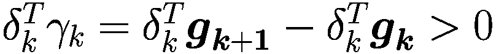
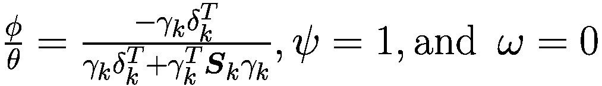
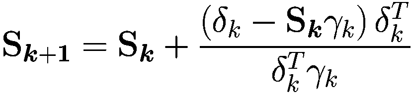
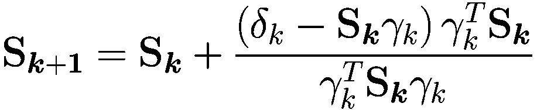

# 9.6 拟牛顿法

拟牛顿法是另一类无需显式计算海森矩阵的算法框架。它建立在 9.4.1 节的牛顿法基础之上，区别在于搜索方向基于一个 *n* ∗ *n* 矩阵 `S`，该矩阵起到与牛顿法中逆海森矩阵相同的作用。即：

```
x_{k+1} = x_k - α_k * S_k * g_k
```

当 `S[k] = I` 时，该算法即为最速下降法。当 `S[k] = H^(-1)` 时，则为牛顿法。当海森矩阵不可用时，`S` 基于现有数据推导得出，旨在作为 `H^(-1)` 的近似。事实上，可以证明，当 `S[k] = H^(-1)` 时，上述更新 `x[k+1]` 的算法收敛速度最快。拟牛顿法结合了最速下降法和共轭方向法的优点，并采用了有效的方向更新规则。它是本章讨论的所有方法中效率最高的，并被广泛应用于众多实际问题中。

假设连续两次 `x[k]` 的差值为：

```
δ_k = x_{k+1} - x_k
```

连续两次梯度 `g[k]` 的差值为：

```
γ_k = g_{k+1} - g_k
```

则可得到：

```
γ_k = H * δ_k
```

牛顿法按如下方式确定方向向量：

```
d_k = - S_k * g_k
```

步长 `α[k]` 可以通过一维搜索最小化以下函数来确定：

```
f(x_k + α * d_k)
```

我们希望避免在每次迭代中计算 `S[k] = H^(-1)` 这种矩阵求逆操作，并确保 `S[k]` 是正定的。我们希望得到一个简单的 `S[k+1]` 更新规则：

```
S_{k+1} = S_k + C_k
```

`C[k]` 是一个 *n* ∗ *n* 的修正矩阵，可以从现有数据中计算得出。在任何 `C[k]` 的定义中，`S[k+1]` 必须满足以下三个性质：

- `S[k+1] * γ[k] = δ[k]`。
- 向量组 `{δ[0], δ[1], ..., δ[n-1]}` 必须是共轭方向。
- 正定的 `S[k]` 必须能生成正定的 `S[k+1]`。

第二个性质确保了共轭方向搜索的优良特性同样适用于拟牛顿搜索。第三个性质保证了每次迭代中的方向向量是有效的。定义 `C[k]` 的方法有很多种，它们衍生出拟牛顿法的不同变体。本章将根据计算 `C[k]` 或更新 `S[k]` 的方式，介绍几种变体。

## 9.6.1 秩一方法

秩一方法的特点在于修正矩阵 `C[k]` 的秩为 1。

假设如下：

```
S_{k+1} * γ_k = δ_k
```

令

```
S_{k+1} = S_k + β * ξ_k * ξ_k^T
```

`ξ[k]` 是一个列向量，`β[k]` 是一个常数。修正矩阵 `β * ξ_k * ξ_k^T` 是对称的，且秩为 1。将两个方程结合，可得：

```
δ_k = S_k * γ_k + β * ξ_k * ξ_k^T * γ_k
```

进而得到：

```
γ_k^T * (δ_k - S_k * γ_k) = β_k * γ_k^T * ξ_k * ξ_k^T * γ_k = β_k * (ξ_k^T * γ_k)²
```

```
(δ_k - S_k * γ_k) * (δ_k - S_k * γ_k)^T = β_k * (ξ_k^T * γ_k)² * β_k * ξ_k * ξ_k^T
```

于是得到：

```
β_k * ξ_k * ξ_k^T = ( (δ_k - S_k * γ_k) * (δ_k - S_k * γ_k)^T ) / (γ_k^T * (δ_k - S_k * γ_k))
```

因此，可得：

```
S_{k+1} = S_k + ( (δ_k - S_k * γ_k) * (δ_k - S_k * γ_k)^T ) / (γ_k^T * (δ_k - S_k * γ_k))
```

这种方法存在两个严重问题。第一，正定的 `S[k]` 可能无法生成正定的 `S[k+1]`。如果出现这种情况，下一个方向就不是一个良好的方向。第二，修正公式中的分母可能趋近于零或等于零。如果发生这种情况，该方法会因为 `S[k+1]` 无定义而失效。

## 9.6.2 戴维登-弗莱彻-鲍威尔方法

戴维登-弗莱彻-鲍威尔（DFP）方法与秩一方法类似，但它有一个重要优势：如果初始矩阵 `S[0]` 是正定的，那么后续的矩阵将始终是正定的。与秩一方法不同，它的每一个新方向都是下降方向。

DFP 更新公式如下：

```
S_{k+1} = S_k + (δ_k * δ_k^T) / (δ_k^T * γ_k) - (S_k * γ_k * γ_k^T * S_k) / (γ_k^T * S_k * γ_k)
```

该修正项是一个秩为二的 *n* ∗ *n* 对称矩阵。


### 9.6.3 Broyden-Fletcher-Goldfarb-Shanno 方法

BFGS 更新公式如下：


BFGS 方法具有以下性质：

1. `S[k + 1]` 在 `k = n - 1` 时与 `H^(-1)` 相同。
2. 方向 `{δ[i]}`（其中 `i = 1, 2, …, n - 1`）构成一个共轭集合。
3. 如果 `S[k]` 是正定的，那么 `S[k + 1]` 也是正定的。
4. 

BFGS 求解器是所有求解器中最好的。它是许多 NM 无约束优化应用中的默认选择。

### 9.6.4 黄族方法（秩一法、DFP、BFGS、Pearson、McCormick）

黄更新公式是一个通用公式，包含了秩一法、DFP、BFGS、Pearson 和 McCormick 方法。其形式如下：


`θ`、`ϕ`、`φ` 和 `ω` 是独立参数。

令 `θ = 1`、`ϕ = -1`、`ψ = 1`、`ω = -1`，即可得到秩一法公式。

令 `θ = 1`、`ϕ = 0`、`ψ = 0`、`ω = 1`，即可得到 DFP 公式。

令 ，即可得到 BFGS 公式。

令 `θ = 1`、`ϕ = 0`、`ψ = 1`、`ω = 0`，即可得到 McCormick 公式。



令 `θ = 0`、`ϕ = 1`、`ψ = 0`、`ω = 1`，即可得到 Pearson 公式。



NM Dev 提供了一套拟牛顿方法。以下代码使用不同的拟牛顿方法求解图 9-11 中的 Himmelblau 函数：

```kotlin
/**
* Himmelblau 函数: f(x) = (x1² + x2 - 11)² + (x1 + x2² -
* 7)²
*/
val f = object : RealScalarFunction {
override fun evaluate(x: Vector): Double {
val x1: Double = x.get(1)
val x2: Double = x.get(2)
var result: Double = (x1 * x1 + x2 - 11).pow(2)
result += (x1 + x2 * x2 - 7).pow(2)
return result
}
override fun dimensionOfDomain(): Int {
return 2
}
override fun dimensionOfRange(): Int {
return 1
}
}
val g = object : RealVectorFunction {
override fun evaluate(x: Vector): Vector {
val x1: Double = x.get(1)
val x2: Double = x.get(2)
val w1: Double = x1 * x1 + x2 - 11
val w2: Double = x1 + x2 * x2 - 7
var result = ArrayList(2)
result.add(0, 4 * w1 * x1 + 2 * w2)
result.add(1, 2 * w1 + 4 * w2 * x2)
return DenseVector(result)
}
override fun dimensionOfDomain(): Int {
return 2
}
override fun dimensionOfRange(): Int {
return 2
}
}
val problem = C2OptimProblemImpl(f, g)
// 使用秩一法
val rankOneMinimizer: QuasiNewtonMinimizer = RankOneMinimizer(1e-16, 15)
val soln1: IterativeSolution = rankOneMinimizer.solve(problem)
var xmin: Vector = soln1.search(DenseVector(6.0, 6.0))
var f_xmin: Double = f.evaluate(xmin)
println(String.format("f(%s) = %.16f", xmin.toString(), f_xmin))
```

输出结果如下：

```
f([3.000000, 2.000000] ) = 0.0000000000000000
// 使用 DFP 方法
val dfpMinimizer: QuasiNewtonMinimizer = DFPMinimizer(1e-16, 15)
val soln2: IterativeSolution = dfpMinimizer.solve(problem)
xmin = soln2.search(DenseVector(6.0, 6.0))
f_xmin = f.evaluate(xmin)
println(String.format("f(%s) = %.16f", xmin.toString(), f_xmin))
```


```text
`f([3.000000, 2.000000] ) = 0.0000000000000000`
// 使用 BFGS 方法
val bfgsMinimizer: QuasiNewtonMinimizer = BFGSMinimizer(false, 1e-16, 15)
val soln3: IterativeSolution = bfgsMinimizer.solve(problem)
xmin = soln3.search(DenseVector(6.0, 6.0))
f_xmin = f.evaluate(xmin)
println(String.format("f(%s) = %.16f", xmin.toString(), f_xmin))
```

输出结果如下：

```text
f([3.000000, 2.000000] ) = 0.0000000000000000
// 使用 Huang 方法
val huangMinimizer: QuasiNewtonMinimizer = HuangMinimizer(0.0, 1.0, 0.0, 1.0, 1e-16, 15)
val soln4: IterativeSolution = huangMinimizer.solve(problem)
xmin = soln4.search(DenseVector(6.0, 6.0))
f_xmin = f.evaluate(xmin)
println(String.format("f(%s) = %.16f", xmin.toString(), f_xmin))
```

输出结果如下：

```text
f([3.000000, 2.000000] ) = 0.0000000000000000
// 使用 Pearson 方法
val pearsonMinimizer: QuasiNewtonMinimizer = PearsonMinimizer(1e-16, 15)
val soln5: IterativeSolution = pearsonMinimizer.solve(problem)
xmin = soln5.search(DenseVector(6.0, 6.0))
f_xmin = f.evaluate(xmin)
println(String.format("f(%s) = %.16f", xmin.toString(), f_xmin))
```

输出结果如下：

```text
f([3.000000, 2.000000] ) = 0.0000000000000000
```

拟牛顿方法似乎比任何共轭方向方法都高效得多。它们所需的迭代次数更少（15 次对比 20 次），并且精度更高。

这些求解器的签名如下：

```java
/**
* 使用秩一方法构建一个多元最小化器。
*
* @param epsilon       精度参数：当某个数 |x| ≤ ε 时，视为 0
* @param maxIterations 最大迭代次数
*/
public RankOneMinimizer(double epsilon, int maxIterations)
/**
* 使用 DFP 方法构建一个多元最小化器。
*
* @param epsilon       精度参数：当某个数 |x| ≤ ε 时，视为 0
* @param maxIterations 最大迭代次数
*/
public DFPMinimizer(double epsilon, int maxIterations)
/**
* 使用 BFGS 方法构建一个多元最小化器。
*
* @param epsilon          精度参数：当某个数 |x| ≤ ε 时，视为 0
* @param maxIterations    最大迭代次数
* @param isFletcherSwitch 指示是否使用 Fletcher 开关
*/
public BFGSMinimizer(boolean isFletcherSwitch, double epsilon, int maxIterations)
/**
* 使用 Huang 方法构建一个多元最小化器。
*
* @param theta         Huang 公式中的 θ
* @param phi           Huang 公式中的 φ
* @param psi           Huang 公式中的 ψ
* @param omega         Huang 公式中的 ω
* @param epsilon       精度参数：当某个数 |x| ≤ ε 时，视为 0
* @param maxIterations 最大迭代次数
*/
public HuangMinimizer(
double theta,
double phi,
double psi,
double omega,
double epsilon,
int maxIterations
)
/**
* 使用 Pearson 方法构建一个多元最小化器。
*
* @param epsilon       精度参数：当某个数 |x| ≤ ε 时，视为 0
* @param maxIterations 最大迭代次数
*/
public PearsonMinimizer(double epsilon, int maxIterations)
```

