# 10. 约束优化

优化在数学和工业应用的许多分支中无处不在。例如，回归和最大似然估计等许多统计理论都归结为优化问题。量化金融通过最大化投资组合的收益风险比来进行资产配置。在我们公司 NM Limited，我们构建数据驱动的决策系统，以协助管理层做出科学而非临时的业务决策。例如，为钢铁制造厂构建资源分配系统以优化原材料、机器和人力；路径规划器以寻找取送邮件的最佳路线；以及安排车辆及其班次的调度系统。

本章的源代码可以在 S2 平台上运行：

[`https://s21.nm.dev/hub/user-redirect/lab/tree/s2-public/Numerical%20Methods%20Using%20Kotlin/chapter10.ipynb`](https://s21.nm.dev/hub/user-redirect/lab/tree/s2-public/Numerical%20Methods%20Using%20Kotlin/chapter10.ipynb)

源代码可以在 GitHub 上找到：

[`https://github.com/apress/numerical-methods-kotlin`](https://github.com/apress/numerical-methods-kotlin)

## 10.1 优化问题

通常，约束优化问题是要找到一个满足以下条件的向量 **x** ^∗ ：

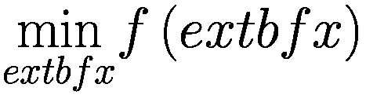

受限于以下条件：

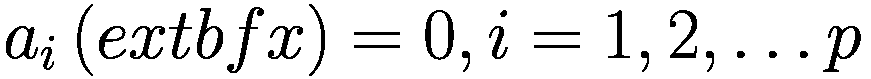

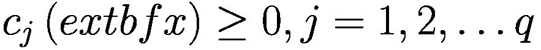

假设 `ai` 和 `cj` 是二次可微的连续函数。这些约束共同定义了优化问题的可行域 `R`。也就是说，**x** ^∗ ∈ `R`。该可行域被假定为凸集。

凸集是一种集合，对于集合中的任意两点 **x** 和 **y**，连接这两点的任意线段 (1 − `t`)**x +** `t` **y** 都在该集合中。图 10-1 展示了一个凸集的例子。

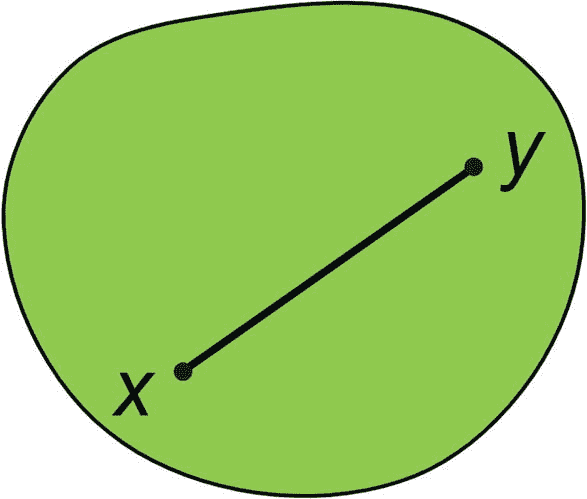

*一个凸集的示意图。圆形中连接两点 x 和 y 的线段。*

**图 10-1** - 一个凸集

图 10-2 展示了一个非凸集的例子。

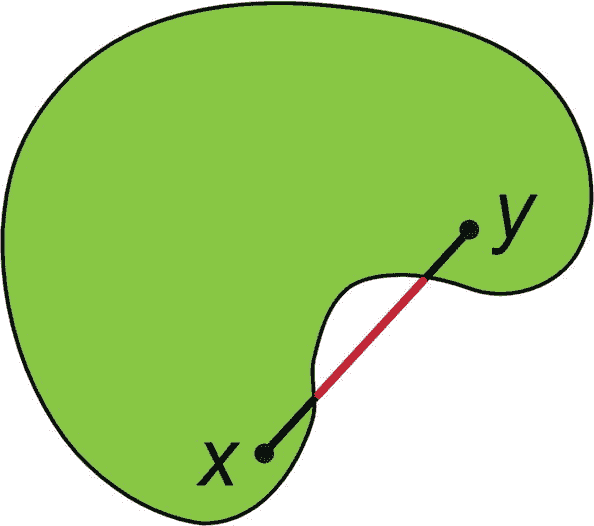

*一个非凸集的示意图。图中展示了连接两点 x 和 y 的一条线段。*

**图 10-2** - 一个非凸集

以下是一个约束优化问题的示例：

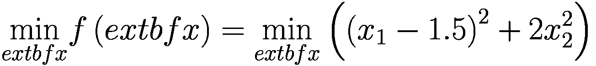

受限于以下条件：

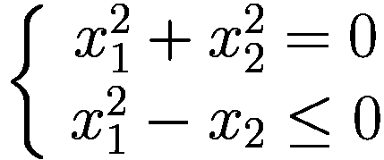

图 10-3 展示了由约束条件中两条曲线相交所定义的可行域。

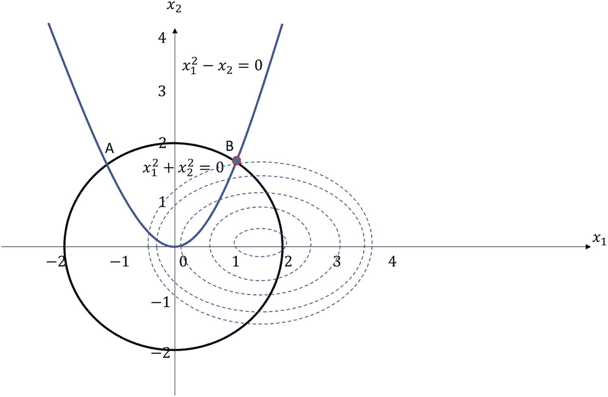

*由约束条件定义的可行域图。*

**图 10-3** - 由约束条件定义的可行域

等高线图（虚线）是目标函数可能取到的（相同）值。不等式（小于等于）约束将解限制在抛物线曲线上方。等式约束则要求解位于圆周上。因此，可行域仅为抛物线曲线内的圆弧 AB。点 B 处的圆点表示目标函数在该弧线上取得最小值的解。


### 10.1.1 通用优化算法

通常，寻找优化问题解的过程是一个迭代过程（除非你拥有解析表达式，但通常你并没有）。因此，你从一个初始点或初始猜测开始尝试。如果不行，就再试另一个。在任何数值优化算法中，核心部分都是如何选择下一个要尝试的点。决定第 *k* 次迭代搜索点的因素有两个。它们是方向 ***d*** [***k***] 以及在该方向上变化的幅度 *α* [*k*]。因此，下一个搜索点如下所示：

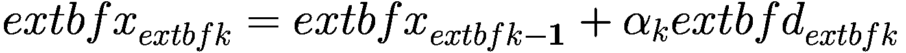

重复此过程，直到满足收敛准则。该准则可以是目标函数值的变化量过小。

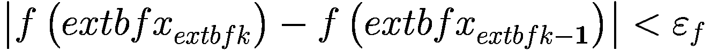

或者，也可以是 ***x*** [***k***] 的变化量过小。

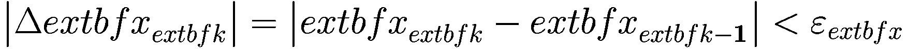

### 10.1.2 约束条件

在 NM Dev 中，一组等式约束或不等式约束由一个实值多元函数列表表示。该接口称为 `Constraints`。其类签名如下：

```
public interface Constraints {
/**
* 获取约束函数列表。
*
* @return 约束函数列表
*/
public List getConstraints();
/**
* 获取变量数量。
*
* @return 变量数量
*/
public int dimension();
/**
* 获取约束数量。
*
* @return 约束数量
*/
public int size();
}
```

#### 等式约束

等式约束的集合如下所示：


或者以向量形式表示如下：

![ $$ a\left( extbf{x}\right)={\left[{a}_1\left( extbf{x}\right),{a}_2\left( extbf{x}\right),\dots, {a}_p\left( extbf{x}\right)\right]}^T=0 $$ ](images/528380_1_En_10_Chapter/528380_1_En_10_Chapter_TeX_Equj.png)

这在 *R* ^(*n*) 空间中定义了一个超曲面。

如果点 ***x*** 满足约束条件，且列向量 ∇*a* 1、∇*a* 2、...、∇*a* *p* 线性无关，则称点 ***x*** 为等式约束的正则点。也就是说，***x*** 是一个解：

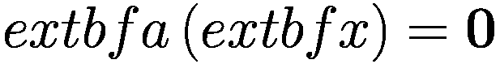

并且雅可比矩阵如下所示：

![ $$ {\textbf{J}}_{\textbf{e}}\left( extbf{x}\right)=\left[\nabla {a}_1\left( extbf{x}\right),\nabla {a}_2\left( extbf{x}\right),\dots, \nabla {a}_p\left( extbf{x}\right)\right] $$ ](images/528380_1_En_10_Chapter/528380_1_En_10_Chapter_TeX_Equl.png)

![ $$ =\left[\begin{array}{ccc}\frac{da_1}{dx_1}&amp; \cdots &amp; \frac{da_1}{dx_n}\\ {}&amp; \ddots &amp; \\ {}\frac{da_p}{dx_1}&amp; &amp; \frac{da_p}{dx_n}\end{array}\right] $$ ](images/528380_1_En_10_Chapter/528380_1_En_10_Chapter_TeX_Equm.png)

该矩阵具有满行秩 *p*。

如果 *p* > *n*，那么 **J** [**e**] 不可能是满行秩的，也就不存在正则点。如果 *p* = *n*，则只存在有限个正则点，那么优化问题就变得微不足道了。因此，通常可以假设 *p* < *n*。如果 ***x*** 是一组等式约束的正则点，它便定义了该约束超曲面的一个切平面。

Antoniou & Lu (2007) 给出了以下示例：

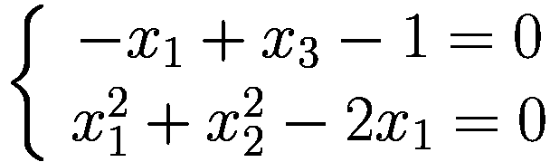

雅可比矩阵如下：

![ $$ {\textbf{J}}_{\textbf{e}}\left( extbf{x}\right)=\left[\begin{array}{ccc}-1&amp; 0&amp; 1\\ {}2{x}_1-2&amp; 2{x}_2&amp; 0\end{array}\right] $$ ](images/528380_1_En_10_Chapter/528380_1_En_10_Chapter_TeX_Equo.png)

除了点 ***x*** = [1 0 *x* [3]]^(*T*)（因为它不满足约束条件）之外，该矩阵的秩均为 2。因此，任何其他点都是正则点。

在 NM Dev 中，`EqualityConstraints` 接口是一个标记，用于表示一组等式约束。其签名如下：

```
public interface EqualityConstraints extends Constraints {
}
```

`GeneralEqualityConstraints` 类实现了一组等式约束。其类签名如下：

```
public class GeneralEqualityConstraints extends GeneralConstraints implements EqualityConstraints {
/**
* 从一个实值函数集合构造一个等式约束实例。
*
* @param constraints 等式约束
*/
public GeneralEqualityConstraints(Collection constraints) {
super(constraints);
}
/**
* 从一个实值函数数组构造一个等式约束实例。
*
* @param constraints 等式约束
*/
public GeneralEqualityConstraints(RealScalarFunction... constraints) {
super(constraints);
}
}
```

以下代码片段表示了前面的示例：

```
// 非线性约束
val a = GeneralEqualityConstraints(
// 第一个等式约束
object : AbstractRealScalarFunction(3) { // 定义域维度
override fun evaluate(x: Vector): Double {
val x1: Double = x.get(1)
val x3: Double = x.get(3)
val a1: Double = -x1 + x3 + 1
return a1
}
},
// 第二个等式约束
object : AbstractRealScalarFunction(3) { // 定义域维度
override fun evaluate(x: Vector): Double {
val x1: Double = x.get(1)
val x2: Double = x.get(2)
val a2: Double = x1 * x1 + x2 * x2 - 2.0 * x1
return a2
}
}
)
```

如果所有等式约束都是线性的，则可以写成如下形式：


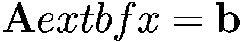

`**A**` 是一个 *p* × *n* 的矩阵。`***b***` 是一个 *p* × 1 的向量。雅可比矩阵 `**J** [**e**]` 与常数矩阵 `**A**` 相同。因此，如果 rank(`**A**`) = *p*，那么线性系统 `**A** ***x*** = ***b***` 的任意解都是正则点。否则，对于 rank(`**A**`) = *p*′ < *p* 的情况，存在两种可能性。

如果 *rank*(`[**A b**]`) > *p*，则线性系统无解。需要仔细检查以消除矛盾。如果 *rank*(`[**A b**]`) =  *rank* (`**A**`) = *p* ^′ < *p*，那么你可以将约束条件简化为一组更小但等价的等式约束。

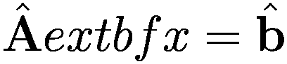

其中 `**Â**` 是一个 *p*′ × *n* 矩阵，`**b̂**` 是一个 *p*′ × 1 向量。

一种方法是对方阵 `**A**` 应用奇异值分解（SVD）。更详细的信息请参见第 2 章。你可以将 `**A**` 分解如下：

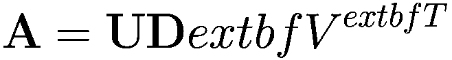

其中 `**U**` 是一个 *p* × *p* 的正交矩阵，`**V**` 是一个 *n* × *n* 的正交矩阵。

![**D** = [[**D̂**, 0], [0, 0]]](images/528380_1_En_10_Chapter/528380_1_En_10_Chapter_TeX_Equs.png)

其中 `**D̂**` 包含所有正的奇异值。

![**A** = **UDV**^T = **U** [[**Â**], [0]]](images/528380_1_En_10_Chapter/528380_1_En_10_Chapter_TeX_Equt.png)

![**Â** = **D̂**[**v₁**, …, **v_p′**]^T](images/528380_1_En_10_Chapter/528380_1_En_10_Chapter_TeX_Equu.png)

`***v*** [***i***]` 是 `***V*** ^(***T***)` 中的列。`**Â**` 是一个 *p* ^′ × *n* 的矩阵。

![[[**Â**], [0]] x = [[**b̂**], [0]]](images/528380_1_En_10_Chapter/528380_1_En_10_Chapter_TeX_Equv.png)

`**b̂**` 是 `**U** ^(***T***) ***b***` 的前 *p* ^′ 项。

以下代码片段复现了 Antoniou & Lu (2007) 中的示例 10.2：

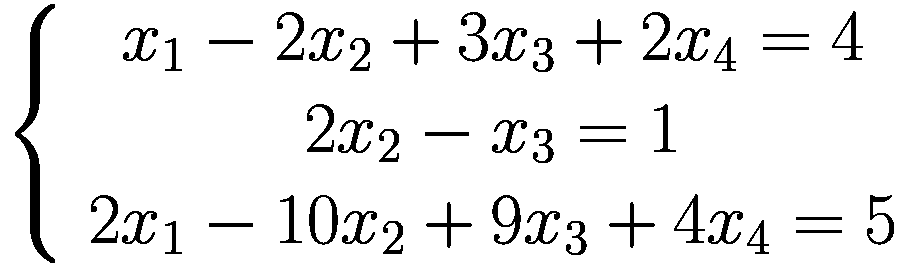

该线性系统的秩为 2，因此是可约的。简化后的等式约束如下：

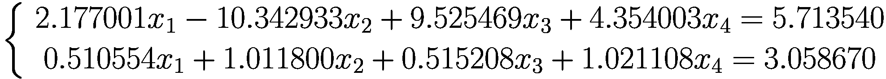

```kotlin
/** 示例 10.2，第 270 页。《实用优化：算法与
* 工程应用》。Andreas Antoniou, Wu-Sheng Lu */
// 线性约束
val A: Matrix = DenseMatrix(
arrayOf(
doubleArrayOf(1.0, -2.0, 3.0, 2.0),
doubleArrayOf(0.0, 2.0, -1.0, 0.0),
doubleArrayOf(2.0, -10.0, 9.0, 4.0)
)
)
val b: Vector = DenseVector(4.0, 1.0, 5.0)
val A_eq = LinearEqualityConstraints(A, b)
println("原始等式约束：")
println(A_eq)
// 进行 SVD 分解以简化等式约束
val svd: SVD = SVD(A, true)
val U: Matrix = svd.U()
println("\nU = ")
println(U)
val D: Matrix = svd.D()
println("\nD = ")
println(D)
val V: Matrix = svd.V()
println("\nV = ")
println(V)
// 检查原始等式约束是否可约
val epsilon: Double = 1e-8 // 精度参数，小于此值视为 0
val isReducible: Boolean = A_eq.isReducible()
println(isReducible)
val r: Int = MatrixMeasure.rank(
A,
epsilon
)
println(String.format("A 的秩 = %d%n", r))
```

输出如下：

```
原始等式约束：
3x4
[,1] [,2] [,3] [,4]
[1,] 1.000000, -2.000000, 3.000000, 2.000000,
[2,] 0.000000, 2.000000, -1.000000, 0.000000,
[3,] 2.000000, -10.000000, 9.000000, 4.000000,  * x =
[4.000000, 1.000000, 5.000000]
U =
3x3
[,1] [,2] [,3]
[1,] 0.271659, 0.800304, -0.534522,
[2,] -0.136451, 0.581828, 0.801784,
[3,] 0.952671, -0.144875, 0.267261,
D =
3x3
[,1] [,2] [,3]
[1,] 14.879768, 0.000000, 0.000000,
[2,] 0.000000, 1.610126, 0.000000,
[3,] 0.000000, 0.000000, 0.000000,
V =
4x3
[,1] [,2] [,3]
[1,] 0.146306, 0.317089, -0.936741,
[2,] -0.695100, 0.628398, 0.112540,
[3,] 0.640162, 0.319980, 0.225081,
[4,] 0.292612, 0.634179, 0.243290,
true
A 的秩 = 2
```


## 不等式约束

不等式约束的数学形式如下：


与等式约束不同，不等式约束的数量 `q` 不必小于 `n`。对于任意可行点 ``，存在两类不等式约束。满足 `cj > 0` 的约束集合被称为非活动约束，如图 10-2 中的 `` 和 ``。由于 `` 位于这些约束的边界上，下一个搜索点不能向违反约束的方向移动。因此，这些活动约束限制了 `` 邻域内的可行区域。另一方面，像 `` 这样的非活动约束距离 `` 很远，因此在 `` 的一个足够小的邻域内，它们对可行区域没有影响。参见图 10-4。

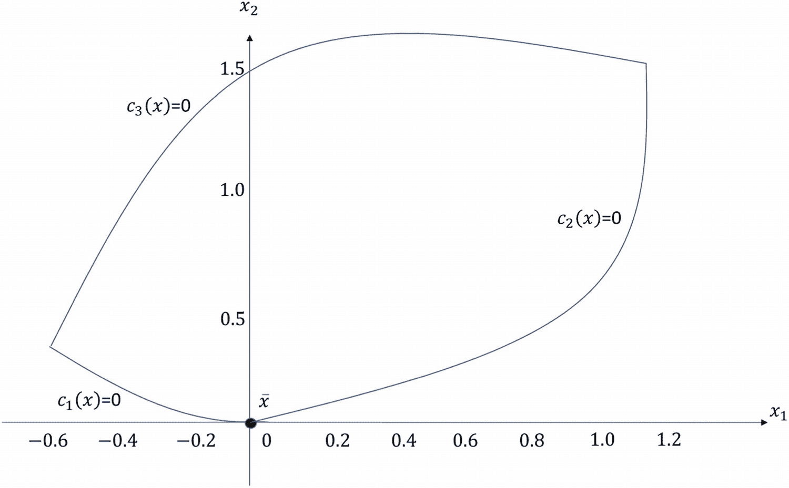

不等式约束示意图。图中针对三个方程绘制了三条直线。

图 10-4

不等式约束

在 NM Dev 中，`GreaterThanConstraints` 接口是一个标记，用于表示一组（大于等于）不等式约束。其签名如下：

```
public interface GreaterThanConstraints extends Constraints {
/**
* 将大于等于约束转换为小于等于约束。
*
* @return 等价的小于等于约束
*/
public LessThanConstraints toLessThanConstraints();
}
```

等价地，你可以通过改变符号，将不等式约束写成小于等于不等式约束的形式：

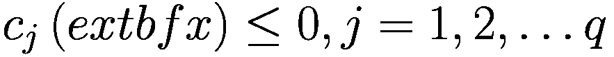

`LessThanConstraints` 接口是一个标记，用于表示一组小于等于不等式约束。其签名如下：

```
public interface LessThanConstraints extends Constraints {
/**
* 将小于等于约束转换为大于等于约束。
*
* @return 等价的大于等于约束
*/
public GreaterThanConstraints toGreaterThanConstraints();
}
```

`GeneralGreaterThanConstraints` 类实现了一组大于等于不等式约束。该类的签名如下：

```
public class GeneralGreaterThanConstraints
extends GeneralConstraints
implements GreaterThanConstraints {
/**
* 从一个实值函数集合构造一个大于等于不等式约束实例。
*
* @param constraints 大于等于不等式约束
*/
public GeneralGreaterThanConstraints(Collection constraints) {
super(constraints);
}
/**
* 从一个实值函数数组构造一个大于等于不等式约束实例。
*
* @param constraints 大于等于不等式约束
*/
public GeneralGreaterThanConstraints(RealScalarFunction... constraints) {
super(constraints);
}
...
}
```

例如，以下代码片段构造了这样的大于等于不等式约束：

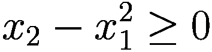

```
val c_gr = GeneralGreaterThanConstraints(
object : AbstractBivariateRealFunction() {
override fun evaluate(x1: Double, x2: Double): Double {
val c: Double = x2 - x1 * x1
return c
}
})
```

或者，你也可以使用 `GeneralLessThanConstraints` 类来构造相同的约束。该类签名如下：

```
public class GeneralLessThanConstraints
extends GeneralConstraints
implements LessThanConstraints {
/**
* 从一个实值函数集合构造一个小于等于不等式约束实例。
*
* @param constraints 小于等于不等式约束
*/
public GeneralLessThanConstraints(Collection constraints) {
super(constraints);
}
/**
* 从一个实值函数数组构造一个小于等于不等式约束实例。
*
* @param constraints 小于等于不等式约束
*/
public GeneralLessThanConstraints(RealScalarFunction... constraints) {
super(constraints);
}
...
}
```

例如，相同的约束可以写成：

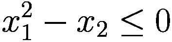

代码如下：

```
val c_less = GeneralLessThanConstraints(
object : AbstractBivariateRealFunction() {
override fun evaluate(x1: Double, x2: Double): Double {
val c: Double = x1 * x1 - x2
return c
}
})
```

如果所有的约束都是线性的，如下所示：

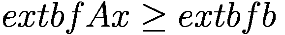

那么你可以使用 `LinearGreaterThanConstraints` 类。该类签名如下：

```
public class LinearGreaterThanConstraints
extends LinearConstraints
implements GreaterThanConstraints {
/**
* 构造一组线性大于等于约束。
*
* @param A 不等式系数矩阵
* @param b 不等式值向量
*/
public LinearGreaterThanConstraints(Matrix A, Vector b);
@Override
public LinearLessThanConstraints toLessThanConstraints();
/**
* 给定一组线性大于等于约束以及一组等式约束，
* 寻找满足约束的可行初始点。
* 该实现求解参考书目中式 (11.25)。
* 结果向量的前 (n-1) 个元素构成一个可行初始点。
* 最后一个元素是单点扰动。
*
* @param equal 一组线性等式约束
* @return 可行初始点及单点扰动（合并在一个向量中）
* @see 
* "Jorge Nocedal, Stephen Wright, p. 473, Numerical Optimization."
* "Andreas Antoniou, Wu-Sheng Lu, Eq 11.25, Quadratic and Convex Programming, Practical Optimization: Algorithms and Engineering Applications."
*/
public Vector getFeasibleInitialPoint(LinearEqualityConstraints equal);
/**
* 给定一组线性大于等于约束，寻找满足约束的可行初始点。
* 该实现求解参考书目中式 (11.25)。
* 结果向量的前 (n-1) 个元素构成一个可行初始点。
* 最后一个元素是单点扰动。
*
* @return 可行初始点及单点扰动（合并在一个向量中）
* @see "Andreas Antoniou, Wu-Sheng Lu, Eq 11.25, Quadratic and Convex Programming, Practical Optimization: Algorithms and Engineering Applications."
*/
public Vector getFeasibleInitialPoint();
}
```

例如，在现代投资组合优化中，你通常会为每只股票设定一个最小权重，比如 0%。这表示不允许卖空。这个不等式约束可以写成：

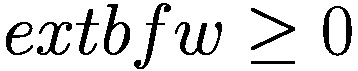

以下代码表示了这一组约束：


`// w_i >= 0 表示不允许卖空`
```
val A: Matrix = DenseMatrix(
arrayOf(
doubleArrayOf(1.0, 0.0, 0.0),
doubleArrayOf(0.0, 1.0, 0.0),
doubleArrayOf(0.0, 0.0, 1.0),
)
)
val b1: Vector = DenseVector(0.0, 0.0, 0.0) // 3 只股票
val no_short_selling1 = LinearGreaterThanConstraints(A, b1)// w >= 0
println(no_short_selling1)
```

输出如下：

```
3x3
[,1] [,2] [,3]
[1,] 1.000000, 0.000000, 0.000000,
[2,] 0.000000, 1.000000, 0.000000,
[3,] 0.000000, 0.000000, 1.000000,  * x >=
[0.000000, 0.000000, 0.000000]
```

或者，你可以使用包装类 `LowerBoundConstraints` 来构造一组下界约束。

```
val no_short_selling2 = LowerBoundConstraints(3, 0.0);
println(no_short_selling2);
```

输出如下：

```
3x3
[,1] [,2] [,3]
[1,] 1.000000, 0.000000, 0.000000,
[2,] 0.000000, 1.000000, 0.000000,
[3,] 0.000000, 0.000000, 1.000000,  * x >=
[0.000000, 0.000000, 0.000000]
```

如果所有变量的下界都为 0，你可以直接使用 `NonNegativityConstraints` 类。例如，以下代码片段构造了完全相同的禁止卖空约束：

```
val no_short_selling3 = NonNegativityConstraints(3);
println(no_short_selling3);
```

输出如下：

```
3x3
[,1] [,2] [,3]
[1,] 1.000000, 0.000000, 0.000000,
[2,] 0.000000, 1.000000, 0.000000,
[3,] 0.000000, 0.000000, 1.000000,  * x >=
[0.000000, 0.000000, 0.000000]
```

类似地，`LinearLessThanConstraints` 类表示线性小于等于约束。

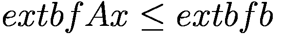

该类的签名如下：

```
public class LinearLessThanConstraints
extends LinearConstraints
implements LessThanConstraints {
/**
* 构造一组线性小于等于约束。
*
* @param A 小于等于不等式约束矩阵
* @param b 小于等于不等式约束值
*/
public LinearLessThanConstraints(Matrix A, Vector b) {
super(A, b);
}
@Override
public LinearGreaterThanConstraints toGreaterThanConstraints() {
return new LinearGreaterThanConstraints(A().scaled(-1), b().scaled(-1));
}
/**
* 给定一组线性小于等于约束以及一组等式约束，
* 找到一个满足约束的可行初始点。
* 该实现求解参考文献中的方程 11.25。
* 前 (n-1) 个条目构成一个可行初始点。
* 最后一个条目是单点扰动值。
*
* @param equal 一组线性等式约束
* @return 可行初始点及单点扰动值（在一个向量中）
* @see "Andreas Antoniou, Wu-Sheng Lu, "Eq 11.25, Quadratic and Convex
* Programming," Practical Optimization: Algorithms and Engineering
* Applications."
*/
public Vector getFeasibleInitialPoint(LinearEqualityConstraints equal) {
return this.toGreaterThanConstraints().getFeasibleInitialPoint(equal);
}
/**
* 给定一组线性小于等于约束，
* 找到一个满足约束的可行初始点。
* 该实现求解参考文献中的方程 11.25。
* 前 (n-1) 个条目构成一个可行初始点。
* 最后一个条目是单点扰动值。
*
* @return 可行初始点及单点扰动值（在一个向量中）
* @see "Andreas Antoniou, Wu-Sheng Lu, "Eq 11.25, Quadratic and Convex
* Programming," Practical Optimization: Algorithms and Engineering
* Applications."
*/
public Vector getFeasibleInitialPoint() {
return getFeasibleInitialPoint(null);
}
}
```

例如，你可能希望对投资组合中每只股票施加最大权重限制，以避免过度集中。以下不等式约束确保没有股票占比超过投资组合的 20%：

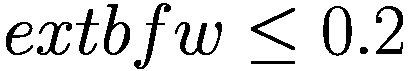

相应的代码片段如下：

```
// w_i <= 0.2
val A: Matrix = DenseMatrix(
arrayOf(
doubleArrayOf(1.0, 0.0, 0.0),
doubleArrayOf(0.0, 1.0, 0.0),
doubleArrayOf(0.0, 0.0, 1.0),
)
)
val b2: Vector = DenseVector(0.2, 0.2, 0.2) // 3 只股票
val maximum_exposure = LinearLessThanConstraints(A, b2)// w <= 0.2
println(maximum_exposure)
```

输出如下：

```
3x3
[,1] [,2] [,3]
[1,] 1.000000, 0.000000, 0.000000,
[2,] 0.000000, 1.000000, 0.000000,
[3,] 0.000000, 0.000000, 1.000000,  * x <=
[0.200000, 0.200000, 0.200000]
```

## 10.2 线性规划

线性规划在数学优化中非常重要。许多针对其他类型优化问题的算法都通过将 LP 问题作为子问题来求解。它广泛应用于商业、经济学和工程学。使用 LP 模型的行业包括交通运输、能源、电信和制造业。在规划、路线设计、调度、分配和设计等各类问题的建模中，LP 已被证明非常有用。例如，管理层利用 LP 在有限资源下实现利润最大化和成本最小化；YouTube 利用 LP 来稳定视频。众所周知，LP 问题的最优解必然是可行域的顶点之一。虽然理论上你可以使用暴力方法逐一检查所有顶点并进行比较，但这并不是一种实用的方法。一些大规模 LP 问题可能涉及多达 1200 万个变量。有许多高效的算法可以求解 LP 问题。在本节中，我们将介绍基本的单纯形法，这是求解 LP 问题的主要方法。


### 10.2.1 线性规划问题

标准形式的线性规划问题表述如下：

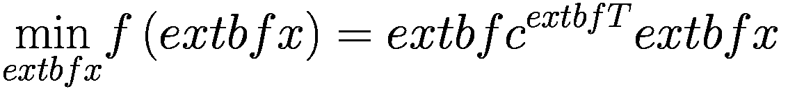

并满足以下约束条件：


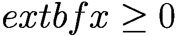

其中，`c ≠ 0` 是一个 `n × 1` 向量，`n` 是变量数量，`A` 是一个 `p × n` 矩阵，`p` 是约束条件数量，`b` 是一个 `p × 1` 向量。假设 `A` 是满秩的，即 `rank(A) = p < n`。目标函数 `f` 和所有约束条件均为线性函数。

对于一个固定的标量 `β`，`c^T x = β` 在 `n` 维欧几里得空间中定义了一个仿射（线性）流形。当 `n = 2` 时，它是一条直线。对于不同的 `β[i]`，`c^T x = β[i]` 代表一族平行线。这些直线的法线是 `c`，因此 `c` 通常被称为目标函数的法向量。

在 NM Dev 中，你可以使用 `LPStandardProblem` 类来构造标准形式的线性规划问题。该类的签名如下：

```
public class LPStandardProblem extends LPProblemImpl1 {
/**
* 构造一个标准形式的线性规划问题。
*
* @param c     目标函数
* @param equal 等式约束
*/
public LPStandardProblem(Vector c, LinearEqualityConstraints equal);
}
```

例如，以下代码片段构造了这样一个线性规划问题：

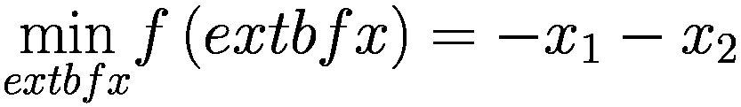

满足以下约束条件：

![ $$ \left[\begin{array}{cccc}7&amp; 1&amp; 1&amp; 0\\ {}-1&amp; 1&amp; 0&amp; 1\end{array}\right]\left[\begin{array}{c}{x}_1\\ {}{x}_2\\ {}{x}_3\\ {}{x}_4\end{array}\right]=\left[\begin{array}{c}15\\ {}1\end{array}\right] $$ ](images/528380_1_En_10_Chapter/528380_1_En_10_Chapter_TeX_Equak.png)


```
// 构造一个标准形式的线性规划问题
val problem1 = LPStandardProblem(
DenseVector(-1.0, -1.0, 0.0, 0.0), // c
LinearEqualityConstraints(
DenseMatrix(
arrayOf(
doubleArrayOf(7.0, 1.0, 1.0, 0.0),
doubleArrayOf(-1.0, 1.0, 0.0, 1.0)
)
),
DenseVector(15.0, 1.0) // b
))
println(problem1)
```

输出结果如下：

```
min. objective:
[-1.000000, -1.000000, 0.000000, 0.000000]
less-than-or-equal-to inequalities:
4x4
[,1] [,2] [,3] [,4]
[1,] -7.000000, -1.000000, -1.000000, -0.000000,
[2,] 1.000000, -1.000000, -0.000000, -1.000000,
[3,] 7.000000, 1.000000, 1.000000, 0.000000,
[4,] -1.000000, 1.000000, 0.000000, 1.000000,  * x <=
[-15.000000, -1.000000, 15.000000, 1.000000]
equalities:
free variables:
```

注意，输出结果实际上是线性规划问题的**标准型**。标准型表述如下：


它满足不等式约束：


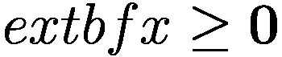

一个具有等式约束的标准形式，可以通过将等式约束转化为不等式约束，转换为标准型。


上述等式等价于：

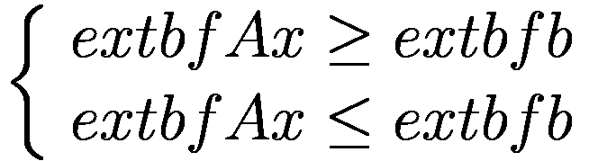

因此，标准型中的不等式约束如下：

![ $$ \left[\begin{array}{c} extbf{A}\\ {}- extbf{A}\end{array}\right] extbf{x}\ge \left[\begin{array}{c} extbf{b}\\ {}- extbf{b}\end{array}\right] $$ ](images/528380_1_En_10_Chapter/528380_1_En_10_Chapter_TeX_Equar.png)

类似地，通过引入一个 `p` 维的松弛向量变量 `y`，可以将标准型转换为标准形式，其中：

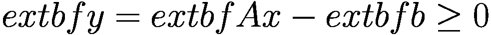

原始向量变量 `x` 可以分解为正部分 `x^+ ≥ 0` 和负部分 `x^− ≥ 0`。

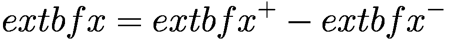

令：

![ $$ \hat{ extbf{x}}=\left[\begin{array}{c}{ extbf{x}}^{+}\\ {}{ extbf{x}}^{-}\\ {} extbf{y}\end{array}\right],\kern0.5em \hat{ extbf{c}}=\left[\begin{array}{c} extbf{c}\\ {}- extbf{c}\\ {}\textbf{0}\end{array}\right],\kern0.5em \hat{ extbf{A}}=\left[ extbf{A} - extbf{A} -{ extbf{I}}_{ extbf{p}}\right] $$ ](images/528380_1_En_10_Chapter/528380_1_En_10_Chapter_TeX_Equau.png)

那么等价的线性规划问题标准形式如下：

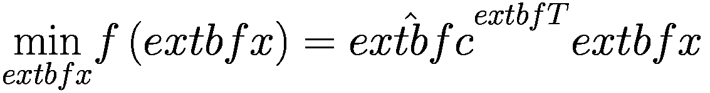

满足以下约束条件：

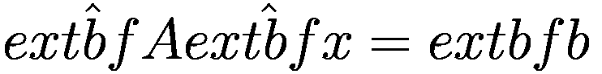

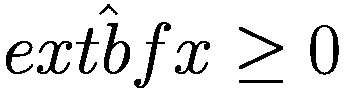

NM Dev 类 `LPCanonicalProblem1` 用于构造标准型线性规划问题。该类的签名如下：

```
public class LPCanonicalProblem1 extends LPProblemImpl1 {
/**
* 构造一个标准型线性规划问题。
*
* @param c 目标函数
* @param A 大于等于约束 A * x &ge; b 的系数矩阵 A
* @param b 大于等于约束 A * x &ge; b 的值向量 b
*/
public LPCanonicalProblem1(
Vector c,
Matrix A,
Vector b
);
/**
* 构造一个标准型线性规划问题。
*
* @param cost   目标函数
* @param greater 一组大于等于约束
*/
public LPCanonicalProblem1(
Vector cost,
LinearGreaterThanConstraints greater
);
/**
* 将线性规划问题从第二种标准型转换为第一种标准型。
*
* @param problem 一个第二种标准型的线性规划问题
*/
public LPCanonicalProblem1(LPCanonicalProblem2 problem);
/**
* 获取线性规划问题中的大于等于约束。
*
* @return 大于等于约束
*/
public LinearGreaterThanConstraints getGreaterThanConstraints();
}
```

以下代码片段构造了相同的标准型线性规划问题：

```
// 构造一个第一种标准型的线性规划问题
val problem2 = LPCanonicalProblem1(
DenseVector(-1.0, -1.0, 0.0, 0.0), // c
DenseMatrix(
arrayOf(
doubleArrayOf(7.0, 1.0, 1.0, 0.0),
doubleArrayOf(-1.0, 1.0, 0.0, 1.0),
doubleArrayOf(-7.0, -1.0, -1.0, 0.0),
doubleArrayOf(1.0, -1.0, 0.0, -1.0),
)
),
DenseVector(15.0, 1.0, -15.0, -1.0) // b
)
println(problem2)
```

输出结果如下：

```
min. objective:
[-1.000000, -1.000000, 0.000000, 0.000000]
less-than-or-equal-to inequalities:
4x4
[,1] [,2] [,3] [,4]
[1,] -7.000000, -1.000000, -1.000000, -0.000000,
[2,] 1.000000, -1.000000, -0.000000, -1.000000,
[3,] 7.000000, 1.000000, 1.000000, -0.000000,
[4,] -1.000000, 1.000000, -0.000000, 1.000000,  * x <=
[-15.000000, -1.000000, 15.000000, 1.000000]
equalities:
free variables:
```

该输出与之前用标准形式构造的输出结果相同。

NM Dev 提供了另一个名为 `LPCanonicalProblem2` 的类，用于使用小于等于不等式约束构造标准型线性规划问题。


这受限于以下条件：


以下代码片段构建了与前文相同的线性规划问题：

```
// construct an LP problem in canonical form 2
// construct an LP problem in canonical form 2
val problem3 = LPCanonicalProblem2(
DenseVector(-1.0, -1.0, 0.0, 0.0), // c
DenseMatrix(
arrayOf(
doubleArrayOf(-7.0, -1.0, -1.0, 0.0),
doubleArrayOf(1.0, -1.0, 0.0, -1.0),
doubleArrayOf(7.0, 1.0, 1.0, 0.0),
doubleArrayOf(-1.0, 1.0, 0.0, 1.0),
)
),
DenseVector(-15.0, -1.0, 15.0, 1.0) // b
)
println(problem3)
```

输出结果如下：

```
min. objective:
[-1.000000, -1.000000, 0.000000, 0.000000]
less-than-or-equal-to inequalities:
4x4
[,1] [,2] [,3] [,4]
[1,] -7.000000, -1.000000, -1.000000, 0.000000,
[2,] 1.000000, -1.000000, 0.000000, -1.000000,
[3,] 7.000000, 1.000000, 1.000000, 0.000000,
[4,] -1.000000, 1.000000, 0.000000, 1.000000,  * x <=
[-15.000000, -1.000000, 15.000000, 1.000000]
equalities:
free variables:
```

另一个示例，以下代码片段构建了这个线性规划问题：

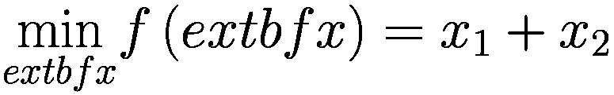

受限于以下条件：

![$$ \left[\begin{array}{cc}1&amp; 1\\ {}1&amp; 2\\ {}0&amp; 3\end{array}\right]\left[\begin{array}{c}{x}_1\\ {}{x}_2\end{array}\right]\le \left[\begin{array}{c}150\\ {}170\\ {}180\end{array}\right] $$](images/528380_1_En_10_Chapter/528380_1_En_10_Chapter_TeX_Equbc.png)


```
// construct an LP problem in canonical form 2
val problem4 = LPCanonicalProblem2(
DenseVector(1.0, 1.0), // c
DenseMatrix(
arrayOf(
doubleArrayOf(1.0, 1.0),
doubleArrayOf(1.0, 2.0),
doubleArrayOf(0.0, 3.0)
)
),
DenseVector(150.0, 170.0, 180.0) // b
)
println(problem4)
```

输出结果如下：

```
min. objective:
[1.000000, 1.000000]
less-than-or-equal-to inequalities:
3x2
[,1] [,2]
[1,] 1.000000, 1.000000,
[2,] 1.000000, 2.000000,
[3,] 0.000000, 3.000000,  * x <=
[150.000000, 170.000000, 180.000000]
equalities:
free variables:
```

图 10-5 绘制了这些约束条件。可行域以阴影标出。

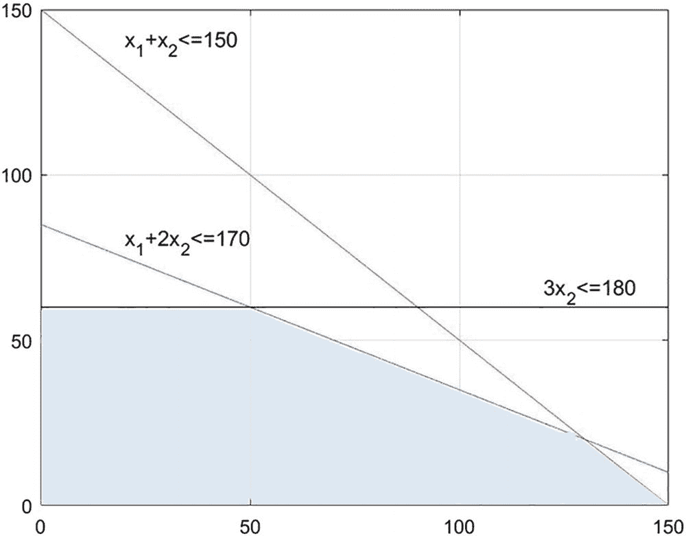

一个由三个方程组成的图形，绘制了三条线性直线，可行区域以阴影标出。

**图 10-5** 一个标准形式的线性规划问题

## 10.2.2 一阶必要条件

在数学优化中，拉格朗日乘子法是一种寻找函数在等式约束下的局部最大值和最小值的策略。它是一种用于极值点的一阶导数检验方法。它将目标函数的梯度与等式约束的梯度联系起来。

假设你要解决这个问题：


受限于以下条件：

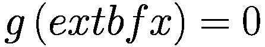

你构造拉格朗日函数，该函数是 `x` 和 `λ` 的函数：

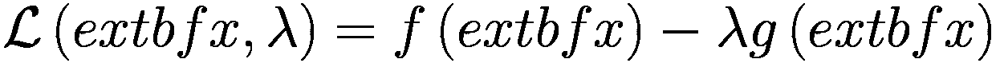

对应于原始约束优化问题的解 `x*` 始终是拉格朗日函数的一个鞍点⁸。因此，你得到：

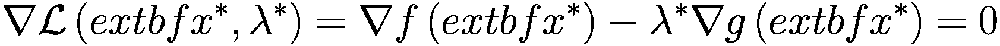

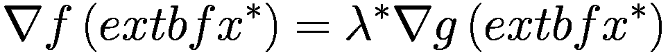

例如，假设你要解决这个问题：

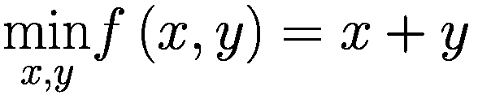

受限于以下条件：

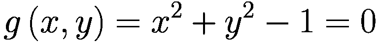

可行集是单位圆，`f` 的等高线是对角线（斜率为 −1）。图 10-6 以图形方式展示了最小值出现在 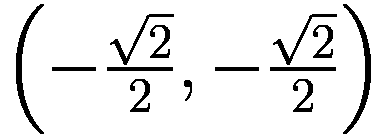。

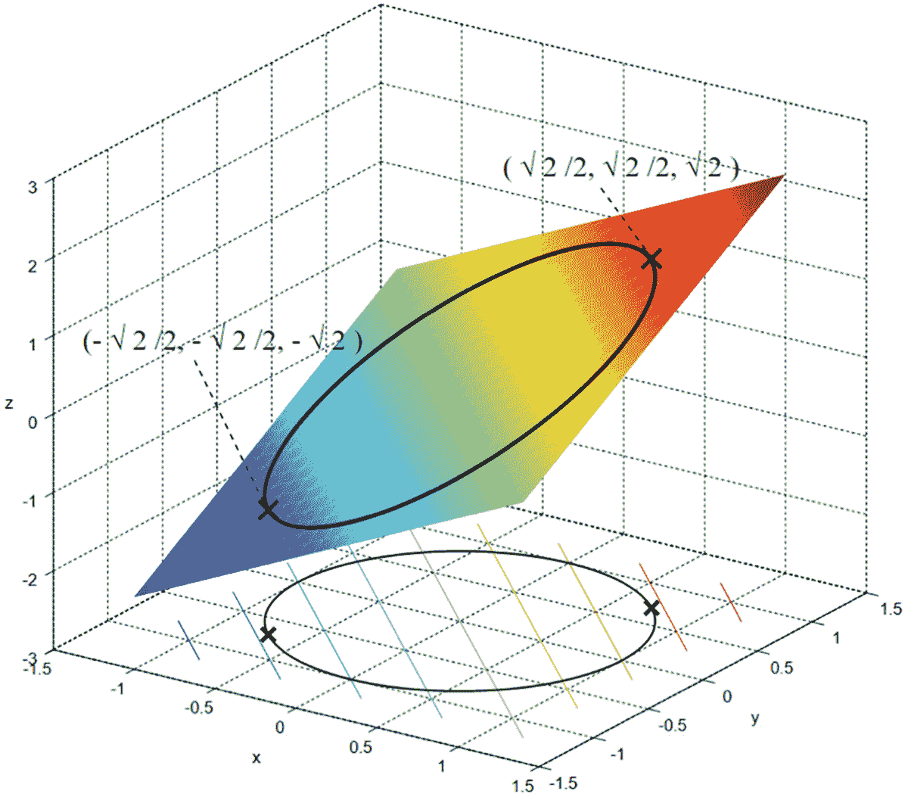

一个三维图形。两个图形的正负值在图形的两个括号中显示。

**图 10-6** 一个带有等式约束的最小化问题

应用拉格朗日乘子法，你得到：

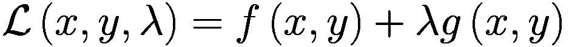

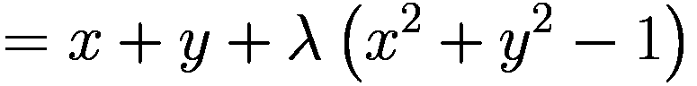

梯度如下：

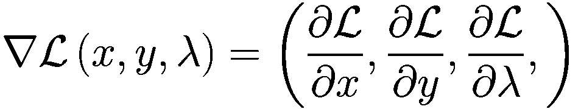

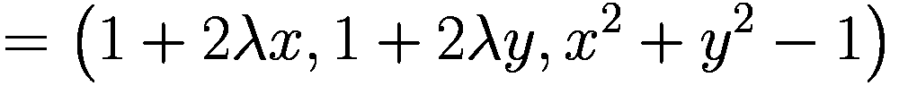

求解 `∇ℒ(x, y, λ) = 0` 得到：


或等价地：


因此， 是最小值。


Karush-Kuhn-Tucker (KKT) 条件将拉格朗日乘数法进行了推广，使其也能处理不等式约束。与拉格朗日方法类似，有约束的最小化（最大化）问题被重写为一个拉格朗日函数，其最优点是一个鞍点，即在选择变量的定义域内是全局最小值（最大值），在乘数的定义域内是全局最大值（最小值）。KKT 条件指出，如果 `x*` 是以下问题的局部极小值点：

```
min_x f(x)
```

满足以下约束：

```
a_i(x) = 0, i = 1, 2, ..., p
c_j(x) >= 0, j = 1, 2, ..., q
```

那么存在拉格朗日乘数 `λ*` 和 `μ*`，使得以下拉格朗日函数：

```
L(x, λ, μ) = f(x) - λ a(x) - μ c(x)
```

在 `x*` 处有一个鞍点。也就是说：

```
∇L(x*, λ*, μ*) = ∇f(x*) - λ* ∇a(x*) - μ* ∇c(x*) = 0
```

或者：

```
∇f(x*) = λ* ∇a(x*) + μ* ∇c(x*)
```

此外：

```
λ* a(x*) = 0
μ* c(x*) = 0
```

并且：

```
μ_j* >= 0, j = 1, 2, ..., q
```

因此，对于非活跃约束 `c_j(x*) > 0`，`μ_j*` 必须为 0。

例如，为简单起见，假设优化问题没有等式约束，只有一个不等式约束。如果极小值点 `x*` 位于由 `c_1` 定义的可行域 `R` 内部，那么 `c_1` 就是一个非活跃约束。此时 `μ_1* = 0`。否则，如果极小值点位于 `c_1` 的边界上，即 `c_1(x*) = 0`，那么 `μ_1* > 0`。`∇f(x*) = μ_1* ∇c_1(x*)`。`f` 和 `c` 的梯度必须指向 `R` 内部的同一方向，如图 10-7 所示。


**图 10-7**：`x*` 是不等式约束边界上的极小值点。

### 10.2.3 单纯形法

当你将 KKT 条件应用于标准形式的线性规划问题时，形式如下：

```
min_x f(x) = c^T x
```

满足以下约束：

```
Ax = b
x >= 0
```

你会得到：

```
c = A^T λ* + μ*
```

以及：

```
μ_i* x_i* = 0, 1 <= i <= n
```

一个显而易见的观察结果是，解 `x*` 不可能位于可行域的内部。如果它在内部，那么就没有活跃约束，即 `μ* = 0`。那么你会得到：

```
c = A^T λ*
```

*n* 维向量 `c` 将位于由 `A^T` 的 *p* 列所张成的 *p* 维子空间中。由于 `p < n`，除非解在边界上，否则这种情况极不可能发生。因此，线性规划问题的任何解都极有可能位于可行域的边界上，即由不等式约束所定义的边界上。

此外，如果一个候选解位于可行域的边界上，你可以简单地沿着边界移动来减小目标函数值。换句话说，从一个位于边界上的候选解开始，你可以沿着边界滑下以寻找更小的值，直到到达该边界段的末端，即一个顶点。见图 10-8。


**图 10-8**：线性规划问题的解必然位于一个顶点上。

对于图 10-8 中的例子，假设你从 `v_1` 开始。你可以沿着函数值递减的方向（向左）移动。当到达顶点 `v_2` 时，你切换到另一条边，并继续沿着函数值递减的方向向下滑到 `v_3`，最后到达 `v_4`。`v_4` 是一条边的终点所在的顶点。从这个顶点移动到另一条边不会再降低函数值。事实上，你已经找到了极小值点 `v_4 = (0, 0)`。很容易看出 `x_1 + x_2 = 0 + 0 = 0` 是这个问题的解。

可以证明，对于标准形式的线性问题，如果目标函数在可行域内有最小值，那么它（至少）在其中一个顶点上取得该值。由于顶点数量是有限的，这便将问题简化为有限计算。原则上，你可以检查所有顶点的函数值以找到最小值。见图 10-9。


**图 10-9**：一组线性不等式定义了一个多面体作为可行域。单纯形算法从一个起始顶点开始，沿着多面体的边移动，直到到达最优解所在的顶点。


好的，作为一名高级文档工程师和翻译员，我将严格按照您的注意事项和示例格式，将给定的英文文本翻译成中文。


同样可以证明，如果一个顶点不是目标函数的最小值点，那么存在一条包含该顶点的边，使得目标函数的值沿着该边远离顶点时严格递减。如果该边是有限的，那么该边连接到另一个顶点，在该顶点处目标函数的值更小；否则，目标函数在该边上无下界，且该线性问题无解。单纯形法正是应用了这一洞见，沿着多面体（由约束条件定义的可行域）的边进行移动，逐步到达目标函数值越来越小的顶点。这个过程一直持续，直到达到最小值或遇到一条无界边（从而断定问题无解）。该算法一定会终止，因为多面体的顶点数量是有限的。此外，由于你总是在同一方向（目标函数的方向）上在顶点之间跳跃，因此希望所经过的顶点数量是少的。

对于一个规范形式的 LP 问题，如下所示：


满足以下约束：


可以通过引入松弛变量 `x[B]` 将其转换为标准形式，如下所示：


（这里我们将原始变量 `x` 记为 `x[N]`。）

标准形式的等价 LP 问题如下：


满足以下约束：


这里，`N = {1, 2, ..., n}` 是原始变量的索引集合，`B = {n + 1, ..., n + m}` 是松弛变量的索引集合。

我们将使用以下表格来表示标准 LP 问题：


解读此表格的方式是：最左侧的列包含因变量（或基本变量），最顶行的变量是自变量（或非基本变量）。示例如下：


紧凑形式下的表格如下：


Ferris、Mangasarian 和 Wright (2007) 提供了以下示例：


满足以下约束：


约束条件的松弛变量如下：


名为 `SimplexTable` 的 NM Dev 类用于为 LP 问题构建单纯形表。示例如下：

```kotlin
// 构建一个 LP 问题
val problem = LPCanonicalProblem1(
    DenseVector(3.0, -6.0), // c
    DenseMatrix(
        arrayOf(
            doubleArrayOf(1.0, 2.0),
            doubleArrayOf(2.0, 1.0),
            doubleArrayOf(1.0, -1.0),
            doubleArrayOf(1.0, -4.0),
            doubleArrayOf(-4.0, 1.0)
        )
    ),
    DenseVector(-1.0, 0.0, -1.0, -13.0, -23.0) // b
)
var tableau = SimplexTable(problem)
println(tableau)
```

输出如下：

| `x,1` | `x,2` | `B_2147483647` |
| --- | --- | --- |
| `x_slack,1` | `1.000000` | `2.000000` | `1.000000` |
| `x_slack,2` | `2.000000` | `1.000000` | `-0.000000` |
| `x_slack,3` | `1.000000` | `-1.000000` | `1.000000` |
| `x_slack,4` | `1.000000` | `-4.000000` | `13.000000` |
| `x_slack,5` | `-4.000000` | `1.000000` | `23.000000` |
| `COST_2147483647` | `3.000000` | `-6.000000` | `0.000000` |

在这个初始表格中，`x,1` 是 `x[1]`，`x,2` 是 `x[2]`。五个 `x_slack` 变量是五个不等式约束对应的松弛变量。参见图 10-10。


约束条件的交集在五个顶点之间形成了一个阴影区域。顶点 3 和顶点 4 之间的线段用 `z = -15` 标出。

图 10-10

这些顶点是约束条件的交点 (Ferris, Mangasarian, & Wright, 2007)

可行域多面体中的每个顶点都是 `n` 个由对应约束条件定义的超平面的交点。图 10-8 展示了这些顶点作为约束条件的交点。可以证明，这等价于将所有 `n` 个非基本变量设置为 0，即 `x[N] = 0`。例如，前面展示的初始表格对应于坐标系原点的顶点，此时所有原始变量均为 0，即 `x = x[N] = 0`。要使这个 `x` 成为可行解（不违反任何约束），`x[B] = -b` 中的松弛变量必须非负。也就是说，`b <= 0`。在这种情况下，目标值为 `f(0) = 0`。

为了考察另一个（相邻的）顶点，你可以将一个非基本变量与一个基本变量进行互换，实质上是将非基本变量的值从 0 增加到某个正值，同时将一个基本变量设置为 0。例如，假设你需要从 `x = (x[1], x[2]) = (0, 0)` 移动到下一个顶点。由于标准 LP 问题中变量的非负约束，你只能增加这些变量的值。例如，你可以尝试增加 `x[1]`。


那么，目标值变为：


增加 `x[1]` 实际上增加了 `f`，这与你期望的正好相反。所以，你可以尝试这样：


对于这个选择，你得到：


选择非基变量或主元列的过程称为 *pricing*（定价）。主元列被称为入基变量，因为它正在“进入”基变量。

为了确定哪个基变量应与入基变量交换，需要分析增加入基变量对每个基变量的影响。对于此示例，得到以下结果：


应尽量使 *λ* 变大，以最大限度地降低目标函数值，但 *λ* 不能过大，否则某些基变量会变为负值，从而违反约束条件。非负约束条件转化为以下形式：


在不违反任何约束条件的前提下，*λ* 能取到的最大非负值是 *λ* = 1。此外，注意到阻塞变量（即当 *λ* 超过其上限 1 时将变为负值的那个变量）是 `x[5]`。因此，应选择 `x[5]` 作为主元行。

选择基变量或主元行的过程称为 *ratio test*（比值测试）。主元行被称为离基变量，因为它正在“离开”基变量，成为非基变量并取值为 0。

在表格中，使用 Jordan 交换来交换 `x[5]`（第 3 行）和 `x[2]`（第 2 列）。对于线性系统，Jordan 交换是一种将独立变量与依赖变量互换的操作。考虑这个简单示例：


要交换 `x` 和 `y` 的角色，写成如下形式：


可以将这个想法推广到多元情况，其中独立变量 ***x*** ∈ ℝ^(*n*)，依赖变量 ***y*** ∈ ℝ^(*m*)。具体来说，假设有以下关系：


等价地，以表格形式，假设有：


交换第 `r` 行 (`y[r]`) 与第 `s` 列 (`x[s]`) 意味着用 `y[r]` 表示 `x[s]`，并保持其他 `x[i]` 不变。这可以通过求解一个关于 `x[s]` 的线性方程组来实现。得到的表格如下：

![ $$ {\displaystyle \begin{array}{ccccccccc}&amp; &amp; {x}_1&amp; \dots &amp; {x}_{s-1}&amp; {y}_r&amp; {x}_{s+1}&amp; \dots &amp; {x}_n\\ {}{y}_1&amp; =&amp; {B}_{11}&amp; \dots &amp; &amp; {B}_{1s}&amp; &amp; \dots &amp; {B}_{1n}\\ {}\vdots &amp; &amp; \vdots &amp; &amp; &amp; \vdots &amp; &amp; &amp; \vdots \\ {}{y}_{r-1}&amp; &amp; &amp; &amp; &amp; &amp; &amp; &amp; \\ {}{x}_s&amp; =&amp; {B}_{r1}&amp; &amp; &amp; {B}_{rs}&amp; &amp; &amp; {B}_{rn}\\ {}{y}_{r+1}&amp; &amp; &amp; &amp; &amp; &amp; &amp; &amp; \\ {}\vdots &amp; &amp; \vdots &amp; &amp; &amp; \vdots &amp; &amp; &amp; \vdots \\ {}{y}_m&amp; =&amp; {B}_{m1}&amp; &amp; &amp; {B}_{ms}&amp; &amp; &amp; {B}_{mn}\end{array}} $$ ](img/528380_1_En_10_Chapter_TeX_Equde.png)

以下代码执行 Jordan 交换，将示例中的第 3 行（`x[5]`）与第 2 列（`x[2]`）进行交换。

```julia
tableau = tableau.swap(3, 2)
println(tableau)
```

输出如下：

|   | `x,1` | `x_slack,3` | `B,2147483647` |
| `x_slack,1` | `3.000000` | `-2.000000` | `3.000000` |
| `x_slack,2` | `3.000000` | `-1.000000` | `1.000000` |
| `x,2` | `1.000000` | `-1.000000` | `1.000000` |
| `x_slack,4` | `-3.000000` | `4.000000` | `9.000000` |
| `x_slack,5` | `-3.000000` | `-1.000000` | `24.000000` |
| `COST,2147483647` | `-3.000000` | `6.000000` | `-6.000000` |

```
6x3
```

目标函数值从 0 下降到了 -6。

通过重复定价和比值测试的过程，测试下一个顶点，直到找到最优解（或证明无解）。请注意，表格的最后一行包含当前非基变量的系数。它表示每单位变量增加时 *f* 的减少量。因此，经验法则是：在定价过程中，选择具有最负系数的列。在此示例中，下一个将是 `x[1]`（系数为 -3）。

以下代码执行第 4 行（`x[6]`）与第 1 列（`x[1]`）的交换。

```julia
tableau = tableau.swap(4, 1)
println(tableau)
```

输出如下：

|   | `x_slack,4` | `x_slack,3` | `B,2147483647` |
| `x_slack,1` | `-1.000000` | `2.000000` | `12.000000` |
| `x_slack,2` | `-1.000000` | `3.000000` | `10.000000` |
| `x,2` | `3.000000` | `0.333333` | `4.000000` |
| `x,1` | `3.000000` | `1.333333` | `3.000000` |
| `x_slack,5` | `1.000000` | `-5.000000` | `15.000000` |
| `COST,2147483647` | `1.000000` | `2.000000` | `-15.000000` |

```
6x3
```

现在，最后一行中的所有系数均为正，可以从表格的最后一列读取 LP 问题的解。


这种单纯形算法能有效求解 LP 问题。它是一种迭代方法，不断更新可行点（可行域中的顶点），直到达到最优解。它通过对约束方程组的线性系统对应的矩阵执行线性变换来找到下一个顶点。因此，它通常包含两个阶段来解决 LP 问题。第一阶段是找到一个满足所有约束条件的可行起始点。即，找到一个最后一列非负的表格。在前面的示例中，如果 LP 问题采用标准形式，则原点（***x*** = **0**）满足所有约束。第二阶段从可行的表格开始，应用一系列线性变换，直到找到最优表格。

为了找到可行的起始点，你将看到如何求解一个相关的 LP 问题，称为 Phase 1 LP 问题。对于这个 Phase 1 问题，应该很容易确定一个初始可行点，并且它的解应该能为原始问题提供一个可行点。具体来说，给定一个标准 LP 问题，如下所示：


满足以下约束：


你可以通过引入一个人工变量 `x[0]` 和松弛变量 `x[n + i]` 来构建**第一阶段**的线性规划问题，如下所示：


满足以下约束条件：


首先，目标函数有下界，因此最小解为 `f = x[0] = 0`。其次，第一阶段线性规划问题存在一个明显的可行点，如下所示：


以及：


于是松弛变量的取值如下：


因此，`x[B] >= 0` 满足所有约束条件。

第三，如果原问题存在一个可行点 `x̅`，那么点 `(x0, x) = (0, x̅)` 对于第一阶段问题也是可行的，因为 `x[B] >= 0`。

第四，如果 `(0, x̅)` 是第一阶段问题的一个解，那么 `x̅` 就是原问题的一个可行点。原因如下：


由此可得：


这满足了原问题中的所有约束条件。

最后，如果 `(x[0], x)` 是第一阶段问题的一个解，且 `x[0] > 0`，那么原问题必然不可行。

你可以使用前面描述的单纯形法来求解第一阶段问题。NM Dev 类 `FerrisMangasarianWrightPhase1` 实现了这一第一阶段过程，通过对相关第一阶段问题的单纯形表进行转轴操作，从不可行的表中找出一个可行表。下面是一个示例：


满足以下约束条件：


```
// 构造一个线性规划问题
problem = LPProblemImpl1(
DenseVector(4.0, 5.0), // c
LinearGreaterThanConstraints(
DenseMatrix(
arrayOf(
doubleArrayOf(1.0, 1.0),
doubleArrayOf(1.0, 2.0),
doubleArrayOf(4.0, 2.0),
doubleArrayOf(-1.0, -1.0),
doubleArrayOf(-1.0, 1.0)
)
),
DenseVector(-1.0, 1.0, 8.0, -3.0, 1.0)), // b
null, // 小于等于约束
null, // 等式约束
null) // 盒子约束
table0 = SimplexTable(problem)
println("原问题的单纯形表:")
println(table0)
val phase1 = FerrisMangasarianWrightPhase1(table0)
val table1 = phase1.process()
println("第一阶段问题的单纯形表:")
println(table1)
println(String.format("最小值 = %f%n", table1.minimum()))
println(String.format("最小化解 = %s%n", table1.minimizer()))
```

输出如下：

|     | `x,1`    | `x,2`    | `B,2147483647` |
|-----|----------|----------|----------------|
| `x_slack,1` | `1.000000` | `1.000000` | `1.000000`       |
| `x_slack,2` | `1.000000` | `2.000000` | `-1.000000`      |
| `x_slack,3` | `4.000000` | `2.000000` | `-8.000000`      |
| `x_slack,4` | `-1.000000` | `-1.000000` | `3.000000`       |
| `x_slack,5` | `-1.000000` | `1.000000` | `-1.000000`      |
|     | `4.000000` | `5.000000` | `0.000000`       |

```
原问题的单纯形表:
6x3
```

|     | `x_slack,3` | `x_slack,5` | `B,2147483647` |
|-----|-------------|-------------|----------------|
| `x_slack,1` | `0.333333`    | `0.333333`    | `4.000000`       |
| `x_slack,2` | `0.500000`    | `1.000000`    | `4.000000`       |
| `x,2`     | `0.166667`    | `0.666667`    | `2.000000`       |
| `x_slack,4` | `-0.333333`   | `-0.333333`   | `0.000000`       |
| `x,1`     | `0.166667`    | `-0.333333`   | `1.000000`       |
| `COST,2147483647` | `1.500000`    | `2.000000`    | `14.000000`      |

```
原问题的单纯形表:
6x3
```

```
最小值 = 14.000000
最小化解 = [1.000000, 2.000000]
```

你已经找到了原问题的一个可行点 `x = (1, 2)`。原问题的最小值为 `f(x) = 14`。

在 NM Dev 中，单纯形求解器实现了 `LPSimplexSolver` 接口。

```
public interface LPSimplexSolver
extends LPSolver {
/**
* 通过单纯形表上的单纯形算法求解线性规划问题
*
* @param table 与线性规划问题对应的初始单纯形表
* @return 线性规划问题的解
* @throws Exception 当发生错误时
*/
public LPSimplexSolution solve(SimplexTable table) throws Exception;
}
```

`LPTwoPhaseSolver` 类实现了本节所述的两阶段算法。它接收 `LPProblem` 形式的线性规划问题，并以 `LPSimplexSolution` 形式输出解。该类签名如下：

```
public class LPTwoPhaseSolver implements LPSimplexSolver {
private class Solution implements LPSimplexSolution {
......
}
private final LPSimplexSolver solver;//一个标准线性规划求解器
/**
* 构造一个用于求解线性规划问题的求解器。
*
* @param solver 一个标准线性规划求解器
*/
public LPTwoPhaseSolver(LPSimplexSolver solver) {
this.solver = solver;
}
/**
* 构造一个用于求解线性规划问题的求解器。
*/
public LPTwoPhaseSolver() {
this(new LPCanonicalSolver());
}
@Override
public LPSimplexSolution solve(SimplexTable table) throws LPInfeasible, Exception {
return new Solution(table);
}
@Override
public LPSimplexSolution solve(LPProblem problem) throws LPInfeasible, Exception {
return solve(new SimplexTable(problem));
}
}
```

延续前面的例子，以下代码使用两阶段算法求解该线性规划问题。


```kotlin
// construct an LP problem
var problem = LPProblemImpl1(
    DenseVector(4.0, 5.0), // c
    LinearGreaterThanConstraints(
        DenseMatrix(
            arrayOf(
                doubleArrayOf(1.0, 1.0),
                doubleArrayOf(1.0, 2.0),
                doubleArrayOf(4.0, 2.0),
                doubleArrayOf(-1.0, -1.0),
                doubleArrayOf(-1.0, 1.0)
            )
        ),
        DenseVector(-1.0, 1.0, 8.0, -3.0, 1.0)), // b
    null, // less-than constraints
    null, // equality constraints
    null) // box constraints
// construct the simplex tableau for the LP problem
var table0 = SimplexTable(problem)
println("simplex tableau for the problem:")
println(table0)
// solve the LP problem using the 2-phase algorithm
val solver = LPTwoPhaseSolver()
val solution = solver.solve(problem).minimizer() as LPBoundedMinimizer
println(String.format("minimum = %f%n", solution.minimum()))
println(String.format("minimizer = %s%n", solution.minimizer()))
```

输出如下：

|   | `x,1` | `x,2` | `B,2147483647` |
| `x_slack,1` | `1.000000` | `1.000000` | `1.000000` |
| `x_slack,2` | `1.000000` | `2.000000` | `-1.000000` |
| `x_slack,3` | `4.000000` | `2.000000` | `-8.000000` |
| `x_slack,4` | `-1.000000` | `-1.000000` | `3.000000` |
| `x_slack,5` | `-1.000000` | `1.000000` | `-1.000000` |
| `COST,2147483647` | `4.000000` | `5.000000` | `0.000000` |

```
simplex tableau for the problem:
6x3
```

```
minimum = 14.000000
minimizer = [1.000000, 2.000000]
```

结果表明 `f(1, 2) = 14` 确实是原问题的最优解。

再举一个例子，以下代码解决了 Chen, Batson, & Dang (2009) 中的这个线性规划问题：


满足以下约束条件：


```kotlin
// construct an LP problem
val problem = LPProblemImpl1(
    DenseVector(-5.0, 2.0), // c
    LinearGreaterThanConstraints(
        DenseMatrix(
            arrayOf(
                doubleArrayOf(1.0, 3.0)
            )
        ),
        DenseVector(9.0)), // b1
    LinearLessThanConstraints(
        DenseMatrix(
            arrayOf(
                doubleArrayOf(-1.0, 2.0),
                doubleArrayOf(3.0, 2.0)
            )
        ),
        DenseVector(5.0, 19.0)), // b2
    null,
    null)
// construct the simplex tableau for the LP problem
val table0 = SimplexTable(problem)
println("simplex tableau for the problem:")
println(table0)
// solve the LP problem using the 2-phase algorithm
val solver = LPTwoPhaseSolver()
val solution: LPMinimizer = solver.solve(problem).minimizer()
println(String.format("minimum = %f%n", solution.minimum()))
println(String.format("minimizer = %s%n", solution.minimizer()))
```

输出如下：

|   | `x,1` | `x,2` | `B,2147483647` |
| `x_slack,1` | `1.000000` | `3.000000` | `-9.000000` |
| `x_slack,2` | `1.000000` | `-2.000000` | `5.000000` |
| `x_slack,3` | `-3.000000` | `-2.000000` | `19.000000` |
| `COST,2147483647` | `-5.000000` | `2.000000` | `0.000000` |

```
simplex tableau for the problem:
4x3
```

```
minimum = -25.571429
minimizer = [5.571429, 1.142857]
```

最优解为 。

再举一个例子，以下代码解决了 Ferris, Mangasarian, & Wright (2007) 中的这个线性规划问题：


满足以下约束条件：


```kotlin
// construct an LP problem
fun problem(): LPProblem {
    // min c'x
    val c: Vector = DenseVector(2.0, -1.0)
    // the constraints
    // Ax >= b
    val greaterThanConstraints = LinearGreaterThanConstraints(
        DenseMatrix(arrayOf(doubleArrayOf(1.0, 0.0))), // A
        DenseVector(-6.0)) // b
    val lessThanConstraints: LinearLessThanConstraints? = null // no less than constraints
    // Ax = b
    val equalityConstraints = LinearEqualityConstraints(
        DenseMatrix(arrayOf(doubleArrayOf(-1.0, 0.0))), // A
        DenseVector(-4.0)) // b
    // the whole plane
    val boxConstraints = BoxConstraints(
        2,
        BoxConstraints.Bound(2, Double.NEGATIVE_INFINITY, Double.POSITIVE_INFINITY)
    )
    // construct an LP problem with constraints
    val problem: LPProblem = LPProblemImpl1(
        c,
        greaterThanConstraints,
        lessThanConstraints,
        equalityConstraints,
        boxConstraints
    ) // x2 is free
    return problem
}
// construct the simplex tableau for the LP problem
val table0 = SimplexTable(problem())
println("simplex tableau for the problem:")
println(table0)
// solve the LP problem using the 2-phase algorithm
val solver = LPTwoPhaseSolver()
val solution: LPMinimizer = solver.solve(problem()).minimizer()
println(String.format("minimum = %f%n", solution.minimum()))
println(String.format("minimizer = %s%n", solution.minimizer()))
```

输出如下：

|   | `x,1` | `FREE,2` | `B,2147483647` |
| `x_slack,1` | `1.000000` | `0.000000` | `6.000000` |
| `EQUALITY,1` | `-1.000000` | `0.000000` | `4.000000` |
| `COST,2147483647` | `2.000000` | `-1.000000` | `0.000000` |

```
simplex tableau for the problem:
3x3
```

```
minimum = -Infinity
minimizer = [0.000000, 1.000000]
```

结果表明该问题无下界。

再举一个例子，以下代码解决了 Ferris, Mangasarian, & Wright (2007) 中的这个线性规划问题：


满足以下约束条件：


```kotlin
// construct an LP problem
fun problem(): LPProblem {
    // min c'x
    val c: Vector = DenseVector(2.0, -1.0)
    // the constraints
    // Ax >= b
    val greaterThanConstraints = LinearGreaterThanConstraints(
        DenseMatrix(arrayOf(doubleArrayOf(1.0, 0.0))), // A
        DenseVector(6.0)) // b
    val lessThanConstraints: LinearLessThanConstraints? = null // no less than constraints
    // Ax = b
    val equalityConstraints = LinearEqualityConstraints(
        DenseMatrix(arrayOf(doubleArrayOf(-1.0, 0.0))), // A
        DenseVector(-4.0)) // b
    // the whole plane
    val boxConstraints = BoxConstraints(
        2,
        BoxConstraints.Bound(2, Double.NEGATIVE_INFINITY, Double.POSITIVE_INFINITY)
    )
    // construct an LP problem with constraints
    val problem: LPProblem = LPProblemImpl1(
        c,
        greaterThanConstraints,
        lessThanConstraints,
        equalityConstraints,
        boxConstraints
    ) // x2 is free
    return problem
}
// construct the simplex tableau for the LP problem
val table0 = SimplexTable(problem())
println("simplex tableau for the problem:")
println(table0)
// solve the LP problem using the 2-phase algorithm
val solver = LPTwoPhaseSolver()
val solution: LPMinimizer = solver.solve(problem()).minimizer()
```

输出如下：

|   | `x,1` | `FREE,2` | `B,2147483647` |
| `x_slack,1` | `1.000000` | `0.000000` | `-6.000000` |
| `EQUALITY,1` | `-1.000000` | `0.000000` | `4.000000` |
| `COST,2147483647` | `2.000000` | `-1.000000` | `0.000000` |

```
simplex tableau for the problem:
3x3
```


```
Exception in thread "main" `dev.nm.solver.multivariate.constrained.convex.sdp.socp.qp.lp.exception.LPInfeasible`
at `dev.nm.solver.multivariate.constrained.convex.sdp.socp.qp.lp.simplex.FerrisMangasarianWrightPhase1.process(FerrisMangasarianWrightPhase1.java:81)`
at `dev.nm.solver.multivariate.constrained.convex.sdp.socp.qp.lp.simplex.solver.LPTwoPhaseSolver$Solution.(LPTwoPhaseSolver.java:64)`
at `dev.nm.solver.multivariate.constrained.convex.sdp.socp.qp.lp.simplex.solver.LPTwoPhaseSolver$Solution.(LPTwoPhaseSolver.java:45)`
at `dev.nm.solver.multivariate.constrained.convex.sdp.socp.qp.lp.simplex.solver.LPTwoPhaseSolver.solve(LPTwoPhaseSolver.java:104)`
at `dev.nm.solver.multivariate.constrained.convex.sdp.socp.qp.lp.simplex.solver.LPTwoPhaseSolver.solve(LPTwoPhaseSolver.java:109)`
at `dev.nm.nmj.Chapter10.lp_solver_3(Chapter10.java:108)`
at `dev.nm.nmj.Chapter10.main(Chapter10.java:75)`
```

请注意，此程序抛出了一个`LPInfeasible`异常。它是在第一阶段被检测到的，表明该问题无可行解。

## 10.2.4 单纯形法的代数形式

上一节讨论了单纯形法的几何形式。你也可以将该算法融入第 10.1.1 节的一般优化框架中。给定一个顶点`x[k]`（非退化，意味着它恰好有*n*条边或*n*个有效约束），如果`A[ak+1]`与`A[ak]`正好相差一行，则称顶点`x[k+1]`与`x[k]`相邻：

![ $$ {	extbf{A}}_{	extbf{a}	extbf{k}}=\left[\begin{array}{c}{	extbf{a}}_{	extbf{j}\textbf{1}}^{	extbf{T}}\\ {}{	extbf{a}}_{	extbf{j}\textbf{2}}^{	extbf{T}}\\ {}\vdots \\ {}{	extbf{a}}_{	extbf{j}	extbf{n}}^{	extbf{T}}\end{array}\right] $$ ](images/528380_1_En_10_Chapter/528380_1_En_10_Chapter_TeX_Equec.png)

其中`a[ji]^T`是第*ji*个约束的系数。与`A[ak]`相关联的是有效约束的索引集合：


其中*ji*表示原始变量中的一个索引。

换句话说，如果`ℑ[k]`和`ℑ[k+1]`恰好有(*n* − 1)个相同的成员，则`x[k]`和`x[k+1]`相邻。在顶点`x[k]`处，单纯形算法会检查`x[k]`是否是最小点。如果不是，它会寻找一个能给出更小目标函数值的相邻顶点`x[k+1]`。如果最小点存在且顶点数量有限，则单纯形算法总能在有限次迭代内找到解。

KKT 条件指出，存在一个`λ[k] ∈ ℝ^n`，使得：


并且，如果满足以下条件，则`x[k]`是一个最小点：


换句话说，`x[k]`不是最小点，当且仅当`λ[k]`中至少有一个分量（例如第*l*个分量 (`λ[k]`)[*l*]）为负。即：


在一般优化算法中，下一个（相邻的）顶点由下式给出：


可以证明，一个可行的下降方向`d[k]`具有以下特征：

`A[ak] d[k] ≥ 0`，`c^T d[k] < 0`

为了找到边`d[k]`，需要求解以下方程：


其中`e[l]`是第*l*个坐标向量（即*n* × *n*单位矩阵的第*l*列）。

然后，你会得到：


因此，`d[k]`是一个可行的下降方向。

此外，对于*i* ≠ *l*，你会得到：


你可以为索引集`ℐ[k]`（即`x[k]`处的非有效约束）中的每个*i*，且满足`a[ji]^T d[k] < 0`时，求解`α[i]`：


NM Dev 库中名为 `LPRevisedSimplexSolver` 的类实现了 Antoniou & Lu (2007) 中描述的这种代数形式的单纯形算法。你可以使用此求解器来解决你在上一节中解决的、来自 Chen, Batson, & Dang (2009) 的同一个线性规划问题。

你需要将这一行代码从：

```
LPTwoPhaseSolver solver = new LPTwoPhaseSolver();
```

改为：

```
LPRevisedSimplexSolver solver = new LPRevisedSimplexSolver(1e-8);
```

以使用不同的求解器。


满足以下约束条件：


```
// 构造一个线性规划问题
val problem = LPProblemImpl1(
DenseVector(-5.0, 2.0), // c
LinearGreaterThanConstraints(
DenseMatrix(
arrayOf(
doubleArrayOf(1.0, 3.0)
)
),
DenseVector(9.0)), // b1
LinearLessThanConstraints(
DenseMatrix(
arrayOf(
doubleArrayOf(-1.0, 2.0),
doubleArrayOf(3.0, 2.0)
)
),
DenseVector(5.0, 19.0)), // b2
null,
null)
// 使用代数线性规划求解器解决该线性规划问题
val solver = LPRevisedSimplexSolver(1e-8)
val solution: LPMinimizer = solver.solve(problem).minimizer()
println(String.format("minimum = %f%n", solution.minimum()))
println(String.format("minimizer = %s%n", solution.minimizer()))
```

输出结果如下：

```
minimum = -25.571429
minimizer = [5.571429, 1.142857]
```

这和使用两阶段求解器得到的结果完全相同。


