# 10.3 二次规划

二次规划（QP）用于在满足线性约束的条件下最小化二次目标函数。它在量化金融等领域具有重要应用。此外，它常被用于求解其他更通用的非线性约束优化（如序列二次规划）中的子问题。该问题通常表述如下：

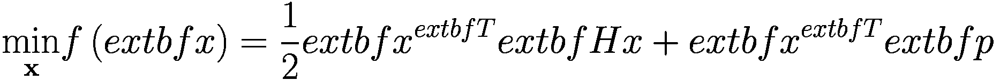

并满足以下约束：

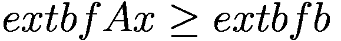

其中 `A` ∈ ℝ^(*p* × *n*)，对应于 *n* 个变量的 *p* 个线性约束。通常应假设矩阵 `H` 是对称的、满秩的，并且是半正定的（`H` ≽ 0）。

如果海森矩阵 `H` ≽ 0 是半正定的，那么该问题就是一个凸优化问题，可以在（弱）多项式时间内求解。否则，该问题是 NP 困难的。对于非凸问题，可能存在多个驻点和局部最小值。实际上，即使 `H` 只有一个负特征值，该问题也是强 NP 困难的。

QP 的一个重要应用是现代投资组合理论。假设你想将一笔资金分配给 *n* 只股票，并持有该投资组合一年。尽管一年后每只股票的确切回报率未知，但你可以将股票 `i` 的年回报率 `r[i]` 建模为一个随机变量，例如服从正态分布。即：

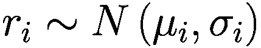

由于股票并非完全独立，它们往往同涨同跌，因此存在相关性。股票 `i` 和股票 `j` 之间的相关性如下：

![$$ {\rho}_{ij}=\frac{\textrm{E}\left[\left({r}_i-{\mu}_i\right)\left({r}_j-{\mu}_j\right)\right]}{\sigma_i{\sigma}_j} $$](images/528380_1_En_10_Chapter/528380_1_En_10_Chapter_TeX_Eques.png)

投资者的决策是决定将资金的多少比例或权重 `w[i]` 投入每只股票，以构建其投资组合。那么投资组合的期望回报率如下：

![$$ \textrm{E}\left[R\right]=\textrm{E}\left[\sum \limits_{i=1}^n{w}_i{r}_i\right]=\sum \limits_{i=1}^n{w}_i\textrm{E}\left[{r}_i\right]=\sum \limits_{i=1}^n{w}_i{\mu}_i={\textbf{w}}^{\textbf{T}}\textbf{\mu} $$](images/528380_1_En_10_Chapter/528380_1_En_10_Chapter_TeX_Equet.png)

投资组合的方差如下：

![$$ Var\left[R\right]=\textrm{E}\left[{\left(R-\textrm{E}\left[R\right]\right)}²\right]=\sum \limits_{i=1}^n\sum \limits_{j=1}^n{w}_i{w}_j{\sigma}_i{\sigma}_j{\rho}_{ij}={\textbf{w}}^{\textbf{T}}\textbf{\Sigma} \textbf{w} $$](images/528380_1_En_10_Chapter/528380_1_En_10_Chapter_TeX_Equeu.png)

其中 `Σ` 是 *n* × *n* 的对称半正定协方差矩阵，定义如下：

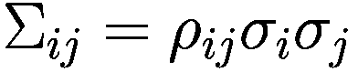

马科维茨提出，投资者应寻求一种权重分配，使得投资组合的期望回报率最大化，同时风险（以投资组合方差衡量）最小化。这本质上构成了以下 QP 问题：

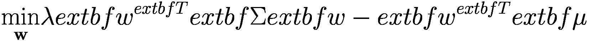

并满足以下约束：

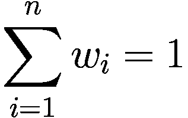

所有权重之和等于 100%。你还可以施加其他约束，例如每只股票的最小权重为 0%。这表示不允许卖空。该不等式约束可以写作：

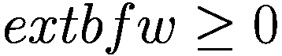

`λ` > 0 被称为*风险规避系数*。较为保守、希望最小化风险的投资者会选择较小的 `λ`。相反，追求更高预期回报并能承受更大回撤的激进投资者，则会选择较大的 `λ`。改变 `λ` 会得到不同的投资组合（不同的权重分配），这些组合满足一个条件：在给定 `λ` 下，不存在另一个具有更高预期回报且回报标准差（即风险）相同的投资组合。这些（针对不同 `λ` 的）最优投资组合的集合共同描绘出所谓的*有效前沿*。见图 10-11。

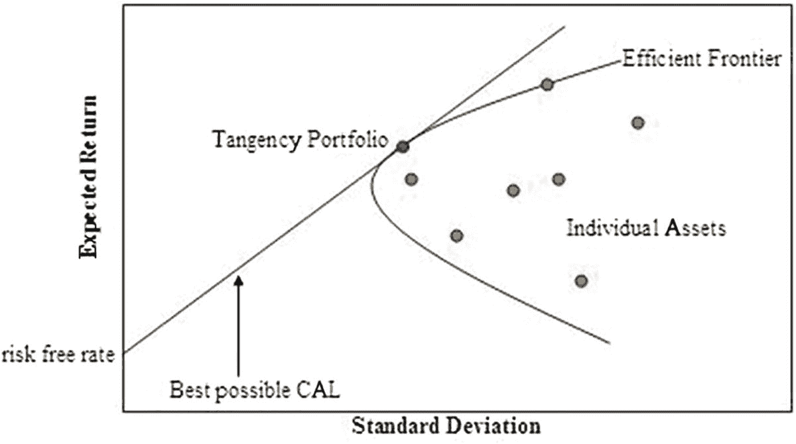

该图展示了预期回报与标准差之间的关系。图中包含几个不同的曲线图以及一条有效前沿曲线。

图 10-11 投资组合的有效前沿

### 10.3.1 仅含等式约束的凸二次规划问题

我们先从一个可通过解析方法求解的简单凸二次规划问题入手。仅含等式约束的凸二次规划问题表述如下：


满足以下约束条件：

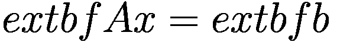

其中 `H` ≽ 0，`A` ≽ 0，`A` ∈ ℝ^(*p* × *n*)，且 `A` 对称且满秩，满足 *p* < *n*。

可以证明，解 `x` 的形式如下：

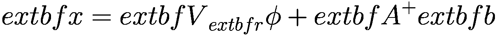

其中 `V[r]` 由 `V` 的最后 *n* − *p* 列组成，`V` 来自 `A = U Σ V^T` 的奇异值分解。`A^+` 是 `A` 的摩尔-彭若斯逆矩阵。

利用这种解的形式，原问题可以重写为等价的无约束最小化问题，如下所示：

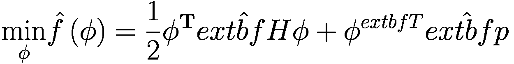

其中

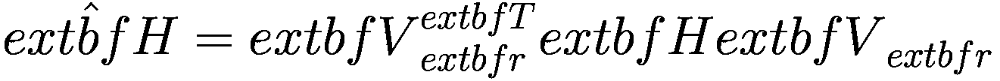

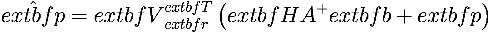

如果 `H` ≻ 0 是正定矩阵，那么 `\hat{H}` ≻ 0 也是正定矩阵。问题的唯一全局最小化器如下：

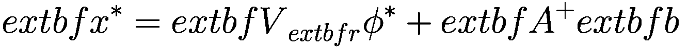

其中 `\phi*` 是以下线性系统的解：

## 二次规划与 NM Dev 实现

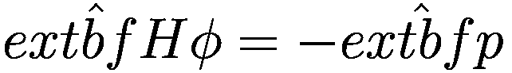

如果 `H` ≽ 0 是半正定矩阵，那么 `hat(H)` 可能是正定或半正定矩阵。若 `hat(H)` ≻ 0 为正定矩阵，则 `x*` 是问题的唯一全局最小化器。若 `hat(H)` ≽ 0 为半正定矩阵，则有两种可能：如果 `hat(p)` 可以表示为 `hat(H)` 各列的线性组合，那么 `f(x)` 存在无穷多个全局最小化器；否则，不存在最小化器。

### 示例：二次规划问题

我们以 Antoniou & Lu (2007) 中的以下二次规划问题为例，来说明该方法：

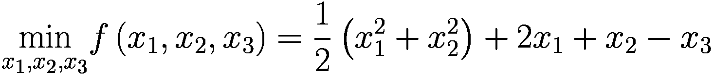

满足以下约束条件：


其中 `A = [0 1 1]`，`b = 1`。

矩阵形式的目标函数如下：

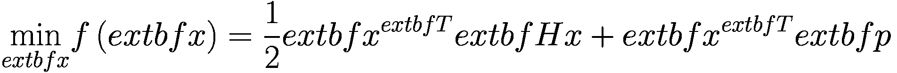

![$$ extbf{H}=\left[\begin{array}{ccc}1&amp; 0&amp; 0\\ {}0&amp; 1&amp; 0\\ {}0&amp; 0&amp; 0\end{array}\right]\succcurlyeq 0 $$](images/528380_1_En_10_Chapter/528380_1_En_10_Chapter_TeX_Equfk.png)

![$$ extbf{p}=\left[\begin{array}{c}2\\ {}1\\ {}-1\end{array}\right] $$](images/528380_1_En_10_Chapter/528380_1_En_10_Chapter_TeX_Equfl.png)

对 `A` 进行奇异值分解得到以下结果：

![$$ {\textbf{V}}_{\textbf{r}}=\left[\begin{array}{cc}1&amp; 0\\ {}0&amp; \frac{\sqrt{2}}{2}\\ {}0&amp; -\frac{\sqrt{2}}{2}\end{array}\right] $$](images/528380_1_En_10_Chapter/528380_1_En_10_Chapter_TeX_Equfm.png)

![$$ {\textbf{A}}^{+}=\left[\begin{array}{c}0\\ {}0.5\\ {}0.5\end{array}\right] $$](images/528380_1_En_10_Chapter/528380_1_En_10_Chapter_TeX_Equfn.png)

因此，得到以下结果：

![$$ \hat{ extbf{H}}={ extbf{V}}_r^T{ extbf{H} extbf{V}}_r=\left[\begin{array}{cc}1&amp; 0\\ {}0&amp; \frac{\sqrt{2}}{2}\end{array}\right]\succ 0 $$](images/528380_1_En_10_Chapter/528380_1_En_10_Chapter_TeX_Equfo.png)

唯一的全局最小化器如下：


![$$ =\left[ \begin{array}{cc}1&amp; 0\\ {}0&amp; \frac{\sqrt{2}}{2}\\ {}0&amp; -\frac{\sqrt{2}}{2}\end{array}\kern0.5em \right]\times \left[\kern0.5em \begin{array}{c}-2\\ {}-3.5355\end{array}\kern0.5em \right]+\left[\kern0.5em \begin{array}{c}0\\ {}0.5\\ {}0.5\end{array}\kern0.5em \right]\left[1\right]=\left[\kern0.5em \begin{array}{c}-2\\ {}-2\\ {}3\end{array}\right] $$](images/528380_1_En_10_Chapter/528380_1_En_10_Chapter_TeX_Equfq.png)

### NM Dev 中的实现

在 NM Dev 中，`QuadraticFunction` 类用于构造以下形式的二次函数：

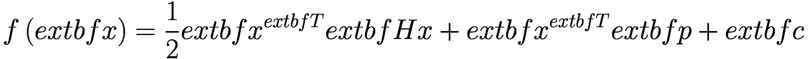

该类的签名如下：

```
public class QuadraticFunction extends AbstractRealScalarFunction {
/**
 * 构造如下形式的二次函数：\(f(x) = \frac{1}{2} \times x'Hx + x'p + c\)。
 * @param H 对称半正定矩阵
 * @param p 向量
 * @param c 常数
 */
public QuadraticFunction(Matrix H, Vector p, double c);
/**
 * 构造如下形式的二次函数：\(f(x) = \frac{1}{2} \times x'Hx + x'p\)。
 *
 * @param H 对称半正定矩阵
 * @param p 向量
 */
public QuadraticFunction(Matrix H, Vector p);
/**
 * 拷贝构造函数。
 *
 * @param f 二次函数
 */
public QuadraticFunction(QuadraticFunction f);
public ImmutableMatrix Hessian();
public ImmutableVector p();
@Override
public Double evaluate(Vector z);
@Override
public String toString();
}
```

`QPSimpleMinimizer` 类是一个工具类，包含一系列用于求解无约束二次规划问题和仅含等式约束的二次规划问题的实用函数。这两个问题都可以通过解析方法求解。以下代码重现了前面的示例：

```
// 构造仅含等式约束的二次规划问题
val H: DenseMatrix = DenseMatrix(
arrayOf(
doubleArrayOf(1.0, 0.0, 0.0),
doubleArrayOf(0.0, 1.0, 0.0),
doubleArrayOf(0.0, 0.0, 0.0)
)
)
val p: DenseVector = DenseVector(2.0, 1.0, -1.0)
val f = QuadraticFunction(H, p)
println("最小化：")
println(f)
// 等式约束
val A: DenseMatrix = DenseMatrix(
arrayOf(
doubleArrayOf(0.0, 1.0, 1.0)
))
val b: DenseVector = DenseVector(1.0)
val Aeq = LinearEqualityConstraints(A, b)
// 求解仅含等式约束的二次规划问题
val soln = QPSimpleMinimizer.solve(f, Aeq)
val x: Vector = soln.minimizer()
val fx: Double = f.evaluate(x)
println(String.format("f(%s) = %f%n", x, fx))
println(String.format("解是否唯一 = %b%n", soln.isUnique()))
```

输出结果如下：

好的，作为一名高级文档工程师和翻译员，我将严格遵循您的注意事项和示例格式，将给定的英文文本翻译成中文。

---

```
最小化:
1/2 * x'3x3
[,1] [,2] [,3]
[1,] 1.000000, 0.000000, 0.000000,
[2,] 0.000000, 1.000000, 0.000000,
[3,] 0.000000, 0.000000, 0.000000, x + x'[2.000000, 1.000000, -1.000000]
f([-2.000000, -2.000000, 3.000000] ) = -5.000000
is unique = true
```

NM Dev 计算出相同的最优解 `x* = [-2, -2, 3]` 和最小值 −5。

### 10.3.2 严格凸 QP 问题的积极集法

一般来说，一个 QP 问题可以表述如下：

`min f(x) = (1/2) x^T H x + x^T p`

满足以下约束条件：

`Ax >= b`

其中 `A` ∈ ℝ^(p × n)。

不失一般性地，你可以跳过等式约束，因为它们可以像第 10.3.1 节那样被消去。

在极小点 `x` 处的 Karush-Kuhn-Tucker (KKT) 条件由下式给出：

`Hx + p - A^T μ = 0`

`(a_i^T x - b_i) μ_i = 0, i=1, 2, …, p`

`μ_i >= 0, i=1, 2, …, p`

假设解 `x*` 位于可行域的内部。（与 LP 不同，LP 的解必须在边界上，而 QP 问题的解可以在可行域内部。）那么你会得到：

`Ax* - b > 0`

这意味着：

`μ* = 0`

然后你会得到：

`Hx* + p = 0`

唯一的全局极小点 `x*` 是该线性系统的解，如下所示：

`x* = -H^{-1} p`

#### 原始积极集法

如果解 `x*` 不是内点，而是位于可行域的边界上，那么下一步搜索方向是将当前迭代点 `x` 处的有效约束视为一组等式约束，同时忽略其他约束。这就是求解一般凸 QP 问题的积极集法。

设 `x[k]` 是第 *k* 次迭代中的一个可行迭代点。设 `J[k]` 是有效约束的索引集合，即那些满足 `a_i^T x - b_i = 0` 的约束，这被称为一个积极集。下一次迭代，如同第 10.1.1 节中通用的优化算法一样，如下所示：

`x_{k+1} = x_k + d = x_k + α_k d_k`

如果满足以下条件，则在 `x[k]` 处有效的约束在 `x[k+1]` 处仍然有效：

`a_j^T x_{k+1} - b_j = 0`, `j` ∈ `J[k]`

在下一次迭代方程的两边乘以 `a_j^T`，你会得到：

`a_j^T d_k = 0`, `j` ∈ `J[k]`

在 `x[k] + d` 处的目标函数如下所示：

`f_k(d) = (1/2) d^T H d + d^T g_k + c_k`

其中

`g_k = p + Hx_k`

并且 `c[k]` 是一个常数。

积极集法中的一个主要步骤是求解以下仅包含等式约束的 QP 子问题，如下所示：

`min_d f_hat(d) = (1/2) d^T H d + d^T g_k`

满足以下约束条件：

`a_j^T d_k = 0`, `j` ∈ `J[k]`

这可以使用第 10.3.1 节中的方法来求解。原始积极集算法如下所示：