# 原始有效集算法

## 步骤 1
从一个可行的初始点 `x[0]` 开始。
确定初始有效集 `J[0]`。
仅使用 `J[0]` 中的有效约束，将矩阵 `A[a0]` 构造成 `A` 的一个子矩阵。
设置 `k = 0`。

## 步骤 2
计算 `g[k] = p + Hx[k]`。
使用 `g[k]` 来检查 `d[k]` 是否为零。如果 `d[k]` 不为零，则转到步骤 4。

## 步骤 3 (`d[k] = 0`)
使用 `A_ak^T * μ̂ = g_k` 求解 `μ̂`。
如果 `μ̂ >= 0`，则输出 `x[k]` 作为解并终止。
否则，从 `J[k]` 中移除与最负拉格朗日乘子相关联的索引。

## 步骤 4 (`d[k] ≠ 0`)
使用仅含等式约束的子 QP 问题求解 `d[k]`。

## 步骤 5
计算 `α[k]`。
```
α_k = min { 1, min_{i∉J_k, a_i^T d_k < 0} (b_i - a_i^T x_k) / (a_i^T d_k) }
```
设置 `x[k+1] = x[k] + α[k] * d[k]`。

## 步骤 6
如果 `α[k] < 1`，则通过在步骤 5 中将产生最小值的索引添加到 `J[k]` 来构建 `J[k+1]`。
否则，设置 `J[k] = J[k+1]`。

## 步骤 7
设置 `k = k + 1`。
从步骤 2 开始重复。

---

考虑 Nocedal & Wright (2006) 中的这个示例问题：
```
min_x q(x) = (x_1 - 1)² + (x_2 - 2.5)²
```
约束条件如下：
```
{ x_1 - 2x_2 + 2 >= 0
{ -x_1 - 2x_2 + 6 >= 0
{ -x_1 + 2x_2 + 2 >= 0
{ x_1 >= 0
{ x_2 >= 0
```
你可以将问题写成矩阵形式。
```
min_x f(x) = (1/2) x^T H x + x^T p
```
满足以下约束：
```
A x >= b
```
其中：
```
H = [2   0]
    [0   2]

p = [-2]
    [-5]

A = [ 1  -2]
    [-1  -2]
    [-1   2]
    [ 1   0]
    [ 0   1]

b = [-2]
    [-6]
    [-2]
    [ 0]
    [ 0]
```
(注意，这两种形式的常数项不同，但它们与解无关。)

如图 10-12 所示。

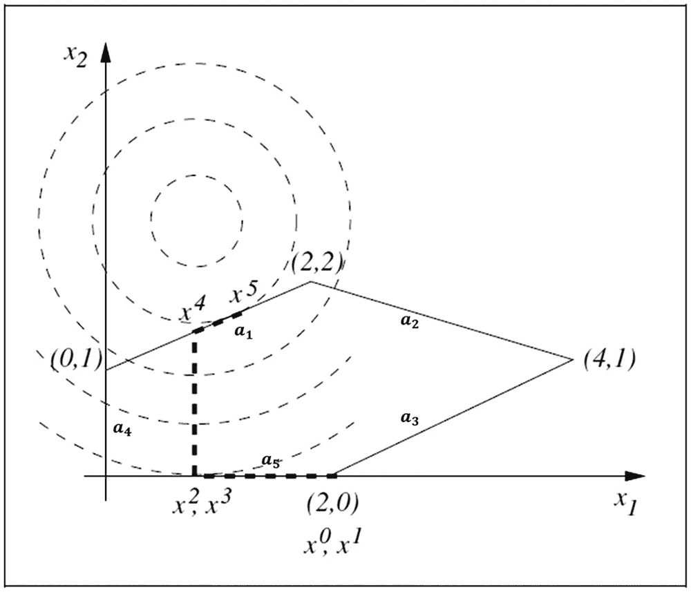

**图 10-12** 一个二次规划问题

图 10-12 展示了可行域、边界、目标函数的等高线以及约束标签 `a[i]`。

假设初始迭代点是 `x⁰ = [2, 0]^T` (这里，上标表示迭代次数，下标表示分量)。该顶点有两个有效约束，即 `a[3]` 和 `a[5]`。`a[3] * x⁰ = a[5] * x⁰ = 0`。工作集是 `J[0] = {3, 5}`。QP 子问题的解是 `d⁰ = 0`。你需要求解 KKT 条件中的拉格朗日乘子，以检验它是否是最小点。
```
[-1   2] [μ̂_1] = [ 2]
[ 0   1] [μ̂_2]   [-5]
```
也就是说，你得到：
```
[μ̂_3] = [-2]
[μ̂_5]   [-1]
```
这不满足非负性要求，意味着尚未找到最小值。你将约束条件 3，即 `a[3]`，从工作集中移除，因为它对应的拉格朗日乘子绝对值最大。

在下一个迭代 `k = 1` 中，当前工作集变为 `J[1] = {5}`。`x¹ = x⁰ = [2, 0]^T`，因为上次迭代没有移动搜索点。`d¹ = [-1, 0]^T`。步长公式得到 `α[1] = 1`。新的迭代点是 `x² = [1, 0]^T`。

在下一个迭代 `k = 2` 中，`x² = [1, 0]^T`。`d² = 0`。`μ̂_5 = -5`。你将 `a[5]` 从工作集中移除。工作集现在为空，`J[1] = {}`。

在下一个迭代 `k = 3` 中，因为 `d² = 0`，所以 `x³ = [1, 0]^T`。由于工作集为空，QP 子问题是无约束的。求解得到 `d³ = [0, 2.5]^T`。步长公式得到 `α[3] = 0.6`。新的迭代点是 `x⁴ = [1, 1.5]^T`。

在下一个迭代 `k = 4` 中，`x⁴ = [1, 1.5]^T`。存在一个阻塞约束 `a[1]`。第一个约束被添加到工作集中，`J[4] = {1}`。`d⁴ = [0.4, 0.2]^T`。`α[4] = 1`。新的迭代点是 `x⁵ = [1.4, 1.7]^T`。工作集保持不变。

在下一个迭代 `k = 5` 中，`x⁵ = [1.4, 1.7]^T`。`d⁵ = 0`。检查 KKT 条件得到 `μ̂_1 = 0.8 > 0`。已找到最小值。你得到如下结果：
```
x* = [1.4]
     [1.7]
```

下面的 NM Dev 代码求解了这个 QP 问题：
```kotlin
// 构造一个二次函数
val H: Matrix = DenseMatrix(
    arrayOf(
        doubleArrayOf(2.0, 0.0),
        doubleArrayOf(0.0, 2.0),
    )
)
val p: Vector = DenseVector(-2.0, -5.0)
val f = QuadraticFunction(H, p)
// 构造线性不等式约束
val A: Matrix = DenseMatrix(
    arrayOf(
        doubleArrayOf(1.0, -2.0),
        doubleArrayOf(-1.0, -2.0),
        doubleArrayOf(-1.0, 2.0),
        doubleArrayOf(1.0, 0.0),
        doubleArrayOf(0.0, 1.0),
    )
)
val b: Vector = DenseVector(-2.0, -6.0, -2.0, 0.0, 0.0)
val greater = LinearGreaterThanConstraints(A, b)// x >= 0
// 构造 QP 问题
val problem = QPProblem(f, null, greater)
// 构造一个原始积极集求解器
val epsion: Double = Math.sqrt(PrecisionUtils.autoEpsilon(problem.f().Hessian()))
val solver1 = QPPrimalActiveSetMinimizer(
    epsion, // 精度
    Integer.MAX_VALUE // 最大迭代次数
)
// 使用原始积极集方法求解 QP 问题
val solution1: QPPrimalActiveSetMinimizer.Solution = solver1.solve(problem)
solution1.search(DenseVector(2.0, 0.0))
// 打印解
println("minimizer = " + solution1.minimizer().minimizer())
println("minimum = " + solution1.minimum())
```
输出如下：

# 对偶积极集法

```
x_0 = [2.000000, 0.000000]
J_0
= active: [3, 5]; inactive: []
g_0 = [2.000000, -5.000000]
d_0 = [0.000000, 0.000000]
mu = [-2.000000, -1.000000]
x_1 = [2.000000, 0.000000]
J_1
= active: [5]; inactive: [3]
g_1 = [2.000000, -5.000000]
d_1 = [-1.000000, 0.000000]
a = 1.000000
x_2 = [1.000000, 0.000000]
J_2
= active: [5]; inactive: [3]
g_2 = [0.000000, -5.000000]
d_2 = [0.000000, 0.000000]
mu = [-5.000000]
x_3 = [1.000000, 0.000000]
J_3
= active: []; inactive: [3, 5]
g_3 = [0.000000, -5.000000]
d_3 = [-0.000000, 2.500000]
a = 0.600000
x_4 = [1.000000, 1.500000]
J_4
= active: [1]; inactive: [3, 5]
g_4 = [0.000000, -2.000000]
d_4 = [0.400000, 0.200000]
a = 1.000000
x_5 = [1.400000, 1.700000]
J_5
= active: [1]; inactive: [3, 5]
g_5 = [0.800000, -1.600000]
d_5 = [0.000000, 0.000000]
mu = [0.800000]
minimizer = [1.400000, 1.700000]
minimum = -6.450000000000001
```

同样地，我们得到 `f`(1.4, 1.7) = -6.45。建议将输出结果与前面讨论的迭代轨迹进行比较。

## 对偶积极集法

对偶性是一种用于求解与原问题（称为*原始*问题）相关的问题的技术。这个相关的问题被称为*对偶*问题。在对偶问题中，参数是原始问题的拉格朗日乘子。当不等式约束的数量远大于 `x` 的维度时，求解对偶问题以找到拉格朗日乘子，然后为原始问题找到 `x*` 可能会更容易。具体来说，设 `x*`、`λ*`、`μ*` 为约束优化问题（如 KKT 条件所定义）的最小化器和两个拉格朗日乘子。它们求解了对偶问题，如下所示：

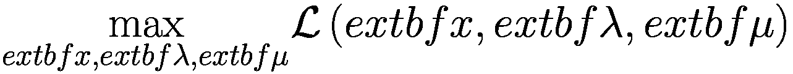

需满足以下条件：

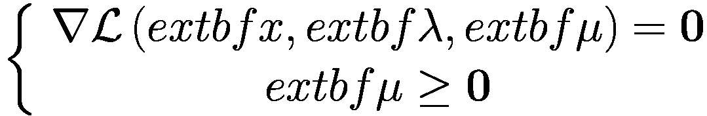

此外，我们还有：

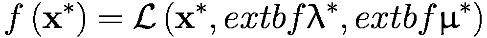

用于求解 QP 问题的对偶积极集方法本质上是上一节中的积极集方法，但应用于 QP 问题的对偶问题。QP 问题的对偶形式如下：

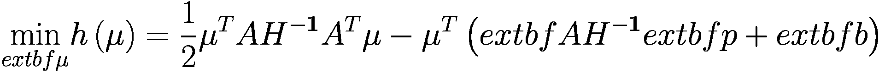

需满足以下条件：

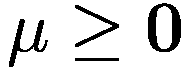

在其最小化器 `μ*` 确定之后，可以根据 KKT 条件获得原始问题的最小化器，如下所示：

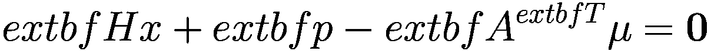

即：

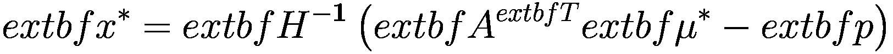

与求解原始问题相比，求解对偶问题具有以下优势：

- 容易找到一个可行的初始点，即任何具有非负分量的向量，例如 `μ[0] = 0`。
- 问题中的约束矩阵是 *p* × *p* 的单位矩阵。因此，对偶问题总是满足非退化假设。
- 该问题仅涉及有界不等式约束，这显著降低了算法所需的计算成本。

在 NM Dev 中，`QPDualActiveSetMinimizer` 类将 QP 问题转换为其对偶问题，然后应用积极集方法。以下代码使用对偶积极集方法求解同一个问题：

```kotlin
// 构造二次函数
val H: Matrix = DenseMatrix(
    arrayOf(
        doubleArrayOf(2.0, 0.0),
        doubleArrayOf(0.0, 2.0),
    )
)
val p: Vector = DenseVector(-2.0, -5.0)
val f = QuadraticFunction(H, p)

// 构造线性不等式约束
val A: Matrix = DenseMatrix(
    arrayOf(
        doubleArrayOf(1.0, -2.0),
        doubleArrayOf(-1.0, -2.0),
        doubleArrayOf(-1.0, 2.0),
        doubleArrayOf(1.0, 0.0),
        doubleArrayOf(0.0, 1.0),
    )
)
val b: Vector = DenseVector(-2.0, -6.0, -2.0, 0.0, 0.0)
val greater = LinearGreaterThanConstraints(A, b) // x >= 0

// 构造 QP 问题
val problem = QPProblem(f, null, greater)

// 构造对偶积极集求解器
val epsion: Double = Math.sqrt(PrecisionUtils.autoEpsilon(problem.f().Hessian()))

// 使用对偶积极集法求解 QP 问题
val solver2 = QPDualActiveSetMinimizer(
    epsion,           // 精度
    Integer.MAX_VALUE // 最大迭代次数
)
val solution2: QPDualActiveSetMinimizer.Solution = solver2.solve(problem)
solution2.search()

// 打印结果
println("minimizer = " + solution2.minimizer().minimizer())
println("minimum = " + solution2.minimum())
```

我们仅仅将求解器从以下代码：

```kotlin
val solver1 = QPPrimalActiveSetMinimizer(
    epsion,           // 精度
    Integer.MAX_VALUE // 最大迭代次数
)
// 使用原始积极集法求解 QP 问题
val solution1: QPPrimalActiveSetMinimizer.Solution = solver1.solve(problem)
```

改为了以下代码：

```kotlin
// 使用对偶积极集法求解 QP 问题
val solver2 = QPDualActiveSetMinimizer(
    epsion,           // 精度
    Integer.MAX_VALUE // 最大迭代次数
)
val solution2: QPDualActiveSetMinimizer.Solution = solver2.solve(problem)
```

你甚至无需为对偶积极集求解器提供初始猜测。

输出结果如下：

```
x_0 = [0.000000, 0.000000, 0.000000, 0.000000, 0.000000]
J_0
= active: [1, 2, 3, 4, 5]; inactive: []
g_0 = [-2.000000, 0.000000, 6.000000, 1.000000, 2.500000]
d_0 = [0.000000, 0.000000, 0.000000, 0.000000, 0.000000]
mu = [-2.000000, 0.000000, 6.000000, 1.000000, 2.500000]
x_1 = [0.000000, 0.000000, 0.000000, 0.000000, 0.000000]
J_1
= active: [2, 3, 4, 5]; inactive: [1]
g_1 = [-2.000000, 0.000000, 6.000000, 1.000000, 2.500000]
d_1 = [0.800000, 0.000000, 0.000000, 0.000000, 0.000000]
a = 1.000000
x_2 = [0.800000, 0.000000, 0.000000, 0.000000, 0.000000]
J_2
= active: [2, 3, 4, 5]; inactive: [1]
g_2 = [0.000000, 1.200000, 4.000000, 1.400000, 1.700000]
d_2 = [0.000000, 0.000000, 0.000000, 0.000000, 0.000000]
mu = [1.200000, 4.000000, 1.400000, 1.700000]
minimizer = [1.400000, 1.700000]
minimum = -6.450000000000001
```

该结果与使用原始积极集法得到的结果相同。

## 10.4 半定规划

半定规划（SDP）是凸优化的一个子领域，致力于在正半定矩阵锥与仿射空间交集的约束下，优化线性目标函数。正半定矩阵是特征值非负的对称矩阵。SDP 之所以日益受到关注，有以下几个原因。运筹学和组合优化中的许多实际问题都可以建模或近似为 SDP 问题。在自动控制理论中，SDP 被用于线性矩阵不等式的场景。一些量子查询复杂度问题也已通过 SDP 形式化表述。此外，所有线性规划（如 LP 和 QP）都可以重新表述为 SDP 问题。向量不等式约束被替换为矩阵不等式约束。图 10-13 展示了凸规划及其子领域的层级结构。

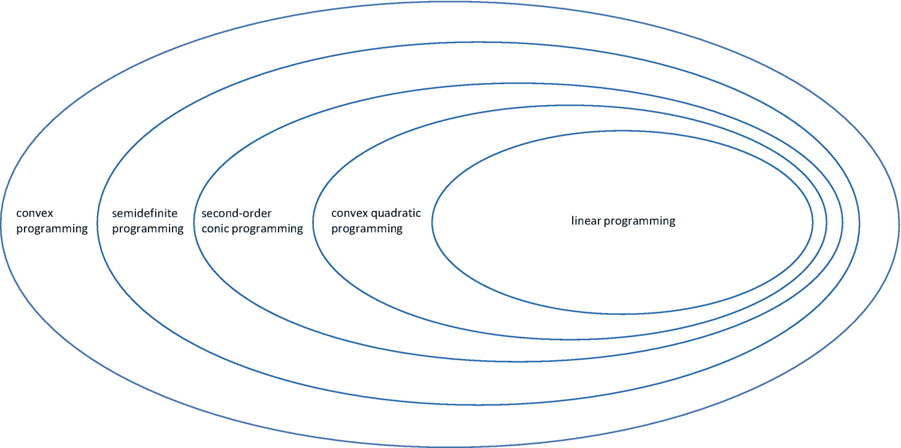

凸规划的层级结构包括半定规划、二阶锥规划、凸二次规划和线性规划。

**图 10-13** 凸规划的层级结构

### 10.4.1 原始 SDP 问题与对偶 SDP 问题

设 ***S***^(*n*) 为实对称 *n* × *n* 矩阵的空间。***S***^(*n*) 上的标准内积定义如下：

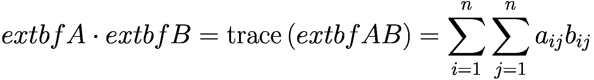

原始 SDP 问题定义如下：

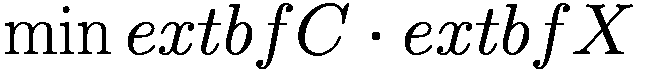

满足约束：

***A***[*i*] ***∙ X = b***[*i*]，其中 *i* = 1, 2, ..., *p*

***X*** **≽ 0**

其中 ***C***、***X***、***A***[*i*] 属于 ***S***^(*n*)。***X*** 是正半定矩阵。

一个 SDP 问题的示例如下：

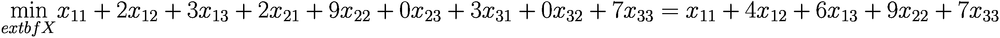

满足约束：

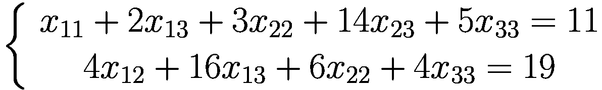

![ $$ \textbf{X}=\left[\begin{array}{ccc}{x}_{11}&amp; {x}_{12}&amp; {x}_{13}\\ {}{x}_{21}&amp; {x}_{22}&amp; {x}_{23}\\ {}{x}_{31}&amp; {x}_{32}&amp; {x}_{33}\end{array}\right]\succcurlyeq 0 $$ ](images/528380_1_En_10_Chapter/528380_1_En_10_Chapter_TeX_Equhc.png)

以矩阵形式，该问题可写作：

![ $$ \underset{ \textbf{X}}{\min}\left[\begin{array}{ccc}1&amp; 2&amp; 3\\ {}2&amp; 9&amp; 0\\ {}3&amp; 0&amp; 7\end{array}\right]\cdot \left[\begin{array}{ccc}{x}_{11}&amp; {x}_{12}&amp; {x}_{13}\\ {}{x}_{12}&amp; {x}_{22}&amp; {x}_{23}\\ {}{x}_{13}&amp; {x}_{23}&amp; {x}_{33}\end{array}\right] $$ ](images/528380_1_En_10_Chapter/528380_1_En_10_Chapter_TeX_Equhd.png)

满足约束：

![ $$ \left\{\begin{array}{c}\left[\begin{array}{ccc}1&amp; 0&amp; 1\\ {}0&amp; 3&amp; 7\\ {}1&amp; 7&amp; 5\end{array}\right]\cdotp \left[\begin{array}{ccc}{x}_{11}&amp; {x}_{12}&amp; {x}_{13}\\ {}{x}_{12}&amp; {x}_{22}&amp; {x}_{23}\\ {}{x}_{13}&amp; {x}_{23}&amp; {x}_{33}\end{array}\right]=11\\ {}\left[\begin{array}{ccc}0&amp; 2&amp; 8\\ {}2&amp; 6&amp; 0\\ {}8&amp; 0&amp; 4\end{array}\right]\cdotp \left[\begin{array}{ccc}{x}_{11}&amp; {x}_{12}&amp; {x}_{13}\\ {}{x}_{12}&amp; {x}_{22}&amp; {x}_{23}\\ {}{x}_{13}&amp; {x}_{23}&amp; {x}_{33}\end{array}\right]=19\end{array}\right. $$ ](images/528380_1_En_10_Chapter/528380_1_En_10_Chapter_TeX_Equhe.png)

这个 SDP 问题看起来与 LP 问题非常相似。注意，现在涉及的决策变量是矩阵 ***X*** 而非向量。此外，正如 ***x*** ≥ **0** 意味着 *n* 个分量中的每一个都必须非负，***X*** **≽ 0** 意味着 *n* 个特征值中的每一个都必须非负。

在 NM Dev 中，`SDPPrimalProblem` 类用于构造原始形式的 SDP 问题。该类的签名如下：

### 10.4.2 中心路径

```java
public class SDPPrimalProblem { // TODO: 转换为 SDPDualProblem; 实现 ConstrainedOptimProblem
    /**
     * 构造一个原始 SDP 问题。
     * \[
     * \min_x \mathbf{c'x} \textrm{, s.t., } \\
     * \mathbf{Ax} = \mathbf{b}, \mathbf{x} \geq \mathbf{0}
     * \]
     *
     * @param C \(C\)
     * @param A \(A\)
     */
    public SDPPrimalProblem(SymmetricMatrix C, SymmetricMatrix[] A);

    /**
     * 获取系统的维度，即 `x` 的维度，即变量数量。
     *
     * @return 系统的维度
     */
    public int n();

    /**
     * 获取 `b` 的大小。
     *
     * @return `b` 的大小
     */
    public int p();

    /**
     * 获取 `C`。
     *
     * @return `C`
     */
    public SymmetricMatrix C();

    /**
     * 获取 `A[i]`。
     *
     * @param i `A` 的索引，从 1 开始计数
     * @return `A[i]`
     */
    public SymmetricMatrix A(int i);
}
```

以下代码构造了上述示例中的原始问题：

```kotlin
// 原始 SDP 矩阵
val C: SymmetricMatrix = SymmetricMatrix(
    arrayOf(
        doubleArrayOf(1.0),
        doubleArrayOf(2.0, 9.0),
        doubleArrayOf(3.0, 0.0, 7.0)
    )
)
val A1: SymmetricMatrix = SymmetricMatrix(
    arrayOf(
        doubleArrayOf(1.0),
        doubleArrayOf(0.0, 3.0),
        doubleArrayOf(1.0, 7.0, 5.0)
    )
)
val A2: SymmetricMatrix = SymmetricMatrix(
    arrayOf(
        doubleArrayOf(0.0),
        doubleArrayOf(2.0, 6.0),
        doubleArrayOf(8.0, 0.0, 4.0)
    )
)
// 构造原始 SDP 问题
val primal = SDPPrimalProblem(
    C,
    arrayOf(A1, A2))
```

如果 `C = diag(c)` 且 `A[i] = diag(a[i])` 均为对角矩阵，则该问题可立即简化为标准形式的线性规划问题。标准形式线性规划问题的对偶问题如下：

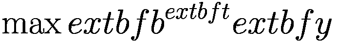

满足约束条件：

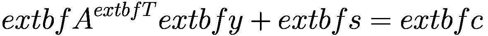

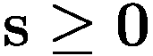

其中 `s` 为松弛变量。

类似地，相对于原始 SDP 问题的对偶 SDP 问题如下：


满足约束条件：

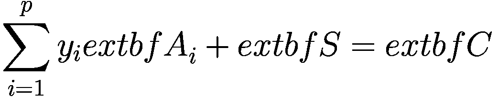

`S` ≽ 0

其中 `S` 为松弛变量。

该例子的对偶问题如下：


满足约束条件：

![ $$ {y}_1\left[\begin{array}{ccc}1&amp; 0&amp; 1\\ {}0&amp; 3&amp; 7\\ {}1&amp; 7&amp; 5\end{array}\right]+{y}_2\left[\begin{array}{ccc}0&amp; 2&amp; 8\\ {}2&amp; 6&amp; 0\\ {}8&amp; 0&amp; 4\end{array}\right]+ extbf{S}=\left[\begin{array}{ccc}1&amp; 2&amp; 3\\ {}2&amp; 9&amp; 0\\ {}3&amp; 0&amp; 7\end{array}\right] $$ ](images/528380_1_En_10_Chapter/528380_1_En_10_Chapter_TeX_Equhl.png)

`S` ≽ 0

或者可表示为：

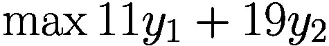

满足约束条件：

![ $$ \left[\begin{array}{ccc}1-1{y}_1-0{y}_2&amp; 2-0{y}_1-2{y}_2&amp; 3-1{y}_1-8{y}_2\\ {}2-0{y}_1-2{y}_2&amp; 9-3{y}_1-6{y}_2&amp; 0-7{y}_1-0{y}_2\\ {}3-1{y}_1-8{y}_2&amp; 0-7{y}_1-0{y}_2&amp; 7-5{y}_1-4{y}_2\end{array}\right]\succcurlyeq \textbf{0} $$ ](images/528380_1_En_10_Chapter/528380_1_En_10_Chapter_TeX_Equhn.png)

对偶形式通常更易于观察和操作，因为其变量是 `p` 个乘子 `y[i]`。

NM Dev 的 `SDPPrimalProblem` 类以对偶形式构造 SDP 问题。类签名如下：

```java
public class SDPDualProblem extends ConstrainedOptimProblemImpl1 {
    /**
     * 构造对偶 SDP 问题。
     *
     * @param b \(b\)
     * @param C \(C\)
     * @param A \(A\)
     */
    public SDPDualProblem(
        final Vector b,
        final SymmetricMatrix C,
        final SymmetricMatrix[] A
    );

    /**
     * 获取方阵 `C` 和 `A` 的维度。
     *
     * @return 矩阵的维度
     */
    public int n();

    /**
     * 获取系统的维度，即 `p = y` 的维度 = 变量数量。
     *
     * @return 系统的维度
     */
    public int p();

    /**
     * 获取 `b`。
     *
     * @return `b`
     */
    public ImmutableVector b();

    /**
     * 获取 `C`。
     *
     * @return `C`
     */
    public SymmetricMatrix C();

    /**
     * 获取 `A[i]`。
     *
     * @param i 指向 `A` 的索引，从 1 开始计数
     * @return `A[i]`
     */
    public SymmetricMatrix A(int i);
}
```

继续此示例，以下代码构造对偶问题：

```kotlin
// 对偶 SDP 向量与矩阵
val b: Vector = DenseVector(11.0, 19.0)
// 构造原始 SDP 问题
val dual = SDPDualProblem(
    b,
    C,
    arrayOf(A1, A2))
println(dual)
```

SDP 问题的 Karush-Kuhn-Tucker (KKT)条件表明，矩阵 `X*` 是原始问题的最小化子当且仅当存在矩阵 `S* ∈ Sⁿ` 和向量 `y* ∈ ℝᵖ` 使得以下系统成立：

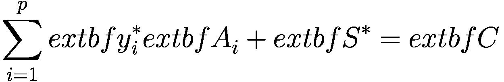

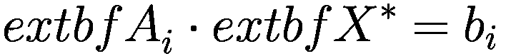

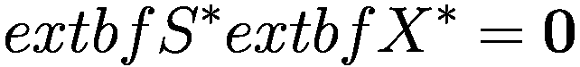

`X* ≽ 0, S* ≽ 0`，可以证明 KKT 条件的解存在。原始解为 `{X*, yᵢ*, S*}`，同时可以证明 `{yᵢ*, S*}` 是对偶问题的最大化子（即解）。因此该解被称为原始-对偶解。

中心路径在内点算法的构建中起关键作用。对于 SDP 问题，中心路径由一组 `{X(τ), y(τ), S(τ)}` 构成，满足以下系统：

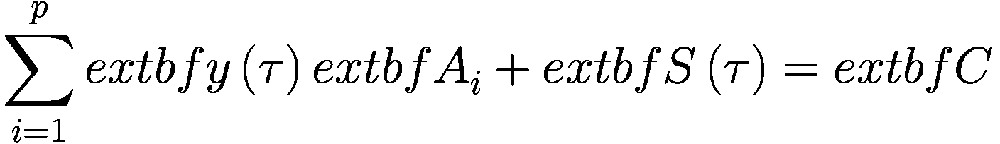

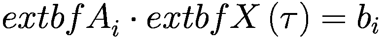

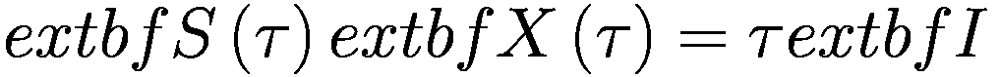

`X(τ) ≽ 0, S(τ) ≽ 0`

除 `τI` 项外，该解几乎满足 KKT 条件。

沿中心路径的差异或对偶间隙 `δ` 可通过下式计算：

![ $$ \delta \left[ extbf{X}\left(\tau \right), extbf{y}\left(\tau \right)\right]= extbf{C}\cdot extbf{X}\left(\tau \right)-{ extbf{b}}^{ extbf{T}} extbf{y}\left(\tau \right) $$ ](images/528380_1_En_10_Chapter/528380_1_En_10_Chapter_TeX_Equhu.png)

![ $$ =\left[\sum \limits_{i=1}^p extbf{y}\left(\tau \right){ extbf{A}}_i+ extbf{S}\left(\tau \right)\right]\cdot extbf{X}\left(\tau \right)-{ extbf{b}}^{ extbf{T}} extbf{y}\left(\tau \right) $$ ](images/528380_1_En_10_Chapter/528380_1_En_10_Chapter_TeX_Equhv.png)

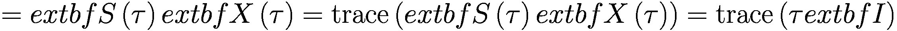

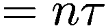

如果能通过将 `τ` 追踪至 0 来闭合间隙，中心路径将趋近于 SDP 问题的解。参见图 10-14。

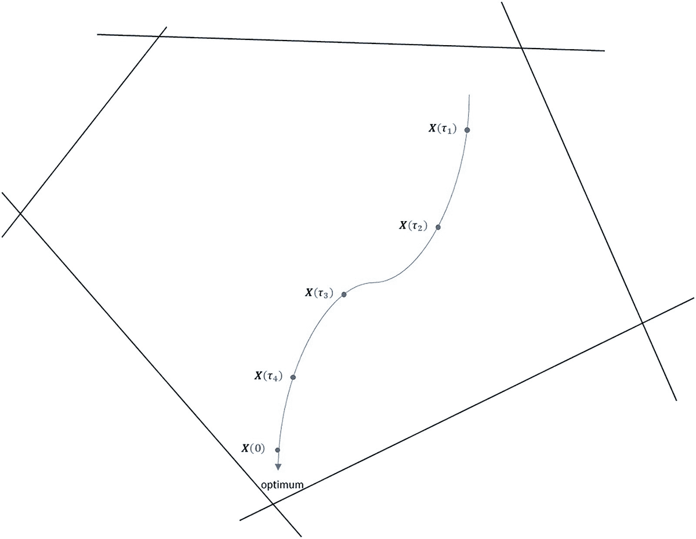

图 10-14 内点算法的中心路径

换言之：

![ $$ \underset{\tau \to 0}{\lim}\delta \left[ extbf{X}\left(\tau \right), extbf{y}\left(\tau \right)\right]=0 $$ ](images/528380_1_En_10_Chapter/528380_1_En_10_Chapter_TeX_Equhy.png)

同时还有：

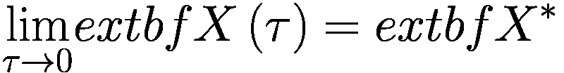

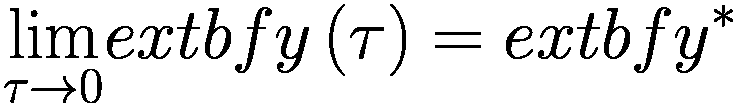


原始-对偶解为 `\left\{{\mathbf{X}}^{\ast },{\mathbf{y}}_{\textbf{i}}^{\ast },{\mathbf{S}}^{\ast}\right\}`。

内点算法通过沿着问题的中心路径生成迭代序列，使其收敛于原始-对偶解。对于每个 `τ > 0`，`X(τ)` 和 `{y(τ), S(τ)}` 分别位于原始问题和对偶问题可行域的内部。这就是一种路径跟踪算法。

### 10.4.3 原始-对偶路径跟踪法

首先定义一些运算和符号。给定 `ℝ^{n × n}` 中的矩阵 `K`、`M`、`N`，一般的非对称克罗内克积定义如下：

![`\mathbf{M}\otimes\mathbf{N}=\left[\begin{array}{ccc}{m}_{11}\mathbf{N}& \dots & {m}_{1n}\mathbf{N}\\ {}\vdots & \ddots & \vdots \\ {}{m}_{n1}\mathbf{N}& \dots & {m}_{nn}\mathbf{N}\end{array}\right]`](images/528380_1_En_10_Chapter/528380_1_En_10_Chapter_TeX_Equic.png)

`svec(K)` 运算将一个对称矩阵 `K = {k[ij]}` 转换为维度为 `n(n + 1)/2` 的向量，如下所示：

![`\textrm{svec}\left(\mathbf{K}\right)={\left[{k}_{11},\sqrt{2}{k}_{12},\dots, \sqrt{2}{k}_{1n},{k}_{22},\sqrt{2}{k}_{23},\dots, \sqrt{2}{k}_{2n},\dots, {k}_{nn}\right]}^T`](images/528380_1_En_10_Chapter/528380_1_En_10_Chapter_TeX_Equid.png)

对称克罗内克积由如下恒等式定义：

![`\left(\mathbf{M}\odot\mathbf{N}\right)\textrm{svec}\left(\mathbf{K}\right)=\textrm{svec}\left[\frac{1}{2}\left({\mathbf{NKM}}^{\mathbf{T}}+{\mathbf{MKN}}^{\mathbf{T}}\right)\right]`](images/528380_1_En_10_Chapter/528380_1_En_10_Chapter_TeX_Equie.png)

在处理矩阵变量时，有时将矩阵表示为向量会更方便。`nevc(K)` 运算将 `K` 的列堆叠起来构成一个向量。

在牛顿法中，从给定集合 `{X, y, S}` 出发，寻找增量 `ΔX, Δy, ΔS`，其中 `ΔX` 和 `ΔS` 是对称的，使得 `{ΔX, Δy, ΔS}` 满足以下线性化方程：


最后一个方程可以用对称克罗内克积表示为：


为简便起见，令：

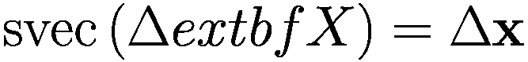

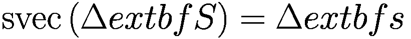

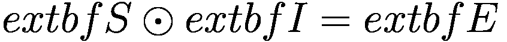

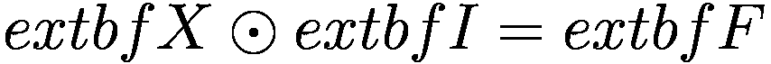


在这些记号下，最后一个方程变为：

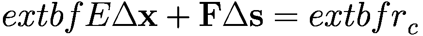

此外，令：


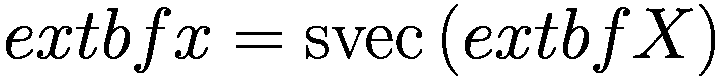


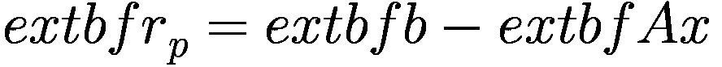

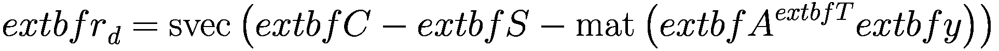

其中`mat()`是`svec()`的逆运算。

利用这些记号，线性化系统可以写成：

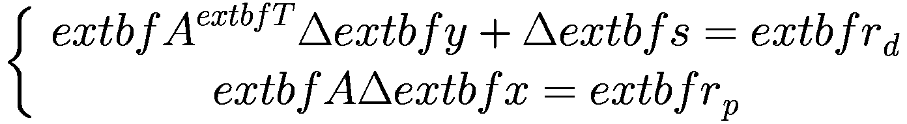

或者简写为：


其中：


Antoniou & Lu (2007) 详细阐述了用于求解 SDP 问题的内点算法，如下所示：

### 半定规划问题的原始-对偶路径跟踪算法

**步骤 1**

输入问题数据：`A[i]`（其中`1 ≤ i ≤ p`）、`b ∈ ℝ^(p)`、`C ∈ ℝ^(n × n)`，以及一个严格可行集合`{X[0], y[0], S[0]}`，该集合满足可行性约束，且`X[0] ≻ 0`，`S[0] ≻ 0`。

选取标量参数`σ ∈ [0, 1)`。

设置迭代计数器`k = 0`，并初始化对偶间隙`δ[k]`的容差`ε`。

**步骤 2**

计算如下：

```
δ_k = (X_k · S_k) / n
```

**步骤 3**

如果`δ[k] ≤ ε`，则输出解`{X[k], y[k], S[k]}`并停止。

否则，设置如下：

```
τ_k = σ * (X_k · S_k) / n
```

**步骤 4**

求解如下方程：

```
J [Δx; Δy; Δs] = [r_d; r_p; r_c]
```

其解如下：

```
Δx = -E^(-1) [F (r_d - A^T Δy) - r_c]
```

```
Δs = r_d - A^T Δy
```

```
M Δy = r_p + A E^(-1) (F r_d - r_c)
```

其中，`M`是舒尔补矩阵，由下式给出：

```
M = A E^(-1) F A^T
```

将解`{Δx, Δy, Δs}`通过`ΔX = mat(Δx)`和`ΔS = mat(Δs)`转换为`{ΔX, Δy, ΔS}`。

**步骤 5**

选取参数`γ ∈ (0, 1)`，并按如下方式确定参数`α`和`β`：

```
α = min(1, γ α̂)
```

```
β = min(1, γ β̂)
```

其中：

```
α̂ = max ᾱ  满足  X_k + ᾱ ΔX ≥ 0
```

```
β̂ = max β̄  满足  S_k + β̄ ΔS ≥ 0
```

**步骤 6**

设置如下：

```
X_{k+1} = X_k + α ΔX
```

# 10.5 二阶锥规划

设置 `k = k + 1` 并重复步骤 2。

---

Antoniou & Lu (2007) 给出了以下示例。求标量 `y[1]`、`y[2]`、`y[3]`，使得下式的最大特征值最小化：

```
F = A_0 + y_1 A_1 + y_2 A_2 + y_3 A_3
```

```
A_0 = [[2, -0.5, -0.6], [-0.5, 2, 0.4], [-0.6, 0.4, 3]]
```

```
A_1 = [[0, 1, 0], [1, 0, 0], [0, 0, 0]]
```

```
A_2 = [[0, 0, 1], [0, 0, 0], [1, 0, 0]]
```

```
A_3 = [[0, 0, 0], [0, 0, 1], [0, 1, 0]]
```

该问题可以表述为一个（对偶）半定规划问题。

```
max_{y} b^T y
```

满足约束条件：

```
∑_{i=1}⁴ y_i A_i + S = C
```

```
S ≽ 0
```

以及：

```
b = [0, 0, 0, 1]^T
```

```
y = [y_1, y_2, y_3, y_4]^T
```

```
C = -A_0
```

```
A_4 = I
```

`-y[4]` 是矩阵 `F` 的最大特征值。

容易验证，初始集合 `{X[0], y[0], S[0]}`：

```
X_0 = (1/3) I
```

```
y_0 = [0.2, 0.2, 0.2, -4]^T
```

```
S_0 = [[2, 0.3, 0.4], [0.3, 2, -0.6], [0.4, -0.6, 1]]
```

对于该原始-对偶问题是严格可行的。

矩阵 `A` 如下：

```
A = [[0, √2, 0, 0, 0, 0],
     [0, 0, √2, 0, 0, 0],
     [0, 0, 0, 0, 0, 0],
     [1, 0, 0, 1, √2, 0],
     [0, 0, 0, 0, 0, 1]]
```

设置 `σ = n / (15√n + n) = 0.1035`，`γ = 0.9`，`ε = 0.001`。

该算法经过四次迭代后，返回解 `{X^∗, y^∗, S^∗}`，其中得到：

```
y^∗ = [0.392921, 0.599995, -0.399992, -3.000469]^T
```

`F` 的最大特征值为 3。

在 NM Dev 中，`PrimalDualPathFollowingMinimizer` 类实现了该原始-对偶路径跟踪算法。以下代码求解了上述半定规划问题：

```kotlin
/**
* 来源：Andreas Antoniou, Wu-Sheng Lu 著作，第 465 页
*/
println("求解一个 SDP 问题")

// 使用矩阵和向量定义一个 SDP 问题
val A0: SymmetricMatrix = SymmetricMatrix(
    arrayOf(
        doubleArrayOf(2.0),
        doubleArrayOf(-0.5, 2.0),
        doubleArrayOf(-0.6, 0.4, 3.0)
    )
)
val A1: SymmetricMatrix = SymmetricMatrix(
    arrayOf(
        doubleArrayOf(0.0),
        doubleArrayOf(1.0, 0.0),
        doubleArrayOf(0.0, 0.0, 0.0)
    )
)
val A2: SymmetricMatrix = SymmetricMatrix(
    arrayOf(
        doubleArrayOf(0.0),
        doubleArrayOf(0.0, 0.0),
        doubleArrayOf(1.0, 0.0, 0.0)
    )
)
val A3: SymmetricMatrix = SymmetricMatrix(
    arrayOf(
        doubleArrayOf(0.0),
        doubleArrayOf(0.0, 0.0),
        doubleArrayOf(0.0, 1.0, 0.0)
    )
)
val A4: SymmetricMatrix = A3.ONE()
val C: SymmetricMatrix = A0.scaled(-1.0)
val b: Vector = DenseVector(0.0, 0.0, 0.0, 1.0)

// 构造一个 SDP 问题
val problem = SDPDualProblem(
    b,
    C,
    arrayOf(A1, A2, A3, A4))

// 初始可行点
val X0: DenseMatrix = DenseMatrix(
    arrayOf(
        doubleArrayOf(1.0 / 3.0, 0.0, 0.0),
        doubleArrayOf(0.0, 1.0 / 3.0, 0.0),
        doubleArrayOf(0.0, 0.0, 1.0 / 3.0)
    )
)
val y0: Vector = DenseVector(0.2, 0.2, 0.2, -4.0)
val S0: DenseMatrix = DenseMatrix(
    arrayOf(
        doubleArrayOf(2.0, 0.3, 0.4),
        doubleArrayOf(0.3, 2.0, -0.6),
        doubleArrayOf(0.4, -0.6, 1.0)
    )
)

// 初始中心路径
val path0: CentralPath = CentralPath(X0, y0, S0)

// 求解 SDP 问题
val solver = PrimalDualPathFollowingMinimizer(
    0.9, // γ
    0.001) // ε
val solution: IterativeSolution = solver.solve(problem)
val path: CentralPath = solution.search(path0)

//教科书的解精确到 epsilon
//改变 epsilon 会改变结果
// 原始解
println("X = ")
println(path.X)
// 对偶解
println("Y = ")
println(path.y)
println("S = ")
println(path.S)
```

输出结果如下：

```
X =
3x3
[,1] [,2] [,3]
[1,] 0.000552, -0.000000, -0.000000,
[2,] -0.000000, 0.000552, 0.000000,
[3,] -0.000000, 0.000000, 0.998896,
y =
[0.392921, 0.599995, -0.399992, -3.000469]
S =
3x3
[,1] [,2] [,3]
[1,] 1.000469, 0.107079, 0.000005,
[2,] 0.107079, 1.000469, -0.000008,
[3,] 0.000005, -0.000008, 0.000469,
```

## 10.5.1 SOCP 问题

二阶锥规划（SOCP）问题是一类凸优化问题，其目标是在仿射线性流形与二阶锥笛卡尔积的交集上最小化一个线性函数。SOCP 广泛应用于工程、控制和金融领域的鲁棒优化和组合优化中。LP、凸 QP 以及许多其他线性问题都可以表述为 SOCP 问题。另一方面，SDP 将 SOCP 作为一个特例包含在内。与 LP、QP 和 SDP 问题类似，SOCP 问题可以通过内点法在多项式时间内求解。求解 SOCP 问题时，这些方法每次迭代所需的计算量大于求解 LP 和 QP 问题，但小于求解规模和结构相似的 SDP。虽然 SOCP 问题可以作为 SDP 问题求解，但出于数值稳定性和计算复杂度的考虑，通常不会这样做。

# 锥与凸锥

一个锥 ∁ 是一个集合，如果 **x** ∈ ∁，那么对于任意标量 *α* ≥ 0，都有 *α* **x** ∈ ∁。根据定义，锥总是无界的。一个凸锥 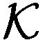 是一个凸集，且满足 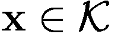。这意味着对于任意标量 *α* ≥ 0，都有 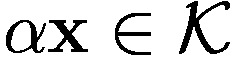。图 10-15 展示了 *ℝ*³ 中的一个凸锥。

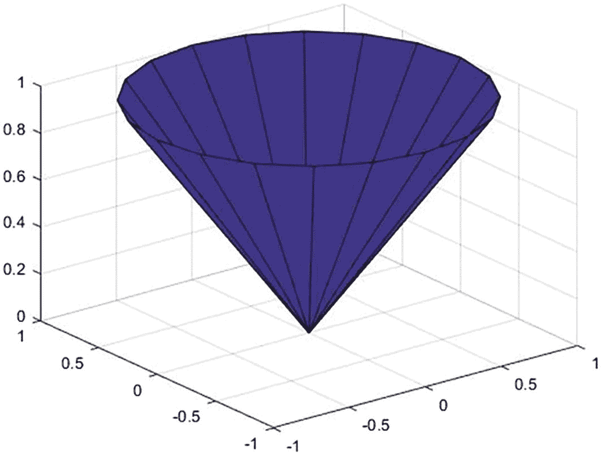

**图 10-15** 一个凸锥

并非所有锥都是凸的。例如，下面的一维锥就不是凸的（见图 10-16）：

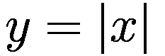

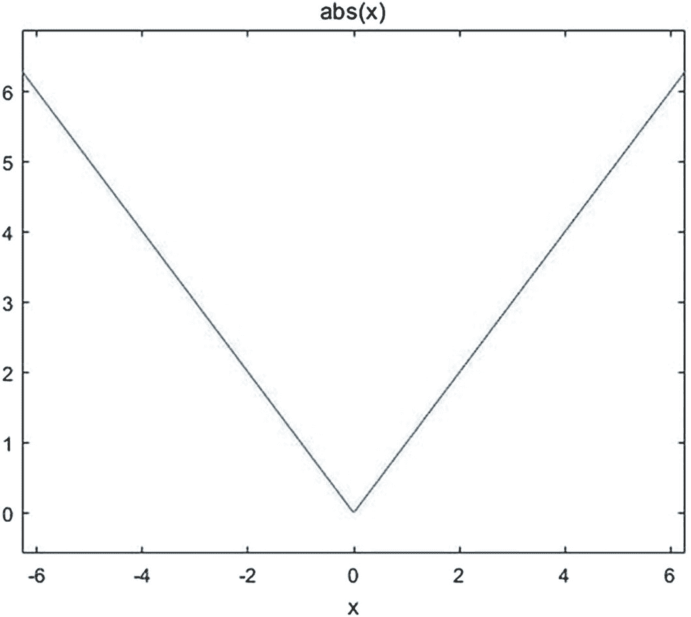

**图 10-16** 一个非凸锥

两个点 (−2, 2) 和 (2, 2) 的中点 (0, 2) 不在该曲线上。

## 范数锥与二阶锥

*范数锥*定义如下：

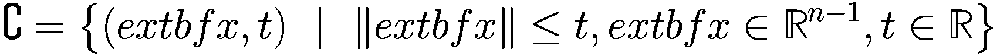

二阶锥是欧几里得空间中的范数锥。其定义如下：

![ $$ \mathcal{K}=\left\{\left[\begin{array}{c}t\\ {}\textbf{u}\end{array}\right]\kern0.5em |\kern0.5em \left\Vert \textbf{u}\right\Vert \le t,\textbf{u}\in {\mathbb{R}}^{n-1},t\in \mathbb{R}\right\} $$ ](images/528380_1_En_10_Chapter/528380_1_En_10_Chapter_TeX_Equke.png)

图 10-17 展示了维度为 1、2 和 3 的二阶锥。

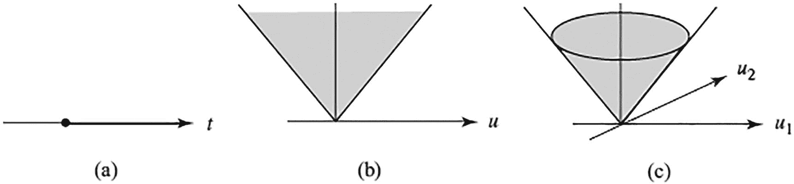

**图 10-17** 1、2、3 维的二阶锥 (Antoniou & Lu, 2007)

## SOCP 问题

原始 SOCP 问题表述如下：

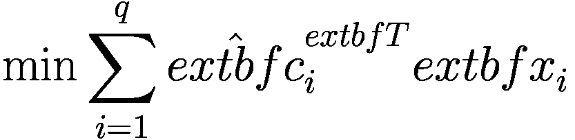

满足以下约束：

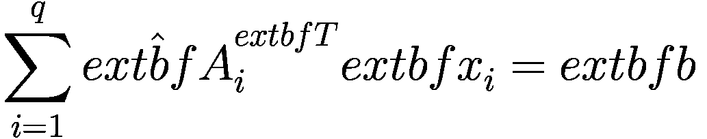

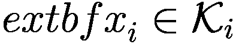，*i* = 1, ..., *q*

其中 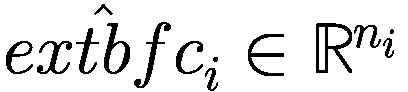，，，**b** ∈ *ℝ*^*m*。

 是维度为 *n*[*i*] 的二阶锥。SOCP 问题中的每个变量向量 **x**[*i*] 都被约束在一个二阶锥  中。

### 对偶形式

SOCP 问题的对偶形式表述如下：


满足以下约束：


，*i* = 1, ..., *q*

其中 `y` ∈ ℝ^(*m*) 且 。

如果令


![ $$ {\hat{\textbf{A}}}_{\textbf{i}}^{\textbf{T}}=\left[\begin{array}{c}{\textbf{b}}_i^{\textbf{T}}\\ {}{\textbf{A}}_i^{\textbf{T}}\end{array}\right] $$ ](images/528380_1_En_10_Chapter/528380_1_En_10_Chapter_TeX_Equkk.png)

![ $$ {\hat{\textbf{c}}}_i=\left[\begin{array}{c}{d}_i\\ {}{\textbf{c}}_i\end{array}\right] $$ ](images/528380_1_En_10_Chapter/528380_1_En_10_Chapter_TeX_Equkl.png)

其中 `b[i]` ∈ ℝ^(*m*)，`d[i]` 是一个标量，则 SOCP 问题的对偶问题可以写成如下标准形式：


满足以下约束：


## NM Dev 实现

NM Dev 类 `SOCPGeneralConstraint` 实现了标准形式的约束条件。该类的签名如下：

```java
public class SOCPGeneralConstraint {

    private final Matrix A;
    private final Vector c;
    private final Vector b;
    private final double d;

    /**
     * 构造一个 SOCP 通用约束。
     *
     * @param A A
     * @param c c
     * @param b b
     * @param d d
     */
    public SOCPGeneralConstraint(
        Matrix A,
        Vector c,
        Vector b,
        double d
    ) {
        this.A = A;
        this.c = c;
        this.b = b;
        this.d = d;
    }

    /**
     * 获取系数矩阵 A。
     *
     * @return A
     */
    public Matrix getA() {
        return A;
    }

    /**
     * 获取系数向量 c。
     *
     * @return c
     */
    public Vector getC() {
        return c;
    }

    /**
     * 获取系数向量 b。
     *
     * @return b
     */
    public Vector getB() {
        return b;
    }

    /**
     * 获取常数 d。
     *
     * @return d
     */
    public double getD() {
        return d;
    }
}
```


NM Dev 还通过 `SOCPLinearEquality` 类支持 SOCP 等式约束。


该类的签名如下：

```java
public class SOCPLinearEquality {
    private final Matrix A;
    private final Vector c;

    public SOCPLinearEquality(Matrix A, Vector c) {
        assertTrue(
            A.nCols() == c.size(),
            "A.nCols() (%d) == c.size() (%d)",
            A.nCols(), c.size()
        );
        this.A = A;
        this.c = c;
    }

    /**
     * @return 矩阵 A
     */
    public Matrix A() {
        return A;
    }

    /**
     * @return 向量 c
     */
    public Vector c() {
        return c;
    }
}
```

## SOCPGeneralProblem 类

NM Dev 类 `SOCPGeneralProblem` 用于构造一个标准形式的 SOCP 问题。该类的签名如下：

```java
public class SOCPGeneralProblem extends SOCPDualProblem {
    /**
     * 拷贝构造函数。
     *
     * @param that 另一个 {@linkplain SOCPGeneralProblem}
     */
    public SOCPGeneralProblem(SOCPGeneralProblem that);

    /**
     * 构造一个通用的二阶锥规划问题。最小化
     * \[
     * f^T x
     * \]
     * 满足 SOCP 约束
     * \[
     * \lVert A_i x + b_i \rVert_2 \leq c_i^T x + d_i,\quad i = 1,\dots,m
     * \]
     *
     * @param f           f
     * @param constraints SOCP 约束
     */
    public SOCPGeneralProblem(
        Vector f,
        SOCPGeneralConstraint[] constraints
    );

    /**
     * 构造一个通用的二阶锥规划问题。最小化
     * \[
     * f^T x
     * \]
     * 满足 SOCP 约束
     * \[
     * \lVert A_i x + b_i \rVert_2 \leq c_i^T x + d_i,\quad i = 1,\dots,m
     * \]
     *
     * @param f           f
     * @param constraints SOCP 约束
     */
    public SOCPGeneralProblem(
        Vector f,
        List constraints
    );
}
```


事实证明，这种标准形式的 SOCP 与工程和科学中的许多凸规划问题（例如量化金融）有直接联系。

## 投资组合优化

我们在第 10.3 节中将经典的现代投资组合理论阐述为一个二次规划问题。


满足以下约束：


在实践中，您可以添加其他约束以匹配真实的交易场景。假设您是一家大型银行，想要出售大量股票。您不想简单地将股票抛售到市场上，这会导致价格急剧下跌，进而对您的出售不利。您希望在重新平衡大型股票投资组合时最小化市场冲击。股票的市场冲击通常被建模为与股票成交量的 3/2 次方成正比。最小化市场冲击的约束通常表述如下：


其中 `m[j]` 是股票的市场冲击系数；`x[j]` 是股票成交量、头寸或权重；`t[2]` 是可接受容忍度的常数。

由于存在 3/2 次方的项，这不是一个线性约束。然而，它可以被表述为一个 SOCP 约束，并且投资组合优化问题可以作为 SOCP 问题进行表述和求解。

令 `x̄ = |x|`，市场冲击项转化为如下形式：


通过引入变量 `y = x + w⁰`（`w⁰` 表示上一次或原始的股票头寸，`x` 表示调整量或交易量，`y` 表示新的股票头寸）、`α` 和 `β`，上述不等式等价于：


这些约束可以进一步转化为：


因此，您得到：


最后一个不等式，，等价于：


因为  可以从其他约束中推导得出，因此可以从约束系统中删除。上述约束条件可以改写为：


综合所有约束条件，市场冲击的约束系统如下：

![ $$ \left\{\begin{array}{c}{\parallel 0\parallel}_2\leqslant {t}_2-\sum \limits_{j=1}^n{\beta}_j\\ {}{\parallel 0\parallel}_2\leqslant {\overline{x}}_j-\left({y}_j-{w}_j⁰\right)\\ {}{\parallel 0\parallel}_2\leqslant {\overline{x}}_j-\left(-{y}_j+{w}_j⁰\right)\\ {}{\parallel \left(\begin{array}{c}{\overline{x}}_{ extbf{j}}\\ {}\frac{\beta_j}{2{m}_j}-\frac{s_j}{2}\end{array}\right)\parallel}_2\leqslant \frac{\beta_j}{2{m}_j}+\frac{s_j}{2}\\ {}{\parallel \left(\begin{array}{c}{s}_{ extbf{j}}\\ {}\frac{1-{\overline{x}}_{ extbf{j}}}{2}\end{array}\right)\parallel}_2\leqslant \frac{1+{\overline{x}}_{ extbf{j}}}{2}\end{array}\right. $$ ](img/528380_1_En_10_Chapter_TeX_Equlc.png)

然后，标准形式的 SOCP 约束如下：

![ $$ \left\{\begin{array}{c}{\left\Vert 0\right\Vert}_2\le {t}_2-\sum \limits_{j=1}^n{\beta}_j\iff {\left\Vert { extbf{A}}_{\textbf{1}}^{ extbf{T}} extbf{z}+{ extbf{C}}_{\textbf{1}}\right\Vert}_2\le { extbf{b}}_{\textbf{1}}^{ extbf{T}} extbf{z}+{d}_1\\ {}{ extbf{A}}_{\textbf{1}}^{ extbf{T}}={\textbf{0}}_{\textbf{1}\times extbf{n}},{ extbf{C}}_{\textbf{1}}=\textbf{0},{ extbf{b}}_{\textbf{1}}=\left(\begin{array}{c}-{\textbf{1}}_{n\times 1}\\ {}\textbf{1}\end{array}\right),{d}_1=0, extbf{z}=\left(\begin{array}{c} extbf{\beta} \\ {}{t}_2\end{array}\right)\kern0.5em \end{array}\right. $$ ](img/528380_1_En_10_Chapter_TeX_Equld.png)

以及如下形式：

![ $$ \left\{\begin{array}{c}{\left\Vert 0\right\Vert}_2\le {\overline{x}}_j-\left({y}_j-{w}_j⁰\right)\iff {\left\Vert { extbf{A}}_{\textbf{2}, extbf{j}}^{ extbf{T}} extbf{z}+{ extbf{C}}_{\textbf{2},\textbf{j}}\right\Vert}_2\le { extbf{b}}_{\textbf{2},\textbf{j}}^{ extbf{T}} extbf{z}+{d}_{2,j}\\ {}{ extbf{A}}_{\textbf{2}, extbf{j}}^{ extbf{T}}={\textbf{0}}_{\textbf{1}\times \textbf{2} extbf{n}},{ extbf{C}}_{\textbf{2}, extbf{j}}=\textbf{0},{ extbf{b}}_{\textbf{2}, extbf{j}}=\left(\begin{array}{c}-{ extbf{e}}_j\\ {}{ extbf{e}}_j\end{array}\right),{d}_{2,j}={w}_j⁰, extbf{z}=\left(\begin{array}{c} extbf{y}\\ {}\overline{x}\end{array}\right)\end{array}\right. $$ ](img/528380_1_En_10_Chapter_TeX_Equle.png)

![ $$ \left\{\begin{array}{c}{\left\Vert 0\right\Vert}_2\le {\overline{x}}_j-\left(-{y}_j+{w}_j⁰\right)\iff {\left\Vert { extbf{A}}_{\textbf{3}, extbf{j}}^{ extbf{T}} extbf{z}+{ extbf{C}}_{\textbf{3}, extbf{j}}\right\Vert}_2\le { extbf{b}}_{\textbf{3}, extbf{j}}^{ extbf{T}} extbf{z}+{d}_{3,j}\\ {}{ extbf{A}}_{\textbf{3}, extbf{j}}^{ extbf{T}}={\textbf{0}}_{\textbf{1}\times \textbf{2} extbf{n}},{ extbf{C}}_{\textbf{3}, extbf{j}}=\textbf{0},{ extbf{b}}_{\textbf{3}, extbf{j}}=\left(\begin{array}{c}{ extbf{e}}_j\\ {}{ extbf{e}}_j\end{array}\right),{d}_{3,j}=-{w}_j⁰, extbf{z}=\left(\begin{array}{c} extbf{y}\\ {}\overline{x}\end{array}\right)\end{array}\right. $$ ](img/528380_1_En_10_Chapter_TeX_Equlf.png)

其中 `e[j]` 是一个 *n* 维向量，其第 *j* 个条目为 1，其余条目皆为 0。

此外，你会得到以下内容：

![ $$ \left\{\begin{array}{c}{\parallel \left(\begin{array}{c}{\overline{x}}_{ extbf{j}}\\ {}\frac{\beta_j}{2{m}_j}-\frac{s_j}{2}\end{array}\right)\parallel}_2\leqslant \frac{\beta_j}{2{m}_j}+\frac{s_j}{2}\iff {\parallel {A}_{\textbf{4},j}^Tz+{C}_{\textbf{4},j}\parallel}_2\leqslant {b}_{\textbf{4},j}^Tz+{d}_{4,j}\\ {}{A}_{\textbf{4},j}^T=\left(\begin{array}{ccc}{e_j}^T&amp; {\textbf{0}}_{\textbf{1}\times n}&amp; {\textbf{0}}_{\textbf{1}\times n}\\ {}{\textbf{0}}_{\textbf{1}\times n}&amp; \frac{1}{2{m}_j}{e_j}^T&amp; -\frac{1}{2}{e_j}^T\end{array}\right),{C}_{\textbf{4},j}={\textbf{0}}_{\textbf{2}\times \textbf{1}},{b}_{\textbf{4},j}=\left(\begin{array}{c}{\textbf{0}}_{n\times \textbf{1}}\\ {}\frac{1}{2{m}_j}{e}_j\\ {}\frac{1}{2}{e}_j\end{array}\right),{d}_{4,j}=0,z=\left(\begin{array}{c}\overline{x}\\ {}{\beta}_j\\ {}s\end{array}\right)\end{array}\right. $$ ](img/528380_1_En_10_Chapter_TeX_Equlg.png)

![ $$ \left\{\begin{array}{c}{\parallel \left(\begin{array}{c}{s}_{ extbf{j}}\\ {}\frac{1-{\overline{x}}_{ extbf{j}}}{2}\end{array}\right)\parallel}_2\leqslant \frac{1+{\overline{x}}_{ extbf{j}}}{2}\iff {\parallel {A}_{\textbf{5},j}^Tz+{C}_{\textbf{5},j}\parallel}_2\leqslant {b}_{\textbf{5},j}^Tz+{d}_{5,j}\\ {}{A}_{\textbf{5},j}^T=\left(\begin{array}{cc}{\textbf{0}}_{\textbf{1}\times n}&amp; {e_j}^T\\ {}-\frac{1}{2}{e_j}^T&amp; {\textbf{0}}_{\textbf{1}\times n}\end{array}\right),{C}_{\textbf{5},j}=\left(\begin{array}{c}\textbf{0}\\ {}\frac{1}{2}\end{array}\right),{b}_{\textbf{5},j}=\left(\begin{array}{c}\frac{1}{2}{e}_j\\ {}{\textbf{0}}_{n\times \textbf{1}}\end{array}\right),{d}_{5,j}=\frac{1}{2},z=\left(\begin{array}{c}\overline{x}\\ {}s\end{array}\right)\end{array}\right. $$ ](img/528380_1_En_10_Chapter_TeX_Equlh.png)

名为 `MarketImpact1` 的 NM Dev 类实现了此 SOCP 约束，用于高级投资组合优化。该类的签名如下：

```java
```

public class `MarketImpact1` extends `SOCPPortfolioConstraint` {

/**

* 构造一个市场冲击项。

*

* @param `w_0` 初始持仓

* @param `m`   市场冲击参数

*/

public `MarketImpact1`(Vector `w_0`, Vector `m`);

}

```

上述示例展示了如何将非线性约束转换为标准形式的一组 `SOCP` 约束。类似的技术也可应用于其他非线性约束。`NM FinTech` 目前支持的其他 `SOCPPortfolioConstraint` 约束如下：

*   `SOCPMaximumLoan`：股票允许的最大借款额
*   `SOCPNoTradingList1`：禁止交易的股票黑名单
*   `SOCPSectorExposure`：行业允许的最大风险敞口
*   `SOCPSectorNeutrality`：行业中性投资组合
*   `SOCPSelfFinancing`：自融资投资组合
*   `SOCPZeroValue`：零成本投资组合

你可以在 `NM FinTech` 包中找到更多信息：

```text
tech.nmfin.portfoliooptimization
```

或者，请访问网站：

[`nmfin.tech/`](https://nmfin.tech/)

### 10.5.2 `SOCP` 问题的原始-对偶方法

设：

`c = [c_1 c_2 ... c_q]^T`
`x = [x_1 x_2 ... x_q]^T`
`s = [s_1 s_2 ... s_q]^T`
`A = [A_1 A_2 ... A_q]^T`
`K = K_1 * K_2 * ... * K_q`

其中 `K_1`, `K_2`, ..., `K_q` 是二阶锥，而 `K` 表示一个二阶锥，其元素为 `x = [x_1 x_2 ... x_q]^T`，且满足 `x_i ∈ K_i`。那么，原始 `SOCP` 问题可以写成如下形式：

`min c^T x`

需满足以下约束条件：

`Ax = b, x ∈ K`

或者，写成对偶形式，可以得到：

`max b^T y`

需满足以下约束条件：

`A^T y + s = c, s ∈ K`

因此，`x` 与 `(s, y)` 之间的对偶间隙如下：

`δ(x, s, y) = c^T x - b^T y = (A^T y + s)^T x - b^T y = s^T x`

对于原始-对偶解 `(x, s, y) ∈ K * K * R^m`，其 `KKT` 条件如下：

`Ax = b`
`A^T y + s = c`
`x^T s = 0`

假设在第 `k` 次迭代后，向量集为 `(x^k, s^k, y^k)`。下一次更新如下：

`(x_{k+1}, s_{k+1}, y_{k+1}) = (x_k, s_k, y_k) + α_k (Δx, Δs, Δy)`

其中 `α_k` 是一个正标量。

`(Δx, Δs, Δy)` 通过求解如下方程组得到：

`A Δx = b - Ax`
`A^T Δy + Δs = c - s - A^T y`
`S Δx + X Δs = σ μ e - Xs`

其中

`e = [1 1 ... 1]^T`

`X = diag{X_1, ..., X_q}`, `X_i = [[t_i, u_i^T], [u_i, t_i I_i]]`

`S = diag{S_1, ..., S_q}`

`μ = x^T s / q`

`σ` 是一个小的正标量。`I_i` 是一个 `n_i - 1` 阶的单位矩阵。可以证明，向量集 `(x^k, s^k, y^k)` 经过更新后，新的向量集 `(x^{k+1}, s^{k+1}, y^{k+1})` 能更好地近似 `KKT` 条件，从而产生更小的对偶间隙。

Antoniou & Lu (2007) 提供了用于求解 `SOCP` 问题的内点算法细节，如下所述。

#### 二阶锥规划问题的原始-对偶内点算法

**步骤 1**

输入问题描述 `{A, b, c}`，参数 `q` 和 `{n[i]}`（其中 `i = 1, 2, ..., q`），以及容差 `ε`。

输入可行域内部的一个初始向量组 `(x[0], s[0], y[0])`。

设定 `δ0 = (x0^T s0) / q`， `σ = 10^(−5)`。

设定迭代计数器 `k = 0`。

**步骤 2**

求解 `(Δx, Δs, Δy)`。

**步骤 3**

选择 `α[k]`。

**步骤 4**

更新 `(x[k+1], s[k+1], y[k+1]) = (x[k], s[k], y[k]) + α[k] (Δx, Δs, Δy)`。

**步骤 5**

计算如下：

`δ[k+1] = (x_{k+1}^T s_{k+1}) / q`

若 `δ[k+1] ≤ ε`，则输出解 `(x^{*}, s^{*}, y^{*}) = (x[k+1], s[k+1], y[k+1])` 并停止。

否则，令 `k = k + 1` 并重复步骤 2。

Antoniou & Lu (2007) 提供了以下示例来演示该算法：

`min δ`

满足以下约束：

`[((x1 - x3)² + (x2 - x4)²)]^{1/2} ≤ δ`
`[x1 x2] [[0.25, 0], [0, 1]] [x1; x2] - [x1 x2] [0.5; 0] ≤ 0.75`
`[x3 x4] [[0.625, 0.375], [0.375, 0.625]] [x3; x4] - [x3 x4] [5.5; 6.5] ≤ -17.5`

首先将问题写为标准形式。令：

`x = [δ x1 x2 x3 x4]^T`

该 `SOCP` 问题可写为：

`min b^T x`

满足以下约束：

`||A_i^T x + c_i|| ≤ b_i^T x + d_i`

其中：

`b = [1 0 0 0 0]^T`
`A1^T = [[0, -1, 0, 1, 0], [0, 0, 1, 0, -1]]`
`A2^T = [[0, 0.5, 0, 0, 0], [0, 0, 1, 0, 0]]`
`A3^T = [[0, 0, 0, -0.7071, -0.7071], [0, 0, 0, -0.3536, 0.3536]]`
`b1 = b, b2 = 0, b3 = 0`
`c1 = 0, c2 = [-0.5; 0], c3 = [4.2426; -0.7071]`
`d1 = 0, d2 = 1, d3 = 1`

为了生成一个严格可行的初始向量组 `(x[0], s[0], y[0])`，尝试以下取值：

`[x1 x2 x3 x4] = [1.5 0.5 2.5 4]`
`y0 = [β -1.5 -0.5 -2.5 -4]^T`

其中 `β` 是一个标量，用于确保 `s[0]` 是一个内点。

`s0 = c - A^T y = [β 1 3.5 0 0 1 0.25 0.5 -0.3535 -0.1767]^T`

当 `n[1] = 5, n[2] = 3, n[3] = 3` 时，选择 `β = 3.7` 可以保证 `s[0]` 是一个内点。由此可得：

`y0 = [3.7 -1.5 -0.5 -2.5 -4]^T`
`s0 = [3.7 1 3.5 0 0 1 0.25 0.5 1 -0.3535 -0.1767]^T`
`x0 = [1 0 0 0 0 0.1 0 0 0.1 0 0]^T`

设定 `ε = 10^(−4)`，该算法经过 15 次迭代后返回一个解。

`y* = [-1.707791 -2.044005 -0.852730 -2.544838 -2.485646]^T`

名为 `PrimalDualInteriorPointMinimizer` 的 `NM Dev` 类实现了该算法。以下代码解决了上述示例问题：

```kotlin
fun problem() : SOCPGeneralProblem {

    // 最小化 f'x
    val f: Vector = DenseVector(1.0, 0.0, 0.0, 0.0, 0.0)

    // 锥约束中的 A 矩阵
    val A1t: Matrix = DenseMatrix(arrayOf(doubleArrayOf(0.0, -1.0, 0.0, 1.0, 0.0), doubleArrayOf(0.0, 0.0, 1.0, 0.0, -1.0)))
    val A2t: Matrix = DenseMatrix(arrayOf(doubleArrayOf(0.0, 0.5, 0.0, 0.0, 0.0), doubleArrayOf(0.0, 0.0, 1.0, 0.0, 0.0)))
    val A3t: Matrix = DenseMatrix(arrayOf(doubleArrayOf(0.0, 0.0, 0.0, -0.7071, -0.7071), doubleArrayOf(0.0, 0.0, 0.0, -0.3536, 0.3536)))

    // 锥约束中的 b 向量
```

```
val b1: Vector = f

val b2: Vector = f.ZERO()

val b3: Vector = f.ZERO()

// 锥约束中的 c 向量

val c1: Vector = DenseVector(2) // 零向量

val c2: Vector = DenseVector(-0.5, 0.0)

val c3: Vector = DenseVector(4.2426, -0.7071)

// 锥约束中的 d 常数

val d = doubleArrayOf(0.0, 1.0, 1.0)

val constraints: kotlin.collections.List = java.util.Arrays.asList(

SOCPGeneralConstraint(A1t.t(), c1, b1, d[0]),

SOCPGeneralConstraint(A2t.t(), c2, b2, d[1]),

SOCPGeneralConstraint(A3t.t(), c3, b3, d[2])

)

// 待求解的 SOCP 问题

val problem: SOCPGeneralProblem = SOCPGeneralProblem(

f,

constraints) // ||Ax + b||  = solver.solve(p)

soln.search(soln0)

// 原始解

println("X = ")

println(soln.minimizer().x)

// 对偶解

println("Y = ")

println(soln.minimizer().y)

println("S = ")

println(soln.minimizer().s)

println("minimum = " + soln.minimum())
```

输出如下：

```
X = 

[1.000000, -0.292607, 0.956232, 1.121095, -0.585213, -0.956232, 1.288558, -0.883070, 0.938384]

y =

[-1.707796, -2.043378, -0.853136, -2.544339, -2.485799]

S =

[1.707796, 0.500961, -1.632663, 1.000000, 0.521689, 0.853136, 1.000000, 0.685789, -0.727800]

minimum = -1.7077862121401681
```

截至 2014 年 1 月 9 日，该 SOCP 求解器在解决一个大型投资组合优化问题时，测试了多达 6,000 个变量和 26,000 个约束条件，仅用五分钟就返回了结果。

## 10.6 一般非线性优化问题

最一般的优化问题类别是目标函数和约束条件均为非线性的情况。有众多方法可以解决这类问题，例如第 11 章讲述的罚函数法。在本节中，我们将介绍序列二次规划（SQP）方法。当目标函数和约束条件均为二次连续可微时，它是求解一般约束问题的最有效方法之一。SQP 适用于小型和大型问题，并且非常适合求解具有显著非线性的问题。SQP 方法可以看作是无约束优化中牛顿法的推广，它通过最小化问题的二次模型来寻找远离当前点的步长。

### 10.6.1 仅含等式约束的 SQP 问题

考虑以下优化问题：


服从以下约束条件：

`ai = 0, i = 1, ..., p`

其中，`f`和`a[i]`是连续函数，且具有连续的一阶和二阶偏导数。假设可行域非空且`p ≤ n`。极小化的一阶必要条件由拉格朗日乘子法给出，如下所示：


假设你已获得第`k`次迭代集合`{**x**[k]`, `**λ**[k]}`，并假定其与解`{**x**^(∗)`, `**λ**^(∗)}`足够接近，现在想要找到一个增量`{δ[**x**]`, `δ[**λ**]}`，使得下一次迭代更接近最优点。利用泰勒级数，可以得到下式：

![ $$ \nabla \mathcal{L}\left({ extbf{x}}_{k+1},{ extbf{\lambda}}_{k+1}\right)\approx \nabla \mathcal{L}\left({ extbf{x}}_k,{ extbf{\lambda}}_k\right)+{\nabla}²\mathcal{L}\left({ extbf{x}}_k,{ extbf{\lambda}}_k\right)\left[\begin{array}{c}{\delta}_{ extbf{x}}\\ {}{\delta}_{ extbf{\lambda}}\end{array}\right] $$ ](images/528380_1_En_10_Chapter/528380_1_En_10_Chapter_TeX_Equnb.png)

如果`∇ℒ(`**x**`[k+1]`, `**λ**`[k+1]) = 0`，那么`{**x**[k+1]`, `**λ**[k+1]}`是对`{**x**^(∗)`, `**λ**^(∗)}`的一个更好的近似。也就是说，可以得到下式：

![ $$ {\nabla}²\mathcal{L}\left({ extbf{x}}_k,{ extbf{\lambda}}_k\right)\left[\begin{array}{c}{\delta}_{\textbf{x}}\\ {}{\delta}_{ extbf{\uplambda}}\end{array}\right]=-\nabla \mathcal{L}\left({ extbf{x}}_k,{ extbf{\lambda}}_k\right) $$ ](images/528380_1_En_10_Chapter/528380_1_En_10_Chapter_TeX_Equnc.png)

你可以将上式用拉格朗日函数在`{**x**`, `**λ**} = {**x**[k]`, `**λ**[k]}`处的黑塞矩阵`**W**`以及`**x = x**[k]`处的雅可比矩阵`**A**`重写如下：

![ $$ \left[\begin{array}{cc}{ extbf{W}}_k&amp; -{ extbf{A}}_k^T\\ {}-{ extbf{A}}_k&amp; \textbf{0}\end{array}\right]\left[\begin{array}{c}{\delta}_{ extbf{x}}\\ {}{\delta}_{ extbf{\lambda}}\end{array}\right]=\left[\begin{array}{c}{ extbf{A}}_k^T{ extbf{\lambda}}_k-{ extbf{g}}_k\\ {}{ extbf{a}}_k\end{array}\right] $$ ](images/528380_1_En_10_Chapter/528380_1_En_10_Chapter_TeX_Eqund.png)

其中：


![ $$ { extbf{A}}_k=\left[\begin{array}{c}{\nabla}_{\textbf{x}}^T{a}_1\left({ extbf{x}}_k\right)\\ {}{\nabla}_{\textbf{x}}^T{a}_2\left({ extbf{x}}_k\right)\\ {}\vdots \\ {}{\nabla}_{\textbf{x}}^T{a}_p\left({ extbf{x}}_k\right)\end{array}\right] $$ ](images/528380_1_En_10_Chapter/528380_1_En_10_Chapter_TeX_Equnf.png)


![ $$ { extbf{a}}_k=\left[{a}_1\left({\textbf{x}}_k\right)\kern1em {a}_2\left({ extbf{x}}_k\right)\kern1em \dots \kern1.25em {a}_p\left({ extbf{x}}_k\right)\right] $$ ](images/528380_1_En_10_Chapter/528380_1_En_10_Chapter_TeX_Equnh.png)

如果 `W[k]` ≻ 0 且 `A[k]` 满秩，那么该方程的解，即 $$ \left[\begin{array}{c}{\delta}_{ extbf{x}}\\ {}{\delta}_{ extbf{\lambda}}\end{array}\right] $$，存在。要计算`δ[x]`，可以将矩阵方程展开为如下形式：


这两个方程实质上就是`δ[x]`对应的 QP 问题的一阶必要最优性条件。也就是说，可以得到：


满足以下约束条件：


这是一个仅含等式约束的 QP 问题。可以使用第 10.3.1 节中的算法求解。一旦求出`δ[x]`，下一次迭代的点为：


`λ[k + 1]`, `W[k + 1]`, `g[k + 1]`, `A[k + 1]` 可以通过之前的方程求得。持续这个过程，直到算法收敛，即当`‖δ[x]‖` 足够小时停止。这种反复求解 QP 子问题的迭代方法称为序列二次规划（SQP）。本质上，SQP 所做的是迭代地最小化拉格朗日函数 ℒ(`x`, `λ`) 的二阶近似，而不是函数 `f`(`x`) 本身。

Antoniou & Lu (2007) 讨论了以下示例：


满足以下约束条件：


给定 **x[k]** = [*x*[1] *x*[2] *x*[3]]^(T) 和 `λ[k]` = [`λ`[1] `λ`[2]]^(T)，可以得到以下结果：

![ $$ { extbf{g}}_k=\left[\begin{array}{c}-4{x}_1³-2{x}_1{x}_2²-2{x}_1{x}_3²\\ {}-8{x}_2³-2{x}_1²{x}_2\\ {}-4{x}_3³-2{x}_1²{x}_3\end{array}\right] $$ ](images/528380_1_En_10_Chapter/528380_1_En_10_Chapter_TeX_Equno.png)

![ $$ { extbf{A}}_k=\left[\begin{array}{ccc}4{x}_1³&amp; 4{x}_2³&amp; 4{x}_3³\\ {}16{x}_1&amp; 28{x}_2&amp; 14{x}_3\end{array}\right] $$ ](images/528380_1_En_10_Chapter/528380_1_En_10_Chapter_TeX_Equnp.png)

![ $$ { extbf{a}}_k=\left[\begin{array}{c}{x}_1⁴+{x}_2⁴+{x}_3⁴-25\\ {}8{x}_1²+14{x}_2²+7{x}_3²-56\end{array}\right] $$ ](images/528380_1_En_10_Chapter/528380_1_En_10_Chapter_TeX_Equnq.png)

给定 `x[k]` = [3 1.5 3]^(T) 和 `λ[k]` = [−1 −1]^(T)，算法求得解：

![ $$ { extbf{x}}^{\ast }=\left[\begin{array}{c}1.874065\\ {}-0.465820\\ {}1.884720\end{array}\right] $$ ](images/528380_1_En_10_Chapter/528380_1_En_10_Chapter_TeX_Equnr.png)


名为 `SQPActiveSetOnlyEqualityConstraint1Minimizer` 的 NM Dev 类实现了此算法，用于求解仅含等式约束的 SDP 问题。以下示例代码求解了上述示例：

```kotlin
```

# 目标函数

```kotlin
val f: RealScalarFunction = object : RealScalarFunction {
    override fun evaluate(x: Vector): Double {
        val x1: Double = x.get(1)
        val x2: Double = x.get(2)
        val x3: Double = x.get(3)

        var fx: Double = -x1.pow(4.0)
        fx -= 2.0 * x2.pow(4.0)
        fx -= x3.pow(4.0)
        fx -= (x1 * x2).pow(2.0)
        fx -= (x1 * x3).pow(2.0)

        return fx
    }

    override fun dimensionOfDomain(): Int {
        return 3
    }

    override fun dimensionOfRange(): Int {
        return 1
    }
}
```

# 等式约束

```kotlin
val equality_constraints: EqualityConstraints = GeneralEqualityConstraints(
    object : RealScalarFunction {
        override fun evaluate(x: Vector): Double {
            val x1: Double = x.get(1)
            val x2: Double = x.get(2)
            val x3: Double = x.get(3)

            var fx: Double = x1.pow(4.0)
            fx += x2.pow(4.0)
            fx += x3.pow(4.0)
            fx -= 25.0

            return fx // a1
        }

        override fun dimensionOfDomain(): Int {
            return 3
        }

        override fun dimensionOfRange(): Int {
            return 1
        }
    },
    object : RealScalarFunction {
        override fun evaluate(x: Vector): Double {
            val x1: Double = x.get(1)
            val x2: Double = x.get(2)
            val x3: Double = x.get(3)

            var fx: Double = 8.0 * x1.pow(2.0)
            fx += 14.0 * x2.pow(2.0)
            fx += 7.0 * x3.pow(2.0)
            fx -= 56.0

            return fx // a2
        }

        override fun dimensionOfDomain(): Int {
            return 3
        }

        override fun dimensionOfRange(): Int {
            return 1
        }
    }
)
```

# 构建一个 SQP 求解器

```kotlin
val solver = SQPActiveSetOnlyEqualityConstraint1Minimizer(
    object : SQPActiveSetOnlyEqualityConstraint1Minimizer.VariationFactory {
        override fun newVariation(
            f: RealScalarFunction?,
            equal: EqualityConstraints?
        ): SQPASEVariation {
            val impl = SQPASEVariation2(100.0, 0.01, 10)
            impl.set(f, equal)
            return impl
        }
    },
    1e-8, // epsilon，阈值
    20 // 最大迭代次数
)
```

# 求解一个 SQP 问题

```kotlin
val solution: IterativeSolution
    = solver.solve(f, equality_constraints)

val x: Vector = solution.search(
    DenseVector(3.0, 1.5, 3.0), // x0
    DenseVector(-1.0, -1.0)) // λ0

val fx: Double = f.evaluate(x)

// 打印解
println("x = " + x)
println("fx = " + fx)
```

输出如下：

```
x = [1.874065, -0.465820, 1.884720]
fx = -38.28482786994784
```

请注意，该问题存在多个解。更改参数，如 `x0`，将得到不同的解。另一个解如下：

![ $$ { extbf{x}}^{\ast }=\left[\begin{array}{c}1.874065\\ {}0.465820\\ {}1.884720\end{array}\right] $$ ](images/528380_1_En_10_Chapter/528380_1_En_10_Chapter_TeX_Equnt.png)

### 10.6.2 含不等式约束的 SQP 问题

你可以将之前的算法扩展到不等式约束的情形。考虑如下一般优化问题：


满足如下条件：

`c_j` ≥ 0，`i` = 1, 2, ...`q`

假设 `f` 和 {`c_j`} 是二次可微的。采用相同的思路，再次对于第 `k` 次迭代点 `{x_k, μ_k}`，寻找下一个迭代点的增量 `{δ_x, δ_μ}`，如下所示：


使其满足近似的 KKT 条件：


利用泰勒展开，可得下式：


结合最后两个方程，可得：

![$$ \mu_{k+1}\left[c_j\left(\textbf{x}_k\right)+\delta_{\textbf{x}}^T\nabla_{\textbf{x}}c_j\left(\textbf{x}_k\right)\right]=0 $$](images/528380_1_En_10_Chapter/528380_1_En_10_Chapter_TeX_Equod.png)

拉格朗日函数定义如下：


因此，可得以下各式：


其中，`A_k` 是约束条件在 `x_k` 处的雅可比矩阵，即：

![$$ \textbf{A}_k=\left[\begin{array}{c}\nabla_{\textbf{x}}^T c_1\left(\textbf{x}_k\right)\\ {}\vdots \\ {}\nabla_{\textbf{x}}^T c_q\left(\textbf{x}_k\right)\end{array}\right] $$](images/528380_1_En_10_Chapter/528380_1_En_10_Chapter_TeX_Equoi.png)

使用这些符号，近似的 KKT 条件可以写成如下形式：


其中，有：

![$$ \textbf{c}_k={\left[c_1\left(\textbf{x}_k\right)\quad c_2\left(\textbf{x}_k\right)\quad \dots \quad c_q\left(\textbf{x}_k\right)\right]}^T $$](images/528380_1_En_10_Chapter/528380_1_En_10_Chapter_TeX_Equon.png)

这些近似的 KKT 条件正是以下 QP 问题的精确 KKT 条件：


满足如下条件：


然后，在求解关于 `δ_x` 的 QP 子问题后，得到：


SQP 算法迭代地求解 QP 子问题，直至解收敛。

Antoniou & Lu (2007) 讨论了这个 SQP 示例。

![$$ \underset{\textbf{x}}{\min }f\left(\textbf{x}\right)=\frac{1}{2}\left[{\left(x_1-x_3\right)}²+{\left(x_2-x_4\right)}²\right] $$](images/528380_1_En_10_Chapter/528380_1_En_10_Chapter_TeX_Equor.png)

满足如下条件：

![$$ \left\{\begin{array}{c}c_1\left(\textbf{x}\right)=-\left[x_1\quad x_2\right]\left[\begin{array}{cc}\frac{1}{4}&amp; 0\\ {}0&amp; 1\end{array}\right]\left[\begin{array}{c}x_1\\ {}x_2\end{array}\right]+\left[x_1\quad x_2\right]\left[\begin{array}{c}\frac{1}{2}\\ {}0\end{array}\right]+\frac{3}{4}\ge 0\\ {}c_2\left(\textbf{x}\right)=-\frac{1}{8}\left[\begin{array}{cc}x_3 &amp; x_4\end{array}\right]\left[\begin{array}{cc}5&amp; 3\\ {}3&amp; 5\end{array}\right]\left[\begin{array}{c}x_3\\ {}x_4\end{array}\right]+\left[\begin{array}{cc}x_3 &amp; x_4\end{array}\right]\left[\begin{array}{c}\frac{11}{2}\\ {}\frac{13}{2}\end{array}\right]-\frac{35}{2}\ge 0\end{array}\right. $$](images/528380_1_En_10_Chapter/528380_1_En_10_Chapter_TeX_Equos.png)

其中：

![$$ \textbf{x}=\left[\begin{array}{c}x_1\\ {}x_2\\ {}x_3\\ {}x_4\end{array}\right] $$](images/528380_1_En_10_Chapter/528380_1_En_10_Chapter_TeX_Equot.png)

由于目标函数和约束条件都是二次的，海森矩阵 `Y_k` 与 `x_k` 无关，具体形式如下：

![$$ \textbf{Y}_k=\left[\begin{array}{cccc}1+\frac{\mu_1}{2}&amp; 0&amp; -1&amp; 0\\ {}0&amp; 1+2\mu_1&amp; 0&amp; -1\\ {}-1&amp; 0&amp; 1+\frac{5\mu_2}{4}&amp; \frac{3\mu_2}{4}\\ {}0&amp; -1&amp; \frac{3\mu_2}{4}&amp; 1+\frac{5\mu_2}{4}\end{array}\right]\succ 0 $$](images/528380_1_En_10_Chapter/528380_1_En_10_Chapter_TeX_Equou.png)

使用以下初始点：

![$$ \textbf{x}_0=\left[\begin{array}{c}1.0\\ {}0.5\\ {}2.0\\ {}3.0\end{array}\right] $$](images/528380_1_En_10_Chapter/528380_1_En_10_Chapter_TeX_Equov.png)

以及：

![$$ \textbf{\mu}_0=\left[\begin{array}{c}1\\ {}1\end{array}\right] $$](images/528380_1_En_10_Chapter/528380_1_En_10_Chapter_TeX_Equow.png)

其解如下：

![$$ \textbf{x}^{\ast }=\left[\begin{array}{c}2.044750\\ {}0.852716\\ {}2.544913\\ {}2.485633\end{array}\right] $$](images/528380_1_En_10_Chapter/528380_1_En_10_Chapter_TeX_Equox.png)

以及：

![ $$ { extbf{\mu}}^{\ast }=\left[\begin{array}{c}0.957480\\ {}1.100145\end{array}\right] $$ ](images/528380_1_En_10_Chapter/528380_1_En_10_Chapter_TeX_Equoy.png)

NM Dev 类 `SQPActiveSetOnlyInequalityConstraintMinimizer` 实现了该算法，用于解决仅含不等式约束的 SQP 问题。以下代码求解了之前的示例问题：

```

## 目标函数

```kotlin
// 目标函数
val f: RealScalarFunction = object : RealScalarFunction {
    override fun evaluate(x: Vector): Double {
        val x1: Double = x.get(1)
        val x2: Double = x.get(2)
        val x3: Double = x.get(3)
        val x4: Double = x.get(4)
        var fx: Double = (x1 - x3) * (x1 - x3)
        fx += (x2 - x4) * (x2 - x4)
        fx /= 2
        return fx
    }
    override fun dimensionOfDomain(): Int {
        return 4
    }
    override fun dimensionOfRange(): Int {
        return 1
    }
}
```

## 不等式约束

```kotlin
// 不等式约束
val greater = GeneralGreaterThanConstraints(
    // c1
    object : RealScalarFunction {
        override fun evaluate(x: Vector): Double {
            val x1: Double = x.get(1)
            val x2: Double = x.get(2)
            val x12: Matrix = DenseMatrix(
                arrayOf(
                    doubleArrayOf(x1, x2),
                    doubleArrayOf(2.0, 1.0)
                )
            )
            val A: Matrix = DenseMatrix(
                arrayOf(
                    doubleArrayOf(0.25, 0.0),
                    doubleArrayOf(0.0, 1.0)
                )
            )
            val B: Matrix = DenseMatrix(
                arrayOf(
                    doubleArrayOf(0.5, 0.0),
                    doubleArrayOf(2.0, 1.0)
                )
            )
            var FX: Matrix = x12.t().multiply(A).multiply(x12)
            FX = FX.scaled(-1.0)
            FX = FX.add(x12.t().multiply(B))
            var fx: Double = FX.get(1, 1)
            fx += 0.75
            return fx
        }
        override fun dimensionOfDomain(): Int {
            return 4
        }
        override fun dimensionOfRange(): Int {
            return 1
        }
    },
    // c2
    object : RealScalarFunction {
        override fun evaluate(x: Vector): Double {
            val x3: Double = x.get(3)
            val x4: Double = x.get(4)
            val x34: Matrix = DenseMatrix(
                arrayOf(
                    doubleArrayOf(x3, x4),
                    doubleArrayOf(2.0, 1.0)
                )
            )
            val A: Matrix = DenseMatrix(
                arrayOf(
                    doubleArrayOf(5.0, 3.0),
                    doubleArrayOf(3.0, 5.0)
                )
            )
            val B: Matrix = DenseMatrix(
                arrayOf(
                    doubleArrayOf(11.0 / 2.0, 13.0 / 2.0),
                    doubleArrayOf(2.0, 1.0)
                )
            )
            var FX: Matrix = x34.t().multiply(A).multiply(x34)
            FX = FX.scaled(-1.0 / 8.0)
            FX = FX.add(x34.t().multiply(B))
            var fx: Double = FX.get(1, 1)
            fx += -35.0 / 2.0
            return fx
        }
        override fun dimensionOfDomain(): Int {
            return 4
        }
        override fun dimensionOfRange(): Int {
            return 1
        }
    })
```

/** TODO: 将第二个精度参数设为 0 可获得更好的最小化结果 如何一般性地选择精度参数？ */

## 构建 SQP 求解器

```kotlin
// 构建 SQP 求解器
val solver = SQPActiveSetOnlyInequalityConstraintMinimizer(
    1e-7, // epsilon1
    1e-3, // epsilon2
    10 // 最大迭代次数
)
```

## 求解 SQP 问题

```kotlin
// 求解 SQP 问题
val solution: IterativeSolution = solver.solve(f, greater)
val x: Vector = solution.search(
    DenseVector(1.0, 0.5, 2.0, 3.0), // x0
    DenseVector(1.0, 1.0)) // μ0
val fx: Double = f.evaluate(x)
// 打印解
println("x = " + x)
println("fx = " + fx)
```

输出如下：

```
x = [2.044833, 0.852724, 2.545007, 2.485578]
fx = 1.4581925507489448
```

# 11. 启发式算法

在计算机科学和数学优化中，*启发式算法*是一种旨在为优化问题找到足够好解的程序，常用于前几章讨论的经典方法（LP、QP、SOCP、SDP 和 SQP）失效、过慢、不可行或不适用的情况。当问题规模过大（例如超出有限计算能力）、信息不完整或不完美（例如缺乏剪枝结构）、目标函数复杂（例如不可微）或约束条件困难（基于规则的约束、例外情况）时，尤其如此。启发式算法通常通过使用特定规则排除大量候选解来加速计算。等价地，它只搜索解空间的一个子集，而该空间原本可能过大，无法完全枚举或探索。这些特定规则通常对所求解问题及其解空间做出假设，它们可能也可能不排除真实解。尽管这些特定规则通常未被证明或赋予其性质，但在实践中，启发式算法常常能为许多原本无法解决的问题返回良好、可用的解，例如旅行商问题等整个NP-完全问题类。

经典优化算法旨在寻找全局最优解，且通常本质上是迭代和确定性的。相比之下，启发式算法的特定规则往往本质上是实验性的。它们旨在高效探索搜索空间，以找到足够好的解。这些算法通常利用一定随机性来探索搜索空间，因此找到的解依赖于所生成的随机变量集。这些特定算法涵盖从简单的局部搜索过程（例如爬山算法）到复杂的学习过程（例如遗传算法）。图 11-1 展示了*元启发式算法*不同分类的欧拉图。


图 11-1 元启发式算法不同分类的欧拉图

在组合优化中，例如旅行商问题，候选解的搜索空间随着问题规模的增大而呈超指数级增长。类似地，高维问题也面临维数灾难。对这些问题进行穷举搜索或解析方法寻找最优解是不可行的。启发式算法可以搜索大量可行解，以比其他穷举优化算法（如模拟退火）更少的计算量找到近似解。

本章的源代码可在 S2 平台上运行：

[`https://s21.nm.dev/hub/user-redirect/lab/tree/s2-public/Numerical%20Methods%20Using%20Kotlin/chapter11.ipynb`](https://s21.nm.dev/hub/user-redirect/lab/tree/s2-public/Numerical%2520Methods%2520Using%2520Kotlin/chapter11.ipynb)

源代码可在 GitHub 上找到：

[`https://github.com/apress/numerical-methods-kotlin`](https://github.com/apress/numerical-methods-kotlin)

## 11.1 罚函数法

罚函数法是一种将约束优化问题转化为无约束优化问题的方法，它通过将约束条件转化为罚项来实现。其思想是：当解位于可行域内时，罚项为零；当解位于可行域外时，罚项为正。通常你会给罚项分配一个较大的正数`M`作为系数，称为罚因子，以确保满足原始问题的约束条件。这种方法是在可行域内部进行搜索，约束边界就像一堵墙。如果当前解远离约束边界，罚项值很小，这表明解位于可行域内。此时无约束优化问题`F(x, M)`与原始约束优化问题`f(x)`相同。否则，罚项值趋近于无穷大，这表明解违反了某些约束条件。等价的无约束优化问题原则上可由任何无约束优化器求解，例如第 9 章中讨论的那些。NM Dev 默认使用 BFGS 最小化器`BFGSMinimizer`。参见图 11-2。


图 11-2 – 罚函数法

要搜索最优解`x*`，你可以从可行域或不可行域内的初始猜测值开始。如果从可行域开始，约束边界就像墙壁一样，你不会离开可行域。当当前解远离约束边界时，罚函数值非常小；否则，罚函数值接近无穷大，从而阻止解离开可行域。然而，为大规模问题实例寻找可行解可能是NP-难问题（一种描述计算机最难求解问题的复杂说法），这使得该方法无法应用。或者，你可以从任意位置或不可行域开始搜索，然后逐步移动到可行域。这样就不需要预先存在一个可行的初始解了。

考虑一个一般的约束优化问题，如下所示：
，满足约束条件：
`hi(x) = 0`，`i ∈ E = {1, 2, …, m}`
`gj(x) ≤ 0`，`j ∈ I = {1, 2, …, n}`
`{hi(x)}`是等式约束，`{gj(x)}`是不等式约束。

你可以通过对违反任何约束的行为进行惩罚，将原始问题转化为一个等价的无约束优化问题。罚函数法的一般形式如下：

`F(x)`是新的目标函数。`H`和`G`是罚项，它们分别是约束条件`{hi(x)}`和`{gj(x)}`的函数。`M`是罚因子。

将等式约束`{hi(x)}`转化为罚项`H`的一种方法是对它们的绝对值求和。具体如下：

`{pi}`是每个等式约束的权重。

NM Dev 类`AbsoluteErrorPenalty`通过一组等式约束来构建这样一个罚函数。其签名如下：
```java
/**
 * 根据一组等式约束构造绝对值罚函数。
 *
 * @param constraints 一组等式约束
 * @param weights     分配给这些约束的权重
 */
public AbsoluteErrorPenalty(EqualityConstraints constraints, double[] weights)
```

Courant 罚项是将等式约束`{hi(x)}`转化为罚项`H`的另一种方法。它计算平方值的和。具体如下：

`{pi}`是每个等式约束的权重。

NM Dev 类`CourantPenalty`通过一组等式约束来构建一个 Courant 罚函数。其签名如下：
```java
/**
 * 根据一组等式约束构造 CourantPenalty 罚函数。
 *
 * @param constraints 一组等式约束
 * @param weights     分配给这些约束的权重
 */
public CourantPenalty(EqualityConstraints constraints, double[] weights)
```

Fletcher 罚项是将不等式约束`{gj(x)}`转化为罚项`G`的一种方法。它计算大于 0 的平方误差之和。具体如下：

`{qj}`是每个不等式约束的权重。

NM Dev 类`FletcherPenalty`通过一组小于约束来构造一个 Fletcher 罚函数。（大于约束也可以通过取反符号转换为小于约束。）其签名如下：
```java
/**
 * 根据一组小于不等式约束构造 Fletcher 罚函数。
 *
 * @param constraints 一组小于不等式约束
 * @param weights     分配给这些约束的权重
 */
public FletcherPenalty(LessThanConstraints constraints, double[] weights)
```

## 罚函数法的缺点与改进

尽管罚函数法在理论上是可行的，但它存在一个缺点：罚因子 `M` 的值难以估计。如果取值过小，返回的解可能不可行，从而违反约束。如果取值过大，并且最优解位于（或接近）可行域边界，搜索将很快被推入可行域内部，而无法返回靠近可行域边界的位置。大的罚因子会阻碍搜索过程初始阶段对不可行域的探索。它还会导致严重的数值误差，即使解存在也可能无法找到。

这个缺点可以通过以下迭代过程来改善。首先，从一个较小但仍为正的大数 `M` 开始，找到 `F(x, M)` 的最优解 `x*`。如果 `x*` 不满足原始约束优化问题的约束条件，则增大 `M`（例如，乘以 10）。重复此过程，直到 `x*` 满足原始约束优化问题的约束条件。

## 在 NM Dev 中的实现

在 `NM Dev` 中，`PenaltyMethodMinimizer` 类实现了罚函数法。以下代码求解了这个约束优化问题：

$$ \underset{x,y}{\min }{\left(x+1\right)}²+{\left(y+1\right)}² $$

满足约束条件：

$$ y=0 $$

$$ x\ge 1 $$

```kotlin
val f: RealScalarFunction = object : AbstractBivariateRealFunction() {
    override fun evaluate(x: Double, y: Double): Double {
        // f = (x+1)² + (y+1)²
        return (x + 1) * (x + 1) + (y + 1) * (y + 1)
    }
}

val c1: RealScalarFunction = object : AbstractBivariateRealFunction() {
    override fun evaluate(x: Double, y: Double): Double {
        // y = 0
        return y
    }
}

val c2: RealScalarFunction = object : AbstractBivariateRealFunction() {
    override fun evaluate(x: Double, y: Double): Double {
        // x >= 1
        return 1 - x
    }
}

val problem: ConstrainedOptimProblemImpl1 = ConstrainedOptimProblemImpl1(
    f,
    GeneralEqualityConstraints(c1), // y = 0
    GeneralLessThanConstraints(c2)  // x >= 1
)

val M: Double = 1e30 // 惩罚因子
val optim: PenaltyMethodMinimizer = PenaltyMethodMinimizer(
    PenaltyMethodMinimizer.DEFAULT_PENALTY_FUNCTION_FACTORY,
    M,
    // 用于求解等价无约束优化问题的求解器
    BFGSMinimizer(false, 1e-8, 200)
)

val soln: IterativeSolution = optim.solve(problem)
val xmin: Vector = soln.search(
    DenseVector(arrayOf(0.0, 0.0)) // 初始猜测值
)
val fxmin: Double = f.evaluate(xmin) // 最小值
println(String.format("f(%s) = %f", xmin, fxmin))
// 或者
println(String.format("f(%s) = %f", soln.minimizer(), soln.minimum()))
```

输出结果如下：

```
f([1.000000, 0.000000] ) = 5.000000
f([1.000000, 0.000000] ) = 5.000000
```

`PenaltyFunctionFactory DEFAULT_PENALTY_FUNCTION_FACTORY` 根据等式约束和不等式约束构建惩罚项。它对等式约束使用 `CourantPenalty`，对不等式约束使用 `FletcherPenalty`。如果你希望以不同于默认实现的方式构建惩罚项，可以使用自定义的 `PenaltyFunctionFactory`。

## 11.2 遗传算法

遗传算法（GA）是一种模仿自然界生物进化规律的元启发式算法。它是一种模拟达尔文生物进化论中自然选择和遗传变异过程的计算模型。该算法通过数学和计算机仿真操作，将求解优化问题最优解的搜索过程，转化为类似于生物进化中染色体基因交叉、变异和选择的过程。与经典优化算法相比，在解决大规模复杂问题时，GA 可能在更短的时间内给出解。GA 已广泛应用于组合优化、机器学习、信号处理、自适应控制等领域。遗传算法由密歇根大学安娜堡分校的约翰·霍兰德教授及其学生在 20 世纪 70 年代初推广开来。他还引入了一个用于预测下一代质量的正式框架，即霍兰德模式定理。

遗传算法的一个经典应用是函数优化。GA 已在许多复杂函数上得到测试：连续与离散、凸与凹、低维与高维、单峰与多峰。对于某些具有许多复杂约束的非线性、不可微、多模型、多目标函数优化问题，使用其他优化方法难以求解，而 GA 可能给出更好的结果。此外，随着现代问题规模及组合优化问题搜索空间的迅速增大，通过枚举法寻找最优解变得困难。对于此类复杂问题，实践者通常更满足于获得满意解而非最优解。事实证明，GA 是寻求满意解最有效的工具之一，尤其适用于 NP 难组合优化问题。例如，GA 已成功应用于解决旅行商问题、背包问题、装箱问题、图划分问题、数独谜题等。值得注意的是，一家名为 NM Optim Limited（`https://nmoptim.com/`）的工业优化公司，为钢铁制造工厂构建了一套使用遗传算法处理许多复杂且特定约束的作业车间调度系统。

从数学上讲，遗传算法从一个优化问题的候选解种群开始。每个候选解都会被编码，以便可以评估其适应度（对优化问题的价值），并且编码可以被改变（变异）或与另一个候选解混合（交叉），从而产生一个新的候选解（新编码）。迭代地，种群进化产生下一代候选解，直到达到满意的适应度水平或产生最大代数。基本的 GA 框架如下。

### 11.2.1 编码

遗传算法不能直接处理或操作问题的候选解，比如作业调度表。你必须首先设计一个解的表示形式，称为编码或染色体，以便 GA 可以对其进行操作。每个候选解的标准表示或染色体是一个由 0 和 1 组成的位数组或位字符串。编码策略需要满足以下要求，才能使 GA 搜索有效。

- **完备性**：问题空间中的所有候选解都能表示为 GA 空间中的染色体。
- **健全性**：GA 空间中的染色体对应于问题空间中的所有候选解。
- **非冗余性**：与候选解对应的染色体是一一对应的关系。

### 11.2.2 适应度函数

进化论中的生存适应度指的是生物体适应环境的能力以及繁殖后代的能力。它是对候选解优劣程度的度量。在优化方面，它是衡量你对问题目标函数优化程度的指标。请注意，适应度函数（值）与目标函数（值）并不相同，尽管它们呈正相关。通常，你需要在目标函数值与适应度函数值之间建立映射关系。候选解的适应度值需要进行比较和排序。它也是被（随机）选择进行变异和交叉的基础，因此需要是一个正数（用于计算被选中的概率）且有界。遗传算法在搜索和进化过程中通常不需要其他外部信息，仅使用适应度函数来评估候选解的优劣。适应度函数的设计对于 GA 运行的成功与否至关重要。它应满足以下条件：

- 单值、连续、非负、有界
- 合理且一致
- 易于计算
- 通用性强

### 11.2.3 初始种群

GA 从一个由个体候选解组成的初始种群开始迭代。种群大小取决于问题的性质，但通常包含几百或几千个可能的个体。通常，初始种群是随机生成的，并且应合理覆盖所有可能的解（搜索空间）。有时，可能会在可能找到最优解的区域“播种”解。典型的初始设置策略如下：

1.  利用关于问题的一些知识，你可以尝试粗略了解解空间的分布或范围。初始种群应根据最优解可能所在位置的这种先验分布进行分布。
2.  首先随机生成一定数量的个体；然后从中选出最优的个体并将其添加到初始种群中。重复此过程，直到初始种群中的个体数量达到预定大小。

### 11.2.4 运行过程

基本遗传算法的运行过程如下：

1.  **初始化**：设置进化代数计数器 `t=0`，最大进化代数 `T`，并随机生成 `M` 个个体作为初始种群 `P(0)`。
2.  **评估**：计算群体 `P(t)` 中每个个体的适应度。
3.  **选择**：对群体应用选择算子。选择的目的是将优良的染色体（基因）通过交叉和变异遗传到下一代。
4.  **交叉**：对群体应用交叉算子，将选中的两个个体配对，为下一代生成新的候选解。
5.  **变异**：对群体应用变异算子，通过改变被选个体表示中某些位点的基因，为下一代生成新的候选解。下一代群体为 `P(t+1)`。
6.  **终止条件**：如果 `t=T`，则将进化过程中得到的适应度最好的个体作为最优解返回，计算终止。或者，当最优个体的适应度达到给定的阈值，或者群体适应度不再提高时，计算停止。进化代数通常设置为 100 到 500 代。

三个主要的遗传基本操作是选择、交叉和变异。

### 11.2.5 选择

选择操作是从群体中挑选出优良个体并淘汰劣质个体。该操作确保下一代能够继承优良基因，并摒弃不良基因。它本质上是一种爬山搜索。选择基于个体的适应度进行。个体适应度越高，其被选中的概率就越大（但并非绝对）。请注意，适应度较低的个体也有可能被选中，只是概率较低。这是为了保证种群的多样性，并避免陷入局部最优解。常用的选择算子有适应度比例法、随机遍历抽样法和局部选择法。

### 11.2.6 交叉

生物基因的重组（以及变异）在自然生物的进化中起着核心作用。同样，遗传算法中的关键操作是对候选解的表示或编码进行交叉算子。交叉算子替换并重组两个父本个体的（随机）部分结构，以生成两个新个体。对于位数组，常用的交叉方法包括单点交叉、两点交叉、k 点交叉和均匀交叉。

在单点交叉中，在两个父本染色体的染色体上随机选取一个点，指定为“交叉点”。该点右侧的位在两个父本染色体之间进行交换。这样就产生了两个子代，每个子代都携带来自两个父本的遗传信息。见图 11-3。


单点交叉示意图。绘制了四个条带，一条虚线垂直穿过所有条带，并标明了交叉点。图中展示了父代、子代和交叉点。

图 11-3 单点交叉

在两点交叉中，从父本染色体中随机选取两个交叉点。这两个点之间的位在两个父本生物体之间进行交换。这相当于执行两次具有不同交叉点的单点交叉。此策略可以推广到任意正整数 k 的 k 点交叉，即选取 k 个交叉点。见图 11-4。


两点交叉示意图。绘制了四个条带，两条虚线垂直穿过所有条带，并标明了交叉点。图中展示了父代、子代和交叉点。

图 11-4 两点交叉

在均匀交叉中，通常每个位以相等的概率从任意一个父本中选择。有时也会使用其他混合比例，这会导致子代从某个父本继承比另一个父本更多的遗传信息。

### 11.2.7 变异

遗传算法引入变异有两个目的。第一个目的是确保从遗传算法染色体种群的一代到下一代之间的遗传多样性。变异会改变染色体中一个或多个基因位的初始状态。解决方案可能完全不同于其父代，因此遗传算法有可能找到更好的解。变异在进化过程中根据预设的变异概率发生。该概率应设置得较低。如果设置得过高，搜索将退化为原始的随机搜索。

第二个目的是在接近最优解时控制局部搜索。当遗传算法通过交叉算子处于最优解附近时，由变异算子引起的局部随机搜索可以加速向最优解的收敛。在这种情况下，变异概率应该较小；否则，接近最优解的优良模式会因变异而被破坏。另一方面，为了跳出局部最优解并保持群体多样性，变异概率应取较大值，以防止染色体彼此过于相似，从而减慢甚至停止向全局最优解的收敛。

根据编码方式的不同，定义变异算子的方法有很多。一个经典的例子涉及一个概率，即一个遗传序列中的任意一个位点从其原始状态发生翻转。实现变异算子的一种常见方法包括为序列中的每个位生成一个随机变量。这个随机变量决定了一个特定位是否会被翻转。这种基于生物学点突变的变异程序被称为单点突变。其他类型包括反转变异和浮点变异。当基因编码受限于排列问题时（例如排列问题），突变方式包括交换、反转和打乱。见图 11-5。


在位串变异示意图中，两个二进制数并行排列。一个箭头表示位的改变。

图 11-5 位串变异。在随机位置进行位翻转

在 NM Dev 中，`GeneticAlgorithm` 类和 `Chromosome` 接口提供了一个框架来实现自定义的遗传算法。`GeneticAlgorithm` 允许用户定义初始种群的初始化方式和终止条件。实际上，该类中的大多数方法都是受保护的，这意味着用户可以重写它们以提供不同的实现。其签名如下：

```java
public abstract class GeneticAlgorithm {
    /**
```

对于任何特定的优化问题，用户需要通过实现 `Chromosome` 接口来定义编码、相应的交叉算子和变异算子。由于遗传算法实现通常为了性能而在多核环境中运行，因此确保染色体操作的实现是线程安全的并且可以并行运行至关重要。其签名如下：

```java
public interface Chromosome extends Comparable {

    /**
     * 此为适应度，用于确定该染色体的优劣程度。
     *
     * @return 适应度
     */
    public double fitness();

    /**
     * 通过变异构建一个 {@code Chromosome}。
     *
     * @return 一个变异后的染色体
     */
    public Chromosome mutate();

    /**
     * 通过对一对染色体进行交叉构建一个 {@code Chromosome}。
     *
     * @param that 另一个染色体
     * @return 一个交叉后的染色体
     */
    public Chromosome crossover(Chromosome that);
}
```

例如，NM Dev 实现了 `SimpleGridMinimizer` 求解器，以便使用此遗传算法框架最小化多元实值函数（从 ℝ^(*n*) 到 ℝ¹）。此优化器不利用被优化函数的梯度，这意味着它不要求优化问题可微，而这却是诸如梯度下降和拟牛顿法等经典优化方法所必需的。因此，它还可以用于那些甚至不连续、含有噪声、随时间变化、随临时约束条件而变化等的优化问题。

`SimpleGridMinimizer` 从一个分布在解空间上的初始猜测种群开始。然后它将它们配对进行交叉和变异，以搜索最优解。具体来说，候选解的编码仅仅是 ℝ^(*n*) 中的一个向量。

```java
public abstract class RealScalarFunctionChromosome implements Chromosome {
    private Double fx = null;
    private final RealScalarFunction f;
    private final ImmutableVector x; // 编码
}
```

交叉算子是对两个个体取中点。变异算子是对向量添加一个小的随机扰动。也就是说，你会得到这个：

```java
/**
 * {@code SimpleCell} 实现了两种遗传操作。
 * 
 * 通过扰动（缩放）适应度百分比进行变异；
 * 通过取两个单元格的中点（平均值）进行交叉。
 * 
 */
public class SimpleCell extends RealScalarFunctionChromosome {
    protected SimpleCell(RealScalarFunction f, Vector x) {
        super(f, x);
    }

    /**
     * 在邻域内通过随机扰动进行变异。
     *
     * @return 一个突变后的染色体
     */
    @Override
    public Chromosome mutate() {
        final double offset = 1 - rate;
        final double width = 2 * rate;
        Vector z = new DenseVector(x());
        for (int i = 1; i <= z.size(); ++i) {
            double rand = uniform.nextDouble();
            double u = offset + rand * width;
            z.set(i, z.get(i) * u);
        }
        return getSimpleCell(f(), z);
    }

    /**
     * 通过取中点进行交叉。
     *
     * @param other 另一个染色体
     * @return 一个杂交后的染色体
     */
    @Override
    public Chromosome crossover(Chromosome other) {
        SimpleCell that = (SimpleCell) other;
        Vector z = this.x().add(that.x()).scaled(0.5);
        return getSimpleCell(f(), z);
    }
}
```

以下代码使用此特定的遗传算法实现来最小化下列函数：


```kotlin
// 要最小化的目标函数
```

以下是抽象类部分的代码：

```java
    /**
     * 初始化第一代种群。
     *
     * @return 第一代种群
     */
    protected abstract List getFirstGeneration();

    /**
     * 此为收敛判据。
     *
     * @return 若搜索已收敛则返回 {@code true}
     */
    protected abstract boolean isConverged();

    /**
     * 运行遗传算法。
     */
    public void run() {
        population.addAll(getFirstGeneration());
        for (; !isConverged();) {
            step();
        }
    }

    /**
     * 运行遗传算法中的一个步骤：生成下一代染色体池。
     *
     * @return true
     */
    protected Object step();

    /**
     * 生成一个子代染色体。
     *
     * 此实现先进行交叉操作，再进行变异操作。
     *
     * @param i 索引值，范围从 0 到（种群规模-1）
     * @return 一个子代染色体
     */
    protected Chromosome getChild(int i);

    /**
     * 选取一个用于变异/交叉的染色体。
     *
     * 此实现从种群中均匀随机选取。
     *
     * @return 一个染色体
     */
    protected Chromosome getOne();

    /**
     * 利用父代和子代染色体池填充下一代。
     *
     * 此实现从父代和子代中选取最优染色体。
     *
     * @param parents  父代染色体池
     * @param children 子代染色体池
     * @return 下一代种群
     */
    protected List getNextGeneration(List parents, List children);

    /**
     * 获取种群池的大小，即染色体数量。
     *
     * @return 种群规模
     */
    protected int nPopulation();

    /**
     * 在填充下一代之前获取子代数量。
     *
     * 在此实现中，该数量与种群规模相同（与父代数量相同）。
     *
     * @return 子代数量
     */
    protected int nChildren();

    /**
     * 获取第 i 个最优染色体。
     *
     * @param i 索引
     * @return 第 i 个最优染色体
     */
    protected Chromosome getBest(int i);

    /**
     * 为种群池分配空间。
     *
     * @param size 种群规模
     * @return 一个种群池
     */
    protected static ArrayList getNewPool(int size);
}
```

# 11.2.8 差分进化

差分进化（`DE`）算法是遗传算法的一种特定实现，用于优化多变量实值函数。其主要创新在于其差分变异算子。设 `CR` ∈ [0, 1] 为交叉概率，`F` ∈ [0, 2] 为差分权重。对于每个个体 `x`，差分变异算子随机选取三个不同且互异的候选解 `a`、`b`、`c`，并执行以下操作：
1.  随机选择一个索引 `R` ∈ {1, …, `n`}，其中 `n` 是目标函数的维度。
2.  按如下方式计算新个体 `y` = (`y[1]`, …, `y[n]`)：
    -   对于每个索引 `i` ∈ {1, …, `n`}，生成一个服从均匀分布的随机数 `r[i] ~ U(0, 1)`。
    -   如果 `r[i] < CR` 或 `i = R`，则 `y[i] = a[i] + F × (b[i] − c[i])`。否则，`y[i] = x[i]`。

新候选解在每个索引处（如果发生了变异）是一个随机向量的加权和与两个随机向量的差值 `b-c` 之和，这就是其被称为差分进化的原因。请注意，索引位置 `R` 始终会被线性组合所替换。参见图 11-6。


一张包含四个点 `a`、`b`、`c` 和 `d` 的图表。点 `a`、`y`、`c`、`b` 之间的距离等于 `b` 减 `c`。

**图 11-6** 差分变异

DE 参数 `CR` 和 `F` 以及种群规模的选择会对优化性能产生巨大影响。因此，如何选择能带来良好性能的 DE 参数一直是大量研究的主题。一个经验法则是建议使用 `CR = 0.9` 和 `F = 0.8`。

以下 NM Dev 代码解决了一个整数约束优化问题。整数规划问题通常很难用经典算法解决，并且是目前非常活跃的研究课题。此示例展示了遗传算法的强大通用性以及它如何处理困难的约束。


```kotlin
// the objective function to minimize
val f: RealScalarFunction = object : AbstractBivariateRealFunction() {
    override fun evaluate(x: Double, y: Double): Double {
        return (x - 1) * (x - 1) + (y - 3) * (y - 3) // (x - 1)² + (y - 3)²
    }
}

// construct an integer programming problem
val problem: IPProblem
// both x and y need to be integers
    = IPProblemImpl1(f, null, null, intArrayOf(1, 2), 0.0)

// a uniform random number generator
val rng: RandomLongGenerator = UniformRNG()
rng.seed(123456798L)

// construct an instance of a genetic algorithm solver
val solver = DEOptim(
    object : DEOptim.NewCellFactory {
        override fun newCellFactory() : DEOptimCellFactory {
            return IntegralConstrainedCellFactory(
                Rand1Bin(0.5, 0.5, rng), // the DE operator
                IntegralConstrainedCellFactory.SomeIntegers(problem))
        }
    },
    rng, // a uniform random number generator
    1e-15, // a precision parameter
    100, // the maximum number of iterations
    20 // the maximum number of iterations of no improvement
)

val soln: IterativeSolution = solver.solve(problem)

val xmin: Vector = soln.search(
    // the boundaries: [-10, 10], [-10, 10]
    DenseVector(-10.0, 10.0),
    DenseVector(10.0, -10.0),
    DenseVector(10.0, 10.0),
    DenseVector(-10.0, -10.0)
)

val fxmin: Double = f.evaluate(xmin) // the minimum
println(String.format("f(%s) = %f", xmin, fxmin))
```

输出如下：
```
f([1.000000, 3.000000] ) = 0.000000
```

### `Rand1Bin` 类

`Rand1Bin` 类是对 Price、Storn 和 Lampinen (2005) 提出的 DE 算子的一种实现。具体如下：
- 差分变异：将一个经缩放、随机采样的向量差加到第三个向量上
- 交叉：通过执行均匀交叉（离散重组）实现

### 11.3 模拟退火

模拟退火（`SA`）是一种用于寻找全局最优解的元启发式算法，其灵感来源于冶金学中的退火过程。退火包括将材料加热到高温，然后让其缓慢冷却。这使得粒子在高温下能够自由移动以进行排列，并在低温下稳定下来。模拟退火可用于经典算法难以处理的复杂计算优化问题。尽管它通常只能获得全局最小值的近似解，但对于许多实际问题来说这通常已经足够了。

`SA` 的核心思想是冷却调度或退火温度调度。当搜索初期温度较高时，`SA` 更有可能接受一个更差的解作为下一个候选解。随着温度缓慢降低，接受更差解的概率也随之降低。接受更差的解有助于进行更广泛的搜索以寻找全局最优解，例如跳出局部极小值点。

图 11-7 展示了模拟退火如何搜索最大值。这里的目标是到达最高点。然而，仅使用简单的爬山算法是不够的，因为存在许多局部最大值。通过缓慢降低温度，最终找到了全局最大值。请注意，搜索在开始时范围较广，而当温度趋近于 0 时，搜索则或多或少停留在最大值附近。


**图 11-7** 模拟退火

通常，`SA` 算法的基本版本工作方式如下。温度从初始正值逐渐降低到零。在每个时间步，算法随机选择一个接近当前解的解，评估其质量，并根据与温度相关的概率（选择更好解和更差解的概率分别保持正值并逐渐趋近于零）来决定是否移动到/接受该解。当温度趋近于 0 时，该算法渐近地趋近于爬山搜索。从算法上讲，要最小化一个函数 `f`，其步骤如下：
1. 令 `s = s[0]` 为初始状态。
2. 对于从 `k = 0` 到 `k[max]`（最大迭代次数）：
    - 温度 `T = T(k)` 是根据冷却或退火调度确定的 `k` 的函数。
    - 选取 `s` 的一个随机邻域解 `s[new]`。
    - 根据接受概率 `P( f(s), f(s[new]), T)` 决定是否接受 `s[new]`，该概率是 `f(s)`、`f(s[new])` 和 `T` 的函数。如果 `f(s[new]) < f(s)`，则总是接受这个新的、更优的解。
3. 输出最终步骤的状态 `s`。

在 NM Dev 中，`SimulatedAnnealingMinimizer` 类提供了一个框架来实现自定义的模拟退火算法。其签名如下：
```java
/**
 * 构造一个新实例。
 *
 * @param temperatureFunction 一个函数，对于给定的迭代次数 i，返回
 *                            T_i，即温度水平。该函数必须随 i 单调递增。
 * @param probabilityFunction 返回在给定温度下接受状态转移的概率
 * @param annealingFunction   提议下一个状态
 * @param markovLength        每次迭代（每个温度下）尝试状态改变的次数
 * @param stopCondition       {@linkplain StopCondition 停止条件}
 * @param uniform             用于控制算法随机元素的随机数生成器
 */
public SimulatedAnnealingMinimizer(
    TemperatureFunction,
    AnnealingFunction,
    TemperedAcceptanceProbabilityFunction probabilityFunction,
    int markovLength,
    StopCondition stopCondition,
    RandomLongGenerator uniform
)
```

温度函数 `TemperatureFunction` 定义了模拟退火中使用的温度调度。通常，用于访问分布（提议生成）的温度可能与用于确定接受概率的温度不同。其接口签名如下：
```java
public interface TemperatureFunction {
    /**
     * 获取时间 t 时的接受温度 \(T^A_t\)。
     *
     * @param t 获取温度的时间点，或退火参数，与重新退火前的迭代次数相同
     * @return 时间 t 时的接受温度
     */
    public double acceptanceTemperature(int t);

    /**
     * 获取时间 t 时的访问温度 \(T^V_t\)。
     *
     * @param t 获取温度的时间点，或退火参数，与重新退火前的迭代次数相同
     * @return 时间 t 时的访问温度
     */
    public double visitingTemperature(int t);
}
```

用于解释模拟退火的物理类比假设冷却速率足够低，使得当前状态的概率分布始终接近热力学平衡。不幸的是，弛豫时间（即在温度变化后等待恢复平衡所需的时间）强烈依赖于能量/目标函数的“地形”和当前温度。在模拟退火算法中，弛豫时间还以非常复杂的方式取决于下一个候选状态的生成方式。因此，理想的冷却速率无法预先确定，应该针对每个问题凭经验调整。NM Dev 实现了多个温度函数，如下所示：
* `BoltzTemperatureFunction`，*T*[*k*] = *T*[0]/ ln *k*
* `ExpTemperatureFunction`，*T*[*k*] = 0.95^(*k*)*T*[0]
* `FastTemperatureFunction`，*T*[*k*] = *T*[0]/*k*
* `GSATemperatureFunction`

退火函数 `AnnealingFunction`，也称为温度调节提议函数，根据当前状态和温度给出下一个提议或下一个状态。其接口签名如下：
```java
public interface AnnealingFunction {
    /**
     * 根据当前状态和温度获取下一个提议。
     *
     * @param currentState 系统的当前状态
     * @param temperature  系统的当前温度
     * @return 下一个提议
     */
    public Vector nextProposal(Vector currentState, double temperature);
}
```

您必须考虑到，在模拟退火算法经过几次迭代后，当前状态的能量预计会比随机状态低得多。因此，作为一般规则，您应该使生成器偏向于那些目标状态能量可能类似于当前状态的候选移动。这种启发式方法倾向于排除“非常好”和“非常差”的候选移动。然而，“非常好”的移动通常比“非常差”的移动少见得多，因此这种启发式方法通常非常有效。NM Dev 实现了多个退火函数，如下所示：
*   `BoltzAnnealingFunction`：步长是温度的平方根，方向均匀随机。
*   `FastAnnealingFunction`：步长是温度，方向均匀随机。方形大小等于温度。
*   `GSAAnnealingFunction`
*   `BoxGSAAnnealingFunction`

温度调节接受概率函数 `TemperedAcceptanceProbabilityFunction` 用于计算下一个状态转移将被接受的概率。其接口签名如下：
```java
public interface TemperedAcceptanceProbabilityFunction {
    /**
     * 计算下一个状态转移将被接受的概率。
     *
     * @param currentState   系统的当前状态
     * @param energyCurrent  当前状态的能量
     * @param proposedState  系统的提议下一个状态
     * @param energyProposed 提议状态的能量
     * @param temperature    当前温度
     * @return 接受概率
     */
    public double acceptanceProbability(
        Vector currentState,
        double energyCurrent,
        Vector proposedState,
        double energyProposed,
        double temperature);
}
```

以下代码演示了使用模拟退火求解器来最小化一个复杂函数：

```kotlin
// 要最小化的目标函数
val f: RealScalarFunction = object : AbstractRealScalarFunction(2) {
    override fun evaluate(x: Vector): Double {
        val x1: Double = x.get(1)
        val x2: Double = x.get(2)
        // (4 - 2.1*x(1)² + x(1)⁴/3)*x(1)²
        val term1: Double = (4.0 - 2.1 * x1.pow(2.0) + x1.pow(4.0) / 3.0) * x1.pow(2.0)
        // x(1)*x(2)
        val term2: Double = x1 * x2
        // (-4 + 4*x(2)²)*x(2)²
        val term3: Double = (-4.0 + 4.0 * x2.pow(2.0)) * x2.pow(2.0)
        return term1 + term2 + term3
    }
}

// 构造一个优化问题
val problem = object : OptimProblem {
    override fun f(): RealScalarFunction {
        return f
    }
    override fun dimension(): Int {
        return 2
    }
}

// 在 5000 次迭代后停止
val stopCondition: StopCondition = AfterIterations(5000)

// 模拟退火求解器的一个实例
val solver: IterativeMinimizer = GeneralizedSimulatedAnnealingMinimizer(
    2, // 目标函数的维度
    stopCondition
)

val soln: IterativeSolution = solver.solve(problem)
val x0: Vector = DenseVector(0.5, 0.5) // 初始猜测
val xmin: Vector = soln.search(x0)
val fxmin: Double = f.evaluate(xmin) // 最小值
println(String.format("f(%s) = %f", xmin, fxmin))
```

输出如下：

```
f([-0.089836, 0.712655] ) = -1.031628
```

有时返回到一个明显更好的解，而不是总是从当前状态移动，效果会更好。这个过程被称为模拟退火的重启。重启的决定可以基于多种标准。其中值得注意的包括：基于固定步数的重启、基于当前能量与到目前为止获得的最佳能量相比是否过高而重启、随机重启等等。

# 12. 基础统计学

统计学是数学的一个分支，研究数据的收集、整理、分析、解释和展示。研究中有两种主要的统计方法：描述性统计学用于总结和描述样本数据的属性；推断性统计学则基于样本对总体得出结论并进行预测。总体是我们想要研究并为之得出结论的全部数据集，包括已知与未知、可观测与不可观测的部分。样本集是总体中我们拥有（观测到的）数据的一个子集。总体是不变的，而样本集会根据数据收集方式的不同而变化。每次收集数据时，样本集都可能不同。样本规模总是小于总体规模，且始终是有限的。而总体规模可能非常大，甚至无限大。推断性统计学通过样本的描述性统计量来推断总体的特征。例如，要估算整个宇宙中的星系数量，我们会利用望远镜（如哈勃望远镜）拍摄一小片天空的图像，然后根据这片天空与整个宇宙的比例来估算宇宙中的星系数量。这种抽样与推断的过程是统计分析的核心。我们正是通过这种方式来估算宇宙中的原子数量、地球上的奶牛数量（通常我们不会逐一清点并命名 15 亿头奶牛），以及许多其他无法全部观测（即没有全部数据）的测量值。统计学几乎应用于所有科学学科，如自然科学和社会科学，以及商业、人文学科、政府和制造业等领域。

NM Dev 库提供了一整套用于数据分析的统计工具。它涵盖了描述性统计、多种单变量与多变量概率分布、回归分析、时间序列分析、多变量分析、数据滤波、假设检验、随机数生成、仿真等内容。这些正是我们在后续章节中将要讨论的主题。

本章的源代码可以在 S2 平台上运行，地址如下：

[`https://s21.nm.dev/hub/user-redirect/lab/tree/s2-public/Numerical%20Methods%20Using%20Kotlin/chapter12.ipynb`](https://s21.nm.dev/hub/user-redirect/lab/tree/s2-public/Numerical%2520Methods%2520Using%2520Kotlin/chapter12.ipynb)

源代码可在 GitHub 上找到：

[`https://github.com/apress/numerical-methods-kotlin`](https://github.com/apress/numerical-methods-kotlin)

## 12.1 随机变量

随机变量的概念是统计学的基础。可以说，统计学的数学本质就是研究随机变量，这种说法（可能）不会太离谱。一个非随机变量，例如`x = 1`，指的是每次观察时都取相同值（此例中为 1）的变量，它始终不变。相反，随机变量在每次观测或抽样时可能取不同的值。在观测之前，我们无法知道它将会取什么值。假设我们将硬币抛掷的结果“正面”（`H`）标记为 1，“反面”（`T`）标记为 0。那么，代表抛硬币结果的随机变量`X`，在每次抛掷（或每次抽样）时取值可能为 1 或 0。假设我们抛了五次硬币，得到的结果是{`H`, `H`, `T`, `T`, `H`}。那么本次实验中`X`的样本就是{`x[1] = 1`, `x[2] = 1`, `x[3] = 0`, `x[4] = 0`, `x[5] = 1`}。根据实验结果的不同，每个样本或观测值都可能不同。

更正式地说，随机变量`X`是一个函数，它将一个域（称为样本空间Ω）中的结果映射到某些实数（值域`E`）。结果`ω ∈ Ω`可能取决于某种不可预测的物理过程。以抛硬币为例，结果是Ω = {`H`, `T`}，随机变量`X`将其映射到`E` = {1, 0}。

此外，随机变量有一个概率分布`P`，它指定了随机变量取某一个或某几个值的概率。这个概率等于结果恰好是与这些值对应的事件发生的可能性。例如，对于一枚公平的硬币，以下三个量是相等的：`X = 1`的概率记作`P(X = 1)`，或者结果是`H`的可能性，都是 50%。离散型随机变量只能取有限个或可数无穷多个值，例如抛硬币例子中的{1, 0}。离散型随机变量的概率分布称为概率质量函数。一枚公平硬币的随机变量和概率质量函数如下所示：

```
⎧ X(ω = H) = 1
⎨
⎩ X(ω = T) = 0
```

以及：

```
⎧ P(X = 1) = P(ω = H) = 0.5
⎨
⎩ P(X = 0) = P(ω = T) = 0.5
```

图 12-1 展示了样本空间Ω、随机变量的值域`E`（同时也是概率函数的定义域）、随机变量`X`以及概率`P`之间的关系。


三个椭圆分别表示公平硬币抛掷的样本空间、随机变量和概率。它包含随机变量的定义域：正面、反面，加上 1、0，最终输出为一半。

**图 12-1** 公平硬币抛掷的随机变量

## 12.2 样本统计量

给定随机变量`X`的一组样本（`x[1]`，`x[2]`，…，`x[n]`），我们可以使用样本统计量或描述性统计量来描述该集合的统计属性。有些统计量衡量数据的集中趋势（或位置），例如均值；有些衡量样本的变异性（或分散程度），例如方差；还有一些则突出变量之间的潜在关系，例如协方差。此外还有其他类型的统计量。重要的是要注意，样本统计量不一定等于相应总体的统计量。如果样本量`n`足够大，它们可能是很好的近似值。

在 NM Dev 中，所有从数据集或样本计算统计量的类都继承自`Statistic`接口。其签名如下：

```java
/**
 * 统计量（单数形式）是对样本某个属性（例如其算术平均值）的单一度量。
 * 它通过将函数（统计算法）应用于样本（即一组数据）来计算。
 *
 * @author Haksun Li
 * @see Wikipedia:
 * Statistic
 */
public interface Statistic {
    /**
     * 获取该统计量的值。
     *
     * @return 统计量的值
     */
    public double value();
    /**
     * 获取样本的大小。
     *
     * @return 样本容量
     */
    public int n();
}
```

public long N();

/**

* 使用更多数据重新计算统计量，如果可能的话采用增量方式。

*

* @param data 新数据的数组

*/

public void addData(double... data);

}

```

函数`value()`计算统计量。函数`N()`返回样本容量。


### 12.2.1 均值

最简单的样本统计量是样本均值，或称算术平均数，即数据的平均值，记作`x̄`。它衡量数据集的中⼼位置，是所有样本之和除以样本数量（或计数）的结果。样本均值的数学定义如下：

```

x̄ = (Σᵢ₌₁ⁿ xᵢ) / n

```

大数定律指出，如果样本是从总体`X`中随机抽取的，且总体均值（即期望）为`E(X) = μ`（方差有限），那么样本均值会收敛于总体均值。即：

```

limₙ→∞ x̄ = μ

```

例如，对于样本`X = {2, 3, 3, 1}`，其样本均值计算如下：

```

x̄ = (Σᵢ₌₁⁴ xᵢ) / 4 = (2 + 3 + 3 + 1) / 4 = 2.25

```

在 NM Dev 中，`Mean`类用于计算数据集的样本均值。以下代码计算前述示例：

```kotlin

// 样本数据集

val X1: DoubleArray = doubleArrayOf(2.0, 3.0, 3.0, 1.0)

// 计算数据集的均值

val mean: Mean = Mean(X1)

println("样本大小 = " + mean.N())

println("样本均值 = " + mean.value())

```

输出结果如下：

```

样本大小 = 4

样本均值 = 2.25

```

### 12.2.2 加权均值

样本均值假设每个数据点对最终平均值的贡献相同。加权样本均值则允许某些数据点的贡献大于其他数据点，即每个数据点可以有不同权重`w[i]`。加权样本均值的数学定义如下：

```

x̄* = (Σᵢ₌₁ⁿ wᵢ xᵢ) / (Σᵢ₌₁ⁿ wᵢ)

```

假设一名学生各科成绩为`X = {82, 94, 90, 83, 87}`，对应的学分为`W = {1, 4, 8, 4, 4}`，那么总成绩（即加权样本均值）为：

```

x̄* = (1×82 + 4×94 + 8×90 + 4×83 + 4×87) / (1 + 4 + 8 + 4 + 4) = 88.48

```

在 NM Dev 中，`WeightedMean`类用于计算数据集的加权样本均值。以下代码计算前述示例的加权样本均值：

```kotlin

// 样本数据集

val X2: DoubleArray = doubleArrayOf(82.0, 94.0, 90.0, 83.0, 87.0)

val W2: DoubleArray = doubleArrayOf(1.0, 4.0, 8.0, 4.0, 4.0)

// 计算数据集的均值

val weighted_mean: WeightedMean = WeightedMean(

    X2, // 数据

    W2  // 权重

)

println("样本大小 = " + mean.N())

println("样本加权均值 = " + weighted_mean.value())

```

输出结果如下：

```

样本大小 = 4

样本加权均值 = 88.47619047619048

```

### 12.2.3 方差

样本方差衡量一组数值围绕其平均值的离散程度。换句话说，它反映了数据的分散程度或波动大小。在估计的语境中，估计量可视为随机变量。估计量的样本均值即为估计值，而估计量的样本方差则表征估计的不确定性。例如，如果我们对温度进行五次测量，样本均值就是温度的测量值，样本方差则代表测量结果的不确定性。参见图 12-2。

**图 12-2** 均值相同但方差不同的两个样本

图 12-2 展示了两个均值相同但方差不同的样本。红色样本的均值为 100，方差为 100（标准差 = 10）；蓝色样本的均值为 100，方差为 2500（标准差 = 50）。显然，蓝色样本中的数据比红色样本分散得多，蓝色数据点距离均值更远。

样本方差的数学定义如下：

```

s² = (Σᵢ₌₁ⁿ (xᵢ - x̄)²) / n

```

另一种无偏版本的定义如下：

```

s² = (Σᵢ₌₁ⁿ (xᵢ - x̄)²) / (n - 1)

```

样本标准差`s`是样本方差的平方根。从公式中不难看出，样本方差是数据与样本均值之间平方距离的平均值。

对于样本`X = {2, 3, 3, 1}`，其样本方差计算如下：

```

s² = (Σᵢ₌₁⁴ (xᵢ - x̄)²) / (4 - 1) = ((2 - 2.25)² + (3 - 2.25)² × 2 + (1 - 2.25)²) / 3 = 0.9167

```

样本标准差如下：

```

s = √0.9167 = 0.9574

```

在 NM Dev 中，`Variance`类用于计算数据集的样本方差。以下代码计算前述示例的样本方差：

```kotlin

// 样本数据集

val X3: DoubleArray = doubleArrayOf(2.0, 3.0, 3.0, 1.0)

// 计算有偏和无偏的方差与标准差

val var1: Variance = Variance(X3, false) // 有偏

println("样本标准差（有偏） = " + var1.standardDeviation())

println("样本方差（有偏） = " + var1.value())

val var2: Variance = Variance(X3, true) // 无偏

println("样本标准差（无偏） = " + var2.standardDeviation())

println("样本方差（无偏） = " + var2.value())

```

输出结果如下：

```

样本标准差（有偏） = 0.82915619758885

样本方差（有偏） = 0.6875

样本标准差（无偏） = 0.9574271077563381

样本方差（无偏） = 0.9166666666666666

```


### 12.2.4 加权方差

类似地，样本集的加权样本方差可定义如下：


其无偏版本如下：


其中：


在 NM Dev 中，`WeightedVariance`类用于计算数据集的加权样本方差。以下代码计算了第 12.2.2 节中学生成绩示例的加权样本方差：

```kotlin

// 样本数据集

val X2: DoubleArray = doubleArrayOf(82.0, 94.0, 90.0, 83.0, 87.0)

val W2: DoubleArray = doubleArrayOf(1.0, 4.0, 8.0, 4.0, 4.0)

// 计算有偏和无偏的方差与标准差

val wvar1: WeightedVariance = WeightedVariance(

    X2, // 数据

    W2, // 权重

    false) // 有偏

println("样本加权标准差（有偏） = " + wvar1.stdev())

println("样本加权方差（有偏） = " + wvar1.value())

val wvar2: WeightedVariance = WeightedVariance(

    X2, // 数据

    W2, // 权重

    false) // 无偏

println("样本标准差（无偏） = " + wvar2.stdev())

println("样本方差（无偏） = " + wvar2.value())

```

输出结果如下：

```

sample weighted standard deviation (biased) = 3.849787225030045

sample weighted variance (biased) = 14.820861678004535

sample standard deviation (unbiased) = 3.849787225030045
```

sample variance (unbiased) = 14.820861678004535

### 12.2.5 偏度

样本偏度是衡量数据关于其均值分布不对称性的指标。偏度值可以为正、零或负。对于单峰分布（只有一个峰的分布），负偏度通常表示尾部在分布的左侧，正偏度表示尾部在右侧。偏度值为零意味着均值两侧的尾部总体上相互平衡。对称分布始终具有零偏度。但对于不对称分布，即使一侧尾部又长又细，另一侧尾部又短又粗，也可能出现零偏度。见图 12-3。


**图 12-3.** 单峰分布中与均值/中位数/众数相关的偏度示例

数学上，样本偏度（或 Fisher-Pearson 偏度系数）定义如下：


其中 `s` 是使用 `n` 而非 (`n` − 1) 计算得出的样本标准差。


调整后的 Fisher-Pearson 偏度系数定义如下：


对于样本 `X` = {1, 1, 2, 1, 2, 3, 2, 1, 0} 和样本均值 `x̄ = 1.4444`，样本偏度计算如下：


在 NM Dev 中，`Skewness` 类用于计算数据集的样本偏度。以下代码计算了前述示例的样本偏度：

```kotlin
// 样本数据的偏度
val X3: DoubleArray = doubleArrayOf(1.0, 1.0, 1.0, 1.0, 2.0, 2.0, 2.0, 3.0, 0.0)
val skew: Skewness = Skewness(X3)
println("样本偏度 = " + skew.value())
```

输出结果如下：

```
sample skewness = 0.14798608996128484
```

### 12.2.6 峰度

样本峰度是衡量分布“尾部”程度的指标。标准正态分布的峰度为 3。通常会将分布的峰度与此值进行比较。峰度小于 3 的分布被称为**薄尾**分布。这意味着该分布产生的异常值比正态分布更少，且极端程度更低。薄尾分布的一个例子是均匀分布，它不产生异常值。峰度大于 3 的分布被称为**厚尾**或**肥尾**分布。肥尾分布的一个例子是拉普拉斯分布，其尾部渐近趋近于零的速度比高斯分布慢，因此产生的异常值比正态分布更多。我们通常使用超额峰度（定义为峰度 `κ` 减去 3）来与标准正态分布进行比较。数学上，样本超额峰度定义如下：


1986 年，Moors 给出了对峰度的一种解释。将 z 分数定义如下：


其中 `X` 是随机变量，`μ` 是均值，`σ` 是标准差。z 分数将随机变量或数据标准化，使其以 `σ` 的单位来度量。z 分数常用于比较不同分布的随机变量，使其具有“相同”的单位。

根据峰度的定义和恒等式，我们得到：


![ $$ \kappa =\textrm{E}\left({Z}⁴\right)=\operatorname{var}\left({Z}²\right)+{\left[\textrm{E}\left({Z}²\right)\right]}² $$ ](images/528380_1_En_12_Chapter/528380_1_En_12_Chapter_TeX_Equx.png)


现在，峰度可以被视为度量 `Z²` 围绕其期望值的离散程度的指标。或者，也可以将其视为度量 `Z` 围绕 +1 和 -1 离散程度的指标。`κ` 在对称的两点分布中达到最小值。就原始变量 `X` 而言，峰度是度量 `X` 围绕两个值 `μ ± σ` 离散程度的指标。

在以下两种情况下，`κ` 的值较高：

*   概率质量集中在均值附近，且分布偶尔会产生远离均值的值。
*   概率质量集中在分布的尾部。

图 12-4 展示了低峰度与高峰度的差异。左侧分布的峰度大于右侧分布，因为左侧分布的数据扩展（或分散）到更广的范围，即存在更多异常值和极端样本。


两张柱状图，肥尾分布的范围从 0 到 30，而薄尾分布的范围从 0 到 24。

**图 12-4** 肥尾分布与薄尾分布

对于样本 `X = {1, 1, 2, 1, 2, 3, 2, 1, 0}`，样本峰度计算如下：


在 NM Dev 中，`Kurtosis` 类用于计算数据集的样本峰度。以下代码计算了前面示例的样本峰度：

```kotlin
// Kurtosis of the sample data
val X3: DoubleArray = doubleArrayOf(1.0, 1.0, 1.0, 1.0, 2.0, 2.0, 2.0, 3.0, 0.0)
val kur: Kurtosis = Kurtosis(X3)
println("sample kurtosis = " + kur.value())
```

输出结果如下：

```
sample kurtosis = -1.043839758125472
```

### 12.2.7 矩

均值、方差、偏度和峰度是通过以特定（非线性）方式组合数据来审视数据的方法。我们可以将这些概念扩展到更高阶的矩。从数学上讲，对于所有的 `k`，第 `k` 阶原始样本矩定义如下：


显而易见，一阶样本矩就是样本均值。

可以证明，对于任意样本量 `n`，如果该矩存在，那么原始样本矩的期望值等于总体的第 `k` 阶原始矩。因此，它是一个无偏估计量。

第 `k` 阶中心样本矩定义如下：


其中  或简写为  是平均值，即一阶原始样本矩。

显而易见，一阶样本中心矩 。

同样地，，即未修正的样本方差。

高阶矩是指四阶以上的矩。与方差、偏度和峰度一样，这些是数据的非线性组合，属于高阶统计量。它们可用于描述或估计形状参数。阶数越高，估计就越困难，因为需要更大的样本来获得同等质量的估计值。这是由于高阶矩消耗了过多的自由度。此外，它们可能难以理解。一种解释高阶矩的方法是用低阶矩来讨论它们。例如，四阶矩（峰度）可以解释为“尾部与肩部在引起离散程度方面的相对重要性”（在给定离散程度下，高峰度对应厚尾，而低峰度对应宽肩）。五阶矩可以解释为衡量“尾部与中心（众数、肩部）在引起偏斜方面的相对重要性”。（在给定偏度下，高五阶矩对应厚尾且众数变动小，而低五阶矩对应肩部变化更大。）

在 NM Dev 中，`Moments` 类用于计算数据集的样本矩。示例如下：

```kotlin
// 样本数据集
val X4: DoubleArray = doubleArrayOf(1.0, 1.0, 1.0, 1.0, 2.0, 2.0, 2.0, 3.0, 0.0)

// 计算数据集的矩
val moments: Moments = Moments(6) // 最高计算到六阶矩

// 使用 R 中的 rexp 函数生成的数据，λ = 1
val values: DoubleArray = doubleArrayOf(
    1.050339964176429, 0.906121669295144, 0.116647826876888,
    4.579895872370673, 1.714264543643022, 0.436467861756682,
    0.860735191921604, 1.771233864044571, 0.623149028640023,
    1.058291583279980
)
for (i in 0 until values.size) {
    moments.addData(values[i])
}
println("样本大小 = " + moments.N())
println("一阶中心矩 = " + moments.centralMoment(1)) // 正常
println("二阶中心矩 = " + moments.centralMoment(2)) // 正常
println("三阶中心矩 = " + moments.centralMoment(3)) // 偏差，数据不足
println("四阶中心矩 = " + moments.centralMoment(4)) // 偏差较大，数据不足
println("五阶中心矩 = " + moments.centralMoment(5)) // 无意义，数据不足
println("六阶中心矩 = " + moments.centralMoment(6)) // 无意义，数据不足
```

输出如下：

```
样本大小 = 10
一阶中心矩 = 1.3117147406005016
二阶中心矩 = 1.422300520892388
三阶中心矩 = 3.217342528890056
四阶中心矩 = 11.708334307448762
五阶中心矩 = 36.97401011137275
六阶中心矩 = 122.20276981014138
```

### 12.2.8 秩

秩是对一组项目进行排序，使得对于任意两个项目，第一个要么“排名高于”、要么“排名低于”、要么“排名等于”第二个。如果排名中允许出现并列，则该排名称为弱序。否则，如果没有并列，则称为全序。通过将详细度量值简化为有序数列，排名使得根据特定标准评估复杂信息成为可能。例如，互联网搜索引擎可能会根据对其相关性的估计对其找到的页面进行排名，使用户能够快速选择他们可能希望看到的页面。在统计学中，秩是一种数据转换，即在数据排序后为其分配数值或有序值。例如，假设观测到数值数据 3.4、5.1、2.6 和 7.3。对这些数据项进行排序后，它们的秩分别是 2、3、1 和 4。再举一个例子，有序数据 hot、cold、warm 将被替换为 3、1、2。在这些示例中，秩是按升序分配给值的。（在其他一些情况下，会使用降序排名。）

在 NM Dev 中，`Rank` 类用于对一组数据进行秩排序。它返回这些值的样本秩。有多种方法可以处理并列（即相等值）和缺失值。`FIRST` 方法在对每个并列索引集赋值时，按值递增顺序进行排列，类似地，`LAST` 方法则按值递减顺序。`RANDOM` 方法将这些并列值随机排序，而默认方法 `AVERAGE` 则用它们的平均值替换，`MAX` 和 `MIN` 分别用它们的最大值和最小值替换，后者是典型的体育排名方法。`AS_26` 方法遵循 Freeman（1970）的方法来打破平局。它为每个重复项的秩加上 0.5。这是我们的默认实现。

示例如下：

```kotlin
val x: DoubleArray = doubleArrayOf(3.0, 1.0, 4.0, 1.0, 5.0, 9.0, 2.0, 6.0, 5.0, 3.0, 5.0)
println("排名数据: " + Arrays.toString(x))
var rank: Rank = Rank(x, Rank.TiesMethod.AS_26) // 默认实现
println("AS_26 秩: " + Arrays.toString(rank.ranks()))
rank = Rank(x, Rank.TiesMethod.AVERAGE)
println("AVERAGE 秩: " + Arrays.toString(rank.ranks()))
rank = Rank(x, Rank.TiesMethod.FIRST)
println("FIRST 秩: " + Arrays.toString(rank.ranks()))
rank = Rank(x, Rank.TiesMethod.LAST)
println("LAST 秩: " + Arrays.toString(rank.ranks()))
rank = Rank(x, Rank.TiesMethod.MAX)
println("MAX 秩: " + Arrays.toString(rank.ranks()))
rank = Rank(x, Rank.TiesMethod.MIN)
println("MIN 秩: " + Arrays.toString(rank.ranks()))
rank = Rank(x, Rank.TiesMethod.RANDOM)
println("RANDOM 秩: " + Arrays.toString(rank.ranks()))
```

输出如下：

```
排名数据: [3.0, 1.0, 4.0, 1.0, 5.0, 9.0, 2.0, 6.0, 5.0, 3.0, 5.0]
AS_26 秩: [4.5, 1.5, 6.0, 1.5, 8.0, 11.0, 3.0, 10.0, 8.0, 4.5, 8.0]
AVERAGE 秩: [4.5, 1.5, 6.0, 1.5, 8.0, 11.0, 3.0, 10.0, 8.0, 4.5, 8.0]
FIRST 秩: [4.0, 1.0, 6.0, 2.0, 7.0, 11.0, 3.0, 10.0, 8.0, 5.0, 9.0]
```

# LAST, MAX, MIN, RANDOM 秩

LAST 秩: [5.0, 2.0, 6.0, 1.0, 9.0, 11.0, 3.0, 10.0, 8.0, 4.0, 7.0]

MAX 秩: [5.0, 2.0, 6.0, 2.0, 9.0, 11.0, 3.0, 10.0, 9.0, 5.0, 9.0]

MIN 秩: [4.0, 1.0, 6.0, 1.0, 7.0, 11.0, 3.0, 10.0, 7.0, 4.0, 7.0]

RANDOM 秩: [4.0, 1.0, 6.0, 2.0, 9.0, 11.0, 3.0, 10.0, 7.0, 5.0, 8.0]

# 分位数

## 定义与理论

`q`-分位数是将一个有限且有序的数据集划分成`q`个（近乎）等长子集的值。这些分位数就是标记连续子集之间边界的数据值。`q`-分位数共有 `q` − 1 个，每个对应一个满足 0 < `k` < `q` 的整数 `k`。将数据视为来自某个随机变量的样本，则一个随机变量的第 `k` 个 `q`-分位数是这样一个值 `x`：样本或随机变量小于 `x` 的概率至多为 ，而样本或随机变量大于 `x` 的概率至多为 。最小的观测值对应概率 0，最大的观测值对应概率 1。

分位数也可以应用于连续分布（见第 12.3 节和第 12.3.1 节），这提供了一种将秩统计量推广到连续变量的方法。当已知一个随机变量的累积分布函数时，`q`-分位数就是将分位数函数（累积分布函数 CDF 的反函数）应用于值集  的结果。

## 在 NM Dev 中的实现

在 NM Dev 中，类 `Quantile` 用于计算数据集的分位数。如 Hyndman & Fan (1996) 所述，共有九种不同的分位数定义和实现。简要说明如下。默认实现是 `APPROXIMATELY_MEDIAN_UNBIASED`。

1.  `INVERSE_OF_EMPIRICAL_CDF`：经验分布函数的逆函数。
2.  `INVERSE_OF_EMPIRICAL_CDF_WITH_AVERAGING_AT_DISCONTINUITIES`：经验分布函数的逆函数，在不连续点处取平均。
3.  `NEAREST_EVEN_ORDER_STATISTICS`：如 SAS 中的最近偶数阶统计量。
4.  `LINEAR_INTERPOLATION_OF_EMPIRICAL_CDF`：经验 CDF 的线性插值。
5.  `MIDWAY_THROUGH_STEPS_OF_EMPIRICAL_CDF`：一种分段线性函数，其节点位于经验 CDF 各步进的中点上。
6.  `MINITAB_SPSS`：Minitab 和 SPSS 中的定义。
7.  `S`：S 语言中的定义。
8.  `APPROXIMATELY_MEDIAN_UNBIASED`：无论样本分布如何，得到的分位数估计值都近似中位数无偏。
9.  `APPROXIMATELY_UNBIASED_IF_DATA_IS_NORMAL`：如果样本服从正态分布，则所得的分位数估计值对于期望次序统计量近似无偏。

## 示例

示例如下：

```kotlin
println("Quantiles")

val x: DoubleArray = doubleArrayOf(0.0, 1.0, 2.0, 3.0, 3.0, 3.0, 6.0, 7.0, 8.0, 9.0) // with repeated observations

val qs: DoubleArray = doubleArrayOf(1e-10, 0.1, 0.15, 0.2, 0.3, 0.4, 0.5, 0.6, 0.7, 0.8, 0.9, 0.95, 1.0) // qu

println("APPROXIMATELY_MEDIAN_UNBIASED")

val stat1: Quantile = Quantile(
    x,
    Quantile.QuantileType.APPROXIMATELY_MEDIAN_UNBIASED
)

println("\nnumber of samples = " + stat1.N())

for (q in qs) {
    println(String.format("Q(%f) = %f", q, stat1.value(q)))
}

println("\nthe median = " + stat1.value(0.5))
println("the 100% quantile = " + stat1.value(1.0))
println("the maximum = " + Max(x).value())
```

输出结果如下：

```
APPROXIMATELY_MEDIAN_UNBIASED
number of samples = 10
Q(0.000000) = 0.000000
Q(0.100000) = 0.366667
Q(0.150000) = 0.883333
Q(0.200000) = 1.400000
Q(0.300000) = 2.433333
Q(0.400000) = 3.000000
Q(0.500000) = 3.000000
Q(0.600000) = 4.600000
Q(0.700000) = 6.566667
Q(0.800000) = 7.600000
Q(0.900000) = 8.633333
Q(0.950000) = 9.000000
Q(1.000000) = 9.000000
the median = 3.0
the 100% quantile = 9.0
the maximum = 9.0
```

示例如下：

```kotlin
println("NEAREST_EVEN_ORDER_STATISTICS")

val stat2: Quantile = Quantile(
    x,
    Quantile.QuantileType.NEAREST_EVEN_ORDER_STATISTICS)

println("\nnumber of samples = " + stat2.N())

for (q in qs) {
    println(String.format("Q(%f) = %f", q, stat2.value(q)))
}

println("\nthe median = " + stat2.value(0.5))
println("the 1e-10 quantile = " + stat2.value(1e-10))
println("the minimun = " + Min(x).value())
```

输出结果如下：

```
NEAREST_EVEN_ORDER_STATISTICS
number of samples = 10
Q(0.000000) = 0.000000
Q(0.100000) = 0.000000
Q(0.150000) = 1.000000
Q(0.200000) = 1.000000
Q(0.300000) = 2.000000
Q(0.400000) = 3.000000
Q(0.500000) = 3.000000
Q(0.600000) = 3.000000
Q(0.700000) = 6.000000
Q(0.800000) = 7.000000
Q(0.900000) = 8.000000
Q(0.950000) = 9.000000
Q(1.000000) = 9.000000
the median = 3.0
the 1e-10 quantile = 0.0
the minimun = 0.0
```

# 中位数

数据集的中位数定义为：不超过一半的数据值大于它，同时也不超过一半的数据值小于它。虽然算术平均数常用于报告集中趋势，但它不是一个稳健的统计量，意味着它极易受异常值（即远大于或远小于大多数数据值）的影响。对于偏态分布，例如收入分布（少数人的收入远高于大多数人），算术平均数可能与人们通常理解的“中间值”不符，而稳健统计量（如中位数）则能更好地描述集中趋势。从数学上讲，中位数就是 50% 分位数，即 `Q(0.5)`。见图 12-5。


中位数和平均数的两条概率分布曲线。在中位数概率分布中，50% 的区域被阴影覆盖。

**图 12-5** 概率分布中中位数与平均数的比较

## 示例

示例如下：

```kotlin
val x: DoubleArray = doubleArrayOf(0.0, 1.0, 2.0, 3.0, 3.0, 3.0, 6.0, 7.0, 8.0, 9.0) // with repeated observations
```


```kotlin
println("APPROXIMATELY_MEDIAN_UNBIASED")

val stat1: Quantile = Quantile(
    x,
    Quantile.QuantileType.APPROXIMATELY_MEDIAN_UNBIASED
);
println("the median = " + stat1.value(0.5));

println("NEAREST_EVEN_ORDER_STATISTICS");
val stat2: Quantile = Quantile(
    x,
    Quantile.QuantileType.NEAREST_EVEN_ORDER_STATISTICS
);
println("the median = " + stat2.value(0.5));
```

输出结果如下：
```
APPROXIMATELY_MEDIAN_UNBIASED
the median = 3.0
NEAREST_EVEN_ORDER_STATISTICS
the median = 3.0
```

## 最大值和最小值

最大值是数据集中的最大值，而最小值是数据集中的最小值。从数学上讲，它们分别等同于 100% 分位数和最小分位数（例如 1e-10% 分位数），即 `Q(1)` 和 `Q(1e-10)`。但结果可能受所使用的插值方法影响。在 NM Dev 中，`Max` 和 `Min` 类分别用于计算最大值和最小值。示例如下：

```kotlin
val x: DoubleArray = doubleArrayOf(0.0, 1.0, 2.0, 3.0, 3.0, 3.0, 6.0, 7.0, 8.0, 9.0) // with repeated observations

println("APPROXIMATELY_MEDIAN_UNBIASED");
val stat1: Quantile = Quantile(
    x,
    Quantile.QuantileType.APPROXIMATELY_MEDIAN_UNBIASED
);
println("the 100% quantile = " + stat1.value(1.0));
println("the maximum = " + Max(x).value());

println("NEAREST_EVEN_ORDER_STATISTICS");
val stat2: Quantile = Quantile(
    x,
    Quantile.QuantileType.NEAREST_EVEN_ORDER_STATISTICS
);
println("the 1e-10 quantile = " + stat2.value(1e-10));
println("the minimun = " + Min(x).value());
```

输出结果如下：
```
APPROXIMATELY_MEDIAN_UNBIASED
the 100% quantile = 9.0
the maximum = 9.0
NEAREST_EVEN_ORDER_STATISTICS
the 1e-10 quantile = 0.0
the minimun = 0.0
```

### 12.2.9 协方差

`协方差`是衡量两个样本或两个随机变量联合变异性的指标。如果一个样本/变量的大值对应另一个样本/变量的大值，且小值也如此（即变量趋向表现出相似行为），则协方差为正。见图 12-6。


`y`对`x`的坐标轴呈现椭圆形状，显示正协方差。
**图 12-6** 正协方差

在相反情况下，当一个样本/变量的大值通常对应另一个样本/变量的小值时（即变量趋向表现出相反行为），协方差为负。见图 12-7。


`y`对`x`的坐标轴呈现椭圆形状，显示负协方差。
**图 12-7** 负协方差

类似地，如果一个样本/变量中的值无法预测另一个样本/变量中的值，则协方差为零。见图 12-8。


`y`对`x`的坐标轴呈现圆形形状，显示零协方差。
**图 12-8** 零协方差

因此，协方差的符号显示了变量之间线性关系的趋势。协方差的幅度不易解释，因为它未经归一化，因此取决于变量的量级。然而，归一化后的协方差版本——称为相关系数——则通过其幅度显示线性关系的强度。

#### 样本协方差

从数学上讲，两个样本 `X` 和 `Y` 的样本协方差如下：
```
$$ \operatorname{cov}\left(X,Y\right)=\textrm{E}\left(X-\textrm{E}(X)\right)\textrm{E}\left(Y-\textrm{E}(Y)\right) $$
```
```
$$ =\frac{1}{N-1}\sum \limits_{i=1}^N\left({X}_i-\overline{X}\right)\left({Y}_i-\overline{Y}\right) $$
```
`$$ \overline{X} $$` 是 `X` 的样本均值。`$$ \overline{Y} $$` 是 `Y` 的样本均值。此处我们使用 `N` − 1 而非 `N` 作为分母，以使估计量无偏，因为我们在计算中使用了样本均值而非总体均值。如果总体均值已知，则无偏估计量如下：
```
$$ \operatorname{cov}\left(X,Y\right)=\frac{1}{N}\sum \limits_{i=1}^N\left({X}_i-\textrm{E}(X)\right)\left({Y}_i-\textrm{E}(Y)\right) $$
```
样本方差是协方差的一个特例，其中两个样本/变量完全相同（即一个变量始终与另一个变量取相同值）：
```
$$ \operatorname{var}(X)=\operatorname{cov}\left(X,X\right)={\sigma}²(X)={\sigma}_X² $$
```
样本标准差是 `var(X)` 的平方根。
```
$$ {\sigma}_X=\sqrt{\sigma_X²} $$
```

#### 相关

两个样本的相关系数定义为协方差除以其标准差的乘积。样本相关也称为斯皮尔曼等级相关。它本质上是协方差的归一化度量，因此结果始终介于 −1 和 1 之间。与协方差本身一样，该度量只能反映变量的线性相关，而忽略许多其他类型的关系或相关。见图 12-9。
```
$$ \textrm{corr}\left(X,Y\right)={\rho}_{XY}=\frac{\operatorname{cov}\left(X,Y\right)}{\sigma_X{\sigma}_Y} $$
```


不同相关系数值对应的五个散点图。这些值分别为 -1、介于 -1 和 0 之间、介于 0 和 1 之间、1 以及 0。
**图 12-9** 不同相关系数值的散点图示例

在 NM Dev 中，`SpearmanRankCorrelation` 类用于计算两个样本集之间的样本相关。示例如下：
```kotlin
// 样本数据集
val X5: DoubleArray = doubleArrayOf(106.0, 86.0, 100.0, 101.0, 99.0, 103.0, 97.0, 113.0, 112.0, 110.0)
val X6: DoubleArray = doubleArrayOf(7.0, 0.0, 27.0, 50.0, 28.0, 29.0, 20.0, 12.0, 6.0, 17.0)

// 计算数据集的样本相关
println("样本相关 = " + SpearmanRankCorrelation(X5, X6).value())
```

输出如下：
```
样本相关 = -0.17575757575757575
```


# 协方差矩阵与相关矩阵

对于两个以上的样本，协方差矩阵是一个方阵，给出了每对样本之间的协方差。任何协方差矩阵都是对称且半正定的。其主对角线上的元素是各样本的方差。直观地说，协方差矩阵将方差的概念推广到了多维。例如，二维空间中一组随机样本的变异，既不能用一个单一数值完全表征，仅用 `x` 和 `y` 方向的方差也无法包含所有必要信息；要完整描述二维变异，需要用一个包含协方差和方差的 2 × 2 矩阵。

在数学上，对于一个由多个随机变量组成的列向量 `X = (X[1], X[2], ..., X[n])^T`，假设每个变量都有有限的方差和期望值 `E(X[i])`，那么协方差矩阵 `S[X]` 是一个矩阵，其 `(i, j)` 位置的元素是协方差 `cov(X[i], X[j])`。即：


其对角线元素为 。

类似地，相关矩阵是一个矩阵，其 `(i, j)` 位置的元素是相关系数 。其对角线元素均为 1。相关矩阵必然是一个对称且半正定的矩阵。此外，如果没有任何变量能完全由其他变量的值线性生成其所有值，那么该相关矩阵是严格正定的。

例如，假设我们有五个数据集。
`X[1]` = {1.4022225, –0.2230975, 0.6939930, 0.6939930, 0.6939930, –2.5275280}
`X[2]` = {–0.04625344, 0.91561987, 1.94611387, 0.18818663, –0.10749210, 0.64942255}
`X[3]` = {1.26176112, 1.17086252, –0.82939259, –0.29040783, 3.27376532, 0.07506224}
`X[4]` = {–1.8394428, 0.2282348, 1.0905923, 0.6937185, 0.5141217, –1.0787524}
`X[5]` = {0.7182637, 0.0690674, 0.1458883, 0.4664052, 0.7691778, 1.6217606}

样本协方差如下：
![ $$ {\varSigma}_X=\left[\begin{array}{ccccc}1.891462&amp; -0.094053&amp; 0.665669&amp; 0.176962&amp; -0.487023\\ {}-0.094053&amp; 0.600273&amp; -0.742584&amp; 0.404512&amp; -0.173547\\ {}0.665669&amp; -0.742584&amp; 2.167306&amp; -0.250672&amp; 0.085099\\ {}0.176962&amp; 0.404512&amp; -0.250672&amp; 1.301751&amp; -0.385892\\ {}-0.487023&amp; -0.173547&amp; 0.085099&amp; -0.385892&amp; 0.317301\end{array}\right] $$ ](images/528380_1_En_12_Chapter/528380_1_En_12_Chapter_TeX_Equal.png)

请注意，每个样本集（或每个变量）按列排列。共有五列，对应五个变量。每个集有六个样本/观测值/数值。每一行是五个变量的一次观测。例如，行中的数值，如 {1.4022225, −0.04625344, 1.26176112, −1.8394428, 0.7182637}，被认为是一次共同观测。因此，数值的顺序非常重要。由此得到的协方差矩阵是一个 5 × 5 矩阵。

在 NM Dev 中，`SampleCovariance` 类用于计算数据集的样本协方差。以下代码重现了上述示例：

```
// each column is a sample set there are 5 data sets
val X7: Matrix = DenseMatrix(
    arrayOf(
        doubleArrayOf(1.4022225, -0.04625344, 1.26176112, -1.8394428, 0.7182637),
        doubleArrayOf(-0.2230975, 0.91561987, 1.17086252, 0.2282348, 0.0690674),
        doubleArrayOf(0.6939930, 1.94611387, -0.82939259, 1.0905923, 0.1458883),
        doubleArrayOf(-0.4050039, 0.18818663, -0.29040783, 0.6937185, 0.4664052),
        doubleArrayOf(0.6587918, -0.10749210, 3.27376532, 0.5141217, 0.7691778),
        doubleArrayOf(-2.5275280, 0.64942255, 0.07506224, -1.0787524, 1.6217606)
    )
)
// compute the sample covariance of the data sets
val cov: Matrix = SampleCovariance(X7) // a 5x5 matrix
println("\nsample covariance =")
println(cov)
```

输出如下：

```
sample covariance =
5x5
[,1]       [,2]       [,3]       [,4]       [,5]
[1,]  1.891462,  -0.094053,   0.665669,   0.176962,  -0.487023,
[2,] -0.094053,   0.600273,  -0.742584,   0.404512,  -0.173547,
[3,]  0.665669,  -0.742584,   2.167306,  -0.250672,   0.085099,
[4,]  0.176962,   0.404512,  -0.250672,   1.301751,  -0.385892,
[5,] -0.487023,  -0.173547,   0.085099,  -0.385892,   0.317301,
```

#### Ledoit-Wolf 线性收缩估计

本节内容基于 Ledoit & Wolf (2004) 的研究，该研究提出了一种比`样本协方差矩阵`更优的协方差矩阵估计量。许多现实问题（而非教科书中的理论问题）都需要估计协方差矩阵或其逆矩阵，其中矩阵维度`p`相对于样本量`n`较大。例如：从大量股票中选取均值-方差有效投资组合、对大型截面数据进行广义最小二乘（GLS）回归，以及在矩条件数量众多时，为广义矩方法选择最优权重矩阵。在这些情境下，通常使用的估计量——即`样本协方差矩阵`——表现欠佳。当矩阵维度`p`大于可用观测数量`n`（`p / n > 1`）时，`样本协方差矩阵`甚至不可逆。这种情况经常发生，例如在估计 3000 只股票的协方差矩阵时，若没有足够的数据进行估计：十年数据仅有 2500 个交易日，或者更糟，仅有 120 个月度数据。这样估计出的日度或月度协方差矩阵不可逆，所有需要计算逆矩阵的投资组合优化算法都将失效。

当比值`p / n < 1`但不可忽略时，`样本协方差矩阵`虽可逆，但可能在数值上呈现病态。（若矩阵的条件数非常大，则称该矩阵为病态矩阵。实际上，这样的矩阵近乎奇异，其逆矩阵的计算或线性方程组的求解极易产生巨大数值误差。不可逆矩阵的条件数为无穷大。）这意味着求逆过程会急剧放大估计误差。对于较大的`p`，很难获取足够多的观测值（大`n`）使`p / n`趋近于 0，因此开发一种适用于高维协方差矩阵的良态估计量至关重要。

如果必须得到一个良态估计量，我们可以对协方差矩阵施加某种特定的结构（如对角性、稀疏性、图模型或因子模型）来强制其良态。然而，在缺乏关于矩阵真实结构的先验信息时，这种人为设定的结构通常会被错误指定，导致估计量严重偏离真实协方差矩阵，甚至可能面目全非。在 Ledoit & Wolf (2004) 之前，没有任何一种估计量能同时满足良态且比`样本协方差矩阵`更准确的要求。

2003 年，Ledoit & Wolf (2003, 2004) 提出了一种渐近兼具这两种特性的估计量。获得良态结构化估计量的一种方法是施加所有方差相等且所有协方差为零的条件。他们推荐的估计量是该结构化估计量与`样本协方差矩阵`的加权平均。这种估计量确保加权平均后的结果比单独使用任何一个估计量都更准确。这种新估计方法倾向于将最极端的系数拉向更居中的值（因此被称为“收缩”），从而系统性地减少关键处的估计误差。

大量研究表明：(i) 即使观测值和变量数量非常少，新估计量通常也远优于`样本协方差矩阵`；(ii) 当变量和观测值至少达到十个时，其精度与有限样本决策理论中提出的某些估计量相当或显著更高；(iii) 其条件性质优于真实协方差矩阵；(iv) 当观测值和变量数量至少达到 20 个时，渐近特性可作为有限样本行为的良好近似。图 12-10 比较了线性收缩协方差矩阵`S*`与`样本协方差矩阵`的条件数（衡量矩阵对数据微小变化的不稳定程度，数值越小越好）。

展示随着变量与观测值比值变化，`S`、`σ`和`S*`的条件数随`p`与`n`关系上升的图表。

**图 12-10** Ledoit-Wolf 2004 方法所得矩阵与`样本协方差矩阵`的条件数对比（图片来源：Ledoit & Wolf, 2004）

在 NM Dev 中，`LedoitWolf2004`类用于计算这种线性收缩协方差矩阵估计量。以下是一个示例：

```kotlin
// 以下是 2012 年 8 月 20 日至 2013 年 1 月 15 日期间（即 100 天回报率）的股票回报数据，涉及微软（MSFT）、雅虎（YHOO）、谷歌（GOOG）、苹果（AAPL）、摩根士丹利（MS）和埃克森美孚（XOM）。
val X: Matrix = DenseMatrix(
    arrayOf(
        doubleArrayOf(0.001968, 0.000668, -0.008926, -0.013668, 0.004057, -0.005492),
        doubleArrayOf(-0.008511, -0.003340, 0.011456, 0.019523, -0.002020, 0.002991),
        doubleArrayOf(-0.009244, -0.003351, -0.000561, -0.009327, -0.024291, -0.004703),
        doubleArrayOf(0.009997, 0.003362, 0.002704, 0.000879, 0.004149, 0.008413),
        doubleArrayOf(0.004289, -0.004692, -0.013866, 0.018797, -0.002066, -0.003543),
        doubleArrayOf(-0.001971, -0.008754, 0.011999, -0.001308, 0.004831, 0.004129),
        doubleArrayOf(0.000658, 0.008152, 0.015888, -0.001965, 0.014423, -0.002284),
        doubleArrayOf(-0.010855, -0.011456, -0.009200, -0.014260, 0.006093, -0.007899),
        doubleArrayOf(0.016628, -0.001363, 0.005002, 0.002073, 0.006729, 0.001154),
        doubleArrayOf(-0.014066, 0.016382, -0.005912, 0.014617, 0.033422, -0.002075),
        doubleArrayOf(0.000000, 0.013432, -0.000470, -0.007025, 0.010996, 0.002426),
        doubleArrayOf(0.031520, 0.001325, 0.027442, 0.009023, 0.036468, 0.019011),
        doubleArrayOf(-0.012544, 0.007280, 0.009651, 0.006165, 0.051235, 0.010403),
        doubleArrayOf(-0.007492, -0.007227, -0.007619, -0.026013, -0.027598, -0.004924),
        doubleArrayOf(0.002297, 0.003309, -0.012244, -0.003244, 0.038647, 0.001574),
        doubleArrayOf(-0.000327, 0.015831, -0.001893, 0.013914, 0.009884, -0.000786),
        doubleArrayOf(0.005241, 0.012987, 0.021943, 0.019693, 0.027634, 0.018766),
        doubleArrayOf(0.008798, 0.010897, 0.005156, 0.012164, 0.019048, 0.011802),
        doubleArrayOf(0.000000, -0.005707, 0.000423, 0.012294, -0.024189, -0.004252),
        doubleArrayOf(-0.000969, 0.014668, 0.011690, 0.003043, -0.009577, -0.002847),
        doubleArrayOf(-0.004203, -0.003143, 0.012836, 0.000272, -0.003413, -0.011748),
        doubleArrayOf(0.012662, -0.004414, 0.000852, -0.004850, -0.020548, 0.010443),
        doubleArrayOf(-0.008015, -0.003167, 0.008062, 0.001999, -0.007576, 0.004398),
        doubleArrayOf(-0.013251, 0.016518, 0.020968, -0.013287, -0.002349, -0.000438),
        doubleArrayOf(-0.012774, -0.020000, -0.000294, -0.024969, -0.025898, -0.001533),
        doubleArrayOf(-0.007299, -0.004464, 0.005740, -0.012409, -0.010272, -0.005594),
        doubleArrayOf(-0.000334, 0.027546, 0.004035, 0.024254, 0.025031, 0.006287),
        doubleArrayOf(-0.013039, -0.003741, -0.002644, -0.020863, -0.005956, -0.003836),
        doubleArrayOf(-0.009146, -0.009387, 0.009649, -0.011565, 0.002996, 0.003851),
        doubleArrayOf(0.005812, 0.006949, -0.006288, 0.002910, 0.007168, -0.000877),
        doubleArrayOf(0.006798, 0.016939, 0.007279, 0.015343, 0.007117, -0.000219),
        doubleArrayOf(0.005739, 0.003701, 0.007279, -0.006927, 0.025913, 0.005706),
        doubleArrayOf(-0.006042, -0.011063, -0.000521, -0.021318, 0.001722, 0.003492),
        doubleArrayOf(-0.002364, -0.003729, -0.012779, -0.022090, -0.002865, 0.001414),
        doubleArrayOf(-0.016926, -0.011229, -0.018144, -0.003636, -0.005747, -0.005863),
        doubleArrayOf(-0.010331, -0.001262, 0.000632, 0.007963, 0.002890, -0.012014),
        doubleArrayOf(-0.001044, 0.005685, 0.009294, -0.020000, 0.026513, 0.001548),
        doubleArrayOf(0.008708, -0.002513, -0.008956, 0.002575, -0.030882, -0.001545),
        doubleArrayOf(0.010704, -0.012594, -0.005062, 0.008008, 0.025492, 0.005306),
        doubleArrayOf(-0.000683, 0.015306, 0.005020, 0.023692, 0.006780, 0.009567),
        doubleArrayOf(0.003419, 0.010678, 0.014489, -0.007977, 0.034792, 0.010892),
        doubleArrayOf(-0.003066, -0.005594, -0.080067, -0.018576, -0.037961, 0.000970),
        doubleArrayOf(-0.029050, -0.010000, -0.019007, -0.036030, -0.014656, -0.014209),
        doubleArrayOf(-0.022527, -0.004419, -0.004576, 0.039666, -0.004577, 0.000437),
        doubleArrayOf(0.001801, 0.057070, 0.002475, -0.032607, -0.019540, -0.021829),
        doubleArrayOf(-0.005392, -0.007199, -0.004483, 0.005667, 0.004103, -0.003347),
        doubleArrayOf(-0.000723, 0.003625, 0.000679, -0.011824, -0.004670, 0.006158),
        doubleArrayOf(0.011935, 0.010837, -0.003851, -0.009097, -0.003519, 0.002114),
        doubleArrayOf(0.011794, 0.002978, 0.007628, -0.014370, 0.022955, 0.005996),
        doubleArrayOf(0.034264, 0.006532, 0.010716, 0.002059, 0.013234, 0.004746),
        doubleArrayOf(-0.000683, 0.009440, 0.000480, -0.033090, 0.009654, -0.014501),
        doubleArrayOf(0.004443, 0.015196, -0.007210, 0.013550, -0.001687, 0.004013),
        doubleArrayOf(0.007826, 0.005181, -0.001816, -0.003024, 0.024789, 0.010769),
        doubleArrayOf(-0.026334, -0.004009, -0.021416, -0.038263, -0.085761, -0.031415),
        doubleArrayOf(-0.009015, -0.008626, -0.022230, -0.036290, -0.006615, -0.012588),
        doubleArrayOf(0.000700, 0.001160, 0.016465, 0.017313, 0.005448, 0.001608),
        doubleArrayOf(-0.021329, 0.014484, 0.004329, -0.007732, 0.009633, 0.001261),
        doubleArrayOf(-0.032154, 0.019417, -0.010287, 0.000129, -0.014908, -0.009734),
        doubleArrayOf(-0.009228, -0.001120, -0.009863, -0.011089, -0.026029, -0.004626),
        doubleArrayOf(-0.006706, 0.003365, -0.008107, -0.020973, 0.010566, 0.000813),
        doubleArrayOf(-0.005251, -0.001677, -0.000124, 0.003919, -0.004920, 0.003599),
        doubleArrayOf(0.007919, 0.027996, 0.032495, 0.072108, 0.021014, 0.014112),
        doubleArrayOf(-0.000748, -0.006536, 0.002634, -0.008520, -0.010291, -0.001939),
        doubleArrayOf(0.008985, 0.008772, -0.006120, 0.001408, -0.006116, 0.005829),
        doubleArrayOf(0.027829, 0.009239, 0.003154, 0.017447, 0.011077, 0.012271),
        doubleArrayOf(-0.011191, 0.010232, -0.010210, 0.031549, 0.010956, -0.005276),
        doubleArrayOf(-0.011318, 0.009062, 0.014460, -0.008057, 0.001204, -0.014331),
        doubleArrayOf(0.010340, -0.001057, 0.019323, -0.003146, 0.015033, 0.008586),
        doubleArrayOf(-0.014985, -0.002115, 0.012023, 0.011013, -0.001185, 0.000227),
        doubleArrayOf(-0.012245, -0.005299, 0.009366, -0.006923, 0.000593, 0.000227),
        doubleArrayOf(-0.007137, -0.011721, -0.004468, 0.001555, -0.023711, -0.006013),
        doubleArrayOf(-0.002270, 0.020485, -0.006070, -0.017639, 0.008500, -0.004794),
        doubleArrayOf(0.011377, -0.002113, -0.004645, -0.064357, 0.022276, 0.006193),
        doubleArrayOf(0.002250, 0.016411, 0.004812, 0.015683, -0.014134, 0.003078),
        doubleArrayOf(-0.010101, 0.000000, -0.010013, -0.025565, 0.013740, 0.006818),
        doubleArrayOf(0.018141, 0.011979, 0.001768, -0.006432, 0.002357, -0.002144),
        doubleArrayOf(0.014105, 0.004632, 0.016720, 0.021838, 0.043504, 0.006560),
        doubleArrayOf(-0.002928, -0.007172, 0.000976, -0.004415, -0.002817, 0.005169),
        doubleArrayOf(-0.004772, -0.001548, 0.007369, -0.017273, 0.005650, -0.009726),
        doubleArrayOf(-0.011066, 0.014987, -0.001053, -0.037569, 0.014045, -0.005645),
        doubleArrayOf(0.010817, 0.002546, 0.026811, 0.017733, 0.026593, 0.008969),
        doubleArrayOf(0.016974, -0.003555, 0.000402, 0.029046, 0.031840, 0.007764),
        doubleArrayOf(-0.009071, -0.001019, -0.001331, -0.014216, -0.001569, -0.012506),
        doubleArrayOf(0.013548, 0.004592, 0.003125, -0.008702, 0.009429, 0.005088),
        doubleArrayOf(-0.008309, -0.017268, -0.009317, -0.004600, -0.018163, -0.018675),
        doubleArrayOf(-0.014208, 0.015504, -0.008566, 0.001617, 0.001586, -0.003554),
        doubleArrayOf(-0.007391, -0.004071, -0.000888, -0.013784, -0.003694, 0.001726),
        doubleArrayOf(0.003723, 0.001533, -0.003640, 0.004016, -0.005826, -0.002412),
        doubleArrayOf(-0.015208, -0.005102, -0.008892, -0.010620, -0.007991, -0.020262),
        doubleArrayOf(0.006026, 0.020513, 0.010528, 0.044310, 0.026853, 0.017039),
        doubleArrayOf(0.034070, 0.009045, 0.022435, 0.031682, 0.026151, 0.024957),
        doubleArrayOf(-0.013396, -0.014940, 0.000581, -0.012622, -0.002039, -0.001804),
        doubleArrayOf(-0.018716, 0.004044, 0.019760, -0.027855, 0.031154, 0.004630),
        doubleArrayOf(-0.001870, -0.023162, -0.004363, -0.005882, -0.019316, -0.011578),
        doubleArrayOf(-0.005245, 0.013402, -0.001973, 0.002691, -0.007576, 0.006255),
        doubleArrayOf(0.005650, -0.017294, 0.006573, -0.015629, -0.001527, -0.003843),
        doubleArrayOf(-0.008989, -0.017081, 0.004552, 0.012396, 0.036697, 0.010892),
        doubleArrayOf(0.013983, 0.015798, -0.002009, -0.006132, -0.008358, 0.005724),
        doubleArrayOf(0.002236, 0.007258, -0.022622, -0.035653, -0.004958, -0.000335),
        doubleArrayOf(0.011900, 0.004632, 0.002323, -0.031550, 0.017937, -0.000558)
    )
)
// 源自沃尔夫（Wolf）的实现（http://www.econ.uzh.ch/faculty/wolf/publications.xhtml#9）：
// phi = 4.11918014563813e-06
// rho = 2.59272437810913e-06
// gamma = 1.64807384775746e-08
// kappa = 9.26205927972248e+01
// shrinkage = 9.26205927972248e-01
// sigma =
// 1e-4 *
// 1.515632920116000 0.485389976957753 0.569819071905581 0.832527350192132 0.847148840587289
// 0.397609074332363
// 0.485389976957753 1.385321425539000 0.536232629487419 0.789078831932216 0.788206205379818
// 0.348026133393798
// 0.569819071905581 0.536232629487419 1.821791453675000 0.934388133855881 0.952823814063320
// 0.422051935833047
// 0.832527350192132 0.789078831932216 0.934388133855881 3.948763689179000 1.349588317003072
// 0.628591706535889
// 0.847148840587289 0.788206205379818 0.952823814063320 1.349588317003072 3.907173836600000
// 0.644231481562656
// 0.397609074332363 0.348026133393798 0.422051935833047 0.628591706535889 0.644231481562656
// 0.792958306075000
val result: LedoitWolf2004.Result
    = LedoitWolf2004(false).compute(X) // 使用有偏样本（与沃尔夫的代码一致）
// Ledoit-Wolf 线性收缩协方差矩阵
val S_lshrunk: Matrix = result.getCovarianceMatrix()
println("Ledoit-Wolf-2004 线性收缩协方差矩阵为：")
println(S_lshrunk)
// 同样的协方差矩阵
val S: Matrix = SampleCovariance(X)
println("\n 样本协方差 =")
println(S)
```

输出如下：

```
Ledoit-Wolf-2004 收缩协方差矩阵为：
6x6
[,1] [,2] [,3] [,4] [,5] [,6]
[1,] 0.000152, 0.000049, 0.000057, 0.000083, 0.000085, 0.000040,
[2,] 0.000049, 0.000139, 0.000054, 0.000079, 0.000079, 0.000035,
[3,] 0.000057, 0.000054, 0.000182, 0.000093, 0.000095, 0.000042,
[4,] 0.000083, 0.000079, 0.000093, 0.000395, 0.000135, 0.000063,
[5,] 0.000085, 0.000079, 0.000095, 0.000135, 0.000391, 0.000064,
[6,] 0.000040, 0.000035, 0.000042, 0.000063, 0.000064, 0.000079,
样本协方差 =
6x6
[,1] [,2] [,3] [,4] [,5] [,6]
[1,] 0.000153, 0.000028, 0.000050, 0.000065, 0.000091, 0.000063,
[2,] 0.000028, 0.000140, 0.000036, 0.000053, 0.000057, 0.000016,
[3,] 0.000050, 0.000036, 0.000184, 0.000101, 0.000132, 0.000050,
[4,] 0.000065, 0.000053, 0.000101, 0.000399, 0.000122, 0.000083,
[5,] 0.000091, 0.000057, 0.000132, 0.000122, 0.000395, 0.000109,
[6,] 0.000063, 0.000016, 0.000050, 0.000083, 0.000109, 0.000080,
```

我们可以看到，Ledoit-Wolf 线性收缩协方差矩阵与样本协方差矩阵差异很大。

### Ledoit-Wolf 非线性收缩

本节遵循 Ledoit & Wolf (2012) 的研究。在对真实协方差矩阵结构缺乏进一步了解的情况下，迄今为止最成功的方法可以说就是收缩估计。通过取两者的加权平均，将样本协方差矩阵向单位矩阵的倍数收缩，等价于将所有样本特征值线性收缩至其集体均值，同时保留样本特征向量。这种方法行之有效，因为样本协方差矩阵中的样本特征值存在这样的特性：最大的样本特征值系统性偏大，而最小的则系统性偏小。线性收缩方法通过将最大的特征值拉低、将最小的特征值推高（均朝向所有样本特征值的集体均值）来纠正这种偏差。换句话说，它对所有样本特征值应用相同的收缩强度，而不考虑它们的位置。例如，如果线性收缩强度为 0.5，那么每个样本特征值都会被移动至其与所有样本特征值集体均值之间的一半距离处。

根据具体情况，相对于样本协方差矩阵的改进可能非常巨大，也可能微乎其微。当 `p/n` 比值较大和/或总体特征值彼此接近时，线性收缩能捕获相对于样本协方差矩阵的大部分潜在改进。在相反的情况下，即当 `p/n` 比值较小和/或总体特征值分散时，线性收缩相对于样本协方差矩阵几乎没有改进。

Ledoit & Wolf (2016, 2015, 2012) 研究背后的直觉是，当高阶效应过于显著时，一阶近似无法提供足够的改进。改进方案是升级为协方差矩阵的非线性收缩估计。我们不再对所有样本特征值应用相同的收缩强度，而是为每个样本特征值赋予个性化的收缩强度。这种估计量有潜力在渐近意义上至少匹配 Ledoit & Wolf (2004) 的线性收缩估计量，并且通常表现更好，尤其是在线性收缩未能相对于样本协方差矩阵提供足够改进的情况下。事实上，就有限样本性能而言，线性收缩估计量很少优于非线性收缩估计量。只有当线性收缩估计量已经（接近）最优时，这种情况才会发生。然而，正如模拟所示，在这种情况下，非线性收缩估计量的超越幅度非常小。在大多数情况下，线性收缩估计量远非最优，此时非线性收缩能带来相当大的有限样本改进，即使对于矩阵维度低至 `p = 30` 的情况也是如此。由于高阶效应的幅度取决于不可观测的总体协方差矩阵，因此先验地默认使用非线性收缩总是更安全。参见图 12-11。


在 `p` 与 `n` 之比为 1 比 3 的条件下，`Oracle` 估计量、非线性收缩估计量和线性收缩估计量的 `PRIAL` 随矩阵维度变化的曲线图。

#### 图 12-11 协方差矩阵的非线性与线性收缩估计量对比

图 12-11 从平均损失的百分比相对改进（`PRIAL`）角度比较了协方差矩阵的非线性和线性收缩估计量的性能。非线性收缩估计量不仅显著优于线性收缩估计量和样本协方差矩阵，而且在渐近意义上等价于一个 `Oracle` 估计量（即只有当我们拥有关于真实总体的全部信息时才能观测到的估计量）。

在 `NM Dev` 中，`LedoitWolf2016` 类用于计算这种非线性收缩协方差矩阵估计量。以下是一个示例：

# 股票收益率数据

以下是 MSFT、YHOO、GOOG、AAPL、MS、XOM 的股票收益率数据，时间跨度从 2012 年 8 月 20 日到 2013 年 1 月 15 日（即 100 天的收益率）。

## 案例 1 n>>p

`n=100`，`p=6`

```kotlin
val X: Matrix = DenseMatrix(
    arrayOf(
        doubleArrayOf(0.001968, 0.000668, -0.008926, -0.013668, 0.004057, -0.005492),
        doubleArrayOf(-0.008511, -0.003340, 0.011456, 0.019523, -0.002020, 0.002991),
        doubleArrayOf(-0.009244, -0.003351, -0.000561, -0.009327, -0.024291, -0.004703),
        doubleArrayOf(0.009997, 0.003362, 0.002704, 0.000879, 0.004149, 0.008413),
        doubleArrayOf(0.004289, -0.004692, -0.013866, 0.018797, -0.002066, -0.003543),
        doubleArrayOf(-0.001971, -0.008754, 0.011999, -0.001308, 0.004831, 0.004129),
        doubleArrayOf(0.000658, 0.008152, 0.015888, -0.001965, 0.014423, -0.002284),
        doubleArrayOf(-0.010855, -0.011456, -0.009200, -0.014260, 0.006093, -0.007899),
        doubleArrayOf(0.016628, -0.001363, 0.005002, 0.002073, 0.006729, 0.001154),
        doubleArrayOf(-0.014066, 0.016382, -0.005912, 0.014617, 0.033422, -0.002075),
        doubleArrayOf(0.000000, 0.013432, -0.000470, -0.007025, 0.010996, 0.002426),
        doubleArrayOf(0.031520, 0.001325, 0.027442, 0.009023, 0.036468, 0.019011),
        doubleArrayOf(-0.012544, 0.007280, 0.009651, 0.006165, 0.051235, 0.010403),
        doubleArrayOf(-0.007492, -0.007227, -0.007619, -0.026013, -0.027598, -0.004924),
        doubleArrayOf(0.002297, 0.003309, -0.012244, -0.003244, 0.038647, 0.001574),
        doubleArrayOf(-0.000327, 0.015831, -0.001893, 0.013914, 0.009884, -0.000786),
        doubleArrayOf(0.005241, 0.012987, 0.021943, 0.019693, 0.027634, 0.018766),
        doubleArrayOf(0.008798, 0.010897, 0.005156, 0.012164, 0.019048, 0.011802),
        doubleArrayOf(0.000000, -0.005707, 0.000423, 0.012294, -0.024189, -0.004252),
        doubleArrayOf(-0.000969, 0.014668, 0.011690, 0.003043, -0.009577, -0.002847),
        doubleArrayOf(-0.004203, -0.003143, 0.012836, 0.000272, -0.003413, -0.011748),
        doubleArrayOf(0.012662, -0.004414, 0.000852, -0.004850, -0.020548, 0.010443),
        doubleArrayOf(-0.008015, -0.003167, 0.008062, 0.001999, -0.007576, 0.004398),
        doubleArrayOf(-0.013251, 0.016518, 0.020968, -0.013287, -0.002349, -0.000438),
        doubleArrayOf(-0.012774, -0.020000, -0.000294, -0.024969, -0.025898, -0.001533),
        doubleArrayOf(-0.007299, -0.004464, 0.005740, -0.012409, -0.010272, -0.005594),
        doubleArrayOf(-0.000334, 0.027546, 0.004035, 0.024254, 0.025031, 0.006287),
        doubleArrayOf(-0.013039, -0.003741, -0.002644, -0.020863, -0.005956, -0.003836),
        doubleArrayOf(-0.009146, -0.009387, 0.009649, -0.011565, 0.002996, 0.003851),
        doubleArrayOf(0.005812, 0.006949, -0.006288, 0.002910, 0.007168, -0.000877),
        doubleArrayOf(0.006798, 0.016939, 0.007279, 0.015343, 0.007117, -0.000219),
        doubleArrayOf(0.005739, 0.003701, 0.007279, -0.006927, 0.025913, 0.005706),
        doubleArrayOf(-0.006042, -0.011063, -0.000521, -0.021318, 0.001722, 0.003492),
        doubleArrayOf(-0.002364, -0.003729, -0.012779, -0.022090, -0.002865, 0.001414),
        doubleArrayOf(-0.016926, -0.011229, -0.018144, -0.003636, -0.005747, -0.005863),
        doubleArrayOf(-0.010331, -0.001262, 0.000632, 0.007963, 0.002890, -0.012014),
        doubleArrayOf(-0.001044, 0.005685, 0.009294, -0.020000, 0.026513, 0.001548),
        doubleArrayOf(0.008708, -0.002513, -0.008956, 0.002575, -0.030882, -0.001545),
        doubleArrayOf(0.010704, -0.012594, -0.005062, 0.008008, 0.025492, 0.005306),
        doubleArrayOf(-0.000683, 0.015306, 0.005020, 0.023692, 0.006780, 0.009567),
        doubleArrayOf(0.003419, 0.010678, 0.014489, -0.007977, 0.034792, 0.010892),
        doubleArrayOf(-0.003066, -0.005594, -0.080067, -0.018576, -0.037961, 0.000970),
        doubleArrayOf(-0.029050, -0.010000, -0.019007, -0.036030, -0.014656, -0.014209),
        doubleArrayOf(-0.022527, -0.004419, -0.004576, 0.039666, -0.004577, 0.000437),
        doubleArrayOf(0.001801, 0.057070, 0.002475, -0.032607, -0.019540, -0.021829),
        doubleArrayOf(-0.005392, -0.007199, -0.004483, 0.005667, 0.004103, -0.003347),
        doubleArrayOf(-0.000723, 0.003625, 0.000679, -0.011824, -0.004670, 0.006158),
        doubleArrayOf(0.011935, 0.010837, -0.003851, -0.009097, -0.003519, 0.002114),
        doubleArrayOf(0.011794, 0.002978, 0.007628, -0.014370, 0.022955, 0.005996),
        doubleArrayOf(0.034264, 0.006532, 0.010716, 0.002059, 0.013234, 0.004746),
        doubleArrayOf(-0.000683, 0.009440, 0.000480, -0.033090, 0.009654, -0.014501),
        doubleArrayOf(0.004443, 0.015196, -0.007210, 0.013550, -0.001687, 0.004013),
        doubleArrayOf(0.007826, 0.005181, -0.001816, -0.003024, 0.024789, 0.010769),
        doubleArrayOf(-0.026334, -0.004009, -0.021416, -0.038263, -0.085761, -0.031415),
        doubleArrayOf(-0.009015, -0.008626, -0.022230, -0.036290, -0.006615, -0.012588),
        doubleArrayOf(0.000700, 0.001160, 0.016465, 0.017313, 0.005448, 0.001608),
        doubleArrayOf(-0.021329, 0.014484, 0.004329, -0.007732, 0.009633, 0.001261),
        doubleArrayOf(-0.032154, 0.019417, -0.010287, 0.000129, -0.014908, -0.009734),
        doubleArrayOf(-0.009228, -0.001120, -0.009863, -0.011089, -0.026029, -0.004626),
        doubleArrayOf(-0.006706, 0.003365, -0.008107, -0.020973, 0.010566, 0.000813),
        doubleArrayOf(-0.005251, -0.001677, -0.000124, 0.003919, -0.004920, 0.003599),
        doubleArrayOf(0.007919, 0.027996, 0.032495, 0.072108, 0.021014, 0.014112),
        doubleArrayOf(-0.000748, -0.006536, 0.002634, -0.008520, -0.010291, -0.001939),
        doubleArrayOf(0.008985, 0.008772, -0.006120, 0.001408, -0.006116, 0.005829),
        doubleArrayOf(0.027829, 0.009239, 0.003154, 0.017447, 0.011077, 0.012271),
        doubleArrayOf(-0.011191, 0.010232, -0.010210, 0.031549, 0.010956, -0.005276),
        doubleArrayOf(-0.011318, 0.009062, 0.014460, -0.008057, 0.001204, -0.014331),
        doubleArrayOf(0.010340, -0.001057, 0.019323, -0.003146, 0.015033, 0.008586),
        doubleArrayOf(-0.014985, -0.002115, 0.012023, 0.011013, -0.001185, 0.000227),
        doubleArrayOf(-0.012245, -0.005299, 0.009366, -0.006923, 0.000593, 0.000227),
        doubleArrayOf(-0.007137, -0.011721, -0.004468, 0.001555, -0.023711, -0.006013),
        doubleArrayOf(-0.002270, 0.020485, -0.006070, -0.017639, 0.008500, -0.004794),
        doubleArrayOf(0.011377, -0.002113, -0.004645, -0.064357, 0.022276, 0.006193),
        doubleArrayOf(0.002250, 0.016411, 0.004812, 0.015683, -0.014134, 0.003078),
        doubleArrayOf(-0.010101, 0.000000, -0.010013, -0.025565, 0.013740, 0.006818),
        doubleArrayOf(0.018141, 0.011979, 0.001768, -0.006432, 0.002357, -0.002144),
        doubleArrayOf(0.014105, 0.004632, 0.016720, 0.021838, 0.043504, 0.006560),
        doubleArrayOf(-0.002928, -0.007172, 0.000976, -0.004415, -0.002817, 0.005169),
        doubleArrayOf(-0.004772, -0.001548, 0.007369, -0.017273, 0.005650, -0.009726),
        doubleArrayOf(-0.011066, 0.014987, -0.001053, -0.037569, 0.014045, -0.005645),
        doubleArrayOf(0.010817, 0.002546, 0.026811, 0.017733, 0.026593, 0.008969),
        doubleArrayOf(0.016974, -0.003555, 0.000402, 0.029046, 0.031840, 0.007764),
        doubleArrayOf(-0.009071, -0.001019, -0.001331, -0.014216, -0.001569, -0.012506),
        doubleArrayOf(0.013548, 0.004592, 0.003125, -0.008702, 0.009429, 0.005088),
        doubleArrayOf(-0.008309, -0.017268, -0.009317, -0.004600, -0.018163, -0.018675),
        doubleArrayOf(-0.014208, 0.015504, -0.008566, 0.001617, 0.001586, -0.003554),
        doubleArrayOf(-0.007391, -0.004071, -0.000888, -0.013784, -0.003694, 0.001726),
        doubleArrayOf(0.003723, 0.001533, -0.003640, 0.004016, -0.005826, -0.002412),
        doubleArrayOf(-0.015208, -0.005102, -0.008892, -0.010620, -0.007991, -0.020262),
        doubleArrayOf(0.006026, 0.020513, 0.010528, 0.044310, 0.026853, 0.017039),
        doubleArrayOf(0.034070, 0.009045, 0.022435, 0.031682, 0.026151, 0.024957),
        doubleArrayOf(-0.013396, -0.014940, 0.000581, -0.012622, -0.002039, -0.001804),
        doubleArrayOf(-0.018716, 0.004044, 0.019760, -0.027855, 0.031154, 0.004630),
        doubleArrayOf(-0.001870, -0.023162, -0.004363, -0.005882, -0.019316, -0.011578),
        doubleArrayOf(-0.005245, 0.013402, -0.001973, 0.002691, -0.007576, 0.006255),
        doubleArrayOf(0.005650, -0.017294, 0.006573, -0.015629, -0.001527, -0.003843),
        doubleArrayOf(-0.008989, -0.017081, 0.004552, 0.012396, 0.036697, 0.010892),
        doubleArrayOf(0.013983, 0.015798, -0.002009, -0.006132, -0.008358, 0.005724),
        doubleArrayOf(0.002236, 0.007258, -0.022622, -0.035653, -0.004958, -0.000335),
        doubleArrayOf(0.011900, 0.004632, 0.002323, -0.031550, 0.017937, -0.000558)
    )
)
val result1: LedoitWolf2016.Result = LedoitWolf2016().estimate(X)
// 莱多伊特-沃尔夫非线性收缩协方差矩阵
val S_nlShrunk: Matrix = result1.getShrunkCovarianceMatrix()
println("莱多伊特-沃尔夫 2016 非线性收缩协方差矩阵为：")
println(S_nlShrunk)
val result2: LedoitWolf2004.Result
    = LedoitWolf2004(false).compute(X) // 使用有偏样本（如 Wolf 的代码一致）
// 莱多伊特-沃尔夫线性收缩协方差矩阵
val S_lshrunk: Matrix = result2.getCovarianceMatrix()
println("莱多伊特-沃尔夫 2004 线性收缩协方差矩阵为：")
println(S_lshrunk)
// 样本协方差矩阵
val S: Matrix = SampleCovariance(X)
println("\n 样本协方差 =")
println(S)
```

输出如下：

```
Ledoit-Wolf-2016 非线性收缩协方差矩阵为：
6x6
[,1] [,2] [,3] [,4] [,5] [,6]
[1,] 0.000153, 0.000025, 0.000048, 0.000063, 0.000088, 0.000061,
[2,] 0.000025, 0.000141, 0.000031, 0.000052, 0.000057, 0.000015,
[3,] 0.000048, 0.000031, 0.000192, 0.000096, 0.000125, 0.000048,
[4,] 0.000063, 0.000052, 0.000096, 0.000390, 0.000118, 0.000080,
[5,] 0.000088, 0.000057, 0.000125, 0.000118, 0.000386, 0.000105,
[6,] 0.000061, 0.000015, 0.000048, 0.000080, 0.000105, 0.000083,
Ledoit-Wolf-2004 线性收缩协方差矩阵为：
6x6
[,1] [,2] [,3] [,4] [,5] [,6]
[1,] 0.000152, 0.000049, 0.000057, 0.000083, 0.000085, 0.000040,
[2,] 0.000049, 0.000139, 0.000054, 0.000079, 0.000079, 0.000035,
[3,] 0.000057, 0.000054, 0.000182, 0.000093, 0.000095, 0.000042,
[4,] 0.000083, 0.000079, 0.000093, 0.000395, 0.000135, 0.000063,
[5,] 0.000085, 0.000079, 0.000095, 0.000135, 0.000391, 0.000064,
[6,] 0.000040, 0.000035, 0.000042, 0.000063, 0.000064, 0.000079,
样本协方差 =
6x6
[,1] [,2] [,3] [,4] [,5] [,6]
[1,] 0.000153, 0.000028, 0.000050, 0.000065, 0.000091, 0.000063,
[2,] 0.000028, 0.000140, 0.000036, 0.000053, 0.000057, 0.000016,
[3,] 0.000050, 0.000036, 0.000184, 0.000101, 0.000132, 0.000050,
[4,] 0.000065, 0.000053, 0.000101, 0.000399, 0.000122, 0.000083,
[5,] 0.000091, 0.000057, 0.000132, 0.000122, 0.000395, 0.000109,
[6,] 0.000063, 0.000016, 0.000050, 0.000083, 0.000109, 0.000080,
```

## 12.3 概率分布

概率分布是一种数学函数，它给出了实验中不同可能结果发生的概率。例如，抛一枚均匀硬币的概率分布将正面（heads）的概率设为 0.5（50%），将反面（tails）的概率也设为 0.5（50%）。概率分布通常用累积分布函数来正式定义。实值随机变量 `X` 的累积分布函数（CDF）在 `x` 处的取值，就是 `X` 取值小于或等于 `x` 的概率。其数学表达式如下：


对于抛均匀硬币的累积分布函数（设正面为 0，反面为 1），它是一个阶跃函数，如下图所示：


见图 12-12。


在抛均匀硬币的累积分布函数条形图中，正面标记为 0，反面标记为 1。正面的值为 0.5，反面的值为 1。

**图 12-12** 抛均匀硬币的累积分布函数

随机变量可以是连续的，它在实数轴的某个区间或区间集合上取任意数值（具有不可数范围）。图 12-13 展示了几种正态分布的累积分布函数。我们可以看到，对于 `μ` = 0（均值为 0）的正态分布，从该概率分布中抽取一个样本其值小于（或大于）0 的概率是 0.5。


该图显示了 `phi` 下标 `mu sigma square` of `x` 相对于 `x` 的图形，对应四种不同的均值与方差组合。

**图 12-13** 正态分布的累积分布函数

对于连续随机变量，用概率密度函数（PDF）来描述通常更直观。


`fX` 表示随机变量等于某个样本值 `x` 的相对似然性。相对似然性越大，我们看到这个样本的可能性就越大。对于连续随机变量，其绝对似然性始终为 0。图 12-14 展示了图 12-13 中累积分布函数所对应的概率密度函数。


该图展示了四种不同均值与方差组合下正态分布的概率密度函数。

**图 12-14** 正态分布的概率密度函数

随机变量的值落在某个区域内的概率，是该区域在概率密度函数曲线下的面积，即概率密度函数在该区域的积分。其数学表达式如下：


特别地，我们还有以下关系（见图 12-15）：


两条概率分布曲线展示了累积分布函数的面积与取值，分别以 `a` 和 `a` 的函数形式呈现。

**图 12-15** 概率密度曲线下的面积（左图）即累积分布函数的值（右图）

### 分位数函数

随机变量概率分布的分位数函数指定了该随机变量的一个值，使得变量小于或等于该值的概率等于给定的概率。它也被称为逆累积分布函数。数学上，分位数函数 `Q` 返回满足下式的值 `x`：


或者等价地，


`inf` 是下确界算子，它给出集合中小于或等于集合中所有元素的最大元素，也称为最大下界。

通常，几乎必然地，我们有：


因此，我们得到了逆累积分布函数。这里我们捕捉到这样一个事实：分位数函数返回所有那些 CDF 值超过 `u` 的值中 `x` 的最小值（对于连续分布而言）。

在 NM Dev 中，单变量概率函数的实现继承自 `ProbabilityDistribution` 接口。这样的实现不仅指定了分布的 CDF 和 PDF，还指定了描述性统计量（例如均值和方差）以及其他信息。其签名如下：

```java
public interface ProbabilityDistribution {
    /**
     * 获取此分布的均值。
     *
     * @return 均值
     * @see Wikipedia:
     * 期望值
     */
    public double mean();

    /**
     * 获取此分布的中位数。
     *
     * @return 中位数
     * @see Wikipedia: 中位数
     */
    public double median();

    /**
     * 获取此分布的方差。
     *
     * @return 方差
     * @see Wikipedia:
     * 方差
     */
    public double variance();

    /**
     * 获取此分布的偏度。
     *
     * @return 偏度
     * @see Wikipedia:
     * 偏度
     */
    public double skew();

    /**
     * 获取此分布的 excess kurtosis。
     *
     * @return excess kurtosis
     * @see Wikipedia:
     * 峰度
     */
    public double kurtosis();

    /**
     * 获取此分布的熵。
     *
     * @return 熵
     * @see
     * Wikipedia:
     * 熵
     * (信息论)
     */
    public double entropy();

    /**
     * 获取累积概率 `F(x) = Pr(X ≤ x)`。
     *
     * @param x x
     * @return `F(x) = Pr(X ≤ x)`
     * @see
     * Wikipedia:
     * 累积分布函数
     */
    public double cdf(double x);

    /**
     * 获取分位数，即累积分布函数的逆函数。
     * 它是从分布中随机抽取的值有 `u×100%` 的概率会低于此值。
     *
     * `F-1(u) = x`，满足
     * `Pr(X ≤ x) = u`
     *
     * 这可能并不总是存在。
     *
     * @param u `{@code u}`，一个分位数
     * @return `F-1(u)`
     * @see Wikipedia:
     * 分位数函数
     */
    public double quantile(double u);

    /**
     * 密度函数，如果存在，它是 `F` 的导数。
     * 它描述了样本空间中每个点的概率密度。
     *
     * `f(x) = dF(X) / dx`
     *
     * 这可能并不总是存在。
     *
     * 对于离散情况，这是概率质量函数。它给出了离散随机变量恰好等于某个值的概率。
     *
     * @param x x
     * @return `f(x)`
     * @see
     *
     * Wikipedia:
     * 概率密度函数
     * Wikipedia:
     * 概率
     * 质量函数
     *
     */
    public double density(double x);

    /**
     * 矩生成函数是 `etX` 的期望值。即，
     *
     * `E(etX)`
     *
     * 这可能并不总是存在。
     *
     * @param t t
     * @return `E(exp(tX))`
     * @see
     * Wikipedia:
     * 矩生成函数
     */
    public double moment(double t);
}
```

### 12.3.1 矩

随机变量 `X` 的概率分布的均值或期望值，记作 `E(X)`，是加权样本均值或加权平均数的推广。对于离散概率分布，它是权重等于各值概率质量的加权平均值。


直观上，它是 `X` 大量独立实现的算术平均值。对于具有 PDF `f(x)` 的连续概率分布，其均值定义如下：


均值可能不存在或不是有限的。对于某些概率分布，均值是无穷大（`∞` 或 `−∞`），而对于其他一些分布，均值未定义。

概率分布的方差定义如下：


通常，概率分布的标准化矩是被归一化的矩（通常是高阶中心矩）。归一化通常是通过除以标准差的某个表达式来实现的，这使得矩尺度不变。这样做的好处是，这样的标准化矩仅在除变异性之外的其他属性上有所不同，从而可以轻松比较不同概率分布的形状。数学上，`k` 阶标准化矩定义如下：


其中

![ $$ {\mu}_k=\textrm{E}\left[{\left(X-\mu \right)}^k\right]={\int}_{-\infty}^{\infty }{\left(x-\mu \right)}^kf(x) dx $$ ](images/528380_1_En_12_Chapter/528380_1_En_12_Chapter_TeX_Equaz.png)

并且

![ $$ {\sigma}^k={\left(\sqrt{\textrm{E}\left[{\left(X-\mu \right)}²\right]}\right)}^k $$ ](images/528380_1_En_12_Chapter/528380_1_En_12_Chapter_TeX_Equba.png)

标准化矩是无量纲数。第一个标准化矩为零，因为关于均值的一阶矩总是零。第二个标准化矩为一，因为关于均值的二阶矩等于方差 `σ²`。

概率分布的偏度 `γ = μ̃₃` 是第三个标准化矩。它是衡量分布偏斜程度的指标。任何对称分布的三阶中心矩（如果定义）都为零。左偏分布（分布的左尾更长）具有负偏度。右偏分布（分布的右尾更长）具有正偏度。

概率分布的峰度 `κ = μ̃₄` 是第四个标准化矩。与具有相同方差的正态分布相比，它是衡量分布尾部重尾程度的指标。由于它是四次幂的期望，四阶中心矩（如果定义）总是非负的；并且除了点分布外，它总是严格为正的，并且可以无界。如果分布具有重尾，则峰度会很高（称为尖峰态）；相反，薄尾分布（例如，有界分布如均匀分布）具有低峰度（称为低峰态）。