# 矩生成函数

实值随机变量的矩生成函数是其概率分布的另一种规范形式。与概率密度函数或累积分布函数类似，矩生成函数（如果存在）也能唯一地定义一个概率分布。顾名思义，矩生成函数可用于计算分布的矩：关于 0 的*n*阶矩就是矩生成函数在 0 处的*n*阶导数。从数学上讲，随机变量*X*的矩生成函数定义如下：

![ $$ {M}_x(t)=\textrm{E}\left[{e}^{tX}\right] $$ ](images/528380_1_En_12_Chapter/528380_1_En_12_Chapter_TeX_Equbb.png)

也就是说，该函数是随机变量*e*^(*tX*)对于*t* ∈ *ℝ* 的期望。如果积分不收敛，则矩生成函数不存在。

矩生成函数之所以如此命名，是因为它可用于计算分布的矩。*e*^(*tX*)的泰勒展开式如下：

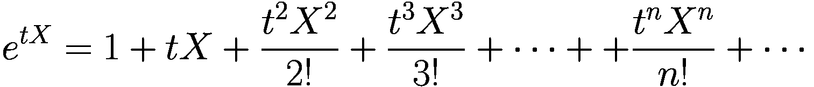

因此，我们得到：

![ $$ {M}_x(t)=\textrm{E}\left[{e}^{tX}\right] $$ ](images/528380_1_En_12_Chapter/528380_1_En_12_Chapter_TeX_Equbd.png)

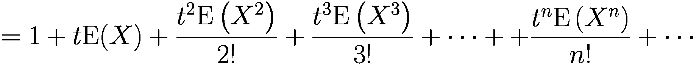

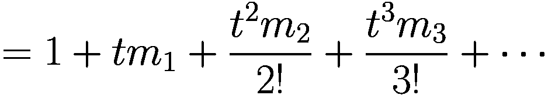

其中*m*[*n*]是*n*阶矩。将*M**x*对*t*求*i*次导数，并令*t* = 0，即可得到关于原点的*i*阶矩*m*[*i*]。

对于由随机变量的线性变换所定义的分布（如果存在），其矩生成函数有特别简单的结果。具体而言，如果随机变量*X*具有矩生成函数*M**X*，那么*αX* + *β*的矩生成函数如下：

![ $$ {M}_{\alpha X+\beta }(t)=\textrm{E}\left[{e}^{t\left( aX+\beta \right)}\right]={e}^{\beta t}{M}_X\left(\alpha t\right) $$ ](images/528380_1_En_12_Chapter/528380_1_En_12_Chapter_TeX_Equbg.png)

此外，如果*S*[*n*]是随机变量{*X*[*i*]}关于权重{*a*[*i*]}的线性组合，如下所示：

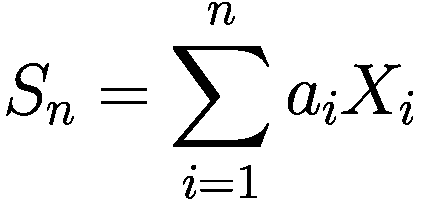

那么*S*[*n*]的矩生成函数如下：

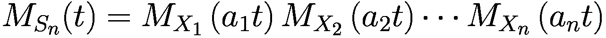

### 12.3.2 正态分布

最重要的分布（可能）是正态分布或高斯分布。许多自然过程，如热扩散，都是正态分布的。此外，中心极限定理指出，具有有限均值和方差的随机变量的多个样本（观测值）的平均值本身就是一个随机变量，其分布随着样本数量的增加而收敛于正态分布。因此，作为多个独立测量值之和的物理量（如测量误差）通常具有近似正态的分布。

从数学上讲，假设{*X*[1], ⋯, *X*[*n*]}是一列独立同分布（i.i.d.）的随机变量，满足 E(*X*[*i*]) = *μ* 且 Var(*X*[*i*]) = *σ*² < ∞。那么当*n*趋于无穷大时，随机变量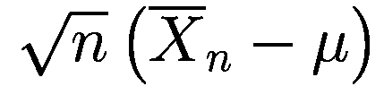依分布收敛于均值为 0、方差为*σ*²的正态分布，即*N*(0, *σ*²)。

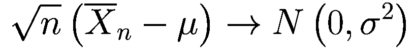

均值为*μ*、方差为*σ*²的正态分布，记为*N*(*μ*, *σ*²)，其概率密度函数（PDF）如下：

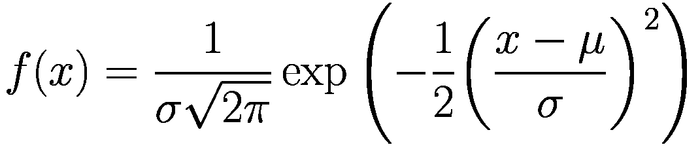

图 12-16 展示了一个示例。

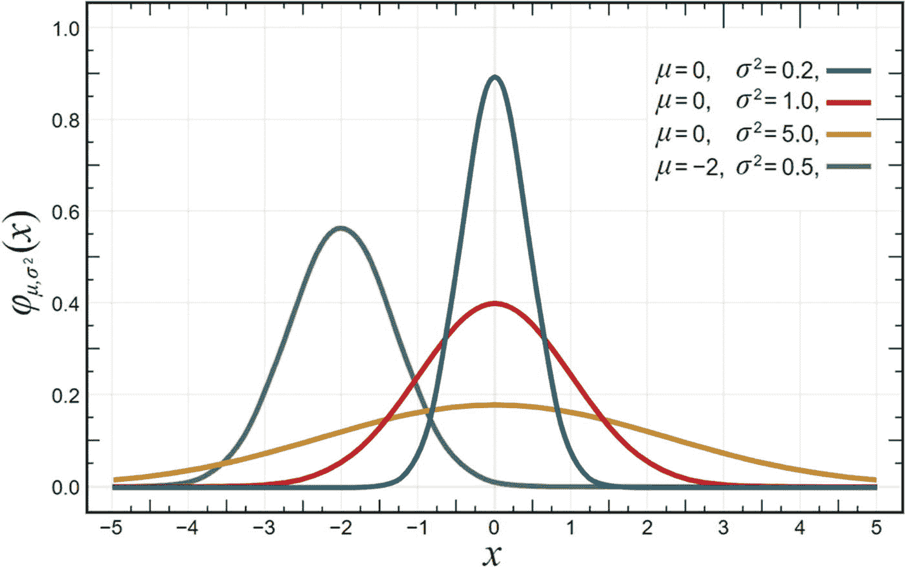

*该图展示了对于四种不同的均值和方差组合，phi 下标 mu sigma 平方的 x 关于 x 的函数图像。*

**图 12-16** 正态分布的概率密度函数

累积分布函数（CDF）如下：

![ $$ F(x)=\frac{1}{2}\left[1+\operatorname{erf}\left(\frac{x-\mu }{\sigma \sqrt{2}}\right)\right] $$ ](images/528380_1_En_12_Chapter/528380_1_En_12_Chapter_TeX_Equbl.png)

图 12-17 展示了一个示例。

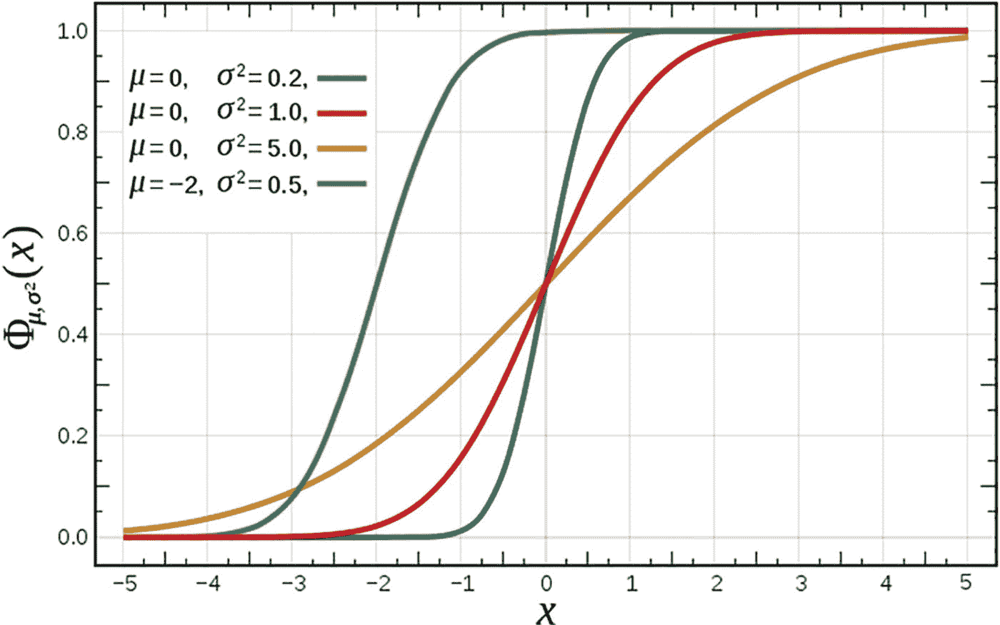

*该图展示了对于四种不同的均值和方差组合，phi 下标 mu sigma 平方的 x 关于 x 的函数图像。*

**图 12-17** 正态分布的累积分布函数

分位数函数如下：

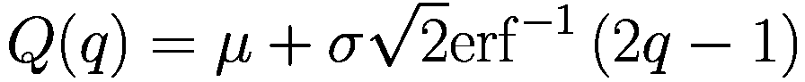

均值如下：

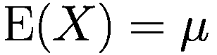

方差如下：

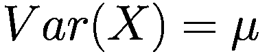

偏度如下：

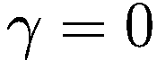

超额峰度如下：

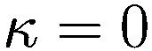

矩生成函数如下：

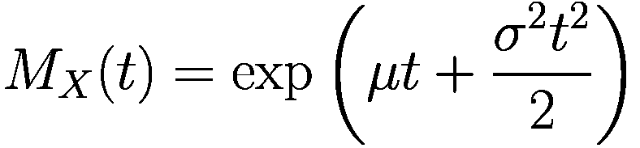

NM Dev 类 `NormalDistribution` 实现了正态分布。以下是一个示例：


```kotlin
val dist = NormalDistribution(
    0.0, // 均值
    1.0 // 方差
)
println("mean = " + dist.mean())
println("median = " + dist.median())
println("variance = " + dist.variance())
println("skew = " + dist.skew())
println("kurtosis = " + dist.kurtosis())
println("entropy = " + dist.entropy()) // Math.log(2 * Math.PI * Math.E)
println("")
val xs: DoubleArray = doubleArrayOf(
    -1000000.0, -10000.0, -1000.0, -100.0, -10.0, -1.0, -0.1, -0.01, -0.001, -0.0001,
    0.0, 0.0001, 0.001, 0.01, 0.1, 1.0, 2.0, 3.0, 10.0, 100.0, 1000.0)
for (x in xs) {
    println(String.format("F(%f) = %f", x, dist.cdf(x)))
}
println("")
for (x in xs) {
    println(String.format("f(%f) = %f", x, dist.density(x)))
}
var allEquals: Boolean = true
var u: Double = 0.000001
while(u < 1.0) {
    val q = dist.quantile(u)
    val fq = dist.cdf(q)
    if (Math.abs(fq - u) > 1e-9) {
        allEquals = false
    }
    u += 0.000001
}
println("\nF(Q(u)) = u for all u = " + allEquals)
```

输出如下：

```
mean = 0.0
median = 0.0
variance = 1.0
skew = 0.0
kurtosis = 0.0
entropy = 2.8378770664093453
F(-1000000.000000) = 0.000000
F(-10000.000000) = 0.000000
F(-1000.000000) = 0.000000
F(-100.000000) = 0.000000
F(-10.000000) = 0.000000
F(-1.000000) = 0.158655
F(-0.100000) = 0.460172
F(-0.010000) = 0.496011
F(-0.001000) = 0.499601
F(-0.000100) = 0.499960
F(0.000000) = 0.500000
F(0.000100) = 0.500040
F(0.001000) = 0.500399
F(0.010000) = 0.503989
F(0.100000) = 0.539828
F(1.000000) = 0.841345
F(2.000000) = 0.977250
F(3.000000) = 0.998650
F(10.000000) = 1.000000
F(100.000000) = 1.000000
F(1000.000000) = 1.000000
f(-1000000.000000) = 0.000000
f(-10000.000000) = 0.000000
f(-1000.000000) = 0.000000
f(-100.000000) = 0.000000
f(-10.000000) = 0.000000
f(-1.000000) = 0.241971
f(-0.100000) = 0.396953
f(-0.010000) = 0.398922
f(-0.001000) = 0.398942
f(-0.000100) = 0.398942
f(0.000000) = 0.398942
f(0.000100) = 0.398942
f(0.001000) = 0.398942
f(0.010000) = 0.398922
f(0.100000) = 0.396953
f(1.000000) = 0.241971
f(2.000000) = 0.053991
f(3.000000) = 0.004432
f(10.000000) = 0.000000
f(100.000000) = 0.000000
f(1000.000000) = 0.000000
F(Q(u)) = u for all u = true
```

### 12.3.3 对数正态分布

对数正态分布是指一个随机变量的对数服从正态分布时的连续概率分布。即，如果随机变量 `X` 服从对数正态分布，那么 `Y = ln X` 服从正态分布。等价地，如果 `Y` 服从正态分布，那么 `Y` 的指数函数 `X = exp(Y)` 就服从对数正态分布。服从对数正态分布的随机变量仅取正实数值。它在精密科学和工程科学以及医学、经济学和金融学中是一个方便且有用的模型。著名的布莱克-舒尔斯模型假设股票收益率服从对数正态分布。

数学上，一个正随机变量 `X` 服从对数正态分布 `X ~ Lognormal(μ, σ²)`，即 `ln X ~ N(μ, σ²)`。

设 `φ(x)` 和 `Φ(x)` 分别为标准正态分布 `N(0, 1)` 的概率密度函数和累积分布函数。则 `X ~ Lognormal(μ, σ²)` 的 PDF 如下：

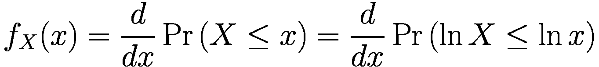

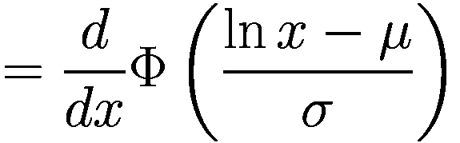

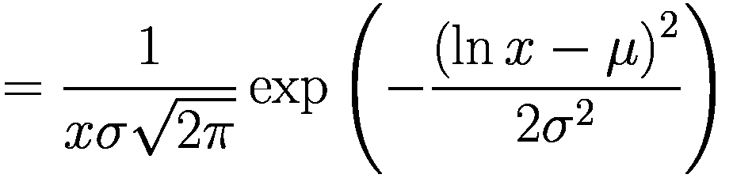

图 12-18 展示了一个示例。

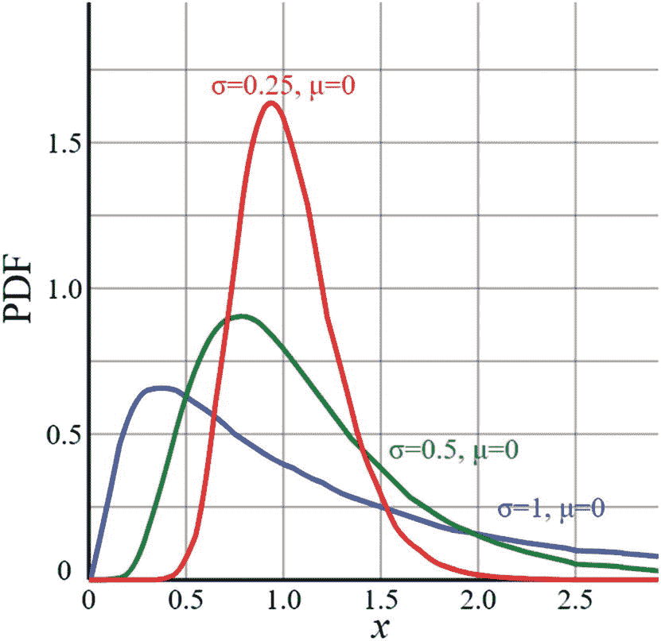

该图显示了在相同均值、不同方差的四种组合下，PDF 随 x 的变化曲线。

**图 12-18** 对数正态分布的概率密度函数；相同的 `μ` 但不同的 `σ`

CDF 如下：

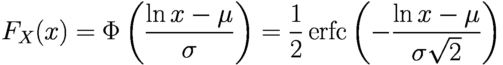

`erfc` 是一个称为补余误差函数的特殊函数。

图 12-19 展示了一个示例。

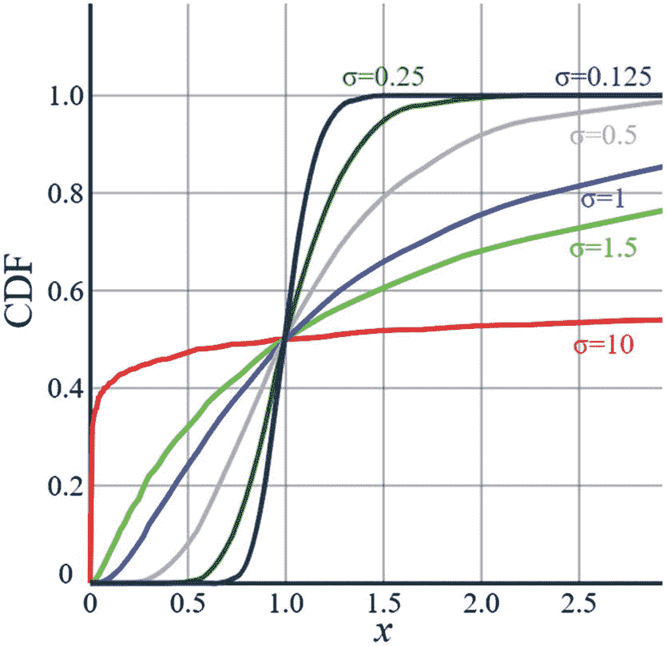

该图显示了在相同均值、不同方差的四种组合下，CDF 随 x 的变化曲线。

**图 12-19** 对数正态分布的累积分布函数；相同的 `μ` 但不同的 `σ`

分位数函数如下：

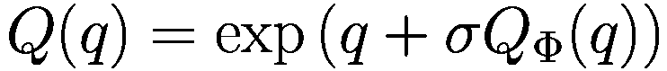

`Q_Φ(q)` 是标准正态分布的分位数函数。

均值如下：

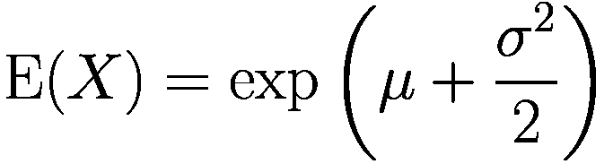

方差如下：

![$$ Var\;(X)=\left[\exp \left({\sigma}²\right)-1\right]\exp \left(2\mu +{\sigma}²\right) $$](images/528380_1_En_12_Chapter/528380_1_En_12_Chapter_TeX_Equby.png)

偏度如下：

![$$ \gamma =\left[\exp \left({\sigma}²\right)+2\right]\sqrt{\exp \left({\sigma}²\right)-1} $$](images/528380_1_En_12_Chapter/528380_1_En_12_Chapter_TeX_Equbz.png)

超额峰度如下：

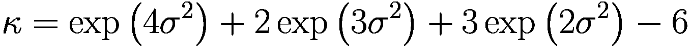

矩生成函数如下：


NM Dev 类 `LogNormalDistribution` 实现了对数正态分布。下面是一个示例：

```kotlin
val dist = LogNormalDistribution(
    1.0, // 均值
    2.0 // 方差
)
println("mean = " + dist.mean())
println("median = " + dist.median())
println("variance = " + dist.variance())
println("skew = " + dist.skew())
println("kurtosis = " + dist.kurtosis())
println("entropy = " + dist.entropy())
println("")
val xs: DoubleArray = doubleArrayOf(
    -1000000.0, -10000.0, -1000.0, -100.0, -10.0, -1.0, -0.1, -0.01, -0.001, -0.0001,
    0.0, 0.0001, 0.001, 0.01, 0.1, 1.0, 2.0, 3.0, 10.0, 100.0, 1000.0)
for (x in xs) {
    println(String.format("F(%f) = %f", x, dist.cdf(x)))
}
println("")
for (x in xs) {
    println(String.format("f(%f) = %f", x, dist.density(x)))
}
var allEquals: Boolean = true
var u: Double = 0.000001
while(u < 1.0) {
    val q = dist.quantile(u)
    val fq = dist.cdf(q)
    if (Math.abs(fq - u) > 1e-9) {
        allEquals = false
    }
    u += 0.000001
}
println("\nF(Q(u)) = u for all u = " + allEquals)
```

输出如下：

```
mean = 20.085536923187668
median = 2.718281828459045
variance = 21623.03700131398
skew = 414.359343300147
kurtosis = 9220556.977307005
entropy = 3.112085713764618
F(-1000000.000000) = 0.000000
F(-10000.000000) = 0.000000
F(-1000.000000) = 0.000000
F(-100.000000) = 0.000000
F(-10.000000) = 0.000000
F(-1.000000) = 0.000000
F(-0.100000) = 0.000000
F(-0.010000) = 0.000000
F(-0.001000) = 0.000000
F(-0.000100) = 0.000000
F(0.000000) = 0.000000
F(0.000100) = 0.000000
F(0.001000) = 0.000038
F(0.010000) = 0.002535
F(0.100000) = 0.049339
F(1.000000) = 0.308538
F(2.000000) = 0.439031
F(3.000000) = 0.519662
F(10.000000) = 0.742571
F(100.000000) = 0.964273
F(1000.000000) = 0.998431
f(-1000000.000000) = 0.000000
f(-10000.000000) = 0.000000
f(-1000.000000) = 0.000000
f(-100.000000) = 0.000000
f(-10.000000) = 0.000000
f(-1.000000) = 0.000000
f(-0.100000) = 0.000000
f(-0.010000) = 0.000000
f(-0.001000) = 0.000000
f(-0.000100) = 0.000000
f(0.000000) = 0.000000
f(0.000100) = 0.004369
f(0.001000) = 0.080387
f(0.010000) = 0.392917
f(0.100000) = 0.510235
f(1.000000) = 0.176033
f(2.000000) = 0.098569
f(3.000000) = 0.066410
f(10.000000) = 0.016135
f(100.000000) = 0.000393
f(1000.000000) = 0.000003
F(Q(u)) = u for all u = true
```


### 12.3.4 指数分布

泊松过程是一系列离散事件的模型，其中事件在任何时刻或任何等长时间间隔内发生的概率相同，但事件发生的具体时间是随机的。事件的发生，以及事件发生前的等待时间，与之前的所有事件和信息无关。因此，该过程被描述为**无记忆性**。例如，根据历史数据，我们知道新顾客的平均到达率是 *λ* = 每小时 10 人，但下一位顾客到来的时间是完全随机的，并且与之前任何顾客无关。顾客到达过程可以建模为泊松过程。

更抽象地说，在图 12-20 中，从状态 0 开始的一个过程可以在随机时间跳转到下一个增量状态。我们不知道它具体何时发生，因为它是随机的。但我们知道它可以在任何时间以相等的概率发生。

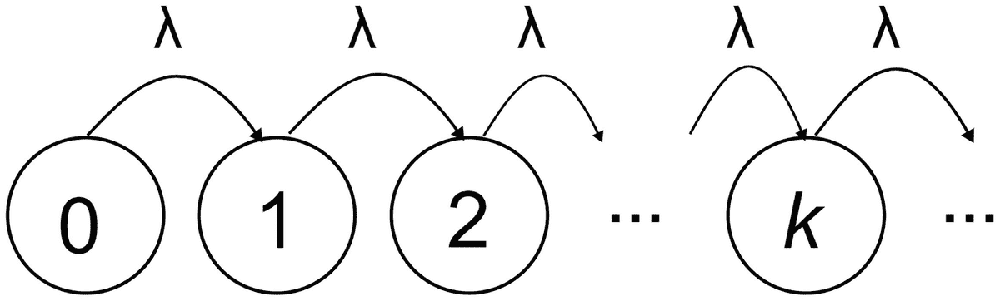

该过程从状态 0 开始，增量以 λ 的速率连续且独立地发生。状态 K 也在图中可见。

图 12-20

一个从 0 开始的泊松点过程，其中增量以速率 λ 连续且独立地发生

泊松过程定义为一个满足以下条件的随机过程：

1.  `N(0) = 0`。
2.  增量 `{N(t[n + 1]) − N(t[n])}` 是独立随机变量。
3.  独立同分布随机增量的均值为 `E(N(t[n + 1]) − N(t[n])) = λ(t[n + 1] − t[n])`。

`λ` 称为强度，是每单位时间预期发生的到达次数。

事件之间的随机时间或下一次跳跃前的随机时间称为**等待时间**。其分布由具有速率参数 `λ` 的指数分布决定。

从数学上讲，一个非负随机变量 `X` 服从指数分布 `X ~ Exp(λ)`，当且仅当它具有以下概率密度函数:

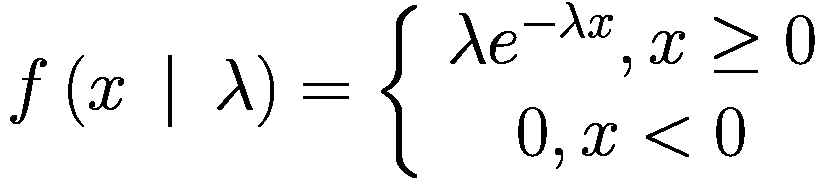

图 12-21 展示了一个例子。

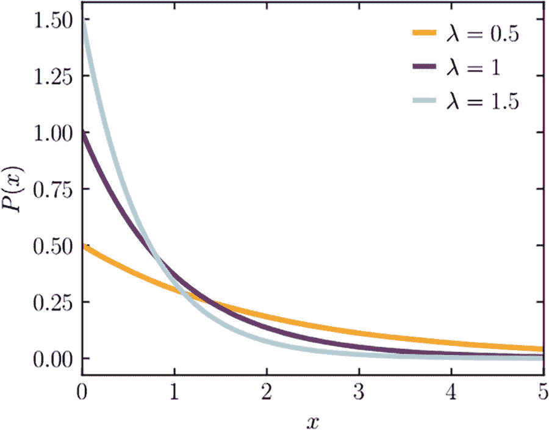

对于 λ 的三个不同值：0.5、1 和 1.5，P 函数随 x 变化的递减图。

图 12-21

指数分布的概率密度函数

累积分布函数如下：

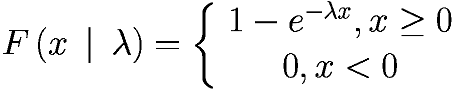

图 12-22 展示了一个例子。

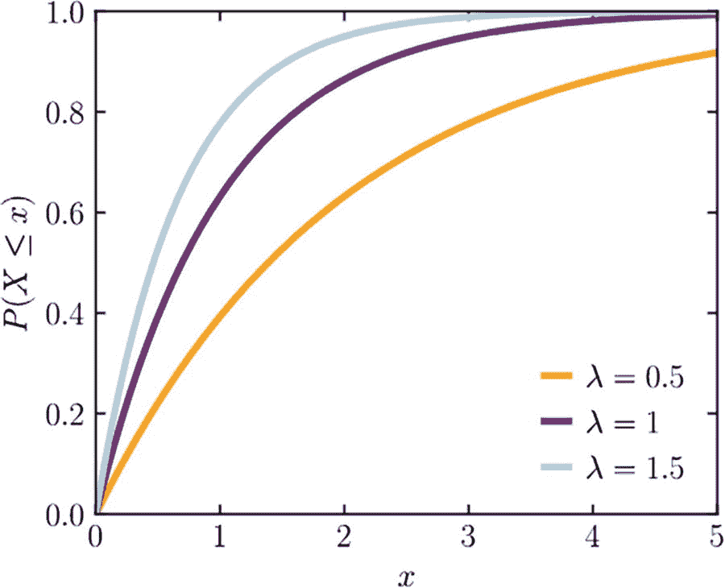

对于 λ 的三个不同值：0.5、1 和 1.5，当 x 小于等于某个值时，P 函数随 x 变化的递增图。

图 12-22

指数分布的累积分布函数

我们可以从累积分布函数推导出指数分布的一个重要性质，即**无记忆性**。具体示例如下：

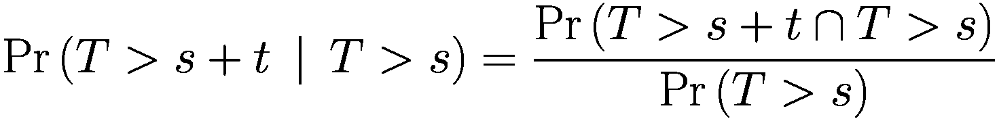

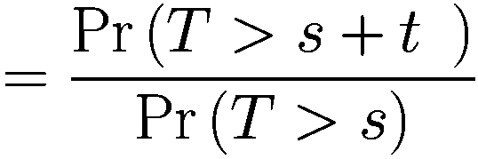

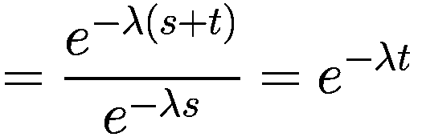

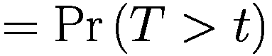

`s` 是无关的。当 `T` 被解释为相对于某个初始时间的事件发生的等待时间时，这个关系意味着，如果在初始时间段 `s` 内未观察到事件，那么剩余等待时间的分布与原始的无条件分布相同。例如，如果一个事件在 30 秒后仍未发生，那么它至少还需要 10 秒才会发生的条件概率，等于从初始时间起超过 10 秒才观察到该事件的无条件概率。

分位数函数如下：

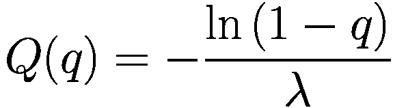

均值如下：

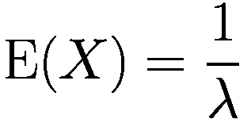

方差如下：

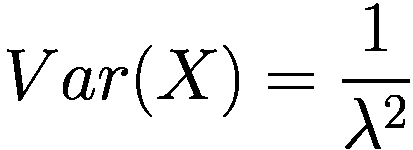

偏度如下：

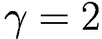

超额峰度如下：

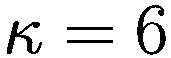

矩生成函数如下：

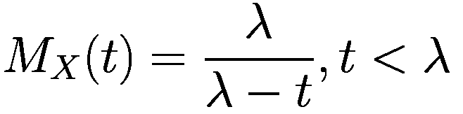

NM Dev 类 `ExponentialDistribution` 实现了指数分布。示例如下：

```
val dist = ExponentialDistribution(
1.0 // lambda = 1.
)
println("mean = " + dist.mean())
println("median = " + dist.median())
println("variance = " + dist.variance())
println("skew = " + dist.skew())
println("kurtosis = " + dist.kurtosis())
println("entropy = " + dist.entropy())
println("")
val xs: DoubleArray = doubleArrayOf(
-1000000.0, -10000.0, -1000.0, -100.0, -10.0, -1.0, -0.1, -0.01, -0.001, -0.0001,
0.0, 0.0001, 0.001, 0.01, 0.1, 1.0, 2.0, 3.0, 10.0, 100.0, 1000.0)
for (x in xs) {
println(String.format("F(%f) = %f", x, dist.cdf(x)))
}
println("")
for (x in xs) {
println(String.format("f(%f) = %f", x, dist.density(x)))
}
var allEquals: Boolean = true
var u: Double = 0.000001
while(u  1e-9) {
allEquals = false
}
u += 0.000001
}
println("\nF(Q(u)) = u for all u = " + allEquals)
```

输出如下：

```
mean = 1.0
median = 0.6931471805599453
variance = 1.0
skew = 2.0
kurtosis = 6.0
entropy = 1.0
F(-1000000.000000) = 0.000000
F(-10000.000000) = 0.000000
F(-1000.000000) = 0.000000
F(-100.000000) = 0.000000
F(-10.000000) = 0.000000
F(-1.000000) = 0.000000
F(-0.100000) = 0.000000
F(-0.010000) = 0.000000
F(-0.001000) = 0.000000
F(-0.000100) = 0.000000
F(0.000000) = 0.000000
F(0.000100) = 0.000100
F(0.001000) = 0.001000
F(0.010000) = 0.009950
F(0.100000) = 0.095163
F(1.000000) = 0.632121
F(2.000000) = 0.864665
F(3.000000) = 0.950213
F(10.000000) = 0.999955
F(100.000000) = 1.000000
F(1000.000000) = 1.000000
f(-1000000.000000) = 0.000000
f(-10000.000000) = 0.000000
f(-1000.000000) = 0.000000
f(-100.000000) = 0.000000
f(-10.000000) = 0.000000
f(-1.000000) = 0.000000
f(-0.100000) = 0.000000
f(-0.010000) = 0.000000
f(-0.001000) = 0.000000
f(-0.000100) = 0.000000
f(0.000000) = 1.000000
f(0.000100) = 0.999900
f(0.001000) = 0.999000
f(0.010000) = 0.990050
f(0.100000) = 0.904837
f(1.000000) = 0.367879
f(2.000000) = 0.135335
f(3.000000) = 0.049787
f(10.000000) = 0.000045
f(100.000000) = 0.000000
f(1000.000000) = 0.000000
F(Q(u)) = u for all u = true
```


### 12.3.5 泊松分布

虽然泊松过程中事件之间的等待时间服从指数分布，但事件的数量服从泊松分布。换句话说，泊松分布是一种离散概率分布，它表达了在固定时间间隔内，以已知的恒定平均速率发生，且与上次事件发生时间无关的给定数量事件发生的概率。请注意，与我们目前讨论的其他连续概率分布不同，泊松分布是一种离散概率分布。它“计数”事件发生的次数。

例如，一个呼叫中心每天 24 小时平均每小时接到 180 个电话。这些电话是相互独立的；接到一个电话不会改变下一个电话到达时间的概率。在任何一分钟内接到的电话数量服从泊松分布：最可能的数量是 2 和 3，但 1 和 4 也很有可能，并且有很小概率可能低至 0，而非常小的概率可能达到 10。另一个例子是在给定的观测期内，从放射源发生的衰变事件的数量。

如果一个离散随机变量 `X` 具有参数 `λ > 0` 的泊松分布，则其概率质量函数 (PMF) 由下式给出：

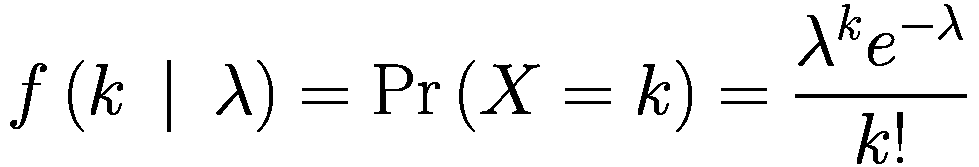

其中 `k = 0, 1, 2, …` 是事件发生的次数。

对于图 12-23 中的示例，`k` 是事件发生的次数。`λ` 是期望的事件发生率。纵轴是在给定 `λ` 时 `k` 次事件发生的概率。该函数仅定义在 `k` 的整数值上；连接线仅用于引导视线。

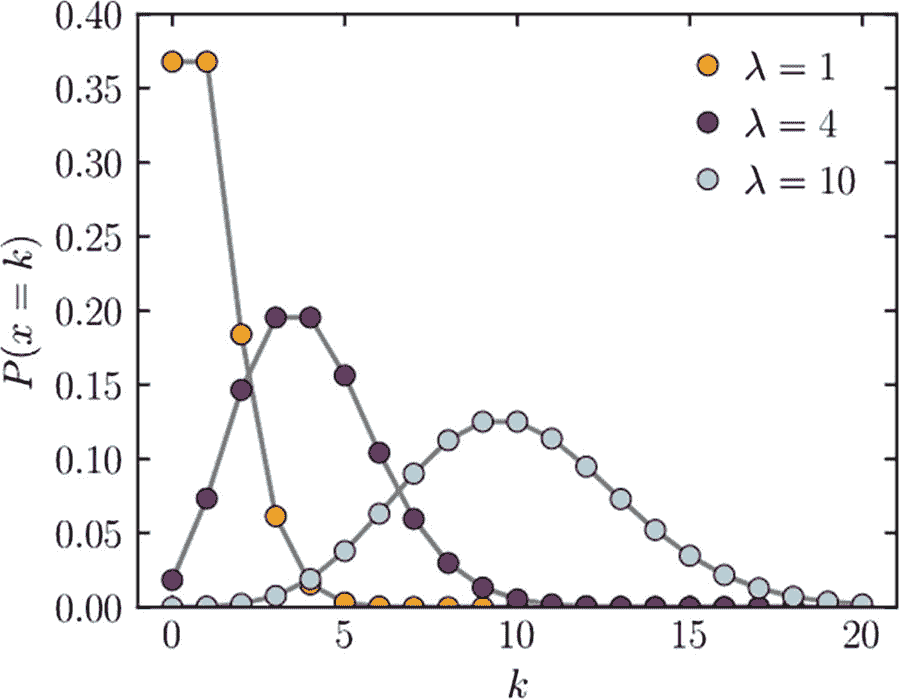

P(x = k) 函数关于 k 的图，展示了三个不同的 lambda 值：1、4 和 10。

**图 12-23** 泊松分布的概率质量函数

CDF 如下：

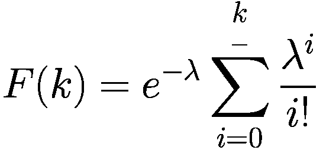

`⎣k⎦` 是向下取整函数，表示小于或等于 `k` 的最小整数。

对于图 12-23 中的示例，横轴是索引 `k`，即事件发生的次数。CDF 在 `k` 的整数点处不连续，在其他地方是平坦的，因为服从泊松分布的变量只取整数值。参见图 12-24。

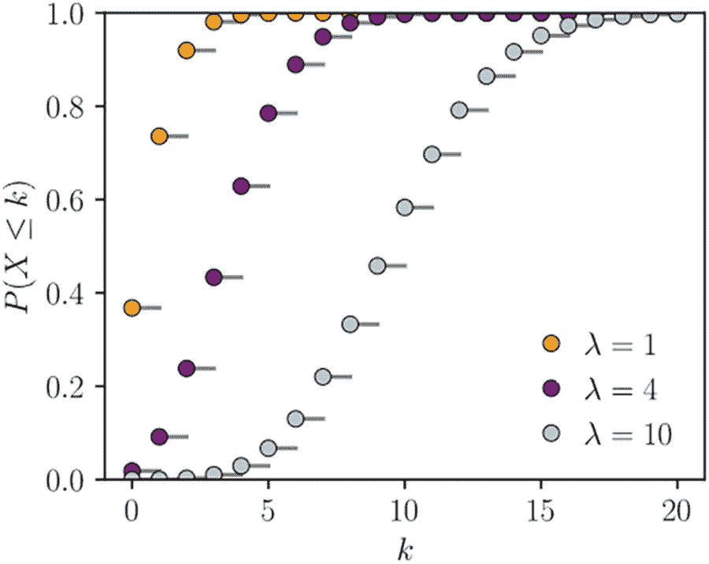

P(X ≤ k) 函数关于 k 的散点图，展示了三个不同的 lambda 值：1、4 和 10。

**图 12-24** 泊松分布的累积概率函数

分位数函数没有封闭形式，但可以通过使用 CDF 搜索满足 `F(k) < q` 的最大 `k` 来计算。

均值如下：

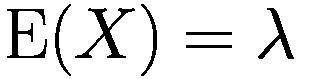

方差如下：

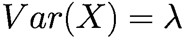

偏度如下：

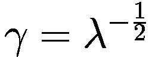

超额峰度如下：

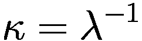

矩生成函数如下：

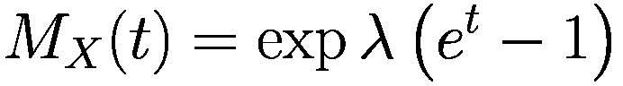

NM Dev 类 `PoissonDistribution` 实现了泊松分布。示例如下：

```
val dist = PoissonDistribution(
2.0 // lambda = 2.0
)
println("mean = " + dist.mean())
println("median = " + dist.median())
println("variance = " + dist.variance())
println("skew = " + dist.skew())
println("kurtosis = " + dist.kurtosis())
println("entropy = " + dist.entropy())
println("")
val ks: DoubleArray = doubleArrayOf(0.0, 1.0, 2.0, 3.0, 4.0, 5.0)
for (k in ks) {
println(String.format("F(%f) = %f", k, dist.cdf(k)))
}
println("")
for (k in ks) {
println(String.format("f(%f) = %f", k, dist.density(k)))
}
println("")
var u: Double = 0.1
while(u < 1.0) {
val x: Double = dist.quantile(u)
println(String.format("Q(%f) = %f", u, x))
u += 0.1
}
```

输出如下：

```
mean = 2.0
median = 2.0
variance = 2.0
skew = 0.7071067811865475
kurtosis = 0.5
entropy = 1.7048826437056113
F(0.000000) = 0.135335
F(1.000000) = 0.406006
F(2.000000) = 0.676676
F(3.000000) = 0.857123
F(4.000000) = 0.947347
F(5.000000) = 0.983436
f(0.000000) = 0.135335
f(1.000000) = 0.270671
f(2.000000) = 0.270671
f(3.000000) = 0.180447
f(4.000000) = 0.090224
f(5.000000) = 0.036089
Q(0.100000) = 0.000000
Q(0.200000) = 1.000000
Q(0.300000) = 1.000000
Q(0.400000) = 1.000000
Q(0.500000) = 2.000000
Q(0.600000) = 2.000000
Q(0.700000) = 3.000000
Q(0.800000) = 3.000000
Q(0.900000) = 4.000000
Q(1.000000) = 22.000000
```


### 12.3.6 二项分布

参数为 `n` 和 `p` 的二项分布是一种离散概率分布，用于描述一系列 `n` 次独立试验中“成功”次数的概率分布。每次试验只有“是”或“否”两种结果：“是/成功”（概率为 `p`）或“否/失败”（概率为 `q = 1 - p`）。单次的成功/失败试验也称为伯努利试验，一系列布尔型结果则称为伯努利过程。对于单次试验，即 `n = 1` 时，二项分布即为伯努利分布。例如，抛一次公平硬币，`n = 1`，`p = 0.5`。

二项分布常用于建模从大小为 `N` 的总体中有放回地抽取大小为 `n` 的样本时，成功次数的分布。如果抽样是不放回的，则各次抽取不独立，此时得到的是超几何分布，而非二项分布。然而，当 `N` 远大于 `n` 时，二项分布仍是一个良好的近似，并被广泛使用。

二项分布和泊松分布具有相似性：它们都衡量某一框架内特定随机事件（或“成功”）的次数。但两者也有区别：二项分布统计的是离散试验中的离散事件次数，而泊松分布统计的是连续区间中的离散事件次数。也就是说，对于二项分布，你有固定次数 `n` 的“尝试”，每次尝试的成功概率为 `p`；而对于泊松分布，你本质上拥有无限次尝试，而每次成功的概率趋近于无穷小。具体而言，给定参数为 `n` 和 `p` 的二项分布，若令 `n → ∞` 且 `p → 0`，同时使得 `np → λ`，则该分布将趋近于参数为 `λ` 的泊松分布。因此，泊松分布可以被视为二项分布的极限形式。

由于这种极限性质，泊松分布被用于建模那些可能发生次数很多、但发生概率很小的事件。换言之，它适用于本应由二项分布表示、但 `n` 非常大且 `p` 非常小的情况，尤其当 `n` 和 `p` 的具体数值未知时，例如“百年一遇”的洪水。

总结来说，如果给定的是单位时间内事件发生的平均概率，并要求计算在给定时间内发生 `n` 件事的概率，则应使用泊松分布。反之，如果给定的是事件发生的精确概率，并要求计算在 `n` 次试验中该事件恰好发生 `k` 次的概率，则应使用二项分布。

此外，当 `n` 足够大时，二项随机变量 `X` 可以用正态分布很好地近似。即 `X ~ N(np, np(1 − p))`。等价地，标准化后的随机变量 `z = (x − μ) / σ` 服从标准正态分布 `N(0, 1)`。

如果随机变量 `X` 服从参数为 `n ∈ ℕ` 和 `p ∈ [0, 1]` 的二项分布，我们记作 `X ~ B(n, p)`。在 `n` 次独立伯努利试验中恰好获得 `k` 次成功的概率由以下概率质量函数给出：

```
f(k | n, p) = Pr(k | n, p) = Pr(X = k) = (n choose k) * p^k * (1 − p)^(n − k)
```

其中 `k = 0, 1, 2, …, n`。

`(n choose k) = n! / (k! * (n − k)!)` 是二项式系数，也是该分布名称的由来。该公式可理解为：`k` 次成功发生的概率为 `p^k`，`n − k` 次失败发生的概率为 `(1 − p)^(n − k)`。然而，这 `k` 次成功可以出现在 `n` 次试验中的任意位置，并且将 `k` 次成功分配到 `n` 次试验序列中共有 `(n choose k)` 种不同的方式。

图 12-25 展示了一个示例。

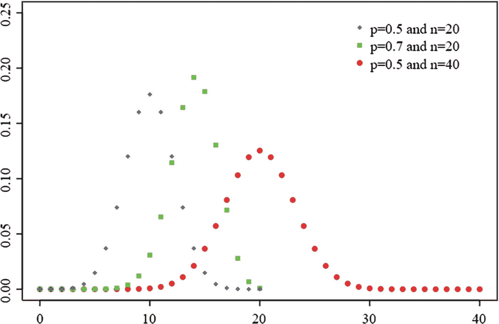

这三张散点图代表了三种不同的 p 和 n 值组合下的二项分布概率质量函数。

图 12-25：二项分布的概率质量函数

累积分布函数如下：

```
F(k | n, p) = Pr(X ≤ k) = sum_{i=0}^{k} (n choose i) * p^i * (1 − p)^(n − i)
```

图 12-26 展示了一个示例。


这三张散点图代表了三种不同的 p 和 N 值组合下的二项分布累积概率函数。

图 12-26：二项分布的累积概率函数

分位函数没有闭式解，但可以通过使用 CDF 搜索满足 `F(k) < q` 的最大 `k` 来进行计算。

均值如下：

```
E(X) = np
```

方差如下：

```
Var(X) = npq
```

偏度如下：

```
γ = (q − p) / sqrt(npq)
```

超额峰度如下：

```
κ = (1 − 6pq) / (npq)
```

矩生成函数如下：

```
M_X(t) = (q + p * e^t)^n
```

NM Dev 库中的 `BinomialDistribution` 类实现了二项分布。示例如下：

```
val dist1 = BinomialDistribution(
20, // n
0.7 // p
)
println("mean = " + dist1.mean())
println("median = " + dist1.median())
println("variance = " + dist1.variance())
println("skew = " + dist1.skew())
println("kurtosis = " + dist1.kurtosis())
println("entropy = " + dist1.entropy())
println("")
val ks: DoubleArray = DoubleUtils.seq(0.0, 20.0, 1.0) // 从 0 到 20 的数列
for (k in ks) {
println(String.format("F(%f) = %f", k, dist1.cdf(k)))
}
println("")
for (k in ks) {
println(String.format("f(%f) = %f", k, dist1.density(k)))
}
println("")
var u: Double = 0.1
while(u < 1.0) {
val x: Double = dist1.quantile(u)
println(String.format("Q(%f) = %f", u, x))
u += 0.1
}
```

输出结果如下：


```
mean = 14.0
median = 14.0
variance = 4.200000000000001
skew = -0.19518001458970657
kurtosis = -0.06190476190476189
entropy = 3.0822902491263404
F(0.000000) = 0.000000
F(1.000000) = 0.000000
F(2.000000) = 0.000000
F(3.000000) = 0.000001
F(4.000000) = 0.000006
F(5.000000) = 0.000043
F(6.000000) = 0.000261
F(7.000000) = 0.001279
F(8.000000) = 0.005138
F(9.000000) = 0.017145
F(10.000000) = 0.047962
F(11.000000) = 0.113331
F(12.000000) = 0.227728
F(13.000000) = 0.391990
F(14.000000) = 0.583629
F(15.000000) = 0.762492
F(16.000000) = 0.892913
F(17.000000) = 0.964517
F(18.000000) = 0.992363
F(19.000000) = 0.999202
F(20.000000) = 1.000000
f(0.000000) = 0.000000
f(1.000000) = 0.000000
f(2.000000) = 0.000000
f(3.000000) = 0.000001
f(4.000000) = 0.000005
f(5.000000) = 0.000037
f(6.000000) = 0.000218
f(7.000000) = 0.001018
f(8.000000) = 0.003859
f(9.000000) = 0.012007
f(10.000000) = 0.030817
f(11.000000) = 0.065370
f(12.000000) = 0.114397
f(13.000000) = 0.164262
f(14.000000) = 0.191639
f(15.000000) = 0.178863
f(16.000000) = 0.130421
f(17.000000) = 0.071604
f(18.000000) = 0.027846
f(19.000000) = 0.006839
f(20.000000) = 0.000798
Q(0.100000) = 11.000000
Q(0.200000) = 12.000000
Q(0.300000) = 13.000000
Q(0.400000) = 14.000000
Q(0.500000) = 14.000000
Q(0.600000) = 15.000000
Q(0.700000) = 15.000000
Q(0.800000) = 16.000000
Q(0.900000) = 17.000000
Q(1.000000) = 20.000000
```

### 12.3.7 t 分布

学生 t 分布（或简称为 t 分布）是当样本量较小且总体标准差未知时，从独立同分布的正态总体中抽取的样本均值相对于真实均值的概率分布。具体来说，假设集合 {`x`[1], …, `x`[`n`]} 从一个已知均值 `μ` 但未知方差的正态分布中抽取；那么该样本的 t 值（一种标准化值）定义如下：


其中  是样本均值，`s` 是无偏样本标准差（分母为 `n` − 1），用于替代真实总体标准差 `σ`。`t` 是随机变量，因为  和 `s` 都是随机的。随机变量 `t` 服从自由度为 `υ` = `n` − 1 的 t 分布。

t 分布在许多广泛使用的统计分析中发挥作用，包括用于评估两个样本均值之间差异的统计显著性（即两个均值在统计上是否存在显著差异）的学生 t 检验，在两个总体均值之差的置信区间构建中，以及在线性回归分析中。学生 t 分布也出现在正态分布族数据的贝叶斯分析中。

从数学上讲，随机变量 `X` 服从 t 分布当且仅当其概率密度函数（PDF）如下所示：


其中 `υ` 是自由度数目，`Γ` 是伽马函数。

图 12-27 展示了一个示例。


六条 x 相对于 x 的 P 函数曲线图，分别对应 1、2、3、5、10 和 30 个自由度。

图 12-27

t 分布（红色）与正态分布（蓝色）对比

t 分布是对称且钟形的，类似于正态分布。然而，t 分布具有更重的尾部，这意味着它更容易产生远离其均值的值。当自由度趋近于无穷大时，t 分布收敛于正态分布。即：


这表示一个均值为 0、方差为 1 的标准正态分布。

其累积分布函数（CDF）如下：


其中 `I` 是正则化不完全贝塔函数，`t` > 0，并且有以下关系：


图 12-28 展示了一个示例。


X 小于等于 x 的 P 函数递增曲线图，相对于 x，对应四个不同的 v 值：1、2、5 和无穷大。

图 12-28

t 分布的累积概率函数

当自由度 `υ` = 1、2、4 时，t 分布的分位数函数具有简单的公式。它们如下所示：


符号函数对正数返回 `1`，对负数返回 `-1`，否则返回 `0`。

一般来说，分位数函数如下：


 是两个形状参数均为  的正则化不完全 Beta 函数的逆函数。

均值如下：


方差如下：

，否则未定义

偏度如下：

*γ* = 0, *ν* > 3，否则未定义

超额峰度如下：

，否则未定义

矩生成函数未定义。

NM Dev 类 `TDistribution` 实现了 t 分布。以下是一个示例：

```
val dist = TDistribution(4.5) // 自由度 = 4.5
println("mean = " + dist.mean())
println("median = " + dist.median())
println("variance = " + dist.variance())
println("skew = " + dist.skew())
println("kurtosis = " + dist.kurtosis())
println("entropy = " + dist.entropy())
println("")
val ks: DoubleArray = DoubleUtils.seq(0.0, 20.0, 1.0) // 从 0 到 20 的序列
for (k in ks) {
println(String.format("F(%f) = %f", k, dist.cdf(k)))
}
println("")
for (k in ks) {
println(String.format("f(%f) = %f", k, dist.density(k)))
}
var allEquals: Boolean = true
var u: Double = 0.1
while(u  1e-9) {
allEquals = false
}
u += 0.1
}
println("\nF(Q(u)) = u for all u = " + allEquals)
```

输出如下：

```
mean = 0.0
median = 0.0
variance = 1.8
skew = 0.0
kurtosis = 12.0
entropy = 1.6515357247574647
F(0.000000) = 0.500000
F(1.000000) = 0.815997
F(2.000000) = 0.945871
F(3.000000) = 0.982810
F(4.000000) = 0.993618
F(5.000000) = 0.997262
F(6.000000) = 0.998679
F(7.000000) = 0.999301
F(8.000000) = 0.999602
F(9.000000) = 0.999759
F(10.000000) = 0.999847
F(11.000000) = 0.999899
F(12.000000) = 0.999931
F(13.000000) = 0.999952
F(14.000000) = 0.999965
F(15.000000) = 0.999974
F(16.000000) = 0.999981
F(17.000000) = 0.999985
F(18.000000) = 0.999989
F(19.000000) = 0.999991
F(20.000000) = 0.999993
f(0.000000) = 0.000000
f(1.000000) = 0.217424
f(2.000000) = 0.065675
f(3.000000) = 0.018403
f(4.000000) = 0.005834
f(5.000000) = 0.002144
f(6.000000) = 0.000897
f(7.000000) = 0.000417
f(8.000000) = 0.000211
f(9.000000) = 0.000115
f(10.000000) = 0.000066
f(11.000000) = 0.000040
f(12.000000) = 0.000025
f(13.000000) = 0.000016
f(14.000000) = 0.000011
f(15.000000) = 0.000008
f(16.000000) = 0.000005
f(17.000000) = 0.000004
f(18.000000) = 0.000003
f(19.000000) = 0.000002
f(20.000000) = 0.000002
F(Q(u)) = u for all u = true
```

### 12.3.8 卡方分布

缩放后的样本均值（即 *k* 个独立正态随机变量之和）服从 t 分布，而 *k* 个独立标准正态随机变量的平方和则服从卡方分布（也称 χ² 分布）。该分布有时被称为中心卡方分布，是更一般的非中心卡方分布的特例。卡方分布是推断统计中应用最广泛的概率分布之一，尤其在假设检验和置信区间构建中。它也常用于常见的卡方检验，以检验观测分布与理论分布的拟合优度。参见第 12.4 节。

在数学上，如果 {*Z*[1], …, *Z*[*k*]} 中的每个变量都是独立的标准正态随机变量，那么它们的平方和（如下所示）：


服从自由度为 *k* 的卡方分布。通常记作 *Q*~*χ* ²(*k*) 或 。卡方分布有一个参数：一个正整数 *k*，它指定了自由度（即被求和的随机变量 *Z*[*i*] 的数量）。

此外，样本方差 *S*² 服从缩放后的卡方分布。


等价地，我们有：


卡方分布的概率密度函数如下：


其中  是伽马函数。

图 12-29 展示了一个示例。


函数 f_k(x) 关于 x 的图形，对应六个不同的 k 值。k 等于 1 和 2 时呈下降趋势；其余 k 值下，趋势先上升后下降。

图 12-29

卡方分布的概率密度函数

累积分布函数如下：


其中 *γ*(*s*, *t*) 是下不完全伽马函数，*P*(*s*, *t*) 是正则化不完全伽马函数。

图 12-30 展示了一个示例。


函数 f_k(x) 关于 x 的图形，对应六个不同的 k 值：1、2、3、4、6 和 9。趋势呈上升状态。

图 12-30

卡方分布的累积分布函数

分位数函数是正则化不完全伽马函数的逆函数。


均值如下：


方差如下：


偏度如下：


超額峰度如下：


矩母函数如下：


NM Dev 类 `ChiSquareDistribution` 实现了卡方分布。下面是一个示例：

```
val dist = ChiSquareDistribution(
1.5 // degree of freedom
)
println("mean = " + dist.mean())
println("median = " + dist.median())
println("variance = " + dist.variance())
println("skew = " + dist.skew())
println("kurtosis = " + dist.kurtosis())
println("entropy = " + dist.entropy())
println("")
val xs: DoubleArray = doubleArrayOf(0.0, 0.0001, 0.001, 0.01, 0.1, 1.0, 2.0, 3.0, 10.0, 100.0, 1000.0)
for (x in xs) {
println(String.format("F(%f) = %f", x, dist.cdf(x)))
}
println("")
for (x in xs) {
println(String.format("f(%f) = %f", x, dist.density(x)))
}
var allEquals: Boolean = true
var u: Double = 0.1
while(u  1e-9) {
allEquals = false
}
u += 0.1
}
println("\nF(Q(u)) = u for all u = " + allEquals)
```

输出如下：

```
mean = 1.5
median = 1.5
variance = 3.0
skew = 2.309401076758503
kurtosis = 8.0
entropy = 1.3749629120446232
F(0.000000) = 0.000000
F(0.000100) = 0.000647
F(0.001000) = 0.003637
F(0.010000) = 0.020415
F(0.100000) = 0.112622
F(1.000000) = 0.527937
F(2.000000) = 0.739980
F(3.000000) = 0.852400
F(10.000000) = 0.996474
F(100.000000) = 1.000000
F(1000.000000) = 1.000000
f(0.000000) = Infinity
f(0.000100) = 4.852013
f(0.001000) = 2.727260
f(0.010000) = 1.526765
f(0.100000) = 0.820784
f(1.000000) = 0.294304
f(2.000000) = 0.150104
f(3.000000) = 0.082266
f(10.000000) = 0.001839
f(100.000000) = 0.000000
f(1000.000000) = 0.000000
F(Q(u)) = u for all u = true
```

### 12.3.9 F 分布

缩放的样本均值（即 t 值）服从 t 分布，而缩放的样本方差之比则服从 F 分布。事实上，一个自由度为 *d*[1] 的卡方分布随机变量与另一个自由度为 *d*[2] 的卡方分布随机变量之比，服从自由度为 (*d*[1], *d*[2]) 的 F 分布，即 *F*(*d*[1], *d*[2])。也就是说，


此外，样本方差 *S*² 服从卡方分布。


那么，两个样本的样本方差之比  以及缩放后的样本方差之比  均服从 F 分布。此外，对于自由度 *ν* 的随机变量 *t*，*t*² 服从 F 分布 *F*(1, *ν*)。

如果随机变量 *X* 服从参数 *d*[1] > 0 和 *d*[2] > 0 的 F 分布，我们记作 *X*~*F*(*d*[1], *d*[2])。其概率密度函数（PDF）如下：


其中 *B* 是 Beta 函数。

图 12-31 显示了一个示例。


图中展示了 d1 和 d2 的五种不同取值组合所对应的 F 分布概率密度函数。

**图 12-31** F 分布的概率密度函数

累积分布函数（CDF）如下：


其中 *I* 是正则化不完全 Beta 函数。

图 12-32 显示了一个示例。


图中展示了 d1 和 d2 的五种不同取值组合所对应的 F 分布累积分布函数。

**图 12-32** F 分布的累积分布函数

分位函数如下：


 是具有形状参数  和  的正则化不完全 Beta 函数的反函数。

均值如下：


方差如下：


偏度如下：


超额峰度如下：


F 分布不存在矩生成函数。

NM Dev 类 `FDistribution` 实现了 F 分布。以下是一个示例：

```
val dist = FDistribution(100.5, 10.0) // 自由度 = {100.5, 10}
println("mean = " + dist.mean())
println("variance = " + dist.variance())
println("skew = " + dist.skew())
println("kurtosis = " + dist.kurtosis())
println("")
val ks: DoubleArray = DoubleUtils.seq(0.0, 20.0, 1.0) // 从 0 到 20 的数值序列
for (k in ks) {
    println(String.format("F(%f) = %f", k, dist.cdf(k)))
}
println("")
for (k in ks) {
    println(String.format("f(%f) = %f", k, dist.density(k)))
}
var allEquals: Boolean = true
var u: Double = 0.1
while (u < 10.0) {
    val q: Double = dist.quantile(u)
    if (Math.abs(dist.cdf(q) - u) > 1e-9) {
        allEquals = false
    }
    u += 0.1
}
println("\nF(Q(u)) = u for all u = " + allEquals)
```

输出如下：

```
mean = 1.25
variance = 0.5622927031509121
skew = 3.4666421524967395
kurtosis = 39.05282344040168
F(0.000000) = 0.000000
F(1.000000) = 0.448778
F(2.000000) = 0.886374
F(3.000000) = 0.970125
F(4.000000) = 0.989870
F(5.000000) = 0.995874
F(6.000000) = 0.998080
F(7.000000) = 0.999013
F(8.000000) = 0.999452
F(9.000000) = 0.999676
F(10.000000) = 0.999799
F(11.000000) = 0.999870
F(12.000000) = 0.999913
F(13.000000) = 0.999940
F(14.000000) = 0.999958
F(15.000000) = 0.999969
F(16.000000) = 0.999977
F(17.000000) = 0.999983
F(18.000000) = 0.999987
F(19.000000) = 0.999990
F(20.000000) = 0.999992
f(0.000000) = 0.000000
f(1.000000) = 0.836572
f(2.000000) = 0.168807
f(3.000000) = 0.035722
f(4.000000) = 0.009923
f(5.000000) = 0.003404
f(6.000000) = 0.001365
f(7.000000) = 0.000616
f(8.000000) = 0.000304
f(9.000000) = 0.000162
f(10.000000) = 0.000091
f(11.000000) = 0.000054
f(12.000000) = 0.000034
f(13.000000) = 0.000021
f(14.000000) = 0.000014
f(15.000000) = 0.000010
f(16.000000) = 0.000007
f(17.000000) = 0.000005
f(18.000000) = 0.000003
f(19.000000) = 0.000003
f(20.000000) = 0.000002
F(Q(u)) = u for all u = true
```

### 12.3.10 瑞利分布

瑞利分布是一种用于非负值随机变量的连续概率分布。它本质上是一个自由度为 2 的卡方分布。例如， 服从瑞利分布，其中 *X* [1] 和 *X* [2] 是两个正态分布，而  和  是两个卡方分布。

当一个向量的总体幅度与其方向分量相关时，经常可以观察到瑞利分布。瑞利分布自然出现的一个例子是对风速进行二维分析时。假设每个分量不相关，服从方差相等且均值为零的正态分布，那么总体风速（向量幅度）将具有瑞利分布的特征。该分布的另一个例子出现在随机复数的情况下，其实部和虚部独立同分布，且方差相等、均值为零。在这种情况下，复数的绝对值服从瑞利分布。

另一种可能性是，，其中 *U* 是均匀分布的随机变量，则 *X* 具有参数为 *σ* 的瑞利分布。

其概率密度函数如下：


其中 *σ* 是分布的尺度参数。

图 12-33 展示了一个示例。


该图表显示了五个不同标准差取值下的瑞利分布概率密度函数。

图 12-33

瑞利分布的概率密度函数

其累积分布函数如下：


图 12-34 展示了一个示例。


该图表显示了五个不同标准差取值下的瑞利分布累积分布函数。

图 12-34

瑞利分布的累积分布函数

其分位数函数如下：


其均值如下：


其方差如下：


其偏度如下：


其超额峰度如下：


其矩生成函数如下：


NM Dev 类 `RayleighDistribution` 实现了瑞利分布。以下是一个示例：

```
val dist = RayleighDistribution(
    2.0 // sigma = 2
)
println("mean = " + dist.mean())
println("median = " + dist.median())
println("variance = " + dist.variance())
println("skew = " + dist.skew())
println("kurtosis = " + dist.kurtosis())
println("entropy = " + dist.entropy())
println("")
val xs: DoubleArray = doubleArrayOf(0.0, 0.0001, 0.001, 0.01, 0.1, 1.0, 2.0, 3.0, 10.0, 100.0, 1000.0)
for (x in xs) {
    println(String.format("F(%f) = %f", x, dist.cdf(x)))
}
println("")
for (x in xs) {
    println(String.format("f(%f) = %f", x, dist.density(x)))
}
var allEquals: Boolean = true
var u: Double = 0.000001
while (u < 0.999999) {
    val q: Double = dist.quantile(u)
    if (Math.abs(dist.cdf(q) - u) > 1e-9) {
        allEquals = false
    }
    u += 0.000001
}
println("\nF(Q(u)) = u for all u = " + allEquals)
```

输出如下：

```
mean = 2.5066282746310002
median = 2.3548200450309493
variance = 1.7168146928204138
skew = 0.6311106578189364
kurtosis = 0.2450893006876391
entropy = 1.635181422730739
F(0.000000) = 0.000000
F(0.000100) = 0.000000
F(0.001000) = 0.000000
F(0.010000) = 0.000012
F(0.100000) = 0.001249
F(1.000000) = 0.117503
F(2.000000) = 0.393469
F(3.000000) = 0.675348
F(10.000000) = 0.999996
F(100.000000) = 1.000000
F(1000.000000) = 1.000000
f(0.000000) = 0.000000
f(0.000100) = 0.000025
f(0.001000) = 0.000250
f(0.010000) = 0.002500
f(0.100000) = 0.024969
f(1.000000) = 0.220624
f(2.000000) = 0.303265
f(3.000000) = 0.243489
f(10.000000) = 0.000009
f(100.000000) = 0.000000
f(1000.000000) = 0.000000
F(Q(u)) = u for all u = true
```


### 12.3.11 伽玛分布

伽玛分布是一个双参数连续概率分布族。指数分布和卡方分布是伽玛分布的特殊情况。通常有两种常用的参数化形式：

- 使用形状参数 `k` > 0 和尺度参数 `θ` > 0
- 使用形状参数 `α` = `k` > 0 和逆尺度参数 `β = 1/θ` > 0，后者称为速率参数

采用 `k` 和 `θ` 的参数化形式在计量经济学及其他某些应用领域中更为常见，例如伽玛分布常被用于对等待时间进行建模。比如，失效前的等待时间是一个常被用于伽玛分布建模的随机变量。NM Dev 使用的就是这种 `k` 和 `θ` 的参数化形式。

采用 `α` 和 `β` 的参数化形式在贝叶斯统计中更为常见，伽玛分布在此用作各种逆尺度（速率）参数的共轭先验分布，例如指数分布或泊松分布的 `λ` 参数，甚至伽玛分布本身的 `β` 参数。

随机变量 `X` 服从形状参数为 `k`、尺度参数为 `θ` 的伽玛分布，记为：

`X ~ Γ(k, θ)`

其概率密度函数如下：

`f(x | k, θ) = (x^(k-1) * exp(-x/θ)) / Γ(k)`

其中 `Γ(k)` 为在 `k` 处求值的伽玛函数。

图 12-35 显示了一个示例。

该图展示了七种不同的 `k` 和 `θ` 取值组合所代表的伽玛分布概率密度函数曲线。

**图 12-35** 伽玛分布的概率密度函数

其累积分布函数如下：

`F(x | k, θ) = γ(k, x/θ) / Γ(k)`

图 12-36 显示了一个示例。

该图展示了七种不同的 `k` 和 `θ` 取值组合所代表的伽玛分布累积分布函数曲线。

**图 12-36** 伽玛分布的累积分布函数

其分位数函数如下：

`Q(q) = θ * P^(-1)(k, q)`

其中 `P^(-1)` 是正则化不完全伽玛函数的逆函数。

其均值如下：

`E(X) = kθ`

其方差如下：

`Var(X) = kθ²`

其偏度如下：

`γ = 2 / sqrt(k)`

其超值峰度如下：

`κ = 6 / k`

其矩生成函数如下：

`M_X(t) = (1 - θt)^(-k), t < 1/θ`

NM Dev 类 `GammaDistribution` 实现了伽玛分布。示例如下：

```
val dist = GammaDistribution(
1.0, // k = 1
2.0 // theta = 2
)
println("mean = " + dist.mean())
println("variance = " + dist.variance())
println("skew = " + dist.skew())
println("kurtosis = " + dist.kurtosis())
println("")
val xs: DoubleArray = doubleArrayOf(0.0, 0.0001, 0.001, 0.01, 0.1, 1.0, 2.0, 3.0, 10.0, 100.0, 1000.0)
for (x in xs) {
println(String.format("F(%f) = %f", x, dist.cdf(x)))
}
println("")
for (x in xs) {
println(String.format("f(%f) = %f", x, dist.density(x)))
}
var allEquals: Boolean = true
var u: Double = 0.001
while (u < 1.0) {
val q: Double = dist.quantile(u)
val cdf: Double = dist.cdf(q)
if (Math.abs(cdf - u) > 1e-9) {
allEquals = false
}
u += 0.001
}
println("\nF(Q(u)) = u for all u = " + allEquals)
```

输出结果如下：

```
mean = 2.0
variance = 4.0
skew = 2.0
kurtosis = 6.0
F(0.000000) = 0.000000
F(0.000100) = 0.000050
F(0.001000) = 0.000500
F(0.010000) = 0.004988
F(0.100000) = 0.048771
F(1.000000) = 0.393469
F(2.000000) = 0.632121
F(3.000000) = 0.776870
F(10.000000) = 0.993262
F(100.000000) = 1.000000
F(1000.000000) = 1.000000
f(0.000000) = 0.500000
f(0.000100) = 0.499975
f(0.001000) = 0.499750
f(0.010000) = 0.497506
f(0.100000) = 0.475615
f(1.000000) = 0.303265
f(2.000000) = 0.183940
f(3.000000) = 0.111565
f(10.000000) = 0.003369
f(100.000000) = 0.000000
f(1000.000000) = 0.000000
F(Q(u)) = u for all u = true
```


### 12.3.12 Beta 分布（Beta Distribution）

Beta 分布是一族定义在单位区间 [0, 1] 上的连续概率分布，由两个正的形状参数 `α` 和 `β` 参数化。这两个参数作为随机变量的指数出现，并控制着分布的形状。Beta 分布已被应用于建模各种学科中局限于有限长度区间内的随机变量的行为。在贝叶斯推断中，Beta 分布是伯努利分布、二项分布、负二项分布和几何分布的共轭先验概率分布。Beta 分布是百分比和比例这类随机行为的合适模型。

具有参数 `α` 和 `β` 的 Beta 分布的随机变量 `X` 表示如下：


其概率密度函数（PDF）如下：


其中 `B(α, β)` 是 Beta 函数。

图 12-37 展示了一个示例。


该图展示了五组不同 alpha 和 beta 值组合所对应的 Beta 分布概率密度函数图。

**图 12-37** Beta 分布的概率密度函数

其累积分布函数（CDF）如下：


其中 `B(x | α, β)` 是不完全 Beta 函数，`Ix` 是正则化不完全 Beta 函数。

图 12-38 展示了一个示例。


该图展示了五组不同 alpha 和 beta 值组合所对应的 Beta 分布累积分布函数图。

**图 12-38** Beta 分布的累积分布函数

分位数函数是正则化不完全 Beta 函数的逆函数。


均值如下：


方差如下：


偏度如下：


超额峰度如下：

![ $$ \kappa =\frac{6\left[{\left(\alpha -\beta \right)}²\left(\alpha +\beta +1\right)-\alpha \beta \left(\alpha +\beta +2\right)\right]}{\alpha \beta \left(\alpha +\beta +1\right)\left(\alpha +\beta +3\right)} $$ ](images/528380_1_En_12_Chapter/528380_1_En_12_Chapter_TeX_Equfk.png)

其矩生成函数如下：


NM Dev 库中的 `BetaDistribution` 类实现了 Beta 分布。以下是一个示例：

```
val dist = BetaDistribution(
    0.5, // alpha = 0.5
    1.5  // beta = 1.5
)
println("mean = " + dist.mean())
println("variance = " + dist.variance())
println("skew = " + dist.skew())
println("kurtosis = " + dist.kurtosis())
println("")
val xs: DoubleArray = doubleArrayOf(0.0, 0.0001, 0.001, 0.01, 0.1, 1.0, 2.0, 3.0)
for (x in xs) {
    println(String.format("F(%f) = %f", x, dist.cdf(x)))
}
println("")
for (x in xs) {
    println(String.format("f(%f) = %f", x, dist.density(x)))
}
var allEquals: Boolean = true
var u: Double = 0.001
while(u <= 0.999) {
    if (Math.abs(dist.cdf(dist.quantile(u)) - u) > 1e-9) {
        allEquals = false
    }
    u += 0.001
}
println("\nF(Q(u)) = u for all u = " + allEquals)
```

输出结果如下：

```
mean = 0.25
variance = 0.0625
skew = 1.0
kurtosis = 0.0
F(0.000000) = 0.000000
F(0.000100) = 0.012732
F(0.001000) = 0.040257
F(0.010000) = 0.127111
F(0.100000) = 0.395819
F(1.000000) = 1.000000
F(2.000000) = NaN
F(3.000000) = NaN
f(0.000000) = Infinity
f(0.000100) = 63.658794
f(0.001000) = 20.121616
f(0.010000) = 6.334287
f(0.100000) = 1.909859
f(1.000000) = 0.000000
f(2.000000) = NaN
f(3.000000) = NaN
F(Q(u)) = u for all u = true
```

请注意，该分布在单位区间 [0, 1] 之外未定义，且在 `x = 0` 处概率密度趋近于无穷大。


### 12.3.13 威布尔分布

一个非负随机变量若具有形状参数 *λ* > 0 和 *k* > 0 的威布尔分布，则其概率密度函数如下：


图 12-39 展示了一个示例。


该图显示了 λ 值为 1 时四种不同 k 值组合的威布尔分布概率密度函数。

图 12-39

威布尔分布的概率密度函数

累积分布函数如下：


图 12-40 展示了一个示例。


该图显示了 λ 值为 1 时四种不同 k 值组合的威布尔分布累积分布函数。

图 12-40

威布尔分布的累积分布函数

分位数函数如下：


均值如下：


*Γ* 是伽马函数。

方差如下：


偏度如下：


超额峰度如下：


矩生成函数如下：


NM Dev 类 `WeibullDistribution` 实现了威布尔分布。示例如下：

```
val dist = WeibullDistribution(
1.0, // lambda, 尺度参数 = 1
1.0 // 形状参数 = 1
)
println("mean = " + dist.mean())
println("variance = " + dist.variance())
println("skew = " + dist.skew())
println("kurtosis = " + dist.kurtosis())
println("entropy = " + dist.entropy())
println("")
val xs: DoubleArray = doubleArrayOf(0.0, 0.0001, 0.001, 0.01, 0.1, 1.0, 2.0, 3.0)
for (x in xs) {
println(String.format("F(%f) = %f", x, dist.cdf(x)))
}
println("")
for (x in xs) {
println(String.format("f(%f) = %f", x, dist.density(x)))
}
var allEquals: Boolean = true
var u: Double = 0.001
while(u  1e-9) {
allEquals = false
}
u += 0.001
}
println("\nF(Q(u)) = u for all u = " + allEquals)
```

输出如下：

```
mean = 1.0
variance = 1.0
skew = 1.9999999999999973
kurtosis = 6.0000000000000036
entropy = 1.0
F(0.000000) = 0.000000
F(0.000100) = 0.000100
F(0.001000) = 0.001000
F(0.010000) = 0.009950
F(0.100000) = 0.095163
F(1.000000) = 0.632121
F(2.000000) = 0.864665
F(3.000000) = 0.950213
f(0.000000) = 1.000000
f(0.000100) = 0.999900
f(0.001000) = 0.999000
f(0.010000) = 0.990050
f(0.100000) = 0.904837
f(1.000000) = 0.367879
f(2.000000) = 0.135335
f(3.000000) = 0.049787
F(Q(u)) = u for all u = true
```

### 12.3.14 经验分布

我们目前讨论的概率分布都是基于模型的参数分布。这些分布的形态由少数（形状）参数决定。基于模型或参数的分布要求对数据集或生成过程的底层统计性质有所了解或做出假设。例如，我们可以假设原子衰变率服从指数分布，股票价格服从对数正态分布。然而，有时很难证明这种假设的合理性，甚至找到一个参数分布来描述数据也很困难。

另一方面，经验分布则不需要对数据集的统计性质有任何先验知识。其形态完全由数据集本身决定。当我们无法证明参数分布的合理性，或者无法以足够高的精度拟合参数分布时，经验分布就非常有用。当样本不足或数据缺乏理论基础时，就可能出现这种情况。

具体来说，经验累积分布函数是一个阶跃函数，在每个 *n* 个数据点处，其值跳跃 。它在随机变量的任何指定值处的值，等于观测值中小于或等于该指定值的比例。经验分布函数是对生成样本点的累积分布函数的一个估计。根据格里文科-坎特利定理，它以概率 1 收敛到该底层分布。

数学上，设 {*X*[1], ..., *X*[*n*]} 是独立同分布的实随机变量，具有相同的累积分布函数 *F*(*x*)。则经验累积分布函数定义如下：


其中 **1**[*A*] 是事件 *A* 的示性函数。当条件或事件满足时，它等于 1。在这种情况下，条件是 *X*[*i*] ≤ *x*。 是 *F*(*x*) 的一个无偏估计量。

例如，在图 12-41 中，渐近接近高度 0 和 1 但从未达到的平滑曲线是标准正态分布的真实累积分布函数。底部的短刻度线表示从该分布中抽取的特定样本的观测值。阶跃函数的水平台阶（包括每个台阶的最左侧点，但不包括最右侧点）构成了该样本的经验分布函数。


该图展示了经验分布与正态分布的递增对比。

图 12-41

经验分布与正态分布的对比

样本大小为 *n* 的经验分布的分位数函数满足：若 *nq* 不是整数，则 *q* 分位数是唯一的，且等于第  个样本，其中  是小于或等于 *nq* 的最大整数。


若 *nq* 是整数，则 *q* 分位数不唯一，可以是满足以下条件的任意实数 *x*：


均值是总体分布均值的无偏估计量。


### 12.3.5 矩

`mean`（均值）是样本均值。


方差如下：


`skewness`（偏度）是样本偏度。`excess kurtosis`（超额峰度）是样本超额峰度。

NM Dev 类 `EmpiricalDistribution` 用于计算数据集的**经验分布**。下面是一个示例：

```
// the data set
val X: DoubleArray = doubleArrayOf(0.0, 1.0, 2.0, 3.0, 4.0, 5.0, 6.0, 7.0, 8.0, 99.0)
// construct the empirical distribution from the data set
val dist = EmpiricalDistribution(X)
println("mean = " + dist.mean())
println("variance = " + dist.variance())
println("skew = " + dist.skew())
println("kurtosis = " + dist.kurtosis())
println("")
val xs: DoubleArray = doubleArrayOf(0.0, 0.0001, 0.001, 0.01, 0.1, 1.0, 2.0, 3.0)
for (x in xs) {
println(String.format("F(%f) = %f", x, dist.cdf(x)))
}
for (x in xs) {
println(String.format("f(%f) = %f", x, dist.density(x)))
}
var allEquals: Boolean = true
var u: Double = 0.1
while(u  1e-9) {
allEquals = false
}
u += 0.1
}
println("\nF(Q(u)) = u for all u = " + allEquals)
```

输出如下：

```
mean = 13.5
variance = 909.1666666666666
skew = 2.2456049365721427
kurtosis = 3.478017579042259
F(0.000000) = 0.100000
F(0.000100) = 0.100000
F(0.001000) = 0.100000
F(0.010000) = 0.100000
F(0.100000) = 0.100000
F(1.000000) = 0.200000
F(2.000000) = 0.300000
F(3.000000) = 0.400000
f(0.000000) = 0.100000
f(0.000100) = 0.000000
f(0.001000) = 0.000000
f(0.010000) = 0.000000
f(0.100000) = 0.000000
f(1.000000) = 0.100000
f(2.000000) = 0.100000
f(3.000000) = 0.100000
F(Q(u)) = u for all u = true
```

### 12.4 多元概率分布

给定定义在概率空间上的多个随机变量 {*X*[1], ⋯, *X*[*n*]}，它们的**联合概率分布**是一种概率分布，用于给出每个 *X*[*i*] 落在该变量指定的任何特定区间或离散值集合中的概率，即 P(*X*[1] ∈ *x*[1], ⋯, *X*[*n*] ∈ *x*[*n*])。在只有两个离散随机变量 *X* 和 *Y* 的情况下，它表示 *X* = *x*[1] 取某个值且同时 *Y* = *y*[1] 取某个值的概率。这被称为**二元分布**，但该概念可推广到任意数量的随机变量和连续变量，从而形成**多元概率分布**。

联合概率分布可以通过联合累积分布函数、联合概率密度函数（对于连续变量）或联合概率质量函数（对于离散变量，见第 12.3.3.4 节）来表达。这些函数又可用于寻找其他两类分布。**边缘分布**给出在特定区间内任意一个变量的概率，而其他变量可取任意值。**条件概率分布**给出在给定其他变量取特定值的条件下，任意变量子集的概率。

例如，假设两个罐子中红球数量都是蓝球的两倍。同时假设从每个罐子中随机抽取一个球，且两次抽取相互独立。设 *A* 和 *B* 分别为与第一次和第二次抽取结果相关联的离散随机变量。从任一罐子中抽到红球的概率是 2/3，抽到蓝球的概率是 1/3。联合概率分布如下表所示：

|   | A = 红 | A = 蓝 | P(B), 边缘 |
| --- | --- | --- | --- |
| B = 红 | (2/3) (2/3)=4/9 | (1/3) (2/3)=2/9 | 4/9+2/9=2/3 |
| B = 蓝 | (2/3) (1/3)=2/9 | (1/3) (1/3)=1/9 | 2/9+1/9=1/3 |
| P(A), 边缘 | 4/9+2/9=2/3 | 2/9+1/9=1/3 |   |

四个内部单元格分别显示了两次抽取结果特定组合的概率。联合概率分布由这些概率构成。在任何一个单元格中，特定组合发生的概率是（由于抽取相互独立）*A* 指定结果的概率与 *B* 指定结果的概率的乘积。这四个单元格中的概率之和为 1，这对概率分布总是成立。

此外，最后一行和最后一列分别给出了 *A* 的边缘概率分布和 *B* 的边缘概率分布。例如，对于 *A*，第一个这些单元格给出了 *A* 为红色的概率之和，无论 *B* 取何值，均为 2/3。因此，*A* 的边缘概率分布给出了 *A* 不依赖于 *B* 的概率，位于表格的边缘。同理，*B* 为蓝色的边缘概率分布在所有 *A* 的取值上均为 1/3。

数学上，对于 *n* 个随机变量 {*X*[1], ⋯, *X*[*n*]} 构成的随机向量 ***X*** = (*X*[1], ⋯, *X*[*n*])^(*T*)，联合累积分布函数如下：


对于两个随机变量 *X* 和 *Y* 的情况，联合累积分布函数简化为：


右侧表示随机变量 *X* 取值小于或等于 *x* 且 *Y* 取值小于或等于 *y* 的概率。


