# 连续随机变量的联合概率密度函数

连续随机变量的联合概率密度函数定义为联合 CDF 对所有变量各求一次偏导，如下所示：

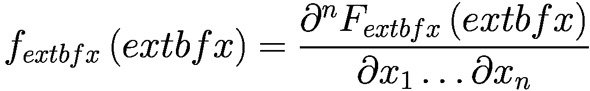

对于两个随机变量`X`和`Y`的情况，联合 PDF 简化为：

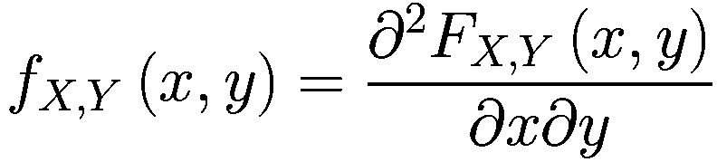

这等价于：

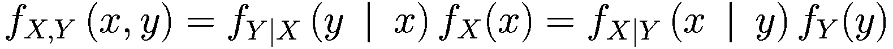

`f_{Y|X}(y|x)`是在给定`X`条件下`Y`的条件 PDF。`f_X(x)`是`X`的边缘 PDF。`f_{X|Y}(x|y)`是在给定`Y`条件下`X`的条件 PDF。`f_Y(y)`是`Y`的边缘 PDF。

区分`X`和`Y`的联合概率分布（多元分布）与每个变量的单独概率分布（单变量分布）非常重要。随机变量的单个概率分布被称为其**边缘概率分布**。一般而言，`X`的边缘概率分布可以通过`X`与其他随机变量的联合概率分布来确定。例如，如果随机变量`X`和`Y`的联合概率密度函数是`f_{X,Y}(x,y)`，则定义边缘分布的`X`和`Y`的边缘概率密度函数如下所示：

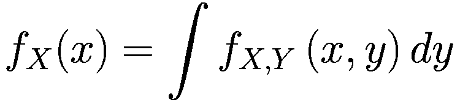

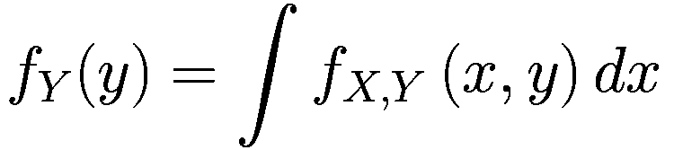

第一个积分是在`(X, Y)`值域内所有满足特定`X=x`的点上，对所有`y`进行求和。第二个积分是在`(X, Y)`值域内所有满足`Y=y`的点上，对所有`x`进行求和。

例如，图 12-42 展示了从二元正态分布中抽取的随机样本（黑点）。边缘概率密度函数也一并显示。

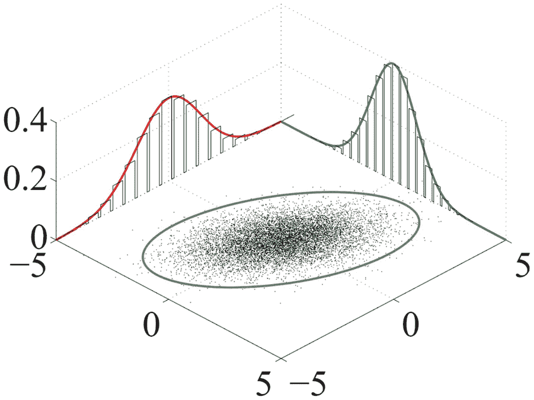

这个三维图包含两个带曲线阴影的概率分布区域和一个圆形阴影区域。

**图 12-42** 来自二元正态分布的随机样本

在 NM Dev 中，单变量概率函数的实现继承自`MultivariateProbabilityDistribution`接口。这样的实现不仅指定了分布的 CDF 和 PDF，还指定了描述性统计量（例如均值和方差）以及其他信息。其签名如下：

```java
public interface MultivariateProbabilityDistribution {
    /**
     * Gets the cumulative probability F(x) = Pr(X &le; x).
     *
     * @param x x
     * @return F(x) = Pr(X &le; x)
     */
    public double cdf(Vector x);
    /**
     * The density function, which, if exists, is the derivative of F. It
     * describes the density of probability at each point in the sample space.
     * 
     * f(x) = dF(X) / dx
     * 
     * This may not always exist.
     * 
     * For the discrete cases, this is the probability mass function. It gives
     * the probability that a discrete random variable is exactly equal to some
     * value.
     *
     * @param x x
     * @return f(x)
     */
    public double density(Vector x);
    /**
     * Gets the mean of this distribution.
     *
     * @return the mean
     */
    public Vector mean();
    /**
     * Gets the mode of this distribution.
     *
     * @return the mean
     */
    public Vector mode();
    /**
     * Gets the covariance matrix of this distribution.
     *
     * @return the covariance
     */
    public Matrix covariance();
    /**
     * Gets the entropy of this distribution.
     *
     * @return the entropy
     * @see Wikipedia: Entropy (information theory)
     */
    public double entropy();
    /**
     * The moment generating function is the expected value of
     * e^{tX}. That is,
     * 
     * E(e^{tX})
     * 
     * This may not always exist.
     *
     * @param t t
     * @return E(exp(tX))
     * @see Wikipedia: Moment-generating function
     */
    public double moment(Vector t);
}
```

请注意，对于多元分布，某些成员函数可能不受支持。


### 12.4.1 多元正态分布

多元正态分布、多元高斯分布或联合正态分布，是一维（单变量）正态分布向高维空间的推广。它通常用于（至少近似地）描述任何一组（可能）相关的实值随机变量，其中每个变量都围绕其均值聚集。

一个 *k* 维随机向量 ***X*** = (`X[1]`, ⋯, `X[k]`)^(`T`) 被称为标准正态随机向量，当且仅当其所有分量都是独立的均值为 0、方差为 1 的标准正态变量。即，对于所有 `i`，有 `X[i]` ~ `N(0, 1)`。

一个 *k* 维随机向量 ***X*** = (`X[1]`, ⋯, `X[k]`)^(`T`) 服从多元正态分布，记为 ***X*** ~ `N(***μ***, **Σ**)`，当且仅当存在一个标准正态随机向量 ***Z ∈*** ℝ^(`l`)，一个向量 ***μ ∈*** ℝ^(`k`)，以及一个矩阵 ***A*** ∈ ℝ^(`k × l`)，使得下式成立：

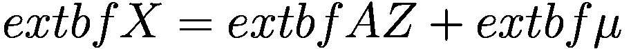

矩阵 **Σ =** ***AA*** ^(`T`) 是随机变量 {`X[i]`} 的协方差矩阵。

可以证明，如果 ***X*** ~ `N(***μ***, **σ**)`，那么其分量的任意线性组合 `Y = a[1] X[1] + … + a[k] X[k]` 都服从正态分布。也就是说，对于任意常数向量 ***a ∈*** ℝ^(`k`)，随机变量 `Y = ***a*** ^(T) ***X***` 服从单变量正态分布。

给定均值 ***μ*** 和正定协方差矩阵 **σ**，多元正态分布的概率密度函数如下：

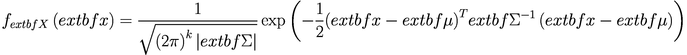

如果 **∑** 是一个 1×1 矩阵（即单个实数），则上述方程简化为单变量正态分布的方程。

对于两个随机变量 `X` 和 `Y`，向量 `[X Y]^T` 的联合概率密度函数如下：

![ $$ f\left(x,y\right)=\frac{1}{2{\pi \sigma}_X{\sigma}_Y\sqrt{1-{\rho}²}}\exp \left(-\frac{1}{2\left(1-{\rho}²\right)}\left[{\left(\frac{x-{\mu}_X}{\sigma_X}\right)}²-2\rho \left(\frac{x-{\mu}_X}{\sigma_X}\right)\left(\frac{y-{\mu}_Y}{\sigma_Y}\right)+{\left(\frac{y-{\mu}_Y}{\sigma_Y}\right)}²\right]\right) $$ ](images/528380_1_En_12_Chapter/528380_1_En_12_Chapter_TeX_Equ1.png)

( `V` )

其中，`ρ` 是 `X` 和 `Y` 之间的相关系数，并且 `σ[X] > 0`，`σ[Y] > 0`。用更一般的多元正态 PDF 表示，我们有：

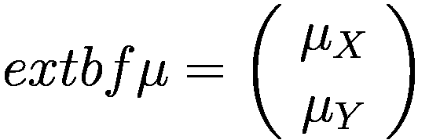 且 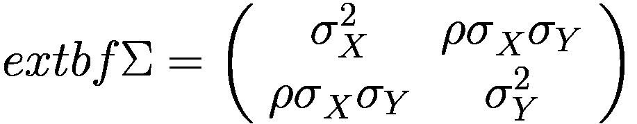

例如，图 12-43 显示了来自一个具有以下参数的二元正态分布的样本点：

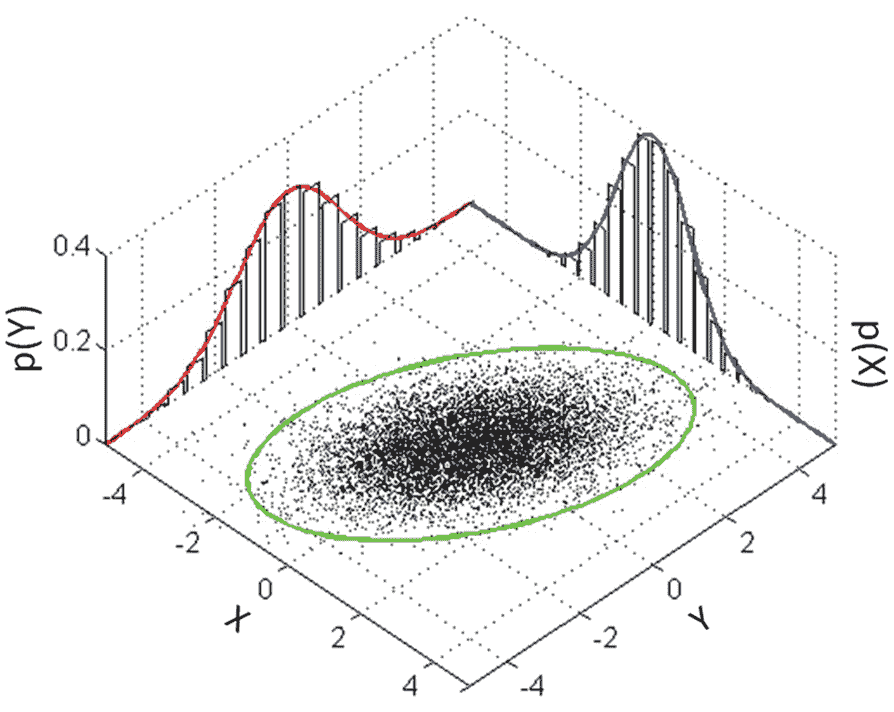

该三维图形由两个带曲线阴影的概率分布区域和一个圆形阴影区域组成。三个轴均已标注。

图 12-43

一个二元正态分布

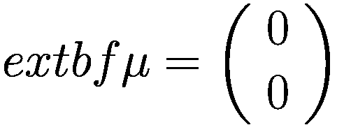 且 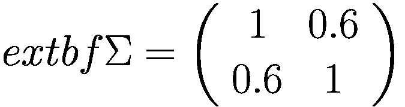

同时还展示了两个边缘分布、一维直方图以及三西格玛椭圆。

均值如下：

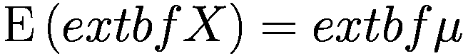

方差如下：

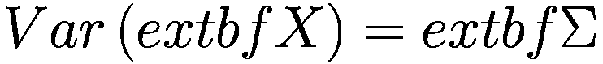

矩母函数如下：

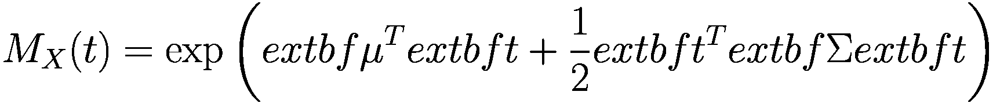

NM Dev 类 `MultivariateNormalDistribution` 实现了多元正态分布。示例如下：

```kotlin
println("Construct a 3-dimensional multivariate standard normal distribution")
val mvnorm1 = MultivariateNormalDistribution(
3 // dimension
)
println("mean = " + mvnorm1.mean())
println("variance = " + mvnorm1.covariance())
println("")
var x1: Vector = DenseVector(0.0, 0.0, 0.0)
println(String.format("f(%s) = %f", x1, mvnorm1.density(x1)))
x1 = DenseVector(1.0, 0.0, 0.0)
println(String.format("f(%s) = %f", x1, mvnorm1.density(x1)))
x1 = DenseVector(0.0, 0.5, 0.0)
println(String.format("f(%s) = %f", x1, mvnorm1.density(x1)))
x1 = DenseVector(0.0, 0.0, 0.3)
println(String.format("f(%s) = %f", x1, mvnorm1.density(x1)))
x1 = DenseVector(1.0, 0.5, 0.0)
println(String.format("f(%s) = %f", x1, mvnorm1.density(x1)))
x1 = DenseVector(0.0, 0.5, 0.3)
println(String.format("f(%s) = %f", x1, mvnorm1.density(x1)))
x1 = DenseVector(1.0, 0.0, 0.3)
println(String.format("f(%s) = %f", x1, mvnorm1.density(x1)))
x1 = DenseVector(1.0, 0.5, 0.3)
println(String.format("f(%s) = %f", x1, mvnorm1.density(x1)))
```

输出结果如下：

```
mean = [0.000000, 0.000000, 0.000000]
variance = 3x3
[,1] [,2] [,3]
[1,] 1.000000, 0.000000, 0.000000,
[2,] 0.000000, 1.000000, 0.000000,
[3,] 0.000000, 0.000000, 1.000000,
f([0.000000, 0.000000, 0.000000] ) = 0.063494
f([1.000000, 0.000000, 0.000000] ) = 0.038511
f([0.000000, 0.500000, 0.000000] ) = 0.056033
f([0.000000, 0.000000, 0.300000] ) = 0.060700
f([1.000000, 0.500000, 0.000000] ) = 0.033986
f([0.000000, 0.500000, 0.300000] ) = 0.053567
f([1.000000, 0.000000, 0.300000] ) = 0.036816
f([1.000000, 0.500000, 0.300000] ) = 0.032490
println("Construct a 2-dimensional multivariate normal distribution")
val mu: DenseVector = DenseVector(1.0, 2.0)
val sigma: DenseMatrix = DenseMatrix(arrayOf(doubleArrayOf(4.0, 2.0), doubleArrayOf(2.0, 3.0)))
val mvnorm2 = MultivariateNormalDistribution(mu, sigma)
println("\nmean = " + mvnorm2.mean()) // same as mu
println("\nvariance = " + mvnorm2.covariance()) // same as sigma
var x2: Vector = DenseVector(0.3, 0.4)
println(String.format("f(%s) = %f", x2, mvnorm2.density(x2)))
x2 = DenseVector(0.4, 0.3)
println(String.format("f(%s) = %f", x2, mvnorm2.density(x2)))
```

输出结果如下：

```
construct a 2-dimensional multivariate normal distribution
mean = [1.000000, 2.000000]
variance = 2x2
[,1] [,2]
[1,] 4.000000, 2.000000,
[2,] 2.000000, 3.000000,
f([0.300000, 0.400000] ) = 0.035812
f([0.400000, 0.300000] ) = 0.032955
```


### 12.4.2 多元 t 分布

多元 t 分布是一维（单变量）t 分布向更高维度的推广。对于 *p* 维 t 分布，假设 `y ~ N(0, Σ)` 是一个多元正态分布，`u ~ χ²(υ)` 是一个自由度为 *υ* 的卡方分布，并且我们有一个 *p* × *p* 的正定尺度矩阵 `Σ`，使得 `y / sqrt(u/υ) = x - μ`，那么随机向量 `x` 服从多元 t 分布。

其概率密度函数如下：

`f(x | υ, μ, Σ) = (Γ((υ+p)/2) / (Γ(υ/2) * υ^(p/2) * π^(p/2) * |Σ|^(1/2))) * [1 + (1/υ) * (x - μ)^T * Σ^(-1) * (x - μ)]^(-(υ+p)/2)`

其均值如下：

`E(X) = μ`，当 *υ* > 1 时；否则未定义

其方差如下：

`Var(X) = (υ / (υ - 2)) * Σ`，当 *υ* > 2 时；否则未定义

其偏度为 0。

NM Dev 类 `MultivariateTDistribution` 实现了多元 t 分布。下面是一个示例：

```kotlin
val p = 2 // 维度
val mu: Vector = DenseVector(1.0, 2.0) // 均值
val Sigma: Matrix = DenseMatrix(p, p).ONE() // 尺度矩阵
var v = 1 // 自由度
var t = MultivariateTDistribution(v, mu, Sigma)
var x: Vector = DenseVector(1.23, 4.56)
println(String.format("f(%s) = %f", x, t.density(x)))
v = 2
t = MultivariateTDistribution(v, mu, Sigma)
x = DenseVector(1.23, 4.56)
println(String.format("f(%s) = %f", x, t.density(x)))
v = 3
t = MultivariateTDistribution(v, mu, Sigma)
x = DenseVector(1.23, 4.56)
println(String.format("f(%s) = %f", x, t.density(x)))
v = 4
t = MultivariateTDistribution(v, mu, Sigma)
x = DenseVector(1.23, 4.56)
println(String.format("f(%s) = %f", x, t.density(x)))
v = 5
t = MultivariateTDistribution(v, mu, Sigma)
x = DenseVector(1.23, 4.56)
println(String.format("f(%s) = %f", x, t.density(x)))
v = 6
t = MultivariateTDistribution(v, mu, Sigma)
x = DenseVector(1.23, 4.56)
println(String.format("f(%s) = %f", x, t.density(x)))
```

输出如下：

```
f([1.230000, 4.560000] ) = 0.007587
f([1.230000, 4.560000] ) = 0.008595
f([1.230000, 4.560000] ) = 0.008674
f([1.230000, 4.560000] ) = 0.008537
f([1.230000, 4.560000] ) = 0.008351
f([1.230000, 4.560000] ) = 0.008167
```

### 12.4.3 多元 Beta 分布

多元 Beta 分布通常称为狄利克雷分布，是一维（单变量）Beta 分布向更高维度的推广。其概率密度函数返回的是，在给定每个事件被观测了 `a[i]` 次的情况下，*K* 个互斥事件的概率为 `x[i]` 的信念。

阶数为 *K* ≥ 2、参数为 `a[1]`, …, `a[K]` 的狄利克雷分布的概率密度函数如下所示：

`f(x₁, …, x_K | a₁, …, a_K) = (1 / B(a)) * Π(i=1 to K) x_i^(a_i - 1)`

其中对所有 *i* 满足 `Σ(i=1 to K) x_i = 1` 且 `x[i] ≥ 0`。

归一化常数是多元 Beta 函数，可以用 Gamma 函数表示，如下所示：

`B(a) = (Π(i=1 to K) Γ(a_i)) / Γ(Σ(i=1 to K) a_i)`

图 12-44 展示了一个示例。

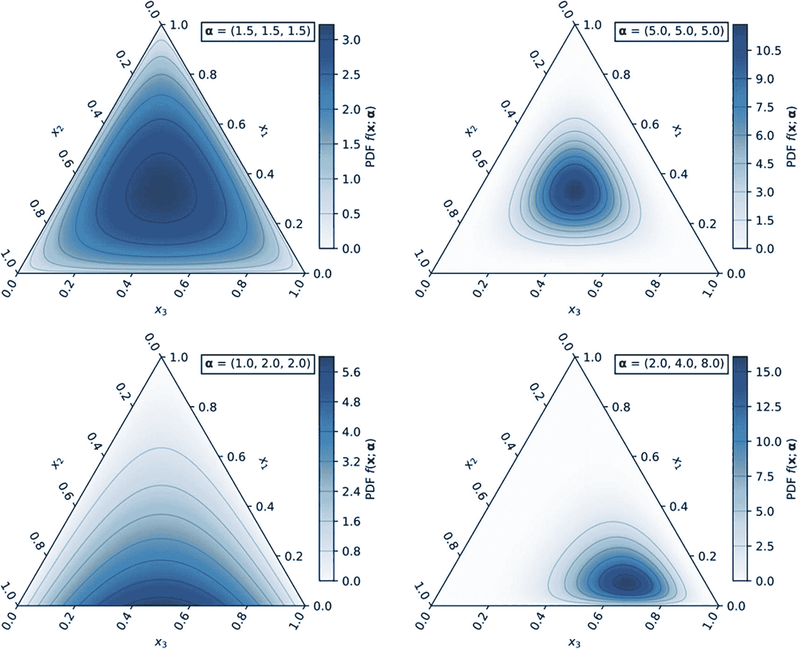

四个三角形，每条边上不同 alpha 点处有图形点，三角形内部显示表示狄利克雷分布概率密度函数的同心曲线。

**图 12-44** 狄利克雷分布的概率密度函数

NM Dev 类 `DirichletDistribution` 实现了狄利克雷分布。下面是一个示例：

```kotlin
// 参数
val a: DoubleArray = doubleArrayOf(1.0, 2.0, 3.0, 4.0, 5.0)
val dist = DirichletDistribution(a)
val x: Vector = DenseVector(0.1, 0.2, 0.3, 0.2, 0.2)
println(String.format("f(%s) = %f", x, dist.density(x)))
```

输出如下：

```
f([0.100000, 0.200000, 0.300000, 0.200000, 0.200000] ) = 69.742633
```


### 12.4.4 多项分布

多项分布是二项分布向更高维度的推广。二项分布给出了一系列二元结果实验中成功（和失败）次数的概率，而多项分布则给出了掷* k *面骰子* n *次后每个面出现次数的概率。换句话说，对于* n *次独立试验，每次试验恰好导致* k *个类别中某一个成功，且每个类别有给定的固定成功概率，多项分布给出了各类别成功次数任意特定组合的概率。当* k* 为 2 且 *n* 为 1 时，多项分布即为伯努利分布。当* k* 为 2 且 *n* 大于 1 时，它是二项分布。当* k* 大于 2 且 *n* 为 1 时，它是分类分布。

数学上，我们有* k *个互斥的可能结果，其对应概率分别为 *p* [1], …, *p* [*k*]，以及* n *次独立试验。由于这* k *个结果互斥且必然发生一个，因此对于 *i* = 1, …, *k* 有 *p* [*i*] ≥ 0，并且 `sum(p_i) = 1`（i 从 1 到 k）。

如果随机变量 {*X* [*i*]} 表示在* n *次试验中第 *i* 个结果被观测到的次数，则随机向量 *X* = (*X* [1], …, *X* [*k*])^(*T*) 服从参数为 *n* 和 *p* 的多项分布，其中 *p* = (*p* [1], …, *p* [*k*])。虽然各次试验是独立的，但结果 *X* 是相互依赖的，因为它们的和必须等于 *n*，即 `sum(x_i) = n`（i 从 1 到 k）。

多项分布是一种离散概率分布。其概率质量函数描述了这* k *个事件同时发生的联合概率。

```
P(X1 = x1, ..., Xk = xk) = (n! / (x1! * ... * xk!)) * p1^x1 * ... * pk^xk
```

所有结果概率之和等于 1。

```
sum(P(X1 = x1i, ..., Xk = xkn)) = 1
```

该多项分布的概率质量函数给出了从一个袋子中抽取* n *个具有* k *种不同颜色的球（每次抽球后放回）的概率。相同颜色的球视为等价。

```
f(x1, ..., xk | n, p1, ..., pk) = P(X1 = x1, ..., Xk = xk)
```

```
= (n! / (x1! * ... * xk!)) * p1^x1 * ... * pk^xk
```

均值如下：

```
E(Xi) = n * pi
```

方差和协方差如下：

```
Var(Xi) = n * pi * (1 - pi)
```

```
Cov(Xi, Xj) = -n * pi * pj, i != j
```

矩生成函数如下：

```
M_X(t) = (sum(pi * e^ti for i from 1 to k))^n
```

假设我们将 100 个球投入 3 个箱子，每个箱子的成功概率分别为 0.1、0.2 和 0.7。每个箱子中分别有 10、20 和 70 个球的概率为 0.013279。见图 [12-45]。

该图描绘了一组圆形形状，有三条箭头指向三个 3D 矩形块。箭头上分别标记了 0.1、0.2 和 0.7。

**图 12-45** 多项分布，k = 3，n = 100

NM Dev 类 `MultinomialDistribution` 实现了多项分布。以下代码实现了上述示例：

```kotlin
// k = 3，每个成功概率
val prob: DoubleArray = doubleArrayOf(0.1, 0.2, 0.7)
val n = 100
var dist = MultinomialDistribution(n, prob[0])
// n 次试验的一个结果
val x: Vector = DenseVector(10.0, 20.0, 70.0)
println(String.format("f(%s) = %f", x, dist.density(x)))
```

输出如下：

```
f([10.000000, 20.000000, 70.000000] ) = 0.013279
```


