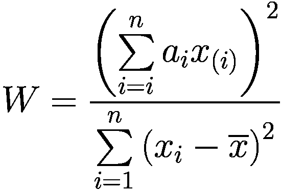
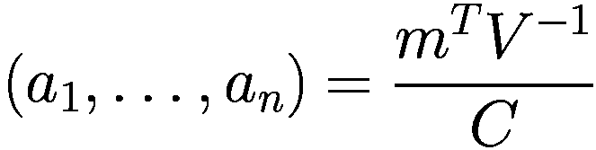
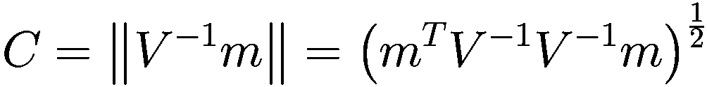
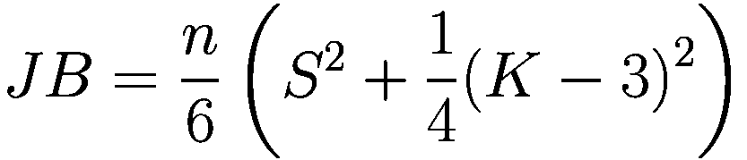
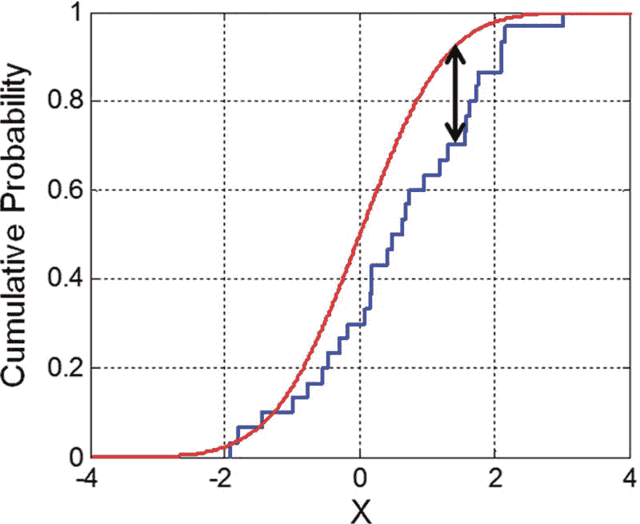
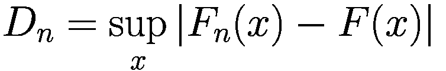
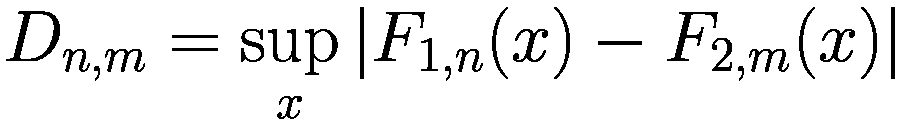
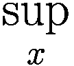
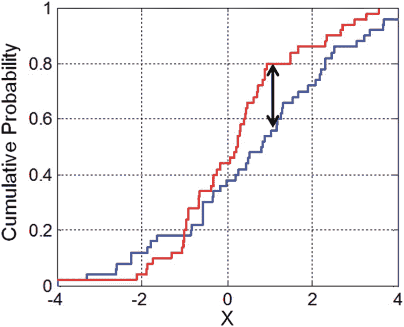
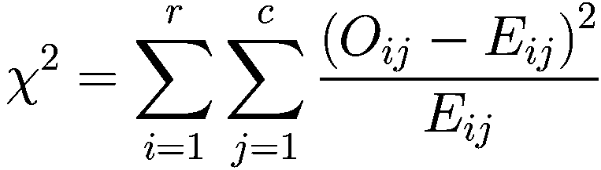

# 12.5 假设检验

统计假设检验是一种统计推断方法。假设检验用于评估样本数据是否支持我们称之为假设的数据解释。假设是布尔型的，要么是，要么否。例如，我们可能想要检验以下内容：

- 数据呈正态分布。
- 关于总体参数的某个假设为真。
- 两个样本来自相同的总体分布。

假设检验背后的思想是：在假设（原）假设成立的前提下，评估我们观察到当前数据的可能性有多大。如果该可能性很低，我们就说结果具有足够的统计显著性，可以“拒绝原假设”。否则，我们“未能拒绝原假设”。统计推断提供了一种“证明”某事物的替代方法。我们或许无法通过一组公理逐步运用演绎逻辑直到得出结论的方式来证明上帝的存在，但我们可以用统计方法证明上帝的存在。至少，我们可以未能拒绝“上帝存在”这一原假设。

通过假设检验并不意味着原假设为真。它只意味着没有足够证据表明原假设可能为假。结果不具有统计显著性。事实上，使用假设检验时，我们可能犯两类推断错误。第一类错误是原假设实际上为真，但我们拒绝了它，也称为假阳性。如果我们的观测结果很极端（可能性很小但确实发生了），就会发生这种情况。第二类错误是原假设为假，但我们未能拒绝它，也称为假阴性。例如，某种药物无效，但根据数据我们却认为它没问题。

再举一个例子，假设我们怀疑一枚硬币有偏差，旋转时正面朝上的概率低于 50%。为检验这一怀疑，我们进行实验，将硬币旋转 100 次，得到 37 次正面和 63 次反面。观察到的正面比例为`37/100 = 37%`。对于这些数据，我们有两种可能的解释。

- 原假设（`H0`）：数据仅仅是随机变异的反映。旋转硬币时正面朝上的概率实际上为 `p = 0.5`。
- 备择假设（`H1`）如下：旋转硬币时正面朝上的概率实际上为 `p < 0.5`。

注意，原假设和备择假设必须互斥。如果我们未能拒绝原假设，我们将接受备择假设来解释数据。

让我们回答这个问题：“原假设是否提供了对数据的合理解释？”首先，我们需要设计一个检验统计量，来衡量数据与假设原假设为真时预期结果之间的差异。在我们的例子中，如果原假设为真，正面次数（以及正面比例）服从参数为 `p = 0.5` 和 `υ = 100` 的二项分布。该分布的标准差等于 `0.05`，可以使用以下代码计算：

```
val n = 100
val dist2 = BinomialDistribution(
n,
0.5 // p
)
val stdev: Double = sqrt(dist2.variance()) / n
println("standard deviation = " + stdev)
```

输出如下：

```
standard deviation = 0.05
```

因此，观察比例（37%）与真实比例（50%）之间差异的标准化 z 分数为：

`z = (0.37 - 0.5) / 0.05 = -2.6`

我们可以看到，如果原假设为真，那么这个 z 分数异常地低，处于正态分布的极端一侧。通过标准正态累积分布函数，z 分数为 `-2.6` 的概率为 `0.004661188023718749`（p 值），发生的概率低于 0.5%。以下代码计算 z 分数和 p 值。

```
val z_score: Double = (0.37 - 0.5) / stdev
println("z-score = " + z_score)
val p_value: Double = NormalDistribution() // 标准正态分布的默认构造函数
.cdf(z_score)
println("p-value = " + p_value)
```

输出如下：

```
z-score = -2.6
p-value = 0.004661188023718749
```

换句话说，如果原假设为真，我们观察到当前数据（37%的正面比例）的可能性极小。原假设无法很好地解释我们的数据。因此，我们拒绝原假设，并接受备择假设。这枚硬币可能确实是有偏差的，旋转时正面朝上的概率低于 50%。见图 12-46。

概率曲线显示了在阿尔法区域中对 `H0` 的拒绝。

图 12-46：假设检验拒绝域

这个例子说明了进行假设检验的一般步骤。六个步骤如下：

该过程包括六个步骤：收集数据、陈述假设、设计检验统计量及其分布、选择显著性水平、计算检验统计量和 p 值、以及做出决策，并按此顺序进行。

图 12-47：假设检验步骤

1. 收集数据和/或进行实验。
2. 陈述原假设（`H0`）和备择假设（`H1`）。原假设本身不涉及数据，它是关于总体参数或数值特征的陈述。我们检验该参数的有效性。备择假设是原假设的互斥否定版本。
3. 设计适当的检验和检验统计量 `T`。推导出在原假设和假设条件下检验统计量的分布。正态分布和 t 分布是常用的分布。
4. 选择显著性水平 `α`，这是一个概率阈值，低于该阈值时将拒绝原假设。常用值为 5%（统计显著）和 1%（统计极显著）。
5. 根据观测值计算检验统计量 `T` 的观测值 `t̂`。计算 p 值。这是在原假设下，抽样得到至少与观测值一样极端的检验统计量的概率（该事件的最大概率）。
6. 当且仅当 p 值小于（或等于）显著性水平阈值 `α` 时，拒绝原假设，支持备择假设。见图 12-47。

NM Dev 提供了广泛的假设检验方法，用于检验总体分布、检验总体参数以及比较底层总体分布。所有假设检验的实现都继承自这个抽象类 `HypothesisTest`。其签名如下：


```java
public abstract class HypothesisTest {
    /**
     * 获取检验统计量。
     *
     * @return 检验统计量
     * @see 维基百科:
     * 检验统计量
     */
    public abstract double statistics();
    /**
     * 获取检验统计量的 p 值。
     *
     * @return p 值
     * @see 维基百科:
     * P 值
     */
    public abstract double pValue();
    /**
     * 获取零假设的描述。
     *
     * @see 维基百科:
     * 零假设
     *
     * @return 零假设的描述
     */
    public abstract String getNullHypothesis();
    /**
     * 获取备择假设的描述。
     *
     * @return 备择假设的描述
     * @see
     * 维基百科:
     * 备择假设
     */
    public abstract String getAlternativeHypothesis();
    /**
     * 获取观测数据的组数。
     *
     * @return 观测数据的组数
     */
    public int nGroups() {
        return k;
    }
    /**
     * 获取观测数据的总数。
     *
     * @return 观测数据的总数
     */
    public int nObs() {
        return N;
    }
    /**
     * 使用 p 值检查在给定的显著性水平下是否可以拒绝零假设。
     * 即，在零假设下观察到当前结果的概率很小。
     *
     * @param alpha 检验的显著性水平
     * @return 如果因 p 值而拒绝假设，则返回 {@code true}
     */
    public boolean isNullRejected(double alpha) {
        return pValue() < alpha;
    }
}
```

### 12.5.1 分布检验

NM Dev 支持多种假设检验，用于评估数据样本是否来自特定分布（例如正态分布），或两个样本是否具有相同的总体分布。

#### 正态性检验

有多种假设检验可用于评估样本是否服从正态分布。它们具有不同的功效和局限性，例如对样本量的上限要求。

##### 夏皮罗-威尔克检验

对于样本量不超过 5000 个数据点且没有过多相同值的情况，最佳的正态性检验是夏皮罗-威尔克检验。夏皮罗-威尔克检验的零假设是样本 {*x* [1], …, *x* [*n*]} 来自正态分布总体。检验统计量如下：



其中 *x* [(*i*)]（括号内为下标索引 *i*；不要与 *x* [*i*] 混淆）是第 *i* 个次序统计量。为了计算次序统计量，我们需要对样本进行排序，并找到样本中第 *i* 个最小的数。 是样本均值。

系数 *a* [*i*] 如下所示：



其中 *C* 是一个向量范数，如下所示：



向量 *m* 由从标准正态分布中采样的独立同分布随机变量的次序统计量的期望值构成。*V* 是这些正态次序统计量的协方差矩阵。

*W* 遵循夏皮罗-威尔克分布，该分布在算法 AS R94 (Anon., 1995) 中实现。

NM Dev 类 `ShapiroWilk` 实现了夏皮罗-威尔克检验。以下是一个示例：

```kotlin
val sample: DoubleArray = doubleArrayOf(-1.7, -1.0, -1.0, -0.73, -0.61, -0.5, -0.24, 0.45, 0.62, 0.81, 1.0, 5.0)
val test = ShapiroWilk(sample)
println("H0: " + test.getNullHypothesis())
println("H1: " + test.getAlternativeHypothesis())
println("检验统计量 = " + test.statistics())
println("p 值 = " + test.pValue())
println("在 5%显著性水平下是否拒绝零假设 = " + test.isNullRejected(0.05))
```

输出如下：

```text
H0: 样本来自正态分布总体
H1: 样本不来自正态分布总体
检验统计量 = 0.7818521311977514
p 值 = 0.005868730248429044
在 5%显著性水平下是否拒绝零假设 = true
```

对于这个样本，零假设在 5% 的显著性水平下被拒绝。因此接受备择假设，即该样本不服从正态分布。

##### 雅克-贝拉检验

雅克-贝拉检验是一种拟合优度检验，用于检验样本数据的偏度和峰度是否符合正态分布。正态分布的偏度和超额峰度均为零。如果其中任何一个远离零，则表明数据不服从正态分布。

检验统计量 *JB* 定义如下：



其中 *n* 是观测数量（通常指自由度），*S* 是样本偏度，*K* 是样本峰度。

如果数据来自正态分布，*JB* 统计量渐近服从自由度为 2 的卡方分布，因此该统计量可用于检验数据是否来自正态分布。零假设是一个联合假设，即偏度为零且超额峰度为零。如 *JB* 的定义所示，任何偏离此假设的情况都会导致 JB 统计量增大。

对于小样本，卡方近似过于敏感，经常在零假设为真时将其拒绝。此外，p 值的分布偏离均匀分布，变为右偏的单峰分布，尤其对于较小的 p 值。这会导致较大的第一类错误率。存在更有效的正态性检验方法。

NM Dev 类 `JarqueBera` 实现了雅克-贝拉检验。以下是一个示例：

```kotlin
val samples: DoubleArray = doubleArrayOf(
39.0, 35.0, 33.0, 33.0, 32.0, 30.0, 30.0, 30.0, 28.0, 28.0,
27.0, 27.0, 27.0, 27.0, 27.0, 26.0, 26.0, 26.0, 26.0, 26.0,
26.0, 25.0, 25.0, 25.0, 25.0, 25.0, 25.0, 24.0, 24.0, 24.0,
24.0, 24.0, 23.0, 23.0, 23.0, 23.0, 23.0, 23.0, 23.0, 23.0,
23.0, 23.0, 23.0, 23.0, 23.0, 22.0, 22.0, 22.0, 22.0, 21.0,
21.0, 21.0, 21.0, 21.0, 21.0, 21.0, 20.0, 20.0, 19.0, 19.0,
18.0, 16.0
)
val test = JarqueBera(
samples,
false // 不使用精确的雅克-贝拉分布
)
println("H0: " + test.getNullHypothesis())
println("H1: " + test.getAlternativeHypothesis())
println("检验统计量 = " + test.statistics())
println("p 值 = " + test.pValue())
println("在 5%显著性水平下是否拒绝零假设 = " + test.isNullRejected(0.05))
```

输出如下：

```text
H0: 偏度和超额峰度均为 0
H1: 偏度或超额峰度不为 0
检验统计量 = 18.957211215941424
p 值 = 7.647049269299266E-5
在 5%显著性水平下是否拒绝零假设 = true
```


### 达戈斯蒂诺检验

达戈斯蒂诺检验是一种比雅克-贝拉检验更强大的正态性检验方法。它也是一种衡量数据偏离正态分布的拟合优度指标。该检验基于样本峰度和偏度的变换，结合了偏度检验和峰度检验。偏度检验用于判断数据的偏度是否在统计上显著异于零，其检验统计量为 `z_s²`。同样，峰度检验用于判断数据的超额峰度是否在统计上显著异于零，其检验统计量为 `z_k²`。达戈斯蒂诺检验基于以下原理：当数据服从正态分布时，检验统计量 `T = z_s² + z_k²` 服从自由度为 2 的卡方分布。该检验通常不适用于少于 20 个元素的数据集。原假设如下：偏度和超额峰度均为 0。备择假设如下：偏度或超额峰度中至少有一个不为零。

NM Dev 类 `DAgostino` 实现了达戈斯蒂诺检验。以下是一个示例：

```
val samples: DoubleArray = doubleArrayOf(
39.0, 35.0, 33.0, 33.0, 32.0, 30.0, 30.0, 30.0, 28.0, 28.0,
27.0, 27.0, 27.0, 27.0, 27.0, 26.0, 26.0, 26.0, 26.0, 26.0,
26.0, 25.0, 25.0, 25.0, 25.0, 25.0, 25.0, 24.0, 24.0, 24.0,
24.0, 24.0, 23.0, 23.0, 23.0, 23.0, 23.0, 23.0, 23.0, 23.0,
23.0, 23.0, 23.0, 23.0, 23.0, 22.0, 22.0, 22.0, 22.0, 21.0,
21.0, 21.0, 21.0, 21.0, 21.0, 21.0, 20.0, 20.0, 19.0, 19.0,
18.0, 16.0
)
val test = DAgostino(samples)
println("H0: " + test.getNullHypothesis())
println("H1: " + test.getAlternativeHypothesis())
println("skewness test statistics " + test.Z1())
println("p-value for skewness test = " + test.pvalueZ1())
println("kurtosis test statistics " + test.Z2())
println("test statistics = " + test.statistics())
println("p-value = " + test.pValue())
println("is null rejected at 5% = " + test.isNullRejected(0.05))
```

输出结果如下：

```
H0: both the skewness and the excess kurtosis are 0
H1: either the skewness or the excess kurtosis is non-zero
skewness test statistics 3.1816798934083783
p-value for skewness test = 0.001464235568704897
kurtosis test statistics 2.328055257751046
test statistics = 15.542928227261438
p-value = 4.2159555092358136E-4
is null rejected at 5% = true
```

### 利利福斯检验

利利福斯检验用于检验原假设，即数据来自具有估计样本均值和方差的正态分布总体。检验统计量是经验分布与假设正态分布之间的最大绝对差。由于假设的累积分布函数使用了基于数据估计的均值和方差，因此检验统计量的“零分布”（即在原假设为真的条件下其概率分布）在随机意义上小于如果原假设只指定单一正态分布时的情况（这正是利利福斯分布存在的原因）。

检验步骤如下：

1.  首先，根据数据估计总体均值和总体方差。
2.  然后，找出经验分布函数与具有估计均值和估计方差的正态分布的累积分布函数之间的最大差异。
3.  最后，评估该最大差异是否足够大以至于在统计上显著，从而拒绝原假设。我们使用利利福斯分布来确定临界区域。

NM Dev 类 `Lilliefors` 实现了利利福斯检验。在此实现中，我们首先使用 Dallal & Wilkinson (1986) 中的公式计算 p 值，该公式仅在 p 值小于 0.1 时被认为是可靠的。当该 p 值大于 0.1 时，我们使用修正统计量的分布（Stephens, 1974）重新计算 p 值。以下是一个示例：

```
val sample: DoubleArray = doubleArrayOf(-1.7, -1.0, -1.0, -0.73, -0.61, -0.5, -0.24, 0.45, 0.62, 0.81, 1.0, 5.0)
val test = Lilliefors(sample)
println("H0: " + test.getNullHypothesis())
println("H1: " + test.getAlternativeHypothesis())
println("test statistics = " + test.statistics())
println("p-value = " + test.pValue())
println("is null rejected at 5% = " + test.isNullRejected(0.05))
```

输出结果如下：

```
H0: the samples come from a normally distributed population
H1: the samples do not come from a normally distributed population
test statistics = 0.23353570622938402
p-value = 0.0696831488554199
is null rejected at 5% = false
```


### 柯尔莫哥洛夫检验

柯尔莫哥洛夫-斯米尔诺夫检验（K-S 检验或 KS 检验）有两个版本。单样本 KS 检验比较样本的经验分布函数与参考分布的累积分布函数之间的距离（如 Lilliefors 检验）。双样本 KS 检验比较两个样本的经验分布函数之间的距离。该统计量的零分布是在以下零假设下计算的：样本来自参考分布（在单样本情况下），或者样本来自同一分布（在双样本情况下）。参见图 12-48。



参考累积分布函数和经验累积分布函数的累积概率相对于 x 的递增图。可逆箭头标记在这些曲线之间。

**图 12-48** 单样本柯尔莫哥洛夫-斯米尔诺夫统计量图示。平滑线为参考累积分布函数，阶梯线为经验累积分布函数，黑色箭头为 K-S 统计量。

单样本柯尔莫哥洛夫-斯米尔诺夫统计量如下：



其中  是经验分布函数 *F*_n_ 与累积分布函数 *F*(*x*) 之间距离集合的上确界。直观上，该统计量取所有 *x* 值上两个分布函数之间的最大绝对差。根据格里文科-坎特利定理，如果样本来自分布 *F*(*x*)，那么当 *n* 趋于无穷时，*D*[_n_] 几乎必然收敛于 0。在实践中，该统计量需要相对较大的数据点数量（与安德森-达令检验统计量等其他拟合优度标准相比）才能正确拒绝零假设。如果 *F*(*x*) 的参数是从数据中确定的，例如，在 Lilliefors 检验中使用样本均值和样本方差，那么使用柯尔莫哥洛夫-斯米尔诺夫分布确定的临界值将失效。

双样本柯尔莫哥洛夫-斯米尔诺夫检验评估两个底层一维概率分布是否存在差异。双样本 KS 统计量如下：



其中 *F*1, *n* 和 *F*2, *m* 分别是第一个和第二个样本的经验分布函数，而  是上确界函数。

双样本 KS 检验是比较两个样本最有用且最通用的非参数方法之一，因为它对两个样本的经验累积分布函数在位置和形状上的差异都很敏感。参见图 12-49。



两个经验分布函数样本的累积概率相对于 x 的递增图。可逆箭头标记在这些曲线之间。

**图 12-49** 双样本柯尔莫哥洛夫-斯米尔诺夫统计量图示。平滑线和阶梯线各对应一个经验分布函数，黑色箭头为双样本 KS 统计量。

柯尔莫哥洛夫-斯米尔诺夫检验可被修改用作拟合优度检验。在检验分布正态性的特殊情况下，样本被标准化并与标准正态分布进行比较。这相当于将参考分布的均值和方差设定为样本估计值，并且已知使用这些来定义特定的参考分布会改变检验统计量的零分布（参见 Lilliefors 检验）。多项研究发现，即使在这种修正形式下，该检验在检验正态性方面的功效也低于夏皮罗-威尔克检验或安德森-达令检验。然而，这些其他检验也有其自身的缺点。例如，夏皮罗-威尔克检验已知不适用于大样本或包含许多相同值的样本。

NM Dev 类 `KolmogorovSmirnov1Sample` 和 `KolmogorovSmirnov2Samples` 实现了单样本和双样本柯尔莫哥洛夫-斯米尔诺夫检验。以下是单样本和双样本 KS 检验的示例：

```
// 单样本 KS 检验
val test1 = KolmogorovSmirnov1Sample(
doubleArrayOf( // 包含重复值
1.2142038235675114, 0.8271665834857130, -2.2786245743283295, 0.8414895245471727,
-1.4327682855296735, -0.2501807766164897, -1.9512765152306415, 0.6963626117638846,
0.4741320101265005, 1.2142038235675114
),
NormalDistribution(),
KolmogorovSmirnov.Side.TWO_SIDED // 选项有：TWO_SIDED, GREATER, LESS
)
println("H0: " + test1.getNullHypothesis())
println("检验统计量 = " + test1.statistics())
println("p 值 = " + test1.pValue())
println("在 5%显著性水平下是否拒绝零假设 = " + test1.isNullRejected(0.05))
```

输出如下：

```
H0: 样本的真实分布函数等于假设的分布函数
检验统计量 = 0.2822971133259847
p 值 = 0.4028859117233684
在 5%显著性水平下是否拒绝零假设 = false
// 双样本 KS 检验
val test2 = KolmogorovSmirnov2Samples(
doubleArrayOf( // x = rnorm(10)
1.2142038235675114, 0.8271665834857130, -2.2786245743283295, 0.8414895245471727,
-1.4327682855296735, -0.2501807766164897, -1.9512765152306415, 0.6963626117638846,
0.4741320101265005, -1.2340784297133520
),
doubleArrayOf( // x = rnorm(15)
1.7996197748754565, -1.1371109188816089, 0.8179707525071304, 0.3809791236763478,
0.1644848304811257, 0.3397412780581336, -2.2571685407244795, 0.4137315314876659,
0.7318687611171864, 0.9905218801425318, -0.4748590846019594, 0.8882674167954235,
1.0534065683777052, 0.2553123235884622, -2.3172807717538038),
KolmogorovSmirnov.Side.GREATER // 选项有：TWO_SIDED, GREATER, LESS
)
println("H0: " + test2.getNullHypothesis())
println("检验统计量 = " + test2.statistics())
println("p 值 = " + test2.pValue())
println("在 5%显著性水平下是否拒绝零假设 = " + test2.isNullRejected(0.05))
```

输出如下：

```
H0: 样本的真实分布函数大于另一个样本的分布函数
检验统计量 = 0.2666666666666667
p 值 = 0.4259925874001307
在 5%显著性水平下是否拒绝零假设 = false
```


### 安德森-达林检验

安德森-达林 K 样本检验用于检验 K 个样本是否来自同一分布，且无需指定该分布。该检验会生成两个统计量和两个 p 值。`T[kN]` 和 `p[kN]` 表示无结值观测时的统计量和 p 值。`T[akN]` 和 `p[akN]` 是针对离散分布或连续数据分组后存在结值情况的备选统计量和 p 值。在这两种情况下，可能会出现结值观测。

NM Dev 类 `AndersonDarling` 实现了安德森-达林 K 样本检验。示例如下：

```
// 样本数据
val x1: DoubleArray = doubleArrayOf(38.7, 41.5, 43.8, 44.5, 45.5, 46.0, 47.7, 58.0)
val x2: DoubleArray = doubleArrayOf(39.2, 39.3, 39.7, 41.4, 41.8, 42.9, 43.3, 45.8)
val x3: DoubleArray = doubleArrayOf(34.0, 35.0, 39.0, 40.0, 43.0, 43.0, 44.0, 45.0)
val x4: DoubleArray = doubleArrayOf(34.0, 34.8, 34.8, 35.4, 37.2, 37.8, 41.2, 42.8)
val test = AndersonDarling(x1, x2, x3, x4)
println("H0: " + test.getNullHypothesis())
println("H1: " + test.getAlternativeHypothesis())
println("检验统计量 = " + test.statistics())
println("p 值 = " + test.pValue())
println("备选检验统计量 = " + test.statisticsAlternative())
println("备选 p 值 = " + test.pValueAlternative())
println("在 5%显著性水平下是否拒绝原假设 = " + test.isNullRejected(0.05))
```

输出结果如下：

```
H0: 所有样本来自同一分布
H1: 并非所有样本来自同一分布
检验统计量 = 4.449262232403152
p 值 = 0.0023633128630889486
备选检验统计量 = 4.479780627135353
备选 p 值 = 0.0022781660876509324
在 5%显著性水平下是否拒绝原假设 = true
```

### 克拉默-冯·米塞斯检验

双样本克拉默-冯·米塞斯检验是另一种用于比较两个样本，以评估它们是否来自同一总体分布的检验方法。

NM Dev 类 `CramerVonMises2Samples` 实现了双样本克拉默-冯·米塞斯检验。示例如下：

```
// 样本数据
val x1: DoubleArray = doubleArrayOf(-0.54289848, 0.08999578, -1.77719573, -0.67991860, -0.65741590, -0.25776164, 1.02024626, 1.26434300, 0.51068476, -0.23998229)
val x2: DoubleArray = doubleArrayOf(1.7053818, 1.0260726, 1.7695157, 1.5650577, 1.4945107, 1.8593791, 2.1760302, -0.9728721, 1.4208313, 1.5892663)
val test = CramerVonMises2Samples(x1, x2)
println("H0: " + test.getNullHypothesis())
println("H1: " + test.getAlternativeHypothesis())
println("检验统计量 = " + test.statistics())
println("p 值 = " + test.pValue())
println("在 5%显著性水平下是否拒绝原假设 = " + test.isNullRejected(0.05))
```

输出结果如下：

```
H0: 两个样本来自同一分布
H1: 两个样本并非来自同一分布
检验统计量 = 1.1450000000000002
p 值 = 0.0010713596423332916
在 5%显著性水平下是否拒绝原假设 = true
```

### 皮尔森卡方检验

皮尔森卡方独立性检验用于评估以列联表（矩阵）形式呈现的两个变量的成对观测是否相互独立。原假设是两个变量在统计上相互独立。

例如，假设我们想了解出勤是否有助于通过考试，类似于澳大利亚英才班的测试。我们可以将出勤/缺勤与通过/未通过的关系记录在如下的列联表中：

| | 通过 | 未通过 | 合计 |
| --- | --- | --- | --- |
| 出勤 | 25 | 6 | 31 |
| 缺勤 | 8 | 15 | 23 |
| 合计 | 33 | 21 | 54 |

如果变量真正独立，我们期望得到如下公平的结果：

| | 通过 | 未通过 | 合计 |
| --- | --- | --- | --- |
| 出勤 | 31*33/54 = 18.94 | 31*21/54 = 12.06 | 31 |
| 缺勤 | 23*33/54 = 14.06 | 23*21/54 = 8.94 | 23 |
| 合计 | 33 | 21 | 54 |

检验统计量如下：



其中 `O[ij]` 是单元格中的观测频数，`E[ij]` 是在原假设成立下假设独立时的期望频数。该检验统计量对所有行（`r`）和列（`c`）求和。它本质上是缩放后的平方偏差之和，通过期望频数对各个单元格的较大和较小计数进行归一化处理。注意，当且仅当所有单元格的 `O[ij] = E[ij]` 时，`χ² = 0`。

当样本量较小且列联表不平衡时，`χ²` 服从费希尔精确分布。否则，当样本量较大且列联表平衡时，我们使用卡方分布，它是费希尔精确分布的渐近分布。

NM Dev 类 `ChiSquareIndependenceTest` 实现了皮尔森卡方独立性检验。以下代码针对上述示例进行计算：

```
// 出勤/缺勤 vs. 通过/未通过计数
val counts: Matrix = DenseMatrix(
arrayOf(
doubleArrayOf(25.0, 6.0),
doubleArrayOf(8.0, 15.0)
)
)
val test1 = ChiSquareIndependenceTest(
counts,
0,
// 渐近分布为卡方分布
ChiSquareIndependenceTest.Type.ASYMPTOTIC
)
val expected: Matrix = ChiSquareIndependenceTest.getExpectedContingencyTable(
intArrayOf(31, 23), // 行和
intArrayOf(33, 21) // 列和
)
println("期望频数:")
println(expected)
println("H0: " + test1.getNullHypothesis())
println("H1: " + test1.getAlternativeHypothesis())
println("检验统计量 = " + test1.statistics())
println("p 值 = " + test1.pValue())
println("在 5%显著性水平下是否拒绝原假设 = " + test1.isNullRejected(0.05))
val test2 = ChiSquareIndependenceTest(
counts,
100000,// 计算费希尔精确分布的模拟次数
ChiSquareIndependenceTest.Type.EXACT // 使用费希尔精确分布
)
println("p 值 = " + test2.pValue())
println("在 5%显著性水平下是否拒绝原假设 = " + test2.isNullRejected(0.05))
```

输出结果如下：

```
期望频数:
2x2
[,1] [,2]
[1,] 18.944444, 12.055556,
[2,] 14.055556, 8.944444,
H0: 列联表中的两个随机变量相互独立
H1: 列联表中的两个随机变量不相互独立
检验统计量 = 9.835886413726527
p 值 = 0.0017113979062570728
在 5%显著性水平下是否拒绝原假设 = true
p 值 = 6.500000000000436E-4
在 5%显著性水平下是否拒绝原假设 = true
```

使用卡方分布作为渐近分布时，p 值为 0.0017。使用费希尔精确分布时，p 值为 0.0006。无论如何，在 5% 的显著性水平下可以安全地拒绝原假设。我们得出结论：出勤对考试结果没有影响的可能性非常小。或者等价地说，出勤与通过考试很可能相关。所以，不要翘课！

### 12.5.2 秩检验

NM Dev 秩检验支持一系列假设检验，用于评估两个样本是否具有相同的总体均值、中位数和变异程度。


### T 检验

T 检验为检验两个独立同分布的正态总体在方差未知但相等的情况下的均值是否相等提供了一种精确检验方法。韦尔奇 T 检验是一种针对数据正态但方差可能不同的情况的近似精确检验。当用于单样本时，该检验可用于将样本均值与假设均值进行比较。对于中等大小的样本和单尾检验，T 检验对正态性假设的适度违反相对稳健。在样本量足够大时，T 检验渐近趋近于 Z 检验，即使与正态性存在较大偏差也表现稳健。然而，如果数据严重非正态且样本量较小，T 检验可能会给出误导性结果。

NM Dev 类 `T` 实现了假设方差相等的 T 检验和假设方差不等的韦尔奇 T 检验。示例如下：

```
// 假设方差相等的 T 检验
val test1: T = T(
doubleArrayOf(1.0, 3.0, 5.0, 2.0, 3.0, 5.0),
doubleArrayOf(2.0, 5.0, 6.0, 4.0, 9.0, 8.0),
true, // 假设方差相等
4.0 // 原假设中的假设均值差 = 4
)
println("H0: " + test1.getNullHypothesis())
println("H1: " + test1.getAlternativeHypothesis())
println("检验统计量 = " + test1.statistics())
println("第一组均值 = " + test1.mean1())
println("第二组均值 = " + test1.mean2())
println("p 值 = " + test1.pValue())
println("p 值，右侧单尾 = " + test1.rightOneSidedPvalue())
println("p 值，左侧单尾 = " + test1.leftOneSidedPvalue())
println(String.format("95%% 置信区间 = (%f, %f)", test1.leftConfidenceInterval(0.95), test1.rightConfidenceInterval(0.95)))
println("97.5%% 置信区间 = " + Arrays.toString(test1.confidenceInterval(0.975)))
println("在 5%显著性水平下是否拒绝原假设 = " + test1.isNullRejected(0.05))
```

输出结果如下：

```
H0: 均值相等
H1: 均值不相等
检验统计量 = -5.239739845279477
第一组均值 = 3.1666666666666665
第二组均值 = 5.666666666666667
p 值 = 3.7894052596908147E-4
p 值，右侧单尾 = 0.9998105297370155
p 值，左侧单尾 = 1.8947026298454073E-4
95% 置信区间 = (-0.251606, -4.748394)
97.5%% 置信区间 = [-5.26404992720365, 0.26404992720364895]
在 5%显著性水平下是否拒绝原假设 = true
```

第一组的均值是 3.17，第二组是 5.67。假设方差相等的 T 检验在 5%显著性水平下拒绝了均值差为 4 的原假设。

```
// 韦尔奇 T 检验（假设方差不相等）
val test2: T = T(
doubleArrayOf(1.0, 3.0, 5.0, 2.0, 3.0, 5.0),
doubleArrayOf(2.0, 5.0, 6.0, 4.0, 9.0, 8.0),
false, // 假设方差不相等
4.0 // 原假设中的假设均值差 = 4
)
println("检验统计量 = " + test2.statistics())
println("p 值 = " + test2.pValue())
println("p 值，右侧单尾 = " + test2.rightOneSidedPvalue())
println("p 值，左侧单尾 = " + test2.leftOneSidedPvalue())
println(String.format("95%% 置信区间 = (%f, %f)", test2.leftConfidenceInterval(0.95), test2.rightConfidenceInterval(0.95)))
println("97.5%% 置信区间 = " + Arrays.toString(test2.confidenceInterval(0.975)))
println("在 5%显著性水平下是否拒绝原假设 = " + test2.isNullRejected(0.05))
```

输出结果如下：

```
检验统计量 = -5.239739845279477
p 值 = 6.816159267755681E-4
p 值，右侧单尾 = 0.9996591920366122
p 值，左侧单尾 = 3.4080796338778404E-4
95% 置信区间 = (-0.205769, -4.794231)
97.5%% 置信区间 = [-5.339736444764696, 0.33973644476469556]
在 5%显著性水平下是否拒绝原假设 = true
```

假设方差不相等的韦尔奇 T 检验也拒绝了原假设。

### 单因素方差分析

单因素方差分析用于检验多个组的均值是否相等。方差分析的优势在于它比两样本 T 检验更有优势。进行多次两样本 T 检验会增加犯第一类错误（假阳性错误）的概率。因此，在比较三个或更多均值时，方差分析非常有用。NM Dev 类 `OneWayANOVA` 实现了单因素方差分析。

### 克鲁斯卡尔-沃利斯检验

克鲁斯卡尔-沃利斯检验是一种非参数方法，用于检验各组之间总体中位数的相等性。它等同于将数据替换为秩次后的单因素方差分析。由于是非参数方法，克鲁斯卡尔-沃利斯检验不假设总体服从正态分布，这与类似的单因素方差分析不同。然而，该检验确实假设每组的分布形状和尺度相同，只是中位数可能存在差异。NM Dev 类 `KruskalWallis` 实现了单因素方差分析。

### 威尔科克森符号秩检验

对于单样本情况，威尔科克森符号秩检验用于检验分布的中位数是否等于假设的中位数；对于两样本情况，则检验各组中位数的相等性。与 T 检验不同，威尔科克森符号秩检验不假设总体的任何分布形式。威尔科克森秩和统计量是所有满足条件 *y* ≤ *x* 的配对 {(*x*, *y*)} 中，*y* 不大于 *x* 的个数。该统计量的取值介于 0 和 *MN* 之间，其中 *M* 是组 1 的观测数，*N* 是组 2 的观测数。该检验统计量服从威尔科克森秩和分布，参见类 `WilcoxonRankSumDistribution`。

NM Dev 类 `WilcoxonSignedRank` 实现了威尔科克森符号秩检验。示例如下：

```
val sample1: DoubleArray = doubleArrayOf(1.3, 5.4, 7.6, 7.2, 3.5)
val sample2: DoubleArray = doubleArrayOf(2.7, 5.2, 6.3, 4.4, 9.8)
val test = WilcoxonSignedRank(
sample1, sample2,
2.0, // 假设分布对称的假设中位数
true  // 使用精确的威尔科克森秩和分布，而非正态分布
)
println("H0: " + test.getNullHypothesis())
println("H1: " + test.getAlternativeHypothesis())
println("检验统计量 = " + test.statistics())
println("p 值 = " + test.pValue())
println("p 值，右侧单尾 = " + test.rightOneSidedPvalue())
println("p 值，左侧单尾 = " + test.leftOneSidedPvalue())
println("在 5%显著性水平下是否拒绝原假设 = " + test.isNullRejected(0.05))
```

输出结果如下：

```
H0: 中位数相等（通过偏移量 mu）
H1: 中位数不相等（并非通过偏移量 mu）
检验统计量 = 2.0
p 值 = 0.1875
p 值，右侧单尾 = 0.9375
p 值，左侧单尾 = 0.09375
在 5%显著性水平下是否拒绝原假设 = false
```


好的，作为一名高级文档工程师和翻译员，我将遵循您提供的注意事项和示例，将给定的英文文本翻译成中文。


