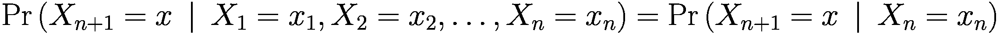
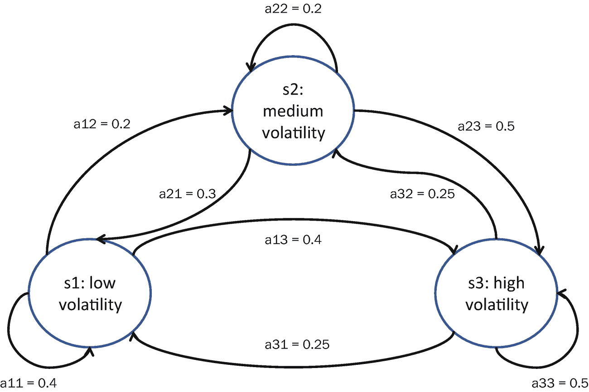
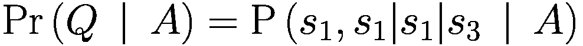
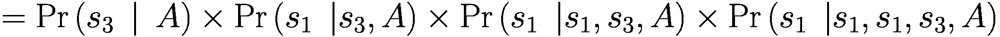
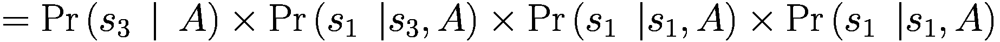
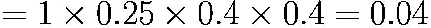
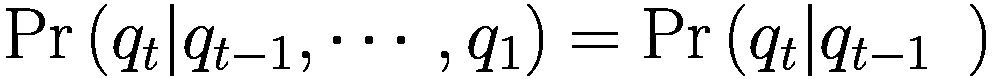
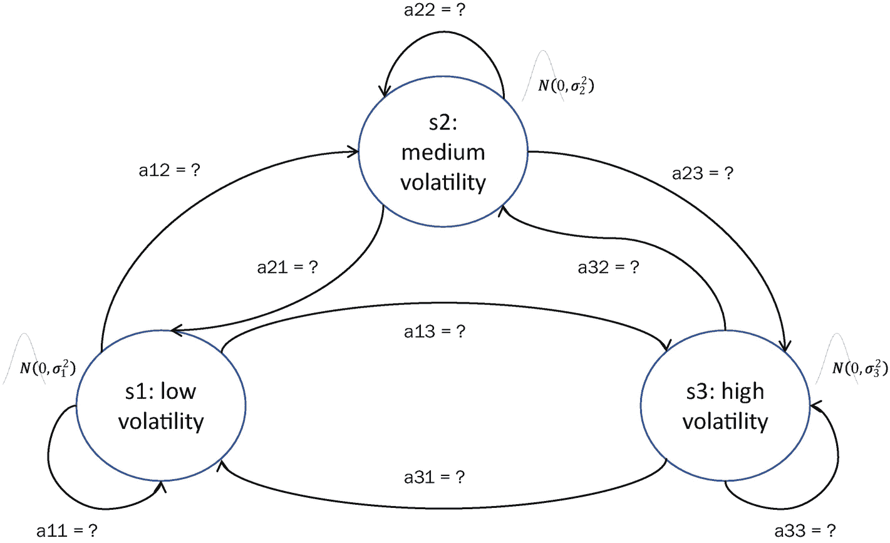
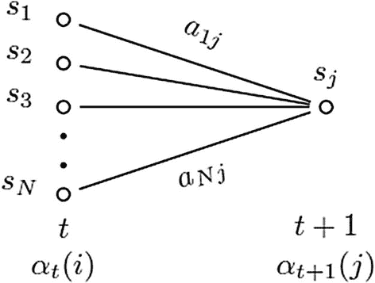

# 马尔可夫模型

马尔可夫模型是一种随机模型，描述了可能状态的序列，其中下一个状态的概率仅取决于当前状态，而与历史无关，因此是无记忆的（不记住过去的任何信息）。它在贝叶斯统计、热力学、统计力学、物理学、化学、经济学、金融学、信号处理、信息论和语音处理等领域有着广泛的应用。马尔可夫过程是一般随机模拟方法（即马尔可夫链蒙特卡洛方法 (MCMC)）的基础，该方法用于模拟从复杂概率分布中进行采样。

## 离散时间马尔可夫链

马尔可夫模型最简单的类型是离散时间马尔可夫链 (DTMC)。它在离散的时间步长上移动状态，并且状态的数量是有限的或可数的。下一个状态的概率仅取决于当前状态，而不取决于过去的任何信息。从数学上讲，假设一系列随机变量 `X[0]`, `X[1]`, `X[2]`, … 具有马尔可夫性质，则我们有以下公式（见图 12-50）：





离散时间马尔可夫链有三个状态。低波动性、中波动性和高波动性分别标记为 `s[1]`、`s[2]` 和 `s[3]`。

图 12-50：具有三个状态的离散时间马尔可夫链

例如，在图 12-50 中，我们可以将股票市场分为三种不同状态：低波动性、中波动性和高波动性。市场明天可能保持相同的（低波动性）状态（40% 的概率），但也可能转移到另一种状态，例如中波动性状态（20% 的概率）或高波动性状态（40% 的概率）。转移概率（由箭头和数字表示）是过程从一个状态转移到另一个状态的概率。注意，离开一个状态并保持在相同状态（指向自身的箭头）的转移概率之和必须为 1。转移概率通常用一个随机矩阵来描述，该矩阵列出了从任意单个状态（行）转移到每个状态（列）的概率。图 12-50 中 DTMC 的随机矩阵如下：

![ $$ A=\left[\begin{array}{ccc}0.4&amp; 0.2&amp; 0.4\\ {}0.3&amp; 0.2&amp; 0.5\\ {}0.25&amp; 0.25&amp; 0.5\end{array}\right] $$ ](images/528380_1_En_12_Chapter/528380_1_En_12_Chapter_TeX_Equhf.png)

由此矩阵以及初始状态的概率共同完全刻画了一个时齐的 DTMC。可以计算系统在未来的第 `n` 步处于特定状态的概率。例如，我们可以计算观察到状态序列 `Q = {s[3], s[1], s[1], s[1]}` 的概率。系统从状态 `s[3]` 开始（概率为 1）。









在第三步中，我们使用了马尔可夫性质来简化条件概率。具体来说，马尔可夫性质表述如下：



在量化金融中，马尔可夫性质与有效市场假说的弱式一致，该假说认为市场的未来价格不依赖于任何历史价格。历史价格无法预测未来。


DTMC 可以无限地在状态之间转移。它生成的状态序列是一个随机整数序列。一个具有随机矩阵`A`的 DTMC 有一个平稳分布`π`，当且仅当`πA = π`。该平稳分布表示当时间趋于无穷时，系统处于每个状态的概率。

NM Dev 库中的`SimpleMC`类实现了一个时齐 DTMC。例如，以下代码实现了一个三状态马尔可夫链：

```
// the stochastic matrix of transition probabilities
val A: Matrix = DenseMatrix(
arrayOf(
doubleArrayOf(0.4, 0.2, 0.4),
doubleArrayOf(0.3, 0.2, 0.5),
doubleArrayOf(0.25, 0.25, 0.5)
)
)
// start in state 3
val I: Vector = DenseVector(0.0, 0.0, 1.0)
val MC: SimpleMC = SimpleMC(I, A)
val PI: Vector = SimpleMC.getStationaryProbabilities(A)
println("The stationary distribution = " + PI)
// simulate the next 9 steps
println("time 0 = " + 3)
for (i in 1 until 10) {
val state: Int = MC.nextState()
println(String.format("time %d = %d", i, state))
}
```

输出如下：

```
the stationary distribution = [0.307263, 0.223464, 0.469274]
time 0 = 3
time 1 = 3
time 2 = 3
time 3 = 3
time 4 = 3
time 5 = 3
time 6 = 1
time 7 = 2
time 8 = 2
time 9 = 1
```

平稳分布描述了当时间趋于无穷时，我们会在哪个状态找到系统。在这个例子中，我们有 47% 的时间会在状态 3 找到该系统。

### 12.6.2 隐马尔可夫模型

隐马尔可夫模型（HMM）是一种随机过程，其底层过程是一个状态马尔可夫链，但你看不到系统当前处于哪个状态，因此它是隐藏的。你能看到的是观测值。每个隐藏状态都关联着一个（不同的）观测值概率分布。参见图 12-51。



股票市场的隐马尔可夫模型有三个状态。低波动率、中波动率和高波动率分别标记为`s1`、`s2`和`s3`。

**图 12-51**

一个股票市场的隐马尔可夫模型

例如，扩展图 12-51 中的例子，市场可以处于三个状态之一：低、中、高波动率。每个状态下股票日收益服从均值为零、但波动率不同的正态分布，即`σ1² ≤ σ2² ≤ σ3²`。注意，每个状态生成相同的收益集合（`−∞`到`+∞`），但概率不同。我们无法准确判断市场在任何时刻处于哪个状态。我们不仅不知道（隐藏的）状态，也不知道模型参数`λ`，例如转移概率和`{σi²}`。我们观测到并拥有的所有信息就是历史收益率，即观测序列`Ω`（以及 HMM 的结构）。

关于 HMM，我们可以问三个问题。第一，似然问题。给定参数`λ`和观测序列`Ω`，我们能计算出观测到该特定序列的似然`Pr(Ω | λ)`吗？第二，解码问题。给定参数`λ`和观测序列`Ω`，我们能确定最可能的隐藏状态序列`Q`吗？第三，学习问题。给定观测序列`Ω`和 HMM 结构，我们能学习得到`λ`吗？

#### 似然问题

给定模型参数`λ`，我们想要计算一个特定观测或输出序列`Ω`的概率。概念上最简单的方法是，对所有可能的状态序列的观测概率`Ω`求和。即：

`Pr(Ω | λ) = Σ_{所有{q}} Pr(Ω, Q | λ) = Σ_{所有{q}} Pr(Ω | Q, λ) × Pr(Q | λ)`

第一项是在给定隐藏状态序列`Q`下观测到`Ω`的概率；第二项是在给定 HMM 参数`λ`下该隐藏状态序列的概率。对于第一项，我们有：

`Pr(Ω | Q, λ) = ∏_{t=1}^T Pr(ω_t | q_t, λ)`

`Pr(ω[t] | q[t], λ)`是在时间`t`状态`q[t]`下观测到`ω[t]`的概率。这由每个状态关联的概率分布给出。在图 12-51 的例子中，它由状态`q[t]`（系统在时间`t`所处的状态）下的正态分布给出。

对于第二项，我们有：

`Pr(Q | λ) = π_{q1} × a_{q1 q2} × a_{q2 q3} × ... × a_{q_{T-1} q_T}`

这仅仅是初始状态概率`π_{q1}`（从状态`q[1]`开始）和转移概率的乘积。

然而，这种朴素的方法在计算上不可行，因为路径数量呈指数增长。我们需要一种更高效的方法。

定义前向概率`αt`为直到时间`t`的局部观测序列且系统在时间`t`处于状态`s[i]`的概率。即：

`α_t(i) = Pr(ω_1, ω_2, ..., ω_t, q_t = s_i | λ)`

这可以通过前向归纳法计算。初始化第一时间步，如下所示：

`α_1(i) = π_i b_i(ω_1)`

其中`bi`是在状态`i`下观测到`ω[1]`的概率。它由该状态的概率分布给出。在我们的例子中，它由正态分布给出。（在我们的数学中，因为`ω`是离散的，这里用离散概率分布的概率质量函数可能更容易理解。但思路是一样的。）参见图 12-52。



**图 12-52**

前向算法

归纳步骤表明，`αt+1`是所有前一步`αt`乘以转移到状态`j`的概率之和。即：

`α_{t+1}(i) = [Σ_{j=1}^N α_t(i) a_{ij}] b_i(ω_{t+1})`

其中`N`是 HMM 的状态数，`a[ij]`是从状态`i`到状态`j`的转移概率。

最后，给定`λ`观测到`Ω`的概率就是所有状态下所有`α[T]`的和：

`Pr(Ω | λ) = Σ_{j=1}^N α_T(j)`


好的，作为高级文档工程师和翻译员，我将严格遵循您提供的注意事项和示例格式，将给定的英文文本翻译成中文。


