## 11.1 罚函数法

罚函数法是一种将约束优化问题转化为无约束优化问题的方法，它通过将约束条件转化为罚项来实现。其思想是：当解位于可行域内时，罚项为零；当解位于可行域外时，罚项为正。通常你会给罚项分配一个较大的正数`M`作为系数，称为罚因子，以确保满足原始问题的约束条件。这种方法是在可行域内部进行搜索，约束边界就像一堵墙。如果当前解远离约束边界，罚项值很小，这表明解位于可行域内。此时无约束优化问题`F(x, M)`与原始约束优化问题`f(x)`相同。否则，罚项值趋近于无穷大，这表明解违反了某些约束条件。等价的无约束优化问题原则上可由任何无约束优化器求解，例如第 9 章中讨论的那些。NM Dev 默认使用 BFGS 最小化器`BFGSMinimizer`。参见图 11-2。

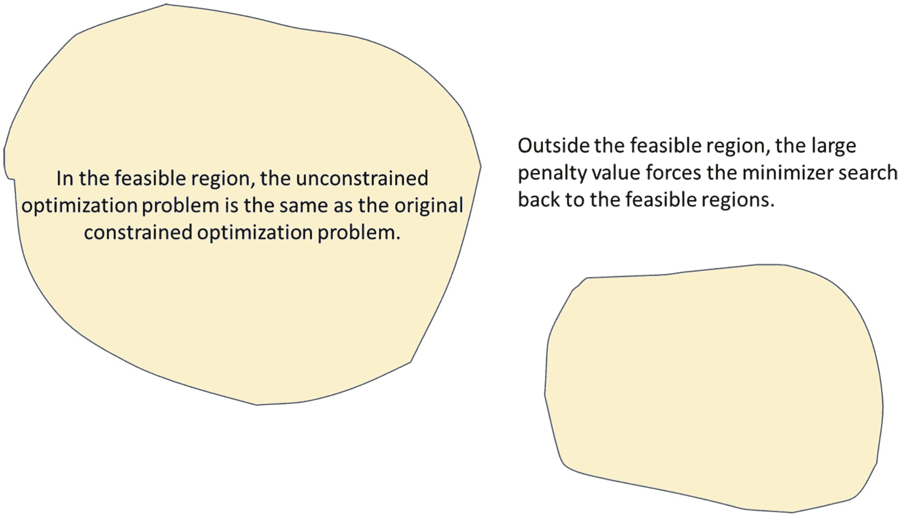
图 11-2 – 罚函数法

要搜索最优解`x*`，你可以从可行域或不可行域内的初始猜测值开始。如果从可行域开始，约束边界就像墙壁一样，你不会离开可行域。当当前解远离约束边界时，罚函数值非常小；否则，罚函数值接近无穷大，从而阻止解离开可行域。然而，为大规模问题实例寻找可行解可能是NP-难问题（一种描述计算机最难求解问题的复杂说法），这使得该方法无法应用。或者，你可以从任意位置或不可行域开始搜索，然后逐步移动到可行域。这样就不需要预先存在一个可行的初始解了。

考虑一个一般的约束优化问题，如下所示：
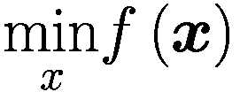，满足约束条件：
`hi(x) = 0`，`i ∈ E = {1, 2, …, m}`
`gj(x) ≤ 0`，`j ∈ I = {1, 2, …, n}`
`{hi(x)}`是等式约束，`{gj(x)}`是不等式约束。

你可以通过对违反任何约束的行为进行惩罚，将原始问题转化为一个等价的无约束优化问题。罚函数法的一般形式如下：
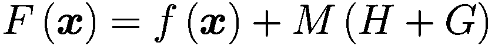
`F(x)`是新的目标函数。`H`和`G`是罚项，它们分别是约束条件`{hi(x)}`和`{gj(x)}`的函数。`M`是罚因子。

将等式约束`{hi(x)}`转化为罚项`H`的一种方法是对它们的绝对值求和。具体如下：
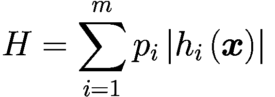
`{pi}`是每个等式约束的权重。

NM Dev 类`AbsoluteErrorPenalty`通过一组等式约束来构建这样一个罚函数。其签名如下：
```java
/**
 * 根据一组等式约束构造绝对值罚函数。
 *
 * @param constraints 一组等式约束
 * @param weights     分配给这些约束的权重
 */
public AbsoluteErrorPenalty(EqualityConstraints constraints, double[] weights)
```

Courant 罚项是将等式约束`{hi(x)}`转化为罚项`H`的另一种方法。它计算平方值的和。具体如下：
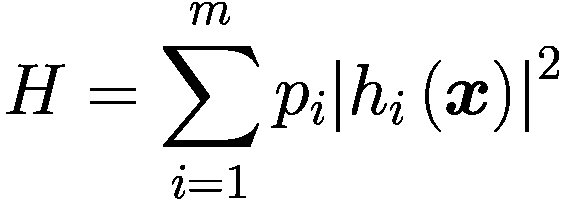
`{pi}`是每个等式约束的权重。

NM Dev 类`CourantPenalty`通过一组等式约束来构建一个 Courant 罚函数。其签名如下：
```java
/**
 * 根据一组等式约束构造 CourantPenalty 罚函数。
 *
 * @param constraints 一组等式约束
 * @param weights     分配给这些约束的权重
 */
public CourantPenalty(EqualityConstraints constraints, double[] weights)
```

Fletcher 罚项是将不等式约束`{gj(x)}`转化为罚项`G`的一种方法。它计算大于 0 的平方误差之和。具体如下：
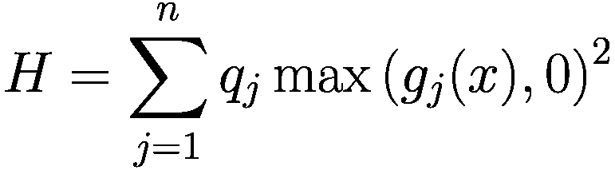
`{qj}`是每个不等式约束的权重。

NM Dev 类`FletcherPenalty`通过一组小于约束来构造一个 Fletcher 罚函数。（大于约束也可以通过取反符号转换为小于约束。）其签名如下：
```java
/**
 * 根据一组小于不等式约束构造 Fletcher 罚函数。
 *
 * @param constraints 一组小于不等式约束
 * @param weights     分配给这些约束的权重
 */
public FletcherPenalty(LessThanConstraints constraints, double[] weights)
```

## 罚函数法的缺点与改进

尽管罚函数法在理论上是可行的，但它存在一个缺点：罚因子 `M` 的值难以估计。如果取值过小，返回的解可能不可行，从而违反约束。如果取值过大，并且最优解位于（或接近）可行域边界，搜索将很快被推入可行域内部，而无法返回靠近可行域边界的位置。大的罚因子会阻碍搜索过程初始阶段对不可行域的探索。它还会导致严重的数值误差，即使解存在也可能无法找到。

这个缺点可以通过以下迭代过程来改善。首先，从一个较小但仍为正的大数 `M` 开始，找到 `F(x, M)` 的最优解 `x*`。如果 `x*` 不满足原始约束优化问题的约束条件，则增大 `M`（例如，乘以 10）。重复此过程，直到 `x*` 满足原始约束优化问题的约束条件。

## 在 NM Dev 中的实现

在 `NM Dev` 中，`PenaltyMethodMinimizer` 类实现了罚函数法。以下代码求解了这个约束优化问题：

$$ \underset{x,y}{\min }{\left(x+1\right)}²+{\left(y+1\right)}² $$

满足约束条件：

$$ y=0 $$

$$ x\ge 1 $$

```kotlin
val f: RealScalarFunction = object : AbstractBivariateRealFunction() {
    override fun evaluate(x: Double, y: Double): Double {
        // f = (x+1)² + (y+1)²
        return (x + 1) * (x + 1) + (y + 1) * (y + 1)
    }
}

val c1: RealScalarFunction = object : AbstractBivariateRealFunction() {
    override fun evaluate(x: Double, y: Double): Double {
        // y = 0
        return y
    }
}

val c2: RealScalarFunction = object : AbstractBivariateRealFunction() {
    override fun evaluate(x: Double, y: Double): Double {
        // x >= 1
        return 1 - x
    }
}

val problem: ConstrainedOptimProblemImpl1 = ConstrainedOptimProblemImpl1(
    f,
    GeneralEqualityConstraints(c1), // y = 0
    GeneralLessThanConstraints(c2)  // x >= 1
)

val M: Double = 1e30 // 惩罚因子
val optim: PenaltyMethodMinimizer = PenaltyMethodMinimizer(
    PenaltyMethodMinimizer.DEFAULT_PENALTY_FUNCTION_FACTORY,
    M,
    // 用于求解等价无约束优化问题的求解器
    BFGSMinimizer(false, 1e-8, 200)
)

val soln: IterativeSolution = optim.solve(problem)
val xmin: Vector = soln.search(
    DenseVector(arrayOf(0.0, 0.0)) // 初始猜测值
)
val fxmin: Double = f.evaluate(xmin) // 最小值
println(String.format("f(%s) = %f", xmin, fxmin))
// 或者
println(String.format("f(%s) = %f", soln.minimizer(), soln.minimum()))
```

输出结果如下：

```
f([1.000000, 0.000000] ) = 5.000000
f([1.000000, 0.000000] ) = 5.000000
```

`PenaltyFunctionFactory DEFAULT_PENALTY_FUNCTION_FACTORY` 根据等式约束和不等式约束构建惩罚项。它对等式约束使用 `CourantPenalty`，对不等式约束使用 `FletcherPenalty`。如果你希望以不同于默认实现的方式构建惩罚项，可以使用自定义的 `PenaltyFunctionFactory`。

## 11.2 遗传算法

遗传算法（GA）是一种模仿自然界生物进化规律的元启发式算法。它是一种模拟达尔文生物进化论中自然选择和遗传变异过程的计算模型。该算法通过数学和计算机仿真操作，将求解优化问题最优解的搜索过程，转化为类似于生物进化中染色体基因交叉、变异和选择的过程。与经典优化算法相比，在解决大规模复杂问题时，GA 可能在更短的时间内给出解。GA 已广泛应用于组合优化、机器学习、信号处理、自适应控制等领域。遗传算法由密歇根大学安娜堡分校的约翰·霍兰德教授及其学生在 20 世纪 70 年代初推广开来。他还引入了一个用于预测下一代质量的正式框架，即霍兰德模式定理。

遗传算法的一个经典应用是函数优化。GA 已在许多复杂函数上得到测试：连续与离散、凸与凹、低维与高维、单峰与多峰。对于某些具有许多复杂约束的非线性、不可微、多模型、多目标函数优化问题，使用其他优化方法难以求解，而 GA 可能给出更好的结果。此外，随着现代问题规模及组合优化问题搜索空间的迅速增大，通过枚举法寻找最优解变得困难。对于此类复杂问题，实践者通常更满足于获得满意解而非最优解。事实证明，GA 是寻求满意解最有效的工具之一，尤其适用于 NP 难组合优化问题。例如，GA 已成功应用于解决旅行商问题、背包问题、装箱问题、图划分问题、数独谜题等。值得注意的是，一家名为 NM Optim Limited（`https://nmoptim.com/`）的工业优化公司，为钢铁制造工厂构建了一套使用遗传算法处理许多复杂且特定约束的作业车间调度系统。

从数学上讲，遗传算法从一个优化问题的候选解种群开始。每个候选解都会被编码，以便可以评估其适应度（对优化问题的价值），并且编码可以被改变（变异）或与另一个候选解混合（交叉），从而产生一个新的候选解（新编码）。迭代地，种群进化产生下一代候选解，直到达到满意的适应度水平或产生最大代数。基本的 GA 框架如下。

### 11.2.1 编码

遗传算法不能直接处理或操作问题的候选解，比如作业调度表。你必须首先设计一个解的表示形式，称为编码或染色体，以便 GA 可以对其进行操作。每个候选解的标准表示或染色体是一个由 0 和 1 组成的位数组或位字符串。编码策略需要满足以下要求，才能使 GA 搜索有效。

- **完备性**：问题空间中的所有候选解都能表示为 GA 空间中的染色体。
- **健全性**：GA 空间中的染色体对应于问题空间中的所有候选解。
- **非冗余性**：与候选解对应的染色体是一一对应的关系。

### 11.2.2 适应度函数

进化论中的生存适应度指的是生物体适应环境的能力以及繁殖后代的能力。它是对候选解优劣程度的度量。在优化方面，它是衡量你对问题目标函数优化程度的指标。请注意，适应度函数（值）与目标函数（值）并不相同，尽管它们呈正相关。通常，你需要在目标函数值与适应度函数值之间建立映射关系。候选解的适应度值需要进行比较和排序。它也是被（随机）选择进行变异和交叉的基础，因此需要是一个正数（用于计算被选中的概率）且有界。遗传算法在搜索和进化过程中通常不需要其他外部信息，仅使用适应度函数来评估候选解的优劣。适应度函数的设计对于 GA 运行的成功与否至关重要。它应满足以下条件：

- 单值、连续、非负、有界
- 合理且一致
- 易于计算
- 通用性强

### 11.2.3 初始种群

GA 从一个由个体候选解组成的初始种群开始迭代。种群大小取决于问题的性质，但通常包含几百或几千个可能的个体。通常，初始种群是随机生成的，并且应合理覆盖所有可能的解（搜索空间）。有时，可能会在可能找到最优解的区域“播种”解。典型的初始设置策略如下：

1.  利用关于问题的一些知识，你可以尝试粗略了解解空间的分布或范围。初始种群应根据最优解可能所在位置的这种先验分布进行分布。
2.  首先随机生成一定数量的个体；然后从中选出最优的个体并将其添加到初始种群中。重复此过程，直到初始种群中的个体数量达到预定大小。

### 11.2.4 运行过程

基本遗传算法的运行过程如下：

1.  **初始化**：设置进化代数计数器 `t=0`，最大进化代数 `T`，并随机生成 `M` 个个体作为初始种群 `P(0)`。
2.  **评估**：计算群体 `P(t)` 中每个个体的适应度。
3.  **选择**：对群体应用选择算子。选择的目的是将优良的染色体（基因）通过交叉和变异遗传到下一代。
4.  **交叉**：对群体应用交叉算子，将选中的两个个体配对，为下一代生成新的候选解。
5.  **变异**：对群体应用变异算子，通过改变被选个体表示中某些位点的基因，为下一代生成新的候选解。下一代群体为 `P(t+1)`。
6.  **终止条件**：如果 `t=T`，则将进化过程中得到的适应度最好的个体作为最优解返回，计算终止。或者，当最优个体的适应度达到给定的阈值，或者群体适应度不再提高时，计算停止。进化代数通常设置为 100 到 500 代。

三个主要的遗传基本操作是选择、交叉和变异。

### 11.2.5 选择

选择操作是从群体中挑选出优良个体并淘汰劣质个体。该操作确保下一代能够继承优良基因，并摒弃不良基因。它本质上是一种爬山搜索。选择基于个体的适应度进行。个体适应度越高，其被选中的概率就越大（但并非绝对）。请注意，适应度较低的个体也有可能被选中，只是概率较低。这是为了保证种群的多样性，并避免陷入局部最优解。常用的选择算子有适应度比例法、随机遍历抽样法和局部选择法。

### 11.2.6 交叉

生物基因的重组（以及变异）在自然生物的进化中起着核心作用。同样，遗传算法中的关键操作是对候选解的表示或编码进行交叉算子。交叉算子替换并重组两个父本个体的（随机）部分结构，以生成两个新个体。对于位数组，常用的交叉方法包括单点交叉、两点交叉、k 点交叉和均匀交叉。

在单点交叉中，在两个父本染色体的染色体上随机选取一个点，指定为“交叉点”。该点右侧的位在两个父本染色体之间进行交换。这样就产生了两个子代，每个子代都携带来自两个父本的遗传信息。见图 11-3。

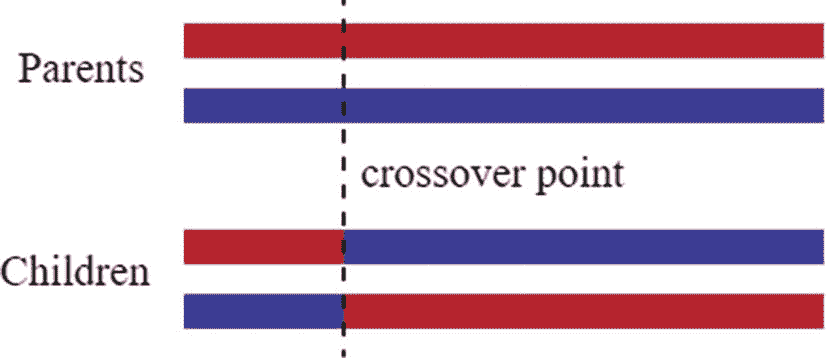

单点交叉示意图。绘制了四个条带，一条虚线垂直穿过所有条带，并标明了交叉点。图中展示了父代、子代和交叉点。

图 11-3 单点交叉

在两点交叉中，从父本染色体中随机选取两个交叉点。这两个点之间的位在两个父本生物体之间进行交换。这相当于执行两次具有不同交叉点的单点交叉。此策略可以推广到任意正整数 k 的 k 点交叉，即选取 k 个交叉点。见图 11-4。

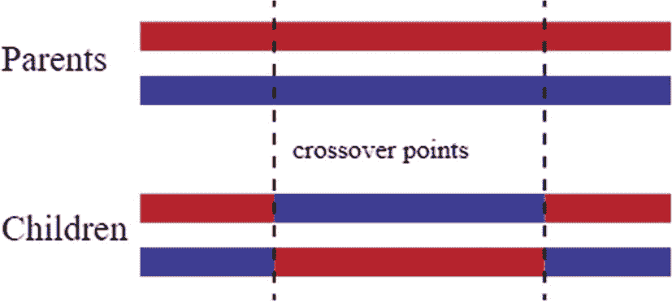

两点交叉示意图。绘制了四个条带，两条虚线垂直穿过所有条带，并标明了交叉点。图中展示了父代、子代和交叉点。

图 11-4 两点交叉

在均匀交叉中，通常每个位以相等的概率从任意一个父本中选择。有时也会使用其他混合比例，这会导致子代从某个父本继承比另一个父本更多的遗传信息。

### 11.2.7 变异

遗传算法引入变异有两个目的。第一个目的是确保从遗传算法染色体种群的一代到下一代之间的遗传多样性。变异会改变染色体中一个或多个基因位的初始状态。解决方案可能完全不同于其父代，因此遗传算法有可能找到更好的解。变异在进化过程中根据预设的变异概率发生。该概率应设置得较低。如果设置得过高，搜索将退化为原始的随机搜索。

第二个目的是在接近最优解时控制局部搜索。当遗传算法通过交叉算子处于最优解附近时，由变异算子引起的局部随机搜索可以加速向最优解的收敛。在这种情况下，变异概率应该较小；否则，接近最优解的优良模式会因变异而被破坏。另一方面，为了跳出局部最优解并保持群体多样性，变异概率应取较大值，以防止染色体彼此过于相似，从而减慢甚至停止向全局最优解的收敛。

根据编码方式的不同，定义变异算子的方法有很多。一个经典的例子涉及一个概率，即一个遗传序列中的任意一个位点从其原始状态发生翻转。实现变异算子的一种常见方法包括为序列中的每个位生成一个随机变量。这个随机变量决定了一个特定位是否会被翻转。这种基于生物学点突变的变异程序被称为单点突变。其他类型包括反转变异和浮点变异。当基因编码受限于排列问题时（例如排列问题），突变方式包括交换、反转和打乱。见图 11-5。

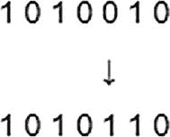

在位串变异示意图中，两个二进制数并行排列。一个箭头表示位的改变。

图 11-5 位串变异。在随机位置进行位翻转

在 NM Dev 中，`GeneticAlgorithm` 类和 `Chromosome` 接口提供了一个框架来实现自定义的遗传算法。`GeneticAlgorithm` 允许用户定义初始种群的初始化方式和终止条件。实际上，该类中的大多数方法都是受保护的，这意味着用户可以重写它们以提供不同的实现。其签名如下：

```java
public abstract class GeneticAlgorithm {
    /**
```

对于任何特定的优化问题，用户需要通过实现 `Chromosome` 接口来定义编码、相应的交叉算子和变异算子。由于遗传算法实现通常为了性能而在多核环境中运行，因此确保染色体操作的实现是线程安全的并且可以并行运行至关重要。其签名如下：

```java
public interface Chromosome extends Comparable {

    /**
     * 此为适应度，用于确定该染色体的优劣程度。
     *
     * @return 适应度
     */
    public double fitness();

    /**
     * 通过变异构建一个 {@code Chromosome}。
     *
     * @return 一个变异后的染色体
     */
    public Chromosome mutate();

    /**
     * 通过对一对染色体进行交叉构建一个 {@code Chromosome}。
     *
     * @param that 另一个染色体
     * @return 一个交叉后的染色体
     */
    public Chromosome crossover(Chromosome that);
}
```

例如，NM Dev 实现了 `SimpleGridMinimizer` 求解器，以便使用此遗传算法框架最小化多元实值函数（从 ℝ^(*n*) 到 ℝ¹）。此优化器不利用被优化函数的梯度，这意味着它不要求优化问题可微，而这却是诸如梯度下降和拟牛顿法等经典优化方法所必需的。因此，它还可以用于那些甚至不连续、含有噪声、随时间变化、随临时约束条件而变化等的优化问题。

`SimpleGridMinimizer` 从一个分布在解空间上的初始猜测种群开始。然后它将它们配对进行交叉和变异，以搜索最优解。具体来说，候选解的编码仅仅是 ℝ^(*n*) 中的一个向量。

```java
public abstract class RealScalarFunctionChromosome implements Chromosome {
    private Double fx = null;
    private final RealScalarFunction f;
    private final ImmutableVector x; // 编码
}
```

交叉算子是对两个个体取中点。变异算子是对向量添加一个小的随机扰动。也就是说，你会得到这个：

```java
/**
 * {@code SimpleCell} 实现了两种遗传操作。
 * 
 * 通过扰动（缩放）适应度百分比进行变异；
 * 通过取两个单元格的中点（平均值）进行交叉。
 * 
 */
public class SimpleCell extends RealScalarFunctionChromosome {
    protected SimpleCell(RealScalarFunction f, Vector x) {
        super(f, x);
    }

    /**
     * 在邻域内通过随机扰动进行变异。
     *
     * @return 一个突变后的染色体
     */
    @Override
    public Chromosome mutate() {
        final double offset = 1 - rate;
        final double width = 2 * rate;
        Vector z = new DenseVector(x());
        for (int i = 1; i <= z.size(); ++i) {
            double rand = uniform.nextDouble();
            double u = offset + rand * width;
            z.set(i, z.get(i) * u);
        }
        return getSimpleCell(f(), z);
    }

    /**
     * 通过取中点进行交叉。
     *
     * @param other 另一个染色体
     * @return 一个杂交后的染色体
     */
    @Override
    public Chromosome crossover(Chromosome other) {
        SimpleCell that = (SimpleCell) other;
        Vector z = this.x().add(that.x()).scaled(0.5);
        return getSimpleCell(f(), z);
    }
}
```

以下代码使用此特定的遗传算法实现来最小化下列函数：

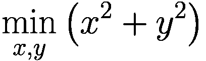

```kotlin
// 要最小化的目标函数
```

以下是抽象类部分的代码：

```java
    /**
     * 初始化第一代种群。
     *
     * @return 第一代种群
     */
    protected abstract List getFirstGeneration();

    /**
     * 此为收敛判据。
     *
     * @return 若搜索已收敛则返回 {@code true}
     */
    protected abstract boolean isConverged();

    /**
     * 运行遗传算法。
     */
    public void run() {
        population.addAll(getFirstGeneration());
        for (; !isConverged();) {
            step();
        }
    }

    /**
     * 运行遗传算法中的一个步骤：生成下一代染色体池。
     *
     * @return true
     */
    protected Object step();

    /**
     * 生成一个子代染色体。
     *
     * 此实现先进行交叉操作，再进行变异操作。
     *
     * @param i 索引值，范围从 0 到（种群规模-1）
     * @return 一个子代染色体
     */
    protected Chromosome getChild(int i);

    /**
     * 选取一个用于变异/交叉的染色体。
     *
     * 此实现从种群中均匀随机选取。
     *
     * @return 一个染色体
     */
    protected Chromosome getOne();

    /**
     * 利用父代和子代染色体池填充下一代。
     *
     * 此实现从父代和子代中选取最优染色体。
     *
     * @param parents  父代染色体池
     * @param children 子代染色体池
     * @return 下一代种群
     */
    protected List getNextGeneration(List parents, List children);

    /**
     * 获取种群池的大小，即染色体数量。
     *
     * @return 种群规模
     */
    protected int nPopulation();

    /**
     * 在填充下一代之前获取子代数量。
     *
     * 在此实现中，该数量与种群规模相同（与父代数量相同）。
     *
     * @return 子代数量
     */
    protected int nChildren();

    /**
     * 获取第 i 个最优染色体。
     *
     * @param i 索引
     * @return 第 i 个最优染色体
     */
    protected Chromosome getBest(int i);

    /**
     * 为种群池分配空间。
     *
     * @param size 种群规模
     * @return 一个种群池
     */
    protected static ArrayList getNewPool(int size);
}
```

# 11.2.8 差分进化

差分进化（`DE`）算法是遗传算法的一种特定实现，用于优化多变量实值函数。其主要创新在于其差分变异算子。设 `CR` ∈ [0, 1] 为交叉概率，`F` ∈ [0, 2] 为差分权重。对于每个个体 `x`，差分变异算子随机选取三个不同且互异的候选解 `a`、`b`、`c`，并执行以下操作：
1.  随机选择一个索引 `R` ∈ {1, …, `n`}，其中 `n` 是目标函数的维度。
2.  按如下方式计算新个体 `y` = (`y[1]`, …, `y[n]`)：
    -   对于每个索引 `i` ∈ {1, …, `n`}，生成一个服从均匀分布的随机数 `r[i] ~ U(0, 1)`。
    -   如果 `r[i] < CR` 或 `i = R`，则 `y[i] = a[i] + F × (b[i] − c[i])`。否则，`y[i] = x[i]`。

新候选解在每个索引处（如果发生了变异）是一个随机向量的加权和与两个随机向量的差值 `b-c` 之和，这就是其被称为差分进化的原因。请注意，索引位置 `R` 始终会被线性组合所替换。参见图 11-6。

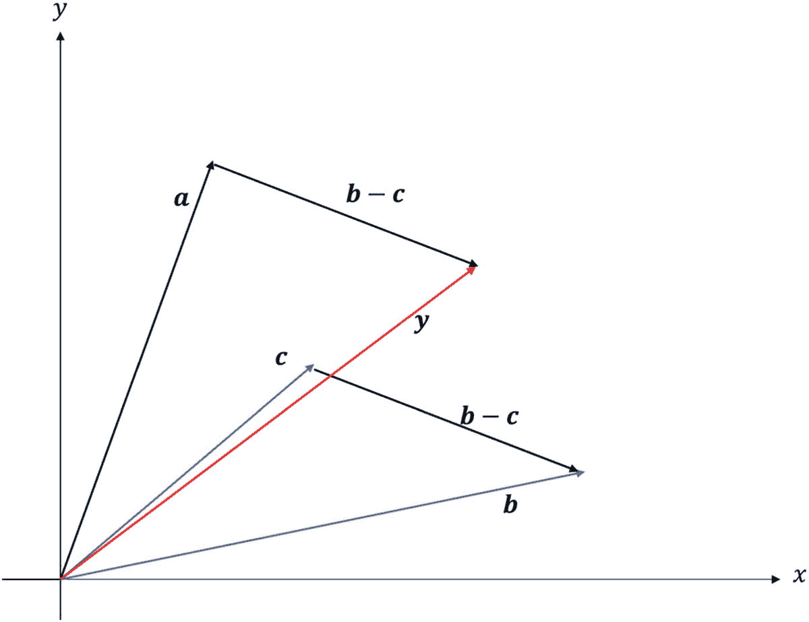

一张包含四个点 `a`、`b`、`c` 和 `d` 的图表。点 `a`、`y`、`c`、`b` 之间的距离等于 `b` 减 `c`。

**图 11-6** 差分变异

DE 参数 `CR` 和 `F` 以及种群规模的选择会对优化性能产生巨大影响。因此，如何选择能带来良好性能的 DE 参数一直是大量研究的主题。一个经验法则是建议使用 `CR = 0.9` 和 `F = 0.8`。

以下 NM Dev 代码解决了一个整数约束优化问题。整数规划问题通常很难用经典算法解决，并且是目前非常活跃的研究课题。此示例展示了遗传算法的强大通用性以及它如何处理困难的约束。

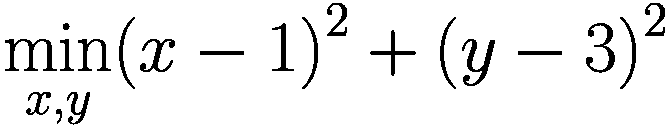

```kotlin
// the objective function to minimize
val f: RealScalarFunction = object : AbstractBivariateRealFunction() {
    override fun evaluate(x: Double, y: Double): Double {
        return (x - 1) * (x - 1) + (y - 3) * (y - 3) // (x - 1)² + (y - 3)²
    }
}

// construct an integer programming problem
val problem: IPProblem
// both x and y need to be integers
    = IPProblemImpl1(f, null, null, intArrayOf(1, 2), 0.0)

// a uniform random number generator
val rng: RandomLongGenerator = UniformRNG()
rng.seed(123456798L)

// construct an instance of a genetic algorithm solver
val solver = DEOptim(
    object : DEOptim.NewCellFactory {
        override fun newCellFactory() : DEOptimCellFactory {
            return IntegralConstrainedCellFactory(
                Rand1Bin(0.5, 0.5, rng), // the DE operator
                IntegralConstrainedCellFactory.SomeIntegers(problem))
        }
    },
    rng, // a uniform random number generator
    1e-15, // a precision parameter
    100, // the maximum number of iterations
    20 // the maximum number of iterations of no improvement
)

val soln: IterativeSolution = solver.solve(problem)

val xmin: Vector = soln.search(
    // the boundaries: [-10, 10], [-10, 10]
    DenseVector(-10.0, 10.0),
    DenseVector(10.0, -10.0),
    DenseVector(10.0, 10.0),
    DenseVector(-10.0, -10.0)
)

val fxmin: Double = f.evaluate(xmin) // the minimum
println(String.format("f(%s) = %f", xmin, fxmin))
```

输出如下：
```
f([1.000000, 3.000000] ) = 0.000000
```

### `Rand1Bin` 类

`Rand1Bin` 类是对 Price、Storn 和 Lampinen (2005) 提出的 DE 算子的一种实现。具体如下：
- 差分变异：将一个经缩放、随机采样的向量差加到第三个向量上
- 交叉：通过执行均匀交叉（离散重组）实现

### 11.3 模拟退火

模拟退火（`SA`）是一种用于寻找全局最优解的元启发式算法，其灵感来源于冶金学中的退火过程。退火包括将材料加热到高温，然后让其缓慢冷却。这使得粒子在高温下能够自由移动以进行排列，并在低温下稳定下来。模拟退火可用于经典算法难以处理的复杂计算优化问题。尽管它通常只能获得全局最小值的近似解，但对于许多实际问题来说这通常已经足够了。

`SA` 的核心思想是冷却调度或退火温度调度。当搜索初期温度较高时，`SA` 更有可能接受一个更差的解作为下一个候选解。随着温度缓慢降低，接受更差解的概率也随之降低。接受更差的解有助于进行更广泛的搜索以寻找全局最优解，例如跳出局部极小值点。

图 11-7 展示了模拟退火如何搜索最大值。这里的目标是到达最高点。然而，仅使用简单的爬山算法是不够的，因为存在许多局部最大值。通过缓慢降低温度，最终找到了全局最大值。请注意，搜索在开始时范围较广，而当温度趋近于 0 时，搜索则或多或少停留在最大值附近。

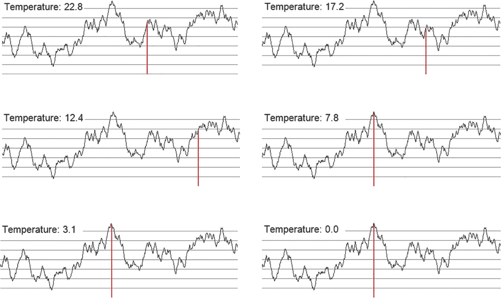

**图 11-7** 模拟退火

通常，`SA` 算法的基本版本工作方式如下。温度从初始正值逐渐降低到零。在每个时间步，算法随机选择一个接近当前解的解，评估其质量，并根据与温度相关的概率（选择更好解和更差解的概率分别保持正值并逐渐趋近于零）来决定是否移动到/接受该解。当温度趋近于 0 时，该算法渐近地趋近于爬山搜索。从算法上讲，要最小化一个函数 `f`，其步骤如下：
1. 令 `s = s[0]` 为初始状态。
2. 对于从 `k = 0` 到 `k[max]`（最大迭代次数）：
    - 温度 `T = T(k)` 是根据冷却或退火调度确定的 `k` 的函数。
    - 选取 `s` 的一个随机邻域解 `s[new]`。
    - 根据接受概率 `P( f(s), f(s[new]), T)` 决定是否接受 `s[new]`，该概率是 `f(s)`、`f(s[new])` 和 `T` 的函数。如果 `f(s[new]) < f(s)`，则总是接受这个新的、更优的解。
3. 输出最终步骤的状态 `s`。

在 NM Dev 中，`SimulatedAnnealingMinimizer` 类提供了一个框架来实现自定义的模拟退火算法。其签名如下：
```java
/**
 * 构造一个新实例。
 *
 * @param temperatureFunction 一个函数，对于给定的迭代次数 i，返回
 *                            T_i，即温度水平。该函数必须随 i 单调递增。
 * @param probabilityFunction 返回在给定温度下接受状态转移的概率
 * @param annealingFunction   提议下一个状态
 * @param markovLength        每次迭代（每个温度下）尝试状态改变的次数
 * @param stopCondition       {@linkplain StopCondition 停止条件}
 * @param uniform             用于控制算法随机元素的随机数生成器
 */
public SimulatedAnnealingMinimizer(
    TemperatureFunction,
    AnnealingFunction,
    TemperedAcceptanceProbabilityFunction probabilityFunction,
    int markovLength,
    StopCondition stopCondition,
    RandomLongGenerator uniform
)
```

温度函数 `TemperatureFunction` 定义了模拟退火中使用的温度调度。通常，用于访问分布（提议生成）的温度可能与用于确定接受概率的温度不同。其接口签名如下：
```java
public interface TemperatureFunction {
    /**
     * 获取时间 t 时的接受温度 \(T^A_t\)。
     *
     * @param t 获取温度的时间点，或退火参数，与重新退火前的迭代次数相同
     * @return 时间 t 时的接受温度
     */
    public double acceptanceTemperature(int t);

    /**
     * 获取时间 t 时的访问温度 \(T^V_t\)。
     *
     * @param t 获取温度的时间点，或退火参数，与重新退火前的迭代次数相同
     * @return 时间 t 时的访问温度
     */
    public double visitingTemperature(int t);
}
```

用于解释模拟退火的物理类比假设冷却速率足够低，使得当前状态的概率分布始终接近热力学平衡。不幸的是，弛豫时间（即在温度变化后等待恢复平衡所需的时间）强烈依赖于能量/目标函数的“地形”和当前温度。在模拟退火算法中，弛豫时间还以非常复杂的方式取决于下一个候选状态的生成方式。因此，理想的冷却速率无法预先确定，应该针对每个问题凭经验调整。NM Dev 实现了多个温度函数，如下所示：
* `BoltzTemperatureFunction`，*T*[*k*] = *T*[0]/ ln *k*
* `ExpTemperatureFunction`，*T*[*k*] = 0.95^(*k*)*T*[0]
* `FastTemperatureFunction`，*T*[*k*] = *T*[0]/*k*
* `GSATemperatureFunction`

退火函数 `AnnealingFunction`，也称为温度调节提议函数，根据当前状态和温度给出下一个提议或下一个状态。其接口签名如下：
```java
public interface AnnealingFunction {
    /**
     * 根据当前状态和温度获取下一个提议。
     *
     * @param currentState 系统的当前状态
     * @param temperature  系统的当前温度
     * @return 下一个提议
     */
    public Vector nextProposal(Vector currentState, double temperature);
}
```

您必须考虑到，在模拟退火算法经过几次迭代后，当前状态的能量预计会比随机状态低得多。因此，作为一般规则，您应该使生成器偏向于那些目标状态能量可能类似于当前状态的候选移动。这种启发式方法倾向于排除“非常好”和“非常差”的候选移动。然而，“非常好”的移动通常比“非常差”的移动少见得多，因此这种启发式方法通常非常有效。NM Dev 实现了多个退火函数，如下所示：
*   `BoltzAnnealingFunction`：步长是温度的平方根，方向均匀随机。
*   `FastAnnealingFunction`：步长是温度，方向均匀随机。方形大小等于温度。
*   `GSAAnnealingFunction`
*   `BoxGSAAnnealingFunction`

温度调节接受概率函数 `TemperedAcceptanceProbabilityFunction` 用于计算下一个状态转移将被接受的概率。其接口签名如下：
```java
public interface TemperedAcceptanceProbabilityFunction {
    /**
     * 计算下一个状态转移将被接受的概率。
     *
     * @param currentState   系统的当前状态
     * @param energyCurrent  当前状态的能量
     * @param proposedState  系统的提议下一个状态
     * @param energyProposed 提议状态的能量
     * @param temperature    当前温度
     * @return 接受概率
     */
    public double acceptanceProbability(
        Vector currentState,
        double energyCurrent,
        Vector proposedState,
        double energyProposed,
        double temperature);
}
```

以下代码演示了使用模拟退火求解器来最小化一个复杂函数：

```kotlin
// 要最小化的目标函数
val f: RealScalarFunction = object : AbstractRealScalarFunction(2) {
    override fun evaluate(x: Vector): Double {
        val x1: Double = x.get(1)
        val x2: Double = x.get(2)
        // (4 - 2.1*x(1)² + x(1)⁴/3)*x(1)²
        val term1: Double = (4.0 - 2.1 * x1.pow(2.0) + x1.pow(4.0) / 3.0) * x1.pow(2.0)
        // x(1)*x(2)
        val term2: Double = x1 * x2
        // (-4 + 4*x(2)²)*x(2)²
        val term3: Double = (-4.0 + 4.0 * x2.pow(2.0)) * x2.pow(2.0)
        return term1 + term2 + term3
    }
}

// 构造一个优化问题
val problem = object : OptimProblem {
    override fun f(): RealScalarFunction {
        return f
    }
    override fun dimension(): Int {
        return 2
    }
}

// 在 5000 次迭代后停止
val stopCondition: StopCondition = AfterIterations(5000)

// 模拟退火求解器的一个实例
val solver: IterativeMinimizer = GeneralizedSimulatedAnnealingMinimizer(
    2, // 目标函数的维度
    stopCondition
)

val soln: IterativeSolution = solver.solve(problem)
val x0: Vector = DenseVector(0.5, 0.5) // 初始猜测
val xmin: Vector = soln.search(x0)
val fxmin: Double = f.evaluate(xmin) // 最小值
println(String.format("f(%s) = %f", xmin, fxmin))
```

输出如下：

```
f([-0.089836, 0.712655] ) = -1.031628
```

有时返回到一个明显更好的解，而不是总是从当前状态移动，效果会更好。这个过程被称为模拟退火的重启。重启的决定可以基于多种标准。其中值得注意的包括：基于固定步数的重启、基于当前能量与到目前为止获得的最佳能量相比是否过高而重启、随机重启等等。

