# 隐马尔可夫模型

例如，考虑一个村庄，所有村民要么健康，要么发烧，并且只有村里的医生才能确定每个人是否发烧。医生通过询问病人的感受来诊断发烧。村民们可能只回答感觉正常、头晕或发冷。

医生认为，病人的健康状况如同一个离散马尔可夫链。存在两种状态：健康和发烧，但医生无法直接观察到它们；这些状态对他来说是隐藏的。每一天，根据病人的健康状况，都有一定的概率病人会告诉医生他感觉正常、发冷或头晕。

观测结果（正常、发冷或头晕）与隐藏状态（健康、发烧）共同构成了一个隐马尔可夫模型（HMM），如图 12-53 所示。

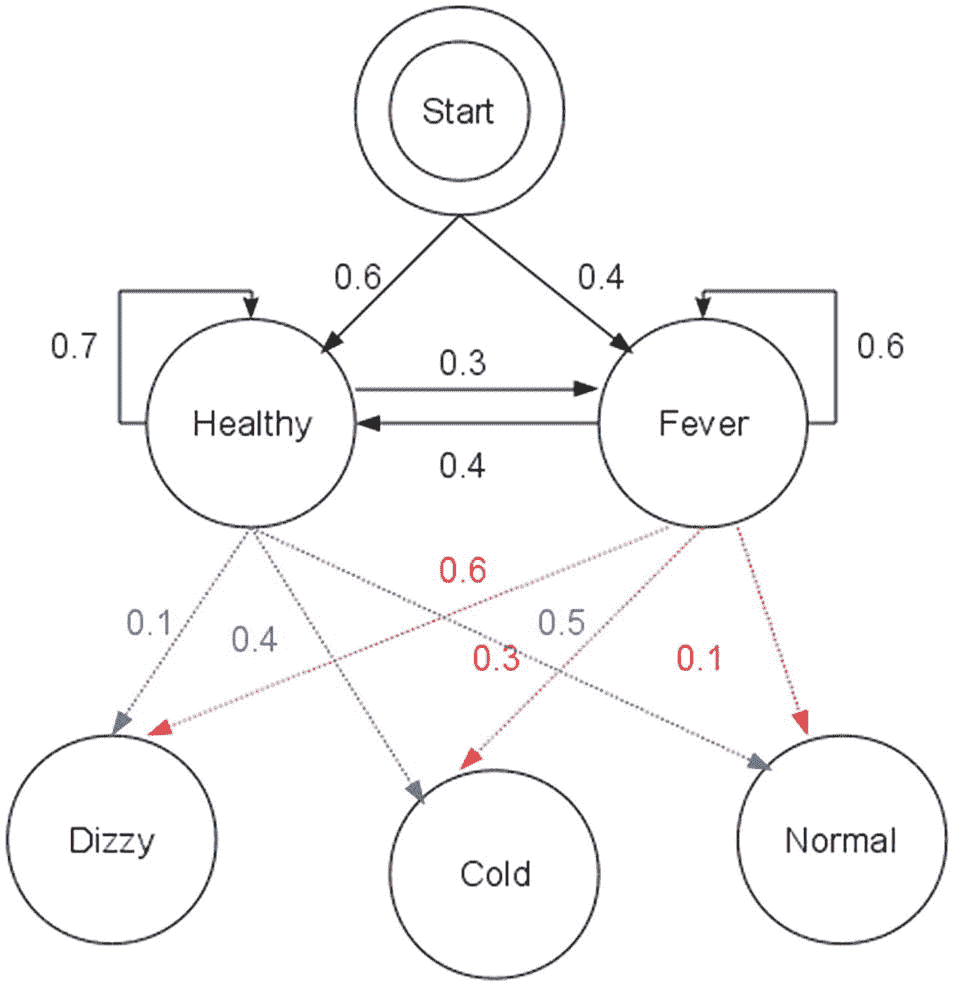

起始状态分为健康与发烧。健康与发烧均以不同箭头连接头晕、发冷和正常。

**图 12-53** 村民健康状况的隐马尔可夫模型

NM Dev 类`DiscreteHMM`实现了一个离散隐马尔可夫模型，`ForwardBackwardProcedure`类执行前向-后向算法来计算前向和后向概率。例如，以下代码实现了上述双状态 HMM：

```
// 2 个状态的初始概率
val PI: DenseVector = DenseVector(0.6, 0.4)
// 转移概率
val A: DenseMatrix = DenseMatrix(
arrayOf(
doubleArrayOf(0.7, 0.3),
doubleArrayOf(0.4, 0.6)
)
)
// 观测概率，2 个状态有 3 种可能结果
val B: DenseMatrix = DenseMatrix(
arrayOf(
doubleArrayOf(0.5, 0.4, 0.1),
doubleArrayOf(0.1, 0.3, 0.6)
)
)
// 构建 HMM1
val hmm: DiscreteHMM = DiscreteHMM(PI, A, B)
// 已实现的观测结果
val observations: DoubleArray = doubleArrayOf(1.0, 2.0, 3.0)
// 运行前向-后向算法
val fb = ForwardBackwardProcedure(hmm, observations)
for (t in 1 until observations.size) {
println(String.format(
"The *scaled* forward probability, alpha, in each state at time %d: %s",
t,
fb.scaledAlpha(t)
))
}
```

输出如下：

```
the *scaled* forward probability, alpha, in each state at time 1: [0.882353, 0.117647]
the *scaled* forward probability, alpha, in each state at time 2: [0.725522, 0.274478]
```

## 解码问题

给定模型参数`λ`和观测序列`Ω`，滤波问题是计算系统在该序列末尾处于某个状态的概率，即`Pr(q[T] = s[i] | λ, Ω)`。此问题可以使用之前展示的前向算法高效求解。

平滑问题与滤波问题类似，但它计算的是系统在序列中间某处处于某个状态的概率，换言之，`Pr(q[t] = s[i] | λ, Ω)`。

定义后向概率`βt`为系统在时间`t`处于状态`s[i]`，并且从此时起直至时间`T`的部分观测已知的概率。即：

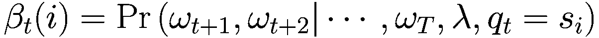

这可以通过后向归纳法计算。初始化最后一个时间步，如图 12-54 所示。

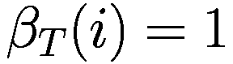


使用不同线条，从节点`S`下标`i`提取出节点`S1`至`SN`。

**图 12-54** 后向算法

归纳步骤指出，`βt`是从状态`i`出发，到达下一时间步`βt + 1`的所有可能路径之和，并且在这些路径中，状态`i`都会产生观测`ω[t + 1]`。即：

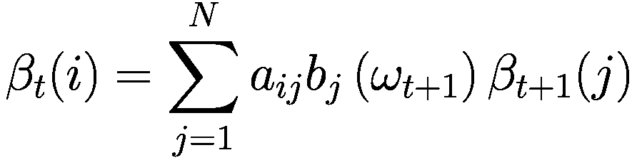

最后，给定观测`Ω`和参数`λ`，系统在时间`t`处于状态`i`的概率如下：

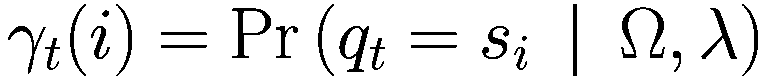

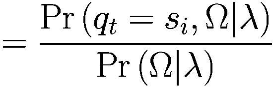

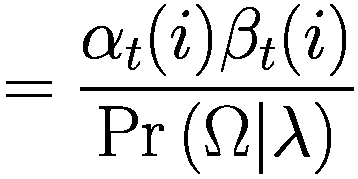

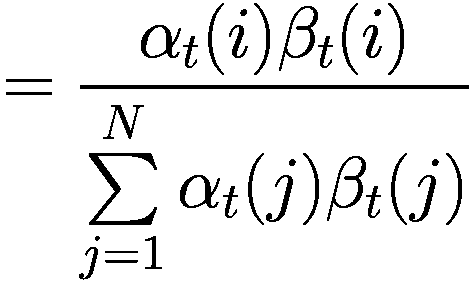

在每个时刻`t`，不考虑状态序列发生概率，最有可能的状态如下：

![ $$ {q}_t=\underset{1\le i\le N}{\textrm{argmax}}\left[{\gamma}_t(i)\right] $$ ](images/528380_1_En_12_Chapter/528380_1_En_12_Chapter_TeX_Equhz.png)

最可能的隐藏状态序列，即寻找所有可能状态序列中的最大值，可以使用维特比算法求解。定义系统经历这些状态、在时间`t`着陆状态`s[i]`并产生观测的最大概率：

![ $$ {\delta}_t(i)=\max \left[\Pr \left({q}_1,{q}_2|\cdots |{q}_t={s}_i|{\omega}_0|\cdots |{\omega}_t|\lambda \right)\right] $$ ](images/528380_1_En_12_Chapter/528380_1_En_12_Chapter_TeX_Equia.png)

初始化：

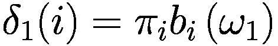

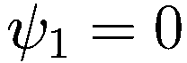

递归：

![ $$ {\delta}_t(j)=\underset{i}{\max}\left[{\delta}_{t-1}(i){a}_{ij}{b}_j\left({\omega}_t\right)\right] $$ ](images/528380_1_En_12_Chapter/528380_1_En_12_Chapter_TeX_Equid.png)

此处`δt`是最可能的状态序列`q[1]`、`q[2]`、⋯、`q[t]`的概率，该序列负责产生前`t`个观测，并以`j`作为其最终状态。

![ $$ {\psi}_t=\underset{i}{\textrm{argmax}}\left[{\delta}_{t-1}(i){a}_{ij}\right] $$ ](images/528380_1_En_12_Chapter/528380_1_En_12_Chapter_TeX_Equie.png)

其中`ψ[t]`是在时间`t`为使`δt`最大化而选择的状态。

终止：

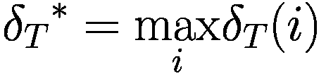

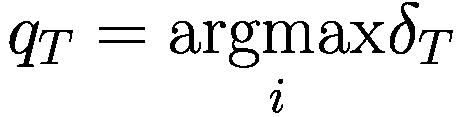

NM Dev 类 `Viterbi` 实现了维特比算法。以下代码延续了图 12-54 中的示例：
```kotlin
// 运行维特比算法以找到最可能的隐藏状态序列
val viterbi = Viterbi(hmm)
val viterbi_states: IntArray = viterbi.getViterbiStates(observations)
println("The Viterbi states: " + Arrays.toString(viterbi_states))
```
输出如下：
```
the Viterbi states: [1, 1, 2]
```

## 学习问题

HMM 中的参数学习任务是，给定一个输出序列 `Ω`，找到最佳的状态转移概率集合 `A` 和概率分布参数集合 `λ`。该任务通常是根据给定的输出序列集合，推导出 HMM 参数的最大似然估计。也就是说，我们的目标是找到能够最大化 `Pr(Ω | λ)` 的 `λ`。对于任意 `λ`，我们都可以计算出 `Pr(Ω | λ)`。这个问题就变成了一个多变量无约束优化问题。原则上，任何优化算法（例如 Nelder-Mead）都可以解决它。然而在实际中，会存在收敛性和效率问题。目前尚没有已知的可行算法能够精确解决此问题，但可以使用 Baum-Welch 算法高效地推导出局部最大似然估计。Baum-Welch 算法是期望最大化算法（EM 算法）的一个特例。它在期望步骤中利用前向-后向算法来计算统计量。请参见图 12-55。

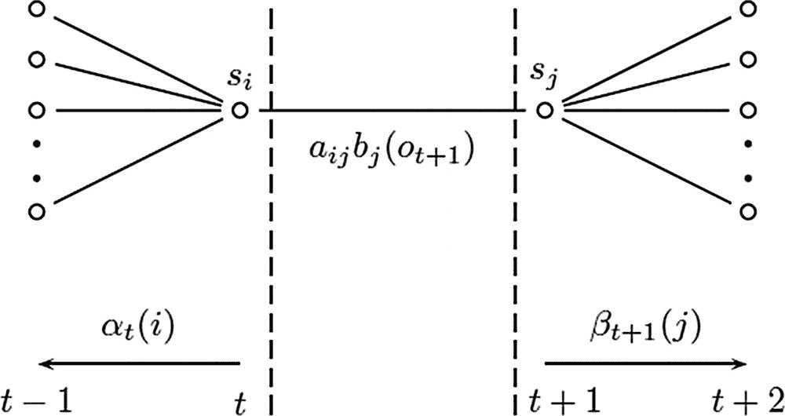

节点使用不同的线条连接到 `S[i]` 节点，并且节点 `S[j]` 被提取出来以形成相同的节点。用算法标记了两条平行的虚线。

**图 12-55**  Baum-Welch 算法，`ξt`

定义 `ξt` 为：在给定模型 `λ` 和观测序列 `Ω` 的条件下，在时刻 `t` 处于状态 `s[i]`，并且在时刻 `t + 1` 处于状态 `s[j]` 的概率。即：
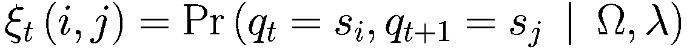

我们可以用前向概率和后向概率来表示这个公式。

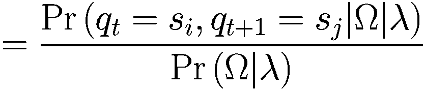
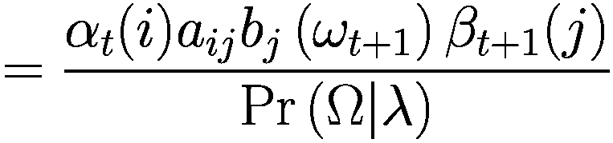

因此，我们得到：

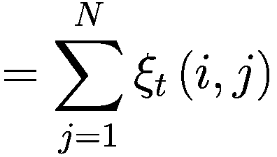

将 `γt` 随时间求和，得到的是状态 `s[i]` 被访问的次数。将 `ξt` 随时间求和，得到的是系统从状态 `s[i]` 转移到状态 `s[j]` 的次数。现在我们可以如下估计模型参数 `λ`：
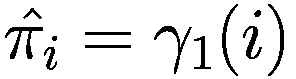，初始状态概率
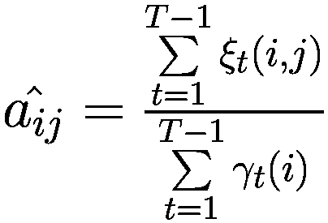，转移概率
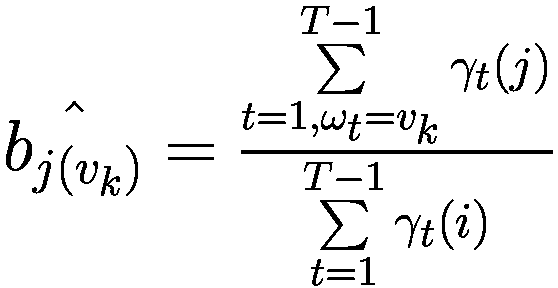，对于离散观测值，在状态 `s[j]` 下观测到的条件概率

NM Dev 类 `BaumWelch` 实现了 Baum-Welch 算法。以下代码从原始 HMM 随机生成的一些样本中学习了图 12-53 中的 HMM：
```kotlin
// 从 HMM 生成观测序列
// 2 个状态的初始概率
val PI: DenseVector = DenseVector(0.6, 0.4)
// 转移概率
val A: DenseMatrix = DenseMatrix(
arrayOf(
doubleArrayOf(0.7, 0.3),
doubleArrayOf(0.4, 0.6)
))
// 观测概率 (2 个状态的 3 种可能输出)
val B: DenseMatrix = DenseMatrix(
arrayOf(
doubleArrayOf(0.5, 0.4, 0.1),
doubleArrayOf(0.1, 0.3, 0.6)
))
// 构造一个 HMM1
val model: DiscreteHMM = DiscreteHMM(PI, A, B)
model.seed(1234507890L, 1234507891L)
// 生成观测值
val T = 10000
var innovations = ArrayList(T)
println(innovations)
var states: IntArray = IntArray(T)
val observations: IntArray = IntArray(T)
for (t in 0 until T) {
innovations.add(t, model.next())
states[t] = innovations.get(t).state()
observations[t] = innovations.get(t).observation().toInt()
}
println("\nObservations: ")
for (t in 1 until 100) {
print(observations[t].toString() + ", ")
if (t % 20 == 0) {
println("")
}
}
```
输出如下：
```
observations:
2, 3, 3, 3, 3, 2, 1, 3, 2, 2, 2, 1, 2, 3, 3, 2, 2, 2, 2, 3,
1, 2, 3, 2, 2, 3, 2, 1, 3, 1, 1, 2, 2, 1, 2, 2, 2, 3, 1, 1,
3, 3, 1, 1, 3, 2, 3, 1, 3, 3, 2, 2, 2, 1, 3, 3, 1, 1, 2, 3,
3, 3, 3, 2, 1, 1, 1, 2, 1, 1, 3, 2, 3, 1, 1, 2, 1, 1, 3, 3,
1, 1, 1, 2, 2, 2, 1, 3, 2, 3, 2, 1, 1, 1, 3, 3, 1, 2, 2, 1,
```

# 从观测值中学习 HMM

首先，我们使用离散观测值学习一个简单的 HMM。

```kotlin
// 从观测值中学习 HMM
val `PI_0`: DenseVector = DenseVector(0.5, 0.5) // 初始猜测
val `A_0`: DenseMatrix = DenseMatrix( // 初始猜测
    arrayOf(
        doubleArrayOf(0.5, 0.5),
        doubleArrayOf(0.5, 0.5)
    )
)
val `B_0`: DenseMatrix = DenseMatrix( // 初始猜测
    arrayOf(
        doubleArrayOf(0.60, 0.20, 0.20),
        doubleArrayOf(0.20, 0.20, 0.60)
    )
)
var `model_0`: DiscreteHMM = DiscreteHMM(`PI_0`, `A_0`, `B_0`)  // 初始猜测

// 训练
val nIterations = 40
for (i in 1 until nIterations) {
    `model_0` = BaumWelch.train(observations, `model_0`)
}

// 训练结果
println("Estimated transition probabilities: ")
println(`model_0`.A()) // 应接近 A
println("(Observation) Conditional probabilities: ")
println(`model_0`.B())  // 应接近 B
```

输出如下：

```
estimated transition probabilities:
2x2
[,1]      [,2]
[1,] 0.701488, 0.298512,
[2,] 0.336808, 0.663192,
(observation) conditional probabilities:
2x3
[,1]      [,2]      [,3]
[1,] 0.500569, 0.428947, 0.070485,
[2,] 0.130704, 0.271811, 0.597485,
```

训练得到的 HMM 参数与原始 HMM 的参数接近，精确到前两位小数。

我们目前的公式假设是离散条件概率。采用连续概率密度函数（例如正态分布）的公式类似，但计算更为复杂。这些被称为混合隐马尔可夫模型（混合 HMM）。观测值是连续的，并遵循连续分布。NM Dev 类 `MixtureHMM` 实现了混合 HMM。要学习它们的参数，我们需要推导出各自的最大似然函数，以便在 EM 算法中使用。E 步骤根据观测值和当前参数估计值计算条件期望。M 步骤根据估计参数和数据集最大化对数似然函数。重复这两个步骤，直到满足某个收敛标准。然而，它们的解甚至可能不是解析形式的，例如 t 分布。

NM Dev 支持一系列混合分布，例如：

* `NormalMixtureDistribution`
* `LogNormalMixtureDistribution`
* `ExponentialMixtureDistribution`
* `PoissonMixtureDistribution`
* `GammaMixtureDistribution`
* `BetaMixtureDistribution`
* `BinomialMixtureDistribution`

NM Dev 类 `MixtureHMMEM` 实现了 EM 算法，用于学习混合 HMM。以下代码演示了学习一个具有正态混合分布的 HMM，该模型是图 12-50 中三种状态下每日股票收益的模型：

```kotlin
println("学习带正态分布的隐马尔可夫模型")

// 初始概率
val PI0: Vector = DenseVector(0.0, 0.0, 1.0)

// 转移概率
val A0: Matrix = DenseMatrix(
    arrayOf(
        doubleArrayOf(0.4, 0.2, 0.4),
        doubleArrayOf(0.3, 0.2, 0.5),
        doubleArrayOf(0.25, 0.25, 0.5)
    )
)

// 条件正态分布
val lambda0: Array<NormalMixtureDistribution.Lambda> = arrayOf(
    NormalMixtureDistribution.Lambda(0.0, 0.5), // (mu, sigma)
    NormalMixtureDistribution.Lambda(0.0, 1.0), // 中等波动性
    NormalMixtureDistribution.Lambda(0.0, 2.5)  // 高波动性
)

// 原始 HMM：一个包含 3 种状态的日股票收益模型
val model0: MixtureHMM = MixtureHMM(PI0, A0, NormalMixtureDistribution(lambda0))
model0.seed(1234567890L)

// 从 HMM 中生成一个观测序列
val T = 10000
var innovations = ArrayList<T>(T)
var observations: DoubleArray = DoubleArray(T)
for (t in 0 until T) {
    innovations.add(t, model0.next())
    observations[t] = innovations.get(t).observation()
}

println("\n 观测值：")
for (t in 1 until 100) {
    print(observations[t].toString() + ", ")
    if (t % 20 == 0) {
        println("")
    }
}
println("")
```

输出结果如下：

# 观测数据与HMM模型学习

## 观测数据
以下为一组日股票收益观测值：
```
observations:
0.6667426768019611, -0.32352325221978717, 3.694903034165229, -1.3008707225256613, 0.07691232606090105, -1.0668653899699068, 1.2547831047356035, -0.3246773249494731, -3.1233208370458296, 0.07292920944831502, -0.11620867976390438, -0.09177918144492855, 1.061260530481548, 3.7632206619139903, 0.8109245344429039, -1.0456473967986801, 0.023362246470829524, 0.7787930654317092, -2.576397166364735, -0.0467834253483496,
3.503162408902286, 1.1028762361945696, 0.18432457538929753, -0.15602885867240143, 0.2860555006413944, 0.5199262544700902, 3.289672039992487, 0.3423964725249409, 1.4075325491240163, 4.10317186600716, 0.4828282434224251, 0.25452361143844454, 0.5712599275796462, -2.5704804292527013, 0.33450861675375654, -2.8531667206093934, -3.0936506692640764, -0.15973644756612507, -0.47277685283533033, 0.0707131186690788,
-1.7796825533737028, 0.9864117126346634, 0.2939922129246895, -2.5399726513271608, -2.6290623371098096, 0.25314785052888766, -0.18575291314328318, -0.7946029274675578, 0.23552969611536276, 2.9897693796241063, 0.5660684741804526, -0.6527078440547278, -0.5004832349155411, -0.2704637817979793, -0.6025767412479524, 0.5771268464391458, -0.24208449949682542, -0.02819954652010102, -2.486386056973469, -3.441724309397634,
-0.4133398692983409, 0.31129502315376223, -0.04193184097521976, -1.0182212276190052, -0.3671837409753249, 0.536533989621346, 3.462093125207502, -2.461234362203126, -2.3392296163644772, -0.47516934718702636, -0.11730581631252934, -0.4265784970780354, -0.8615577291928018, 6.920251345713026, 1.76323228509548, -2.6811368060909544, -1.5171036957836417, -4.899485440536609, -3.610116084182736, 0.33601950735980296,
-0.5835341423322717, 2.6648103130978678, 0.10317758590238832, 0.19254522009732306, -2.2919311524559345, -2.7407736539634344, 0.17291860725525898, 0.18227164156727216, -0.5643594075632472, -0.035583544387142646, -0.09409631532976256, -0.025219030831549336, 0.4529864965098783, -0.8837144318482597, -0.12251468831918433, -0.31744262647741256, 5.209863176061461, -2.474241618649255, 0.1755140184813729, 0.2368171868332689,
```

## 模型定义与训练
从观测值中学习一个`MixtureHMM`。使用`MixtureHMMEM`算法，以`model0`作为初始估计。
```scala
// 从观测值中学习一个 HMM
val model1: MixtureHMM
= MixtureHMMEM(observations, model0, 1e-5, 20) // 使用真实参数作为初始估计
```

## 参数提取与比较
提取学习得到的模型参数`A1`和`lambda1`，并与初始模型`A0`和`lambda0`进行比较。
```scala
val A1: Matrix = model1.A()
val lambda1: Array
= (model1.getDistribution() as NormalMixtureDistribution).getParams()
println("原始转移概率")
println(A0)
println("学习得到的转移概率")
println(A1)
for (i in 0 until lambda0.size) {
println(String.format("比较 mu: %f vs %f", lambda0[i].mu, lambda1[i].mu))
println(String.format("比较 sigma: %f vs %f", lambda0[i].sigma, lambda1[i].sigma))
}
```

## 输出结果
程序运行后的输出结果如下：
```
原始转移概率
3x3
[,1] [,2] [,3]
[1,] 0.400000, 0.200000, 0.400000,
[2,] 0.300000, 0.200000, 0.500000,
[3,] 0.250000, 0.250000, 0.500000,
学习得到的转移概率
3x3
[,1] [,2] [,3]
[1,] 0.413363, 0.192624, 0.394012,
[2,] 0.291749, 0.191727, 0.516524,
[3,] 0.262275, 0.245234, 0.492491,
比较 mu: 0.000000 vs -0.006115
比较 sigma: 0.500000 vs 0.509837
比较 mu: 0.000000 vs 0.036859
比较 sigma: 1.000000 vs 0.952345
比较 mu: 0.000000 vs 0.000615
比较 sigma: 2.500000 vs 2.559295
```

## 结论
从输出结果可以看出，EM 算法能够从日股票收益数据中很好地学习到真实的 HMM 模型，成功匹配了三种状态的方差。