# 12.7 主成分分析

考虑一个在 XY 平面上绘制（例如，实验）数据的激励示例，如图 12-56 所示。我们可以看到两个变量*X*和*Y*是高度相关的。当*X*较大时，*Y*往往也较大。同样，当*X*较小时，*Y*往往也较小。事实上，*Y*可以用*X*的线性函数来近似。如果我们只记录*X*，我们就能对*Y*做出足够好的估计。没有必要两者都记录；只记录*X*就足够了。我们本质上是将二维数据“压缩”到了一维空间。这正是降维的基础。

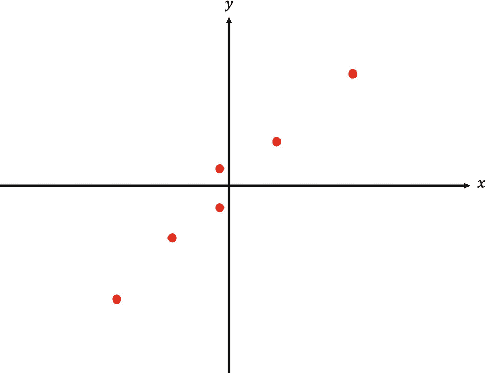

散点图由 X 轴和 Y 轴以及所有四个象限表示。

**图 12-56** XY 平面上的数据

如果我们旋转 XY 平面的坐标轴，使得大多数点位于新 x 轴（*x*′）上或附近，如图 12-57 所示，我们可以更清楚地看到这种降维。我们实际上不需要记录*y*′，因为它们都接近 0，在一个狭窄的范围内。我们只需要记录*x*′，因为它们可以取很宽范围内的许多值。数据主要分布在*x*′上，这也是方差最大的地方。寻找一个新的坐标系，使得大部分方差仅集中在坐标轴的一个小子集上，有助于降低维度、滤除噪声、识别数据的重要部分并发现规律。这就是主成分分析（PCA）的基本原理。

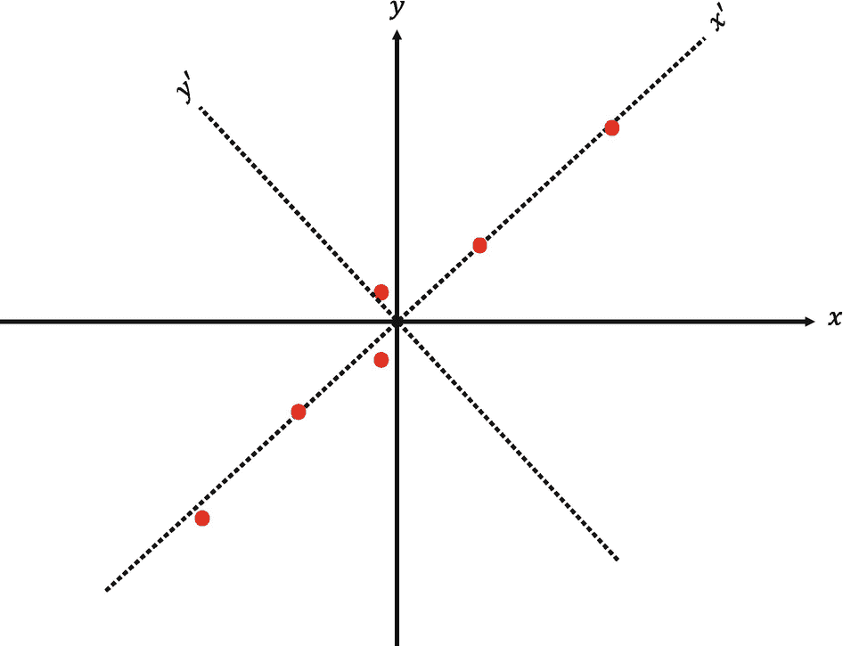

散点图由 X 轴和 Y 轴以及另一组虚线 x 轴和 y 轴表示。虚线轴呈 45 度角。

**图 12-57** 旋转后 XY 平面上的数据

Jon（2003）给出了另一个现实生活中的例子来说明为什么以及如何进行 PCA。在实验物理学中，我们经常需要对一个现象进行多次测量。图 12-58 显示了我们使用三个相机来捕捉连接在弹簧上的球的运动。在我们理解一个现象之前，我们不一定知道如何进行测量。我们可能只是简单地将相机放置在方便且有空间的地方。每个相机从其视角记录一系列的*x*和*y*。每个快照中共有六个坐标。

![ $$\textbf{X}=\left[\begin{array}{c}{x}_A\\ {}{y}_A\\ {}{x}_B\\ {}{y}_B\\ {}{x}_C\\ {}{y}_C\end{array}\right]$$](images/528380_1_En_12_Chapter/528380_1_En_12_Chapter_TeX_Equin.png)

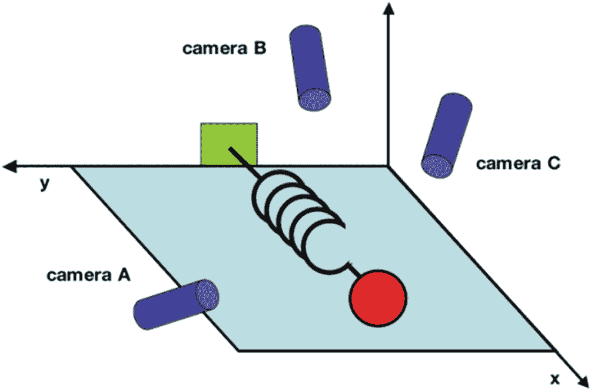

三维坐标轴，内含弹簧的四边体，每个轴代表一个相机，并标有圆柱形盒子 A、B 和 C。

**图 12-58** 测量连接在弹簧上的球的运动

我们可以收集数千个这样的坐标用于分析。然而，我们知道，根据弹簧工作的后见之明，这六个坐标的数据难以分析，并且它们掩盖了弹簧运动的全貌——弹簧实际上只在一个方向上运动。是否有可能“变换”这些数据，使得主成分易于可视化？从数学上讲，我们想找到一个坐标变换或基变换，使得新的坐标能够反映弹簧来回弹跳的那个单一维度。也就是说，需要一个基变换矩阵**P**，使得：

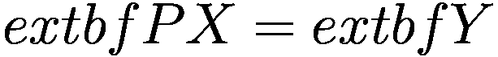

其中**X**是去均值后的数据（在 PCA 中，我们总是首先对每个因子或行**x**[**i**]减去平均值）；**Y**是新基下的新坐标。更多细节请参见第 2 章。

为了找到**P**，我们需要施加一些性质来证明**P**是一个好的基变换。例如，我们希望新坐标系下的**Y**满足：

*   每个新轴上的方差最大化。
*   任意一对变量之间的协方差最小化，例如，为 0。

这两个性质基本上是说**Y**的协方差矩阵应该是对角矩阵。也就是说，对角线元素（方差）最大化，非对角线元素（协方差）为 0。从数学上讲，我们得到：

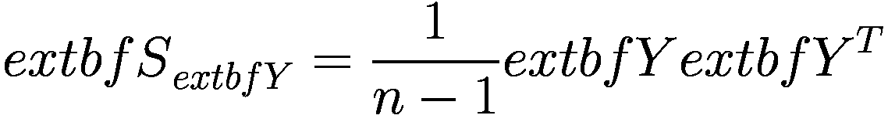

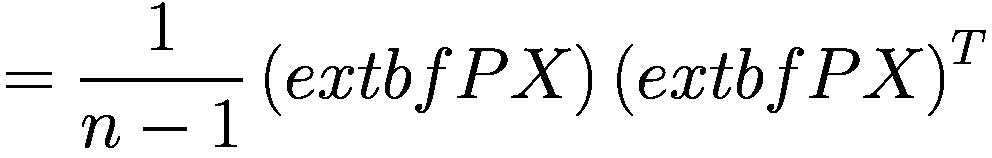

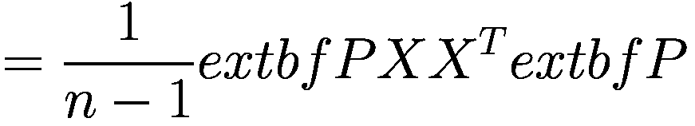

注意，**A** = **XX**^(*T*) 是**X**的协方差矩阵（在减去样本均值和缩放因子之后）。它是对称的，因此可以对角化。存在一个特征向量矩阵**E**和一个对角矩阵**D**使得：

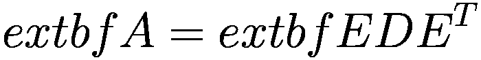

假设我们选择基变换 **P = E**^(*T*)；我们得到以下结果：

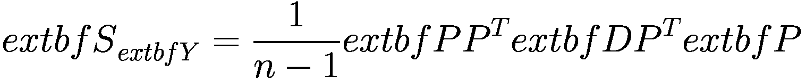

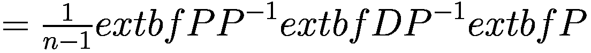，因为**P**是标准正交的

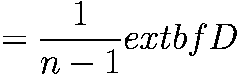

显然，**P = E**^(*T*) 使**S**[**Y**]对角化。这就是对**X**进行 PCA 以产生坐标变换**P**从而得到**Y**的过程。

我们也可以使用 SVD 进行 PCA。对于去均值后的数据**X**，存在标准正交基**U**和**V**以及对角矩阵**σ**，使得：

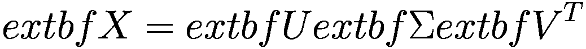

等价地，

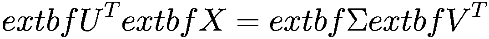

这里，我们同样有基变换如下：

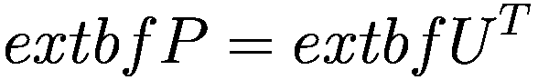

而新坐标如下：

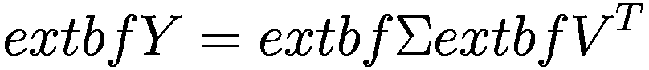

**U**是张成*n*维空间的标准正交向量集；**V**是张成*m*维空间的标准正交向量集。这种 SVD 或 PCA 将*n*维空间投影到*m*维空间，从而实现降维。我们通常按降序排列**σ**中的对角线元素，以便我们可以选择截断不显著的奇异值。这将进一步降低投影空间中的维度。回到图 12-58 中的弹簧示例，我们希望找到旋转坐标的**P**，使得大部分数据位于一个（新）x 轴上。此外，我们只保留一个最显著的奇异值，并截断其他五个以去除噪声。这将数据的维度从 6 降低到 1。然后我们可以轻松地可视化和分析弹簧沿直线来回运动。

NM Dev 支持使用特征分解和 SVD 两种方法进行 PCA。所有实现都继承自`PCA`接口。其签名如下：


```java
public interface PCA {
/**
* 获取原始数据中的观测值数量；即样本量。
*
* @return nObs，原始数据中的观测值数量
*/
public int nObs();
/**
* 获取原始数据中的变量数量。
*
* @return nFactors，原始数据中的变量数量
*/
public int nFactors();
/**
* 获取被减去的样本均值。
*
* @return 原始数据中每个变量的样本均值
*/
public Vector mean();
/**
* 获取应用于每个变量的缩放因子。
*
* @return 应用于原始数据中每个变量的缩放因子
*/
public Vector scale();
/**
* 获取用于 PCA 的（可能经过中心化和/或缩放处理的）数据矩阵 X。
*
* @return （可能经过中心化和/或缩放处理的）数据矩阵 X
*/
public Matrix X();
/**
* 获取主成分的标准差（即相关矩阵（或协方差矩阵）特征值的平方根）。
*
* @return 主成分的标准差
*/
public Vector sdPrincipalComponents();
/**
* 获取第 i 个主成分的标准差。
*
* @param i 索引，从 1 开始计数
* @return 第 i 个主成分的标准差
*/
public double sdPrincipalComponent(int i);
/**
* 获取变量载荷矩阵。
* 载荷矩阵各列的符号是任意的。
*
* @return 变量载荷矩阵
*/
public Matrix loadings();
/**
* 获取第 i 个主成分的载荷向量。
*
* @param i 索引，从 1 开始计数
* @return 第 i 个主成分的载荷向量
*/
public Vector loading(int i);
/**
* 获取每个主成分解释的总体方差比例。
*
* @return 每个主成分解释的总体方差比例
*/
public Vector proportionVar();
/**
* 获取第 i 个主成分解释的总体方差比例。
*
* @param i 索引，从 1 开始计数
* @return 第 i 个主成分解释的总体方差比例
*/
public double proportionVar(int i);
/**
* 获取由主成分解释的总体方差累积比例。
*
* @return 由主成分解释的总体方差累积比例
*/
public Vector cumulativeProportionVar();
/**
* 获取提供的数据在主成分上的得分。
* 得分矩阵各列的符号是任意的。
*
* @return 提供的数据在主成分上的得分
*/
public Matrix scores();
}
```

例如，以下代码在 R 语言中对美国逮捕数据（USArrests）运行 PCA。（该数据集与本书的源代码一同提供。）

```java
// 使用特征分解对数据运行 PCA
val pca: PCA = PCAbyEigen(
USArrests, // 以矩阵形式提供的数据集
false // 使用协方差矩阵而非相关矩阵
)
// 因子数量
val p: Int = pca.nFactors()
// 观测值数量
val n: Int = pca.nObs()
val mean: Vector = pca.mean()
val scale: Vector = pca.scale()
val sdev: Vector = pca.sdPrincipalComponents()
val loadings: Matrix = pca.loadings()
val proportion: Vector = pca.proportionVar()
val cumprop: Vector = pca.cumulativeProportionVar()
println("因子数 = " + p)
println("观测值数 = " + n)
```

输出结果如下：

```java
因子数 = 4
观测值数 = 50
println("均值: " + mean)
println("缩放因子: " + scale)
// 标准差相差 sqrt(50 / 49) 倍，
// 因为样本协方差矩阵使用除数 (nObs - 1)
println("标准差: " + sdev)
// 载荷矩阵各列的符号是任意的。
println("载荷: ")
println(loadings)
// 每个维度的方差比例
println("方差比例: " + proportion)
println("方差累积比例: " + cumprop)
println("得分: ")
println(scores)
```

输出结果如下：

```
均值: [7.788000, 170.760000, 65.540000, 21.232000]
缩放因子: [1.000000, 1.000000, 1.000000, 1.000000]
标准差: [83.732400, 14.212402, 6.489426, 2.482790]
载荷:
4x4
[,1] [,2] [,3] [,4]
[1,] -0.041704, 0.044822, 0.079891, 0.994922,
[2,] -0.995221, 0.058760, -0.067570, -0.038938,
[3,] -0.046336, -0.976857, -0.200546, 0.058169,
[4,] -0.075156, -0.200718, 0.974081, -0.072325,
方差比例: [0.965534, 0.027817, 0.005800, 0.000849]
方差累积比例: [0.965534, 0.993352, 0.999151, 1.000000]
```

PCA 将数据的维度从 4 降到了 1 或 2。第一个主成分解释了数据变异的 96.6%。前两个主成分解释了数据变异的 99%。我们可以安全地截断最后两个主成分。

以下代码使用 SVD 解决相同的问题：

```java
// 使用 SVD 对数据运行 PCA
val pca: PCA = PCAbySVD(
USArrests // 以矩阵形式提供的数据集
)
// 因子数量
val p: Int = pca.nFactors()
// 观测值数量
val n: Int = pca.nObs()
val mean: Vector = pca.mean()
val scale: Vector = pca.scale()
val sdev: Vector = pca.sdPrincipalComponents()
val loadings: Matrix = pca.loadings()
val proportion: Vector = pca.proportionVar()
val cumprop: Vector = pca.cumulativeProportionVar()
println("因子数 = " + p)
println("观测值数 = " + n)
```

输出结果如下：

```java
因子数 = 4
观测值数 = 50
println("均值: " + mean)
println("缩放因子: " + scale)
// 标准差相差 sqrt(50 / 49) 倍，
// 因为样本协方差矩阵使用除数 (nObs - 1)
println("标准差: " + sdev)
// 载荷矩阵各列的符号是任意的。
println("载荷: ")
println(loadings)
// 每个维度的方差比例
println("方差比例: " + proportion)
println("方差累积比例: " + cumprop)
```

输出结果如下：

```
均值: [7.788000, 170.760000, 65.540000, 21.232000]
缩放因子: [4.355510, 83.337661, 14.474763, 9.366385]
标准差: [1.574878, 0.994869, 0.597129, 0.416449]
载荷:
4x4
[,1] [,2] [,3] [,4]
[1,] 0.535899, -0.418181, -0.341233, 0.649228,
[2,] 0.583184, -0.187986, -0.268148, -0.743407,
[3,] 0.278191, 0.872806, -0.378016, 0.133878,
[4,] 0.543432, 0.167319, 0.817778, 0.089024,
方差比例: [0.620060, 0.247441, 0.089141, 0.043358]
方差累积比例: [0.620060, 0.867502, 0.956642, 1.000000]
```


