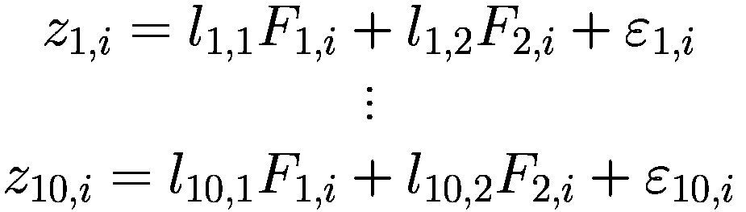
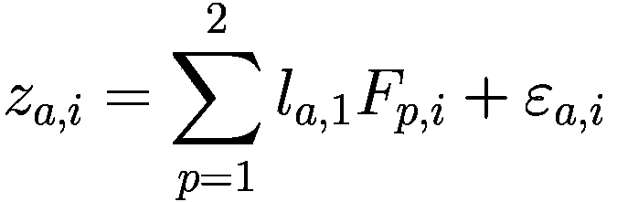
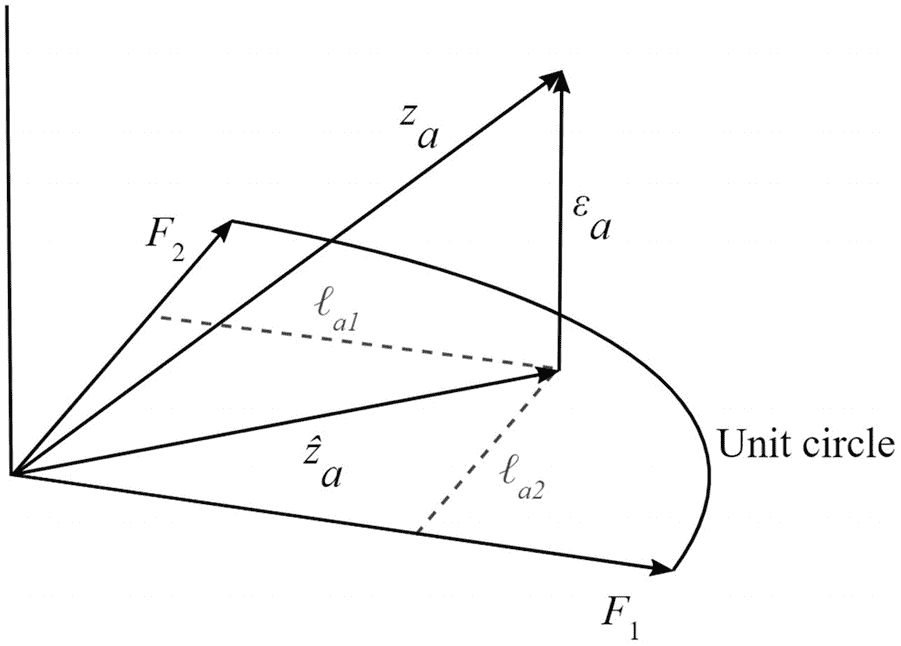
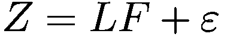

# 12.8 因子分析

因子分析用于通过数量较少的、被称为因子的未观测变量来解释一组相关的变量或观测值。例如，十个观测变量的变化可能主要反映了两个未观测（潜在）变量的变化。观测变量被建模为未观测因子的线性组合加上“误差”项。与 PCA 类似，它有助于降低数据的维度。在处理大型数据集时，因子分析常用于生物学、心理测量学、人格理论、市场营销、产品管理、运筹学和金融等领域。

这个概念最好通过一个例子来说明。假设一位心理学家提出假设，认为存在两种智力：语言智力和数学智力，这两种智力都无法直接观测。为了寻找支持该假设的证据，该心理学家收集了 1000 名学生在 10 个不同学术领域的考试成绩。心理学家的假设认为，对于这 10 个学术领域中的每一个，学生的成绩都是其语言智力和数学智力的线性组合。虽然每个学生都有自己的语言智力和数学智力，但这两个因子的系数对所有人都是相同的。这些系数被称为因子载荷。一个因子的因子载荷量化了观测变量与该给定因子相关的程度（权重）。例如，该假设可能预测一名学生在天文学上的成绩如下：

`{10 × 学生的语言智力} + {6 × 学生的数学智力}`

数字 10 和 6 是与天文学相关的因子载荷。其他学科可能具有不同的因子载荷。

假设两名学生具有相同的语言和数学智力，因此预测成绩也相同，但他们在天文学和其他学科上可能获得不同的分数。预测值与实际值（观测值）之间的这种差异被称为误差。

可观测的数据是 1000 名学生的 10 个成绩，总共 10,000 个数字。未观测的因子值（每个学生 2 个，共 2,000 个数字）和因子载荷是通过因子分析从数据中估计出来的。

我们可以用数学形式写出这些关系。对于学生 *i*，其在 10 个科目中的标准化 z 分数（我们使用 z 分数是为了使所有变量的量级具有可比性）可以建模如下：



或者，更简洁地，可以写成如下形式：



其中 `F[1,i]` 是学生 *i* 的语言智力，`F[2,i]` 是学生 *i* 的数学智力，而 `l[a,p]` 是第 *a* 个学科在 `p = 1, 2` 时的因子载荷。参见图 12-59。



`F1` 和 `F2` 表示在轴上，形成了单位圆。其他线也被提及。

**图 12-59** 因子分析的几何解释

从几何角度看，数据（`z[a,i]`）、因子（`F[p,i]`）和误差（`ε[a,i]`）可以被视为 *N* 维欧几里得空间（样本空间）中的向量，分别表示为 `z[a]`、`F[j]` 和 `ε[a]`。由于数据是标准化的，数据向量具有单位长度（`‖z[a]‖ = 1`）。因子向量在此空间中定义了一个 *k* 维线性子空间（即一个超平面），数据向量被正交投影到该超平面上。在前面的例子中，该超平面是由图 12-59 中两个因子向量定义的一个二维平面。因子分析的目标是找到一个在某种意义上与数据“最佳拟合”的超平面，因此只要定义该超平面的因子向量是独立的且位于该超平面内，选择这些向量无关紧要。

总的来说，对于所有学生的所有科目，用矩阵表示法，我们有如下公式：



NM Dev 类的 `FactorAnalysis` 实现了因子分析过程，用于在给定 *Z*（或 *X*）的情况下找到 *L*、*F* 和 *ε*。下面是一个示例：

```
// 隐藏因子的数量
val nFactors = 3
val factor_analysis
= FactorAnalysis(
R_data,
nFactors,
FactorAnalysis.ScoringRule.THOMSON // 指定评分规则
)
println("观测数 = " + factor_analysis.nObs())
println("变量数 = " + factor_analysis.nVariables())
println("因子数 = " + factor_analysis.nFactors())
// 协方差矩阵
val S = factor_analysis.S()
println("\n 协方差矩阵: ")
println(S)
```

输出结果如下：

```
观测数 = 18
变量数 = 6
因子数 = 3
协方差矩阵:
6x6
[,1] [,2] [,3] [,4] [,5] [,6]
[1,] 1.000000, 0.939308, 0.512887, 0.432031, 0.466495, 0.408608,
[2,] 0.939308, 1.000000, 0.412444, 0.408428, 0.436393, 0.432611,
[3,] 0.512887, 0.412444, 1.000000, 0.877075, 0.512887, 0.432031,
[4,] 0.432031, 0.408428, 0.877075, 1.000000, 0.432031, 0.432326,
[5,] 0.466495, 0.436393, 0.512887, 0.432031, 1.000000, 0.947345,
[6,] 0.408608, 0.432611, 0.432031, 0.432326, 0.947345, 1.000000,
val estimators: FAEstimator = factor_analysis.getEstimators(700)
val fitted: Double = estimators.logLikelihood()
println("拟合的对数似然 = " + fitted)
val uniqueness: Vector = estimators.psi()
println("独特性 = " + uniqueness)
val dof: Int = estimators.dof()
println("自由度 = " + dof)
// 因子载荷
val loadings: Matrix = estimators.loadings()
println("因子载荷:")
println(loadings)
val testStats: Double = estimators.statistics()
println("检验统计量 = " + testStats)
val pValue: Double = estimators.pValue()
println("P 值 = " + pValue)
val scores: Matrix = estimators.scores()
println("分数:")
println(scores)
```

输出结果如下：

```
拟合的对数似然 = 0.475515649954116
独特性 = [0.005000, 0.100900, 0.005000, 0.224053, 0.084290, 0.005000]
自由度 = 0
因子载荷:
6x3
[,1] [,2] [,3]
[1,] 0.943840, 0.181926, 0.266614,
[2,] 0.904720, 0.234836, 0.159479,
[3,] 0.235639, 0.209603, 0.946344,
[4,] 0.179976, 0.242255, 0.827568,
[5,] 0.242107, 0.880640, 0.285599,
[6,] 0.192766, 0.958837, 0.196209,
检验统计量 = 5.785440407775078
P 值 = -1.0
分数:
18x3
[,1] [,2] [,3]
[1,] -0.896511, -0.924689, 0.936376,
[2,] -0.861396, -0.926617, 0.924255,
[3,] -0.900730, -0.925772, 0.950364,
[4,] -0.993305, -0.251413, 0.808659,
[5,] -0.896511, -0.924689, 0.936376,
[6,] -0.741151, 0.720108, -0.783533,
[7,] -0.706036, 0.718180, -0.795654,
[8,] -0.745370, 0.719025, -0.769545,
[9,] -0.802830, 1.391456, -0.923371,
[10,] -0.741151, 0.720108, -0.783533,
[11,] 0.916893, -0.925056, -0.830334,
[12,] 0.952008, -0.926984, -0.842455,
[13,] 0.912674, -0.926140, -0.816346,
[14,] 0.820099, -0.251780, -0.958051,
[15,] 0.916893, -0.925056, -0.830334,
[16,] 0.426454, 2.035689, 1.282442,
[17,] 1.464788, 1.290102, 0.547953,
[18,] 1.875185, 0.313530, 1.946731,
```


