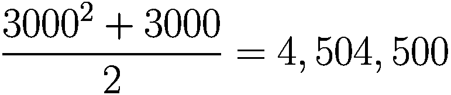
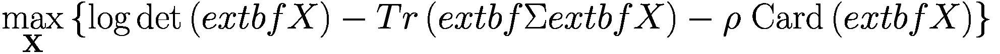
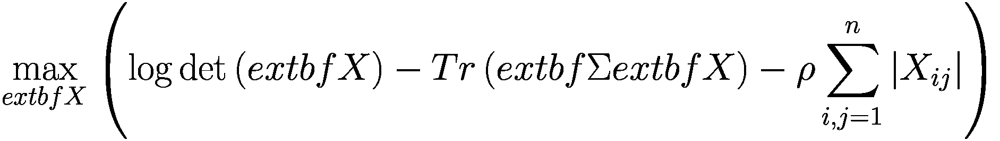
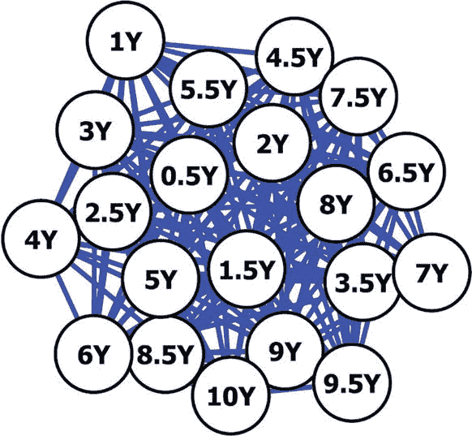
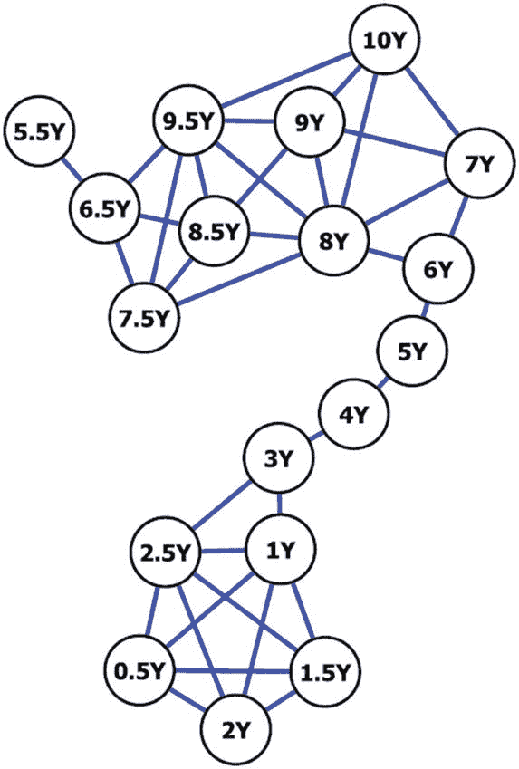
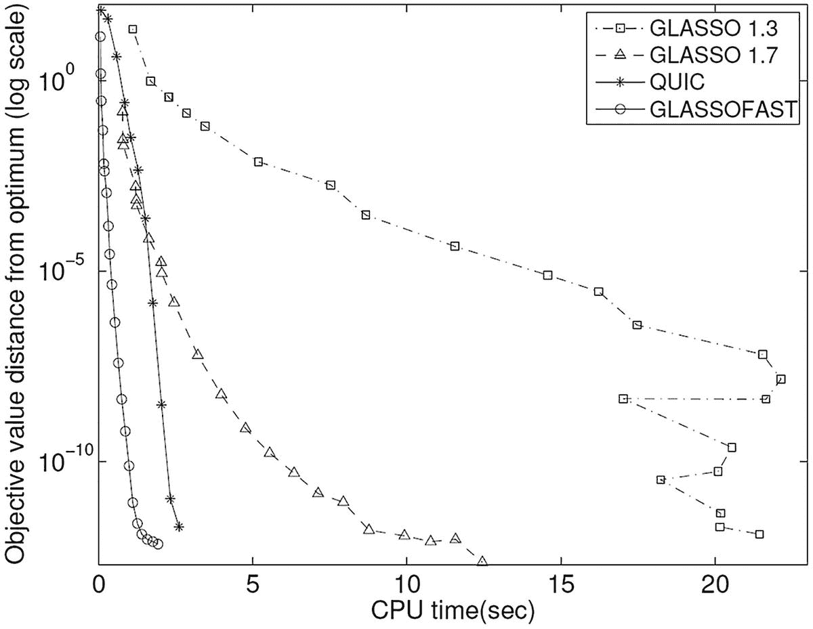

# 12.9 协方差选择

本节内容参考了 d'Aspremont (2011) 的文献。协方差矩阵是建模协变量和理解变量间关系的基础，它是许多算法中的关键信息，例如投资组合优化（需要协方差矩阵的逆）。为了深入理解为何协方差矩阵的估计如此困难，我们来看一个例子：当我们想要估计 3000 只股票（大约相当于纽约证券交易所的上市股票数量）的协方差矩阵时，该矩阵是一个 3000×3000 的矩阵。由于对称性，其自由参数的数量如下：



换句话说，我们需要估计大约 450 万个参数！考虑到有限的数据集，这似乎超出了可行性范围。对于 10 年的数据，只有 2500 个交易日。对于 100 年的数据（不确定我们是否真的拥有那么久远的记录），也只有 25000 个交易日，而且这还假设（错误地）股票协方差在过去 100 年间保持不变。

从实际数据中估计协方差矩阵通常是困难的。这方面已有大量研究。第 12.2.9.4 节和 12.2.9.5 节中的收缩方法是一种实现方式。另一种流行的做法是对协方差矩阵施加结构约束，例如将协方差矩阵的逆矩阵中的元素设为零。后一种方法被称为协方差选择。

逆协方差矩阵中的零对应于模型中条件独立的变量，这种方法可用于在获得协方差矩阵稳健估计的同时（或许更为重要的是）发现底层图模型中的结构。这种权衡存在于解矩阵`X`的对数似然值与其逆矩阵中零的数量（即模型结构）之间，可形式化为以下问题：



其中我们正在选择一个协方差矩阵`X`。`Card(X)`是`X`的基数，即`X`中非零系数的数量，而`ρ > 0`是控制似然值与结构之间权衡的参数。

求解这个惩罚最大似然估计问题，既通过隐式减少参数数量来提高估计过程的稳定性，又直接突出了底层模型中的结构。不幸的是，基数惩罚项使得这个问题在数值上很难求解。d'Aspremont (2011) 描述了一种解法，即放松`Card(X)`惩罚项，并将其替换为（凸的）`X`系数的 L1 范数来进行求解。



这个涉及`X`元素绝对值总和的惩罚项作为基数的代理：函数`∑_{i,j=1}^n |X_{ij}|`可以被视为在超立方体上进行秩最小化时，`Card(X)`的最大凸下界。它也常用于回归和变量选择过程，例如 LASSO。

在多变量高斯分布中，逆协方差矩阵中的零指向那些在给定所有其他变量条件下条件独立的变量。这具有明确的金融含义：逆协方差矩阵反映了资产价格动态中异质成分之间的独立关系。

图 12-60 展示了美国互换利率的依赖性网络或图模型。在此图中，变量（节点）当且仅当条件依赖时才通过链接连接。这是根据样本逆协方差矩阵中零的模式推断出的图模型。



## 图 12-60

根据样本逆协方差矩阵中零的模式推断出的条件依赖网络

图 12-61 显示了相同的图，但这次使用了惩罚参数`ρ = 0.1`的惩罚协方差估计。请注意，在惩罚估计中，利率按期限聚类。该图清晰地揭示了互换利率是作为一条曲线在移动。



## 图 12-61

使用惩罚协方差估计的条件依赖网络

NM Dev 类 `CovarianceSelectionLASSO` 实现了这种协方差选择的 LASSO 方法。以下是一个示例：

```kotlin
// 从标准正态分布生成随机样本
val rnorm = StandardNormalRNG()
rnorm.seed(1234567890L)
val nRows = 50
val nCols = 10
val X = DenseMatrix(nRows, nCols)
for (i in 1 until nRows) {
  for (j in 1 until nCols) {
    X.set(i, j, rnorm.nextDouble())
  }
}
// 样本协方差矩阵
val S = SampleCovariance(X)
println("样本协方差: \n")
println(S)
// 惩罚参数
val rho = 0.03
val problem = CovarianceSelectionProblem(S, rho)
var time1: Long = System.currentTimeMillis()
val lasso = CovarianceSelectionLASSO(problem, 1e-5)
val sigma: Matrix = lasso.covariance()
time1 = System.currentTimeMillis() - time1
println("估计的 sigma: \n")
println(sigma)
println("逆 sigma: \n")
val sigma_inv = lasso.inverseCovariance()
println(sigma_inv)
```

输出如下：

我们可以看到，由于数据是独立同分布的标准正态数据，惩罚后的协方差矩阵（及其逆矩阵）比样本协方差矩阵（及其逆矩阵）更接近单位矩阵，这凸显了样本协方差矩阵的问题以及`LASSO`协方差选择方法的有效性。

`Sustik & Ben (2012)` 提出了一种实现，其速度比原始`LASSO`实现快多个数量级。图 12-62 展示了不同`LASSO`实现之间的基准对比。



该图以对数尺度展示了目标函数值与最优值的距离随CPU时间（秒）的变化曲线，显示了四种不同性质的递减曲线。

**图 12-62** 比较`GLASSOFAST`与`GLASSO`

`NM Dev`类`CovarianceSelectionGLASSOFAST`实现了这种快速的`LASSO`协方差选择算法。以下是一个示例：

```
样本协方差：
10x10
[,1] [,2] [,3] [,4] [,5] [,6] [,7] [,8] [,9] [,10]
[1,] 0.925475, 0.004218, 0.036085, -0.056795, 0.173294, -0.352947, 0.047752, -0.086790, 0.129483, 0.000000,
[2,] 0.004218, 1.044569, 0.028598, -0.103705, -0.084960, -0.176651, 0.308747, -0.138218, 0.127196, 0.000000,
[3,] 0.036085, 0.028598, 0.767803, 0.057206, -0.088929, 0.002309, -0.016617, -0.208669, -0.120564, 0.000000,
[4,] -0.056795, -0.103705, 0.057206, 1.174416, -0.150165, 0.199965, -0.165554, 0.002550, 0.074200, 0.000000,
[5,] 0.173294, -0.084960, -0.088929, -0.150165, 0.977483, -0.207569, -0.124171, -0.076252, 0.235514, 0.000000,
[6,] -0.352947, -0.176651, 0.002309, 0.199965, -0.207569, 1.242628, -0.096799, 0.047458, -0.014898, 0.000000,
[7,] 0.047752, 0.308747, -0.016617, -0.165554, -0.124171, -0.096799, 1.120136, 0.048563, -0.187201, 0.000000,
[8,] -0.086790, -0.138218, -0.208669, 0.002550, -0.076252, 0.047458, 0.048563, 1.154475, 0.036975, 0.000000,
[9,] 0.129483, 0.127196, -0.120564, 0.074200, 0.235514, -0.014898, -0.187201, 0.036975, 0.838084, 0.000000,
[10,] 0.000000, 0.000000, 0.000000, 0.000000, 0.000000, 0.000000, 0.000000, 0.000000, 0.000000, 0.000000,
```

估算的`sigma`：
```
10x10
[,1] [,2] [,3] [,4] [,5] [,6] [,7] [,8] [,9] [,10]
[1,] 0.925475, 0.000000, 0.000000, -0.000833, -0.000000, -0.027764, 0.000000, -0.000000, 0.000000, 0.000000,
[2,] 0.000000, 1.044569, 0.000000, -0.000000, -0.000015, -0.000000, 0.031337, -0.000000, -0.000495, 0.000000,
[3,] 0.000000, 0.000000, 0.767803, -0.000000, -0.000000, -0.000000, 0.000000, -0.023034, -0.000000, 0.000000,
[4,] -0.000833, -0.000000, -0.000000, 1.174416, 0.000000, 0.000025, -0.000000, 0.000000, 0.000000, 0.000000,
[5,] -0.000000, -0.000015, -0.000000, 0.000000, 0.977483, -0.000000, -0.000000, 0.000000, 0.013875, 0.000000,
[6,] -0.027764, -0.000000, -0.000000, 0.000025, -0.000000, 1.242628, -0.000000, 0.000000, 0.000000, 0.000000,
[7,] 0.000000, 0.031337, 0.000000, -0.000000, -0.000000, -0.000000, 1.120136, -0.000000, -0.017704, 0.000000,
[8,] -0.000000, -0.000000, -0.023034, 0.000000, 0.000000, 0.000000, -0.000000, 1.154475, 0.000000, 0.000000,
[9,] 0.000000, -0.000495, -0.000000, 0.000000, 0.013875, 0.000000, -0.017704, 0.000000, 0.838084, 0.000000,
[10,] 0.000000, 0.000000, 0.000000, 0.000000, 0.000000, 0.000000, 0.000000, 0.000000, 0.000000, 0.000000,
```

逆`sigma`：
```
10x10
[,1] [,2] [,3] [,4] [,5] [,6] [,7] [,8] [,9] [,10]
[1,] 1.081252, 0.000000, -0.000000, 0.000766, 0.000000, 0.024159, -0.000000, 0.000000, -0.000000, 0.000000,
[2,] 0.000000, 0.958137, -0.000000, 0.000000, 0.000015, 0.000000, -0.026805, 0.000000, -0.000000, 0.000000,
[3,] -0.000000, -0.000000, 1.303197, 0.000000, 0.000000, 0.000000, -0.000000, 0.026001, 0.000000, 0.000000,
[4,] 0.000766, 0.000000, 0.000000, 0.851487, -0.000000, -0.000000, 0.000000, -0.000000, -0.000000, 0.000000,
[5,] 0.000000, 0.000015, 0.000000, -0.000000, 1.023276, 0.000000, -0.000268, -0.000000, -0.016947, 0.000000,
[6,] 0.024159, 0.000000, 0.000000, -0.000000, 0.000000, 0.805286, -0.000000, -0.000000, -0.000000, 0.000000,
[7,] -0.000000, -0.026805, -0.000000, 0.000000, -0.000268, -0.000000, 0.893797, 0.000000, 0.018870, 0.000000,
[8,] 0.000000, 0.000000, 0.026001, -0.000000, -0.000000, -0.000000, 0.000000, 0.866713, -0.000000, 0.000000,
[9,] -0.000000, -0.000000, 0.000000, -0.000000, -0.016947, -0.000000, 0.018870, -0.000000, 1.193877, 0.000000,
[10,] 0.000000, 0.000000, 0.000000, 0.000000, 0.000000, 0.000000, 0.000000, 0.000000, 0.000000, 100000000.000000,
```

## 代码示例

```kotlin
// 从标准正态分布生成随机样本
val rnorm = StandardNormalRNG()
rnorm.seed(1234567890L)
val nRows = 50
val nCols = 10
val X = DenseMatrix(nRows, nCols)
for (i in 1 until nRows) {
    for (j in 1 until nCols) {
        X.set(i, j, rnorm.nextDouble())
    }
}
// 样本协方差矩阵
// val S = SampleCovariance(X)
// println("样本协方差：")
// println(S)
// 惩罚参数
val rho = 0.03
val problem = CovarianceSelectionProblem(S, rho)
var time2: Long = System.currentTimeMillis()
val lasso2 = CovarianceSelectionGLASSOFAST(problem)
val sigma2 = lasso2.covariance()
time2 = System.currentTimeMillis() - time2
println("估算的 sigma：")
println(sigma2)
println("CovarianceSelectionLASSO 耗时 " + time1 + " 毫秒")
println("CovarianceSelectionGLASSOFAST 耗时 " + time2 + " 毫秒")
```

## 输出结果

输出结果如下：

```
使用 GLASSOFAST 进行协方差选择
估算的 sigma：
10x10
[,1]      [,2]      [,3]      [,4]      [,5]      [,6]      [,7]      [,8]      [,9]      [,10]
[1,]  0.955475,  0.034218,  0.006085, -0.048451,  0.143294, -0.322947,  0.017752, -0.056790,  0.099483,  0.000000,
[2,]  0.034218,  1.074569,  0.008399, -0.073705, -0.054960, -0.146651,  0.278747, -0.108218,  0.097196,  0.000000,
[3,]  0.006085,  0.008399,  0.797803,  0.027206, -0.058929,  0.005653,  0.013383, -0.178669, -0.090564,  0.000000,
[4,] -0.048451, -0.073705,  0.027206,  1.204416, -0.120165,  0.169965, -0.135554,  0.006710,  0.044200,  0.000000,
[5,]  0.143294, -0.054960, -0.058929, -0.120165,  1.007483, -0.177569, -0.094172, -0.046252,  0.205514,  0.000000,
[6,] -0.322947, -0.146651,  0.005653,  0.169965, -0.177569,  1.272628, -0.066798,  0.037528, -0.044898,  0.000000,
[7,]  0.017752,  0.278747,  0.013383, -0.135554, -0.094172, -0.066798,  1.150136,  0.018563, -0.157201,  0.000000,
[8,] -0.056790, -0.108218, -0.178669,  0.006710, -0.046252,  0.037528,  0.018563,  1.184475,  0.006975,  0.000000,
[9,]  0.099483,  0.097196, -0.090564,  0.044200,  0.205514, -0.044898, -0.157201,  0.006975,  0.868084,  0.000000,
[10,] 0.000000,  0.000000,  0.000000,  0.000000,  0.000000,  0.000000,  0.000000,  0.000000,  0.000000,  0.030000,
CovarianceSelectionLASSO 耗时 542 毫秒
CovarianceSelectionGLASSOFAST 耗时 9 毫秒
```

## 结论

显然，`GLASSOFAST` 比经典的 `LASSO` 实现快了几个数量级。