# 12. 基础统计学

统计学是数学的一个分支，研究数据的收集、整理、分析、解释和展示。研究中有两种主要的统计方法：描述性统计学用于总结和描述样本数据的属性；推断性统计学则基于样本对总体得出结论并进行预测。总体是我们想要研究并为之得出结论的全部数据集，包括已知与未知、可观测与不可观测的部分。样本集是总体中我们拥有（观测到的）数据的一个子集。总体是不变的，而样本集会根据数据收集方式的不同而变化。每次收集数据时，样本集都可能不同。样本规模总是小于总体规模，且始终是有限的。而总体规模可能非常大，甚至无限大。推断性统计学通过样本的描述性统计量来推断总体的特征。例如，要估算整个宇宙中的星系数量，我们会利用望远镜（如哈勃望远镜）拍摄一小片天空的图像，然后根据这片天空与整个宇宙的比例来估算宇宙中的星系数量。这种抽样与推断的过程是统计分析的核心。我们正是通过这种方式来估算宇宙中的原子数量、地球上的奶牛数量（通常我们不会逐一清点并命名 15 亿头奶牛），以及许多其他无法全部观测（即没有全部数据）的测量值。统计学几乎应用于所有科学学科，如自然科学和社会科学，以及商业、人文学科、政府和制造业等领域。

NM Dev 库提供了一整套用于数据分析的统计工具。它涵盖了描述性统计、多种单变量与多变量概率分布、回归分析、时间序列分析、多变量分析、数据滤波、假设检验、随机数生成、仿真等内容。这些正是我们在后续章节中将要讨论的主题。

本章的源代码可以在 S2 平台上运行，地址如下：

[`https://s21.nm.dev/hub/user-redirect/lab/tree/s2-public/Numerical%20Methods%20Using%20Kotlin/chapter12.ipynb`](https://s21.nm.dev/hub/user-redirect/lab/tree/s2-public/Numerical%2520Methods%2520Using%2520Kotlin/chapter12.ipynb)

源代码可在 GitHub 上找到：

[`https://github.com/apress/numerical-methods-kotlin`](https://github.com/apress/numerical-methods-kotlin)

## 12.1 随机变量

随机变量的概念是统计学的基础。可以说，统计学的数学本质就是研究随机变量，这种说法（可能）不会太离谱。一个非随机变量，例如`x = 1`，指的是每次观察时都取相同值（此例中为 1）的变量，它始终不变。相反，随机变量在每次观测或抽样时可能取不同的值。在观测之前，我们无法知道它将会取什么值。假设我们将硬币抛掷的结果“正面”（`H`）标记为 1，“反面”（`T`）标记为 0。那么，代表抛硬币结果的随机变量`X`，在每次抛掷（或每次抽样）时取值可能为 1 或 0。假设我们抛了五次硬币，得到的结果是{`H`, `H`, `T`, `T`, `H`}。那么本次实验中`X`的样本就是{`x[1] = 1`, `x[2] = 1`, `x[3] = 0`, `x[4] = 0`, `x[5] = 1`}。根据实验结果的不同，每个样本或观测值都可能不同。

更正式地说，随机变量`X`是一个函数，它将一个域（称为样本空间Ω）中的结果映射到某些实数（值域`E`）。结果`ω ∈ Ω`可能取决于某种不可预测的物理过程。以抛硬币为例，结果是Ω = {`H`, `T`}，随机变量`X`将其映射到`E` = {1, 0}。

此外，随机变量有一个概率分布`P`，它指定了随机变量取某一个或某几个值的概率。这个概率等于结果恰好是与这些值对应的事件发生的可能性。例如，对于一枚公平的硬币，以下三个量是相等的：`X = 1`的概率记作`P(X = 1)`，或者结果是`H`的可能性，都是 50%。离散型随机变量只能取有限个或可数无穷多个值，例如抛硬币例子中的{1, 0}。离散型随机变量的概率分布称为概率质量函数。一枚公平硬币的随机变量和概率质量函数如下所示：

```
⎧ X(ω = H) = 1
⎨
⎩ X(ω = T) = 0
```

以及：

```
⎧ P(X = 1) = P(ω = H) = 0.5
⎨
⎩ P(X = 0) = P(ω = T) = 0.5
```

图 12-1 展示了样本空间Ω、随机变量的值域`E`（同时也是概率函数的定义域）、随机变量`X`以及概率`P`之间的关系。

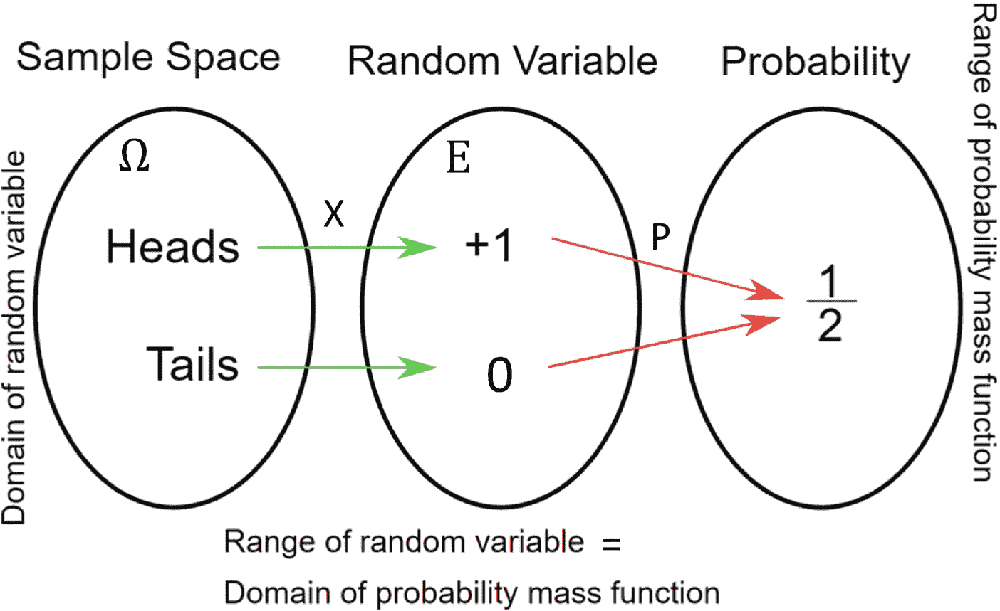

三个椭圆分别表示公平硬币抛掷的样本空间、随机变量和概率。它包含随机变量的定义域：正面、反面，加上 1、0，最终输出为一半。

**图 12-1** 公平硬币抛掷的随机变量

## 12.2 样本统计量

给定随机变量`X`的一组样本（`x[1]`，`x[2]`，…，`x[n]`），我们可以使用样本统计量或描述性统计量来描述该集合的统计属性。有些统计量衡量数据的集中趋势（或位置），例如均值；有些衡量样本的变异性（或分散程度），例如方差；还有一些则突出变量之间的潜在关系，例如协方差。此外还有其他类型的统计量。重要的是要注意，样本统计量不一定等于相应总体的统计量。如果样本量`n`足够大，它们可能是很好的近似值。

在 NM Dev 中，所有从数据集或样本计算统计量的类都继承自`Statistic`接口。其签名如下：

```java
/**
 * 统计量（单数形式）是对样本某个属性（例如其算术平均值）的单一度量。
 * 它通过将函数（统计算法）应用于样本（即一组数据）来计算。
 *
 * @author Haksun Li
 * @see Wikipedia:
 * Statistic
 */
public interface Statistic {
    /**
     * 获取该统计量的值。
     *
     * @return 统计量的值
     */
    public double value();
    /**
     * 获取样本的大小。
     *
     * @return 样本容量
     */
    public int n();
}
```

public long N();

/**

* 使用更多数据重新计算统计量，如果可能的话采用增量方式。

*

* @param data 新数据的数组

*/

public void addData(double... data);

}

```

函数`value()`计算统计量。函数`N()`返回样本容量。


### 12.2.1 均值

最简单的样本统计量是样本均值，或称算术平均数，即数据的平均值，记作`x̄`。它衡量数据集的中⼼位置，是所有样本之和除以样本数量（或计数）的结果。样本均值的数学定义如下：

```

x̄ = (Σᵢ₌₁ⁿ xᵢ) / n

```

大数定律指出，如果样本是从总体`X`中随机抽取的，且总体均值（即期望）为`E(X) = μ`（方差有限），那么样本均值会收敛于总体均值。即：

```

limₙ→∞ x̄ = μ

```

例如，对于样本`X = {2, 3, 3, 1}`，其样本均值计算如下：

```

x̄ = (Σᵢ₌₁⁴ xᵢ) / 4 = (2 + 3 + 3 + 1) / 4 = 2.25

```

在 NM Dev 中，`Mean`类用于计算数据集的样本均值。以下代码计算前述示例：

```kotlin

// 样本数据集

val X1: DoubleArray = doubleArrayOf(2.0, 3.0, 3.0, 1.0)

// 计算数据集的均值

val mean: Mean = Mean(X1)

println("样本大小 = " + mean.N())

println("样本均值 = " + mean.value())

```

输出结果如下：

```

样本大小 = 4

样本均值 = 2.25

```

### 12.2.2 加权均值

样本均值假设每个数据点对最终平均值的贡献相同。加权样本均值则允许某些数据点的贡献大于其他数据点，即每个数据点可以有不同权重`w[i]`。加权样本均值的数学定义如下：

```

x̄* = (Σᵢ₌₁ⁿ wᵢ xᵢ) / (Σᵢ₌₁ⁿ wᵢ)

```

假设一名学生各科成绩为`X = {82, 94, 90, 83, 87}`，对应的学分为`W = {1, 4, 8, 4, 4}`，那么总成绩（即加权样本均值）为：

```

x̄* = (1×82 + 4×94 + 8×90 + 4×83 + 4×87) / (1 + 4 + 8 + 4 + 4) = 88.48

```

在 NM Dev 中，`WeightedMean`类用于计算数据集的加权样本均值。以下代码计算前述示例的加权样本均值：

```kotlin

// 样本数据集

val X2: DoubleArray = doubleArrayOf(82.0, 94.0, 90.0, 83.0, 87.0)

val W2: DoubleArray = doubleArrayOf(1.0, 4.0, 8.0, 4.0, 4.0)

// 计算数据集的均值

val weighted_mean: WeightedMean = WeightedMean(

    X2, // 数据

    W2  // 权重

)

println("样本大小 = " + mean.N())

println("样本加权均值 = " + weighted_mean.value())

```

输出结果如下：

```

样本大小 = 4

样本加权均值 = 88.47619047619048

```

### 12.2.3 方差

样本方差衡量一组数值围绕其平均值的离散程度。换句话说，它反映了数据的分散程度或波动大小。在估计的语境中，估计量可视为随机变量。估计量的样本均值即为估计值，而估计量的样本方差则表征估计的不确定性。例如，如果我们对温度进行五次测量，样本均值就是温度的测量值，样本方差则代表测量结果的不确定性。参见图 12-2。

**图 12-2** 均值相同但方差不同的两个样本

图 12-2 展示了两个均值相同但方差不同的样本。红色样本的均值为 100，方差为 100（标准差 = 10）；蓝色样本的均值为 100，方差为 2500（标准差 = 50）。显然，蓝色样本中的数据比红色样本分散得多，蓝色数据点距离均值更远。

样本方差的数学定义如下：

```

s² = (Σᵢ₌₁ⁿ (xᵢ - x̄)²) / n

```

另一种无偏版本的定义如下：

```

s² = (Σᵢ₌₁ⁿ (xᵢ - x̄)²) / (n - 1)

```

样本标准差`s`是样本方差的平方根。从公式中不难看出，样本方差是数据与样本均值之间平方距离的平均值。

对于样本`X = {2, 3, 3, 1}`，其样本方差计算如下：

```

s² = (Σᵢ₌₁⁴ (xᵢ - x̄)²) / (4 - 1) = ((2 - 2.25)² + (3 - 2.25)² × 2 + (1 - 2.25)²) / 3 = 0.9167

```

样本标准差如下：

```

s = √0.9167 = 0.9574

```

在 NM Dev 中，`Variance`类用于计算数据集的样本方差。以下代码计算前述示例的样本方差：

```kotlin

// 样本数据集

val X3: DoubleArray = doubleArrayOf(2.0, 3.0, 3.0, 1.0)

// 计算有偏和无偏的方差与标准差

val var1: Variance = Variance(X3, false) // 有偏

println("样本标准差（有偏） = " + var1.standardDeviation())

println("样本方差（有偏） = " + var1.value())

val var2: Variance = Variance(X3, true) // 无偏

println("样本标准差（无偏） = " + var2.standardDeviation())

println("样本方差（无偏） = " + var2.value())

```

输出结果如下：

```

样本标准差（有偏） = 0.82915619758885

样本方差（有偏） = 0.6875

样本标准差（无偏） = 0.9574271077563381

样本方差（无偏） = 0.9166666666666666

```


### 12.2.4 加权方差

类似地，样本集的加权样本方差可定义如下：

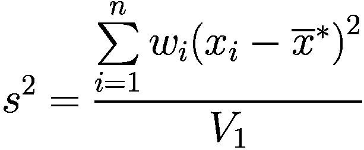

其无偏版本如下：

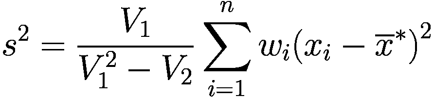

其中：

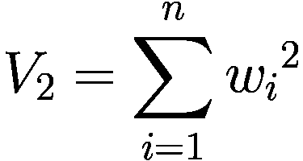

在 NM Dev 中，`WeightedVariance`类用于计算数据集的加权样本方差。以下代码计算了第 12.2.2 节中学生成绩示例的加权样本方差：

```kotlin

// 样本数据集

val X2: DoubleArray = doubleArrayOf(82.0, 94.0, 90.0, 83.0, 87.0)

val W2: DoubleArray = doubleArrayOf(1.0, 4.0, 8.0, 4.0, 4.0)

// 计算有偏和无偏的方差与标准差

val wvar1: WeightedVariance = WeightedVariance(

    X2, // 数据

    W2, // 权重

    false) // 有偏

println("样本加权标准差（有偏） = " + wvar1.stdev())

println("样本加权方差（有偏） = " + wvar1.value())

val wvar2: WeightedVariance = WeightedVariance(

    X2, // 数据

    W2, // 权重

    false) // 无偏

println("样本标准差（无偏） = " + wvar2.stdev())

println("样本方差（无偏） = " + wvar2.value())

```

输出结果如下：

```

sample weighted standard deviation (biased) = 3.849787225030045

sample weighted variance (biased) = 14.820861678004535

sample standard deviation (unbiased) = 3.849787225030045
```

sample variance (unbiased) = 14.820861678004535

### 12.2.5 偏度

样本偏度是衡量数据关于其均值分布不对称性的指标。偏度值可以为正、零或负。对于单峰分布（只有一个峰的分布），负偏度通常表示尾部在分布的左侧，正偏度表示尾部在右侧。偏度值为零意味着均值两侧的尾部总体上相互平衡。对称分布始终具有零偏度。但对于不对称分布，即使一侧尾部又长又细，另一侧尾部又短又粗，也可能出现零偏度。见图 12-3。

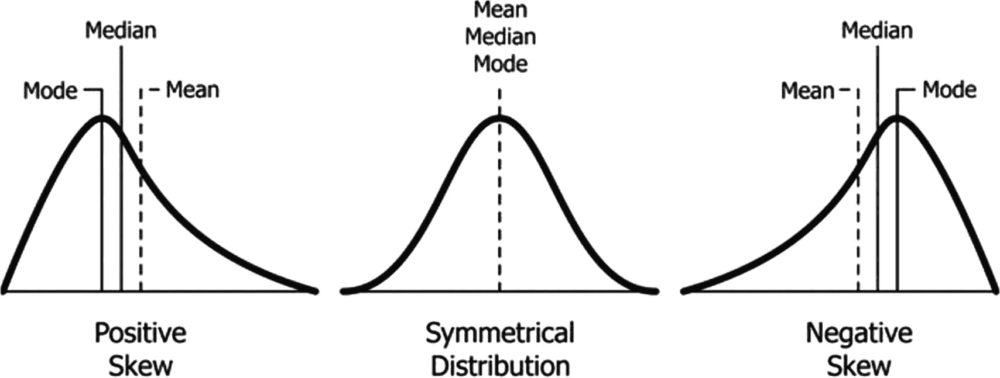

**图 12-3.** 单峰分布中与均值/中位数/众数相关的偏度示例

数学上，样本偏度（或 Fisher-Pearson 偏度系数）定义如下：

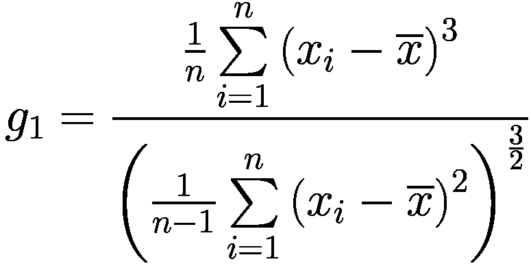

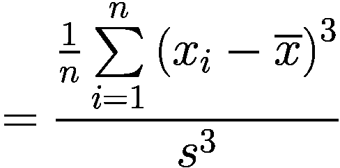

其中 `s` 是使用 `n` 而非 (`n` − 1) 计算得出的样本标准差。

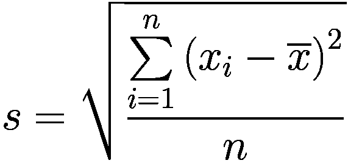

调整后的 Fisher-Pearson 偏度系数定义如下：

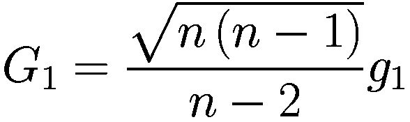

对于样本 `X` = {1, 1, 2, 1, 2, 3, 2, 1, 0} 和样本均值 `x̄ = 1.4444`，样本偏度计算如下：

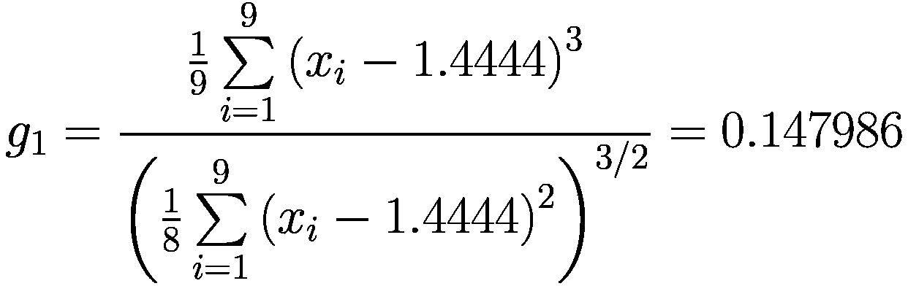

在 NM Dev 中，`Skewness` 类用于计算数据集的样本偏度。以下代码计算了前述示例的样本偏度：

```kotlin
// 样本数据的偏度
val X3: DoubleArray = doubleArrayOf(1.0, 1.0, 1.0, 1.0, 2.0, 2.0, 2.0, 3.0, 0.0)
val skew: Skewness = Skewness(X3)
println("样本偏度 = " + skew.value())
```

输出结果如下：

```
sample skewness = 0.14798608996128484
```

### 12.2.6 峰度

样本峰度是衡量分布“尾部”程度的指标。标准正态分布的峰度为 3。通常会将分布的峰度与此值进行比较。峰度小于 3 的分布被称为**薄尾**分布。这意味着该分布产生的异常值比正态分布更少，且极端程度更低。薄尾分布的一个例子是均匀分布，它不产生异常值。峰度大于 3 的分布被称为**厚尾**或**肥尾**分布。肥尾分布的一个例子是拉普拉斯分布，其尾部渐近趋近于零的速度比高斯分布慢，因此产生的异常值比正态分布更多。我们通常使用超额峰度（定义为峰度 `κ` 减去 3）来与标准正态分布进行比较。数学上，样本超额峰度定义如下：

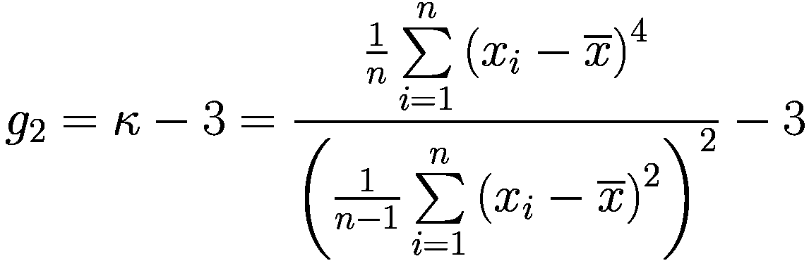

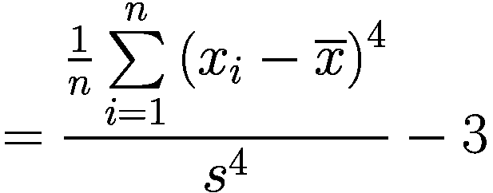

1986 年，Moors 给出了对峰度的一种解释。将 z 分数定义如下：

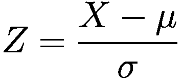

其中 `X` 是随机变量，`μ` 是均值，`σ` 是标准差。z 分数将随机变量或数据标准化，使其以 `σ` 的单位来度量。z 分数常用于比较不同分布的随机变量，使其具有“相同”的单位。

根据峰度的定义和恒等式，我们得到：

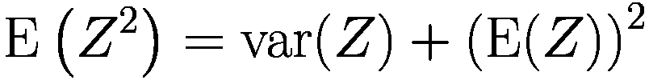

![ $$ \kappa =\textrm{E}\left({Z}⁴\right)=\operatorname{var}\left({Z}²\right)+{\left[\textrm{E}\left({Z}²\right)\right]}² $$ ](images/528380_1_En_12_Chapter/528380_1_En_12_Chapter_TeX_Equx.png)

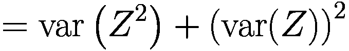

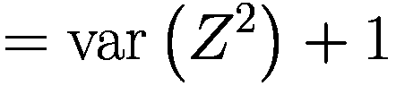

现在，峰度可以被视为度量 `Z²` 围绕其期望值的离散程度的指标。或者，也可以将其视为度量 `Z` 围绕 +1 和 -1 离散程度的指标。`κ` 在对称的两点分布中达到最小值。就原始变量 `X` 而言，峰度是度量 `X` 围绕两个值 `μ ± σ` 离散程度的指标。

在以下两种情况下，`κ` 的值较高：

*   概率质量集中在均值附近，且分布偶尔会产生远离均值的值。
*   概率质量集中在分布的尾部。

图 12-4 展示了低峰度与高峰度的差异。左侧分布的峰度大于右侧分布，因为左侧分布的数据扩展（或分散）到更广的范围，即存在更多异常值和极端样本。

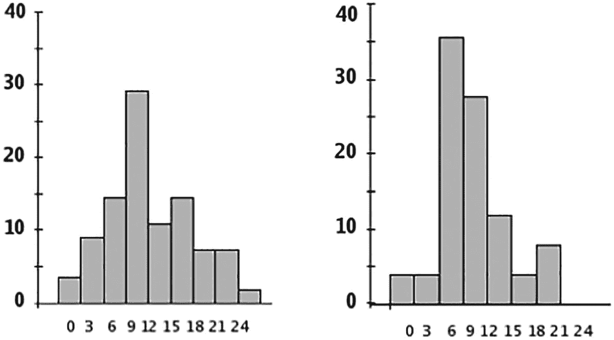

两张柱状图，肥尾分布的范围从 0 到 30，而薄尾分布的范围从 0 到 24。

**图 12-4** 肥尾分布与薄尾分布

对于样本 `X = {1, 1, 2, 1, 2, 3, 2, 1, 0}`，样本峰度计算如下：

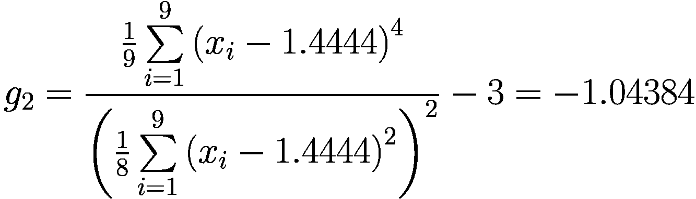

在 NM Dev 中，`Kurtosis` 类用于计算数据集的样本峰度。以下代码计算了前面示例的样本峰度：

```kotlin
// Kurtosis of the sample data
val X3: DoubleArray = doubleArrayOf(1.0, 1.0, 1.0, 1.0, 2.0, 2.0, 2.0, 3.0, 0.0)
val kur: Kurtosis = Kurtosis(X3)
println("sample kurtosis = " + kur.value())
```

输出结果如下：

```
sample kurtosis = -1.043839758125472
```

### 12.2.7 矩

均值、方差、偏度和峰度是通过以特定（非线性）方式组合数据来审视数据的方法。我们可以将这些概念扩展到更高阶的矩。从数学上讲，对于所有的 `k`，第 `k` 阶原始样本矩定义如下：

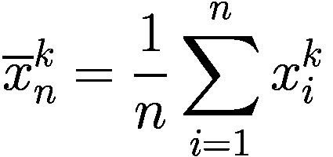

显而易见，一阶样本矩就是样本均值。

可以证明，对于任意样本量 `n`，如果该矩存在，那么原始样本矩的期望值等于总体的第 `k` 阶原始矩。因此，它是一个无偏估计量。

第 `k` 阶中心样本矩定义如下：

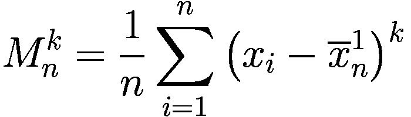

其中 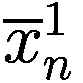 或简写为 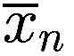 是平均值，即一阶原始样本矩。

显而易见，一阶样本中心矩 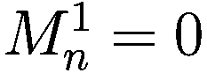。

同样地，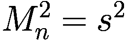，即未修正的样本方差。

高阶矩是指四阶以上的矩。与方差、偏度和峰度一样，这些是数据的非线性组合，属于高阶统计量。它们可用于描述或估计形状参数。阶数越高，估计就越困难，因为需要更大的样本来获得同等质量的估计值。这是由于高阶矩消耗了过多的自由度。此外，它们可能难以理解。一种解释高阶矩的方法是用低阶矩来讨论它们。例如，四阶矩（峰度）可以解释为“尾部与肩部在引起离散程度方面的相对重要性”（在给定离散程度下，高峰度对应厚尾，而低峰度对应宽肩）。五阶矩可以解释为衡量“尾部与中心（众数、肩部）在引起偏斜方面的相对重要性”。（在给定偏度下，高五阶矩对应厚尾且众数变动小，而低五阶矩对应肩部变化更大。）

在 NM Dev 中，`Moments` 类用于计算数据集的样本矩。示例如下：

```kotlin
// 样本数据集
val X4: DoubleArray = doubleArrayOf(1.0, 1.0, 1.0, 1.0, 2.0, 2.0, 2.0, 3.0, 0.0)

// 计算数据集的矩
val moments: Moments = Moments(6) // 最高计算到六阶矩

// 使用 R 中的 rexp 函数生成的数据，λ = 1
val values: DoubleArray = doubleArrayOf(
    1.050339964176429, 0.906121669295144, 0.116647826876888,
    4.579895872370673, 1.714264543643022, 0.436467861756682,
    0.860735191921604, 1.771233864044571, 0.623149028640023,
    1.058291583279980
)
for (i in 0 until values.size) {
    moments.addData(values[i])
}
println("样本大小 = " + moments.N())
println("一阶中心矩 = " + moments.centralMoment(1)) // 正常
println("二阶中心矩 = " + moments.centralMoment(2)) // 正常
println("三阶中心矩 = " + moments.centralMoment(3)) // 偏差，数据不足
println("四阶中心矩 = " + moments.centralMoment(4)) // 偏差较大，数据不足
println("五阶中心矩 = " + moments.centralMoment(5)) // 无意义，数据不足
println("六阶中心矩 = " + moments.centralMoment(6)) // 无意义，数据不足
```

输出如下：

```
样本大小 = 10
一阶中心矩 = 1.3117147406005016
二阶中心矩 = 1.422300520892388
三阶中心矩 = 3.217342528890056
四阶中心矩 = 11.708334307448762
五阶中心矩 = 36.97401011137275
六阶中心矩 = 122.20276981014138
```

### 12.2.8 秩

秩是对一组项目进行排序，使得对于任意两个项目，第一个要么“排名高于”、要么“排名低于”、要么“排名等于”第二个。如果排名中允许出现并列，则该排名称为弱序。否则，如果没有并列，则称为全序。通过将详细度量值简化为有序数列，排名使得根据特定标准评估复杂信息成为可能。例如，互联网搜索引擎可能会根据对其相关性的估计对其找到的页面进行排名，使用户能够快速选择他们可能希望看到的页面。在统计学中，秩是一种数据转换，即在数据排序后为其分配数值或有序值。例如，假设观测到数值数据 3.4、5.1、2.6 和 7.3。对这些数据项进行排序后，它们的秩分别是 2、3、1 和 4。再举一个例子，有序数据 hot、cold、warm 将被替换为 3、1、2。在这些示例中，秩是按升序分配给值的。（在其他一些情况下，会使用降序排名。）

在 NM Dev 中，`Rank` 类用于对一组数据进行秩排序。它返回这些值的样本秩。有多种方法可以处理并列（即相等值）和缺失值。`FIRST` 方法在对每个并列索引集赋值时，按值递增顺序进行排列，类似地，`LAST` 方法则按值递减顺序。`RANDOM` 方法将这些并列值随机排序，而默认方法 `AVERAGE` 则用它们的平均值替换，`MAX` 和 `MIN` 分别用它们的最大值和最小值替换，后者是典型的体育排名方法。`AS_26` 方法遵循 Freeman（1970）的方法来打破平局。它为每个重复项的秩加上 0.5。这是我们的默认实现。

示例如下：

```kotlin
val x: DoubleArray = doubleArrayOf(3.0, 1.0, 4.0, 1.0, 5.0, 9.0, 2.0, 6.0, 5.0, 3.0, 5.0)
println("排名数据: " + Arrays.toString(x))
var rank: Rank = Rank(x, Rank.TiesMethod.AS_26) // 默认实现
println("AS_26 秩: " + Arrays.toString(rank.ranks()))
rank = Rank(x, Rank.TiesMethod.AVERAGE)
println("AVERAGE 秩: " + Arrays.toString(rank.ranks()))
rank = Rank(x, Rank.TiesMethod.FIRST)
println("FIRST 秩: " + Arrays.toString(rank.ranks()))
rank = Rank(x, Rank.TiesMethod.LAST)
println("LAST 秩: " + Arrays.toString(rank.ranks()))
rank = Rank(x, Rank.TiesMethod.MAX)
println("MAX 秩: " + Arrays.toString(rank.ranks()))
rank = Rank(x, Rank.TiesMethod.MIN)
println("MIN 秩: " + Arrays.toString(rank.ranks()))
rank = Rank(x, Rank.TiesMethod.RANDOM)
println("RANDOM 秩: " + Arrays.toString(rank.ranks()))
```

输出如下：

```
排名数据: [3.0, 1.0, 4.0, 1.0, 5.0, 9.0, 2.0, 6.0, 5.0, 3.0, 5.0]
AS_26 秩: [4.5, 1.5, 6.0, 1.5, 8.0, 11.0, 3.0, 10.0, 8.0, 4.5, 8.0]
AVERAGE 秩: [4.5, 1.5, 6.0, 1.5, 8.0, 11.0, 3.0, 10.0, 8.0, 4.5, 8.0]
FIRST 秩: [4.0, 1.0, 6.0, 2.0, 7.0, 11.0, 3.0, 10.0, 8.0, 5.0, 9.0]
```

# LAST, MAX, MIN, RANDOM 秩

LAST 秩: [5.0, 2.0, 6.0, 1.0, 9.0, 11.0, 3.0, 10.0, 8.0, 4.0, 7.0]

MAX 秩: [5.0, 2.0, 6.0, 2.0, 9.0, 11.0, 3.0, 10.0, 9.0, 5.0, 9.0]

MIN 秩: [4.0, 1.0, 6.0, 1.0, 7.0, 11.0, 3.0, 10.0, 7.0, 4.0, 7.0]

RANDOM 秩: [4.0, 1.0, 6.0, 2.0, 9.0, 11.0, 3.0, 10.0, 7.0, 5.0, 8.0]

# 分位数

## 定义与理论

`q`-分位数是将一个有限且有序的数据集划分成`q`个（近乎）等长子集的值。这些分位数就是标记连续子集之间边界的数据值。`q`-分位数共有 `q` − 1 个，每个对应一个满足 0 < `k` < `q` 的整数 `k`。将数据视为来自某个随机变量的样本，则一个随机变量的第 `k` 个 `q`-分位数是这样一个值 `x`：样本或随机变量小于 `x` 的概率至多为 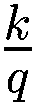，而样本或随机变量大于 `x` 的概率至多为 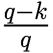。最小的观测值对应概率 0，最大的观测值对应概率 1。

分位数也可以应用于连续分布（见第 12.3 节和第 12.3.1 节），这提供了一种将秩统计量推广到连续变量的方法。当已知一个随机变量的累积分布函数时，`q`-分位数就是将分位数函数（累积分布函数 CDF 的反函数）应用于值集 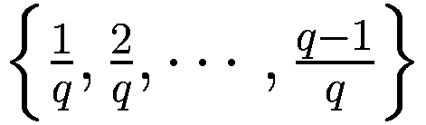 的结果。

## 在 NM Dev 中的实现

在 NM Dev 中，类 `Quantile` 用于计算数据集的分位数。如 Hyndman & Fan (1996) 所述，共有九种不同的分位数定义和实现。简要说明如下。默认实现是 `APPROXIMATELY_MEDIAN_UNBIASED`。

1.  `INVERSE_OF_EMPIRICAL_CDF`：经验分布函数的逆函数。
2.  `INVERSE_OF_EMPIRICAL_CDF_WITH_AVERAGING_AT_DISCONTINUITIES`：经验分布函数的逆函数，在不连续点处取平均。
3.  `NEAREST_EVEN_ORDER_STATISTICS`：如 SAS 中的最近偶数阶统计量。
4.  `LINEAR_INTERPOLATION_OF_EMPIRICAL_CDF`：经验 CDF 的线性插值。
5.  `MIDWAY_THROUGH_STEPS_OF_EMPIRICAL_CDF`：一种分段线性函数，其节点位于经验 CDF 各步进的中点上。
6.  `MINITAB_SPSS`：Minitab 和 SPSS 中的定义。
7.  `S`：S 语言中的定义。
8.  `APPROXIMATELY_MEDIAN_UNBIASED`：无论样本分布如何，得到的分位数估计值都近似中位数无偏。
9.  `APPROXIMATELY_UNBIASED_IF_DATA_IS_NORMAL`：如果样本服从正态分布，则所得的分位数估计值对于期望次序统计量近似无偏。

## 示例

示例如下：

```kotlin
println("Quantiles")

val x: DoubleArray = doubleArrayOf(0.0, 1.0, 2.0, 3.0, 3.0, 3.0, 6.0, 7.0, 8.0, 9.0) // with repeated observations

val qs: DoubleArray = doubleArrayOf(1e-10, 0.1, 0.15, 0.2, 0.3, 0.4, 0.5, 0.6, 0.7, 0.8, 0.9, 0.95, 1.0) // qu

println("APPROXIMATELY_MEDIAN_UNBIASED")

val stat1: Quantile = Quantile(
    x,
    Quantile.QuantileType.APPROXIMATELY_MEDIAN_UNBIASED
)

println("\nnumber of samples = " + stat1.N())

for (q in qs) {
    println(String.format("Q(%f) = %f", q, stat1.value(q)))
}

println("\nthe median = " + stat1.value(0.5))
println("the 100% quantile = " + stat1.value(1.0))
println("the maximum = " + Max(x).value())
```

输出结果如下：

```
APPROXIMATELY_MEDIAN_UNBIASED
number of samples = 10
Q(0.000000) = 0.000000
Q(0.100000) = 0.366667
Q(0.150000) = 0.883333
Q(0.200000) = 1.400000
Q(0.300000) = 2.433333
Q(0.400000) = 3.000000
Q(0.500000) = 3.000000
Q(0.600000) = 4.600000
Q(0.700000) = 6.566667
Q(0.800000) = 7.600000
Q(0.900000) = 8.633333
Q(0.950000) = 9.000000
Q(1.000000) = 9.000000
the median = 3.0
the 100% quantile = 9.0
the maximum = 9.0
```

示例如下：

```kotlin
println("NEAREST_EVEN_ORDER_STATISTICS")

val stat2: Quantile = Quantile(
    x,
    Quantile.QuantileType.NEAREST_EVEN_ORDER_STATISTICS)

println("\nnumber of samples = " + stat2.N())

for (q in qs) {
    println(String.format("Q(%f) = %f", q, stat2.value(q)))
}

println("\nthe median = " + stat2.value(0.5))
println("the 1e-10 quantile = " + stat2.value(1e-10))
println("the minimun = " + Min(x).value())
```

输出结果如下：

```
NEAREST_EVEN_ORDER_STATISTICS
number of samples = 10
Q(0.000000) = 0.000000
Q(0.100000) = 0.000000
Q(0.150000) = 1.000000
Q(0.200000) = 1.000000
Q(0.300000) = 2.000000
Q(0.400000) = 3.000000
Q(0.500000) = 3.000000
Q(0.600000) = 3.000000
Q(0.700000) = 6.000000
Q(0.800000) = 7.000000
Q(0.900000) = 8.000000
Q(0.950000) = 9.000000
Q(1.000000) = 9.000000
the median = 3.0
the 1e-10 quantile = 0.0
the minimun = 0.0
```

# 中位数

数据集的中位数定义为：不超过一半的数据值大于它，同时也不超过一半的数据值小于它。虽然算术平均数常用于报告集中趋势，但它不是一个稳健的统计量，意味着它极易受异常值（即远大于或远小于大多数数据值）的影响。对于偏态分布，例如收入分布（少数人的收入远高于大多数人），算术平均数可能与人们通常理解的“中间值”不符，而稳健统计量（如中位数）则能更好地描述集中趋势。从数学上讲，中位数就是 50% 分位数，即 `Q(0.5)`。见图 12-5。

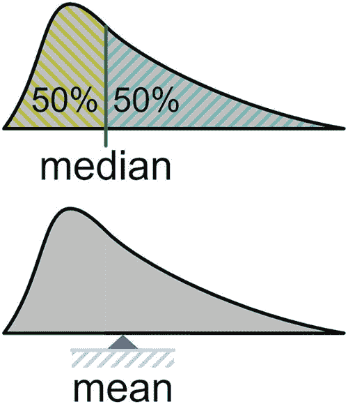

中位数和平均数的两条概率分布曲线。在中位数概率分布中，50% 的区域被阴影覆盖。

**图 12-5** 概率分布中中位数与平均数的比较

## 示例

示例如下：

```kotlin
val x: DoubleArray = doubleArrayOf(0.0, 1.0, 2.0, 3.0, 3.0, 3.0, 6.0, 7.0, 8.0, 9.0) // with repeated observations
```


```kotlin
println("APPROXIMATELY_MEDIAN_UNBIASED")

val stat1: Quantile = Quantile(
    x,
    Quantile.QuantileType.APPROXIMATELY_MEDIAN_UNBIASED
);
println("the median = " + stat1.value(0.5));

println("NEAREST_EVEN_ORDER_STATISTICS");
val stat2: Quantile = Quantile(
    x,
    Quantile.QuantileType.NEAREST_EVEN_ORDER_STATISTICS
);
println("the median = " + stat2.value(0.5));
```

输出结果如下：
```
APPROXIMATELY_MEDIAN_UNBIASED
the median = 3.0
NEAREST_EVEN_ORDER_STATISTICS
the median = 3.0
```

## 最大值和最小值

最大值是数据集中的最大值，而最小值是数据集中的最小值。从数学上讲，它们分别等同于 100% 分位数和最小分位数（例如 1e-10% 分位数），即 `Q(1)` 和 `Q(1e-10)`。但结果可能受所使用的插值方法影响。在 NM Dev 中，`Max` 和 `Min` 类分别用于计算最大值和最小值。示例如下：

```kotlin
val x: DoubleArray = doubleArrayOf(0.0, 1.0, 2.0, 3.0, 3.0, 3.0, 6.0, 7.0, 8.0, 9.0) // with repeated observations

println("APPROXIMATELY_MEDIAN_UNBIASED");
val stat1: Quantile = Quantile(
    x,
    Quantile.QuantileType.APPROXIMATELY_MEDIAN_UNBIASED
);
println("the 100% quantile = " + stat1.value(1.0));
println("the maximum = " + Max(x).value());

println("NEAREST_EVEN_ORDER_STATISTICS");
val stat2: Quantile = Quantile(
    x,
    Quantile.QuantileType.NEAREST_EVEN_ORDER_STATISTICS
);
println("the 1e-10 quantile = " + stat2.value(1e-10));
println("the minimun = " + Min(x).value());
```

输出结果如下：
```
APPROXIMATELY_MEDIAN_UNBIASED
the 100% quantile = 9.0
the maximum = 9.0
NEAREST_EVEN_ORDER_STATISTICS
the 1e-10 quantile = 0.0
the minimun = 0.0
```

### 12.2.9 协方差

`协方差`是衡量两个样本或两个随机变量联合变异性的指标。如果一个样本/变量的大值对应另一个样本/变量的大值，且小值也如此（即变量趋向表现出相似行为），则协方差为正。见图 12-6。

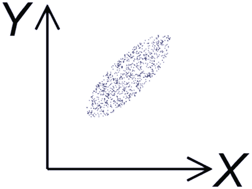
`y`对`x`的坐标轴呈现椭圆形状，显示正协方差。
**图 12-6** 正协方差

在相反情况下，当一个样本/变量的大值通常对应另一个样本/变量的小值时（即变量趋向表现出相反行为），协方差为负。见图 12-7。

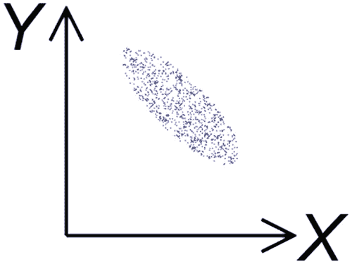
`y`对`x`的坐标轴呈现椭圆形状，显示负协方差。
**图 12-7** 负协方差

类似地，如果一个样本/变量中的值无法预测另一个样本/变量中的值，则协方差为零。见图 12-8。

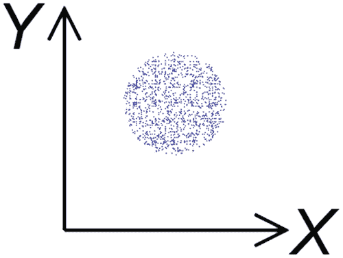
`y`对`x`的坐标轴呈现圆形形状，显示零协方差。
**图 12-8** 零协方差

因此，协方差的符号显示了变量之间线性关系的趋势。协方差的幅度不易解释，因为它未经归一化，因此取决于变量的量级。然而，归一化后的协方差版本——称为相关系数——则通过其幅度显示线性关系的强度。

#### 样本协方差

从数学上讲，两个样本 `X` 和 `Y` 的样本协方差如下：
```
$$ \operatorname{cov}\left(X,Y\right)=\textrm{E}\left(X-\textrm{E}(X)\right)\textrm{E}\left(Y-\textrm{E}(Y)\right) $$
```
```
$$ =\frac{1}{N-1}\sum \limits_{i=1}^N\left({X}_i-\overline{X}\right)\left({Y}_i-\overline{Y}\right) $$
```
`$$ \overline{X} $$` 是 `X` 的样本均值。`$$ \overline{Y} $$` 是 `Y` 的样本均值。此处我们使用 `N` − 1 而非 `N` 作为分母，以使估计量无偏，因为我们在计算中使用了样本均值而非总体均值。如果总体均值已知，则无偏估计量如下：
```
$$ \operatorname{cov}\left(X,Y\right)=\frac{1}{N}\sum \limits_{i=1}^N\left({X}_i-\textrm{E}(X)\right)\left({Y}_i-\textrm{E}(Y)\right) $$
```
样本方差是协方差的一个特例，其中两个样本/变量完全相同（即一个变量始终与另一个变量取相同值）：
```
$$ \operatorname{var}(X)=\operatorname{cov}\left(X,X\right)={\sigma}²(X)={\sigma}_X² $$
```
样本标准差是 `var(X)` 的平方根。
```
$$ {\sigma}_X=\sqrt{\sigma_X²} $$
```

#### 相关

两个样本的相关系数定义为协方差除以其标准差的乘积。样本相关也称为斯皮尔曼等级相关。它本质上是协方差的归一化度量，因此结果始终介于 −1 和 1 之间。与协方差本身一样，该度量只能反映变量的线性相关，而忽略许多其他类型的关系或相关。见图 12-9。
```
$$ \textrm{corr}\left(X,Y\right)={\rho}_{XY}=\frac{\operatorname{cov}\left(X,Y\right)}{\sigma_X{\sigma}_Y} $$
```

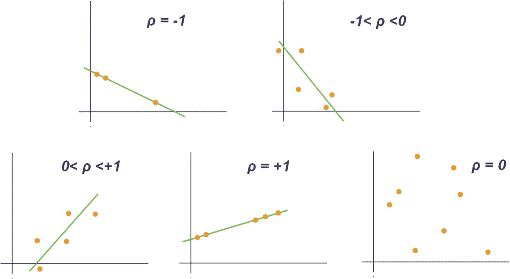
不同相关系数值对应的五个散点图。这些值分别为 -1、介于 -1 和 0 之间、介于 0 和 1 之间、1 以及 0。
**图 12-9** 不同相关系数值的散点图示例

在 NM Dev 中，`SpearmanRankCorrelation` 类用于计算两个样本集之间的样本相关。示例如下：
```kotlin
// 样本数据集
val X5: DoubleArray = doubleArrayOf(106.0, 86.0, 100.0, 101.0, 99.0, 103.0, 97.0, 113.0, 112.0, 110.0)
val X6: DoubleArray = doubleArrayOf(7.0, 0.0, 27.0, 50.0, 28.0, 29.0, 20.0, 12.0, 6.0, 17.0)

// 计算数据集的样本相关
println("样本相关 = " + SpearmanRankCorrelation(X5, X6).value())
```

输出如下：
```
样本相关 = -0.17575757575757575
```


# 协方差矩阵与相关矩阵

对于两个以上的样本，协方差矩阵是一个方阵，给出了每对样本之间的协方差。任何协方差矩阵都是对称且半正定的。其主对角线上的元素是各样本的方差。直观地说，协方差矩阵将方差的概念推广到了多维。例如，二维空间中一组随机样本的变异，既不能用一个单一数值完全表征，仅用 `x` 和 `y` 方向的方差也无法包含所有必要信息；要完整描述二维变异，需要用一个包含协方差和方差的 2 × 2 矩阵。

在数学上，对于一个由多个随机变量组成的列向量 `X = (X[1], X[2], ..., X[n])^T`，假设每个变量都有有限的方差和期望值 `E(X[i])`，那么协方差矩阵 `S[X]` 是一个矩阵，其 `(i, j)` 位置的元素是协方差 `cov(X[i], X[j])`。即：

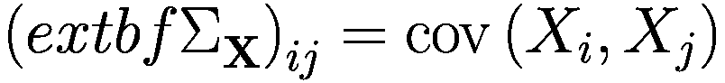

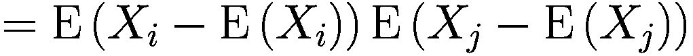

其对角线元素为 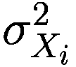。

类似地，相关矩阵是一个矩阵，其 `(i, j)` 位置的元素是相关系数 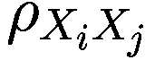。其对角线元素均为 1。相关矩阵必然是一个对称且半正定的矩阵。此外，如果没有任何变量能完全由其他变量的值线性生成其所有值，那么该相关矩阵是严格正定的。

例如，假设我们有五个数据集。
`X[1]` = {1.4022225, –0.2230975, 0.6939930, 0.6939930, 0.6939930, –2.5275280}
`X[2]` = {–0.04625344, 0.91561987, 1.94611387, 0.18818663, –0.10749210, 0.64942255}
`X[3]` = {1.26176112, 1.17086252, –0.82939259, –0.29040783, 3.27376532, 0.07506224}
`X[4]` = {–1.8394428, 0.2282348, 1.0905923, 0.6937185, 0.5141217, –1.0787524}
`X[5]` = {0.7182637, 0.0690674, 0.1458883, 0.4664052, 0.7691778, 1.6217606}

样本协方差如下：
![ $$ {\varSigma}_X=\left[\begin{array}{ccccc}1.891462&amp; -0.094053&amp; 0.665669&amp; 0.176962&amp; -0.487023\\ {}-0.094053&amp; 0.600273&amp; -0.742584&amp; 0.404512&amp; -0.173547\\ {}0.665669&amp; -0.742584&amp; 2.167306&amp; -0.250672&amp; 0.085099\\ {}0.176962&amp; 0.404512&amp; -0.250672&amp; 1.301751&amp; -0.385892\\ {}-0.487023&amp; -0.173547&amp; 0.085099&amp; -0.385892&amp; 0.317301\end{array}\right] $$ ](images/528380_1_En_12_Chapter/528380_1_En_12_Chapter_TeX_Equal.png)

请注意，每个样本集（或每个变量）按列排列。共有五列，对应五个变量。每个集有六个样本/观测值/数值。每一行是五个变量的一次观测。例如，行中的数值，如 {1.4022225, −0.04625344, 1.26176112, −1.8394428, 0.7182637}，被认为是一次共同观测。因此，数值的顺序非常重要。由此得到的协方差矩阵是一个 5 × 5 矩阵。

在 NM Dev 中，`SampleCovariance` 类用于计算数据集的样本协方差。以下代码重现了上述示例：

```
// each column is a sample set there are 5 data sets
val X7: Matrix = DenseMatrix(
    arrayOf(
        doubleArrayOf(1.4022225, -0.04625344, 1.26176112, -1.8394428, 0.7182637),
        doubleArrayOf(-0.2230975, 0.91561987, 1.17086252, 0.2282348, 0.0690674),
        doubleArrayOf(0.6939930, 1.94611387, -0.82939259, 1.0905923, 0.1458883),
        doubleArrayOf(-0.4050039, 0.18818663, -0.29040783, 0.6937185, 0.4664052),
        doubleArrayOf(0.6587918, -0.10749210, 3.27376532, 0.5141217, 0.7691778),
        doubleArrayOf(-2.5275280, 0.64942255, 0.07506224, -1.0787524, 1.6217606)
    )
)
// compute the sample covariance of the data sets
val cov: Matrix = SampleCovariance(X7) // a 5x5 matrix
println("\nsample covariance =")
println(cov)
```

输出如下：

```
sample covariance =
5x5
[,1]       [,2]       [,3]       [,4]       [,5]
[1,]  1.891462,  -0.094053,   0.665669,   0.176962,  -0.487023,
[2,] -0.094053,   0.600273,  -0.742584,   0.404512,  -0.173547,
[3,]  0.665669,  -0.742584,   2.167306,  -0.250672,   0.085099,
[4,]  0.176962,   0.404512,  -0.250672,   1.301751,  -0.385892,
[5,] -0.487023,  -0.173547,   0.085099,  -0.385892,   0.317301,
```

#### Ledoit-Wolf 线性收缩估计

本节内容基于 Ledoit & Wolf (2004) 的研究，该研究提出了一种比`样本协方差矩阵`更优的协方差矩阵估计量。许多现实问题（而非教科书中的理论问题）都需要估计协方差矩阵或其逆矩阵，其中矩阵维度`p`相对于样本量`n`较大。例如：从大量股票中选取均值-方差有效投资组合、对大型截面数据进行广义最小二乘（GLS）回归，以及在矩条件数量众多时，为广义矩方法选择最优权重矩阵。在这些情境下，通常使用的估计量——即`样本协方差矩阵`——表现欠佳。当矩阵维度`p`大于可用观测数量`n`（`p / n > 1`）时，`样本协方差矩阵`甚至不可逆。这种情况经常发生，例如在估计 3000 只股票的协方差矩阵时，若没有足够的数据进行估计：十年数据仅有 2500 个交易日，或者更糟，仅有 120 个月度数据。这样估计出的日度或月度协方差矩阵不可逆，所有需要计算逆矩阵的投资组合优化算法都将失效。

当比值`p / n < 1`但不可忽略时，`样本协方差矩阵`虽可逆，但可能在数值上呈现病态。（若矩阵的条件数非常大，则称该矩阵为病态矩阵。实际上，这样的矩阵近乎奇异，其逆矩阵的计算或线性方程组的求解极易产生巨大数值误差。不可逆矩阵的条件数为无穷大。）这意味着求逆过程会急剧放大估计误差。对于较大的`p`，很难获取足够多的观测值（大`n`）使`p / n`趋近于 0，因此开发一种适用于高维协方差矩阵的良态估计量至关重要。

如果必须得到一个良态估计量，我们可以对协方差矩阵施加某种特定的结构（如对角性、稀疏性、图模型或因子模型）来强制其良态。然而，在缺乏关于矩阵真实结构的先验信息时，这种人为设定的结构通常会被错误指定，导致估计量严重偏离真实协方差矩阵，甚至可能面目全非。在 Ledoit & Wolf (2004) 之前，没有任何一种估计量能同时满足良态且比`样本协方差矩阵`更准确的要求。

2003 年，Ledoit & Wolf (2003, 2004) 提出了一种渐近兼具这两种特性的估计量。获得良态结构化估计量的一种方法是施加所有方差相等且所有协方差为零的条件。他们推荐的估计量是该结构化估计量与`样本协方差矩阵`的加权平均。这种估计量确保加权平均后的结果比单独使用任何一个估计量都更准确。这种新估计方法倾向于将最极端的系数拉向更居中的值（因此被称为“收缩”），从而系统性地减少关键处的估计误差。

大量研究表明：(i) 即使观测值和变量数量非常少，新估计量通常也远优于`样本协方差矩阵`；(ii) 当变量和观测值至少达到十个时，其精度与有限样本决策理论中提出的某些估计量相当或显著更高；(iii) 其条件性质优于真实协方差矩阵；(iv) 当观测值和变量数量至少达到 20 个时，渐近特性可作为有限样本行为的良好近似。图 12-10 比较了线性收缩协方差矩阵`S*`与`样本协方差矩阵`的条件数（衡量矩阵对数据微小变化的不稳定程度，数值越小越好）。

展示随着变量与观测值比值变化，`S`、`σ`和`S*`的条件数随`p`与`n`关系上升的图表。

**图 12-10** Ledoit-Wolf 2004 方法所得矩阵与`样本协方差矩阵`的条件数对比（图片来源：Ledoit & Wolf, 2004）

在 NM Dev 中，`LedoitWolf2004`类用于计算这种线性收缩协方差矩阵估计量。以下是一个示例：

```kotlin
// 以下是 2012 年 8 月 20 日至 2013 年 1 月 15 日期间（即 100 天回报率）的股票回报数据，涉及微软（MSFT）、雅虎（YHOO）、谷歌（GOOG）、苹果（AAPL）、摩根士丹利（MS）和埃克森美孚（XOM）。
val X: Matrix = DenseMatrix(
    arrayOf(
        doubleArrayOf(0.001968, 0.000668, -0.008926, -0.013668, 0.004057, -0.005492),
        doubleArrayOf(-0.008511, -0.003340, 0.011456, 0.019523, -0.002020, 0.002991),
        doubleArrayOf(-0.009244, -0.003351, -0.000561, -0.009327, -0.024291, -0.004703),
        doubleArrayOf(0.009997, 0.003362, 0.002704, 0.000879, 0.004149, 0.008413),
        doubleArrayOf(0.004289, -0.004692, -0.013866, 0.018797, -0.002066, -0.003543),
        doubleArrayOf(-0.001971, -0.008754, 0.011999, -0.001308, 0.004831, 0.004129),
        doubleArrayOf(0.000658, 0.008152, 0.015888, -0.001965, 0.014423, -0.002284),
        doubleArrayOf(-0.010855, -0.011456, -0.009200, -0.014260, 0.006093, -0.007899),
        doubleArrayOf(0.016628, -0.001363, 0.005002, 0.002073, 0.006729, 0.001154),
        doubleArrayOf(-0.014066, 0.016382, -0.005912, 0.014617, 0.033422, -0.002075),
        doubleArrayOf(0.000000, 0.013432, -0.000470, -0.007025, 0.010996, 0.002426),
        doubleArrayOf(0.031520, 0.001325, 0.027442, 0.009023, 0.036468, 0.019011),
        doubleArrayOf(-0.012544, 0.007280, 0.009651, 0.006165, 0.051235, 0.010403),
        doubleArrayOf(-0.007492, -0.007227, -0.007619, -0.026013, -0.027598, -0.004924),
        doubleArrayOf(0.002297, 0.003309, -0.012244, -0.003244, 0.038647, 0.001574),
        doubleArrayOf(-0.000327, 0.015831, -0.001893, 0.013914, 0.009884, -0.000786),
        doubleArrayOf(0.005241, 0.012987, 0.021943, 0.019693, 0.027634, 0.018766),
        doubleArrayOf(0.008798, 0.010897, 0.005156, 0.012164, 0.019048, 0.011802),
        doubleArrayOf(0.000000, -0.005707, 0.000423, 0.012294, -0.024189, -0.004252),
        doubleArrayOf(-0.000969, 0.014668, 0.011690, 0.003043, -0.009577, -0.002847),
        doubleArrayOf(-0.004203, -0.003143, 0.012836, 0.000272, -0.003413, -0.011748),
        doubleArrayOf(0.012662, -0.004414, 0.000852, -0.004850, -0.020548, 0.010443),
        doubleArrayOf(-0.008015, -0.003167, 0.008062, 0.001999, -0.007576, 0.004398),
        doubleArrayOf(-0.013251, 0.016518, 0.020968, -0.013287, -0.002349, -0.000438),
        doubleArrayOf(-0.012774, -0.020000, -0.000294, -0.024969, -0.025898, -0.001533),
        doubleArrayOf(-0.007299, -0.004464, 0.005740, -0.012409, -0.010272, -0.005594),
        doubleArrayOf(-0.000334, 0.027546, 0.004035, 0.024254, 0.025031, 0.006287),
        doubleArrayOf(-0.013039, -0.003741, -0.002644, -0.020863, -0.005956, -0.003836),
        doubleArrayOf(-0.009146, -0.009387, 0.009649, -0.011565, 0.002996, 0.003851),
        doubleArrayOf(0.005812, 0.006949, -0.006288, 0.002910, 0.007168, -0.000877),
        doubleArrayOf(0.006798, 0.016939, 0.007279, 0.015343, 0.007117, -0.000219),
        doubleArrayOf(0.005739, 0.003701, 0.007279, -0.006927, 0.025913, 0.005706),
        doubleArrayOf(-0.006042, -0.011063, -0.000521, -0.021318, 0.001722, 0.003492),
        doubleArrayOf(-0.002364, -0.003729, -0.012779, -0.022090, -0.002865, 0.001414),
        doubleArrayOf(-0.016926, -0.011229, -0.018144, -0.003636, -0.005747, -0.005863),
        doubleArrayOf(-0.010331, -0.001262, 0.000632, 0.007963, 0.002890, -0.012014),
        doubleArrayOf(-0.001044, 0.005685, 0.009294, -0.020000, 0.026513, 0.001548),
        doubleArrayOf(0.008708, -0.002513, -0.008956, 0.002575, -0.030882, -0.001545),
        doubleArrayOf(0.010704, -0.012594, -0.005062, 0.008008, 0.025492, 0.005306),
        doubleArrayOf(-0.000683, 0.015306, 0.005020, 0.023692, 0.006780, 0.009567),
        doubleArrayOf(0.003419, 0.010678, 0.014489, -0.007977, 0.034792, 0.010892),
        doubleArrayOf(-0.003066, -0.005594, -0.080067, -0.018576, -0.037961, 0.000970),
        doubleArrayOf(-0.029050, -0.010000, -0.019007, -0.036030, -0.014656, -0.014209),
        doubleArrayOf(-0.022527, -0.004419, -0.004576, 0.039666, -0.004577, 0.000437),
        doubleArrayOf(0.001801, 0.057070, 0.002475, -0.032607, -0.019540, -0.021829),
        doubleArrayOf(-0.005392, -0.007199, -0.004483, 0.005667, 0.004103, -0.003347),
        doubleArrayOf(-0.000723, 0.003625, 0.000679, -0.011824, -0.004670, 0.006158),
        doubleArrayOf(0.011935, 0.010837, -0.003851, -0.009097, -0.003519, 0.002114),
        doubleArrayOf(0.011794, 0.002978, 0.007628, -0.014370, 0.022955, 0.005996),
        doubleArrayOf(0.034264, 0.006532, 0.010716, 0.002059, 0.013234, 0.004746),
        doubleArrayOf(-0.000683, 0.009440, 0.000480, -0.033090, 0.009654, -0.014501),
        doubleArrayOf(0.004443, 0.015196, -0.007210, 0.013550, -0.001687, 0.004013),
        doubleArrayOf(0.007826, 0.005181, -0.001816, -0.003024, 0.024789, 0.010769),
        doubleArrayOf(-0.026334, -0.004009, -0.021416, -0.038263, -0.085761, -0.031415),
        doubleArrayOf(-0.009015, -0.008626, -0.022230, -0.036290, -0.006615, -0.012588),
        doubleArrayOf(0.000700, 0.001160, 0.016465, 0.017313, 0.005448, 0.001608),
        doubleArrayOf(-0.021329, 0.014484, 0.004329, -0.007732, 0.009633, 0.001261),
        doubleArrayOf(-0.032154, 0.019417, -0.010287, 0.000129, -0.014908, -0.009734),
        doubleArrayOf(-0.009228, -0.001120, -0.009863, -0.011089, -0.026029, -0.004626),
        doubleArrayOf(-0.006706, 0.003365, -0.008107, -0.020973, 0.010566, 0.000813),
        doubleArrayOf(-0.005251, -0.001677, -0.000124, 0.003919, -0.004920, 0.003599),
        doubleArrayOf(0.007919, 0.027996, 0.032495, 0.072108, 0.021014, 0.014112),
        doubleArrayOf(-0.000748, -0.006536, 0.002634, -0.008520, -0.010291, -0.001939),
        doubleArrayOf(0.008985, 0.008772, -0.006120, 0.001408, -0.006116, 0.005829),
        doubleArrayOf(0.027829, 0.009239, 0.003154, 0.017447, 0.011077, 0.012271),
        doubleArrayOf(-0.011191, 0.010232, -0.010210, 0.031549, 0.010956, -0.005276),
        doubleArrayOf(-0.011318, 0.009062, 0.014460, -0.008057, 0.001204, -0.014331),
        doubleArrayOf(0.010340, -0.001057, 0.019323, -0.003146, 0.015033, 0.008586),
        doubleArrayOf(-0.014985, -0.002115, 0.012023, 0.011013, -0.001185, 0.000227),
        doubleArrayOf(-0.012245, -0.005299, 0.009366, -0.006923, 0.000593, 0.000227),
        doubleArrayOf(-0.007137, -0.011721, -0.004468, 0.001555, -0.023711, -0.006013),
        doubleArrayOf(-0.002270, 0.020485, -0.006070, -0.017639, 0.008500, -0.004794),
        doubleArrayOf(0.011377, -0.002113, -0.004645, -0.064357, 0.022276, 0.006193),
        doubleArrayOf(0.002250, 0.016411, 0.004812, 0.015683, -0.014134, 0.003078),
        doubleArrayOf(-0.010101, 0.000000, -0.010013, -0.025565, 0.013740, 0.006818),
        doubleArrayOf(0.018141, 0.011979, 0.001768, -0.006432, 0.002357, -0.002144),
        doubleArrayOf(0.014105, 0.004632, 0.016720, 0.021838, 0.043504, 0.006560),
        doubleArrayOf(-0.002928, -0.007172, 0.000976, -0.004415, -0.002817, 0.005169),
        doubleArrayOf(-0.004772, -0.001548, 0.007369, -0.017273, 0.005650, -0.009726),
        doubleArrayOf(-0.011066, 0.014987, -0.001053, -0.037569, 0.014045, -0.005645),
        doubleArrayOf(0.010817, 0.002546, 0.026811, 0.017733, 0.026593, 0.008969),
        doubleArrayOf(0.016974, -0.003555, 0.000402, 0.029046, 0.031840, 0.007764),
        doubleArrayOf(-0.009071, -0.001019, -0.001331, -0.014216, -0.001569, -0.012506),
        doubleArrayOf(0.013548, 0.004592, 0.003125, -0.008702, 0.009429, 0.005088),
        doubleArrayOf(-0.008309, -0.017268, -0.009317, -0.004600, -0.018163, -0.018675),
        doubleArrayOf(-0.014208, 0.015504, -0.008566, 0.001617, 0.001586, -0.003554),
        doubleArrayOf(-0.007391, -0.004071, -0.000888, -0.013784, -0.003694, 0.001726),
        doubleArrayOf(0.003723, 0.001533, -0.003640, 0.004016, -0.005826, -0.002412),
        doubleArrayOf(-0.015208, -0.005102, -0.008892, -0.010620, -0.007991, -0.020262),
        doubleArrayOf(0.006026, 0.020513, 0.010528, 0.044310, 0.026853, 0.017039),
        doubleArrayOf(0.034070, 0.009045, 0.022435, 0.031682, 0.026151, 0.024957),
        doubleArrayOf(-0.013396, -0.014940, 0.000581, -0.012622, -0.002039, -0.001804),
        doubleArrayOf(-0.018716, 0.004044, 0.019760, -0.027855, 0.031154, 0.004630),
        doubleArrayOf(-0.001870, -0.023162, -0.004363, -0.005882, -0.019316, -0.011578),
        doubleArrayOf(-0.005245, 0.013402, -0.001973, 0.002691, -0.007576, 0.006255),
        doubleArrayOf(0.005650, -0.017294, 0.006573, -0.015629, -0.001527, -0.003843),
        doubleArrayOf(-0.008989, -0.017081, 0.004552, 0.012396, 0.036697, 0.010892),
        doubleArrayOf(0.013983, 0.015798, -0.002009, -0.006132, -0.008358, 0.005724),
        doubleArrayOf(0.002236, 0.007258, -0.022622, -0.035653, -0.004958, -0.000335),
        doubleArrayOf(0.011900, 0.004632, 0.002323, -0.031550, 0.017937, -0.000558)
    )
)
// 源自沃尔夫（Wolf）的实现（http://www.econ.uzh.ch/faculty/wolf/publications.xhtml#9）：
// phi = 4.11918014563813e-06
// rho = 2.59272437810913e-06
// gamma = 1.64807384775746e-08
// kappa = 9.26205927972248e+01
// shrinkage = 9.26205927972248e-01
// sigma =
// 1e-4 *
// 1.515632920116000 0.485389976957753 0.569819071905581 0.832527350192132 0.847148840587289
// 0.397609074332363
// 0.485389976957753 1.385321425539000 0.536232629487419 0.789078831932216 0.788206205379818
// 0.348026133393798
// 0.569819071905581 0.536232629487419 1.821791453675000 0.934388133855881 0.952823814063320
// 0.422051935833047
// 0.832527350192132 0.789078831932216 0.934388133855881 3.948763689179000 1.349588317003072
// 0.628591706535889
// 0.847148840587289 0.788206205379818 0.952823814063320 1.349588317003072 3.907173836600000
// 0.644231481562656
// 0.397609074332363 0.348026133393798 0.422051935833047 0.628591706535889 0.644231481562656
// 0.792958306075000
val result: LedoitWolf2004.Result
    = LedoitWolf2004(false).compute(X) // 使用有偏样本（与沃尔夫的代码一致）
// Ledoit-Wolf 线性收缩协方差矩阵
val S_lshrunk: Matrix = result.getCovarianceMatrix()
println("Ledoit-Wolf-2004 线性收缩协方差矩阵为：")
println(S_lshrunk)
// 同样的协方差矩阵
val S: Matrix = SampleCovariance(X)
println("\n 样本协方差 =")
println(S)
```

输出如下：

```
Ledoit-Wolf-2004 收缩协方差矩阵为：
6x6
[,1] [,2] [,3] [,4] [,5] [,6]
[1,] 0.000152, 0.000049, 0.000057, 0.000083, 0.000085, 0.000040,
[2,] 0.000049, 0.000139, 0.000054, 0.000079, 0.000079, 0.000035,
[3,] 0.000057, 0.000054, 0.000182, 0.000093, 0.000095, 0.000042,
[4,] 0.000083, 0.000079, 0.000093, 0.000395, 0.000135, 0.000063,
[5,] 0.000085, 0.000079, 0.000095, 0.000135, 0.000391, 0.000064,
[6,] 0.000040, 0.000035, 0.000042, 0.000063, 0.000064, 0.000079,
样本协方差 =
6x6
[,1] [,2] [,3] [,4] [,5] [,6]
[1,] 0.000153, 0.000028, 0.000050, 0.000065, 0.000091, 0.000063,
[2,] 0.000028, 0.000140, 0.000036, 0.000053, 0.000057, 0.000016,
[3,] 0.000050, 0.000036, 0.000184, 0.000101, 0.000132, 0.000050,
[4,] 0.000065, 0.000053, 0.000101, 0.000399, 0.000122, 0.000083,
[5,] 0.000091, 0.000057, 0.000132, 0.000122, 0.000395, 0.000109,
[6,] 0.000063, 0.000016, 0.000050, 0.000083, 0.000109, 0.000080,
```

我们可以看到，Ledoit-Wolf 线性收缩协方差矩阵与样本协方差矩阵差异很大。

### Ledoit-Wolf 非线性收缩

本节遵循 Ledoit & Wolf (2012) 的研究。在对真实协方差矩阵结构缺乏进一步了解的情况下，迄今为止最成功的方法可以说就是收缩估计。通过取两者的加权平均，将样本协方差矩阵向单位矩阵的倍数收缩，等价于将所有样本特征值线性收缩至其集体均值，同时保留样本特征向量。这种方法行之有效，因为样本协方差矩阵中的样本特征值存在这样的特性：最大的样本特征值系统性偏大，而最小的则系统性偏小。线性收缩方法通过将最大的特征值拉低、将最小的特征值推高（均朝向所有样本特征值的集体均值）来纠正这种偏差。换句话说，它对所有样本特征值应用相同的收缩强度，而不考虑它们的位置。例如，如果线性收缩强度为 0.5，那么每个样本特征值都会被移动至其与所有样本特征值集体均值之间的一半距离处。

根据具体情况，相对于样本协方差矩阵的改进可能非常巨大，也可能微乎其微。当 `p/n` 比值较大和/或总体特征值彼此接近时，线性收缩能捕获相对于样本协方差矩阵的大部分潜在改进。在相反的情况下，即当 `p/n` 比值较小和/或总体特征值分散时，线性收缩相对于样本协方差矩阵几乎没有改进。

Ledoit & Wolf (2016, 2015, 2012) 研究背后的直觉是，当高阶效应过于显著时，一阶近似无法提供足够的改进。改进方案是升级为协方差矩阵的非线性收缩估计。我们不再对所有样本特征值应用相同的收缩强度，而是为每个样本特征值赋予个性化的收缩强度。这种估计量有潜力在渐近意义上至少匹配 Ledoit & Wolf (2004) 的线性收缩估计量，并且通常表现更好，尤其是在线性收缩未能相对于样本协方差矩阵提供足够改进的情况下。事实上，就有限样本性能而言，线性收缩估计量很少优于非线性收缩估计量。只有当线性收缩估计量已经（接近）最优时，这种情况才会发生。然而，正如模拟所示，在这种情况下，非线性收缩估计量的超越幅度非常小。在大多数情况下，线性收缩估计量远非最优，此时非线性收缩能带来相当大的有限样本改进，即使对于矩阵维度低至 `p = 30` 的情况也是如此。由于高阶效应的幅度取决于不可观测的总体协方差矩阵，因此先验地默认使用非线性收缩总是更安全。参见图 12-11。

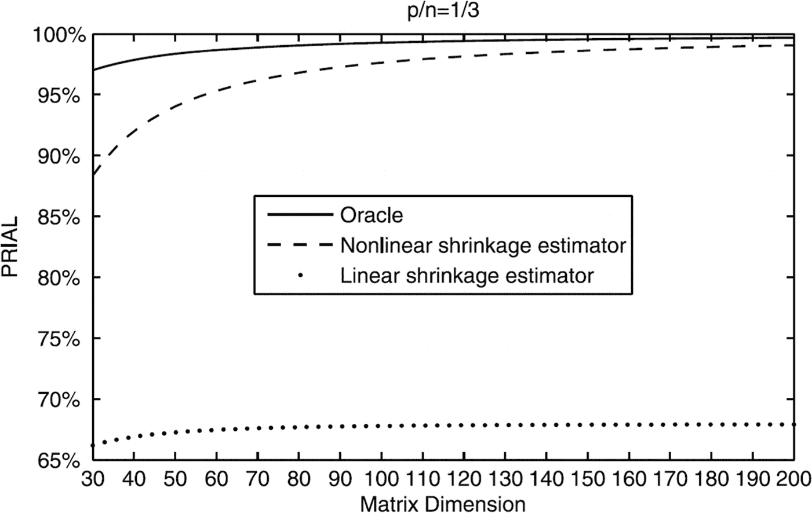

在 `p` 与 `n` 之比为 1 比 3 的条件下，`Oracle` 估计量、非线性收缩估计量和线性收缩估计量的 `PRIAL` 随矩阵维度变化的曲线图。

#### 图 12-11 协方差矩阵的非线性与线性收缩估计量对比

图 12-11 从平均损失的百分比相对改进（`PRIAL`）角度比较了协方差矩阵的非线性和线性收缩估计量的性能。非线性收缩估计量不仅显著优于线性收缩估计量和样本协方差矩阵，而且在渐近意义上等价于一个 `Oracle` 估计量（即只有当我们拥有关于真实总体的全部信息时才能观测到的估计量）。

在 `NM Dev` 中，`LedoitWolf2016` 类用于计算这种非线性收缩协方差矩阵估计量。以下是一个示例：

# 股票收益率数据

以下是 MSFT、YHOO、GOOG、AAPL、MS、XOM 的股票收益率数据，时间跨度从 2012 年 8 月 20 日到 2013 年 1 月 15 日（即 100 天的收益率）。

## 案例 1 n>>p

`n=100`，`p=6`

```kotlin
val X: Matrix = DenseMatrix(
    arrayOf(
        doubleArrayOf(0.001968, 0.000668, -0.008926, -0.013668, 0.004057, -0.005492),
        doubleArrayOf(-0.008511, -0.003340, 0.011456, 0.019523, -0.002020, 0.002991),
        doubleArrayOf(-0.009244, -0.003351, -0.000561, -0.009327, -0.024291, -0.004703),
        doubleArrayOf(0.009997, 0.003362, 0.002704, 0.000879, 0.004149, 0.008413),
        doubleArrayOf(0.004289, -0.004692, -0.013866, 0.018797, -0.002066, -0.003543),
        doubleArrayOf(-0.001971, -0.008754, 0.011999, -0.001308, 0.004831, 0.004129),
        doubleArrayOf(0.000658, 0.008152, 0.015888, -0.001965, 0.014423, -0.002284),
        doubleArrayOf(-0.010855, -0.011456, -0.009200, -0.014260, 0.006093, -0.007899),
        doubleArrayOf(0.016628, -0.001363, 0.005002, 0.002073, 0.006729, 0.001154),
        doubleArrayOf(-0.014066, 0.016382, -0.005912, 0.014617, 0.033422, -0.002075),
        doubleArrayOf(0.000000, 0.013432, -0.000470, -0.007025, 0.010996, 0.002426),
        doubleArrayOf(0.031520, 0.001325, 0.027442, 0.009023, 0.036468, 0.019011),
        doubleArrayOf(-0.012544, 0.007280, 0.009651, 0.006165, 0.051235, 0.010403),
        doubleArrayOf(-0.007492, -0.007227, -0.007619, -0.026013, -0.027598, -0.004924),
        doubleArrayOf(0.002297, 0.003309, -0.012244, -0.003244, 0.038647, 0.001574),
        doubleArrayOf(-0.000327, 0.015831, -0.001893, 0.013914, 0.009884, -0.000786),
        doubleArrayOf(0.005241, 0.012987, 0.021943, 0.019693, 0.027634, 0.018766),
        doubleArrayOf(0.008798, 0.010897, 0.005156, 0.012164, 0.019048, 0.011802),
        doubleArrayOf(0.000000, -0.005707, 0.000423, 0.012294, -0.024189, -0.004252),
        doubleArrayOf(-0.000969, 0.014668, 0.011690, 0.003043, -0.009577, -0.002847),
        doubleArrayOf(-0.004203, -0.003143, 0.012836, 0.000272, -0.003413, -0.011748),
        doubleArrayOf(0.012662, -0.004414, 0.000852, -0.004850, -0.020548, 0.010443),
        doubleArrayOf(-0.008015, -0.003167, 0.008062, 0.001999, -0.007576, 0.004398),
        doubleArrayOf(-0.013251, 0.016518, 0.020968, -0.013287, -0.002349, -0.000438),
        doubleArrayOf(-0.012774, -0.020000, -0.000294, -0.024969, -0.025898, -0.001533),
        doubleArrayOf(-0.007299, -0.004464, 0.005740, -0.012409, -0.010272, -0.005594),
        doubleArrayOf(-0.000334, 0.027546, 0.004035, 0.024254, 0.025031, 0.006287),
        doubleArrayOf(-0.013039, -0.003741, -0.002644, -0.020863, -0.005956, -0.003836),
        doubleArrayOf(-0.009146, -0.009387, 0.009649, -0.011565, 0.002996, 0.003851),
        doubleArrayOf(0.005812, 0.006949, -0.006288, 0.002910, 0.007168, -0.000877),
        doubleArrayOf(0.006798, 0.016939, 0.007279, 0.015343, 0.007117, -0.000219),
        doubleArrayOf(0.005739, 0.003701, 0.007279, -0.006927, 0.025913, 0.005706),
        doubleArrayOf(-0.006042, -0.011063, -0.000521, -0.021318, 0.001722, 0.003492),
        doubleArrayOf(-0.002364, -0.003729, -0.012779, -0.022090, -0.002865, 0.001414),
        doubleArrayOf(-0.016926, -0.011229, -0.018144, -0.003636, -0.005747, -0.005863),
        doubleArrayOf(-0.010331, -0.001262, 0.000632, 0.007963, 0.002890, -0.012014),
        doubleArrayOf(-0.001044, 0.005685, 0.009294, -0.020000, 0.026513, 0.001548),
        doubleArrayOf(0.008708, -0.002513, -0.008956, 0.002575, -0.030882, -0.001545),
        doubleArrayOf(0.010704, -0.012594, -0.005062, 0.008008, 0.025492, 0.005306),
        doubleArrayOf(-0.000683, 0.015306, 0.005020, 0.023692, 0.006780, 0.009567),
        doubleArrayOf(0.003419, 0.010678, 0.014489, -0.007977, 0.034792, 0.010892),
        doubleArrayOf(-0.003066, -0.005594, -0.080067, -0.018576, -0.037961, 0.000970),
        doubleArrayOf(-0.029050, -0.010000, -0.019007, -0.036030, -0.014656, -0.014209),
        doubleArrayOf(-0.022527, -0.004419, -0.004576, 0.039666, -0.004577, 0.000437),
        doubleArrayOf(0.001801, 0.057070, 0.002475, -0.032607, -0.019540, -0.021829),
        doubleArrayOf(-0.005392, -0.007199, -0.004483, 0.005667, 0.004103, -0.003347),
        doubleArrayOf(-0.000723, 0.003625, 0.000679, -0.011824, -0.004670, 0.006158),
        doubleArrayOf(0.011935, 0.010837, -0.003851, -0.009097, -0.003519, 0.002114),
        doubleArrayOf(0.011794, 0.002978, 0.007628, -0.014370, 0.022955, 0.005996),
        doubleArrayOf(0.034264, 0.006532, 0.010716, 0.002059, 0.013234, 0.004746),
        doubleArrayOf(-0.000683, 0.009440, 0.000480, -0.033090, 0.009654, -0.014501),
        doubleArrayOf(0.004443, 0.015196, -0.007210, 0.013550, -0.001687, 0.004013),
        doubleArrayOf(0.007826, 0.005181, -0.001816, -0.003024, 0.024789, 0.010769),
        doubleArrayOf(-0.026334, -0.004009, -0.021416, -0.038263, -0.085761, -0.031415),
        doubleArrayOf(-0.009015, -0.008626, -0.022230, -0.036290, -0.006615, -0.012588),
        doubleArrayOf(0.000700, 0.001160, 0.016465, 0.017313, 0.005448, 0.001608),
        doubleArrayOf(-0.021329, 0.014484, 0.004329, -0.007732, 0.009633, 0.001261),
        doubleArrayOf(-0.032154, 0.019417, -0.010287, 0.000129, -0.014908, -0.009734),
        doubleArrayOf(-0.009228, -0.001120, -0.009863, -0.011089, -0.026029, -0.004626),
        doubleArrayOf(-0.006706, 0.003365, -0.008107, -0.020973, 0.010566, 0.000813),
        doubleArrayOf(-0.005251, -0.001677, -0.000124, 0.003919, -0.004920, 0.003599),
        doubleArrayOf(0.007919, 0.027996, 0.032495, 0.072108, 0.021014, 0.014112),
        doubleArrayOf(-0.000748, -0.006536, 0.002634, -0.008520, -0.010291, -0.001939),
        doubleArrayOf(0.008985, 0.008772, -0.006120, 0.001408, -0.006116, 0.005829),
        doubleArrayOf(0.027829, 0.009239, 0.003154, 0.017447, 0.011077, 0.012271),
        doubleArrayOf(-0.011191, 0.010232, -0.010210, 0.031549, 0.010956, -0.005276),
        doubleArrayOf(-0.011318, 0.009062, 0.014460, -0.008057, 0.001204, -0.014331),
        doubleArrayOf(0.010340, -0.001057, 0.019323, -0.003146, 0.015033, 0.008586),
        doubleArrayOf(-0.014985, -0.002115, 0.012023, 0.011013, -0.001185, 0.000227),
        doubleArrayOf(-0.012245, -0.005299, 0.009366, -0.006923, 0.000593, 0.000227),
        doubleArrayOf(-0.007137, -0.011721, -0.004468, 0.001555, -0.023711, -0.006013),
        doubleArrayOf(-0.002270, 0.020485, -0.006070, -0.017639, 0.008500, -0.004794),
        doubleArrayOf(0.011377, -0.002113, -0.004645, -0.064357, 0.022276, 0.006193),
        doubleArrayOf(0.002250, 0.016411, 0.004812, 0.015683, -0.014134, 0.003078),
        doubleArrayOf(-0.010101, 0.000000, -0.010013, -0.025565, 0.013740, 0.006818),
        doubleArrayOf(0.018141, 0.011979, 0.001768, -0.006432, 0.002357, -0.002144),
        doubleArrayOf(0.014105, 0.004632, 0.016720, 0.021838, 0.043504, 0.006560),
        doubleArrayOf(-0.002928, -0.007172, 0.000976, -0.004415, -0.002817, 0.005169),
        doubleArrayOf(-0.004772, -0.001548, 0.007369, -0.017273, 0.005650, -0.009726),
        doubleArrayOf(-0.011066, 0.014987, -0.001053, -0.037569, 0.014045, -0.005645),
        doubleArrayOf(0.010817, 0.002546, 0.026811, 0.017733, 0.026593, 0.008969),
        doubleArrayOf(0.016974, -0.003555, 0.000402, 0.029046, 0.031840, 0.007764),
        doubleArrayOf(-0.009071, -0.001019, -0.001331, -0.014216, -0.001569, -0.012506),
        doubleArrayOf(0.013548, 0.004592, 0.003125, -0.008702, 0.009429, 0.005088),
        doubleArrayOf(-0.008309, -0.017268, -0.009317, -0.004600, -0.018163, -0.018675),
        doubleArrayOf(-0.014208, 0.015504, -0.008566, 0.001617, 0.001586, -0.003554),
        doubleArrayOf(-0.007391, -0.004071, -0.000888, -0.013784, -0.003694, 0.001726),
        doubleArrayOf(0.003723, 0.001533, -0.003640, 0.004016, -0.005826, -0.002412),
        doubleArrayOf(-0.015208, -0.005102, -0.008892, -0.010620, -0.007991, -0.020262),
        doubleArrayOf(0.006026, 0.020513, 0.010528, 0.044310, 0.026853, 0.017039),
        doubleArrayOf(0.034070, 0.009045, 0.022435, 0.031682, 0.026151, 0.024957),
        doubleArrayOf(-0.013396, -0.014940, 0.000581, -0.012622, -0.002039, -0.001804),
        doubleArrayOf(-0.018716, 0.004044, 0.019760, -0.027855, 0.031154, 0.004630),
        doubleArrayOf(-0.001870, -0.023162, -0.004363, -0.005882, -0.019316, -0.011578),
        doubleArrayOf(-0.005245, 0.013402, -0.001973, 0.002691, -0.007576, 0.006255),
        doubleArrayOf(0.005650, -0.017294, 0.006573, -0.015629, -0.001527, -0.003843),
        doubleArrayOf(-0.008989, -0.017081, 0.004552, 0.012396, 0.036697, 0.010892),
        doubleArrayOf(0.013983, 0.015798, -0.002009, -0.006132, -0.008358, 0.005724),
        doubleArrayOf(0.002236, 0.007258, -0.022622, -0.035653, -0.004958, -0.000335),
        doubleArrayOf(0.011900, 0.004632, 0.002323, -0.031550, 0.017937, -0.000558)
    )
)
val result1: LedoitWolf2016.Result = LedoitWolf2016().estimate(X)
// 莱多伊特-沃尔夫非线性收缩协方差矩阵
val S_nlShrunk: Matrix = result1.getShrunkCovarianceMatrix()
println("莱多伊特-沃尔夫 2016 非线性收缩协方差矩阵为：")
println(S_nlShrunk)
val result2: LedoitWolf2004.Result
    = LedoitWolf2004(false).compute(X) // 使用有偏样本（如 Wolf 的代码一致）
// 莱多伊特-沃尔夫线性收缩协方差矩阵
val S_lshrunk: Matrix = result2.getCovarianceMatrix()
println("莱多伊特-沃尔夫 2004 线性收缩协方差矩阵为：")
println(S_lshrunk)
// 样本协方差矩阵
val S: Matrix = SampleCovariance(X)
println("\n 样本协方差 =")
println(S)
```

输出如下：

```
Ledoit-Wolf-2016 非线性收缩协方差矩阵为：
6x6
[,1] [,2] [,3] [,4] [,5] [,6]
[1,] 0.000153, 0.000025, 0.000048, 0.000063, 0.000088, 0.000061,
[2,] 0.000025, 0.000141, 0.000031, 0.000052, 0.000057, 0.000015,
[3,] 0.000048, 0.000031, 0.000192, 0.000096, 0.000125, 0.000048,
[4,] 0.000063, 0.000052, 0.000096, 0.000390, 0.000118, 0.000080,
[5,] 0.000088, 0.000057, 0.000125, 0.000118, 0.000386, 0.000105,
[6,] 0.000061, 0.000015, 0.000048, 0.000080, 0.000105, 0.000083,
Ledoit-Wolf-2004 线性收缩协方差矩阵为：
6x6
[,1] [,2] [,3] [,4] [,5] [,6]
[1,] 0.000152, 0.000049, 0.000057, 0.000083, 0.000085, 0.000040,
[2,] 0.000049, 0.000139, 0.000054, 0.000079, 0.000079, 0.000035,
[3,] 0.000057, 0.000054, 0.000182, 0.000093, 0.000095, 0.000042,
[4,] 0.000083, 0.000079, 0.000093, 0.000395, 0.000135, 0.000063,
[5,] 0.000085, 0.000079, 0.000095, 0.000135, 0.000391, 0.000064,
[6,] 0.000040, 0.000035, 0.000042, 0.000063, 0.000064, 0.000079,
样本协方差 =
6x6
[,1] [,2] [,3] [,4] [,5] [,6]
[1,] 0.000153, 0.000028, 0.000050, 0.000065, 0.000091, 0.000063,
[2,] 0.000028, 0.000140, 0.000036, 0.000053, 0.000057, 0.000016,
[3,] 0.000050, 0.000036, 0.000184, 0.000101, 0.000132, 0.000050,
[4,] 0.000065, 0.000053, 0.000101, 0.000399, 0.000122, 0.000083,
[5,] 0.000091, 0.000057, 0.000132, 0.000122, 0.000395, 0.000109,
[6,] 0.000063, 0.000016, 0.000050, 0.000083, 0.000109, 0.000080,
```

## 12.3 概率分布

概率分布是一种数学函数，它给出了实验中不同可能结果发生的概率。例如，抛一枚均匀硬币的概率分布将正面（heads）的概率设为 0.5（50%），将反面（tails）的概率也设为 0.5（50%）。概率分布通常用累积分布函数来正式定义。实值随机变量 `X` 的累积分布函数（CDF）在 `x` 处的取值，就是 `X` 取值小于或等于 `x` 的概率。其数学表达式如下：

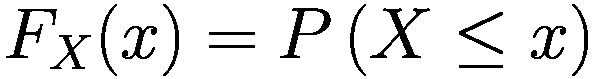

对于抛均匀硬币的累积分布函数（设正面为 0，反面为 1），它是一个阶跃函数，如下图所示：

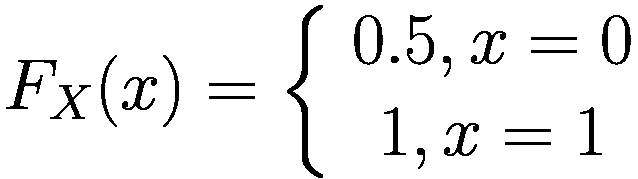

见图 12-12。

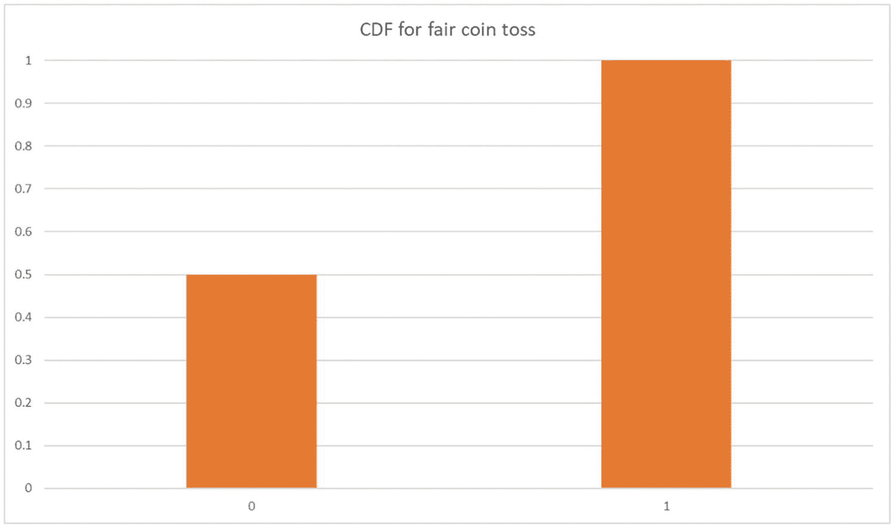

在抛均匀硬币的累积分布函数条形图中，正面标记为 0，反面标记为 1。正面的值为 0.5，反面的值为 1。

**图 12-12** 抛均匀硬币的累积分布函数

随机变量可以是连续的，它在实数轴的某个区间或区间集合上取任意数值（具有不可数范围）。图 12-13 展示了几种正态分布的累积分布函数。我们可以看到，对于 `μ` = 0（均值为 0）的正态分布，从该概率分布中抽取一个样本其值小于（或大于）0 的概率是 0.5。

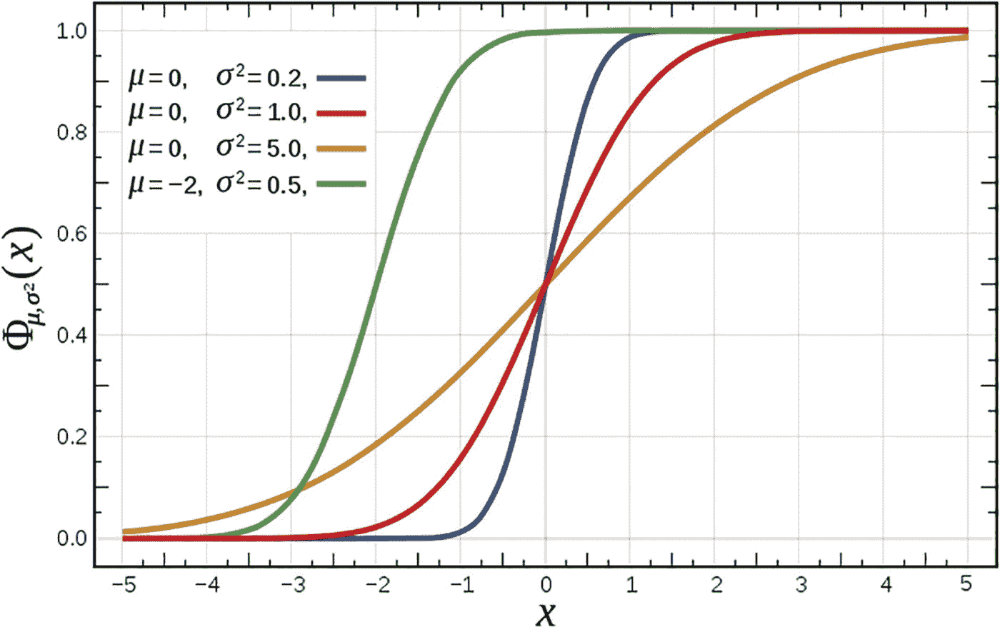

该图显示了 `phi` 下标 `mu sigma square` of `x` 相对于 `x` 的图形，对应四种不同的均值与方差组合。

**图 12-13** 正态分布的累积分布函数

对于连续随机变量，用概率密度函数（PDF）来描述通常更直观。

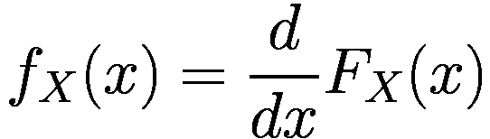

`fX` 表示随机变量等于某个样本值 `x` 的相对似然性。相对似然性越大，我们看到这个样本的可能性就越大。对于连续随机变量，其绝对似然性始终为 0。图 12-14 展示了图 12-13 中累积分布函数所对应的概率密度函数。

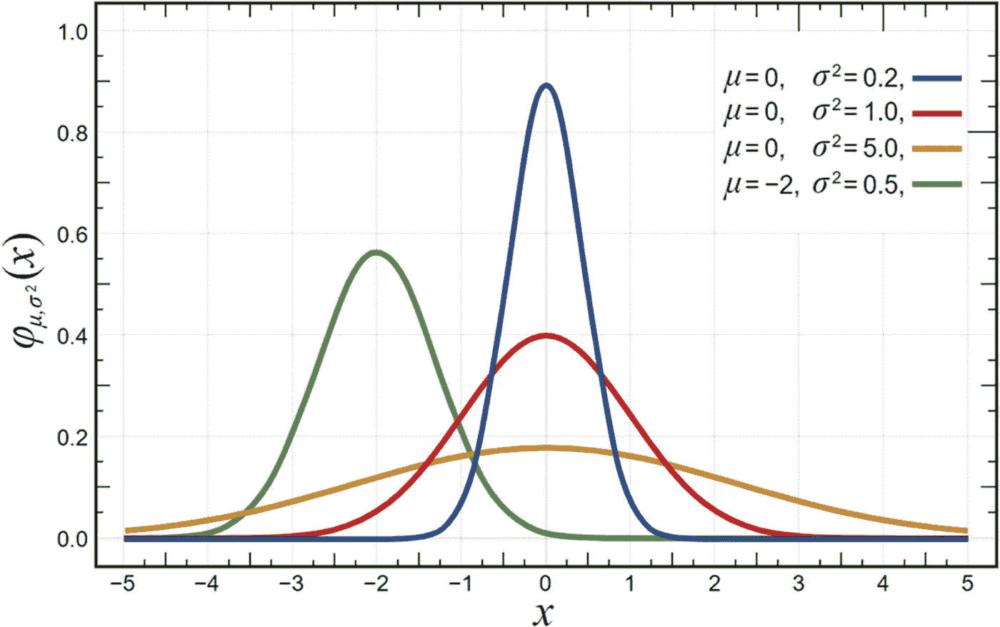

该图展示了四种不同均值与方差组合下正态分布的概率密度函数。

**图 12-14** 正态分布的概率密度函数

随机变量的值落在某个区域内的概率，是该区域在概率密度函数曲线下的面积，即概率密度函数在该区域的积分。其数学表达式如下：

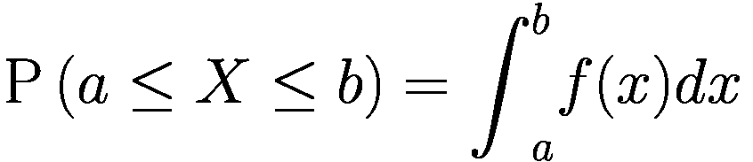

特别地，我们还有以下关系（见图 12-15）：

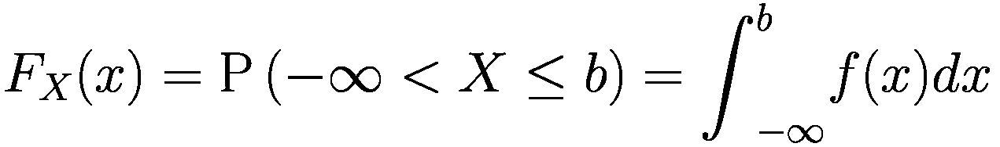

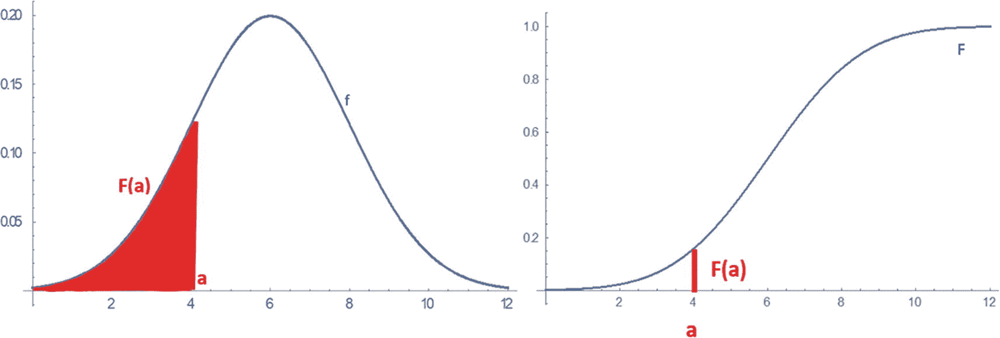

两条概率分布曲线展示了累积分布函数的面积与取值，分别以 `a` 和 `a` 的函数形式呈现。

**图 12-15** 概率密度曲线下的面积（左图）即累积分布函数的值（右图）

### 分位数函数

随机变量概率分布的分位数函数指定了该随机变量的一个值，使得变量小于或等于该值的概率等于给定的概率。它也被称为逆累积分布函数。数学上，分位数函数 `Q` 返回满足下式的值 `x`：

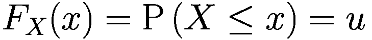

或者等价地，

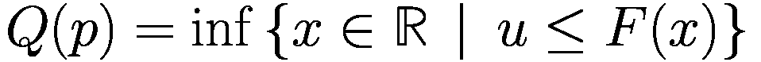

`inf` 是下确界算子，它给出集合中小于或等于集合中所有元素的最大元素，也称为最大下界。

通常，几乎必然地，我们有：

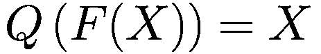

因此，我们得到了逆累积分布函数。这里我们捕捉到这样一个事实：分位数函数返回所有那些 CDF 值超过 `u` 的值中 `x` 的最小值（对于连续分布而言）。

在 NM Dev 中，单变量概率函数的实现继承自 `ProbabilityDistribution` 接口。这样的实现不仅指定了分布的 CDF 和 PDF，还指定了描述性统计量（例如均值和方差）以及其他信息。其签名如下：

```java
public interface ProbabilityDistribution {
    /**
     * 获取此分布的均值。
     *
     * @return 均值
     * @see Wikipedia:
     * 期望值
     */
    public double mean();

    /**
     * 获取此分布的中位数。
     *
     * @return 中位数
     * @see Wikipedia: 中位数
     */
    public double median();

    /**
     * 获取此分布的方差。
     *
     * @return 方差
     * @see Wikipedia:
     * 方差
     */
    public double variance();

    /**
     * 获取此分布的偏度。
     *
     * @return 偏度
     * @see Wikipedia:
     * 偏度
     */
    public double skew();

    /**
     * 获取此分布的 excess kurtosis。
     *
     * @return excess kurtosis
     * @see Wikipedia:
     * 峰度
     */
    public double kurtosis();

    /**
     * 获取此分布的熵。
     *
     * @return 熵
     * @see
     * Wikipedia:
     * 熵
     * (信息论)
     */
    public double entropy();

    /**
     * 获取累积概率 `F(x) = Pr(X ≤ x)`。
     *
     * @param x x
     * @return `F(x) = Pr(X ≤ x)`
     * @see
     * Wikipedia:
     * 累积分布函数
     */
    public double cdf(double x);

    /**
     * 获取分位数，即累积分布函数的逆函数。
     * 它是从分布中随机抽取的值有 `u×100%` 的概率会低于此值。
     *
     * `F-1(u) = x`，满足
     * `Pr(X ≤ x) = u`
     *
     * 这可能并不总是存在。
     *
     * @param u `{@code u}`，一个分位数
     * @return `F-1(u)`
     * @see Wikipedia:
     * 分位数函数
     */
    public double quantile(double u);

    /**
     * 密度函数，如果存在，它是 `F` 的导数。
     * 它描述了样本空间中每个点的概率密度。
     *
     * `f(x) = dF(X) / dx`
     *
     * 这可能并不总是存在。
     *
     * 对于离散情况，这是概率质量函数。它给出了离散随机变量恰好等于某个值的概率。
     *
     * @param x x
     * @return `f(x)`
     * @see
     *
     * Wikipedia:
     * 概率密度函数
     * Wikipedia:
     * 概率
     * 质量函数
     *
     */
    public double density(double x);

    /**
     * 矩生成函数是 `etX` 的期望值。即，
     *
     * `E(etX)`
     *
     * 这可能并不总是存在。
     *
     * @param t t
     * @return `E(exp(tX))`
     * @see
     * Wikipedia:
     * 矩生成函数
     */
    public double moment(double t);
}
```

### 12.3.1 矩

随机变量 `X` 的概率分布的均值或期望值，记作 `E(X)`，是加权样本均值或加权平均数的推广。对于离散概率分布，它是权重等于各值概率质量的加权平均值。

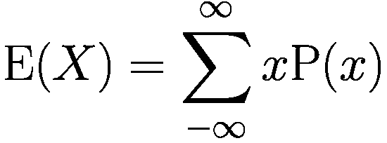

直观上，它是 `X` 大量独立实现的算术平均值。对于具有 PDF `f(x)` 的连续概率分布，其均值定义如下：


均值可能不存在或不是有限的。对于某些概率分布，均值是无穷大（`∞` 或 `−∞`），而对于其他一些分布，均值未定义。

概率分布的方差定义如下：


通常，概率分布的标准化矩是被归一化的矩（通常是高阶中心矩）。归一化通常是通过除以标准差的某个表达式来实现的，这使得矩尺度不变。这样做的好处是，这样的标准化矩仅在除变异性之外的其他属性上有所不同，从而可以轻松比较不同概率分布的形状。数学上，`k` 阶标准化矩定义如下：


其中

![ $$ {\mu}_k=\textrm{E}\left[{\left(X-\mu \right)}^k\right]={\int}_{-\infty}^{\infty }{\left(x-\mu \right)}^kf(x) dx $$ ](images/528380_1_En_12_Chapter/528380_1_En_12_Chapter_TeX_Equaz.png)

并且

![ $$ {\sigma}^k={\left(\sqrt{\textrm{E}\left[{\left(X-\mu \right)}²\right]}\right)}^k $$ ](images/528380_1_En_12_Chapter/528380_1_En_12_Chapter_TeX_Equba.png)

标准化矩是无量纲数。第一个标准化矩为零，因为关于均值的一阶矩总是零。第二个标准化矩为一，因为关于均值的二阶矩等于方差 `σ²`。

概率分布的偏度 `γ = μ̃₃` 是第三个标准化矩。它是衡量分布偏斜程度的指标。任何对称分布的三阶中心矩（如果定义）都为零。左偏分布（分布的左尾更长）具有负偏度。右偏分布（分布的右尾更长）具有正偏度。

概率分布的峰度 `κ = μ̃₄` 是第四个标准化矩。与具有相同方差的正态分布相比，它是衡量分布尾部重尾程度的指标。由于它是四次幂的期望，四阶中心矩（如果定义）总是非负的；并且除了点分布外，它总是严格为正的，并且可以无界。如果分布具有重尾，则峰度会很高（称为尖峰态）；相反，薄尾分布（例如，有界分布如均匀分布）具有低峰度（称为低峰态）。

# 矩生成函数

实值随机变量的矩生成函数是其概率分布的另一种规范形式。与概率密度函数或累积分布函数类似，矩生成函数（如果存在）也能唯一地定义一个概率分布。顾名思义，矩生成函数可用于计算分布的矩：关于 0 的`n`阶矩就是矩生成函数在 0 处的`n`阶导数。从数学上讲，随机变量`X`的矩生成函数定义如下：

![ $$ {M}_x(t)=\textrm{E}\left[{e}^{tX}\right] $$ ](images/528380_1_En_12_Chapter/528380_1_En_12_Chapter_TeX_Equbb.png)

也就是说，该函数是随机变量`e^{tX}`对于`t ∈ ℝ`的期望。如果积分不收敛，则矩生成函数不存在。

矩生成函数之所以如此命名，是因为它可用于计算分布的矩。`e^{tX}`的泰勒展开式如下：


因此，我们得到：

![ $$ {M}_x(t)=\textrm{E}\left[{e}^{tX}\right] $$ ](images/528380_1_En_12_Chapter/528380_1_En_12_Chapter_TeX_Equbd.png)


其中`m[n]`是`n`阶矩。将`M_x`对`t`求`i`次导数，并令`t = 0`，即可得到关于原点的`i`阶矩`m[i]`。

对于由随机变量的线性变换所定义的分布（如果存在），其矩生成函数有特别简单的结果。具体而言，如果随机变量`X`具有矩生成函数`M_X`，那么`αX + β`的矩生成函数如下：

![ $$ {M}_{\alpha X+\beta }(t)=\textrm{E}\left[{e}^{t\left( aX+\beta \right)}\right]={e}^{\beta t}{M}_X\left(\alpha t\right) $$ ](images/528380_1_En_12_Chapter/528380_1_En_12_Chapter_TeX_Equbg.png)

此外，如果`S[n]`是随机变量`{X[i]}`关于权重`{a[i]}`的线性组合，如下所示：


那么`S[n]`的矩生成函数如下：


## 正态分布

最重要的分布（可能）是正态分布或高斯分布。许多自然过程，如热扩散，都是正态分布的。此外，中心极限定理指出，具有有限均值和方差的随机变量的多个样本（观测值）的平均值本身就是一个随机变量，其分布随着样本数量的增加而收敛于正态分布。因此，作为多个独立测量值之和的物理量（如测量误差）通常具有近似正态的分布。

从数学上讲，假设`{X[1], ⋯, X[n]}`是一列独立同分布（`i.i.d.`）的随机变量，满足`E(X[i]) = μ`且`Var(X[i]) = σ² < ∞`。那么当`n`趋于无穷大时，随机变量

依分布收敛于均值为 0、方差为`σ²`的正态分布，即`N(0, σ²)`。


均值为`μ`、方差为`σ²`的正态分布，记为`N(μ, σ²)`，其概率密度函数（PDF）如下：


图 12-16 展示了一个示例。


*该图展示了对于四种不同的均值和方差组合，phi 下标 mu sigma 平方的 x 关于 x 的函数图像。*

**图 12-16** 正态分布的概率密度函数

累积分布函数（CDF）如下：

![ $$ F(x)=\frac{1}{2}\left[1+\operatorname{erf}\left(\frac{x-\mu }{\sigma \sqrt{2}}\right)\right] $$ ](images/528380_1_En_12_Chapter/528380_1_En_12_Chapter_TeX_Equbl.png)

图 12-17 展示了一个示例。


*该图展示了对于四种不同的均值和方差组合，phi 下标 mu sigma 平方的 x 关于 x 的函数图像。*

**图 12-17** 正态分布的累积分布函数

分位数函数如下：


均值如下：


方差如下：


偏度如下：


超额峰度如下：


矩生成函数如下：


NM Dev 类 `NormalDistribution` 实现了正态分布。以下是一个示例：

## 正态分布示例代码

```kotlin
val dist = NormalDistribution(
    0.0, // 均值
    1.0 // 方差
)
println("mean = " + dist.mean())
println("median = " + dist.median())
println("variance = " + dist.variance())
println("skew = " + dist.skew())
println("kurtosis = " + dist.kurtosis())
println("entropy = " + dist.entropy()) // Math.log(2 * Math.PI * Math.E)
println("")
val xs: DoubleArray = doubleArrayOf(
    -1000000.0, -10000.0, -1000.0, -100.0, -10.0, -1.0, -0.1, -0.01, -0.001, -0.0001,
    0.0, 0.0001, 0.001, 0.01, 0.1, 1.0, 2.0, 3.0, 10.0, 100.0, 1000.0)
for (x in xs) {
    println(String.format("F(%f) = %f", x, dist.cdf(x)))
}
println("")
for (x in xs) {
    println(String.format("f(%f) = %f", x, dist.density(x)))
}
var allEquals: Boolean = true
var u: Double = 0.000001
while(u < 1.0) {
    val q = dist.quantile(u)
    val fq = dist.cdf(q)
    if (Math.abs(fq - u) > 1e-9) {
        allEquals = false
    }
    u += 0.000001
}
println("\nF(Q(u)) = u for all u = " + allEquals)
```

**输出**

```
mean = 0.0
median = 0.0
variance = 1.0
skew = 0.0
kurtosis = 0.0
entropy = 2.8378770664093453
F(-1000000.000000) = 0.000000
F(-10000.000000) = 0.000000
F(-1000.000000) = 0.000000
F(-100.000000) = 0.000000
F(-10.000000) = 0.000000
F(-1.000000) = 0.158655
F(-0.100000) = 0.460172
F(-0.010000) = 0.496011
F(-0.001000) = 0.499601
F(-0.000100) = 0.499960
F(0.000000) = 0.500000
F(0.000100) = 0.500040
F(0.001000) = 0.500399
F(0.010000) = 0.503989
F(0.100000) = 0.539828
F(1.000000) = 0.841345
F(2.000000) = 0.977250
F(3.000000) = 0.998650
F(10.000000) = 1.000000
F(100.000000) = 1.000000
F(1000.000000) = 1.000000
f(-1000000.000000) = 0.000000
f(-10000.000000) = 0.000000
f(-1000.000000) = 0.000000
f(-100.000000) = 0.000000
f(-10.000000) = 0.000000
f(-1.000000) = 0.241971
f(-0.100000) = 0.396953
f(-0.010000) = 0.398922
f(-0.001000) = 0.398942
f(-0.000100) = 0.398942
f(0.000000) = 0.398942
f(0.000100) = 0.398942
f(0.001000) = 0.398942
f(0.010000) = 0.398922
f(0.100000) = 0.396953
f(1.000000) = 0.241971
f(2.000000) = 0.053991
f(3.000000) = 0.004432
f(10.000000) = 0.000000
f(100.000000) = 0.000000
f(1000.000000) = 0.000000
F(Q(u)) = u for all u = true
```

### 12.3.3 对数正态分布

对数正态分布是指一个随机变量的对数服从正态分布时的连续概率分布。即，如果随机变量`X`服从对数正态分布，那么`Y = ln X`服从正态分布。等价地，如果`Y`服从正态分布，那么`Y`的指数函数`X = exp(Y)`就服从对数正态分布。服从对数正态分布的随机变量仅取正实数值。它在精密科学和工程科学以及医学、经济学和金融学中是一个方便且有用的模型。著名的布莱克-舒尔斯模型假设股票收益率服从对数正态分布。

数学上，一个正随机变量`X`服从对数正态分布`X ~ Lognormal(μ, σ²)`，即`ln X ~ N(μ, σ²)`。

设`φ(x)`和`Φ(x)`分别为标准正态分布`N(0, 1)`的概率密度函数和累积分布函数。则`X ~ Lognormal(μ, σ²)`的 PDF 如下：


图 12-18 展示了一个示例。


该图显示了在相同均值、不同方差的四种组合下，PDF 随 x 的变化曲线。

**图 12-18** 对数正态分布的概率密度函数；相同的`μ`但不同的`σ`

CDF 如下：


`erfc`是一个称为补余误差函数的特殊函数。

图 12-19 展示了一个示例。


该图显示了在相同均值、不同方差的四种组合下，CDF 随 x 的变化曲线。

**图 12-19** 对数正态分布的累积分布函数；相同的`μ`但不同的`σ`

分位数函数如下：


`Q_Φ(q)`是标准正态分布的分位数函数。

均值如下：


方差如下：

![$$ Var\;(X)=\left[\exp \left({\sigma}²\right)-1\right]\exp \left(2\mu +{\sigma}²\right) $$](images/528380_1_En_12_Chapter/528380_1_En_12_Chapter_TeX_Equby.png)

偏度如下：

![$$ \gamma =\left[\exp \left({\sigma}²\right)+2\right]\sqrt{\exp \left({\sigma}²\right)-1} $$](images/528380_1_En_12_Chapter/528380_1_En_12_Chapter_TeX_Equbz.png)

超额峰度如下：


矩生成函数如下：


NM Dev 类`LogNormalDistribution`实现了对数正态分布。下面是一个示例：

```kotlin
val dist = LogNormalDistribution(
    1.0, // 均值
    2.0 // 方差
)
println("mean = " + dist.mean())
println("median = " + dist.median())
println("variance = " + dist.variance())
println("skew = " + dist.skew())
println("kurtosis = " + dist.kurtosis())
println("entropy = " + dist.entropy())
println("")
val xs: DoubleArray = doubleArrayOf(
    -1000000.0, -10000.0, -1000.0, -100.0, -10.0, -1.0, -0.1, -0.01, -0.001, -0.0001,
    0.0, 0.0001, 0.001, 0.01, 0.1, 1.0, 2.0, 3.0, 10.0, 100.0, 1000.0)
for (x in xs) {
    println(String.format("F(%f) = %f", x, dist.cdf(x)))
}
println("")
for (x in xs) {
    println(String.format("f(%f) = %f", x, dist.density(x)))
}
var allEquals: Boolean = true
var u: Double = 0.000001
while(u < 1.0) {
    val q = dist.quantile(u)
    val fq = dist.cdf(q)
    if (Math.abs(fq - u) > 1e-9) {
        allEquals = false
    }
    u += 0.000001
}
println("\nF(Q(u)) = u for all u = " + allEquals)
```

输出如下：

```
mean = 20.085536923187668
median = 2.718281828459045
variance = 21623.03700131398
skew = 414.359343300147
kurtosis = 9220556.977307005
entropy = 3.112085713764618
F(-1000000.000000) = 0.000000
F(-10000.000000) = 0.000000
F(-1000.000000) = 0.000000
F(-100.000000) = 0.000000
F(-10.000000) = 0.000000
F(-1.000000) = 0.000000
F(-0.100000) = 0.000000
F(-0.010000) = 0.000000
F(-0.001000) = 0.000000
F(-0.000100) = 0.000000
F(0.000000) = 0.000000
F(0.000100) = 0.000000
F(0.001000) = 0.000038
F(0.010000) = 0.002535
F(0.100000) = 0.049339
F(1.000000) = 0.308538
F(2.000000) = 0.439031
F(3.000000) = 0.519662
F(10.000000) = 0.742571
F(100.000000) = 0.964273
F(1000.000000) = 0.998431
f(-1000000.000000) = 0.000000
f(-10000.000000) = 0.000000
f(-1000.000000) = 0.000000
f(-100.000000) = 0.000000
f(-10.000000) = 0.000000
f(-1.000000) = 0.000000
f(-0.100000) = 0.000000
f(-0.010000) = 0.000000
f(-0.001000) = 0.000000
f(-0.000100) = 0.000000
f(0.000000) = 0.000000
f(0.000100) = 0.004369
f(0.001000) = 0.080387
f(0.010000) = 0.392917
f(0.100000) = 0.510235
f(1.000000) = 0.176033
f(2.000000) = 0.098569
f(3.000000) = 0.066410
f(10.000000) = 0.016135
f(100.000000) = 0.000393
f(1000.000000) = 0.000003
F(Q(u)) = u for all u = true
```

### 12.3.4 指数分布

泊松过程是一系列离散事件的模型，其中事件在任何时刻或任何等长时间间隔内发生的概率相同，但事件发生的具体时间是随机的。事件的发生，以及事件发生前的等待时间，与之前的所有事件和信息无关。因此，该过程被描述为**无记忆性**。例如，根据历史数据，我们知道新顾客的平均到达率是`λ` = 每小时 10 人，但下一位顾客到来的时间是完全随机的，并且与之前任何顾客无关。顾客到达过程可以建模为泊松过程。

更抽象地说，在图 12-20 中，从状态 0 开始的一个过程可以在随机时间跳转到下一个增量状态。我们不知道它具体何时发生，因为它是随机的。但我们知道它可以在任何时间以相等的概率发生。


该过程从状态 0 开始，增量以`λ`的速率连续且独立地发生。状态`K`也在图中可见。

图 12-20

一个从 0 开始的泊松点过程，其中增量以速率`λ`连续且独立地发生

泊松过程定义为一个满足以下条件的随机过程：

1. `N(0) = 0`。
2. 增量`{N(t[n + 1]) − N(t[n])}`是独立随机变量。
3. 独立同分布随机增量的均值为`E(N(t[n + 1]) − N(t[n])) = λ(t[n + 1] − t[n])`。

`λ`称为强度，是每单位时间预期发生的到达次数。

事件之间的随机时间或下一次跳跃前的随机时间称为**等待时间**。其分布由具有速率参数`λ`的指数分布决定。

从数学上讲，一个非负随机变量`X`服从指数分布`X ~ Exp(λ)`，当且仅当它具有以下概率密度函数：


图 12-21 展示了一个例子。


对于`λ`的三个不同值：0.5、1 和 1.5，P 函数随`x`变化的递减图。

图 12-21

指数分布的概率密度函数

累积分布函数如下：


图 12-22 展示了一个例子。


对于 λ 的三个不同值：0.5、1 和 1.5，当 x 小于等于某个值时，P 函数随 x 变化的递增图。

图 12-22

指数分布的累积分布函数

我们可以从累积分布函数推导出指数分布的一个重要性质，即**无记忆性**。具体示例如下：


`s` 是无关的。当 `T` 被解释为相对于某个初始时间的事件发生的等待时间时，这个关系意味着，如果在初始时间段 `s` 内未观察到事件，那么剩余等待时间的分布与原始的无条件分布相同。例如，如果一个事件在 30 秒后仍未发生，那么它至少还需要 10 秒才会发生的条件概率，等于从初始时间起超过 10 秒才观察到该事件的无条件概率。

分位数函数如下：


均值如下：


方差如下：


偏度如下：


超额峰度如下：


矩生成函数如下：


NM Dev 类 `ExponentialDistribution` 实现了指数分布。示例如下：

```kotlin
val dist = ExponentialDistribution(
    1.0 // lambda = 1.
)
println("mean = " + dist.mean())
println("median = " + dist.median())
println("variance = " + dist.variance())
println("skew = " + dist.skew())
println("kurtosis = " + dist.kurtosis())
println("entropy = " + dist.entropy())
println("")
val xs: DoubleArray = doubleArrayOf(
    -1000000.0, -10000.0, -1000.0, -100.0, -10.0, -1.0, -0.1, -0.01, -0.001, -0.0001,
    0.0, 0.0001, 0.001, 0.01, 0.1, 1.0, 2.0, 3.0, 10.0, 100.0, 1000.0
)
for (x in xs) {
    println(String.format("F(%f) = %f", x, dist.cdf(x)))
}
println("")
for (x in xs) {
    println(String.format("f(%f) = %f", x, dist.density(x)))
}
var allEquals: Boolean = true
var u: Double = 0.000001
while (u < 1.0) {
    val q = dist.quantile(u)
    if (Math.abs(dist.cdf(q) - u) > 1e-9) {
        allEquals = false
    }
    u += 0.000001
}
println("\nF(Q(u)) = u for all u = " + allEquals)
```

输出如下：

```
mean = 1.0
median = 0.6931471805599453
variance = 1.0
skew = 2.0
kurtosis = 6.0
entropy = 1.0
F(-1000000.000000) = 0.000000
F(-10000.000000) = 0.000000
F(-1000.000000) = 0.000000
F(-100.000000) = 0.000000
F(-10.000000) = 0.000000
F(-1.000000) = 0.000000
F(-0.100000) = 0.000000
F(-0.010000) = 0.000000
F(-0.001000) = 0.000000
F(-0.000100) = 0.000000
F(0.000000) = 0.000000
F(0.000100) = 0.000100
F(0.001000) = 0.001000
F(0.010000) = 0.009950
F(0.100000) = 0.095163
F(1.000000) = 0.632121
F(2.000000) = 0.864665
F(3.000000) = 0.950213
F(10.000000) = 0.999955
F(100.000000) = 1.000000
F(1000.000000) = 1.000000
f(-1000000.000000) = 0.000000
f(-10000.000000) = 0.000000
f(-1000.000000) = 0.000000
f(-100.000000) = 0.000000
f(-10.000000) = 0.000000
f(-1.000000) = 0.000000
f(-0.100000) = 0.000000
f(-0.010000) = 0.000000
f(-0.001000) = 0.000000
f(-0.000100) = 0.000000
f(0.000000) = 1.000000
f(0.000100) = 0.999900
f(0.001000) = 0.999000
f(0.010000) = 0.990050
f(0.100000) = 0.904837
f(1.000000) = 0.367879
f(2.000000) = 0.135335
f(3.000000) = 0.049787
f(10.000000) = 0.000045
f(100.000000) = 0.000000
f(1000.000000) = 0.000000
F(Q(u)) = u for all u = true
```

### 12.3.5 泊松分布

虽然泊松过程中事件之间的等待时间服从指数分布，但事件的数量服从泊松分布。换句话说，泊松分布是一种离散概率分布，它表达了在固定时间间隔内，以已知的恒定平均速率发生，且与上次事件发生时间无关的给定数量事件发生的概率。请注意，与我们目前讨论的其他连续概率分布不同，泊松分布是一种离散概率分布。它“计数”事件发生的次数。

例如，一个呼叫中心每天 24 小时平均每小时接到 180 个电话。这些电话是相互独立的；接到一个电话不会改变下一个电话到达时间的概率。在任何一分钟内接到的电话数量服从泊松分布：最可能的数量是 2 和 3，但 1 和 4 也很有可能，并且有很小概率可能低至 0，而非常小的概率可能达到 10。另一个例子是在给定的观测期内，从放射源发生的衰变事件的数量。

如果一个离散随机变量 `X` 具有参数 `λ > 0` 的泊松分布，则其概率质量函数 (PMF) 由下式给出：


其中 `k = 0, 1, 2, …` 是事件发生的次数。

# 12.3.5 泊松分布

对于图 12-23 中的示例，`k` 是事件发生的次数。`λ` 是期望的事件发生率。纵轴是在给定 `λ` 时 `k` 次事件发生的概率。该函数仅定义在 `k` 的整数值上；连接线仅用于引导视线。


P(x = k) 函数关于 k 的图，展示了三个不同的 lambda 值：1、4 和 10。

**图 12-23** 泊松分布的概率质量函数

CDF 如下：


`⎣k⎦` 是向下取整函数，表示小于或等于 `k` 的最小整数。

对于图 12-23 中的示例，横轴是索引 `k`，即事件发生的次数。CDF 在 `k` 的整数点处不连续，在其他地方是平坦的，因为服从泊松分布的变量只取整数值。参见图 12-24。


P(X ≤ k) 函数关于 k 的散点图，展示了三个不同的 lambda 值：1、4 和 10。

**图 12-24** 泊松分布的累积概率函数

分位数函数没有封闭形式，但可以通过使用 CDF 搜索满足 `F(k) < q` 的最大 `k` 来计算。

均值如下：


方差如下：


偏度如下：


超额峰度如下：


矩生成函数如下：


NM Dev 类 `PoissonDistribution` 实现了泊松分布。示例如下：

```
val dist = PoissonDistribution(
    2.0 // lambda = 2.0
)
println("mean = " + dist.mean())
println("median = " + dist.median())
println("variance = " + dist.variance())
println("skew = " + dist.skew())
println("kurtosis = " + dist.kurtosis())
println("entropy = " + dist.entropy())
println("")
val ks: DoubleArray = doubleArrayOf(0.0, 1.0, 2.0, 3.0, 4.0, 5.0)
for (k in ks) {
    println(String.format("F(%f) = %f", k, dist.cdf(k)))
}
println("")
for (k in ks) {
    println(String.format("f(%f) = %f", k, dist.density(k)))
}
println("")
var u: Double = 0.1
while(u < 1.0) {
    val x: Double = dist.quantile(u)
    println(String.format("Q(%f) = %f", u, x))
    u += 0.1
}
```

输出如下：

```
mean = 2.0
median = 2.0
variance = 2.0
skew = 0.7071067811865475
kurtosis = 0.5
entropy = 1.7048826437056113
F(0.000000) = 0.135335
F(1.000000) = 0.406006
F(2.000000) = 0.676676
F(3.000000) = 0.857123
F(4.000000) = 0.947347
F(5.000000) = 0.983436
f(0.000000) = 0.135335
f(1.000000) = 0.270671
f(2.000000) = 0.270671
f(3.000000) = 0.180447
f(4.000000) = 0.090224
f(5.000000) = 0.036089
Q(0.100000) = 0.000000
Q(0.200000) = 1.000000
Q(0.300000) = 1.000000
Q(0.400000) = 1.000000
Q(0.500000) = 2.000000
Q(0.600000) = 2.000000
Q(0.700000) = 3.000000
Q(0.800000) = 3.000000
Q(0.900000) = 4.000000
Q(1.000000) = 22.000000
```

## 12.3.6 二项分布

参数为 `n` 和 `p` 的二项分布是一种离散概率分布，用于描述一系列 `n` 次独立试验中“成功”次数的概率分布。每次试验只有“是”或“否”两种结果：“是/成功”（概率为 `p`）或“否/失败”（概率为 `q = 1 - p`）。单次的成功/失败试验也称为伯努利试验，一系列布尔型结果则称为伯努利过程。对于单次试验，即 `n = 1` 时，二项分布即为伯努利分布。例如，抛一次公平硬币，`n = 1`，`p = 0.5`。

二项分布常用于建模从大小为 `N` 的总体中有放回地抽取大小为 `n` 的样本时，成功次数的分布。如果抽样是不放回的，则各次抽取不独立，此时得到的是超几何分布，而非二项分布。然而，当 `N` 远大于 `n` 时，二项分布仍是一个良好的近似，并被广泛使用。

二项分布和泊松分布具有相似性：它们都衡量某一框架内特定随机事件（或“成功”）的次数。但两者也有区别：二项分布统计的是离散试验中的离散事件次数，而泊松分布统计的是连续区间中的离散事件次数。也就是说，对于二项分布，你有固定次数 `n` 的“尝试”，每次尝试的成功概率为 `p`；而对于泊松分布，你本质上拥有无限次尝试，而每次成功的概率趋近于无穷小。具体而言，给定参数为 `n` 和 `p` 的二项分布，若令 `n → ∞` 且 `p → 0`，同时使得 `np → λ`，则该分布将趋近于参数为 `λ` 的泊松分布。因此，泊松分布可以被视为二项分布的极限形式。

由于这种极限性质，泊松分布被用于建模那些可能发生次数很多、但发生概率很小的事件。换言之，它适用于本应由二项分布表示、但 `n` 非常大且 `p` 非常小的情况，尤其当 `n` 和 `p` 的具体数值未知时，例如“百年一遇”的洪水。

总结来说，如果给定的是单位时间内事件发生的平均概率，并要求计算在给定时间内发生 `n` 件事的概率，则应使用泊松分布。反之，如果给定的是事件发生的精确概率，并要求计算在 `n` 次试验中该事件恰好发生 `k` 次的概率，则应使用二项分布。

此外，当 `n` 足够大时，二项随机变量 `X` 可以用正态分布很好地近似。即 `X ~ N(np, np(1 − p))`。等价地，标准化后的随机变量 `z = (x − μ) / σ` 服从标准正态分布 `N(0, 1)`。

如果随机变量 `X` 服从参数为 `n ∈ ℕ` 和 `p ∈ [0, 1]` 的二项分布，我们记作 `X ~ B(n, p)`。在 `n` 次独立伯努利试验中恰好获得 `k` 次成功的概率由以下概率质量函数给出：

```
f(k | n, p) = Pr(k | n, p) = Pr(X = k) = (n choose k) * p^k * (1 − p)^(n − k)
```

其中 `k = 0, 1, 2, …, n`。

`(n choose k) = n! / (k! * (n − k)!)` 是二项式系数，也是该分布名称的由来。该公式可理解为：`k` 次成功发生的概率为 `p^k`，`n − k` 次失败发生的概率为 `(1 − p)^(n − k)`。然而，这 `k` 次成功可以出现在 `n` 次试验中的任意位置，并且将 `k` 次成功分配到 `n` 次试验序列中共有 `(n choose k)` 种不同的方式。

图 12-25 展示了一个示例。


这三张散点图代表了三种不同的 p 和 n 值组合下的二项分布概率质量函数。

**图 12-25** 二项分布的概率质量函数

累积分布函数如下：

```
$$ F(k | n, p) = Pr(X ≤ k) = \sum_{i=0}^{k} \binom{n}{i} p^i (1 − p)^{n − i} $$

图 12-26 展示了一个示例。


这三张散点图代表了三种不同的 `p` 和 `N` 值组合下的二项分布累积概率函数。

图 12-26：二项分布的累积概率函数

分位函数没有闭式解，但可以通过使用 CDF 搜索满足 `F(k) < q` 的最大 `k` 来进行计算。

均值如下：

```
E(X) = np
```

方差如下：

```
Var(X) = npq
```

偏度如下：

```
γ = (q − p) / sqrt(npq)
```

超额峰度如下：

```
κ = (1 − 6pq) / (npq)
```

矩生成函数如下：

```
M_X(t) = (q + p * e^t)^n
```

NM Dev 库中的 `BinomialDistribution` 类实现了二项分布。示例如下：

```
val dist1 = BinomialDistribution(
20, // n
0.7 // p
)
println("mean = " + dist1.mean())
println("median = " + dist1.median())
println("variance = " + dist1.variance())
println("skew = " + dist1.skew())
println("kurtosis = " + dist1.kurtosis())
println("entropy = " + dist1.entropy())
println("")
val ks: DoubleArray = DoubleUtils.seq(0.0, 20.0, 1.0) // 从 0 到 20 的数列
for (k in ks) {
println(String.format("F(%f) = %f", k, dist1.cdf(k)))
}
println("")
for (k in ks) {
println(String.format("f(%f) = %f", k, dist1.density(k)))
}
println("")
var u: Double = 0.1
while(u < 1.0) {
val x: Double = dist1.quantile(u)
println(String.format("Q(%f) = %f", u, x))
u += 0.1
}
```

输出结果如下：

```
mean = 14.0
median = 14.0
variance = 4.200000000000001
skew = -0.19518001458970657
kurtosis = -0.06190476190476189
entropy = 3.0822902491263404
F(0.000000) = 0.000000
F(1.000000) = 0.000000
F(2.000000) = 0.000000
F(3.000000) = 0.000001
F(4.000000) = 0.000006
F(5.000000) = 0.000043
F(6.000000) = 0.000261
F(7.000000) = 0.001279
F(8.000000) = 0.005138
F(9.000000) = 0.017145
F(10.000000) = 0.047962
F(11.000000) = 0.113331
F(12.000000) = 0.227728
F(13.000000) = 0.391990
F(14.000000) = 0.583629
F(15.000000) = 0.762492
F(16.000000) = 0.892913
F(17.000000) = 0.964517
F(18.000000) = 0.992363
F(19.000000) = 0.999202
F(20.000000) = 1.000000
f(0.000000) = 0.000000
f(1.000000) = 0.000000
f(2.000000) = 0.000000
f(3.000000) = 0.000001
f(4.000000) = 0.000005
f(5.000000) = 0.000037
f(6.000000) = 0.000218
f(7.000000) = 0.001018
f(8.000000) = 0.003859
f(9.000000) = 0.012007
f(10.000000) = 0.030817
f(11.000000) = 0.065370
f(12.000000) = 0.114397
f(13.000000) = 0.164262
f(14.000000) = 0.191639
f(15.000000) = 0.178863
f(16.000000) = 0.130421
f(17.000000) = 0.071604
f(18.000000) = 0.027846
f(19.000000) = 0.006839
f(20.000000) = 0.000798
Q(0.100000) = 11.000000
Q(0.200000) = 12.000000
Q(0.300000) = 13.000000
Q(0.400000) = 14.000000
Q(0.500000) = 14.000000
Q(0.600000) = 15.000000
Q(0.700000) = 15.000000
Q(0.800000) = 16.000000
Q(0.900000) = 17.000000
Q(1.000000) = 20.000000
```

## 12.3.7 t 分布

学生 t 分布（或简称为 t 分布）是当样本量较小且总体标准差未知时，从独立同分布的正态总体中抽取的样本均值相对于真实均值的概率分布。具体来说，假设集合 `{x[1], …, x[n]}` 从一个已知均值 `μ` 但未知方差的正态分布中抽取；那么该样本的 t 值（一种标准化值）定义如下：


其中  是样本均值，`s` 是无偏样本标准差（分母为 `n` − 1），用于替代真实总体标准差 `σ`。`t` 是随机变量，因为  和 `s` 都是随机的。随机变量 `t` 服从自由度为 `υ` = `n` − 1 的 t 分布。

t 分布在许多广泛使用的统计分析中发挥作用，包括用于评估两个样本均值之间差异的统计显著性（即两个均值在统计上是否存在显著差异）的学生 t 检验，在两个总体均值之差的置信区间构建中，以及在线性回归分析中。学生 t 分布也出现在正态分布族数据的贝叶斯分析中。

从数学上讲，随机变量 `X` 服从 t 分布当且仅当其概率密度函数（PDF）如下所示：


其中 `υ` 是自由度数目，`Γ` 是伽马函数。

图 12-27 展示了一个示例。


六条 x 相对于 x 的 P 函数曲线图，分别对应 1、2、3、5、10 和 30 个自由度。

图 12-27

t 分布（红色）与正态分布（蓝色）对比

t 分布是对称且钟形的，类似于正态分布。然而，t 分布具有更重的尾部，这意味着它更容易产生远离其均值的值。当自由度趋近于无穷大时，t 分布收敛于正态分布。即：


这表示一个均值为 0、方差为 1 的标准正态分布。

其累积分布函数（CDF）如下：
```

### 12.3.7 t分布


其中 `I` 是正则化不完全贝塔函数，`t` > 0，并且有以下关系：


图 12-28 展示了一个示例。


X 小于等于 x 的 P 函数递增曲线图，相对于 x，对应四个不同的 v 值：1、2、5 和无穷大。

图 12-28

t 分布的累积概率函数

当自由度 `υ` = 1、2、4 时，t 分布的分位数函数具有简单的公式。它们如下所示：


符号函数对正数返回 `1`，对负数返回 `-1`，否则返回 `0`。

一般来说，分位数函数如下：


 是两个形状参数均为  的正则化不完全 Beta 函数的逆函数。

均值如下：


方差如下：

，否则未定义

偏度如下：

γ = 0, ν > 3，否则未定义

超额峰度如下：

，否则未定义

矩生成函数未定义。

NM Dev 类 `TDistribution` 实现了 t 分布。以下是一个示例：

```
val dist = TDistribution(4.5) // 自由度 = 4.5
println("mean = " + dist.mean())
println("median = " + dist.median())
println("variance = " + dist.variance())
println("skew = " + dist.skew())
println("kurtosis = " + dist.kurtosis())
println("entropy = " + dist.entropy())
println("")
val ks: DoubleArray = DoubleUtils.seq(0.0, 20.0, 1.0) // 从 0 到 20 的序列
for (k in ks) {
println(String.format("F(%f) = %f", k, dist.cdf(k)))
}
println("")
for (k in ks) {
println(String.format("f(%f) = %f", k, dist.density(k)))
}
var allEquals: Boolean = true
var u: Double = 0.1
while(u  1e-9) {
allEquals = false
}
u += 0.1
}
println("\nF(Q(u)) = u for all u = " + allEquals)
```

输出如下：

```
mean = 0.0
median = 0.0
variance = 1.8
skew = 0.0
kurtosis = 12.0
entropy = 1.6515357247574647
F(0.000000) = 0.500000
F(1.000000) = 0.815997
F(2.000000) = 0.945871
F(3.000000) = 0.982810
F(4.000000) = 0.993618
F(5.000000) = 0.997262
F(6.000000) = 0.998679
F(7.000000) = 0.999301
F(8.000000) = 0.999602
F(9.000000) = 0.999759
F(10.000000) = 0.999847
F(11.000000) = 0.999899
F(12.000000) = 0.999931
F(13.000000) = 0.999952
F(14.000000) = 0.999965
F(15.000000) = 0.999974
F(16.000000) = 0.999981
F(17.000000) = 0.999985
F(18.000000) = 0.999989
F(19.000000) = 0.999991
F(20.000000) = 0.999993
f(0.000000) = 0.000000
f(1.000000) = 0.217424
f(2.000000) = 0.065675
f(3.000000) = 0.018403
f(4.000000) = 0.005834
f(5.000000) = 0.002144
f(6.000000) = 0.000897
f(7.000000) = 0.000417
f(8.000000) = 0.000211
f(9.000000) = 0.000115
f(10.000000) = 0.000066
f(11.000000) = 0.000040
f(12.000000) = 0.000025
f(13.000000) = 0.000016
f(14.000000) = 0.000011
f(15.000000) = 0.000008
f(16.000000) = 0.000005
f(17.000000) = 0.000004
f(18.000000) = 0.000003
f(19.000000) = 0.000002
f(20.000000) = 0.000002
F(Q(u)) = u for all u = true
```

### 12.3.8 卡方分布

# 卡方分布

缩放后的样本均值（即*k*个独立正态随机变量之和）服从*t*分布，而*k*个独立标准正态随机变量的平方和则服从卡方分布（也称χ²分布）。该分布有时被称为中心卡方分布，是更一般的非中心卡方分布的特例。卡方分布是推断统计中应用最广泛的概率分布之一，尤其在假设检验和置信区间构建中。它也常用于常见的卡方检验，以检验观测分布与理论分布的拟合优度。参见第12.4节。

在数学上，如果`{Z[1], …, Z[k]}`中的每个变量都是独立的标准正态随机变量，那么它们的平方和（如下所示）：


服从自由度为*k*的卡方分布。通常记作`Q~χ²(k)`或。卡方分布有一个参数：一个正整数*k*，它指定了自由度（即被求和的随机变量`Z[i]`的数量）。

此外，样本方差`S²`服从缩放后的卡方分布。


等价地，我们有：


卡方分布的概率密度函数如下：


其中是伽马函数。

图12-29展示了一个示例。


函数`f_k(x)`关于`x`的图形，对应六个不同的`k`值。`k`等于1和2时呈下降趋势；其余`k`值下，趋势先上升后下降。

**图12-29**  
卡方分布的概率密度函数

累积分布函数如下：


其中`γ(s, t)`是下不完全伽马函数，`P(s, t)`是正则化不完全伽马函数。

图12-30展示了一个示例。


函数`f_k(x)`关于`x`的图形，对应六个不同的`k`值：1、2、3、4、6和9。趋势呈上升状态。

**图12-30**  
卡方分布的累积分布函数

分位数函数是正则化不完全伽马函数的逆函数。


均值如下：


方差如下：


偏度如下：


超額峰度如下：


矩母函数如下：


NM Dev 类 `ChiSquareDistribution` 实现了卡方分布。下面是一个示例：

```kotlin
val dist = ChiSquareDistribution(
    1.5 // degree of freedom
)
println("mean = " + dist.mean())
println("median = " + dist.median())
println("variance = " + dist.variance())
println("skew = " + dist.skew())
println("kurtosis = " + dist.kurtosis())
println("entropy = " + dist.entropy())
println("")
val xs: DoubleArray = doubleArrayOf(0.0, 0.0001, 0.001, 0.01, 0.1, 1.0, 2.0, 3.0, 10.0, 100.0, 1000.0)
for (x in xs) {
    println(String.format("F(%f) = %f", x, dist.cdf(x)))
}
println("")
for (x in xs) {
    println(String.format("f(%f) = %f", x, dist.density(x)))
}
var allEquals: Boolean = true
var u: Double = 0.1
while(u < 1.0) {
    if (Math.abs(dist.cdf(dist.quantile(u)) - u) > 1e-9) {
        allEquals = false
    }
    u += 0.1
}
println("\nF(Q(u)) = u for all u = " + allEquals)
```

输出如下：

```
mean = 1.5
median = 1.5
variance = 3.0
skew = 2.309401076758503
kurtosis = 8.0
entropy = 1.3749629120446232
F(0.000000) = 0.000000
F(0.000100) = 0.000647
F(0.001000) = 0.003637
F(0.010000) = 0.020415
F(0.100000) = 0.112622
F(1.000000) = 0.527937
F(2.000000) = 0.739980
F(3.000000) = 0.852400
F(10.000000) = 0.996474
F(100.000000) = 1.000000
F(1000.000000) = 1.000000
f(0.000000) = Infinity
f(0.000100) = 4.852013
f(0.001000) = 2.727260
f(0.010000) = 1.526765
f(0.100000) = 0.820784
f(1.000000) = 0.294304
f(2.000000) = 0.150104
f(3.000000) = 0.082266
f(10.000000) = 0.001839
f(100.000000) = 0.000000
f(1000.000000) = 0.000000
F(Q(u)) = u for all u = true
```

### 12.3.9 F 分布

缩放的样本均值（即*t*值）服从*t*分布，而缩放的样本方差之比则服从F分布。事实上，一个自由度为`d[1]`的卡方分布随机变量与另一个自由度为`d[2]`的卡方分布随机变量之比，服从自由度为(`d[1]`, `d[2]`)的F分布，即`F(d[1], d[2])`。也就是说，

## F分布


此外，样本方差`S`² 服从卡方分布。


那么，两个样本的样本方差之比以及缩放后的样本方差之比均服从`F`分布。此外，对于自由度`ν`的随机变量`t`，`t`²服从`F`分布`F`(1, `ν`)。

如果随机变量`X`服从参数`d`[1] > 0 和`d`[2] > 0 的`F`分布，我们记作`X`~`F`(`d`[1], `d`[2])。其概率密度函数（PDF）如下：


其中`B`是`Beta`函数。

图 12-31 显示了一个示例。


图中展示了`d1`和`d2`的五种不同取值组合所对应的`F`分布概率密度函数。

**图 12-31** F 分布的概率密度函数

累积分布函数（CDF）如下：


其中`I`是正则化不完全`Beta`函数。

图 12-32 显示了一个示例。


图中展示了`d1`和`d2`的五种不同取值组合所对应的`F`分布累积分布函数。

**图 12-32** F 分布的累积分布函数

分位函数如下：


是具有形状参数和的正则化不完全`Beta`函数的反函数。

### 均值

均值如下：


### 方差

方差如下：


### 偏度

偏度如下：


### 超额峰度

超额峰度如下：


`F`分布不存在矩生成函数。

`NM Dev`类`FDistribution`实现了`F`分布。以下是一个示例：

```scala
val dist = FDistribution(100.5, 10.0) // 自由度 = {100.5, 10}
println("mean = " + dist.mean())
println("variance = " + dist.variance())
println("skew = " + dist.skew())
println("kurtosis = " + dist.kurtosis())
println("")
val ks: DoubleArray = DoubleUtils.seq(0.0, 20.0, 1.0) // 从 0 到 20 的数值序列
for (k in ks) {
    println(String.format("F(%f) = %f", k, dist.cdf(k)))
}
println("")
for (k in ks) {
    println(String.format("f(%f) = %f", k, dist.density(k)))
}
var allEquals: Boolean = true
var u: Double = 0.1
while (u < 10.0) {
    val q: Double = dist.quantile(u)
    if (Math.abs(dist.cdf(q) - u) > 1e-9) {
        allEquals = false
    }
    u += 0.1
}
println("\nF(Q(u)) = u for all u = " + allEquals)
```

输出如下：

### 12.3.10 瑞利分布

瑞利分布是一种用于非负值随机变量的连续概率分布。它本质上是一个自由度为 2 的卡方分布。例如，$$ X=\sqrt{X_1²+{X}_2²} $$ 服从瑞利分布，其中 `X[1]` 和 `X[2]` 是两个正态分布，而 $$ {X}_1² $$ 和 $$ {X}_2² $$ 是两个卡方分布。

当一个向量的总体幅度与其方向分量相关时，经常可以观察到瑞利分布。瑞利分布自然出现的一个例子是对风速进行二维分析时。假设每个分量不相关，服从方差相等且均值为零的正态分布，那么总体风速（向量幅度）将具有瑞利分布的特征。该分布的另一个例子出现在随机复数的情况下，其实部和虚部独立同分布，且方差相等、均值为零。在这种情况下，复数的绝对值服从瑞利分布。

另一种可能性是，$$ X=\sigma \sqrt{-2\ln U} $$，其中 `U` 是均匀分布的随机变量，则 `X` 具有参数为 `σ` 的瑞利分布。

其概率密度函数如下：

$$ f\left(x\kern0.5em |\kern0.5em \sigma \right)=\frac{x}{\sigma²}\exp \left(-\frac{x²}{2{\sigma}²}\right),x\ge 0 $$

其中 `σ` 是分布的尺度参数。

图 12-33 展示了一个示例。


该图表显示了五个不同标准差取值下的瑞利分布概率密度函数。

图 12-33

瑞利分布的概率密度函数

其累积分布函数如下：

$$ F\left(x\kern0.5em |\kern0.5em \sigma \right)=1-\exp \left(-\frac{x²}{2{\sigma}²}\right),x\ge 0 $$

图 12-34 展示了一个示例。


该图表显示了五个不同标准差取值下的瑞利分布累积分布函数。

图 12-34

瑞利分布的累积分布函数

其分位数函数如下：

$$ Q(q)=\sigma \sqrt{-2\ln \left(1-q\right)} $$

其均值如下：

$$ \textrm{E}(X)=\sigma \sqrt{\frac{\pi }{2}} $$

其方差如下：

$$ Var(X)=\frac{4-\pi }{2}{\sigma}² $$

其偏度如下：

$$ \gamma =\frac{2\sqrt{\pi}\left(\pi -3\right)}{{\left(4-\pi \right)}^{\frac{3}{2}}} $$

其超额峰度如下：

$$ \kappa =-\frac{6{\pi}²-24\pi +16}{{\left(4-\pi \right)}²} $$

其矩生成函数如下：

$$ {M}_X(t)=1+\sigma t\exp \left(\frac{\sigma²{t}²}{2}\right)\sqrt{\frac{\pi }{2}}\left(\operatorname{erf}\left(\frac{\sigma t}{\sqrt{2}}\right)+1\right) $$

NM Dev 类 `RayleighDistribution` 实现了瑞利分布。以下是一个示例：

```
val dist = RayleighDistribution(
    2.0 // sigma = 2
)
println("mean = " + dist.mean())
println("median = " + dist.median())
println("variance = " + dist.variance())
println("skew = " + dist.skew())
println("kurtosis = " + dist.kurtosis())
println("entropy = " + dist.entropy())
println("")
val xs: DoubleArray = doubleArrayOf(0.0, 0.0001, 0.001, 0.01, 0.1, 1.0, 2.0, 3.0, 10.0, 100.0, 1000.0)
for (x in xs) {
    println(String.format("F(%f) = %f", x, dist.cdf(x)))
}
println("")
for (x in xs) {
    println(String.format("f(%f) = %f", x, dist.density(x)))
}
var allEquals: Boolean = true
var u: Double = 0.000001
while (u < 0.999999) {
    val q: Double = dist.quantile(u)
    if (Math.abs(dist.cdf(q) - u) > 1e-9) {
        allEquals = false
    }
    u += 0.000001
}
println("\nF(Q(u)) = u for all u = " + allEquals)
```

输出如下：
```
mean = 1.25
variance = 0.5622927031509121
skew = 3.4666421524967395
kurtosis = 39.05282344040168
F(0.000000) = 0.000000
F(1.000000) = 0.448778
F(2.000000) = 0.886374
F(3.000000) = 0.970125
F(4.000000) = 0.989870
F(5.000000) = 0.995874
F(6.000000) = 0.998080
F(7.000000) = 0.999013
F(8.000000) = 0.999452
F(9.000000) = 0.999676
F(10.000000) = 0.999799
F(11.000000) = 0.999870
F(12.000000) = 0.999913
F(13.000000) = 0.999940
F(14.000000) = 0.999958
F(15.000000) = 0.999969
F(16.000000) = 0.999977
F(17.000000) = 0.999983
F(18.000000) = 0.999987
F(19.000000) = 0.999990
F(20.000000) = 0.999992
f(0.000000) = 0.000000
f(1.000000) = 0.836572
f(2.000000) = 0.168807
f(3.000000) = 0.035722
f(4.000000) = 0.009923
f(5.000000) = 0.003404
f(6.000000) = 0.001365
f(7.000000) = 0.000616
f(8.000000) = 0.000304
f(9.000000) = 0.000162
f(10.000000) = 0.000091
f(11.000000) = 0.000054
f(12.000000) = 0.000034
f(13.000000) = 0.000021
f(14.000000) = 0.000014
f(15.000000) = 0.000010
f(16.000000) = 0.000007
f(17.000000) = 0.000005
f(18.000000) = 0.000003
f(19.000000) = 0.000003
f(20.000000) = 0.000002
F(Q(u)) = u for all u = true
```

### 12.3.11 伽玛分布

伽玛分布是一个双参数连续概率分布族。指数分布和卡方分布是伽玛分布的特殊情况。通常有两种常用的参数化形式：

- 使用形状参数 `k` > 0 和尺度参数 `θ` > 0
- 使用形状参数 `α` = `k` > 0 和逆尺度参数 `β = 1/θ` > 0，后者称为速率参数

采用 `k` 和 `θ` 的参数化形式在计量经济学及其他某些应用领域中更为常见，例如伽玛分布常被用于对等待时间进行建模。比如，失效前的等待时间是一个常被用于伽玛分布建模的随机变量。NM Dev 使用的就是这种 `k` 和 `θ` 的参数化形式。

采用 `α` 和 `β` 的参数化形式在贝叶斯统计中更为常见，伽玛分布在此用作各种逆尺度（速率）参数的共轭先验分布，例如指数分布或泊松分布的 `λ` 参数，甚至伽玛分布本身的 `β` 参数。

随机变量 `X` 服从形状参数为 `k`、尺度参数为 `θ` 的伽玛分布，记为：

`X ~ Γ(k, θ)`

其概率密度函数如下：

`f(x | k, θ) = (x^(k-1) * exp(-x/θ)) / Γ(k)`

其中 `Γ(k)` 为在 `k` 处求值的伽玛函数。

图 12-35 显示了一个示例。

该图展示了七种不同的 `k` 和 `θ` 取值组合所代表的伽玛分布概率密度函数曲线。

**图 12-35** 伽玛分布的概率密度函数

其累积分布函数如下：

`F(x | k, θ) = γ(k, x/θ) / Γ(k)`

图 12-36 显示了一个示例。

该图展示了七种不同的 `k` 和 `θ` 取值组合所代表的伽玛分布累积分布函数曲线。

**图 12-36** 伽玛分布的累积分布函数

其分位数函数如下：

`Q(q) = θ * P^(-1)(k, q)`

其中 `P^(-1)` 是正则化不完全伽玛函数的逆函数。

其均值如下：

`E(X) = kθ`

其方差如下：

`Var(X) = kθ²`

其偏度如下：

`γ = 2 / sqrt(k)`

其超值峰度如下：

`κ = 6 / k`

其矩生成函数如下：

`M_X(t) = (1 - θt)^(-k), t < 1/θ`

NM Dev 类 `GammaDistribution` 实现了伽玛分布。示例如下：

```kotlin
val dist = GammaDistribution(
    1.0, // k = 1
    2.0 // theta = 2
)
println("mean = " + dist.mean())
println("variance = " + dist.variance())
println("skew = " + dist.skew())
println("kurtosis = " + dist.kurtosis())
println("")
val xs: DoubleArray = doubleArrayOf(0.0, 0.0001, 0.001, 0.01, 0.1, 1.0, 2.0, 3.0, 10.0, 100.0, 1000.0)
for (x in xs) {
    println(String.format("F(%f) = %f", x, dist.cdf(x)))
}
println("")
for (x in xs) {
    println(String.format("f(%f) = %f", x, dist.density(x)))
}
var allEquals: Boolean = true
var u: Double = 0.001
while (u < 1.0) {
    val q: Double = dist.quantile(u)
    val cdf: Double = dist.cdf(q)
    if (Math.abs(cdf - u) > 1e-9) {
        allEquals = false
    }
    u += 0.001
}
println("\nF(Q(u)) = u for all u = " + allEquals)
```

输出结果如下：

```
mean = 2.0
variance = 4.0
skew = 2.0
kurtosis = 6.0
F(0.000000) = 0.000000
F(0.000100) = 0.000050
F(0.001000) = 0.000500
F(0.010000) = 0.004988
F(0.100000) = 0.048771
F(1.000000) = 0.393469
F(2.000000) = 0.632121
F(3.000000) = 0.776870
F(10.000000) = 0.993262
F(100.000000) = 1.000000
F(1000.000000) = 1.000000
f(0.000000) = 0.500000
f(0.000100) = 0.499975
f(0.001000) = 0.499750
f(0.010000) = 0.497506
f(0.100000) = 0.475615
f(1.000000) = 0.303265
f(2.000000) = 0.183940
f(3.000000) = 0.111565
f(10.000000) = 0.003369
f(100.000000) = 0.000000
f(1000.000000) = 0.000000
F(Q(u)) = u for all u = true
```

### 12.3.12 Beta 分布（Beta Distribution）

Beta 分布是一族定义在单位区间 [0, 1] 上的连续概率分布，由两个正的形状参数 `α` 和 `β` 参数化。这两个参数作为随机变量的指数出现，并控制着分布的形状。Beta 分布已被应用于建模各种学科中局限于有限长度区间内的随机变量的行为。在贝叶斯推断中，Beta 分布是伯努利分布、二项分布、负二项分布和几何分布的共轭先验概率分布。Beta 分布是百分比和比例这类随机行为的合适模型。

具有参数 `α` 和 `β` 的 Beta 分布的随机变量 `X` 表示如下：


其概率密度函数（PDF）如下：


其中 `B(α, β)` 是 Beta 函数。

图 12-37 展示了一个示例。


该图展示了五组不同 alpha 和 beta 值组合所对应的 Beta 分布概率密度函数图。

**图 12-37** Beta 分布的概率密度函数

其累积分布函数（CDF）如下：

其中`B(x | α, β)`是不完全 Beta 函数，`Ix`是正则化不完全 Beta 函数。

图 12-38 展示了一个示例。


该图展示了五组不同 alpha 和 beta 值组合所对应的 Beta 分布累积分布函数图。

**图 12-38** Beta 分布的累积分布函数

分位数函数是正则化不完全 Beta 函数的逆函数。


均值如下：


方差如下：


偏度如下：


超额峰度如下：

![ $$ \kappa =\frac{6\left[{\left(\alpha -\beta \right)}²\left(\alpha +\beta +1\right)-\alpha \beta \left(\alpha +\beta +2\right)\right]}{\alpha \beta \left(\alpha +\beta +1\right)\left(\alpha +\beta +3\right)} $$ ](images/528380_1_En_12_Chapter/528380_1_En_12_Chapter_TeX_Equfk.png)

其矩生成函数如下：


NM Dev 库中的`BetaDistribution`类实现了 Beta 分布。以下是一个示例：

```
val dist = BetaDistribution(
    0.5, // alpha = 0.5
    1.5  // beta = 1.5
)
println("mean = " + dist.mean())
println("variance = " + dist.variance())
println("skew = " + dist.skew())
println("kurtosis = " + dist.kurtosis())
println("")
val xs: DoubleArray = doubleArrayOf(0.0, 0.0001, 0.001, 0.01, 0.1, 1.0, 2.0, 3.0)
for (x in xs) {
    println(String.format("F(%f) = %f", x, dist.cdf(x)))
}
println("")
for (x in xs) {
    println(String.format("f(%f) = %f", x, dist.density(x)))
}
var allEquals: Boolean = true
var u: Double = 0.001
while(u <= 0.999) {
    if (Math.abs(dist.cdf(dist.quantile(u)) - u) > 1e-9) {
        allEquals = false
    }
    u += 0.001
}
println("\nF(Q(u)) = u for all u = " + allEquals)
```

输出结果如下：

```
mean = 0.25
variance = 0.0625
skew = 1.0
kurtosis = 0.0
F(0.000000) = 0.000000
F(0.000100) = 0.012732
F(0.001000) = 0.040257
F(0.010000) = 0.127111
F(0.100000) = 0.395819
F(1.000000) = 1.000000
F(2.000000) = NaN
F(3.000000) = NaN
f(0.000000) = Infinity
f(0.000100) = 63.658794
f(0.001000) = 20.121616
f(0.010000) = 6.334287
f(0.100000) = 1.909859
f(1.000000) = 0.000000
f(2.000000) = NaN
f(3.000000) = NaN
F(Q(u)) = u for all u = true
```

请注意，该分布在单位区间 `[0, 1]` 之外未定义，且在 `x = 0` 处概率密度趋近于无穷大。

### 12.3.13 威布尔分布

一个非负随机变量若具有形状参数 *λ* > 0 和 *k* > 0 的威布尔分布，则其概率密度函数如下：


图 12-39 展示了一个示例。


该图显示了 λ 值为 1 时四种不同 k 值组合的威布尔分布概率密度函数。

图 12-39

威布尔分布的概率密度函数

累积分布函数如下：


图 12-40 展示了一个示例。


该图显示了 λ 值为 1 时四种不同 k 值组合的威布尔分布累积分布函数。

图 12-40

威布尔分布的累积分布函数

分位数函数如下：


均值如下：


*Γ* 是伽马函数。

方差如下：


偏度如下：


超额峰度如下：


矩生成函数如下：


NM Dev 类 `WeibullDistribution` 实现了威布尔分布。示例如下：

```kotlin
val dist = WeibullDistribution(
    1.0, // lambda, 尺度参数 = 1
    1.0 // 形状参数 = 1
)
println("mean = " + dist.mean())
println("variance = " + dist.variance())
println("skew = " + dist.skew())
println("kurtosis = " + dist.kurtosis())
println("entropy = " + dist.entropy())
println("")
val xs: DoubleArray = doubleArrayOf(0.0, 0.0001, 0.001, 0.01, 0.1, 1.0, 2.0, 3.0)
for (x in xs) {
    println(String.format("F(%f) = %f", x, dist.cdf(x)))
}
println("")
for (x in xs) {
    println(String.format("f(%f) = %f", x, dist.density(x)))
}
var allEquals: Boolean = true
var u: Double = 0.001
while(u < 1 - 1e-9) {
    val q = dist.quantile(u)
    val p = dist.cdf(q)
    if (Math.abs(p - u) > 1e-9) {
        allEquals = false
    }
    u += 0.001
}
println("\nF(Q(u)) = u for all u = " + allEquals)
```

输出如下：

```
mean = 1.0
variance = 1.0
skew = 1.9999999999999973
kurtosis = 6.0000000000000036
entropy = 1.0
F(0.000000) = 0.000000
F(0.000100) = 0.000100
F(0.001000) = 0.001000
F(0.010000) = 0.009950
F(0.100000) = 0.095163
F(1.000000) = 0.632121
F(2.000000) = 0.864665
F(3.000000) = 0.950213
f(0.000000) = 1.000000
f(0.000100) = 0.999900
f(0.001000) = 0.999000
f(0.010000) = 0.990050
f(0.100000) = 0.904837
f(1.000000) = 0.367879
f(2.000000) = 0.135335
f(3.000000) = 0.049787
F(Q(u)) = u for all u = true
```

### 12.3.14 经验分布

我们目前讨论的概率分布都是基于模型的参数分布。这些分布的形态由少数（形状）参数决定。基于模型或参数的分布要求对数据集或生成过程的底层统计性质有所了解或做出假设。例如，我们可以假设原子衰变率服从指数分布，股票价格服从对数正态分布。然而，有时很难证明这种假设的合理性，甚至找到一个参数分布来描述数据也很困难。

另一方面，经验分布则不需要对数据集的统计性质有任何先验知识。其形态完全由数据集本身决定。当我们无法证明参数分布的合理性，或者无法以足够高的精度拟合参数分布时，经验分布就非常有用。当样本不足或数据缺乏理论基础时，就可能出现这种情况。

具体来说，经验累积分布函数是一个阶跃函数，在每个 *n* 个数据点处，其值跳跃 。它在随机变量的任何指定值处的值，等于观测值中小于或等于该指定值的比例。经验分布函数是对生成样本点的累积分布函数的一个估计。根据格里文科-坎特利定理，它以概率 1 收敛到该底层分布。

数学上，设 {*X*[1], ..., *X*[*n*]} 是独立同分布的实随机变量，具有相同的累积分布函数 *F*(*x*)。则经验累积分布函数定义如下：


其中 **1**[*A*] 是事件 *A* 的示性函数。当条件或事件满足时，它等于 1。在这种情况下，条件是 *X*[*i*] ≤ *x*。 是 *F*(*x*) 的一个无偏估计量。

例如，在图 12-41 中，渐近接近高度 0 和 1 但从未达到的平滑曲线是标准正态分布的真实累积分布函数。底部的短刻度线表示从该分布中抽取的特定样本的观测值。阶跃函数的水平台阶（包括每个台阶的最左侧点，但不包括最右侧点）构成了该样本的经验分布函数。


该图展示了经验分布与正态分布的递增对比。

图 12-41

经验分布与正态分布的对比

样本大小为 *n* 的经验分布的分位数函数满足：若 *nq* 不是整数，则 *q* 分位数是唯一的，且等于第  个样本，其中  是小于或等于 *nq* 的最大整数。


若 *nq* 是整数，则 *q* 分位数不唯一，可以是满足以下条件的任意实数 *x*：


均值是总体分布均值的无偏估计量。

### 12.3.5 矩

`mean`（均值）是样本均值。


方差如下：


`skewness`（偏度）是样本偏度。`excess kurtosis`（超额峰度）是样本超额峰度。

NM Dev 类 `EmpiricalDistribution` 用于计算数据集的**经验分布**。下面是一个示例：


```
// the data set
val X: DoubleArray = doubleArrayOf(0.0, 1.0, 2.0, 3.0, 4.0, 5.0, 6.0, 7.0, 8.0, 99.0)
// construct the empirical distribution from the data set
val dist = EmpiricalDistribution(X)
println("mean = " + dist.mean())
println("variance = " + dist.variance())
println("skew = " + dist.skew())
println("kurtosis = " + dist.kurtosis())
println("")
val xs: DoubleArray = doubleArrayOf(0.0, 0.0001, 0.001, 0.01, 0.1, 1.0, 2.0, 3.0)
for (x in xs) {
println(String.format("F(%f) = %f", x, dist.cdf(x)))
}
for (x in xs) {
println(String.format("f(%f) = %f", x, dist.density(x)))
}
var allEquals: Boolean = true
var u: Double = 0.1
while(u  1e-9) {
allEquals = false
}
u += 0.1
}
println("\nF(Q(u)) = u for all u = " + allEquals)
```

### 12.4 多元概率分布

给定定义在概率空间上的多个随机变量 `X[1]`, ⋯, `X[n]`，它们的**联合概率分布**是一种概率分布，用于给出每个 `X[i]` 落在该变量指定的任何特定区间或离散值集合中的概率，即 `P(X[1] ∈ x[1], ⋯, X[n] ∈ x[n])`。在只有两个离散随机变量 `X` 和 `Y` 的情况下，它表示 `X = x[1]` 取某个值且同时 `Y = y[1]` 取某个值的概率。这被称为**二元分布**，但该概念可推广到任意数量的随机变量和连续变量，从而形成**多元概率分布**。

联合概率分布可以通过联合累积分布函数、联合概率密度函数（对于连续变量）或联合概率质量函数（对于离散变量，见第 12.3.3.4 节）来表达。这些函数又可用于寻找其他两类分布。**边缘分布**给出在特定区间内任意一个变量的概率，而其他变量可取任意值。**条件概率分布**给出在给定其他变量取特定值的条件下，任意变量子集的概率。

例如，假设两个罐子中红球数量都是蓝球的两倍。同时假设从每个罐子中随机抽取一个球，且两次抽取相互独立。设 `A` 和 `B` 分别为与第一次和第二次抽取结果相关联的离散随机变量。从任一罐子中抽到红球的概率是 2/3，抽到蓝球的概率是 1/3。联合概率分布如下表所示：

|   | `A` = 红 | `A` = 蓝 | `P(B)`, 边缘 |
| --- | --- | --- | --- |
| `B` = 红 | (2/3) (2/3)=4/9 | (1/3) (2/3)=2/9 | 4/9+2/9=2/3 |
| `B` = 蓝 | (2/3) (1/3)=2/9 | (1/3) (1/3)=1/9 | 2/9+1/9=1/3 |
| `P(A)`, 边缘 | 4/9+2/9=2/3 | 2/9+1/9=1/3 |   |

四个内部单元格分别显示了两次抽取结果特定组合的概率。联合概率分布由这些概率构成。在任何一个单元格中，特定组合发生的概率是（由于抽取相互独立）`A` 指定结果的概率与 `B` 指定结果的概率的乘积。这四个单元格中的概率之和为 1，这对概率分布总是成立。

此外，最后一行和最后一列分别给出了 `A` 的边缘概率分布和 `B` 的边缘概率分布。例如，对于 `A`，第一个这些单元格给出了 `A` 为红色的概率之和，无论 `B` 取何值，均为 2/3。因此，`A` 的边缘概率分布给出了 `A` 不依赖于 `B` 的概率，位于表格的边缘。同理，`B` 为蓝色的边缘概率分布在所有 `A` 的取值上均为 1/3。

数学上，对于 `n` 个随机变量 `X[1]`, ⋯, `X[n]` 构成的随机向量 ***X*** = (`X[1]`, ⋯, `X[n]`)^(*T*)，联合累积分布函数如下：


对于两个随机变量 `X` 和 `Y` 的情况，联合累积分布函数简化为：


右侧表示随机变量 `X` 取值小于或等于 `x` 且 `Y` 取值小于或等于 `y` 的概率。


# 连续随机变量的联合概率密度函数

连续随机变量的联合概率密度函数定义为联合 CDF 对所有变量各求一次偏导，如下所示：


对于两个随机变量`X`和`Y`的情况，联合 PDF 简化为：


这等价于：


`f_{Y|X}(y|x)`是在给定`X`条件下`Y`的条件 PDF。`f_X(x)`是`X`的边缘 PDF。`f_{X|Y}(x|y)`是在给定`Y`条件下`X`的条件 PDF。`f_Y(y)`是`Y`的边缘 PDF。

区分`X`和`Y`的联合概率分布（多元分布）与每个变量的单独概率分布（单变量分布）非常重要。随机变量的单个概率分布被称为其**边缘概率分布**。一般而言，`X`的边缘概率分布可以通过`X`与其他随机变量的联合概率分布来确定。例如，如果随机变量`X`和`Y`的联合概率密度函数是`f_{X,Y}(x,y)`，则定义边缘分布的`X`和`Y`的边缘概率密度函数如下所示：


第一个积分是在`(X, Y)`值域内所有满足特定`X=x`的点上，对所有`y`进行求和。第二个积分是在`(X, Y)`值域内所有满足`Y=y`的点上，对所有`x`进行求和。

例如，图 12-42 展示了从二元正态分布中抽取的随机样本（黑点）。边缘概率密度函数也一并显示。


这个三维图包含两个带曲线阴影的概率分布区域和一个圆形阴影区域。

**图 12-42** 来自二元正态分布的随机样本

在 NM Dev 中，单变量概率函数的实现继承自`MultivariateProbabilityDistribution`接口。这样的实现不仅指定了分布的 CDF 和 PDF，还指定了描述性统计量（例如均值和方差）以及其他信息。其签名如下：

```java
public interface MultivariateProbabilityDistribution {
    /**
     * Gets the cumulative probability F(x) = Pr(X &le; x).
     *
     * @param x x
     * @return F(x) = Pr(X &le; x)
     */
    public double cdf(Vector x);
    /**
     * The density function, which, if exists, is the derivative of F. It
     * describes the density of probability at each point in the sample space.
     * 
     * f(x) = dF(X) / dx
     * 
     * This may not always exist.
     * 
     * For the discrete cases, this is the probability mass function. It gives
     * the probability that a discrete random variable is exactly equal to some
     * value.
     *
     * @param x x
     * @return f(x)
     */
    public double density(Vector x);
    /**
     * Gets the mean of this distribution.
     *
     * @return the mean
     */
    public Vector mean();
    /**
     * Gets the mode of this distribution.
     *
     * @return the mean
     */
    public Vector mode();
    /**
     * Gets the covariance matrix of this distribution.
     *
     * @return the covariance
     */
    public Matrix covariance();
    /**
     * Gets the entropy of this distribution.
     *
     * @return the entropy
     * @see Wikipedia: Entropy (information theory)
     */
    public double entropy();
    /**
     * The moment generating function is the expected value of
     * e^{tX}. That is,
     * 
     * E(e^{tX})
     * 
     * This may not always exist.
     *
     * @param t t
     * @return E(exp(tX))
     * @see Wikipedia: Moment-generating function
     */
    public double moment(Vector t);
}
```

请注意，对于多元分布，某些成员函数可能不受支持。

### 12.4.1 多元正态分布

多元正态分布、多元高斯分布或联合正态分布，是一维（单变量）正态分布向高维空间的推广。它通常用于（至少近似地）描述任何一组（可能）相关的实值随机变量，其中每个变量都围绕其均值聚集。

一个 *k* 维随机向量`X` = (`X[1]`, ⋯, `X[k]`)^(T) 被称为标准正态随机向量，当且仅当其所有分量都是独立的均值为 0、方差为 1 的标准正态变量。即，对于所有 `i`，有 `X[i]` ~ `N(0, 1)`。

一个 *k* 维随机向量`X` = (`X[1]`, ⋯, `X[k]`)^(T) 服从多元正态分布，记为`X` ~ `N(μ, Σ)`，当且仅当存在一个标准正态随机向量`Z` ∈ ℝ^(l)，一个向量`μ` ∈ ℝ^(k)，以及一个矩阵`A` ∈ ℝ^(k × l)，使得下式成立：


矩阵`Σ = AA^(T)`是随机变量 {`X[i]`} 的协方差矩阵。

可以证明，如果`X` ~ `N(μ, Σ)`，那么其分量的任意线性组合`Y = a[1] X[1] + … + a[k] X[k]`都服从正态分布。也就是说，对于任意常数向量`a` ∈ ℝ^(k)，随机变量`Y = a^(T) X`服从单变量正态分布。

给定均值`μ`和正定协方差矩阵`Σ`，多元正态分布的概率密度函数如下：


如果 `∑` 是一个 1×1 矩阵（即单个实数），则上述方程简化为单变量正态分布的方程。

对于两个随机变量 `X` 和 `Y`，向量 `[X Y]^T` 的联合概率密度函数如下：

![ $$ f\left(x,y\right)=\frac{1}{2{\pi \sigma}_X{\sigma}_Y\sqrt{1-{\rho}²}}\exp \left(-\frac{1}{2\left(1-{\rho}²\right)}\left[{\left(\frac{x-{\mu}_X}{\sigma_X}\right)}²-2\rho \left(\frac{x-{\mu}_X}{\sigma_X}\right)\left(\frac{y-{\mu}_Y}{\sigma_Y}\right)+{\left(\frac{y-{\mu}_Y}{\sigma_Y}\right)}²\right]\right) $$ ](images/528380_1_En_12_Chapter/528380_1_En_12_Chapter_TeX_Equ1.png)

( `V` )

其中，`ρ` 是 `X` 和 `Y` 之间的相关系数，并且 `σ[X] > 0`，`σ[Y] > 0`。用更一般的多元正态 PDF 表示，我们有：

 且 

例如，图 12-43 显示了来自一个具有以下参数的二元正态分布的样本点：


该三维图形由两个带曲线阴影的概率分布区域和一个圆形阴影区域组成。三个轴均已标注。

图 12-43

一个二元正态分布

 且 

同时还展示了两个边缘分布、一维直方图以及三西格玛椭圆。

均值如下：


方差如下：


矩母函数如下：


NM Dev 类 `MultivariateNormalDistribution` 实现了多元正态分布。示例如下：

```kotlin
println("Construct a 3-dimensional multivariate standard normal distribution")
val mvnorm1 = MultivariateNormalDistribution(
3 // dimension
)
println("mean = " + mvnorm1.mean())
println("variance = " + mvnorm1.covariance())
println("")
var x1: Vector = DenseVector(0.0, 0.0, 0.0)
println(String.format("f(%s) = %f", x1, mvnorm1.density(x1)))
x1 = DenseVector(1.0, 0.0, 0.0)
println(String.format("f(%s) = %f", x1, mvnorm1.density(x1)))
x1 = DenseVector(0.0, 0.5, 0.0)
println(String.format("f(%s) = %f", x1, mvnorm1.density(x1)))
x1 = DenseVector(0.0, 0.0, 0.3)
println(String.format("f(%s) = %f", x1, mvnorm1.density(x1)))
x1 = DenseVector(1.0, 0.5, 0.0)
println(String.format("f(%s) = %f", x1, mvnorm1.density(x1)))
x1 = DenseVector(0.0, 0.5, 0.3)
println(String.format("f(%s) = %f", x1, mvnorm1.density(x1)))
x1 = DenseVector(1.0, 0.0, 0.3)
println(String.format("f(%s) = %f", x1, mvnorm1.density(x1)))
x1 = DenseVector(1.0, 0.5, 0.3)
println(String.format("f(%s) = %f", x1, mvnorm1.density(x1)))
```

输出结果如下：

```
mean = [0.000000, 0.000000, 0.000000]
variance = 3x3
[,1] [,2] [,3]
[1,] 1.000000, 0.000000, 0.000000,
[2,] 0.000000, 1.000000, 0.000000,
[3,] 0.000000, 0.000000, 1.000000,
f([0.000000, 0.000000, 0.000000] ) = 0.063494
f([1.000000, 0.000000, 0.000000] ) = 0.038511
f([0.000000, 0.500000, 0.000000] ) = 0.056033
f([0.000000, 0.000000, 0.300000] ) = 0.060700
f([1.000000, 0.500000, 0.000000] ) = 0.033986
f([0.000000, 0.500000, 0.300000] ) = 0.053567
f([1.000000, 0.000000, 0.300000] ) = 0.036816
f([1.000000, 0.500000, 0.300000] ) = 0.032490
```

```kotlin
println("Construct a 2-dimensional multivariate normal distribution")
val mu: DenseVector = DenseVector(1.0, 2.0)
val sigma: DenseMatrix = DenseMatrix(arrayOf(doubleArrayOf(4.0, 2.0), doubleArrayOf(2.0, 3.0)))
val mvnorm2 = MultivariateNormalDistribution(mu, sigma)
println("\nmean = " + mvnorm2.mean()) // same as mu
println("\nvariance = " + mvnorm2.covariance()) // same as sigma
var x2: Vector = DenseVector(0.3, 0.4)
println(String.format("f(%s) = %f", x2, mvnorm2.density(x2)))
x2 = DenseVector(0.4, 0.3)
println(String.format("f(%s) = %f", x2, mvnorm2.density(x2)))
```

输出结果如下：

```
construct a 2-dimensional multivariate normal distribution
mean = [1.000000, 2.000000]
variance = 2x2
[,1] [,2]
[1,] 4.000000, 2.000000,
[2,] 2.000000, 3.000000,
f([0.300000, 0.400000] ) = 0.035812
f([0.400000, 0.300000] ) = 0.032955
```

### 12.4.2 多元 t 分布

多元 t 分布是一维（单变量）t 分布向更高维度的推广。对于 `p` 维 t 分布，假设 `y ~ N(0, Σ)` 是一个多元正态分布，`u ~ χ²(υ)` 是一个自由度为 `υ` 的卡方分布，并且我们有一个 `p` × `p` 的正定尺度矩阵 `Σ`，使得 `y / sqrt(u/υ) = x - μ`，那么随机向量 `x` 服从多元 t 分布。

其概率密度函数如下：

`f(x | υ, μ, Σ) = (Γ((υ+p)/2) / (Γ(υ/2) * υ^(p/2) * π^(p/2) * |Σ|^(1/2))) * [1 + (1/υ) * (x - μ)^T * Σ^(-1) * (x - μ)]^(-(υ+p)/2)`

其均值如下：

`E(X) = μ`，当 `υ` > 1 时；否则未定义

其方差如下：

`Var(X) = (υ / (υ - 2)) * Σ`，当 `υ` > 2 时；否则未定义

其偏度为 0。

NM Dev 类 `MultivariateTDistribution` 实现了多元 t 分布。下面是一个示例：

```kotlin
val p = 2 // 维度
val mu: Vector = DenseVector(1.0, 2.0) // 均值
val Sigma: Matrix = DenseMatrix(p, p).ONE() // 尺度矩阵
var v = 1 // 自由度
var t = MultivariateTDistribution(v, mu, Sigma)
var x: Vector = DenseVector(1.23, 4.56)
println(String.format("f(%s) = %f", x, t.density(x)))
v = 2
t = MultivariateTDistribution(v, mu, Sigma)
x = DenseVector(1.23, 4.56)
println(String.format("f(%s) = %f", x, t.density(x)))
v = 3
t = MultivariateTDistribution(v, mu, Sigma)
x = DenseVector(1.23, 4.56)
println(String.format("f(%s) = %f", x, t.density(x)))
v = 4
t = MultivariateTDistribution(v, mu, Sigma)
x = DenseVector(1.23, 4.56)
println(String.format("f(%s) = %f", x, t.density(x)))
v = 5
t = MultivariateTDistribution(v, mu, Sigma)
x = DenseVector(1.23, 4.56)
println(String.format("f(%s) = %f", x, t.density(x)))
v = 6
t = MultivariateTDistribution(v, mu, Sigma)
x = DenseVector(1.23, 4.56)
println(String.format("f(%s) = %f", x, t.density(x)))
```

输出如下：

```
f([1.230000, 4.560000] ) = 0.007587
f([1.230000, 4.560000] ) = 0.008595
f([1.230000, 4.560000] ) = 0.008674
f([1.230000, 4.560000] ) = 0.008537
f([1.230000, 4.560000] ) = 0.008351
f([1.230000, 4.560000] ) = 0.008167
```

### 12.4.3 多元 Beta 分布

多元 Beta 分布通常称为狄利克雷分布，是一维（单变量）Beta 分布向更高维度的推广。其概率密度函数返回的是，在给定每个事件被观测了 `a[i]` 次的情况下，`K` 个互斥事件的概率为 `x[i]` 的信念。

阶数为 `K` ≥ 2、参数为 `a[1]`, …, `a[K]` 的狄利克雷分布的概率密度函数如下所示：

`f(x₁, …, x_K | a₁, …, a_K) = (1 / B(a)) * Π(i=1 to K) x_i^(a_i - 1)`

其中对所有 `i` 满足 `Σ(i=1 to K) x_i = 1` 且 `x[i] ≥ 0`。

归一化常数是多元 Beta 函数，可以用 Gamma 函数表示，如下所示：

`B(a) = (Π(i=1 to K) Γ(a_i)) / Γ(Σ(i=1 to K) a_i)`

图 12-44 展示了一个示例。


四个三角形，每条边上不同 alpha 点处有图形点，三角形内部显示表示狄利克雷分布概率密度函数的同心曲线。

图 12-44 狄利克雷分布的概率密度函数

NM Dev 类 `DirichletDistribution` 实现了狄利克雷分布。下面是一个示例：

```kotlin
// 参数
val a: DoubleArray = doubleArrayOf(1.0, 2.0, 3.0, 4.0, 5.0)
val dist = DirichletDistribution(a)
val x: Vector = DenseVector(0.1, 0.2, 0.3, 0.2, 0.2)
println(String.format("f(%s) = %f", x, dist.density(x)))
```

输出如下：

```
f([0.100000, 0.200000, 0.300000, 0.200000, 0.200000] ) = 69.742633
```

### 12.4.4 多项分布

多项分布是二项分布向更高维度的推广。二项分布给出了一系列二元结果实验中成功（和失败）次数的概率，而多项分布则给出了掷 `k` 面骰子 `n` 次后每个面出现次数的概率。换句话说，对于 `n` 次独立试验，每次试验恰好导致 `k` 个类别中某一个成功，且每个类别有给定的固定成功概率，多项分布给出了各类别成功次数任意特定组合的概率。当 `k` 为 2 且 `n` 为 1 时，多项分布即为伯努利分布。当 `k` 为 2 且 `n` 大于 1 时，它是二项分布。当 `k` 大于 2 且 `n` 为 1 时，它是分类分布。

数学上，我们有 `k` 个互斥的可能结果，其对应概率分别为 `p[1]`, …, `p[k]`，以及 `n` 次独立试验。由于这 `k` 个结果互斥且必然发生一个，因此对于 `i` = 1, …, `k` 有 `p[i] ≥ 0`，并且 `sum(p_i) = 1`（i 从 1 到 k）。

如果随机变量 `{X[i]}` 表示在 `n` 次试验中第 `i` 个结果被观测到的次数，则随机向量 `X = (X[1], …, X[k])^(T)` 服从参数为 `n` 和 `p` 的多项分布，其中 `p = (p[1], …, p[k])`。虽然各次试验是独立的，但结果 `X` 是相互依赖的，因为它们的和必须等于 `n`，即 `sum(x_i) = n`（i 从 1 到 k）。

多项分布是一种离散概率分布。其概率质量函数描述了这 `k` 个事件同时发生的联合概率。

```
P(X1 = x1, ..., Xk = xk) = (n! / (x1! * ... * xk!)) * p1^x1 * ... * pk^xk
```

所有结果概率之和等于 1。

```
sum(P(X1 = x1i, ..., Xk = xkn)) = 1
```

该多项分布的概率质量函数给出了从一个袋子中抽取 `n` 个具有 `k` 种不同颜色的球（每次抽球后放回）的概率。相同颜色的球视为等价。

```
f(x1, ..., xk | n, p1, ..., pk) = P(X1 = x1, ..., Xk = xk)
```

```
= (n! / (x1! * ... * xk!)) * p1^x1 * ... * pk^xk
```

均值如下：

```
E(Xi) = n * pi
```

方差和协方差如下：

```
Var(Xi) = n * pi * (1 - pi)
```

```
Cov(Xi, Xj) = -n * pi * pj, i != j
```

矩生成函数如下：

```
M_X(t) = (sum(pi * e^ti for i from 1 to k))^n
```

假设我们将 100 个球投入 3 个箱子，每个箱子的成功概率分别为 0.1、0.2 和 0.7。每个箱子中分别有 10、20 和 70 个球的概率为 0.013279。见图 12-45。

该图描绘了一组圆形形状，有三条箭头指向三个 3D 矩形块。箭头上分别标记了 0.1、0.2 和 0.7。

**图 12-45** 多项分布，k = 3，n = 100

NM Dev 类 `MultinomialDistribution` 实现了多项分布。以下代码实现了上述示例：

```kotlin
// k = 3，每个成功概率
val prob: DoubleArray = doubleArrayOf(0.1, 0.2, 0.7)
val n = 100
var dist = MultinomialDistribution(n, prob[0])
// n 次试验的一个结果
val x: Vector = DenseVector(10.0, 20.0, 70.0)
println(String.format("f(%s) = %f", x, dist.density(x)))
```

输出如下：

```
f([10.000000, 20.000000, 70.000000] ) = 0.013279
```

# 12.5 假设检验

统计假设检验是一种统计推断方法。假设检验用于评估样本数据是否支持我们称之为假设的数据解释。假设是布尔型的，要么是，要么否。例如，我们可能想要检验以下内容：

- 数据呈正态分布。
- 关于总体参数的某个假设为真。
- 两个样本来自相同的总体分布。

假设检验背后的思想是：在假设（原）假设成立的前提下，评估我们观察到当前数据的可能性有多大。如果该可能性很低，我们就说结果具有足够的统计显著性，可以“拒绝原假设”。否则，我们“未能拒绝原假设”。统计推断提供了一种“证明”某事物的替代方法。我们或许无法通过一组公理逐步运用演绎逻辑直到得出结论的方式来证明上帝的存在，但我们可以用统计方法证明上帝的存在。至少，我们可以未能拒绝“上帝存在”这一原假设。

通过假设检验并不意味着原假设为真。它只意味着没有足够证据表明原假设可能为假。结果不具有统计显著性。事实上，使用假设检验时，我们可能犯两类推断错误。第一类错误是原假设实际上为真，但我们拒绝了它，也称为假阳性。如果我们的观测结果很极端（可能性很小但确实发生了），就会发生这种情况。第二类错误是原假设为假，但我们未能拒绝它，也称为假阴性。例如，某种药物无效，但根据数据我们却认为它没问题。

再举一个例子，假设我们怀疑一枚硬币有偏差，旋转时正面朝上的概率低于 50%。为检验这一怀疑，我们进行实验，将硬币旋转 100 次，得到 37 次正面和 63 次反面。观察到的正面比例为`37/100 = 37%`。对于这些数据，我们有两种可能的解释。

- 原假设（`H0`）：数据仅仅是随机变异的反映。旋转硬币时正面朝上的概率实际上为`p = 0.5`。
- 备择假设（`H1`）如下：旋转硬币时正面朝上的概率实际上为`p < 0.5`。

注意，原假设和备择假设必须互斥。如果我们未能拒绝原假设，我们将接受备择假设来解释数据。

让我们回答这个问题：“原假设是否提供了对数据的合理解释？”首先，我们需要设计一个检验统计量，来衡量数据与假设原假设为真时预期结果之间的差异。在我们的例子中，如果原假设为真，正面次数（以及正面比例）服从参数为`p = 0.5`和`υ = 100`的二项分布。该分布的标准差等于`0.05`，可以使用以下代码计算：

```scala
val n = 100
val dist2 = BinomialDistribution(
    n,
    0.5 // p
)
val stdev: Double = sqrt(dist2.variance()) / n
println("standard deviation = " + stdev)
```

输出如下：

```
standard deviation = 0.05
```

因此，观察比例（37%）与真实比例（50%）之间差异的标准化 z 分数为：

`z = (0.37 - 0.5) / 0.05 = -2.6`

我们可以看到，如果原假设为真，那么这个 z 分数异常地低，处于正态分布的极端一侧。通过标准正态累积分布函数，z 分数为`-2.6`的概率为`0.004661188023718749`（p 值），发生的概率低于 0.5%。以下代码计算 z 分数和 p 值。

```scala
val z_score: Double = (0.37 - 0.5) / stdev
println("z-score = " + z_score)
val p_value: Double = NormalDistribution() // 标准正态分布的默认构造函数
    .cdf(z_score)
println("p-value = " + p_value)
```

输出如下：

```
z-score = -2.6
p-value = 0.004661188023718749
```

换句话说，如果原假设为真，我们观察到当前数据（37%的正面比例）的可能性极小。原假设无法很好地解释我们的数据。因此，我们拒绝原假设，并接受备择假设。这枚硬币可能确实是有偏差的，旋转时正面朝上的概率低于 50%。见图 12-46。

概率曲线显示了在阿尔法区域中对`H0`的拒绝。
图 12-46：假设检验拒绝域

这个例子说明了进行假设检验的一般步骤。六个步骤如下：

该过程包括六个步骤：收集数据、陈述假设、设计检验统计量及其分布、选择显著性水平、计算检验统计量和 p 值、以及做出决策，并按此顺序进行。
图 12-47：假设检验步骤

1. 收集数据和/或进行实验。
2. 陈述原假设（`H0`）和备择假设（`H1`）。原假设本身不涉及数据，它是关于总体参数或数值特征的陈述。我们检验该参数的有效性。备择假设是原假设的互斥否定版本。
3. 设计适当的检验和检验统计量`T`。推导出在原假设和假设条件下检验统计量的分布。正态分布和 t 分布是常用的分布。
4. 选择显著性水平`α`，这是一个概率阈值，低于该阈值时将拒绝原假设。常用值为 5%（统计显著）和 1%（统计极显著）。
5. 根据观测值计算检验统计量`T`的观测值`t̂`。计算 p 值。这是在原假设下，抽样得到至少与观测值一样极端的检验统计量的概率（该事件的最大概率）。
6. 当且仅当 p 值小于（或等于）显著性水平阈值`α`时，拒绝原假设，支持备择假设。见图 12-47。

NM Dev 提供了广泛的假设检验方法，用于检验总体分布、检验总体参数以及比较底层总体分布。所有假设检验的实现都继承自这个抽象类`HypothesisTest`。其签名如下：

```java
public abstract class HypothesisTest {
    /**
     * 获取检验统计量。
     *
     * @return 检验统计量
     * @see 维基百科:
     * 检验统计量
     */
    public abstract double statistics();
    /**
     * 获取检验统计量的 p 值。
     *
     * @return p 值
     * @see 维基百科:
     * P 值
     */
    public abstract double pValue();
    /**
     * 获取零假设的描述。
     *
     * @see 维基百科:
     * 零假设
     *
     * @return 零假设的描述
     */
    public abstract String getNullHypothesis();
    /**
     * 获取备择假设的描述。
     *
     * @return 备择假设的描述
     * @see
     * 维基百科:
     * 备择假设
     */
    public abstract String getAlternativeHypothesis();
    /**
     * 获取观测数据的组数。
     *
     * @return 观测数据的组数
     */
    public int nGroups() {
        return k;
    }
    /**
     * 获取观测数据的总数。
     *
     * @return 观测数据的总数
     */
    public int nObs() {
        return N;
    }
    /**
     * 使用 p 值检查在给定的显著性水平下是否可以拒绝零假设。
     * 即，在零假设下观察到当前结果的概率很小。
     *
     * @param alpha 检验的显著性水平
     * @return 如果因 p 值而拒绝假设，则返回 {@code true}
     */
    public boolean isNullRejected(double alpha) {
        return pValue() < alpha;
    }
}
```

### 12.5.1 分布检验

NM Dev 支持多种假设检验，用于评估数据样本是否来自特定分布（例如正态分布），或两个样本是否具有相同的总体分布。

#### 正态性检验

有多种假设检验可用于评估样本是否服从正态分布。它们具有不同的功效和局限性，例如对样本量的上限要求。

##### 夏皮罗-威尔克检验

对于样本量不超过 5000 个数据点且没有过多相同值的情况，最佳的正态性检验是夏皮罗-威尔克检验。夏皮罗-威尔克检验的零假设是样本`{x[1], ..., x[n]}`来自正态分布总体。检验统计量如下：


其中`x` [(`i`)]（括号内为下标索引`i`；不要与`x` `[i]`混淆）是第`i`个次序统计量。为了计算次序统计量，我们需要对样本进行排序，并找到样本中第`i`个最小的数。 是样本均值。

系数`a` `[i]`如下所示：


其中`C`是一个向量范数，如下所示：


向量`m`由从标准正态分布中采样的独立同分布随机变量的次序统计量的期望值构成。`V`是这些正态次序统计量的协方差矩阵。

`W`遵循夏皮罗-威尔克分布，该分布在算法 AS R94 (Anon., 1995) 中实现。

NM Dev 类`ShapiroWilk`实现了夏皮罗-威尔克检验。以下是一个示例：

```kotlin
val sample: DoubleArray = doubleArrayOf(-1.7, -1.0, -1.0, -0.73, -0.61, -0.5, -0.24, 0.45, 0.62, 0.81, 1.0, 5.0)
val test = ShapiroWilk(sample)
println("H0: " + test.getNullHypothesis())
println("H1: " + test.getAlternativeHypothesis())
println("检验统计量 = " + test.statistics())
println("p 值 = " + test.pValue())
println("在 5%显著性水平下是否拒绝零假设 = " + test.isNullRejected(0.05))
```

输出如下：

```text
H0: 样本来自正态分布总体
H1: 样本不来自正态分布总体
检验统计量 = 0.7818521311977514
p 值 = 0.005868730248429044
在 5%显著性水平下是否拒绝零假设 = true
```

对于这个样本，零假设在 5% 的显著性水平下被拒绝。因此接受备择假设，即该样本不服从正态分布。

### 雅克-贝拉检验

雅克-贝拉检验是一种拟合优度检验，用于检验样本数据的偏度和峰度是否符合正态分布。正态分布的偏度和超额峰度均为零。如果其中任何一个远离零，则表明数据不服从正态分布。

检验统计量`JB`定义如下：


其中`n`是观测数量（通常指自由度），`S`是样本偏度，`K`是样本峰度。

如果数据来自正态分布，`JB`统计量渐近服从自由度为 2 的卡方分布，因此该统计量可用于检验数据是否来自正态分布。零假设是一个联合假设，即偏度为零且超额峰度为零。如`JB`的定义所示，任何偏离此假设的情况都会导致 JB 统计量增大。

对于小样本，卡方近似过于敏感，经常在零假设为真时将其拒绝。此外，p 值的分布偏离均匀分布，变为右偏的单峰分布，尤其对于较小的 p 值。这会导致较大的第一类错误率。存在更有效的正态性检验方法。

NM Dev 类`JarqueBera`实现了雅克-贝拉检验。以下是一个示例：

```kotlin
val samples: DoubleArray = doubleArrayOf(
39.0, 35.0, 33.0, 33.0, 32.0, 30.0, 30.0, 30.0, 28.0, 28.0,
27.0, 27.0, 27.0, 27.0, 27.0, 26.0, 26.0, 26.0, 26.0, 26.0,
26.0, 25.0, 25.0, 25.0, 25.0, 25.0, 25.0, 24.0, 24.0, 24.0,
24.0, 24.0, 23.0, 23.0, 23.0, 23.0, 23.0, 23.0, 23.0, 23.0,
23.0, 23.0, 23.0, 23.0, 23.0, 22.0, 22.0, 22.0, 22.0, 21.0,
21.0, 21.0, 21.0, 21.0, 21.0, 21.0, 20.0, 20.0, 19.0, 19.0,
18.0, 16.0
)
val test = JarqueBera(
samples,
false // 不使用精确的雅克-贝拉分布
)
println("H0: " + test.getNullHypothesis())
println("H1: " + test.getAlternativeHypothesis())
println("检验统计量 = " + test.statistics())
println("p 值 = " + test.pValue())
println("在 5%显著性水平下是否拒绝零假设 = " + test.isNullRejected(0.05))
```

输出如下：

```text
H0: 偏度和超额峰度均为 0
H1: 偏度或超额峰度不为 0
检验统计量 = 18.957211215941424
p 值 = 7.647049269299266E-5
在 5%显著性水平下是否拒绝零假设 = true
```

### 达戈斯蒂诺检验

达戈斯蒂诺检验是一种比雅克-贝拉检验更强大的正态性检验方法。它也是一种衡量数据偏离正态分布的拟合优度指标。该检验基于样本峰度和偏度的变换，结合了偏度检验和峰度检验。偏度检验用于判断数据的偏度是否在统计上显著异于零，其检验统计量为`z_s²`。同样，峰度检验用于判断数据的超额峰度是否在统计上显著异于零，其检验统计量为`z_k²`。达戈斯蒂诺检验基于以下原理：当数据服从正态分布时，检验统计量`T = z_s² + z_k²`服从自由度为 2 的卡方分布。该检验通常不适用于少于 20 个元素的数据集。原假设如下：偏度和超额峰度均为 0。备择假设如下：偏度或超额峰度中至少有一个不为零。

NM Dev 类`DAgostino`实现了达戈斯蒂诺检验。以下是一个示例：

```kotlin
val samples: DoubleArray = doubleArrayOf(
39.0, 35.0, 33.0, 33.0, 32.0, 30.0, 30.0, 30.0, 28.0, 28.0,
27.0, 27.0, 27.0, 27.0, 27.0, 26.0, 26.0, 26.0, 26.0, 26.0,
26.0, 25.0, 25.0, 25.0, 25.0, 25.0, 25.0, 24.0, 24.0, 24.0,
24.0, 24.0, 23.0, 23.0, 23.0, 23.0, 23.0, 23.0, 23.0, 23.0,
23.0, 23.0, 23.0, 23.0, 23.0, 22.0, 22.0, 22.0, 22.0, 21.0,
21.0, 21.0, 21.0, 21.0, 21.0, 21.0, 20.0, 20.0, 19.0, 19.0,
18.0, 16.0
)
val test = DAgostino(samples)
println("H0: " + test.getNullHypothesis())
println("H1: " + test.getAlternativeHypothesis())
println("skewness test statistics " + test.Z1())
println("p-value for skewness test = " + test.pvalueZ1())
println("kurtosis test statistics " + test.Z2())
println("test statistics = " + test.statistics())
println("p-value = " + test.pValue())
println("is null rejected at 5% = " + test.isNullRejected(0.05))
```

输出结果如下：

```text
H0: 偏度和超额峰度均为 0
H1: 偏度或超额峰度不为 0
skewness test statistics -2.3528420215018784
p-value for skewness test = 0.01864117627565854
kurtosis test statistics 4.994968220391856
test statistics = 30.83377381934208
p-value = 1.945604939011084E-7
is null rejected at 5% = true
```

# 利利福斯检验与柯尔莫哥洛夫检验

```
H0: both the skewness and the excess kurtosis are 0
H1: either the skewness or the excess kurtosis is non-zero
skewness test statistics 3.1816798934083783
p-value for skewness test = 0.001464235568704897
kurtosis test statistics 2.328055257751046
test statistics = 15.542928227261438
p-value = 4.2159555092358136E-4
is null rejected at 5% = true
```

### 利利福斯检验

利利福斯检验用于检验原假设，即数据来自具有估计样本均值和方差的正态分布总体。检验统计量是经验分布与假设正态分布之间的最大绝对差。由于假设的累积分布函数使用了基于数据估计的均值和方差，因此检验统计量的“零分布”（即在原假设为真的条件下其概率分布）在随机意义上小于如果原假设只指定单一正态分布时的情况（这正是利利福斯分布存在的原因）。

检验步骤如下：

1.  首先，根据数据估计总体均值和总体方差。

2.  然后，找出经验分布函数与具有估计均值和估计方差的正态分布的累积分布函数之间的最大差异。

3.  最后，评估该最大差异是否足够大以至于在统计上显著，从而拒绝原假设。我们使用利利福斯分布来确定临界区域。

NM Dev 类 `Lilliefors` 实现了利利福斯检验。在此实现中，我们首先使用 Dallal & Wilkinson (1986) 中的公式计算 p 值，该公式仅在 p 值小于 0.1 时被认为是可靠的。当该 p 值大于 0.1 时，我们使用修正统计量的分布（Stephens, 1974）重新计算 p 值。以下是一个示例：

```kotlin
val sample: DoubleArray = doubleArrayOf(-1.7, -1.0, -1.0, -0.73, -0.61, -0.5, -0.24, 0.45, 0.62, 0.81, 1.0, 5.0)
val test = Lilliefors(sample)
println("H0: " + test.getNullHypothesis())
println("H1: " + test.getAlternativeHypothesis())
println("test statistics = " + test.statistics())
println("p-value = " + test.pValue())
println("is null rejected at 5% = " + test.isNullRejected(0.05))
```

输出结果如下：

```
H0: the samples come from a normally distributed population
H1: the samples do not come from a normally distributed population
test statistics = 0.23353570622938402
p-value = 0.0696831488554199
is null rejected at 5% = false
```

### 柯尔莫哥洛夫检验

柯尔莫哥洛夫-斯米尔诺夫检验（K-S 检验或 KS 检验）有两个版本。单样本 KS 检验比较样本的经验分布函数与参考分布的累积分布函数之间的距离（如 `Lilliefors` 检验）。双样本 KS 检验比较两个样本的经验分布函数之间的距离。该统计量的零分布是在以下零假设下计算的：样本来自参考分布（在单样本情况下），或者样本来自同一分布（在双样本情况下）。参见图 12-48。


参考累积分布函数和经验累积分布函数的累积概率相对于 x 的递增图。可逆箭头标记在这些曲线之间。

**图 12-48** 单样本柯尔莫哥洛夫-斯米尔诺夫统计量图示。平滑线为参考累积分布函数，阶梯线为经验累积分布函数，黑色箭头为 K-S 统计量。

单样本柯尔莫哥洛夫-斯米尔诺夫统计量如下：


其中  是经验分布函数 *F*_n_ 与累积分布函数 *F*(*x*) 之间距离集合的上确界。直观上，该统计量取所有 *x* 值上两个分布函数之间的最大绝对差。根据格里文科-坎特利定理，如果样本来自分布 *F*(*x*)，那么当 *n* 趋于无穷时，*D*[_n_] 几乎必然收敛于 0。在实践中，该统计量需要相对较大的数据点数量（与安德森-达令检验统计量等其他拟合优度标准相比）才能正确拒绝零假设。如果 *F*(*x*) 的参数是从数据中确定的，例如，在 `Lilliefors` 检验中使用样本均值和样本方差，那么使用柯尔莫哥洛夫-斯米尔诺夫分布确定的临界值将失效。

双样本柯尔莫哥洛夫-斯米尔诺夫检验评估两个底层一维概率分布是否存在差异。双样本 KS 统计量如下：


其中 *F*1, *n* 和 *F*2, *m* 分别是第一个和第二个样本的经验分布函数，而  是上确界函数。

双样本 KS 检验是比较两个样本最有用且最通用的非参数方法之一，因为它对两个样本的经验累积分布函数在位置和形状上的差异都很敏感。参见图 12-49。


两个经验分布函数样本的累积概率相对于 x 的递增图。可逆箭头标记在这些曲线之间。

**图 12-49** 双样本柯尔莫哥洛夫-斯米尔诺夫统计量图示。平滑线和阶梯线各对应一个经验分布函数，黑色箭头为双样本 KS 统计量。

柯尔莫哥洛夫-斯米尔诺夫检验可被修改用作拟合优度检验。在检验分布正态性的特殊情况下，样本被标准化并与标准正态分布进行比较。这相当于将参考分布的均值和方差设定为样本估计值，并且已知使用这些来定义特定的参考分布会改变检验统计量的零分布（参见 `Lilliefors` 检验）。多项研究发现，即使在这种修正形式下，该检验在检验正态性方面的功效也低于夏皮罗-威尔克检验或安德森-达令检验。然而，这些其他检验也有其自身的缺点。例如，夏皮罗-威尔克检验已知不适用于大样本或包含许多相同值的样本。

NM Dev 类 `KolmogorovSmirnov1Sample` 和 `KolmogorovSmirnov2Samples` 实现了单样本和双样本柯尔莫哥洛夫-斯米尔诺夫检验。以下是单样本和双样本 KS 检验的示例：

```kotlin
// 单样本 KS 检验
val test1 = KolmogorovSmirnov1Sample(
    doubleArrayOf( // 包含重复值
        1.2142038235675114, 0.8271665834857130, -2.2786245743283295, 0.8414895245471727,
        -1.4327682855296735, -0.2501807766164897, -1.9512765152306415, 0.6963626117638846,
        0.4741320101265005, 1.2142038235675114
    ),
    NormalDistribution(),
    KolmogorovSmirnov.Side.TWO_SIDED // 选项有：TWO_SIDED, GREATER, LESS
)
println("H0: " + test1.getNullHypothesis())
println("检验统计量 = " + test1.statistics())
println("p 值 = " + test1.pValue())
println("在 5%显著性水平下是否拒绝零假设 = " + test1.isNullRejected(0.05))
```

输出如下：

# 双样本 KS 检验

```
H0: 样本的真实分布函数等于假设的分布函数
检验统计量 = 0.2822971133259847
p 值 = 0.4028859117233684
在 5%显著性水平下是否拒绝零假设 = false
// 双样本 KS 检验
val test2 = KolmogorovSmirnov2Samples(
doubleArrayOf( // x = rnorm(10)
1.2142038235675114, 0.8271665834857130, -2.2786245743283295, 0.8414895245471727,
-1.4327682855296735, -0.2501807766164897, -1.9512765152306415, 0.6963626117638846,
0.4741320101265005, -1.2340784297133520
),
doubleArrayOf( // x = rnorm(15)
1.7996197748754565, -1.1371109188816089, 0.8179707525071304, 0.3809791236763478,
0.1644848304811257, 0.3397412780581336, -2.2571685407244795, 0.4137315314876659,
0.7318687611171864, 0.9905218801425318, -0.4748590846019594, 0.8882674167954235,
1.0534065683777052, 0.2553123235884622, -2.3172807717538038),
KolmogorovSmirnov.Side.GREATER // 选项有：TWO_SIDED, GREATER, LESS
)
println("H0: " + test2.getNullHypothesis())
println("检验统计量 = " + test2.statistics())
println("p 值 = " + test2.pValue())
println("在 5%显著性水平下是否拒绝零假设 = " + test2.isNullRejected(0.05))
```

输出如下：

```
H0: 样本的真实分布函数大于另一个样本的分布函数
检验统计量 = 0.2666666666666667
p 值 = 0.4259925874001307
在 5%显著性水平下是否拒绝零假设 = false
```

## 安德森-达林检验

安德森-达林 K 样本检验用于检验 K 个样本是否来自同一分布，且无需指定该分布。该检验会生成两个统计量和两个 p 值。`T[kN]` 和 `p[kN]` 表示无结值观测时的统计量和 p 值。`T[akN]` 和 `p[akN]` 是针对离散分布或连续数据分组后存在结值情况的备选统计量和 p 值。在这两种情况下，可能会出现结值观测。

NM Dev 类 `AndersonDarling` 实现了安德森-达林 K 样本检验。示例如下：

```
// 样本数据
val x1: DoubleArray = doubleArrayOf(38.7, 41.5, 43.8, 44.5, 45.5, 46.0, 47.7, 58.0)
val x2: DoubleArray = doubleArrayOf(39.2, 39.3, 39.7, 41.4, 41.8, 42.9, 43.3, 45.8)
val x3: DoubleArray = doubleArrayOf(34.0, 35.0, 39.0, 40.0, 43.0, 43.0, 44.0, 45.0)
val x4: DoubleArray = doubleArrayOf(34.0, 34.8, 34.8, 35.4, 37.2, 37.8, 41.2, 42.8)
val test = AndersonDarling(x1, x2, x3, x4)
println("H0: " + test.getNullHypothesis())
println("H1: " + test.getAlternativeHypothesis())
println("检验统计量 = " + test.statistics())
println("p 值 = " + test.pValue())
println("备选检验统计量 = " + test.statisticsAlternative())
println("备选 p 值 = " + test.pValueAlternative())
println("在 5%显著性水平下是否拒绝原假设 = " + test.isNullRejected(0.05))
```

输出结果如下：

```
H0: 所有样本来自同一分布
H1: 并非所有样本来自同一分布
检验统计量 = 4.449262232403152
p 值 = 0.0023633128630889486
备选检验统计量 = 4.479780627135353
备选 p 值 = 0.0022781660876509324
在 5%显著性水平下是否拒绝原假设 = true
```

## 克拉默-冯·米塞斯检验

双样本克拉默-冯·米塞斯检验是另一种用于比较两个样本，以评估它们是否来自同一总体分布的检验方法。

NM Dev 类 `CramerVonMises2Samples` 实现了双样本克拉默-冯·米塞斯检验。示例如下：

```
// 样本数据
val x1: DoubleArray = doubleArrayOf(-0.54289848, 0.08999578, -1.77719573, -0.67991860, -0.65741590, -0.25776164, 1.02024626, 1.26434300, 0.51068476, -0.23998229)
val x2: DoubleArray = doubleArrayOf(1.7053818, 1.0260726, 1.7695157, 1.5650577, 1.4945107, 1.8593791, 2.1760302, -0.9728721, 1.4208313, 1.5892663)
val test = CramerVonMises2Samples(x1, x2)
println("H0: " + test.getNullHypothesis())
println("H1: " + test.getAlternativeHypothesis())
println("检验统计量 = " + test.statistics())
println("p 值 = " + test.pValue())
println("在 5%显著性水平下是否拒绝原假设 = " + test.isNullRejected(0.05))
```

输出结果如下：

```
H0: 两个样本来自同一分布
H1: 两个样本并非来自同一分布
检验统计量 = 1.1450000000000002
p 值 = 0.0010713596423332916
在 5%显著性水平下是否拒绝原假设 = true
```

## 皮尔森卡方检验

皮尔森卡方独立性检验用于评估以列联表（矩阵）形式呈现的两个变量的成对观测是否相互独立。原假设是两个变量在统计上相互独立。

例如，假设我们想了解出勤是否有助于通过考试，类似于澳大利亚英才班的测试。我们可以将出勤/缺勤与通过/未通过的关系记录在如下的列联表中：

| | 通过 | 未通过 | 合计 |
|---|---|---|---|
| 出勤 | 25 | 6 | 31 |
| 缺勤 | 8 | 15 | 23 |
| 合计 | 33 | 21 | 54 |

如果变量真正独立，我们期望得到如下公平的结果：

| | 通过 | 未通过 | 合计 |
|---|---|---|---|
| 出勤 | 31\*33/54 = 18.94 | 31\*21/54 = 12.06 | 31 |
| 缺勤 | 23\*33/54 = 14.06 | 23\*21/54 = 8.94 | 23 |
| 合计 | 33 | 21 | 54 |

检验统计量如下：

$$ {\chi}²=\sum \limits_{i=1}^r\sum \limits_{j=1}^c\frac{{\left({O}_{ij}-{E}_{ij}\right)}²}{E_{ij}} $$

其中 `O[ij]` 是单元格中的观测频数，`E[ij]` 是在原假设成立下假设独立时的期望频数。该检验统计量对所有行（`r`）和列（`c`）求和。它本质上是缩放后的平方偏差之和，通过期望频数对各个单元格的较大和较小计数进行归一化处理。注意，当且仅当所有单元格的 `O[ij] = E[ij]` 时，`χ² = 0`。

当样本量较小且列联表不平衡时，`χ²` 服从费希尔精确分布。否则，当样本量较大且列联表平衡时，我们使用卡方分布，它是费希尔精确分布的渐近分布。

NM Dev 类 `ChiSquareIndependenceTest` 实现了皮尔森卡方独立性检验。以下代码针对上述示例进行计算：

```
// 出勤/缺勤 vs. 通过/未通过计数
val counts: Matrix = DenseMatrix(
arrayOf(
doubleArrayOf(25.0, 6.0),
doubleArrayOf(8.0, 15.0)
)
)
val test1 = ChiSquareIndependenceTest(
counts,
0,
// 渐近分布为卡方分布
ChiSquareIndependenceTest.Type.ASYMPTOTIC
)
val expected: Matrix = ChiSquareIndependenceTest.getExpectedContingencyTable(
intArrayOf(31, 23), // 行和
intArrayOf(33, 21) // 列和
)
println("期望频数:")
println(expected)
println("H0: " + test1.getNullHypothesis())
println("H1: " + test1.getAlternativeHypothesis())
println("检验统计量 = " + test1.statistics())
println("p 值 = " + test1.pValue())
println("在 5%显著性水平下是否拒绝原假设 = " + test1.isNullRejected(0.05))
val test2 = ChiSquareIndependenceTest(
counts,
100000,// 计算费希尔精确分布的模拟次数
ChiSquareIndependenceTest.Type.EXACT // 使用费希尔精确分布
)
println("p 值 = " + test2.pValue())
println("在 5%显著性水平下是否拒绝原假设 = " + test2.isNullRejected(0.05))
```

输出结果如下：

```
期望频数:
2x2
[,1] [,2]
[1,] 18.944444, 12.055556,
[2,] 14.055556, 8.944444,
H0: 列联表中的两个随机变量相互独立
H1: 列联表中的两个随机变量不相互独立
检验统计量 = 9.835886413726527
p 值 = 0.0017113979062570728
在 5%显著性水平下是否拒绝原假设 = true
p 值 = 6.500000000000436E-4
在 5%显著性水平下是否拒绝原假设 = true
```

使用卡方分布作为渐近分布时，p 值为 0.0017。使用费希尔精确分布时，p 值为 0.0006。无论如何，在 5% 的显著性水平下可以安全地拒绝原假设。我们得出结论：出勤对考试结果没有影响的可能性非常小。或者等价地说，出勤与通过考试很可能相关。所以，不要翘课！

### 12.5.2 秩检验

NM Dev 秩检验支持一系列假设检验，用于评估两个样本是否具有相同的总体均值、中位数和变异程度。

### T 检验

T 检验为检验两个独立同分布的正态总体在方差未知但相等的情况下的均值是否相等提供了一种精确检验方法。韦尔奇 T 检验是一种针对数据正态但方差可能不同的情况的近似精确检验。当用于单样本时，该检验可用于将样本均值与假设均值进行比较。对于中等大小的样本和单尾检验，T 检验对正态性假设的适度违反相对稳健。在样本量足够大时，T 检验渐近趋近于 Z 检验，即使与正态性存在较大偏差也表现稳健。然而，如果数据严重非正态且样本量较小，T 检验可能会给出误导性结果。

NM Dev 类 `T` 实现了假设方差相等的 T 检验和假设方差不等的韦尔奇 T 检验。示例如下：

```
// 假设方差相等的 T 检验
val test1: T = T(
doubleArrayOf(1.0, 3.0, 5.0, 2.0, 3.0, 5.0),
doubleArrayOf(2.0, 5.0, 6.0, 4.0, 9.0, 8.0),
true, // 假设方差相等
4.0 // 原假设中的假设均值差 = 4
)
println("H0: " + test1.getNullHypothesis())
println("H1: " + test1.getAlternativeHypothesis())
println("检验统计量 = " + test1.statistics())
println("第一组均值 = " + test1.mean1())
println("第二组均值 = " + test1.mean2())
println("p 值 = " + test1.pValue())
println("p 值，右侧单尾 = " + test1.rightOneSidedPvalue())
println("p 值，左侧单尾 = " + test1.leftOneSidedPvalue())
println(String.format("95%% 置信区间 = (%f, %f)", test1.leftConfidenceInterval(0.95), test1.rightConfidenceInterval(0.95)))
println("97.5%% 置信区间 = " + Arrays.toString(test1.confidenceInterval(0.975)))
println("在 5%显著性水平下是否拒绝原假设 = " + test1.isNullRejected(0.05))
```

输出结果如下：

```
H0: 均值相等
H1: 均值不相等
检验统计量 = -5.239739845279477
第一组均值 = 3.1666666666666665
第二组均值 = 5.666666666666667
p 值 = 3.7894052596908147E-4
p 值，右侧单尾 = 0.9998105297370155
p 值，左侧单尾 = 1.8947026298454073E-4
95% 置信区间 = (-0.251606, -4.748394)
97.5%% 置信区间 = [-5.26404992720365, 0.26404992720364895]
在 5%显著性水平下是否拒绝原假设 = true
```

第一组的均值是 3.17，第二组是 5.67。假设方差相等的 T 检验在 5%显著性水平下拒绝了均值差为 4 的原假设。

```
// 韦尔奇 T 检验（假设方差不相等）
val test2: T = T(
doubleArrayOf(1.0, 3.0, 5.0, 2.0, 3.0, 5.0),
doubleArrayOf(2.0, 5.0, 6.0, 4.0, 9.0, 8.0),
false, // 假设方差不相等
4.0 // 原假设中的假设均值差 = 4
)
println("检验统计量 = " + test2.statistics())
println("p 值 = " + test2.pValue())
println("p 值，右侧单尾 = " + test2.rightOneSidedPvalue())
println("p 值，左侧单尾 = " + test2.leftOneSidedPvalue())
println(String.format("95%% 置信区间 = (%f, %f)", test2.leftConfidenceInterval(0.95), test2.rightConfidenceInterval(0.95)))
println("97.5%% 置信区间 = " + Arrays.toString(test2.confidenceInterval(0.975)))
println("在 5%显著性水平下是否拒绝原假设 = " + test2.isNullRejected(0.05))
```

输出结果如下：

```
检验统计量 = -5.239739845279477
p 值 = 6.816159267755681E-4
p 值，右侧单尾 = 0.9996591920366122
p 值，左侧单尾 = 3.4080796338778404E-4
95% 置信区间 = (-0.205769, -4.794231)
97.5%% 置信区间 = [-5.339736444764696, 0.33973644476469556]
在 5%显著性水平下是否拒绝原假设 = true
```

假设方差不相等的韦尔奇 T 检验也拒绝了原假设。

### 单因素方差分析

单因素方差分析用于检验多个组的均值是否相等。方差分析的优势在于它比两样本 T 检验更有优势。进行多次两样本 T 检验会增加犯第一类错误（假阳性错误）的概率。因此，在比较三个或更多均值时，方差分析非常有用。NM Dev 类 `OneWayANOVA` 实现了单因素方差分析。

### 克鲁斯卡尔-沃利斯检验

## 克鲁斯卡尔-沃利斯检验

克鲁斯卡尔-沃利斯检验是一种非参数方法，用于检验各组之间总体中位数的相等性。它等同于将数据替换为秩次后的单因素方差分析。由于是非参数方法，克鲁斯卡尔-沃利斯检验不假设总体服从正态分布，这与类似的单因素方差分析不同。然而，该检验确实假设每组的分布形状和尺度相同，只是中位数可能存在差异。NM Dev 类`KruskalWallis`实现了单因素方差分析。

### 威尔科克森符号秩检验

对于单样本情况，威尔科克森符号秩检验用于检验分布的中位数是否等于假设的中位数；对于两样本情况，则检验各组中位数的相等性。与 T 检验不同，威尔科克森符号秩检验不假设总体的任何分布形式。威尔科克森秩和统计量是所有满足条件`y ≤ x`的配对`{(x, y)}`中，`y`不大于`x`的个数。该统计量的取值介于 0 和`M*N`之间，其中`M`是组 1 的观测数，`N`是组 2 的观测数。该检验统计量服从威尔科克森秩和分布，参见类`WilcoxonRankSumDistribution`。

NM Dev 类`WilcoxonSignedRank`实现了威尔科克森符号秩检验。示例如下：

```
val sample1: DoubleArray = doubleArrayOf(1.3, 5.4, 7.6, 7.2, 3.5)
val sample2: DoubleArray = doubleArrayOf(2.7, 5.2, 6.3, 4.4, 9.8)
val test = WilcoxonSignedRank(
    sample1, sample2,
    2.0, // 假设分布对称的假设中位数
    true  // 使用精确的威尔科克森秩和分布，而非正态分布
)
println("H0: " + test.getNullHypothesis())
println("H1: " + test.getAlternativeHypothesis())
println("检验统计量 = " + test.statistics())
println("p 值 = " + test.pValue())
println("p 值，右侧单尾 = " + test.rightOneSidedPvalue())
println("p 值，左侧单尾 = " + test.leftOneSidedPvalue())
println("在 5%显著性水平下是否拒绝原假设 = " + test.isNullRejected(0.05))
```

输出结果如下：

```
H0: 中位数相等（通过偏移量 mu）
H1: 中位数不相等（并非通过偏移量 mu）
检验统计量 = 2.0
p 值 = 0.1875
p 值，右侧单尾 = 0.9375
p 值，左侧单尾 = 0.09375
在 5%显著性水平下是否拒绝原假设 = false
```

# 西格尔-图基检验

西格尔-图基检验用于判断两组数据中，是否有一组的数据比另一组更倾向于具有更广泛分散的值。换句话说，该检验用于确定两组中的某一组是否倾向于偏离（序数尺度的）中心，有时偏右，有时偏左。原假设是两组具有相同的方差和中位数。备择假设是一组比另一组具有更大的方差。

假设有两组数据`A`和`B`，第一组有`n`个观测值，第二组有`m`个观测值（因此总观测值`N = n + m`）。如果将所有`N`个观测值按升序排列，可以预期，如果两组之间没有差异（遵循原假设`H[0]`），那么这两组的值将会随机混合或排序。这意味着，在极端（高和低）得分的排名中，来自`A`组和`B`组的值会相似。比如说，如果`A`组更倾向于极端值（备择假设`H[1]`），那么来自`A`组的观测值中，低值或高值的比例会更高，而中心值的比例则会降低。该检验统计量具有`Wilcoxon`秩和分布，请参阅类`WilcoxonRankSumDistribution`。

NM Dev类`SiegelTukey`实现了西格尔-图基检验。以下是一个示例：

```kotlin
val sample1: DoubleArray = doubleArrayOf(4.0, 16.0, 48.0, 51.0, 66.0, 98.0)
val sample2: DoubleArray = doubleArrayOf(33.0, 62.0, 84.0, 85.0, 88.0, 93.0, 97.0)
val test: SiegelTukey = SiegelTukey(
    sample1,
    sample2,
    0.0, // 假设均值差
    true // 使用精确的 Wilcoxon 秩和分布而非正态分布
)
println("H0: " + test.getNullHypothesis())
println("H1: " + test.getAlternativeHypothesis())
println("test statistics = " + test.statistics())
println("p-value = " + test.pValue())
println("p-value, right sided = " + test.rightOneSidedPvalue())
println("p-value, left sided = " + test.leftOneSidedPvalue())
println("is null rejected at 5% = " + test.isNullRejected(0.05))
```

输出如下：

```
H0: the two samples have the same variability and median
H1: the two samples have different variabilities
test statistics = 16.0
p-value = 0.5337995337995338
p-value, right sided = 0.7773892773892773
p-value, left sided = 0.2668997668997669
is null rejected at 5% = false
```

# 范德瓦尔登检验

范德瓦尔登检验将标准 Kruskal-Wallis 单因素方差分析中的秩转换为标准正态分布的分位数。这些被称为正态得分，检验即基于这些正态得分进行计算。单因素模型中最常用的非参数检验是 Kruskal-Wallis 检验。Kruskal-Wallis 检验基于数据的秩。范德瓦尔登检验的优点是，当正态性假设确实满足时，它能提供标准 ANOVA 分析的高效率；同时，当正态性假设不满足时，它也能提供 Kruskal-Wallis 检验的稳健性。NM Dev 类 `VanDerWaerden` 实现了范德瓦尔登检验。

# 马尔可夫模型

马尔可夫模型是一种随机模型，描述了可能状态的序列，其中下一个状态的概率仅取决于当前状态，而与历史无关，因此是无记忆的（不记住过去的任何信息）。它在贝叶斯统计、热力学、统计力学、物理学、化学、经济学、金融学、信号处理、信息论和语音处理等领域有着广泛的应用。马尔可夫过程是一般随机模拟方法（即马尔可夫链蒙特卡洛方法 (MCMC)）的基础，该方法用于模拟从复杂概率分布中进行采样。

## 离散时间马尔可夫链

马尔可夫模型最简单的类型是离散时间马尔可夫链 (DTMC)。它在离散的时间步长上移动状态，并且状态的数量是有限的或可数的。下一个状态的概率仅取决于当前状态，而不取决于过去的任何信息。从数学上讲，假设一系列随机变量 `X[0]`、`X[1]`、`X[2]`、... 具有马尔可夫性质，则我们有以下公式（见图 12-50）：


离散时间马尔可夫链有三个状态。低波动性、中波动性和高波动性分别标记为 `s[1]`、`s[2]` 和 `s[3]`。

图 12-50：具有三个状态的离散时间马尔可夫链

例如，在图 12-50 中，我们可以将股票市场分为三种不同状态：低波动性、中波动性和高波动性。市场明天可能保持相同的（低波动性）状态（40% 的概率），但也可能转移到另一种状态，例如中波动性状态（20% 的概率）或高波动性状态（40% 的概率）。转移概率（由箭头和数字表示）是过程从一个状态转移到另一个状态的概率。注意，离开一个状态并保持在相同状态（指向自身的箭头）的转移概率之和必须为 1。转移概率通常用一个随机矩阵来描述，该矩阵列出了从任意单个状态（行）转移到每个状态（列）的概率。图 12-50 中 DTMC 的随机矩阵如下：

![ $$ A=\left[\begin{array}{ccc}0.4&amp; 0.2&amp; 0.4\\ {}0.3&amp; 0.2&amp; 0.5\\ {}0.25&amp; 0.25&amp; 0.5\end{array}\right] $$ ](images/528380_1_En_12_Chapter/528380_1_En_12_Chapter_TeX_Equhf.png)

由此矩阵以及初始状态的概率共同完全刻画了一个时齐的 DTMC。可以计算系统在未来的第 `n` 步处于特定状态的概率。例如，我们可以计算观察到状态序列 `Q = {s[3], s[1], s[1], s[1]}` 的概率。系统从状态 `s[3]` 开始（概率为 1）。


在第三步中，我们使用了马尔可夫性质来简化条件概率。具体来说，马尔可夫性质表述如下：


在量化金融中，马尔可夫性质与有效市场假说的弱式一致，该假说认为市场的未来价格不依赖于任何历史价格。历史价格无法预测未来。

DTMC 可以无限地在状态之间转移。它生成的状态序列是一个随机整数序列。一个具有随机矩阵 `A` 的 DTMC 有一个平稳分布 `π`，当且仅当 `πA = π`。该平稳分布表示当时间趋于无穷时，系统处于每个状态的概率。

NM Dev 库中的 `SimpleMC` 类实现了一个时齐 DTMC。例如，以下代码实现了一个三状态马尔可夫链：

```kotlin
// the stochastic matrix of transition probabilities
val A: Matrix = DenseMatrix(
    arrayOf(
        doubleArrayOf(0.4, 0.2, 0.4),
        doubleArrayOf(0.3, 0.2, 0.5),
        doubleArrayOf(0.25, 0.25, 0.5)
    )
)
// start in state 3
val I: Vector = DenseVector(0.0, 0.0, 1.0)
val MC: SimpleMC = SimpleMC(I, A)
val PI: Vector = SimpleMC.getStationaryProbabilities(A)
println("The stationary distribution = " + PI)
// simulate the next 9 steps
println("time 0 = " + 3)
for (i in 1 until 10) {
    val state: Int = MC.nextState()
    println(String.format("time %d = %d", i, state))
}
```

输出如下：

```
the stationary distribution = [0.307263, 0.223464, 0.469274]
time 0 = 3
time 1 = 3
time 2 = 3
time 3 = 3
time 4 = 3
time 5 = 3
time 6 = 1
time 7 = 2
time 8 = 2
time 9 = 1
```

平稳分布描述了当时间趋于无穷时，我们会在哪个状态找到系统。在这个例子中，我们有 47% 的时间会在状态 3 找到该系统。

## 隐马尔可夫模型

隐马尔可夫模型（HMM）是一种随机过程，其底层过程是一个状态马尔可夫链，但你看不到系统当前处于哪个状态，因此它是隐藏的。你能看到的是观测值。每个隐藏状态都关联着一个（不同的）观测值概率分布。参见图 12-51。


股票市场的隐马尔可夫模型有三个状态。低波动率、中波动率和高波动率分别标记为 `s1`、`s2` 和 `s3`。

图 12-51

一个股票市场的隐马尔可夫模型

例如，扩展图 12-51 中的例子，市场可以处于三个状态之一：低、中、高波动率。每个状态下股票日收益服从均值为零、但波动率不同的正态分布，即 `σ1² ≤ σ2² ≤ σ3²`。注意，每个状态生成相同的收益集合（`-∞` 到 `+∞`），但概率不同。我们无法准确判断市场在任何时刻处于哪个状态。我们不仅不知道（隐藏的）状态，也不知道模型参数 `λ`，例如转移概率和 `{σi²}`。我们观测到并拥有的所有信息就是历史收益率，即观测序列 `Ω`（以及 HMM 的结构）。

关于 HMM，我们可以问三个问题。第一，似然问题。给定参数 `λ` 和观测序列 `Ω`，我们能计算出观测到该特定序列的似然 `Pr(Ω | λ)` 吗？第二，解码问题。给定参数 `λ` 和观测序列 `Ω`，我们能确定最可能的隐藏状态序列 `Q` 吗？第三，学习问题。给定观测序列 `Ω` 和 HMM 结构，我们能学习得到 `λ` 吗？

### 似然问题


给定模型参数`λ`，我们想要计算一个特定观测或输出序列`Ω`的概率。概念上最简单的方法是，对所有可能的状态序列的观测概率`Ω`求和。即：

`Pr(Ω | λ) = Σ_{所有{q}} Pr(Ω, Q | λ) = Σ_{所有{q}} Pr(Ω | Q, λ) × Pr(Q | λ)`

第一项是在给定隐藏状态序列`Q`下观测到`Ω`的概率；第二项是在给定HMM参数`λ`下该隐藏状态序列的概率。对于第一项，我们有：

`Pr(Ω | Q, λ) = ∏_{t=1}^T Pr(ω_t | q_t, λ)`

`Pr(ω[t] | q[t], λ)`是在时间`t`状态`q[t]`下观测到`ω[t]`的概率。这由每个状态关联的概率分布给出。在图12-51的例子中，它由状态`q[t]`（系统在时间`t`所处的状态）下的正态分布给出。

对于第二项，我们有：

`Pr(Q | λ) = π_{q1} × a_{q1 q2} × a_{q2 q3} × ... × a_{q_{T-1} q_T}`

这仅仅是初始状态概率`π_{q1}`（从状态`q[1]`开始）和转移概率的乘积。

然而，这种朴素的方法在计算上不可行，因为路径数量呈指数增长。我们需要一种更高效的方法。

定义前向概率`αt`为直到时间`t`的局部观测序列且系统在时间`t`处于状态`s[i]`的概率。即：

`α_t(i) = Pr(ω_1, ω_2, ..., ω_t, q_t = s_i | λ)`

这可以通过前向归纳法计算。初始化第一时间步，如下所示：

`α_1(i) = π_i b_i(ω_1)`

其中`bi`是在状态`i`下观测到`ω[1]`的概率。它由该状态的概率分布给出。在我们的例子中，它由正态分布给出。（在我们的数学中，因为`ω`是离散的，这里用离散概率分布的概率质量函数可能更容易理解。但思路是一样的。）参见图12-52。


**图 12-52**

前向算法

归纳步骤表明，`αt+1`是所有前一步`αt`乘以转移到状态`j`的概率之和。即：

`α_{t+1}(i) = [Σ_{j=1}^N α_t(i) a_{ij}] b_i(ω_{t+1})`

其中`N`是HMM的状态数，`a[ij]`是从状态`i`到状态`j`的转移概率。

最后，给定`λ`观测到`Ω`的概率就是所有状态下所有`α[T]`的和：

`Pr(Ω | λ) = Σ_{j=1}^N α_T(j)`


# 隐马尔可夫模型

例如，考虑一个村庄，所有村民要么健康，要么发烧，并且只有村里的医生才能确定每个人是否发烧。医生通过询问病人的感受来诊断发烧。村民们可能只回答感觉正常、头晕或发冷。

医生认为，病人的健康状况如同一个离散马尔可夫链。存在两种状态：健康和发烧，但医生无法直接观察到它们；这些状态对他来说是隐藏的。每一天，根据病人的健康状况，都有一定的概率病人会告诉医生他感觉正常、发冷或头晕。

观测结果（正常、发冷或头晕）与隐藏状态（健康、发烧）共同构成了一个隐马尔可夫模型（HMM），如图 12-53 所示。


起始状态分为健康与发烧。健康与发烧均以不同箭头连接头晕、发冷和正常。

**图 12-53** 村民健康状况的隐马尔可夫模型

NM Dev 类`DiscreteHMM`实现了一个离散隐马尔可夫模型，`ForwardBackwardProcedure`类执行前向-后向算法来计算前向和后向概率。例如，以下代码实现了上述双状态 HMM：

```
// 2 个状态的初始概率
val PI: DenseVector = DenseVector(0.6, 0.4)
// 转移概率
val A: DenseMatrix = DenseMatrix(
arrayOf(
doubleArrayOf(0.7, 0.3),
doubleArrayOf(0.4, 0.6)
)
)
// 观测概率，2 个状态有 3 种可能结果
val B: DenseMatrix = DenseMatrix(
arrayOf(
doubleArrayOf(0.5, 0.4, 0.1),
doubleArrayOf(0.1, 0.3, 0.6)
)
)
// 构建 HMM1
val hmm: DiscreteHMM = DiscreteHMM(PI, A, B)
// 已实现的观测结果
val observations: DoubleArray = doubleArrayOf(1.0, 2.0, 3.0)
// 运行前向-后向算法
val fb = ForwardBackwardProcedure(hmm, observations)
for (t in 1 until observations.size) {
println(String.format(
"The *scaled* forward probability, alpha, in each state at time %d: %s",
t,
fb.scaledAlpha(t)
))
}
```

输出如下：

```
the *scaled* forward probability, alpha, in each state at time 1: [0.882353, 0.117647]
the *scaled* forward probability, alpha, in each state at time 2: [0.725522, 0.274478]
```

## 解码问题

给定模型参数`λ`和观测序列`Ω`，滤波问题是计算系统在该序列末尾处于某个状态的概率，即`Pr(q[T] = s[i] | λ, Ω)`。此问题可以使用之前展示的前向算法高效求解。

平滑问题与滤波问题类似，但它计算的是系统在序列中间某处处于某个状态的概率，换言之，`Pr(q[t] = s[i] | λ, Ω)`。

定义后向概率`βt`为系统在时间`t`处于状态`s[i]`，并且从此时起直至时间`T`的部分观测已知的概率。即：


这可以通过后向归纳法计算。初始化最后一个时间步，如图 12-54 所示。


使用不同线条，从节点`S`下标`i`提取出节点`S1`至`SN`。

**图 12-54** 后向算法

归纳步骤指出，`βt`是从状态`i`出发，到达下一时间步`βt + 1`的所有可能路径之和，并且在这些路径中，状态`i`都会产生观测`ω[t + 1]`。即：


最后，给定观测`Ω`和参数`λ`，系统在时间`t`处于状态`i`的概率如下：


在每个时刻`t`，不考虑状态序列发生概率，最有可能的状态如下：

![ $$ {q}_t=\underset{1\le i\le N}{\textrm{argmax}}\left[{\gamma}_t(i)\right] $$ ](images/528380_1_En_12_Chapter/528380_1_En_12_Chapter_TeX_Equhz.png)

最可能的隐藏状态序列，即寻找所有可能状态序列中的最大值，可以使用维特比算法求解。定义系统经历这些状态、在时间`t`着陆状态`s[i]`并产生观测的最大概率：

![ $$ {\delta}_t(i)=\max \left[\Pr \left({q}_1,{q}_2|\cdots |{q}_t={s}_i|{\omega}_0|\cdots |{\omega}_t|\lambda \right)\right] $$ ](images/528380_1_En_12_Chapter/528380_1_En_12_Chapter_TeX_Equia.png)

初始化：


递归：

![ $$ {\delta}_t(j)=\underset{i}{\max}\left[{\delta}_{t-1}(i){a}_{ij}{b}_j\left({\omega}_t\right)\right] $$ ](images/528380_1_En_12_Chapter/528380_1_En_12_Chapter_TeX_Equid.png)

此处`δt`是最可能的状态序列`q[1]`、`q[2]`、⋯、`q[t]`的概率，该序列负责产生前`t`个观测，并以`j`作为其最终状态。

![ $$ {\psi}_t=\underset{i}{\textrm{argmax}}\left[{\delta}_{t-1}(i){a}_{ij}\right] $$ ](images/528380_1_En_12_Chapter/528380_1_En_12_Chapter_TeX_Equie.png)

其中`ψ[t]`是在时间`t`为使`δt`最大化而选择的状态。

终止：


NM Dev 类 `Viterbi` 实现了维特比算法。以下代码延续了图 12-54 中的示例：
```kotlin
// 运行维特比算法以找到最可能的隐藏状态序列
val viterbi = Viterbi(hmm)
val viterbi_states: IntArray = viterbi.getViterbiStates(observations)
println("The Viterbi states: " + Arrays.toString(viterbi_states))
```
输出如下：
```
the Viterbi states: [1, 1, 2]
```

## 学习问题

HMM 中的参数学习任务是，给定一个输出序列 `Ω`，找到最佳的状态转移概率集合 `A` 和概率分布参数集合 `λ`。该任务通常是根据给定的输出序列集合，推导出 HMM 参数的最大似然估计。也就是说，我们的目标是找到能够最大化 `Pr(Ω | λ)` 的 `λ`。对于任意 `λ`，我们都可以计算出 `Pr(Ω | λ)`。这个问题就变成了一个多变量无约束优化问题。原则上，任何优化算法（例如 Nelder-Mead）都可以解决它。然而在实际中，会存在收敛性和效率问题。目前尚没有已知的可行算法能够精确解决此问题，但可以使用 Baum-Welch 算法高效地推导出局部最大似然估计。Baum-Welch 算法是期望最大化算法（EM 算法）的一个特例。它在期望步骤中利用前向-后向算法来计算统计量。请参见图 12-55。


节点使用不同的线条连接到 `S[i]` 节点，并且节点 `S[j]` 被提取出来以形成相同的节点。用算法标记了两条平行的虚线。

**图 12-55**  Baum-Welch 算法，`ξt`

定义 `ξt` 为：在给定模型 `λ` 和观测序列 `Ω` 的条件下，在时刻 `t` 处于状态 `s[i]`，并且在时刻 `t + 1` 处于状态 `s[j]` 的概率。即：


我们可以用前向概率和后向概率来表示这个公式。


因此，我们得到：


将 `γt` 随时间求和，得到的是状态 `s[i]` 被访问的次数。将 `ξt` 随时间求和，得到的是系统从状态 `s[i]` 转移到状态 `s[j]` 的次数。现在我们可以如下估计模型参数 `λ`：
，初始状态概率
，转移概率
，对于离散观测值，在状态 `s[j]` 下观测到的条件概率

NM Dev 类 `BaumWelch` 实现了 Baum-Welch 算法。以下代码从原始 HMM 随机生成的一些样本中学习了图 12-53 中的 HMM：
```kotlin
// 从 HMM 生成观测序列
// 2 个状态的初始概率
val PI: DenseVector = DenseVector(0.6, 0.4)
// 转移概率
val A: DenseMatrix = DenseMatrix(
arrayOf(
doubleArrayOf(0.7, 0.3),
doubleArrayOf(0.4, 0.6)
))
// 观测概率 (2 个状态的 3 种可能输出)
val B: DenseMatrix = DenseMatrix(
arrayOf(
doubleArrayOf(0.5, 0.4, 0.1),
doubleArrayOf(0.1, 0.3, 0.6)
))
// 构造一个 HMM1
val model: DiscreteHMM = DiscreteHMM(PI, A, B)
model.seed(1234507890L, 1234507891L)
// 生成观测值
val T = 10000
var innovations = ArrayList(T)
println(innovations)
var states: IntArray = IntArray(T)
val observations: IntArray = IntArray(T)
for (t in 0 until T) {
innovations.add(t, model.next())
states[t] = innovations.get(t).state()
observations[t] = innovations.get(t).observation().toInt()
}
println("\nObservations: ")
for (t in 1 until 100) {
print(observations[t].toString() + ", ")
if (t % 20 == 0) {
println("")
}
}
```
输出如下：
```
observations:
2, 3, 3, 3, 3, 2, 1, 3, 2, 2, 2, 1, 2, 3, 3, 2, 2, 2, 2, 3,
1, 2, 3, 2, 2, 3, 2, 1, 3, 1, 1, 2, 2, 1, 2, 2, 2, 3, 1, 1,
3, 3, 1, 1, 3, 2, 3, 1, 3, 3, 2, 2, 2, 1, 3, 3, 1, 1, 2, 3,
3, 3, 3, 2, 1, 1, 1, 2, 1, 1, 3, 2, 3, 1, 1, 2, 1, 1, 3, 3,
1, 1, 1, 2, 2, 2, 1, 3, 2, 3, 2, 1, 1, 1, 3, 3, 1, 2, 2, 1,
```

# 从观测值中学习 HMM

首先，我们使用离散观测值学习一个简单的 HMM。

```kotlin
// 从观测值中学习 HMM
val `PI_0`: DenseVector = DenseVector(0.5, 0.5) // 初始猜测
val `A_0`: DenseMatrix = DenseMatrix( // 初始猜测
    arrayOf(
        doubleArrayOf(0.5, 0.5),
        doubleArrayOf(0.5, 0.5)
    )
)
val `B_0`: DenseMatrix = DenseMatrix( // 初始猜测
    arrayOf(
        doubleArrayOf(0.60, 0.20, 0.20),
        doubleArrayOf(0.20, 0.20, 0.60)
    )
)
var `model_0`: DiscreteHMM = DiscreteHMM(`PI_0`, `A_0`, `B_0`)  // 初始猜测

// 训练
val nIterations = 40
for (i in 1 until nIterations) {
    `model_0` = BaumWelch.train(observations, `model_0`)
}

// 训练结果
println("Estimated transition probabilities: ")
println(`model_0`.A()) // 应接近 A
println("(Observation) Conditional probabilities: ")
println(`model_0`.B())  // 应接近 B
```

输出如下：

```
estimated transition probabilities:
2x2
[,1]      [,2]
[1,] 0.701488, 0.298512,
[2,] 0.336808, 0.663192,
(observation) conditional probabilities:
2x3
[,1]      [,2]      [,3]
[1,] 0.500569, 0.428947, 0.070485,
[2,] 0.130704, 0.271811, 0.597485,
```

训练得到的 HMM 参数与原始 HMM 的参数接近，精确到前两位小数。

我们目前的公式假设是离散条件概率。采用连续概率密度函数（例如正态分布）的公式类似，但计算更为复杂。这些被称为混合隐马尔可夫模型（混合 HMM）。观测值是连续的，并遵循连续分布。NM Dev 类 `MixtureHMM` 实现了混合 HMM。要学习它们的参数，我们需要推导出各自的最大似然函数，以便在 EM 算法中使用。E 步骤根据观测值和当前参数估计值计算条件期望。M 步骤根据估计参数和数据集最大化对数似然函数。重复这两个步骤，直到满足某个收敛标准。然而，它们的解甚至可能不是解析形式的，例如 t 分布。

NM Dev 支持一系列混合分布，例如：

* `NormalMixtureDistribution`
* `LogNormalMixtureDistribution`
* `ExponentialMixtureDistribution`
* `PoissonMixtureDistribution`
* `GammaMixtureDistribution`
* `BetaMixtureDistribution`
* `BinomialMixtureDistribution`

NM Dev 类 `MixtureHMMEM` 实现了 EM 算法，用于学习混合 HMM。以下代码演示了学习一个具有正态混合分布的 HMM，该模型是图 12-50 中三种状态下每日股票收益的模型：

```kotlin
println("学习带正态分布的隐马尔可夫模型")

// 初始概率
val PI0: Vector = DenseVector(0.0, 0.0, 1.0)

// 转移概率
val A0: Matrix = DenseMatrix(
    arrayOf(
        doubleArrayOf(0.4, 0.2, 0.4),
        doubleArrayOf(0.3, 0.2, 0.5),
        doubleArrayOf(0.25, 0.25, 0.5)
    )
)

// 条件正态分布
val lambda0: Array<NormalMixtureDistribution.Lambda> = arrayOf(
    NormalMixtureDistribution.Lambda(0.0, 0.5), // (mu, sigma)
    NormalMixtureDistribution.Lambda(0.0, 1.0), // 中等波动性
    NormalMixtureDistribution.Lambda(0.0, 2.5)  // 高波动性
)

// 原始 HMM：一个包含 3 种状态的日股票收益模型
val model0: MixtureHMM = MixtureHMM(PI0, A0, NormalMixtureDistribution(lambda0))
model0.seed(1234567890L)

// 从 HMM 中生成一个观测序列
val T = 10000
var innovations = ArrayList<T>(T)
var observations: DoubleArray = DoubleArray(T)
for (t in 0 until T) {
    innovations.add(t, model0.next())
    observations[t] = innovations.get(t).observation()
}

println("\n 观测值：")
for (t in 1 until 100) {
    print(observations[t].toString() + ", ")
    if (t % 20 == 0) {
        println("")
    }
}
println("")
```

输出结果如下：

# 观测数据与HMM模型学习

## 观测数据
以下为一组日股票收益观测值：
```
observations:
0.6667426768019611, -0.32352325221978717, 3.694903034165229, -1.3008707225256613, 0.07691232606090105, -1.0668653899699068, 1.2547831047356035, -0.3246773249494731, -3.1233208370458296, 0.07292920944831502, -0.11620867976390438, -0.09177918144492855, 1.061260530481548, 3.7632206619139903, 0.8109245344429039, -1.0456473967986801, 0.023362246470829524, 0.7787930654317092, -2.576397166364735, -0.0467834253483496,
3.503162408902286, 1.1028762361945696, 0.18432457538929753, -0.15602885867240143, 0.2860555006413944, 0.5199262544700902, 3.289672039992487, 0.3423964725249409, 1.4075325491240163, 4.10317186600716, 0.4828282434224251, 0.25452361143844454, 0.5712599275796462, -2.5704804292527013, 0.33450861675375654, -2.8531667206093934, -3.0936506692640764, -0.15973644756612507, -0.47277685283533033, 0.0707131186690788,
-1.7796825533737028, 0.9864117126346634, 0.2939922129246895, -2.5399726513271608, -2.6290623371098096, 0.25314785052888766, -0.18575291314328318, -0.7946029274675578, 0.23552969611536276, 2.9897693796241063, 0.5660684741804526, -0.6527078440547278, -0.5004832349155411, -0.2704637817979793, -0.6025767412479524, 0.5771268464391458, -0.24208449949682542, -0.02819954652010102, -2.486386056973469, -3.441724309397634,
-0.4133398692983409, 0.31129502315376223, -0.04193184097521976, -1.0182212276190052, -0.3671837409753249, 0.536533989621346, 3.462093125207502, -2.461234362203126, -2.3392296163644772, -0.47516934718702636, -0.11730581631252934, -0.4265784970780354, -0.8615577291928018, 6.920251345713026, 1.76323228509548, -2.6811368060909544, -1.5171036957836417, -4.899485440536609, -3.610116084182736, 0.33601950735980296,
-0.5835341423322717, 2.6648103130978678, 0.10317758590238832, 0.19254522009732306, -2.2919311524559345, -2.7407736539634344, 0.17291860725525898, 0.18227164156727216, -0.5643594075632472, -0.035583544387142646, -0.09409631532976256, -0.025219030831549336, 0.4529864965098783, -0.8837144318482597, -0.12251468831918433, -0.31744262647741256, 5.209863176061461, -2.474241618649255, 0.1755140184813729, 0.2368171868332689,
```

## 模型定义与训练
从观测值中学习一个`MixtureHMM`。使用`MixtureHMMEM`算法，以`model0`作为初始估计。
```scala
// 从观测值中学习一个 HMM
val model1: MixtureHMM
= MixtureHMMEM(observations, model0, 1e-5, 20) // 使用真实参数作为初始估计
```

## 参数提取与比较
提取学习得到的模型参数`A1`和`lambda1`，并与初始模型`A0`和`lambda0`进行比较。
```scala
val A1: Matrix = model1.A()
val lambda1: Array
= (model1.getDistribution() as NormalMixtureDistribution).getParams()
println("原始转移概率")
println(A0)
println("学习得到的转移概率")
println(A1)
for (i in 0 until lambda0.size) {
println(String.format("比较 mu: %f vs %f", lambda0[i].mu, lambda1[i].mu))
println(String.format("比较 sigma: %f vs %f", lambda0[i].sigma, lambda1[i].sigma))
}
```

## 输出结果
程序运行后的输出结果如下：
```
原始转移概率
3x3
[,1] [,2] [,3]
[1,] 0.400000, 0.200000, 0.400000,
[2,] 0.300000, 0.200000, 0.500000,
[3,] 0.250000, 0.250000, 0.500000,
学习得到的转移概率
3x3
[,1] [,2] [,3]
[1,] 0.413363, 0.192624, 0.394012,
[2,] 0.291749, 0.191727, 0.516524,
[3,] 0.262275, 0.245234, 0.492491,
比较 mu: 0.000000 vs -0.006115
比较 sigma: 0.500000 vs 0.509837
比较 mu: 0.000000 vs 0.036859
比较 sigma: 1.000000 vs 0.952345
比较 mu: 0.000000 vs 0.000615
比较 sigma: 2.500000 vs 2.559295
```

## 结论
从输出结果可以看出，EM 算法能够从日股票收益数据中很好地学习到真实的 HMM 模型，成功匹配了三种状态的方差。

# 12.7 主成分分析

考虑一个在 XY 平面上绘制（例如，实验）数据的激励示例，如图 12-56 所示。我们可以看到两个变量`X`和`Y`是高度相关的。当`X`较大时，`Y`往往也较大。同样，当`X`较小时，`Y`往往也较小。事实上，`Y`可以用`X`的线性函数来近似。如果我们只记录`X`，我们就能对`Y`做出足够好的估计。没有必要两者都记录；只记录`X`就足够了。我们本质上是将二维数据“压缩”到了一维空间。这正是降维的基础。


### 图 12-56 XY 平面上的数据

散点图由 X 轴和 Y 轴以及所有四个象限表示。

如果我们旋转 XY 平面的坐标轴，使得大多数点位于新 x 轴（`x'`）上或附近，如图 12-57 所示，我们可以更清楚地看到这种降维。我们实际上不需要记录`y'`，因为它们都接近 0，在一个狭窄的范围内。我们只需要记录`x'`，因为它们可以取很宽范围内的许多值。数据主要分布在`x'`上，这也是方差最大的地方。寻找一个新的坐标系，使得大部分方差仅集中在坐标轴的一个小子集上，有助于降低维度、滤除噪声、识别数据的重要部分并发现规律。这就是主成分分析（PCA）的基本原理。


### 图 12-57 旋转后 XY 平面上的数据

散点图由 X 轴和 Y 轴以及另一组虚线 x 轴和 y 轴表示。虚线轴呈 45 度角。

Jon（2003）给出了另一个现实生活中的例子来说明为什么以及如何进行 PCA。在实验物理学中，我们经常需要对一个现象进行多次测量。图 12-58 显示了我们使用三个相机来捕捉连接在弹簧上的球的运动。在我们理解一个现象之前，我们不一定知道如何进行测量。我们可能只是简单地将相机放置在方便且有空间的地方。每个相机从其视角记录一系列的`x`和`y`。每个快照中共有六个坐标。

![ $$\textbf{X}=\left[\begin{array}{c}{x}_A\\ {}{y}_A\\ {}{x}_B\\ {}{y}_B\\ {}{x}_C\\ {}{y}_C\end{array}\right]$$](images/528380_1_En_12_Chapter/528380_1_En_12_Chapter_TeX_Equin.png)


### 图 12-58 测量连接在弹簧上的球的运动

三维坐标轴，内含弹簧的四边体，每个轴代表一个相机，并标有圆柱形盒子 A、B 和 C。

我们可以收集数千个这样的坐标用于分析。然而，我们知道，根据弹簧工作的后见之明，这六个坐标的数据难以分析，并且它们掩盖了弹簧运动的全貌——弹簧实际上只在一个方向上运动。是否有可能“变换”这些数据，使得主成分易于可视化？从数学上讲，我们想找到一个坐标变换或基变换，使得新的坐标能够反映弹簧来回弹跳的那个单一维度。也就是说，需要一个基变换矩阵`P`，使得：


其中`X`是去均值后的数据（在 PCA 中，我们总是首先对每个因子或行`x[i]`减去平均值）；`Y`是新基下的新坐标。更多细节请参见第 2 章。

为了找到`P`，我们需要施加一些性质来证明`P`是一个好的基变换。例如，我们希望新坐标系下的`Y`满足：

- 每个新轴上的方差最大化。
- 任意一对变量之间的协方差最小化，例如，为 0。

这两个性质基本上是说`Y`的协方差矩阵应该是对角矩阵。也就是说，对角线元素（方差）最大化，非对角线元素（协方差）为 0。从数学上讲，我们得到：


注意，`A` = `XX`^(*T*) 是`X`的协方差矩阵（在减去样本均值和缩放因子之后）。它是对称的，因此可以对角化。存在一个特征向量矩阵`E`和一个对角矩阵`D`使得：


假设我们选择基变换 `P = E`^(*T*)；我们得到以下结果：


，因为`P`是标准正交的


显然，`P = E`^(*T*) 使`S[Y]`对角化。这就是对`X`进行 PCA 以产生坐标变换`P`从而得到`Y`的过程。

我们也可以使用 SVD 进行 PCA。对于去均值后的数据`X`，存在标准正交基`U`和`V`以及对角矩阵`Σ`，使得：


等价地，


这里，我们同样有基变换如下：


而新坐标如下：


`U`是张成`n`维空间的标准正交向量集；`V`是张成`m`维空间的标准正交向量集。这种 SVD 或 PCA 将`n`维空间投影到`m`维空间，从而实现降维。我们通常按降序排列`Σ`中的对角线元素，以便我们可以选择截断不显著的奇异值。这将进一步降低投影空间中的维度。回到图 12-58 中的弹簧示例，我们希望找到旋转坐标的`P`，使得大部分数据位于一个（新）x 轴上。此外，我们只保留一个最显著的奇异值，并截断其他五个以去除噪声。这将数据的维度从 6 降低到 1。然后我们可以轻松地可视化和分析弹簧沿直线来回运动。

NM Dev 支持使用特征分解和 SVD 两种方法进行 PCA。所有实现都继承自`PCA`接口。其签名如下：

# PCA 接口

## 接口定义

```java
public interface PCA {
/**
* 获取原始数据中的观测值数量；即样本量。
*
* @return nObs，原始数据中的观测值数量
*/
public int nObs();
/**
* 获取原始数据中的变量数量。
*
* @return nFactors，原始数据中的变量数量
*/
public int nFactors();
/**
* 获取被减去的样本均值。
*
* @return 原始数据中每个变量的样本均值
*/
public Vector mean();
/**
* 获取应用于每个变量的缩放因子。
*
* @return 应用于原始数据中每个变量的缩放因子
*/
public Vector scale();
/**
* 获取用于 PCA 的（可能经过中心化和/或缩放处理的）数据矩阵 X。
*
* @return （可能经过中心化和/或缩放处理的）数据矩阵 X
*/
public Matrix X();
/**
* 获取主成分的标准差（即相关矩阵（或协方差矩阵）特征值的平方根）。
*
* @return 主成分的标准差
*/
public Vector sdPrincipalComponents();
/**
* 获取第 i 个主成分的标准差。
*
* @param i 索引，从 1 开始计数
* @return 第 i 个主成分的标准差
*/
public double sdPrincipalComponent(`int i`);
/**
* 获取变量载荷矩阵。
* 载荷矩阵各列的符号是任意的。
*
* @return 变量载荷矩阵
*/
public Matrix loadings();
/**
* 获取第 i 个主成分的载荷向量。
*
* @param i 索引，从 1 开始计数
* @return 第 i 个主成分的载荷向量
*/
public Vector loading(`int i`);
/**
* 获取每个主成分解释的总体方差比例。
*
* @return 每个主成分解释的总体方差比例
*/
public Vector proportionVar();
/**
* 获取第 i 个主成分解释的总体方差比例。
*
* @param i 索引，从 1 开始计数
* @return 第 i 个主成分解释的总体方差比例
*/
public double proportionVar(`int i`);
/**
* 获取由主成分解释的总体方差累积比例。
*
* @return 由主成分解释的总体方差累积比例
*/
public Vector cumulativeProportionVar();
/**
* 获取提供的数据在主成分上的得分。
* 得分矩阵各列的符号是任意的。
*
* @return 提供的数据在主成分上的得分
*/
public Matrix scores();
}
```

## 使用特征分解的示例

例如，以下代码在 R 语言中对美国逮捕数据（`USArrests`）运行 PCA。（该数据集与本书的源代码一同提供。）

```java
// 使用特征分解对数据运行 PCA
val pca: PCA = PCAbyEigen(
    USArrests, // 以矩阵形式提供的数据集
    false // 使用协方差矩阵而非相关矩阵
)
// 因子数量
val p: Int = pca.nFactors()
// 观测值数量
val n: Int = pca.nObs()
val mean: Vector = pca.mean()
val scale: Vector = pca.scale()
val sdev: Vector = pca.sdPrincipalComponents()
val loadings: Matrix = pca.loadings()
val proportion: Vector = pca.proportionVar()
val cumprop: Vector = pca.cumulativeProportionVar()
println("因子数 = " + p)
println("观测值数 = " + n)
```

输出结果如下：

```java
因子数 = 4
观测值数 = 50
println("均值: " + mean)
println("缩放因子: " + scale)
// 标准差相差 sqrt(50 / 49) 倍，
// 因为样本协方差矩阵使用除数 (nObs - 1)
println("标准差: " + sdev)
// 载荷矩阵各列的符号是任意的。
println("载荷: ")
println(loadings)
// 每个维度的方差比例
println("方差比例: " + proportion)
println("方差累积比例: " + cumprop)
println("得分: ")
println(scores)
```

输出结果如下：

```
均值: [7.788000, 170.760000, 65.540000, 21.232000]
缩放因子: [1.000000, 1.000000, 1.000000, 1.000000]
标准差: [83.732400, 14.212402, 6.489426, 2.482790]
载荷:
4x4
[,1]       [,2]       [,3]       [,4]
[1,] -0.041704,  0.044822,  0.079891,  0.994922,
[2,] -0.995221,  0.058760, -0.067570, -0.038938,
[3,] -0.046336, -0.976857, -0.200546,  0.058169,
[4,] -0.075156, -0.200718,  0.974081, -0.072325,
方差比例: [0.965534, 0.027817, 0.005800, 0.000849]
方差累积比例: [0.965534, 0.993352, 0.999151, 1.000000]
```

PCA 将数据的维度从 4 降到了 1 或 2。第一个主成分解释了数据变异的 96.6%。前两个主成分解释了数据变异的 99%。我们可以安全地截断最后两个主成分。

## 使用 SVD 的示例

以下代码使用 SVD 解决相同的问题：

```java
// 使用 SVD 对数据运行 PCA
val pca: PCA = PCAbySVD(
    USArrests // 以矩阵形式提供的数据集
)
// 因子数量
val p: Int = pca.nFactors()
// 观测值数量
val n: Int = pca.nObs()
val mean: Vector = pca.mean()
val scale: Vector = pca.scale()
val sdev: Vector = pca.sdPrincipalComponents()
val loadings: Matrix = pca.loadings()
val proportion: Vector = pca.proportionVar()
val cumprop: Vector = pca.cumulativeProportionVar()
println("因子数 = " + p)
println("观测值数 = " + n)
```

输出结果如下：

```java
因子数 = 4
观测值数 = 50
println("均值: " + mean)
println("缩放因子: " + scale)
// 标准差相差 sqrt(50 / 49) 倍，
// 因为样本协方差矩阵使用除数 (nObs - 1)
println("标准差: " + sdev)
// 载荷矩阵各列的符号是任意的。
println("载荷: ")
println(loadings)
// 每个维度的方差比例
println("方差比例: " + proportion)
println("方差累积比例: " + cumprop)
```

输出结果如下：

```
均值: [7.788000, 170.760000, 65.540000, 21.232000]
缩放因子: [4.355510, 83.337661, 14.474763, 9.366385]
标准差: [1.574878, 0.994869, 0.597129, 0.416449]
载荷:
4x4
[,1]       [,2]       [,3]       [,4]
[1,]  0.535899, -0.418181, -0.341233,  0.649228,
[2,]  0.583184, -0.187986, -0.268148, -0.743407,
[3,]  0.278191,  0.872806, -0.378016,  0.133878,
[4,]  0.543432,  0.167319,  0.817778,  0.089024,
方差比例: [0.620060, 0.247441, 0.089141, 0.043358]
方差累积比例: [0.620060, 0.867502, 0.956642, 1.000000]
```

# 12.8 因子分析

因子分析用于通过数量较少的、被称为因子的未观测变量来解释一组相关的变量或观测值。例如，十个观测变量的变化可能主要反映了两个未观测（潜在）变量的变化。观测变量被建模为未观测因子的线性组合加上“误差”项。与 PCA 类似，它有助于降低数据的维度。在处理大型数据集时，因子分析常用于生物学、心理测量学、人格理论、市场营销、产品管理、运筹学和金融等领域。

这个概念最好通过一个例子来说明。假设一位心理学家提出假设，认为存在两种智力：语言智力和数学智力，这两种智力都无法直接观测。为了寻找支持该假设的证据，该心理学家收集了 1000 名学生在 10 个不同学术领域的考试成绩。心理学家的假设认为，对于这 10 个学术领域中的每一个，学生的成绩都是其语言智力和数学智力的线性组合。虽然每个学生都有自己的语言智力和数学智力，但这两个因子的系数对所有人都是相同的。这些系数被称为因子载荷。一个因子的因子载荷量化了观测变量与该给定因子相关的程度（权重）。例如，该假设可能预测一名学生在天文学上的成绩如下：

`{10 × 学生的语言智力} + {6 × 学生的数学智力}`

数字 10 和 6 是与天文学相关的因子载荷。其他学科可能具有不同的因子载荷。

假设两名学生具有相同的语言和数学智力，因此预测成绩也相同，但他们在天文学和其他学科上可能获得不同的分数。预测值与实际值（观测值）之间的这种差异被称为误差。

可观测的数据是 1000 名学生的 10 个成绩，总共 10,000 个数字。未观测的因子值（每个学生 2 个，共 2,000 个数字）和因子载荷是通过因子分析从数据中估计出来的。

我们可以用数学形式写出这些关系。对于学生 `i`，其在 10 个科目中的标准化 z 分数（我们使用 z 分数是为了使所有变量的量级具有可比性）可以建模如下：


或者，更简洁地，可以写成如下形式：


其中 `F[1,i]` 是学生 `i` 的语言智力，`F[2,i]` 是学生 `i` 的数学智力，而 `l[a,p]` 是第 `a` 个学科在 `p = 1, 2` 时的因子载荷。参见图 12-59。


`F1` 和 `F2` 表示在轴上，形成了单位圆。其他线也被提及。

**图 12-59** 因子分析的几何解释

从几何角度看，数据（`z[a,i]`）、因子（`F[p,i]`）和误差（`ε[a,i]`）可以被视为 `N` 维欧几里得空间（样本空间）中的向量，分别表示为 `z[a]`、`F[j]` 和 `ε[a]`。由于数据是标准化的，数据向量具有单位长度（`‖z[a]‖ = 1`）。因子向量在此空间中定义了一个 `k` 维线性子空间（即一个超平面），数据向量被正交投影到该超平面上。在前面的例子中，该超平面是由图 12-59 中两个因子向量定义的一个二维平面。因子分析的目标是找到一个在某种意义上与数据“最佳拟合”的超平面，因此只要定义该超平面的因子向量是独立的且位于该超平面内，选择这些向量无关紧要。

总的来说，对于所有学生的所有科目，用矩阵表示法，我们有如下公式：


`NM Dev` 类的 `FactorAnalysis` 实现了因子分析过程，用于在给定 `Z`（或 `X`）的情况下找到 `L`、`F` 和 `ε`。下面是一个示例：

```scala
// 隐藏因子的数量
val nFactors = 3
val factor_analysis
= FactorAnalysis(
    R_data,
    nFactors,
    FactorAnalysis.ScoringRule.THOMSON // 指定评分规则
)
println("观测数 = " + factor_analysis.nObs())
println("变量数 = " + factor_analysis.nVariables())
println("因子数 = " + factor_analysis.nFactors())
// 协方差矩阵
val S = factor_analysis.S()
println("\n 协方差矩阵: ")
println(S)
```

输出结果如下：

```
观测数 = 18
变量数 = 6
因子数 = 3
协方差矩阵:
6x6
[,1] [,2] [,3] [,4] [,5] [,6]
[1,] 1.000000, 0.939308, 0.512887, 0.432031, 0.466495, 0.408608,
[2,] 0.939308, 1.000000, 0.412444, 0.408428, 0.436393, 0.432611,
[3,] 0.512887, 0.412444, 1.000000, 0.877075, 0.512887, 0.432031,
[4,] 0.432031, 0.408428, 0.877075, 1.000000, 0.432031, 0.432326,
[5,] 0.466495, 0.436393, 0.512887, 0.432031, 1.000000, 0.947345,
[6,] 0.408608, 0.432611, 0.432031, 0.432326, 0.947345, 1.000000,
```

```scala
val estimators: FAEstimator = factor_analysis.getEstimators(700)
val fitted: Double = estimators.logLikelihood()
println("拟合的对数似然 = " + fitted)
val uniqueness: Vector = estimators.psi()
println("独特性 = " + uniqueness)
val dof: Int = estimators.dof()
println("自由度 = " + dof)
// 因子载荷
val loadings: Matrix = estimators.loadings()
println("因子载荷:")
println(loadings)
val testStats: Double = estimators.statistics()
println("检验统计量 = " + testStats)
val pValue: Double = estimators.pValue()
println("P 值 = " + pValue)
val scores: Matrix = estimators.scores()
println("分数:")
println(scores)
```

输出结果如下：

拟合的对数似然 = 0.475515649954116
独特性 = [0.005000, 0.100900, 0.005000, 0.224053, 0.084290, 0.005000]
自由度 = 0

因子载荷:
```
6x3
[,1] [,2] [,3]
[1,] 0.943840, 0.181926, 0.266614,
[2,] 0.904720, 0.234836, 0.159479,
[3,] 0.235639, 0.209603, 0.946344,
[4,] 0.179976, 0.242255, 0.827568,
[5,] 0.242107, 0.880640, 0.285599,
[6,] 0.192766, 0.958837, 0.196209,
```

检验统计量 = 5.785440407775078
P 值 = -1.0

分数:
```
18x3
[,1] [,2] [,3]
[1,] -0.896511, -0.924689, 0.936376,
[2,] -0.861396, -0.926617, 0.924255,
[3,] -0.900730, -0.925772, 0.950364,
[4,] -0.993305, -0.251413, 0.808659,
[5,] -0.896511, -0.924689, 0.936376,
[6,] -0.741151, 0.720108, -0.783533,
[7,] -0.706036, 0.718180, -0.795654,
[8,] -0.745370, 0.719025, -0.769545,
[9,] -0.802830, 1.391456, -0.923371,
[10,] -0.741151, 0.720108, -0.783533,
[11,] 0.916893, -0.925056, -0.830334,
[12,] 0.952008, -0.926984, -0.842455,
[13,] 0.912674, -0.926140, -0.816346,
[14,] 0.820099, -0.251780, -0.958051,
[15,] 0.916893, -0.925056, -0.830334,
[16,] 0.426454, 2.035689, 1.282442,
[17,] 1.464788, 1.290102, 0.547953,
[18,] 1.875185, 0.313530, 1.946731,
```

# 12.9 协方差选择

本节内容参考了 d'Aspremont (2011) 的文献。协方差矩阵是建模协变量和理解变量间关系的基础，它是许多算法中的关键信息，例如投资组合优化（需要协方差矩阵的逆）。为了深入理解为何协方差矩阵的估计如此困难，我们来看一个例子：当我们想要估计 3000 只股票（大约相当于纽约证券交易所的上市股票数量）的协方差矩阵时，该矩阵是一个 3000×3000 的矩阵。由于对称性，其自由参数的数量如下：


换句话说，我们需要估计大约 450 万个参数！考虑到有限的数据集，这似乎超出了可行性范围。对于 10 年的数据，只有 2500 个交易日。对于 100 年的数据（不确定我们是否真的拥有那么久远的记录），也只有 25000 个交易日，而且这还假设（错误地）股票协方差在过去 100 年间保持不变。

从实际数据中估计协方差矩阵通常是困难的。这方面已有大量研究。第 12.2.9.4 节和 12.2.9.5 节中的收缩方法是一种实现方式。另一种流行的做法是对协方差矩阵施加结构约束，例如将协方差矩阵的逆矩阵中的元素设为零。后一种方法被称为协方差选择。

逆协方差矩阵中的零对应于模型中条件独立的变量，这种方法可用于在获得协方差矩阵稳健估计的同时（或许更为重要的是）发现底层图模型中的结构。这种权衡存在于解矩阵`X`的对数似然值与其逆矩阵中零的数量（即模型结构）之间，可形式化为以下问题：


其中我们正在选择一个协方差矩阵`X`。`Card(X)`是`X`的基数，即`X`中非零系数的数量，而`ρ > 0`是控制似然值与结构之间权衡的参数。

求解这个惩罚最大似然估计问题，既通过隐式减少参数数量来提高估计过程的稳定性，又直接突出了底层模型中的结构。不幸的是，基数惩罚项使得这个问题在数值上很难求解。d'Aspremont (2011) 描述了一种解法，即放松`Card(X)`惩罚项，并将其替换为（凸的）`X`系数的 L1 范数来进行求解。


这个涉及`X`元素绝对值总和的惩罚项作为基数的代理：函数`∑_{i,j=1}^n |X_{ij}|`可以被视为在超立方体上进行秩最小化时，`Card(X)`的最大凸下界。它也常用于回归和变量选择过程，例如 LASSO。

在多变量高斯分布中，逆协方差矩阵中的零指向那些在给定所有其他变量条件下条件独立的变量。这具有明确的金融含义：逆协方差矩阵反映了资产价格动态中异质成分之间的独立关系。

图 12-60 展示了美国互换利率的依赖性网络或图模型。在此图中，变量（节点）当且仅当条件依赖时才通过链接连接。这是根据样本逆协方差矩阵中零的模式推断出的图模型。


## 图 12-60

根据样本逆协方差矩阵中零的模式推断出的条件依赖网络

图 12-61 显示了相同的图，但这次使用了惩罚参数`ρ = 0.1`的惩罚协方差估计。请注意，在惩罚估计中，利率按期限聚类。该图清晰地揭示了互换利率是作为一条曲线在移动。


## 图 12-61

使用惩罚协方差估计的条件依赖网络

NM Dev 类 `CovarianceSelectionLASSO` 实现了这种协方差选择的 LASSO 方法。以下是一个示例：

```kotlin
// 从标准正态分布生成随机样本
val rnorm = StandardNormalRNG()
rnorm.seed(1234567890L)
val nRows = 50
val nCols = 10
val X = DenseMatrix(nRows, nCols)
for (i in 1 until nRows) {
  for (j in 1 until nCols) {
    X.set(i, j, rnorm.nextDouble())
  }
}
// 样本协方差矩阵
val S = SampleCovariance(X)
println("样本协方差: \n")
println(S)
// 惩罚参数
val rho = 0.03
val problem = CovarianceSelectionProblem(S, rho)
var time1: Long = System.currentTimeMillis()
val lasso = CovarianceSelectionLASSO(problem, 1e-5)
val sigma: Matrix = lasso.covariance()
time1 = System.currentTimeMillis() - time1
println("估计的 sigma: \n")
println(sigma)
println("逆 sigma: \n")
val sigma_inv = lasso.inverseCovariance()
println(sigma_inv)
```

输出如下：

我们可以看到，由于数据是独立同分布的标准正态数据，惩罚后的协方差矩阵（及其逆矩阵）比样本协方差矩阵（及其逆矩阵）更接近单位矩阵，这凸显了样本协方差矩阵的问题以及`LASSO`协方差选择方法的有效性。

`Sustik & Ben (2012)` 提出了一种实现，其速度比原始`LASSO`实现快多个数量级。图 12-62 展示了不同`LASSO`实现之间的基准对比。


该图以对数尺度展示了目标函数值与最优值的距离随CPU时间（秒）的变化曲线，显示了四种不同性质的递减曲线。

**图 12-62** 比较`GLASSOFAST`与`GLASSO`

`NM Dev`类`CovarianceSelectionGLASSOFAST`实现了这种快速的`LASSO`协方差选择算法。以下是一个示例：

```
样本协方差：
10x10
[,1] [,2] [,3] [,4] [,5] [,6] [,7] [,8] [,9] [,10]
[1,] 0.925475, 0.004218, 0.036085, -0.056795, 0.173294, -0.352947, 0.047752, -0.086790, 0.129483, 0.000000,
[2,] 0.004218, 1.044569, 0.028598, -0.103705, -0.084960, -0.176651, 0.308747, -0.138218, 0.127196, 0.000000,
[3,] 0.036085, 0.028598, 0.767803, 0.057206, -0.088929, 0.002309, -0.016617, -0.208669, -0.120564, 0.000000,
[4,] -0.056795, -0.103705, 0.057206, 1.174416, -0.150165, 0.199965, -0.165554, 0.002550, 0.074200, 0.000000,
[5,] 0.173294, -0.084960, -0.088929, -0.150165, 0.977483, -0.207569, -0.124171, -0.076252, 0.235514, 0.000000,
[6,] -0.352947, -0.176651, 0.002309, 0.199965, -0.207569, 1.242628, -0.096799, 0.047458, -0.014898, 0.000000,
[7,] 0.047752, 0.308747, -0.016617, -0.165554, -0.124171, -0.096799, 1.120136, 0.048563, -0.187201, 0.000000,
[8,] -0.086790, -0.138218, -0.208669, 0.002550, -0.076252, 0.047458, 0.048563, 1.154475, 0.036975, 0.000000,
[9,] 0.129483, 0.127196, -0.120564, 0.074200, 0.235514, -0.014898, -0.187201, 0.036975, 0.838084, 0.000000,
[10,] 0.000000, 0.000000, 0.000000, 0.000000, 0.000000, 0.000000, 0.000000, 0.000000, 0.000000, 0.000000,
```

估算的`sigma`：
```
10x10
[,1] [,2] [,3] [,4] [,5] [,6] [,7] [,8] [,9] [,10]
[1,] 0.925475, 0.000000, 0.000000, -0.000833, -0.000000, -0.027764, 0.000000, -0.000000, 0.000000, 0.000000,
[2,] 0.000000, 1.044569, 0.000000, -0.000000, -0.000015, -0.000000, 0.031337, -0.000000, -0.000495, 0.000000,
[3,] 0.000000, 0.000000, 0.767803, -0.000000, -0.000000, -0.000000, 0.000000, -0.023034, -0.000000, 0.000000,
[4,] -0.000833, -0.000000, -0.000000, 1.174416, 0.000000, 0.000025, -0.000000, 0.000000, 0.000000, 0.000000,
[5,] -0.000000, -0.000015, -0.000000, 0.000000, 0.977483, -0.000000, -0.000000, 0.000000, 0.013875, 0.000000,
[6,] -0.027764, -0.000000, -0.000000, 0.000025, -0.000000, 1.242628, -0.000000, 0.000000, 0.000000, 0.000000,
[7,] 0.000000, 0.031337, 0.000000, -0.000000, -0.000000, -0.000000, 1.120136, -0.000000, -0.017704, 0.000000,
[8,] -0.000000, -0.000000, -0.023034, 0.000000, 0.000000, 0.000000, -0.000000, 1.154475, 0.000000, 0.000000,
[9,] 0.000000, -0.000495, -0.000000, 0.000000, 0.013875, 0.000000, -0.017704, 0.000000, 0.838084, 0.000000,
[10,] 0.000000, 0.000000, 0.000000, 0.000000, 0.000000, 0.000000, 0.000000, 0.000000, 0.000000, 0.000000,
```

逆`sigma`：
```
10x10
[,1] [,2] [,3] [,4] [,5] [,6] [,7] [,8] [,9] [,10]
[1,] 1.081252, 0.000000, -0.000000, 0.000766, 0.000000, 0.024159, -0.000000, 0.000000, -0.000000, 0.000000,
[2,] 0.000000, 0.958137, -0.000000, 0.000000, 0.000015, 0.000000, -0.026805, 0.000000, -0.000000, 0.000000,
[3,] -0.000000, -0.000000, 1.303197, 0.000000, 0.000000, 0.000000, -0.000000, 0.026001, 0.000000, 0.000000,
[4,] 0.000766, 0.000000, 0.000000, 0.851487, -0.000000, -0.000000, 0.000000, -0.000000, -0.000000, 0.000000,
[5,] 0.000000, 0.000015, 0.000000, -0.000000, 1.023276, 0.000000, -0.000268, -0.000000, -0.016947, 0.000000,
[6,] 0.024159, 0.000000, 0.000000, -0.000000, 0.000000, 0.805286, -0.000000, -0.000000, -0.000000, 0.000000,
[7,] -0.000000, -0.026805, -0.000000, 0.000000, -0.000268, -0.000000, 0.893797, 0.000000, 0.018870, 0.000000,
[8,] 0.000000, 0.000000, 0.026001, -0.000000, -0.000000, -0.000000, 0.000000, 0.866713, -0.000000, 0.000000,
[9,] -0.000000, -0.000000, 0.000000, -0.000000, -0.016947, -0.000000, 0.018870, -0.000000, 1.193877, 0.000000,
[10,] 0.000000, 0.000000, 0.000000, 0.000000, 0.000000, 0.000000, 0.000000, 0.000000, 0.000000, 100000000.000000,
```

## 代码示例

```kotlin
// 从标准正态分布生成随机样本
val rnorm = StandardNormalRNG()
rnorm.seed(1234567890L)
val nRows = 50
val nCols = 10
val X = DenseMatrix(nRows, nCols)
for (i in 1 until nRows) {
    for (j in 1 until nCols) {
        X.set(i, j, rnorm.nextDouble())
    }
}
// 样本协方差矩阵
// val S = SampleCovariance(X)
// println("样本协方差：")
// println(S)
// 惩罚参数
val rho = 0.03
val problem = CovarianceSelectionProblem(S, rho)
var time2: Long = System.currentTimeMillis()
val lasso2 = CovarianceSelectionGLASSOFAST(problem)
val sigma2 = lasso2.covariance()
time2 = System.currentTimeMillis() - time2
println("估算的 sigma：")
println(sigma2)
println("CovarianceSelectionLASSO 耗时 " + time1 + " 毫秒")
println("CovarianceSelectionGLASSOFAST 耗时 " + time2 + " 毫秒")
```

## 输出结果

输出结果如下：

```
使用 GLASSOFAST 进行协方差选择
估算的 sigma：
10x10
[,1]      [,2]      [,3]      [,4]      [,5]      [,6]      [,7]      [,8]      [,9]      [,10]
[1,]  0.955475,  0.034218,  0.006085, -0.048451,  0.143294, -0.322947,  0.017752, -0.056790,  0.099483,  0.000000,
[2,]  0.034218,  1.074569,  0.008399, -0.073705, -0.054960, -0.146651,  0.278747, -0.108218,  0.097196,  0.000000,
[3,]  0.006085,  0.008399,  0.797803,  0.027206, -0.058929,  0.005653,  0.013383, -0.178669, -0.090564,  0.000000,
[4,] -0.048451, -0.073705,  0.027206,  1.204416, -0.120165,  0.169965, -0.135554,  0.006710,  0.044200,  0.000000,
[5,]  0.143294, -0.054960, -0.058929, -0.120165,  1.007483, -0.177569, -0.094172, -0.046252,  0.205514,  0.000000,
[6,] -0.322947, -0.146651,  0.005653,  0.169965, -0.177569,  1.272628, -0.066798,  0.037528, -0.044898,  0.000000,
[7,]  0.017752,  0.278747,  0.013383, -0.135554, -0.094172, -0.066798,  1.150136,  0.018563, -0.157201,  0.000000,
[8,] -0.056790, -0.108218, -0.178669,  0.006710, -0.046252,  0.037528,  0.018563,  1.184475,  0.006975,  0.000000,
[9,]  0.099483,  0.097196, -0.090564,  0.044200,  0.205514, -0.044898, -0.157201,  0.006975,  0.868084,  0.000000,
[10,] 0.000000,  0.000000,  0.000000,  0.000000,  0.000000,  0.000000,  0.000000,  0.000000,  0.000000,  0.030000,
CovarianceSelectionLASSO 耗时 542 毫秒
CovarianceSelectionGLASSOFAST 耗时 9 毫秒
```

## 结论

显然，`GLASSOFAST` 比经典的 `LASSO` 实现快了几个数量级。

