# 13. 随机数与模拟

随机数或随机变量是随机过程的结果，该过程的结果不具有确定性。我们只能在事后，即事实发生之后，才能知道变量的确切值。例如，下一次掷骰子的结果是随机的。我们只有在掷出之后才知道结果。抛硬币也是随机的。我们只有在硬币抛出后才知道它落在哪一面。另一种看待随机变量的方式是考虑它们所揭示的信息。例如，虽然学生的考试成绩是固定的，但由于我们在查看之前对其并不知晓或不确定，因此它是随机的。我们只在信息变得可用后才知道考试成绩。因此，许多应用和物理现象由于其性质、不确定性或信息不可用而具有随机性。随机数的研究是统计学的核心。

生成随机数的方法有很多种。这些方法被称为随机数生成器（`RNG`）。`RNG` 最重要的特征是它生成独立同分布（i.i.d.）的随机数。也就是说，除了来自同一个概率分布之外，生成的下一个随机数与之前生成的任何数字都无关。

真正的随机数是使用物理现象生成的，例如抛硬币、掷骰子、电子元件的噪声、核裂变和放射性衰变。这类 `RNG` 被称为物理随机数生成器。它们价格昂贵且难以集成到计算机中。要使用计算机生成真正的随机数，我们需要计算一段时间内的计算次数、系统时间的误差以及声卡的噪声。在实践中，我们并不使用真正的随机数，因为生成它们的成本很高。更重要的是，它们不可重复。通常，我们必须在一个模拟中重复相同的随机数序列，以使我们的计算和实验可重复。调试一个可以重现的问题要比调试一个每次都在变化的问题容易得多。

伪随机数生成器是一种旨在生成缺乏模式的伪随机数序列的算法。要知道该序列根本不是随机的，并且完全由一组相对较小的初始值决定，这一点很重要。知道生成算法和状态后，计算机可以预测下一个值。“看似”随机的值是以确定性方式生成的。另一方面，它们具有长周期性，这意味着它们要经过很长的序列之后才会重复相同的模式。它们具有与真实随机数相似的统计特性。一个好的伪 `RNG` 或简单的 `RNG` 实现必须速度快，因为我们经常需要在应用程序中生成数百万或数十亿个随机数。此外，我们可以通过检查 `RNG` 生成的随机数的均匀性、随机性和独立性来评估其质量。

本章的源代码可以在 S2 平台上运行，链接如下：

[`https://s21.nm.dev/hub/user-redirect/lab/tree/s2-public/Numerical%20Methods%20Using%20Kotlin/chapter13.ipynb`](https://s21.nm.dev/hub/user-redirect/lab/tree/s2-public/Numerical%2520Methods%2520Using%2520Kotlin/chapter13.ipynb)

源代码可在 GitHub 上找到：

[`https://github.com/apress/numerical-methods-kotlin`](https://github.com/apress/numerical-methods-kotlin)

## 13.1 均匀随机数生成器

最简单的 `RNG` 是一类均匀 `RNG`。它们根据均匀分布生成介于 0 和 1（包含）之间的随机数。也就是说，0 到 1（包含）之间的任何数字被选中的概率均等。它们是所有其他更复杂 `RNG`（例如从高斯分布、贝塔分布和伽马分布等概率分布中采样的 `RNG`）的基础构建模块。更复杂的分布通常会对均匀分布进行变换。

### 13.1.1 线性同余法

用于均匀分布的一种经典且最著名的伪随机数生成器算法是线性同余生成器（`LCG`）家族。它们生成整数，然后将其缩放到单位区间内。其理论相对容易理解。它们易于实现且速度快，尤其是在通过存储位截断支持模运算的计算机硬件上。

当两个整数 `A` 和 `B` 除以自然数 `M` 时，如果它们有相同的余数，则称它们关于模 `M` 同余。示例如下：

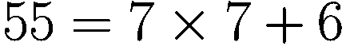

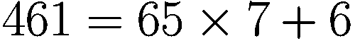

461 除以 7 的余数是 6；55 除以 7 的余数也是 6。因此，461 和 55 关于模 7 同余。我们书写如下：

461≡55 mod 7

一个 `LCG` 由以下递推关系定义：

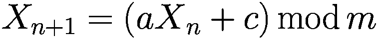

`X[n]` 是一个随机数序列。

`m`，0 < `m`，为模数。

`a`，0 < `a` < `m`，为乘数。

0 ≤ `c` < `m`，为增量，也称为偏移量。

`X[0]`，0 ≤ `X[0]` < `m`，为起始值。

给定起始值 `X[0]`，您可以持续运行递推关系以生成一个随机数序列。假设参数选择得当，随机性质量就很好。所有可能的整数最终都会出现。序列的最大周期是 `m`。然而，`LCG` 的质量很大程度上取决于您选择的参数。它可能会产生短周期甚至非随机的数字（高度序列相关）。您通常不会手动挑选这些参数。

Lehmer 随机数生成器是另一种流行的参数选择方式。它将 `m` 设置为一个素数或素数的幂，并且 `c` = 0。例如，NM Dev 默认使用 `m` = 2147483563 和 `a` = 40014。

`LCG` 的一个问题其周期对于某些应用来说可能太小。创建具有更大周期的 `LCG` 的一种方法是组合多个 `LCG`。组合 `LCG` 的输出等效于单个 `LCG` 的输出，该 `LCG` 的模数与各组件生成器模数的乘积相同，其周期是各组件周期的最小公倍数。

在 NM Dev 中，我们提供了数十种随机数生成器。完整的列表可以在这里找到：

[`https://nm.dev/html/javadoc/nmdev/dev/nm/stat/random/rng/univariate/RandomNumberGenerator.xhtml`](https://nm.dev/html/javadoc/nmdev/dev/nm/stat/random/rng/univariate/RandomNumberGenerator.xhtml)

随机数生成器的签名如下所示。`seed` 方法将 `RNG` 初始化为随机序列的起始点。`nextDouble` 方法根据特定 `RNG` 的属性生成下一个随机数。

```java
public interface Seedable {
/**
* 为随机数/向量/场景生成器设置种子，以产生可重复的实验。
*
* @param seeds 种子
*/
public void seed(long... seeds);
}
public interface RandomNumberGenerator extends Seedable {
/**
* 获取下一个随机 {@code double}。
*
* @return 下一个随机数
*/
public double nextDouble();
}
```

以下代码使用各种 `LCG` 生成了若干随机数序列。`nextLong` 方法为 `LCG` 生成整数；`nextDouble` 方法生成介于 0 和 1 之间的双精度浮点数。^(⁹)

```kotlin
println("使用 Lehmer RNG 生成随机数：")
val rng1 = Lehmer()
rng1.seed(1234567890L)
generateIntAndPrint(rng1, 10)
var arr: DoubleArray = generate(rng1, 10)
print(arr)
```

输出如下：

```  
使用 Lehmer RNG 生成随机数：  
[1435150771, 264992611, 1287986023, 14695885, 1778129691, 1803529921, 261124279, 1119365911, 242889263, 1607847107]  
[0.9693015489683634, 0.6321804200929291, 0.06732959846175084, 0.12655284849786763, 0.8856797936757945, 0.591264143240383, 0.8434276206844243, 0.9128140665540452, 0.34205909356243114, 0.15256980711986945]  
println("Generate random numbers using an LEcuyer RNG:")  
val rng2 = LEcuyer()  
rng2.seed(1234567890L)  
generateIntAndPrint(rng2, 10)  
arr = generate(rng2, 10)  
print(arr)  
```  

输出结果如下：

Generate random numbers using an LEcuyer RNG:  
[931800788, 1315300572, 50110053, 1984090886, 1233048435, 1852047791, 1666959172, 802962765, 288962461, 1436549801]  
[0.5579439720874392, 0.8760583083499495, 0.27437038918694967, 0.8951008789684162, 0.9749086084658786, 0.5236797712387888, 0.5190309786792058, 0.07284812912011898, 0.947280622528531, 0.9903890099331686]  
println("Generate random numbers using a composite LCG:")  
val rng3 = CompositeLinearCongruentialGenerator(  
arrayOf(  
rng1 as LinearCongruentialGenerator,  
rng2 as LinearCongruentialGenerator  
)  
)  
rng3.seed(1234567890L)  
generateIntAndPrint(rng3, 10)  
arr = generate(rng3, 10)  
print(arr)

输出结果如下：

```
Generate random numbers using a composite LCG:  
[1435150771, 264992611, 1287986023, 14695885, 1778129691, 1803529921, 261124279, 1119365911, 242889263, 1607847107]  
[0.9693015115049681, 0.6321803956592273, 0.06732959585946947, 0.12655284360661437, 0.8856797594443706, 0.5912641203880907, 0.8434275880860421, 0.9128140312738847, 0.34205908034188587, 0.15256980122306366]
```

请注意，LCG 生成的是整数。为了从均匀分布中采样，它们会将整数缩放至单位区间内。

通过使用相同的种子，在此例中为 `1234567890L`，代码总能生成相同的随机数序列。这在需要反复进行相同随机实验时非常重要，例如调试或计算 π 值时需要得到相同数值。通常，在一个包含多个 RNG 的应用程序中，它们都应共享同一个底层均匀 RNG。换句话说，无论应用程序可能使用多少个 RNG，它都只能有唯一的一个均匀 RNG。该均匀 RNG 只接受一个种子，并且在整个应用程序的生命周期内，只应在应用程序启动时播种一次。

`CompositeLinearCongruentialGenerator` 的签名如下：

```
/**  
* 根据一些更简单且模数更小的生成器构造一个线性同余生成器。  
*  
* @param rng 更简单且模数更小的线性同余生成器  
*/  
public CompositeLinearCongruentialGenerator(LinearCongruentialGenerator[] rng)
```

### 13.1.2 梅森旋转算法

线性同余法的一个问题在于，其周期对于某些应用来说可能过小。例如，即使使用组合 LCG，`2³²` 仍然很小。因此，LCG 适用于只需要几千个随机数的小型应用，而非数百万个。相比之下，常用的梅森旋转算法（MT）RNG（即 `MT19937`）的周期为 `2¹⁹⁹³⁷ − 1`（Matsumoto & Nishimura, 1998）。此外，MT RNG 具有良好的统计随机性。`MT19937` 是使用最广泛的通用 RNG。

以下代码使用 `MT19937` 在 38.72 毫秒内生成了一百万个随机数：

```
val rng = MersenneTwister()  
val startTime: Long = System.nanoTime()  
val N = 1_000_000  
for (i in 0 until N) {  
rng.nextDouble()  
}  
val endTime: Long = System.nanoTime()  
val duration: Long = (endTime - startTime)  
val ms: Double = duration.toDouble() / 1_000_000.0 // 除以 1000000 得到毫秒数  
println(String.format("Took MT19937 %f milliseconds to generate %d random numbers", ms, N))
```

输出结果如下：

```
Took MT19937 38.72 milliseconds to generate 1000000 random numbers
```

## 13.2 从概率分布中采样

随机数生成广泛应用于游戏、博彩、密码学、仿真以及许多其他需要产生不可预测结果的领域。一些物理现象在本质上是*随机的*（一个表示随机的花哨词汇），例如抛硬币、放射性衰变、粒子位置以及量子领域中的一切。仿真和蒙特卡洛方法已被证明在解决没有其他已知方法的难题时非常有效。它们广泛应用于各个科学分支，并且都基于随机数生成。因此，你经常需要对一个过程或系统的随机性进行建模。换句话说，你需要生成能模拟系统概率特性的随机数。例如，假设你想编写一个模拟抛 100 枚硬币的实验程序，并统计每次实验中出现正面（heads）的次数。你需要根据 50-50 的概率分布生成大量随机数（正面 = 0，反面 = 1）。这被称为从概率分布中采样生成随机数。

随机变量 `X` 是一个可以取不同值的变量。在观测它之前，你并不知道它的具体值（信息被揭示）。这与（确定性的）变量（例如 `x` = 1，它始终只能取一个值）形成对比。每次你“观测”一个随机变量，就是从该随机变量中进行了一次采样。例如，一次抛硬币的结果就是一个随机变量。在抛出硬币之前，你不知道结果是正面还是反面。抛十次硬币会得到十个观测值或样本，例如 `{x[1] = 1, x[2] = 1, x[3] = 0, ⋯, x[10] = 0}`。每个样本都来自一枚公平硬币的概率分布。

概率分布是一个数学函数，它给出了实验中各种可能结果出现的概率。例如，抛一枚公平硬币的概率分布分别赋予正面（heads）0.5（50%）和反面（tails）0.5（50%）的概率。概率分布通常由累积分布函数正式定义。实值随机变量 `X` 在给定值 `x` 处的累积分布函数（CDF），是 `X` 取一个小于或等于 `x` 的值的概率。数学上，可表示如下（参见图 13-1）：

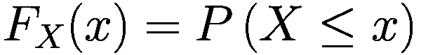

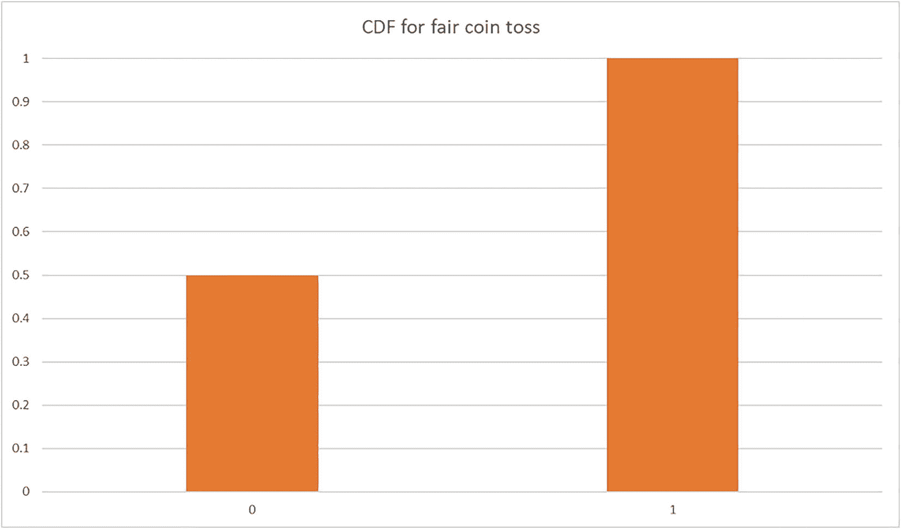

在累积分布函数图上，可以观察到在 0 和 1 处有两个条形图。a 的条形图比 b 的条形图短。

**图 13-1** 公平硬币抛掷的累积分布函数

抛一枚公平硬币（正面标为 0，反面标为 1）的 CDF 如下：

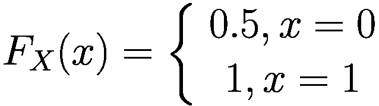

图 13-2 展示了一些正态分布的 CDF。请注意，对于 `μ` = 0（均值为 0）的正态分布，从该概率分布中采样，得到一个小于（或大于）0 的值的概率是 0.5。

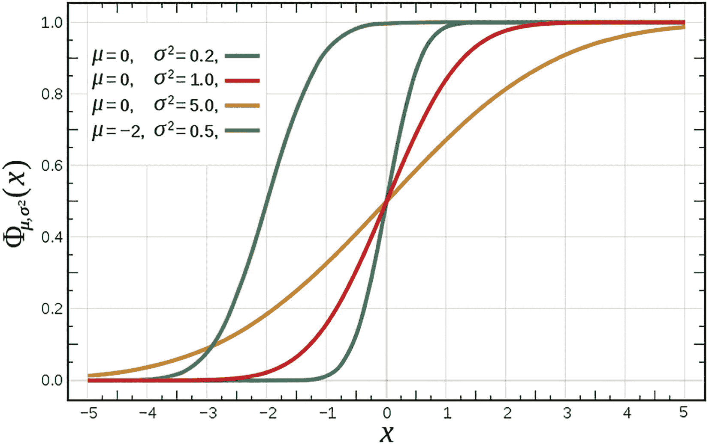

该图绘制了 Phi subscript Mu, sigma square of x 相对于 x 的曲线。图上显示了四条对应于四个累积分布函数的线性曲线。

**图 13-2** 正态分布的累积分布函数

对于连续随机变量，使用概率密度函数（PDF）来描述通常更直观。

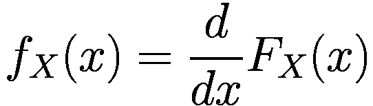

`f_X(x)` 是随机变量等于样本值 `x` 的相对似然。相对似然越大，你看到该样本（而非其他样本）的可能性就越大。对于连续随机变量，绝对似然始终为 0。随机变量值落在某个特定区域内的概率等于该区域在概率密度函数（PDF）下的面积，即 PDF 在该区域上的积分。

我们在第 13.1 节讨论了从均匀分布中采样。本节将讨论从任意概率分布中采样的方法。

### 13.2.1 逆变换采样

# 逆变换采样

逆变换采样是一种方法，用于从给定其累积分布函数的任意概率分布中随机生成样本。它从均匀分布中获取一个介于 0 和 1 之间的随机数 `y`，将其解释为一个概率，然后返回分布 `F_X(x)` 定义域中使得 `F_X(x) <= y` 的最大数 `x`。换句话说，它计算逆函数 `F_X^{-1}(y) = inf {x | F_X(x) >= y}`。以图 13-3 中的示例为例，一个均匀随机数生成四个样本：`U_1`、`U_2^a`、`U_2^b`、`U_2^c`。从概率分布 `F_X(x)` 中得到的相应样本为 `F_X^{-1}(U_1)` 和三个 `F_X^{-1}(U_2)`。

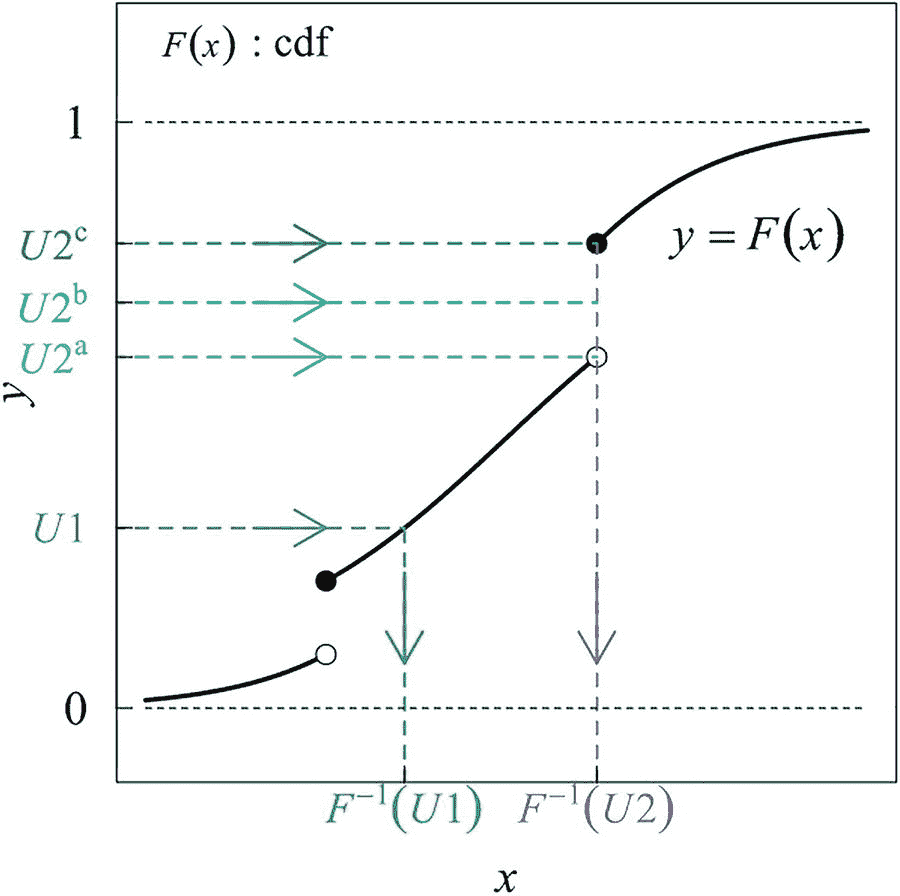

在逆变换采样的图表上，y 轴上显示了两条水平虚线，分别位于 0 和 1 处。给定 `y` 等于 `F(x)`，`F^{-1}(U_1)`，`F^{-1}(U_2)`。`F(x)` 是 CDF。

NM Dev 有一个用于执行逆变换采样的类。其签名如下：

```java
/**
 * 构造一个随机数生成器，用于从分布中采样。
 *
 * @param distribution 要采样的分布
 * @param uniform      一个均匀随机数生成器
 */
public InverseTransformSampling(
    ProbabilityDistribution distribution,
    RandomLongGenerator uniform)
```

瑞利分布具有以下 CDF：

`F(x | σ) = 1 - exp(-x² / (2σ²))`, `x ∈ [0, ∞)`

要为瑞利分布构造一个 RNG，您只需将其概率分布传递给 `InverseTransformSampling`（见图 13-4）。

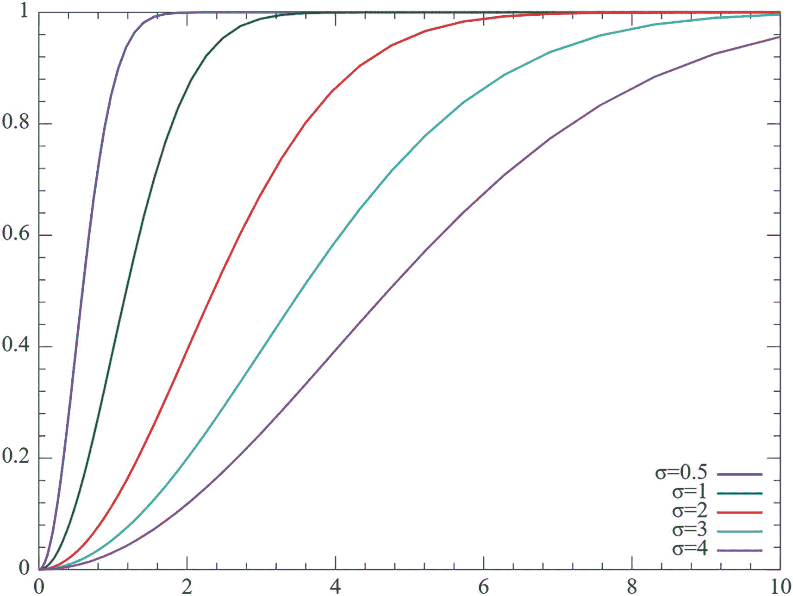

```java
/**
 * 构造一个随机数生成器，用于从瑞利分布中采样。
 *
 * @param sigma 标准差
 */
public RayleighRNG(double sigma) {
    super(new dev.nm.stat.distribution.univariate.RayleighDistribution(sigma));
}
```

在计算上，此方法涉及计算分布的分位数函数，即累积分布函数的逆函数。这就是该方法名称中包含“逆”字的原因。不幸的是，对于许多分布来说，当难以或无法对分布的 PDF 进行积分或计算 CDF 的逆函数时，此方法在计算上效率低下或不可行。逆变换采样对于稀有事件效率低下。对于那些概率接近 0 的事件 (`P(X ∈ A) ≈ 0`)，需要近乎无限数量的均匀样本 (`1 / P(X ∈ A)`) 才能获取到它们。

## 13.2.2 接受-拒绝采样

假设您想从 PDF `f_X(x)` 中采样。您将 PDF 绘制在一个大矩形板上。您随机且均匀地向板上投掷飞镖。然后，您移除落在曲线下方面积之外的飞镖。剩余的飞镖将均匀分布在曲线下的面积内，这些飞镖的 `x` 位置将根据随机变量的密度分布。这是因为曲线最高处（因此概率密度最大）为飞镖提供了最大的着陆空间（见图 13-5）。

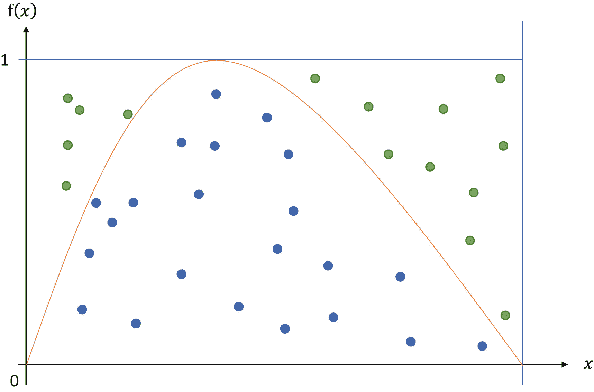

这个想法可以扩展到提议分布不是均匀分布（即矩形板）的情况，也可以是任何您知道如何采样的分布。提议分布需要至少与目标分布一样高，以完全包络后者。否则，您想要采样的曲线区域中有些部分将永远无法到达。这种接受-拒绝算法也适用于更高维度的 PDF。

假设您想从目标 PDF `f(x)` 中采样。您需要找到一个提议 PDF `g(x)`，使得：

*   对于任意 `x`，`f(x) <= M * g(x)`。
*   `g(x)` 易于采样。
*   `g(x)` 的形状应与 `f(x)` 相似。

拒绝方法如下：

1.  从提议分布 `g(x)` 中采样得到 `x[i]`，`x[i] ~ g(x)`。
2.  从均匀分布中采样得到 `u[i]`，`u[i] ~ U(a, b)`。
3.  如果 `u_i <= f(x_i) / (M * g(x_i))`，则接受 `x[i]` 为有效样本；否则，拒绝它。
4.  重复步骤 1 到 3，直到您对样本集满意为止。

该算法的一个缺点是，在找到有效样本之前，可能需要大量不需要的样本。在高维情况下，这个问题更严重，使得算法在这种情形下效率低下且不实用。

## 13.2.3 从单变量分布中采样

逆变换采样和接受-拒绝采样是通用的方法，适用于（几乎）所有概率分布，但它们速度较慢。对于某些特定的概率分布，存在专门且更快的采样方法。NM Dev 拥有大量的 RNG 套件，用于从一些最流行的概率分布中采样：高斯/正态分布、贝塔分布、伽马分布、指数分布、泊松分布、伯努利分布、二项分布、瑞利分布、威布尔分布等。其中一些分布有多种实现，例如正态分布。

### 高斯分布或正态分布

最重要的概率分布或许就是高斯分布或正态分布。许多自然现象都精确地、近似地或假定地服从正态分布。扩散粒子经过一段时间后的位置精确地服从正态分布。一系列抛硬币中正面朝上的次数近似服从正态分布。股票收益对数的变化被假定服从正态分布。其应用在金融、物理学、生物学、统计学等领域无处不在。

从数学角度看，正态分布具有许多优良性质。它们是对称的、单峰的、无限可微的、完全由前两个矩（均值和方差）刻画、具有最大熵、不相关意味着独立，并且具有可加性。或许使正态分布在统计学中占据核心地位的是中心极限定理，该定理指出，当样本量趋近于无穷大时，样本集的均值分布趋近于正态分布。换句话说，所有样本值的平均值（或总和），例如测量值和误差，都近似服从正态分布。见图 13-6。

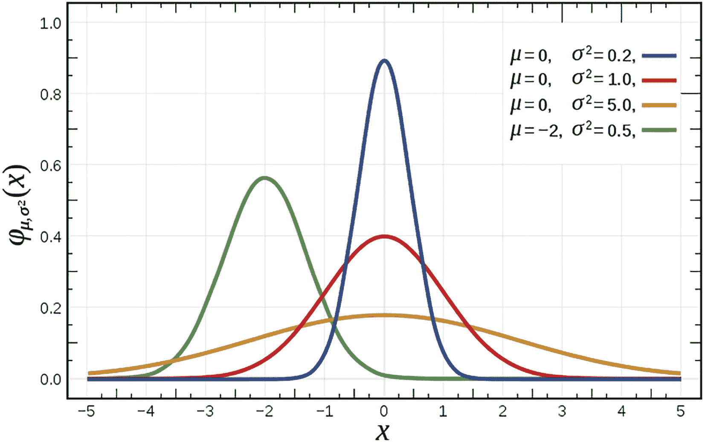

正态分布的概率密度函数如下：

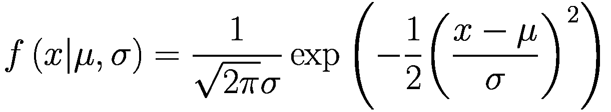

参数 `μ` 是分布的均值或期望值，参数 `σ` 是标准差。分布的方差是 `σ²`。具有高斯分布的随机变量 `X` 被称为服从正态分布，记为 `X`~`N`(`μ`, `σ²`)。正态分布的均值 `μ` 决定了其位置，而标准差 `σ` 决定了分布的幅度。当 `μ` = 0 且 `σ` = 1 时，正态分布称为标准正态分布。

`NM Dev` 提供了多种实现来生成随机正态样本。它们是 `Zignor2005`（Doornik, 2005）、`Ziggurat2000`（Marsaglia & Tsang, 2000）、`MarsagliaBray1964`（G. & Bray）和 `BoxMuller`（Box & Muller, 1958）。默认情况下，我们使用 `Zignor2005`。

以下代码片段是生成标准正态样本和正态样本的示例：

```kotlin
val uniform = MersenneTwister()

uniform.seed(1234567890L)

val rng1 = Zignor2005(uniform) // mean = 0, stdev = 1

val N = 1000

var arr1: DoubleArray = DoubleArray(N)

for (i in 0 until N) {

arr1[i] = rng1.nextDouble()

}

// check the statistics of the random samples

val var1 = Variance(arr1)

println(

String.format(

"mean = %f, stdev = %f",

var1.mean(),

var1.standardDeviation()))

val rng2 = NormalRNG(1.0, 2.0, rng1) // mean = 1, stdev = 2

var arr2: DoubleArray = DoubleArray(N)

for (i in 0 until N) {

arr2[i] = rng2.nextDouble()

}

// check the statistics of the random samples
```

val `var2` = `Variance(arr2)`

`println(`
`String.format(`
`"mean = %f, stdev = %f",`
`var2.mean(),`
`var2.standardDeviation())`

输出结果如下：
```
mean = 0.011830, stdev = 1.009379
mean = 0.940225, stdev = 2.037228
```

样本的统计量匹配了传递给 `RNG` 构造函数的分布参数。签名如下：
```
/**
 * 构造一个改进的 Ziggurat 随机正态生成器。
 *
 * @param uniform 一个均匀随机数生成器
 */
public Zignor2005(RandomLongGenerator uniform)

/**
 * 构造一个从正态分布中采样的随机数生成器。
 *
 * @param mean  均值
 * @param sigma 标准差
 * @param rnorm 一个标准随机正态数生成器
 */
public NormalRNG(double mean, double sigma, RandomStandardNormalGenerator rnorm)
```

标准正态 RNG `Zignor2005` 接收一个均匀 RNG 作为输入，在此示例中为 `MersenneTwister`。然后正态 RNG 接收一个标准正态 RNG 和分布参数作为输入。请注意，在应用程序中，你只需对均匀 RNG 设置一次种子。

### Beta 分布

Beta 分布是一族定义在单位区间 [0, 1] 上的连续概率分布，由两个正的形状参数 `α` 和 `β` 参数化，这两个参数控制着分布的形状。Beta 分布已被应用于众多学科中，用于对限定在有限长度区间内的随机变量行为进行建模。Beta 分布的概率密度函数如下：
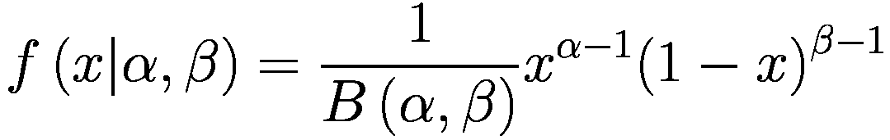
`B(α, β)` 是 Beta 函数。服从参数为 `α` 和 `β` 的 Beta 分布的随机变量 `X` 记作 `X ~ Be(α, β)`。见图 13-7。
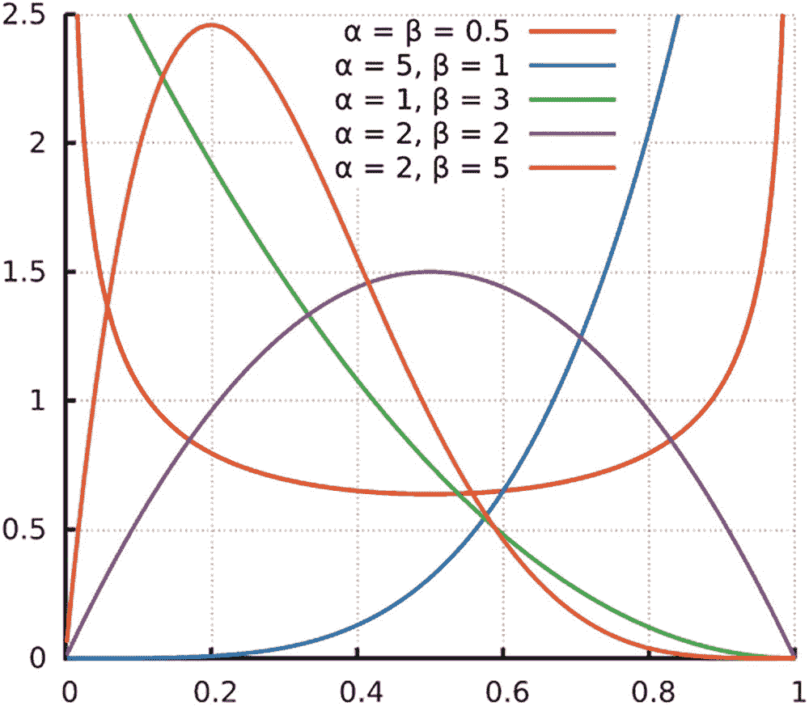
概率密度函数图中有五条曲线。除了一条曲线显示相同的 alpha 和 beta 值外，其余四条曲线均显示不同的 alpha 和 beta 值。**图 13-7:** Beta 分布的概率密度函数

NM Dev 有多种实现可用于生成随机 Beta 样本。它们是 `Cheng1978` (Cheng, 1978) 和 `VanDerWaerden1969` (van der Waerden)。默认情况下，我们使用 `Cheng1978`。`Cheng1978` 类是一种用于生成 Beta 变量的新拒绝方法。该方法在理论上和通过计算机计时上都与先前发表的方法进行了比较。结果表明，该方法在速度和编程简洁性方面均优于先前的方法，尤其适用于参数值的“困难”组合。具体来说，如果 `X` 和 `Y` 分别独立服从 `X ~ Γ(α, θ)` 和 `Y ~ Γ(β, θ)`，那么 `X / (X + Y) ~ Beta(α, θ)`。要从 Beta 分布中采样，可以生成 `X / (X + Y)`，其中 `X` 是参数为 `Γ(α, 1)` 的 Gamma 变量，`Y` 是参数为 `Γ(β, 1)` 的独立 Gamma 变量。

以下代码片段生成 `α = 0.1, β = 0.2` 的 Beta 变量：
```kotlin
val `size` = 1_000_000
val `alpha` : Double = 0.1
val `beta` : Double= 0.2
val `rng` = `Cheng1978(alpha, beta, UniformRNG())`
`rng.seed(1234567890L)`
var `x`: DoubleArray = DoubleArray(`size`)
for (`i` in 0 until `size`) {
    `x`[`i`] = `rng.nextDouble()`
}
// compute the sample statistics
val `mean` = `Mean(x)`
val `variance` = `Variance(x)`
val `skew` = `Skewness(x)`
val `kurtosis` = `Kurtosis(x)`
// compute the theoretical statistics
val `dist`: ProbabilityDistribution = `BetaDistribution(alpha, beta)`
// compare sample vs theoretical statistics
`printStats(dist, mean, variance, skew, kurtosis)`
```

输出如下：
```
theoretical mean = 0.333333, sample mean = 0.333402
theoretical var = 0.170940, sample var = 0.171025
theoretical skew = 0.701066, sample skew = 0.700741
theoretical kurtosis = -1.304348, sample kurtosis = -1.305287
```

可以看到，样本统计量与根据概率分布函数解析计算出的理论值吻合得很好。

构造函数签名如下：
```java
/**
 * Constructs a random number generator to sample from the beta
 * distribution.
 *
 * @param aa      the degree of freedom
 * @param bb      the degree of freedom
 * @param uniform a uniform random number generator
 */
public Cheng1978(double aa, double bb, RandomLongGenerator uniform)
```

## Gamma 分布

Gamma 分布是一族包含两个参数的连续概率分布。指数分布、Erlang 分布和卡方分布都是 Gamma 分布的特例。这两个参数分别是形状参数 `k` 和尺度参数 `θ`。Gamma 分布常用于对等待时间进行建模。例如，在寿命测试中，死亡前的等待时间是一个随机变量，通常用 Gamma 分布来建模。Gamma 分布也用于对保险索赔金额和降雨量进行建模。这意味着，总保险索赔额和水库中的累积降雨量是通过 Gamma 过程来建模的。

在肿瘤学中，癌症发病率的年龄分布通常遵循 Gamma 分布，其形状参数和尺度参数分别预测驱动事件的数量以及这些事件之间的时间间隔。在神经科学中，Gamma 分布常用于描述脉冲间隔分布。在细菌基因表达中，组成型表达蛋白的拷贝数通常遵循 Gamma 分布，其中尺度参数和形状参数分别表示每个细胞周期的平均爆发次数和单个 mRNA 在其生命周期内产生的平均蛋白分子数。

参数 `α = k` 称为形状参数，`β = 1/θ` 称为逆尺度参数。Gamma 分布的概率密度函数如下：

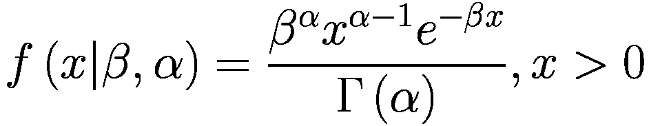

`Γ(α)` 是 Gamma 函数。服从参数为 `α` 和 `β` 的 Gamma 分布的随机变量 `X` 记作 `X ~ Γ(α, β)`。见图 13-8。

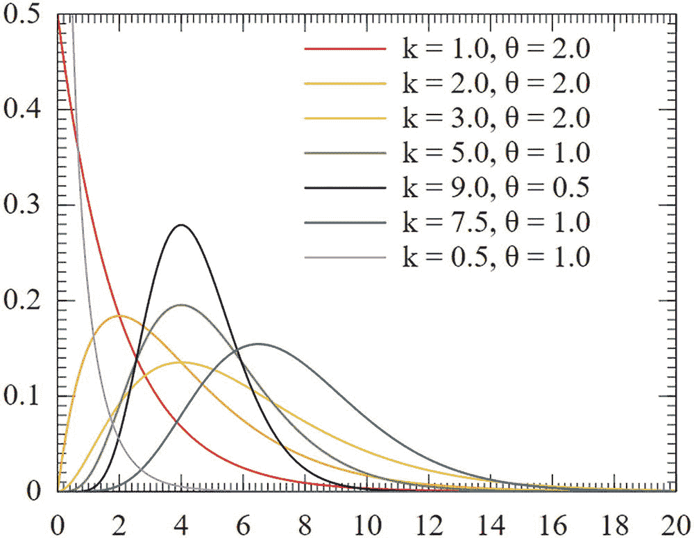

该图包含六个曲线的显示。最高峰处显示了最大的 kappa 值和最小的 theta 值。

**图 13-8:** Gamma 分布的概率密度函数

NM Dev 有多种实现可用于生成随机 Gamma 样本。它们是 `InverseTransformSamplingGammaRNG`（逆变换采样，效率较低）、`MarsagliaTsang2000` (Marsaglia & Tsang, 2000)、`XiTanLiu2010a` 和 `XiTanLiu2010b` (Xi, Tan, & Liu) 以及 `KunduGupta2007` (Kundu & Gupta, 2007)。默认情况下，我们使用 `KunduGupta2007`。当形状参数介于 0 和 1 之间时，它利用广义指数分布以一种便捷的方式生成 Gamma 变量。

以下代码片段生成 `k = 0.1, θ = 1` 的 Gamma 变量：

```kotlin
val size = 1_000_000
val k: Double = 0.1
val theta: Double = 1.0
val rng = KunduGupta2007(k, theta, UniformRNG())
rng.seed(1234567895L)
val x: DoubleArray = DoubleArray(size)
for (i in 0 until size) {
    x[i] = rng.nextDouble()
}
// compute the sample statistics
val mean = Mean(x)
val variance = Variance(x)
val skew = Skewness(x)
val kurtosis = Kurtosis(x)
// compute the theoretical statistics
val dist: ProbabilityDistribution = GammaDistribution(k, theta)
// compute the theoretical statistics
printStats(dist, mean, variance, skew, kurtosis)
```

输出如下：

```
theoretical mean = 0.100000, sample mean = 0.102555
theoretical var = 0.100000, sample var = 0.102297
theoretical skew = 6.324555, sample skew = 6.303562
theoretical kurtosis = 60.000000, sample kurtosis = 60.330271
```

注意，样本统计量与根据概率分布函数解析计算出的理论值吻合得很好。

构造函数签名如下：

```java
/**
 * Constructs a random number generator to sample from the gamma
 * distribution.
 *
 * @param k       the shape parameter
 * @param theta   the scale parameter
 * @param uniform a uniform random number generator
 */
public KunduGupta2007(double k, double theta, RandomLongGenerator uniform)
```

## 泊松分布

泊松过程是一系列离散事件，其中事件之间的平均时间是已知的，但下一个事件的具体发生时间却是随机的。一个事件的发生独立于它之前的事件；也就是说，事件之间的等待时间是马尔可夫性的或无记忆性的。例如，一个呼叫中心全天 24 小时平均每小时接到 180 个电话。这些电话是相互独立的；接到一个电话并不会改变下一个电话何时到来的概率。在任何一分钟内接到的电话数量服从泊松概率分布：最可能的数字是 2 和 3，但 1 和 4 也是可能的，并且有很小的概率是 0，而概率非常小的情况是 10。另一个例子是在给定的观察期内，从放射源发生的衰变事件数量。如果事件在固定时间间隔内的数量具有已知的平均值，并且与自上一个事件以来的时间无关，那么泊松分布概率质量函数给出了在该固定时间间隔内观察到 `k` 个随机事件的概率。该概率质量函数的形式如下：

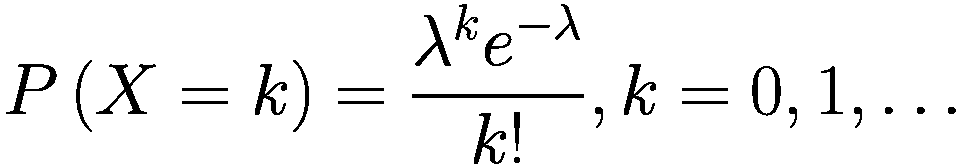

泊松分布的参数 `λ` 是单位时间内随机事件的平均数量。泊松分布的期望和方差都是 `λ`。请注意，与你之前看到的所有分布不同，泊松分布是一种离散分布。`X` 取整数值。见图 13-9。

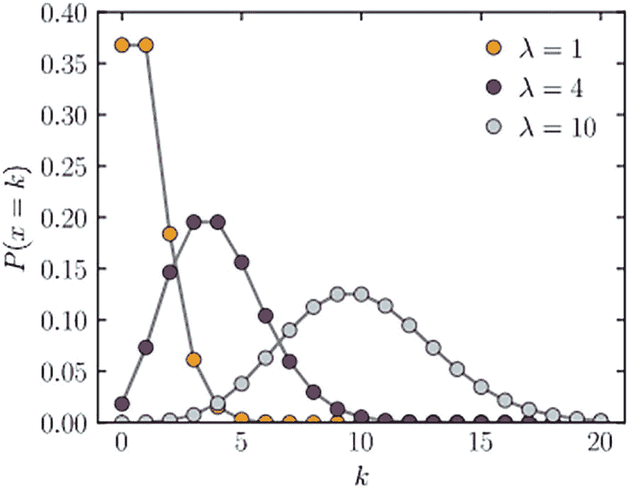

概率质量函数图 `P of X` 等于 `K` 相对于 `K` 的变化。图中以三个不同的图显示了三个不同的 lambda 值：1、4 和 10。

**图 13-9** 泊松分布的概率质量函数

在 NM Dev 中，泊松随机数生成器类是 `Knuth1969`。以下代码片段生成 `λ` = 1 的泊松随机变量：

```kotlin
val N = 10_000
val lambda: Double = 1.0
val rng = Knuth1969(lambda)
rng.seed(123456789L)
var x: DoubleArray = DoubleArray(N)
for (i in 0 until N) {
    x[i] = rng.nextDouble()
}
// 计算样本统计量
val mean = Mean(x)
val variance = Variance(x)
val skew = Skewness(x)
val kurtosis = Kurtosis(x)
// 计算理论统计量
val dist: PoissonDistribution = PoissonDistribution(lambda)
// 计算理论统计量
printStats(dist, mean, variance, skew, kurtosis)
```

输出如下：

```
theoretical mean = 1.000000, sample mean = 1.013300
theoretical var = 1.000000, sample var = 1.022225
theoretical skew = 1.000000, sample skew = 1.000960
theoretical kurtosis = 1.000000, sample kurtosis = 0.990813
```

请注意，样本统计量与根据概率分布函数解析计算的理论值相符。

构造函数的签名如下：

```java
/**
 * 构造一个随机数生成器，用于从泊松分布中抽样。
 *
 * @param lambda  形状参数
 * @param uniform 均匀随机数生成器
 */
```

public `Knuth1969(double lambda, RandomLongGenerator uniform)`

# 指数分布

泊松分布描述了一个区间内的事件数量，而指数分布则描述了泊松过程中事件之间的时间间隔。它是随机时间所服从的分布，是伽马分布的一个特例。指数分布有很多例子，例如放射性粒子衰变前的剩余时间、接听下一个电话之前的等待时间，或者在信用风险模型中贷款违约发生前的剩余时间。

`λ` > 0 被称为速率参数。它表示单位时间内事件发生的平均次数。随机时间范围是 [0, ∞)。如果一个随机变量 `X` 服从指数分布，则记为 `X~E(λ)`。其概率密度函数如下（图 [13-10）：

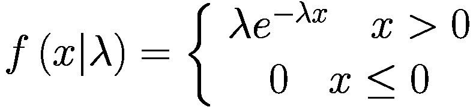

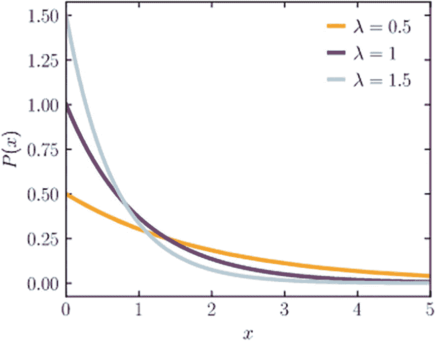

概率密度函数图 `P of x` 相对于 `x` 的变化。图中以三个不同的图显示了三个不同的 lambda 值：0.5、1 和 1.5。该函数呈现下降趋势。

`图 13-10` 指数分布的概率密度函数

你可以使用逆变换抽样生成指数随机变量。NM Dev 实现了一种更高效的算法，称为 `Ziggurat2000Exp` (Marsaglia & Tsang, 2000)。以下代码片段生成 `λ` = 1 的标准指数随机变量。请注意，`Ziggurat2000Exp` 使用默认构造函数，不接受参数。

```kotlin
val size = 500_000

val rng = Ziggurat2000Exp()

rng.seed(634641070L)

var x: DoubleArray = DoubleArray(size)

for (i in 0 until size) {

    x[i] = rng.nextDouble()

}

// 计算样本统计量

val mean = Mean(x)

val variance = Variance(x)

val skew = Skewness(x)

val kurtosis = Kurtosis(x)

// 计算理论统计量

val dist: ProbabilityDistribution = ExponentialDistribution()

// 计算理论统计量

printStats(dist, mean, variance, skew, kurtosis)
```

输出如下：

```
theoretical mean = 1.000000, sample mean = 1.000983

theoretical var = 1.000000, sample var = 0.996058

theoretical skew = 2.000000, sample skew = 1.958222

theoretical kurtosis = 6.000000, sample kurtosis = 5.489008
```

请注意，样本统计量与根据概率分布函数解析计算的理论值相符。

要生成非标准指数方差，你可以首先生成标准指数随机变量，然后对其进行缩放。或者，你也可以直接使用 `InverseTransformSamplingExpRNG`，它接受 `λ` 作为参数。其签名如下：

```java
/**

 * 构造一个随机数生成器，使用逆变换抽样方法从指数分布中抽样。

 *

 * @param lambda 速率参数

 */

public InverseTransformSamplingExpRNG(double lambda)
```

### 13.2.4 从多元分布中抽样

NM Dev 支持为某些更高维度的多元分布生成随机向量。每个样本是一个数字向量，而不仅仅是一个数字。这些分布包括但不限于：

- 高维盒子区域上的多元均匀分布
- 高维单位超球面上的多元均匀分布
- 多元正态分布
- 多项分布

随机向量随机数生成器 `RandomVectorGenerator` 的签名如下：

```java
public interface RandomVectorGenerator extends Seedable {

    /**

     * 获取下一个随机向量。

     *

     * @return 下一个随机向量

     */

    public double[] nextVector();

}
```

每次调用 `nextVector` 都会生成一个以 `double[]` 形式表示的向量样本。

#### 盒形区域上的多元均匀分布

`UniformDistributionOverBox`类是一个随机向量随机数生成器，用于在高维超立方体（即盒形区域）内生成均匀采样。它接受一个一维均匀随机数生成器作为输入，以及盒形的维度（参见图 13-11）。其签名如下：

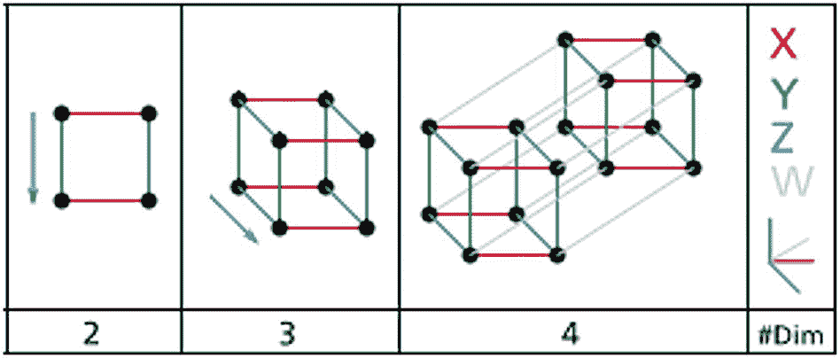

图中展示了三种不同类型的立方体。根据它们所代表的维度数量，第一个立方体代表二维，第二个代表三维，第三个图像代表四维。

`图 13-11`

`不同维度的立方体`

```java
/**

 * 构造一个随机向量生成器，用于在盒形区域内均匀采样。

 *

 * @param uniform 均匀随机数生成器

 * @param bounds  可行的盒形区域

 */

public UniformDistributionOverBox(

    RandomLongGenerator uniform,

    RealInterval... bounds

)
```

以下示例展示了如何使用随机采样来计算圆周率 `π`（即圆的周长与直径之比）。其思路是向一个包含圆形的单位板上随机投掷飞镖，其中 `x` ∈ [−1, 1]，`y` ∈ [−1, 1]。正方形的面积为 1，圆的面积为 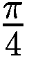，因为半径为 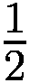。也就是说，圆内的飞镖数 `N[0]` 与整个板上的飞镖数 `N` 之间存在如下比例关系：

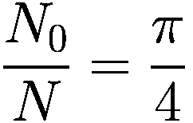

求解 `π`。以下代码实现了该过程：

```kotlin
val N = 1_000_000

val rvg = UniformDistributionOverBox(

    RealInterval(-1.0, 1.0), // 一个单位正方形的盒形区域

    RealInterval(-1.0, 1.0))

var N0 = 0

for (i in 0 until N) {

    val xy: DoubleArray = rvg.nextVector()

    val x: Double = xy[0]

    val y: Double = xy[1]

    if (x * x + y * y <= 1.0) { // 检查点是否在圆内

        N0++

    }

}

val pi: Double = 4.0 * N0 / N

println("pi = " + pi)
```

输出结果如下：

```
pi = 3.139588
```

#### 超球体上的多元均匀分布

`HypersphereRVG`类是一个随机向量随机数生成器，用于在高维超球体表面生成均匀采样。它接受球体维度以及一维标准正态随机数生成器作为输入。其签名如下：

```java
/**

 * 构造一个超球体随机向量生成器，用于生成随机均匀点。

 *

 * @param dimension 超球体的维度

 * @param rnorm     要使用的标准正态随机数生成器

 */

public HypersphereRVG(int dimension, RandomStandardNormalGenerator rnorm)
```

# 多元正态分布

多元正态分布（multivariate normal distribution）、多元高斯分布（multivariate Gaussian distribution）或联合正态分布（joint normal distribution）是一维（单变量）正态分布向更高维度的推广。其定义之一是：如果一个随机向量的任意 `k` 个分量的线性组合都服从单变量正态分布，则称该随机向量服从 `k` 元正态分布。根据多维中心极限定理，多元正态分布通常（至少近似地）用于描述一组可能相关的实值随机变量，这些变量各自围绕某一均值聚集。

一个实随机向量 **`X`** = (`X[1]`, ⋯, `X[k]`)`^(*T*)` 被称为（多元）标准正态随机向量，如果其每个分量 `X[i]` 本身都是单变量标准正态分布，并且它们相互独立。也就是说，对所有 `i`，有 `X[i] ~ N(0, 1)`。可以证明，任何多元正态向量都可以表示为一个 `k` 维向量 `μ` 与一个经过缩放的多变量标准正态向量之和。即，**`X`** ~ `N(**μ**, σ)` 当且仅当存在 **`μ`** ∈ `ℝ^k` 和 **`A`** ∈ `ℝ^(kxl)`，使得 **`X`** = **`AZ`** + **`μ`**，其中 `Z` 是一个多变量标准正态向量。**`μ`** 是 `k` 维均值向量，**σ** 是分量的 `k` × `k` 协方差矩阵。参见图 13-12。

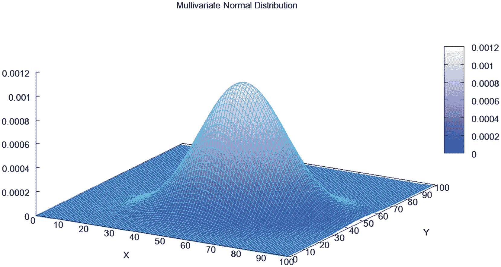

概率密度函数的图形。图中较浅的阴影表示 `y` 轴上更高的值，较深的阴影表示更低的值。

**图 13-12**  
*二维正态分布的概率密度函数*

多元正态分布的概率密度函数如下：


在 NM Dev 中，`NormalRVG` 类用于从多元正态分布中采样。以下代码片段生成了相关的多元正态变量：

```kotlin
// 均值
val mu: Vector = DenseVector(arrayOf(-2.0, 2.0))
// 协方差矩阵
val sigma: Matrix = DenseMatrix(
    arrayOf(
        doubleArrayOf(1.0, 0.5),
        doubleArrayOf(0.5, 1.0)
    )
)
val rvg = NormalRVG(mu, sigma)
rvg.seed(1234567890L)
val size = 10_000
var mean1 = Mean()
var mean2 = Mean()
val X: Matrix = DenseMatrix(size, 2)
for (i in 0 until size) {
    val v: DoubleArray = rvg.nextVector()
    mean1.addData(v[0])
    mean2.addData(v[1])
    X.set(i+1, 1, v[0])
    X.set(i+1, 2, v[1])
}
println(String.format("mean of X_1 = %f", mean1.value()))
println(String.format("mean of X_2 = %f", mean2.value()))
val cov: SampleCovariance = SampleCovariance(X)
println(String.format("sample covariance = %s", cov.toString()))
```

输出结果如下：

```
mean of X_1 = -2.007342
mean of X_2 = 1.995800
sample covariance = 2x2
[,1] [,2]
[1,] 1.003598, 0.496158,
[2,] 0.496158, 1.012381,
```

样本均值和样本协方差矩阵都与输入值吻合得相当好。

`NormalRVG` 的构造函数签名如下：

```java
/**
 * 构造一个多元正态随机向量生成器。
 *
 * @param mu      均值
 * @param sigma   协方差矩阵
 * @param epsilon 精度参数：当数值 |x| ≤ ε 时，视为 0
 * @param rnorm   随机标准正态数生成器
 */
public NormalRVG(
    final Vector mu,
    final Matrix sigma,
    final double epsilon,
    final RandomStandardNormalGenerator rnorm
)
```

# 多项分布

多项分布根据各个箱子的概率将 `n` 个物品分配到 `k` 个箱子中。输出的随机向量会统计每个箱子中的物品数量，总数为 `n`。当 `k` = 2 且 `n` = 1（将一个物品放入两个箱子）时，它就是伯努利分布。输出结果是 (0, 1) 或 (1, 0)。这就像抛一次（不一定是公平的）硬币，你要么得到正面，要么得到反面。当 `k` = 2 且 `n` > 1（将 `n` 个物品放入两个箱子）时，它就是二项分布。这就像反复抛同一枚硬币 `n` 次，并统计正面（或反面）的次数。对于一个固定的有限 `k`，**`X`** 中的第 `i` 个分量表示在总共 `n` 个物品中，第 `i` 个箱子内的物品数量。

多项分布的概率质量函数如下：

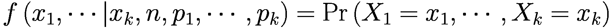

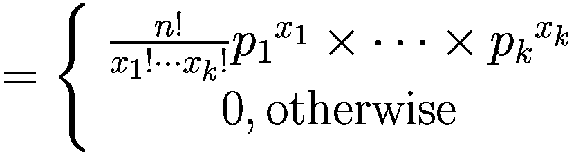

在 NM Dev 中，`MultinomialRVG` 类用于从多项分布中采样。以下代码片段将 10,000 个物品放入两个箱子，概率分别为 70% 和 30%：

```kotlin
val rvg = MultinomialRVG(100_000, doubleArrayOf(0.7, 0.3)) // 箱子 0 的概率是 70%，箱子 1 是 30%
val bin: DoubleArray = rvg.nextVector()
var total: Double = 0.0
for (i in 0 until bin.size) {
    total += bin[i]
}
val bin0: Double = bin[0] / total // 箱子 0 的百分比
val bin1: Double = bin[1] / total // 箱子 1 的百分比
println(String.format("bin0 %% = %f, bin1 %% = %f", bin0, bin1))
```

输出结果如下：

```
bin0 % = 0.702410, bin1 % = 0.297590
```

样本的百分比与输入中每个箱子的个体概率相当吻合。

`MultinomialRVG` 的构造函数签名如下：

```java
/**
 * 构造一个多项随机向量生成器。
 *
 * @param N       一个整数，记为 N，指定在典型的多项实验中放入 K 个箱子的总物品数
 * @param prob    一个长度为 K 的数值非负向量，指定了 K 个箱子的概率
 * @param uniform 一个均匀随机数生成器
 */
public MultinomialRVG(int N, double[] prob, RandomLongGenerator uniform)
```

# 13.2.5 重采样方法

可视化经验分布方法的一种方式如下。给定一组样本，经验分布为每个样本分配 `1/N` 的概率。然后，以 `1/N` 的概率，从该集合中随机抽取一个样本作为下一个随机变量。在集合中出现频率更高的物品被抽中的可能性更大，因此具有更高的概率质量。稀有物品被抽中的可能性较小，因此在输出中出现的频率也较低。本质上，你是通过从样本集中采样来生成新样本。你可以将这种重采样思想推广到一次抽取多个物品。这种方法相对于经验分布方法的一个重要优势是，前者还考虑了样本之间的序列相关性，而后者假设数据集中的所有样本都是独立同分布的。换句话说，通过重采样方法生成的变量不仅具有与真实分布相似的概率分布，而且它们还具有相似的序列相关性（样本之间的时间依赖性）。当系统的真实概率分布未知时，重采样方法是进行统计估计和统计推断的一种常用非参数方法。

在 NM Dev 中，重采样类实现了此接口。每次调用 `newResample()` 方法都会基于原始样本集生成一个新的样本块。

```java
public interface Resampler extends Seedable {

    /**

     * 从原始样本中获取一个重采样样本。

     *

     * 此方法必须是线程安全的，这一点非常重要，以便可以并行运行重采样。

     *

     * @return 一个重采样样本，例如，一个自助法样本

     */

    public double[] newResample();

}
```

### 自助法

自助法是从给定的样本集（通常称为训练集）中进行有放回的均匀采样。当选择一个样本块时，它就成为 RNG 的输出。相同的样本会被“放回”到训练集中，并可被重新选择。自助法的基本思想是，关于真实概率分布 `J` 的总体的推断，可以通过使用经验分布 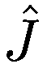 计算推断来近似。由于我们知道 ，因此可以衡量使用重采样数据时关于  的推断的准确性。如果  是 `J` 的一个合理近似，那么反过来就可以推断出对 `J` 的推断质量。

更具体地说，假设你想估计全球人口的平均身高。你无法测量全球所有人。相反，你只抽样一小部分人并进行测量。假设样本大小为 `N`；也就是说，你测量了 `N` 个人的身高。根据这一个样本，只能获得一个均值估计。要推断总体情况，你需要对你计算出的均值有一定的变异性感知。最简单的自助法包括获取原始的身高数据集（训练集），并从中采样以形成一个同样大小为 `N` 的新样本（称为重采样样本或自助法样本）。通过有放回采样从原始数据中获取自助法样本（例如，你可能会从 `[150, 155, 160, 165, 170]` 中“重采样”五次，得到 `[155, 170, 165, 165, 150]`）。如果 `N` 足够大，对于所有实际应用来说，该样本与训练集完全相同的概率几乎为零。这个过程会重复大量次数（通常为 1,000 或 10,000 次）。对于这些自助法样本中的每一个，你都计算其均值（每个这样的均值都称为一个自助法估计）。现在你可以创建一个自助法均值的直方图，如图 13-13 所示。该直方图提供了样本均值分布形状的估计，从中你可以回答关于不同重采样样本之间均值变化程度的问题。这里描述的针对均值的方法可以应用于几乎任何统计量或估计量。

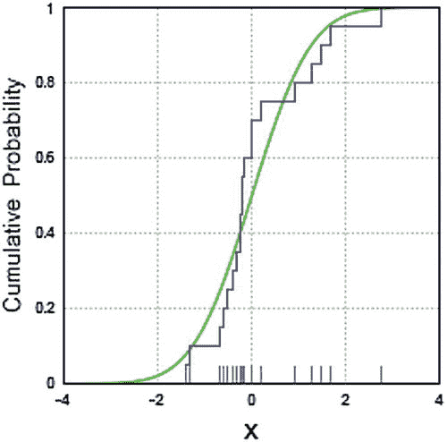

自助法均值的直方图，y 轴表示累积概率。该图呈现上升趋势。

**图 13-13** 自助法均值直方图

以下代码片段实现了前面估计平均身高的示例：

```kotlin
// 从真实总体中抽样

val sample: DoubleArray = doubleArrayOf(150.0, 155.0, 160.0, 165.0, 170.0)

val boot = CaseResamplingReplacement(sample)

boot.seed(1234567890L)

val B = 1000

var means = DoubleArray(B)

for (i in 0 until B) {

    val resample: DoubleArray = boot.newResample()

    means[i] = Mean(resample).value()

}

// 总体均值的估计量

val mean: Double = Mean(means).value()

// 受样本量限制的估计量方差（无论 B 多大）

val variance: Double = Variance(means, true).value()

println(

    String.format("mean = %f, variance of the estimated mean = %f",

        mean,

        variance))
```

另外，`BootstrapEstimator` 提供了一个便捷的包装器来重写此示例，如下所示：

```kotlin
// 来自总体的样本

val sample = doubleArrayOf(150.0, 155.0, 160.0, 165.0, 170.0)

val boot = CaseResamplingReplacement(sample)

boot.seed(1234567890L)

val B = 1000

val estimator = BootstrapEstimator(

boot,

object : StatisticFactory {

override fun getStatistic(): Statistic {

return Mean()

}

},

B

)

println(

String.format("mean = %f, variance of the estimated mean = %f",

estimator.value(),

estimator.variance()))
```

输出如下：

```
mean = 159.976000, variance of the estimated mean = 9.286711
```

总体身高的估计均值为 159.976，其精度（以估计均值的方差衡量）为 9.2867。注意，这是估计值的方差，而非总体身高的方差。

本例中使用的自助法重采样器为 `CaseResamplingReplacement` 类。其签名如下：

```java
/**

* 构建一个自助法样本生成器。这是经典的有放回自助法。

*

* @param sample 原始样本。

*/

public CaseResamplingReplacement(double[] sample)
```

`BootstrapEstimator` 的签名如下：

```java
/**

* 构建一个自助法估计量。

*

* @param bootstrap 自助法方法和样本

* @param factory   统计量

* @param B         自助法副本的数量

*/

public BootstrapEstimator(

Resampler bootstrap,

StatisticFactory factory,

int B
)
```

一般来说，增加训练集大小`N`会提升在相同自助法重采样次数下的精度。增加自助法重采样次数`B`会改进估计本身，但不会提高精度。每次重采样中单个样本被选中的概率为 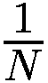，因此未被选中的概率为 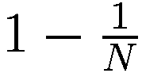。在所有`B`次重采样中都未被选中的概率，即未出现在任何重采样集里，为 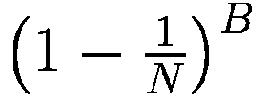。当训练集大小和重采样次数都趋于无穷时，该概率将趋近于`e`^(−1) = 0.368。^(¹⁰) 换言之，使用朴素的有放回案例重采样方法，训练集中仅有约 63.2% 的原始数据会出现在重采样中。

## Politis-White-Patton 方法

NM Dev 还根据《依赖自助法的自动块长选择》（Politis & White, 2004）及其勘误（Politis, White, & Patton, 2009）实现了自助法。Politis-White-Patton 自助法生成序列（即具有序列依赖性或时间依赖性的数据系列）的重采样，这些重采样比简单的有放回案例重采样方法更接近训练数据。例如，任何给定模式的出现次数更接近原始序列中的次数。以下代码示例通过以概率`q`保留上一个值，同时以概率 (1 − `q`) 改变该值，构建了一个序列依赖序列（由 0 和 1 组成）。然后，对于像 {1, 0, 1, 0, 1} 这样的给定模式，它比较了该模式在训练序列中的出现次数与在不同自助法重采样序列中的出现次数。

```
/**
 * 构建一个依赖序列（由 0 和 1 组成），通过以概率 q 保留上一个值，
 * 同时以概率 1-q 改变该值。
 *
 * 简单的自助法 {@linkplain CaseResamplingReplacement} 会严重高估某些模式的
 * 出现次数，而块自助法 {@linkplain BlockBootstrap} 能较好地估计原始样本中
 * 的出现次数。所有估计量都存在高估。
 */
val N: Int = 10000
val q: Double = 0.70 // 保留上一个值的概率
val uniformRNG = UniformRNG()
uniformRNG.seed(1234567890L)
// 生成一个具有序列相关性的 0 和 1 随机序列
var sample: DoubleArray = DoubleArray(N)
sample[0] = if(uniformRNG.nextDouble() > 0.5) 1.0 else 0.0
for (i in 1 until N) {
    sample[i] = if(uniformRNG.nextDouble() < q) sample[i - 1] else 1 - sample[i - 1]
}

// 简单的有放回案例重采样方法
val simpleBoot = CaseResamplingReplacement(sample, uniformRNG)
val countInSimpleBootstrap = Mean()
val rlg: RandomNumberGenerator = Ziggurat2000Exp()
rlg.seed(1234567890L)

// 使用平稳块的 Patton-Politis-White 方法
val stationaryBlock = PattonPolitisWhite2009(
    sample,
    PattonPolitisWhite2009ForObject.Type.STATIONARY,
    uniformRNG,
    rlg)
val countInStationaryBlockBootstrap = Mean()

// 使用循环块的 Patton-Politis-White 方法
val circularBlock = PattonPolitisWhite2009(
    sample,
    PattonPolitisWhite2009ForObject.Type.CIRCULAR,
    uniformRNG,
    rlg)
val countInCircularBlockBootstrap = Mean()

// 修改这一行以使用不同的模式
val pattern: DoubleArray = doubleArrayOf(1.0, 0.0, 1.0, 0.0, 1.0)
val B: Int = 10000
for (i in 0 until B) {
    // 统计模式在序列中的出现次数
    var numberOfMatches = match(simpleBoot.newResample(), pattern)
    countInSimpleBootstrap.addData(numberOfMatches)

    // 统计模式在序列中的出现次数
    numberOfMatches = match(stationaryBlock.newResample(), pattern)
    countInStationaryBlockBootstrap.addData(numberOfMatches)

    // 统计模式在序列中的出现次数
    numberOfMatches = match(circularBlock.newResample(), pattern)
    countInCircularBlockBootstrap.addData(numberOfMatches)
}

// 比较使用不同自助法时的模式出现次数
val countInSample = match(sample, pattern).toInt()
println("样本中匹配的模式数：" + countInSample)
println("简单自助法中匹配的模式数：" + countInSimpleBootstrap.value())
println("平稳块自助法中匹配的模式数：" + countInStationaryBlockBootstrap.value())
println("循环块自助法中匹配的模式数：" + countInCircularBlockBootstrap.value())
```

输出如下：

```
样本中匹配的模式数：39
简单自助法中匹配的模式数：316.8101000000013
平稳块自助法中匹配的模式数：45.09940000000004
循环块自助法中匹配的模式数：44.1490999999999
```

在原始训练序列中，模式 {1, 0, 1, 0, 1} 出现了 39 次。使用简单有放回案例重采样方法得到的自助法序列偏差很大（316 次）。使用 Politis-White-Patton 方法得到的自助法序列则接近原始训练序列，分别为 45 次和 44 次。

`PattonPolitisWhite2009` 类的签名如下：

```
/**
 * 构建一个块自助法样本生成器。块长会自动选择。
 *
 * @param sample  原始样本
 * @param type    块自助法的类型，可以是
 *                Type#STATIONARY 或
 *                Type#CIRCULAR
 * @param uniform 一个并发的随机长整数生成器
 * @param rng     一个并发的随机指数生成器
 */
public PattonPolitisWhite2009(
    double[] sample,
    PattonPolitisWhite2009ForObject.Type type,
    RandomLongGenerator uniform,
    RandomNumberGenerator rng
)
```

# 13.3 方差缩减

假设你要估计随机变量 `X` 的统计量 `Z`。你需要生成大量 `X[1]`，...，`X[n]`，然后为每个 `X[i]` 计算统计量 `Z[i]`，得到 `Z[1]`，...，`Z[n]`。估计量如下所示：

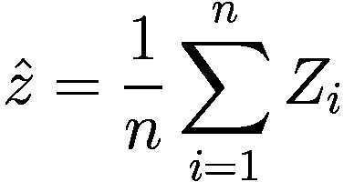

这种方法称为蒙特卡洛模拟。由于这种基于随机性的计算本质，每个随机样本都关联着一个限制结果精度的方差。中心极限定理指出，当 `n` → ∞ 时，`$$ \hat{z} $$` 收敛于一个均值为真值 `z`、标准误差为 `$$ \frac{\sigma }{\sqrt{n}} $$` 的正态分布。这意味着标准误差（逆精度）以 `$$ \sqrt{n} $$` 的速率趋近于 0。要使估计量的精度提高一倍，你需要四倍数量的随机样本。例如，对于第 13.2.4.1 节中的 `compute_Pi` 代码，使用 1,000,000 个样本时，精度为两位小数。要将精度再提高一倍，你需要 4,000,000 个样本。这需要生成大量样本点。

给定相同的计算量（例如使用的随机样本数量），方差缩减有助于提高估计量的精度。NM Dev 提供了一套开箱即用的方差缩减技术，可用于提高估计量的精度。

## 13.3.1 公共随机数

当你想要比较两个或多个估计量时，公共随机数（CRNs）是一种流行且有效的方差缩减技术。更具体地说，假设你想要估计以下内容：

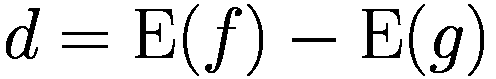

如果你分别使用两个独立的随机数流来计算 `f` 和 `g`，如下所示：

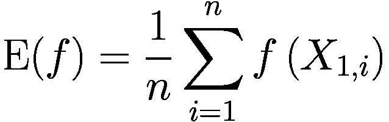

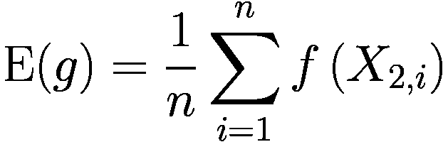

你会得到：

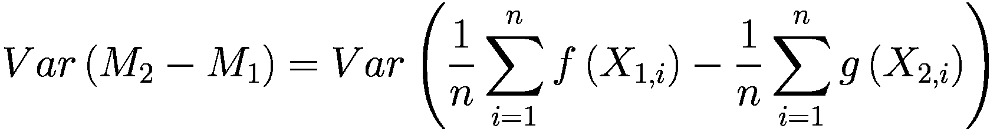

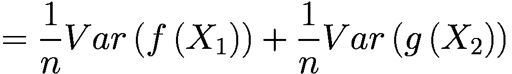

假设 `X[1, i]` 和 `X[2, i]` 是正相关的；那么你会得到：

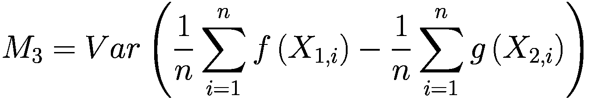

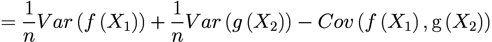

如果进一步假设 `f` 和 `g` 都是单调非递减的，那么正协方差 `Cov(X[1], X[2])` 意味着正协方差 `Cov(f(X[1]), g(X[2]))`。因此，估计量的方差得到了缩减。

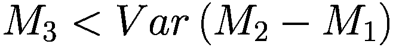

以下代码计算了这个值：

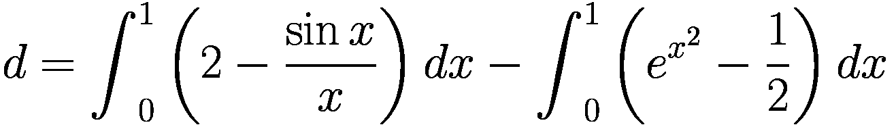

```
val f: UnivariateRealFunction = object : AbstractUnivariateRealFunction() {
    override fun evaluate(x: Double): Double {
        val fx: Double = 2.0 - Math.sin(x) / x
        return fx
    }
}

val g: UnivariateRealFunction = object : AbstractUnivariateRealFunction() {
    override fun evaluate(x: Double): Double {
        val gx: Double = Math.exp(x * x) - 0.5
        return gx
    }
}

val X1: RandomLongGenerator = UniformRNG()
X1.seed(1234567890L)

val crn0: CommonRandomNumbers
    = CommonRandomNumbers(
        f,
        g,
        X1,
        object : AbstractUnivariateRealFunction() { // 另一个独立的均匀分布 RNG
            override fun evaluate(x: Double): Double {
                var X2: RandomLongGenerator = UniformRNG()
                X2.seed(246890123L)
                return X2.nextDouble()
            }
        })

val estimator0: Estimator = crn0.estimate(100_000)

println(
    String.format("d = %f, Variance = %f",
        estimator0.mean(),
        estimator0.variance()))

val crn1: CommonRandomNumbers
    = CommonRandomNumbers(f, g, X1) // 对 f 和 g 均使用 X1

val estimator1: Estimator = crn1.estimate(100_000)

println(
    String.format("d = %f, variance = %f",
        estimator1.mean(),
        estimator1.variance()))
```

输出如下：

```
d = 0.091698, variance = 0.227836
d = 0.090606, variance = 0.182244
```

两个 CRN 估计量中的 `d` ≈ 0.091。第二个 CRN 估计量使用了相关的（实际上是相同的）随机数序列 `X[1]`，其精度（方差更小）优于第一个 CRN 估计量，后者使用了两个独立的随机数流 `X[1]` 和 `X[2]`。请注意，CRN 可能在某些情况下不适用，或者如果 `Cov(f(X[1]), g(X[2]))` < 0，其性能可能更差。

`CommonRandomNumbers` 类的构造函数签名如下：

```
/**
 * 估计 \(E(f(X_1) - g(X_2))\)，其中 f 和 g 是
```

# 13.3.2 对偶变量法

/**

 * 均匀随机变量的函数。我们设置`X2 = X1`。

 *

 * @param `f`  第一个系统

 * @param `g`  第二个系统

 * @param `X1` 一个均匀随机数生成器

 */

public `CommonRandomNumbers`(

    `UnivariateRealFunction` f,

    `UnivariateRealFunction` g,

    `RandomLongGenerator` X1

)

对偶变量法是一种通过在观测对之间引入负相关来缩减方差的技术。一般来说，你有：

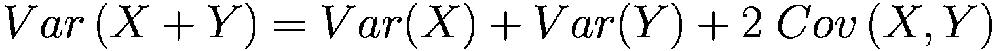
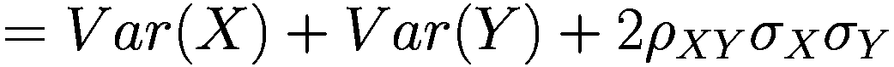

如果 *X* 和 *Y* 之间的相关性 `ρ[XY]` 为负，则 (*X* + *Y*) 的方差小于它们各自的方差之和，从而实现方差缩减。一种实现方法是，对于获得的每个样本路径 `{ε[1]，⋯，ε[n]}`，构造其对偶路径为 `{−ε[1]，⋯，−ε[n]}`。这实际上使样本数量翻倍，并减少了样本路径的方差，从而提高了精度。

以下代码计算积分 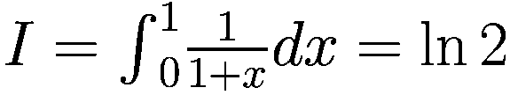：

```kotlin
val f: UnivariateRealFunction = object : AbstractUnivariateRealFunction() {
    override fun evaluate(x: Double): Double {
        val fx: Double = 1.0 / (1.0 + x)
        return fx
    }
}
val uniform: RandomLongGenerator = UniformRNG()
uniform.seed(1234567894L)
val av: AntitheticVariates = AntitheticVariates(
    f,
    uniform,
    AntitheticVariates.REFLECTION)
val estimator: Estimator = av.estimate(1500)
println(
    String.format(
        "mean = %f, variance = %f",
        estimator.mean(),
        estimator.variance()))
```

输出如下：

```
mean = 0.693158, variance = 0.000595
```

方差为 0.0006。如果使用朴素方法，方差将为 0.00255。

`AntitheticVariates` 类的构造函数签名如下：

```java
/**

 * 估计 \(E(f(X_1))\)，其中 `f` 是一个随机变量的函数。

 *

 * @param `f`  要估计其期望值的随机函数

 * @param `X1` 一个随机数生成器

 * @param `X2` 对偶函数，给定 {@code X}

 */

public `AntitheticVariates`(

    `UnivariateRealFunction` f,

    `RandomNumberGenerator` X1,

    `UnivariateRealFunction` X2

)
```

## 13.3.3 控制变量法

控制变量法是一种方差缩减技术，通过利用已知量估计值中的误差信息来减少未知量估计值的误差。更具体地说，假设你想要估计 `μ`，且统计量为 `m`，因此 `E(m) = μ`。再假设你有另一个统计量 `t`，且已知 `E(t) = τ`。你可以利用 `t` 来帮助估计 `μ`。例如：

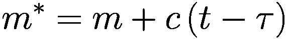

那么，对于任意 `c`，`m*` 也是 `μ` 的一个估计量，因为 `E(m*) = E(m) = μ`。`m*` 的方差如下：

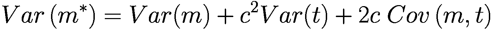

`m*` 的方差在以下情形中达到最小：

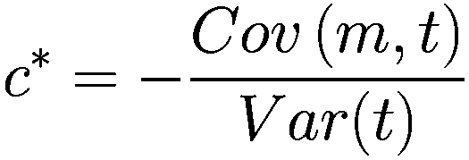

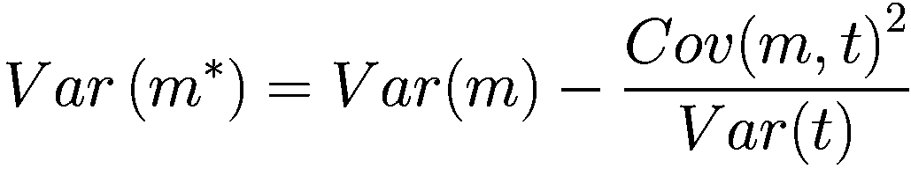


`ρ_{m,t}² = Corr(m, t)`，即 `m` 和 `t` 之间的相关系数。`ρ_{m,t}²` 的值越大，方差缩减的效果就越明显。

以下代码示例计算了与前一个示例相同的积分：


它使用了以下已知积分：


于是得到如下公式：


其中 `u[i]` 是来自均匀分布的样本。

```kotlin
val f: UnivariateRealFunction = object : AbstractUnivariateRealFunction() {
    override fun evaluate(x: Double): Double {
        val fx: Double = 1.0 / (1.0 + x)
        return fx
    }
}
val g: UnivariateRealFunction = object : AbstractUnivariateRealFunction() {
    override fun evaluate(x: Double): Double {
        val gx: Double = 1.0 + x
        return gx
    }
}
val uniform: RandomLongGenerator = UniformRNG()
uniform.seed(1234567891L)
val cv: ControlVariates = ControlVariates(f, g, 1.5, -0.4773, uniform)
val estimator: ControlVariates.Estimator = cv.estimate(1500)
println(
    String.format(
        "mean = %f, variance = %f, b = %f",
        estimator.mean(),
        estimator.variance(),
        estimator.b()))
```

输出结果如下：

```
mean = 0.692015, variance = 0.000601, b = -0.472669
```

方差为 0.0006。若使用朴素方法，方差则为 0.00255。对于此问题，使用控制变量法的结果与使用对偶变量法类似。

`ControlVariates` 类的构造函数签名如下：

```java
/**

 * 估计 \(E(f(X_1))\)，其中 `f` 是随机变量的函数。

 *

 * @param `f`  需要计算期望的随机函数

 * @param `g`  已知期望值的随机函数

 * @param `Eg` `g` 的期望值

 * @param `c`  系数

 * @param `X1` 一个随机数生成器

 */

public `ControlVariates`(

    `UnivariateRealFunction` f,

    `UnivariateRealFunction` g,

    double Eg,

    double c,

    `RandomNumberGenerator` X1

)
```

### 13.3.4 重要性采样

重要性采样是蒙特卡洛模拟中的一项重要策略，它利用从与目标分布不同的分布中生成的样本，来估计该目标分布的特性。其核心思想是，模拟中输入随机变量的某些特定值对正在计算的积分（或平均值）影响更大。如果通过更频繁地采样来强调这些“重要”的值，则可以减少估计量的方差。因此，重要性采样的基本方法是选择一个能“鼓励”重要值的分布。如果直接在模拟中使用这种“有偏”分布，将产生有偏估计量。然而，通过对模拟输出进行加权来校正使用有偏分布带来的偏差，可以确保新的重要性采样估计量是无偏的。

假设你想计算函数 `f(x)` 在目标分布 `P` 下的期望。如果从 `P` 中采样，使用蒙特卡洛方法将得到以下计算：

![$$ {E}_{x\sim P}\left[f(x)\right]={\int}_x^NP(x)f(x) dx\approx \frac{1}{N}\sum \limits_{x_i\sim P,i=1}^Nf\left({x}_i\right) $$](images/528380_1_En_13_Chapter/528380_1_En_13_Chapter_TeX_Equak.png)

然而，如果无法轻松或高效地从 `P` 中采样，则无法进行此求和。你可以尝试寻找另一个你知道如何从中采样的分布 `P'` 来进行积分。测度变换或概率分布的公式如下：

![$$ {E}_{x\sim P}\left[f(x)\right]={\int}_x^Nf(x)P(x) dx $$](images/528380_1_En_13_Chapter/528380_1_En_13_Chapter_TeX_Equal.png)


![$$ ={E}_{x\sim {P}^{\prime }}\left[\frac{P}{P^{\prime }}f(x)\right] $$](images/528380_1_En_13_Chapter/528380_1_En_13_Chapter_TeX_Equan.png)


数学上表明，现在我们从 `P'` 中采样 `x[i]`，并对每个 `f(x[i])`，你需要用 `P(x)/P'(x)` 来缩放输出以校正偏差。

这里有一个简单的例子。假设你想计算恒等函数 `f(x) = x` 在正态分布 (均值 = 1, 标准差 = 1) `N[0] = N(0, 1)` 下的积分。我们不是从标准正态分布中采样，而是从另一个均值为 1、标准差为 0.5 的正态分布 `N[1] = N(0, 0.5)` 中采样。对于从 `N[1]` 抽取的每个样本 `x[i]`，你计算校正后的输出并取平均值。


更具体地说，假设从 `N[1]` 中抽取两次，得到 1.09 和 2.36。计算过程如下：


你可以进一步扩展此例子，计算标准正态函数 `φ(x)` 在 0 到 1 之间的积分。即：


一种实现方法是从标准正态分布 `N[0]` 中采样 `x^(s)`，仅保留 `x^(s)` ∈ [0, 1] 的样本，并拒绝其余样本。其均值如下：

![$$ {I}_0=\frac{\sum \limits_{s=1}^S{x}^s\cdot \textbf{1}\left({x}^s\in \left[0,1\right]\right)}{\textbf{1}\left({x}^s\in \left[0,1\right]\right)} $$](images/528380_1_En_13_Chapter/528380_1_En_13_Chapter_TeX_Equas.png)

如果拒绝大量样本，即 `1(x^(s) ∈ [0, 1]) ≪ S`，那么这种计算是低效的。

或者，你可以从均匀分布中抽取样本，并令当 `x^(s) ∈ [0, 1]` 时 `g(x) = 1`。其权重如下：


其均值如下：


没有样本被拒绝。下面的代码片段解决了这个示例：

```kotlin
val h: UnivariateRealFunction = object : AbstractUnivariateRealFunction() {
    override fun evaluate(x: Double): Double {
        return x // the identity function
    }
}
val w: UnivariateRealFunction = object : AbstractUnivariateRealFunction() {
    val phi: Gaussian = Gaussian()
    val N: StandardCumulativeNormal = CumulativeNormalMarsaglia()
    val I: Double = N.evaluate(1.0) - N.evaluate(0.0)
    override fun evaluate(x: Double): Double {
        val w: Double = phi.evaluate(x) / I // the weight
        return w
    }
}
val rng: RandomNumberGenerator = UniformRNG()
rng.seed(1234567892L)
val imortsampl: ImportanceSampling = ImportanceSampling(h, w, rng)
val estimator: Estimator = imortsampl.estimate(100000)
println(
    String.format(
        "mean = %f, variance = %f",
        estimator.mean(),
        estimator.variance()))
```

输出如下：

```
mean = 0.459671, variance = 0.047314
```

`ImportanceSampling` 类构造函数的签名如下：

```java
/**
 * Uses importance sample to do Monte Carlo integration.
 *
 * @param h the function to integrate
 * @param w the weight function or the change of measure
 * @param G a uniform random number generator
 */
public ImportanceSampling(
    UnivariateRealFunction h,
    UnivariateRealFunction w,
    RandomNumberGenerator G
)
```

# 图 13-14 使用两种不同概率密度函数的重要性采样

此示例来自 Scratchapixel，展示了重要性采样的有效性。如果你能使用“匹配”分布而非均匀分布，那么它将是高效的。假设你想用蒙特卡洛模拟来计算这个积分。见图 13-14。


重要性采样图上显示了密度与自助法均值之间的比率。该图首先呈现上升趋势，直至达到峰值密度，随后呈现下降趋势。

$$ I={\int}_0^{\frac{\pi }{2}}\sin (x) dx $$

$$ ={\left[-\cos (x)\right]}_0^{\frac{\pi }{2}} $$

$$ =-\cos \left(\frac{\pi }{2}\right)--\cos (0) $$

$$ =1 $$

你有两种分布可以选择：
*   像通常使用的那样，采用均匀分布：$$ {f}_0(x)=\frac{1}{\frac{\pi }{2}}=\frac{2}{\pi } $$
*   采用概率密度函数与被积函数接近的分布：$$ {f}_1(x)=\frac{8x}{\pi²} $$

使用均匀分布时，首先需要对累积分布函数求逆。

$$ {\xi}_0={F}_0(x)={\int}_0^x{f}_0(z) dz=\frac{2}{\pi }x $$

$$ x=\frac{\pi }{2}{\xi}_0 $$

`ξ_0` 在单位区间上服从均匀分布。蒙特卡洛求和如下：

$$ {\int}_0^{\frac{\pi }{2}}f(x) dx\approx \frac{1}{N}\sum \limits_{i=1}^N\frac{f\left({x}_i\right)}{f_0\left({x}_i\right)}=\frac{\pi }{2N}\sum \limits_{i=1}^N\sin {x}_i $$

使用第二种分布时，同样先对累积分布函数求逆。

$$ {\xi}_1={F}_1(x)={\int}_0^x{f}_0(z) dz=\frac{4}{\pi²}{x}² $$

$$ x=\frac{\pi }{2}\sqrt{\xi_1} $$

`ξ_1` 在单位区间上服从均匀分布。蒙特卡洛求和如下：

$$ {\int}_0^{\frac{\pi }{2}}f(x) dx\approx \frac{1}{N}\sum \limits_{i=1}^N\frac{f\left({x}_i\right)}{f_1\left({x}_i\right)}=\frac{\pi²}{8N}\sum \limits_{i=1}^N\frac{\sin {x}_i}{x_i} $$

以下代码比较了这两种求和结果：

```kotlin
val rng: RandomNumberGenerator = UniformRNG()

rng.seed(1234567892L)

val N: Int = 16

for (n in 0 until 10) {

    var sumUniform: Double = 0.0

    var sumImportance: Double = 0.0

    for (i in 0 until N) {

        val r: Double = rng.nextDouble()

        sumUniform += sin(r * PI * 0.5)

        val xi: Double = sqrt(r) * PI * 0.5

        sumImportance += sin(xi) / ((8 * xi) / (PI * PI))

    }

    sumUniform *= (PI * 0.5) / N

    sumImportance *= 1.0 / N

    println(String.format("%f %f\n", sumUniform, sumImportance))

}
```

输出如下：

```
1.016777 1.000049
0.984924 1.000781
1.075695 0.981736
0.910973 1.023657
0.908362 1.030897
0.841806 1.048676
1.007154 0.993348
1.133367 0.955110
1.182259 0.947664
1.085175 0.984744
```

```
你可以看到，在相同数量的随机样本和相同随机值`ξ_0 = ξ_1`的情况下，重要性采样技术能够显著降低方差并更快地收敛。

