# 14. 线性回归

在统计学中，线性回归是一种用于建模标量响应（因变量）`y`与一个或多个解释变量（自变量）`x`（向量）之间关系的线性方法。当只有一个解释变量时，称为`简单线性回归`。当有多个解释变量时，称为`多元线性回归`。此类线性模型的参数`β`是解释变量的系数。这些参数通过数据估计得到。当使用此类线性模型根据解释变量的值预测响应结果时，通常假设响应变量的条件均值或对其进行某种变换`g`后，是解释变量的线性函数，即`g(ŷ) = g(E(y)) = xβ`。当变换函数为恒等函数时，它可简化为`ŷ = E(y) = xβ`。

线性回归广泛应用于众多领域和科学中，因为它易于可视化。对于简单线性回归，如图 14-1 所示，模型仅仅是`xy`平面中的一条直线。对于多元线性回归，它是一个超平面。参数易于确定。此外，已有大量工作对线性回归进行了广泛而严谨的研究。其模型和性质已被充分理解。

一个展示简单线性回归增长趋势的散点图，因变量位于 y 轴，自变量位于 x 轴。

图 14-1：简单线性回归

例如，在金融领域，著名的资本资产定价模型（CAPM）就是股票公平/预期超额收益率`E(R[i]) - R[f]`与市场预期超额收益率`E(R[M]) - R[f]`之间的简单线性回归。由于股票或市场的收益率是未知或随机的，我们为其加上期望算子`E()`。资产超额收益是指超过无风险利率`R[f]`的收益，例如政府担保国债的利率。该简单线性回归模型如下：`E(R[i]) = R[f] + βi - R[f])`。系数`β[i]`被称为股票`i`的贝塔值，用于衡量预期资产超额收益对预期市场超额收益的敏感度。这是金融领域中描述股票最重要的方法之一。

在经济学中，线性回归是主要的实证工具。它被用于预测消费支出、固定投资支出、库存投资、一国出口购买量、进口支出、持有流动性资产的需求以及劳动力需求和供给。线性回归可用于构建代表时间序列数据长期运动的趋势线。它能判断特定数据集（如 GDP、油价或股价）在一段时间内是上升还是下降。趋势线可以通过肉眼在数据点集中简单画出，但更恰当的做法是使用线性回归等统计技术计算其位置和斜率。线性回归也广泛应用于生物学、行为科学、社会科学等领域，用以描述实验和调查中变量之间可能存在的关系。它是这些学科中最重要的工具之一。见图 14-2。

一个展示下降趋势的散点图，y 轴为 GDP 季度变化量，x 轴为失业率季度变化百分比（增量百分比）。

图 14-2：在经济学中，奥肯定律指出 GDP 增长与失业率的变化呈线性关系

假设你的数据包含`n`个观测值，`{x_i, y_i}^n_{i=1}`。每个观测值包含一个响应值`y[i]`和`p`个解释变量`x[i] = (x[i1], x[i2], …, x[ip])^T`。这些数据可以像下面这样列表展示：

| 观测值 | y | `x[1]` | `x[2]` | `⋯` | `x[p]` |
| --- | --- | --- | --- | --- | --- |
| 1 | `y[1]` | `x[11]` | `x[12]` | `⋯` | `x[1p]` |
| 2 | `y[2]` | `x[21]` | `x[22]` | `⋯` | `x[2p]` |
| 3 | `y[3]` | `x[31]` | `x[32]` | `⋯` | `x[3p]` |
| `⋮` | `⋮` | `⋮` | `⋮` | `⋯` | `⋮` |
| n | `y[n]` | `x[n1]` | `x[n2]` | `⋯` | `x[np]` |

在线性模型中，响应值`y[i]`是解释变量`x[i]`的线性函数。即：

```
y_1 = β_1 * x_11 + ... + β_p * x_1p + ε_1

y_2 = β_1 * x_21 + ... + β_p * x_2p + ε_2

...

y_n = β_1 * x_n1 + ... + β_p * x_np + ε_n
```

或者，用向量形式表示为：

```
y_i = x_i^T * β + ε_i
```

`x[i]`是第 i 个观测值的解释变量构成的列向量，`β`是从数据中估计的模型参数的`p × 1`向量，`ε[i]`被称为`残差`，它解释了`y[i]`中可能来自测量误差或不受`x[i]`影响的随机波动。`ε[i]`是一个随机变量，因此`y[i]`也是。响应值是随机变量`y[i]`的一个特定实现。

以矩阵形式表示如下：

```
y = Xβ + ε
```

其中`y = [y_1, y_2, …, y_n]^T`，`X = [[x_11, x_12, …, x_1p], [x_21, x_22, …, x_2p], …, [x_n1, x_n2, …, x_np]]`，`β = [β_1, β_2, …, β_p]^T`且`ε = [ε_1, ε_2, …, ε_p]^T`。

解释变量不必相互独立。它们之间可以存在任何关系（只要不是线性关系即可）。例如，当向上抛一个小球时，高度与时间的关系如下：

```
h_i = β_1 * t_i + β_2 * t_i² + ε_i
```

## 14.1 普通最小二乘法

`β[1]`与球的初始速度有关，`β[2]`与地球重力（减速度/加速度）成正比。`ε[i]`是测量误差。该模型对于时间变量`t[i]`是非线性的（二次方程），但对于参数`β[1]`和`β[2]`是线性的。它仍是一个标准形式的线性模型。

本章的源代码可在此处的 S2 平台上运行：
[`https://s21.nm.dev/hub/user-redirect/lab/tree/s2-public/Numerical%20Methods%20Using%20Kotlin/chapter14.ipynb`](https://s21.nm.dev/hub/user-redirect/lab/tree/s2-public/Numerical%20Methods%20Using%20Kotlin/chapter14.ipynb)

源代码可在 GitHub 上找到：
[`https://github.com/apress/numerical-methods-kotlin`](https://github.com/apress/numerical-methods-kotlin)

根据目标函数和假设条件，有多种选择模型参数`β`的方法。最常用的方法之一是普通最小二乘法（OLS）。OLS 最小化给定数据集中观测响应（被观测变量的值）`y[i]`与由解释变量线性函数预测的拟合值 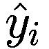 之间差值的平方和。也就是说，目标函数定义如下：

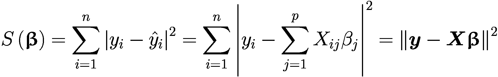

OLS 的 beta 值选择依据如下（见图 14-3）：

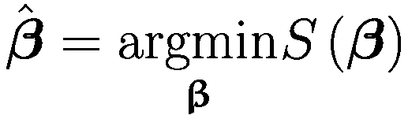

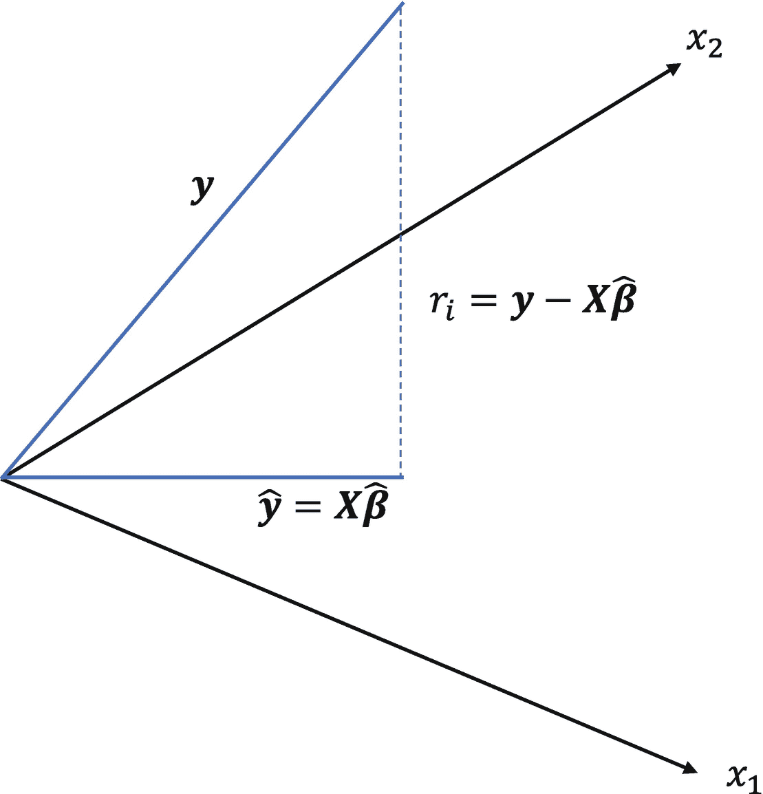

一个直角三角形，斜边为 y，底边为 y 向量，高为 r 下标 i。从直角所对角的顶点引出两条箭头。

图 14-3

正规方程

可以证明，正规方程的解如下所示（见图 14-4）。（之所以称为正规方程，是因为残差 `y − Xβ` 与 `X` 张成的空间正交。）

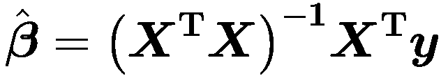

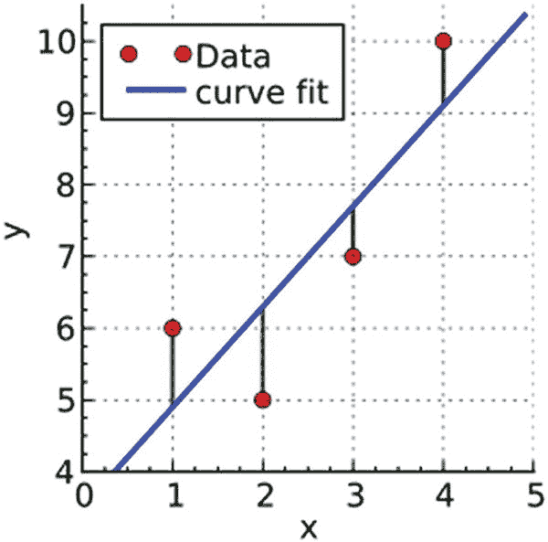

最小二乘估计呈上升趋势的折线图。点代表数据，线代表曲线拟合。

图 14-4

用于最小化平方误差和的最小二乘估计

因此，可以得到：

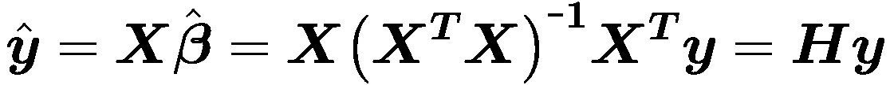

`H = X(X^T X)^(-1)X^T`被称为帽子矩阵，因为正是这个矩阵将帽子^加在观测响应向量`y`上，从而得到拟合响应向量 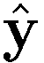。

### 14.1.1 假设条件

OLS 理论做出了一系列假设。

#### 正确设定

线性函数形式必须与实际数据生成过程的形式一致。一些线性数据生成过程的例子包括赛季本垒打数、球迷上座率以及季度收入趋势。一些非线性例子包括地球人口、放射性粒子随时间的变化以及 YouTube 频道用户增长。

#### 外生性

*外生性*意味着解释变量与误差项不相关，即`E(X^T ϵ) = 0`。否则，就存在*内生性*。此外，回归模型中的误差项应具有条件均值为零的性质。

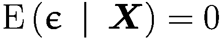

外生性假设的直接结果是误差项均值为零：`E(ϵ) = 0`。

#### 无线性相关

解释变量或设计矩阵`X`必须全部线性无关。从数学上讲，这意味着矩阵`X`几乎必然具有满列秩。

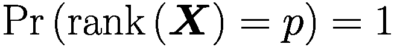

通常还假设`X`具有至少二阶的有限矩。那么矩阵`Q[XX] = E(X^T X/n)`是有限且半正定的。当此假设被违反时，设计矩阵被称为线性相关或完全多重共线性。

#### 同方差性

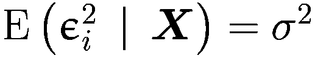意味着每个观测值中误差项的方差`σ²`相同。但情况往往并非如此，因为均值较大的变量通常比均值较小的变量具有更大的方差。例如，预测收入为 10 万美元的人，其实际收入可能很容易达到 8 万美元或 12 万美元，即标准差约为 2 万美元。相比之下，另一个预测收入为 1 万美元的人，不太可能具有相同的 2 万美元标准差，因为这意味着他们的实际收入可能在 -1 万美元到 3 万美元之间波动。当这一要求被违反时，称为异方差性。在这种情况下，更有效的估计量（方差更低的估计量）是加权最小二乘法（见第 14.2 节），你可以为数据中的每个观测值分配不同的权重。

#### 无自相关性

不同观测值之间的误差项不相关，即对于`i ≠ j`，有`E(ϵ[i]ϵ[j] | X) = 0`。在时间序列数据、面板数据、整群样本、分层数据、重复测量数据、纵向数据以及其他存在依赖关系的数据中，这一假设可能会被违反。在这种情况下，广义最小二乘法比 OLS 提供了更好的替代方案（见第 14.3 节）。

#### 正态性

有时还会额外假设，在给定解释变量的条件下，误差项服从正态分布。

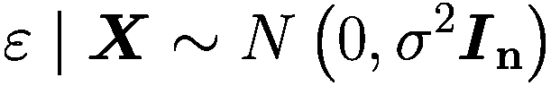

这一假设对于 OLS 方法的有效性并非必需，尽管在满足该假设的情况下（尤其是在假设检验领域），可以建立某些额外的有限样本性质（数据集`n`的大小是有限的）。此外，当误差项服从正态分布时，OLS 估计量等价于最大似然估计量（MLE），因此在所有正则估计量类别中，它是渐近有效的（当`n → ∞`时具有最小方差）。重要的是，正态性假设仅适用于误差项；与流行的误解相反，响应变量`y`并不要求服从正态分布。

### 14.1.2 模型性质

在外生性假设下，OLS 估计量`\hat{\boldsymbol{\beta}}`和`s²`是无偏的，这意味着它们的期望值等于其真实值。

`E(β | X) = \hat{β}`且`E(s² | X) = σ²`

`s²`被称为回归标准误，其定义为误差平方和除以问题的自由度。

```
s² = (εᵀε) / (n-p)
```

在误差不相关且同方差的假设下，估计量 `\hat{β}` 在线性无偏估计量类中是有效的。这被称为最佳线性无偏估计量（BLUE）。这意味着 `\hat{β}` 的方差小于任何其他观测值线性组合估计量的方差。从这个意义上说，OLS 估计量是参数的最佳或最优估计量。特别要注意，这一性质与误差的统计分布无关。换句话说，误差的分布函数不必是正态分布。

然而，如果假设误差确实服从正态分布，即 `ε ~ N(0, σ²I[n])`，那么 `\hat{β}` 也服从正态分布。

```
\hat{β} ~ N(β, σ²(XᵀX)⁻¹)
```

此外，该估计量达到了模型的 Cramér-Rao 下界，因此在所有无偏估计量类中是最优的。

一个解释变量的 `beta` 系数绝对值越高，该变量的效应越强。例如，对于同一个变量，`beta` 为 -0.9 的效应比 `beta` 为 +0.8 的效应更强。然而，`beta` 系数的大小并不能让我们比较变量之间的显著性。例如，`x[1]` 的单位可能是美元，而 `x[2]` 的单位是美分。`x[1]` 的 `beta` 为 0.1 对比 `x[2]` 的 `beta` 为 1.0，并不意味着 `x[1]` 的 `beta` 比 `x[2]` 的 `beta` 更显著，因为如果 `x[1]` 用美分表示，它的 `beta` 会变成 10。

标准化 `beta` 系数以标准差为其单位。这意味着变量可以很容易地进行比较。换句话说，标准化 `beta` 系数就是如果在运行分析之前将回归中的所有变量都转换为 z-score 所得到的系数。一个系数除以其标准误也称为 `t` 统计量，并服从学生 t 分布。你可以使用学生 t 分布来计算标准化 `beta` 系数的 `p` 值，从而确定其显著性。根据经验法则，如果一个 `beta`/变量/`t` 统计量的 `t` 统计量大于 2.0，或者等价地 `p` 值小于 0.05，则它是显著的。这对应于 5% 的显著性水平。假设你的模型设定正确，那么该变量有 95% 的概率确实产生了某种影响。

### 14.1.3 残差分析

残差分析（OLS）定义为对于给定的解释变量值，观测值与拟合值之间的差。注意，在统计学中，残差和误差是两个不同的概念。残差是观测值与模型值之差 `εi = yi - ŷi`；误差是观测值与真实（不可观测）值之差。残差是误差的一个估计。

由于回归假设并不总是成立，因此残差分析对于评估线性回归模型（不仅仅是 OLS）的适用性非常重要。对于简单线性回归，残差图绘制的是残差相对于一个解释变量的散点图。理想情况下，残差图应该像围绕零的随机噪声，没有任何模式。如果数据呈现趋势，则回归模型可能不正确；例如，真实函数可能是一个二次或更高阶的多项式。如果残差是随机的或没有趋势，但呈现“扇形扩散”，则表明存在异方差性。见图 14-5。

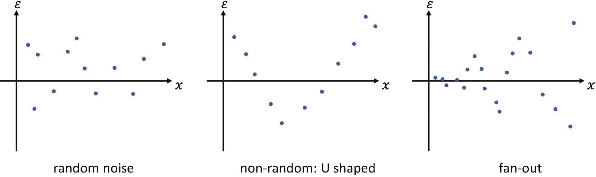

**图 14-5** 残差图

#### RSS

有多种与残差相关的统计量可用于评估所得线性回归模型的拟合程度。由于 OLS 旨在最小化误差平方和，残差平方和（RSS）衡量的是数据中未被回归解释的变异量。也就是说，RSS 是数据偏离模型期望的量。

```
RSS = Σᵢⁿ (yi - ŷi)²
```

#### RMSE

平均误差或偏差称为均方根误差（RMSE）。

```
RMSE = √( Σᵢⁿ (yi - ŷi)² / n )
```

#### RSE

你也可以用总和除以自由度（即数据样本量减去参数数量）来得到误差项 `σ` 标准差的无偏估计量。在这种情况下，你得到的是残差标准误（RSE）。

```
RSE = √( Σᵢⁿ (yi - ŷi)² / (n-p) )
```

在误差 `ε` 服从正态分布的假设下，模型期望值 `ŷi` 和 RSE 给出了 `y[i]` 模型预测的正态分布。该分布可用于找到置信区间。`y[i]` 的真实值有 68% 的概率落在区间 `(ŷi - σ, ŷi + σ)` 内。见图 14-6。

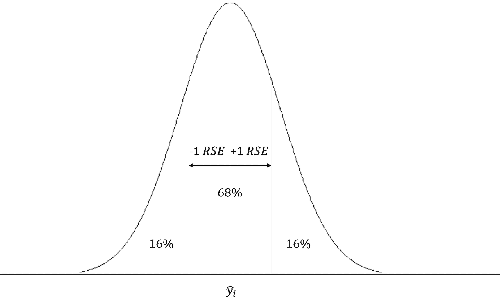

**图 14-6** 模型预测的置信区间

#### ESS

令 `ȳ` 为响应的样本均值。那么，解释平方和（ESS）衡量模型化值中有多少变异。

```
ESS = Σᵢⁿ (ŷi - ȳ)²
```

#### TSS

总平方和（TSS）是 ESS 和 RSS 之和。它衡量观测数据中有多少变异。

```
TSS = ESS + RSS = Σᵢⁿ (ŷi - ȳ)² + Σᵢⁿ (yi - ŷi)²
```

### R²

衡量拟合优度的一个重要指标是决定系数，即 `R²`。`R²` 定义为模型所解释的数据变异比例。其值始终介于 0（0%）和 1（100%）之间。模型能解释的变异量越大，其 `R²` 值就越高。

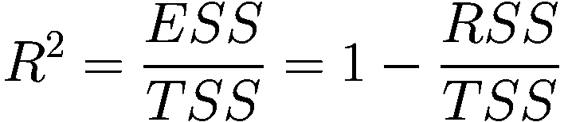

### 调整 R²

`R²` 本身并不能说明模型是好是坏。一个优秀的模型也可能拥有较低的 `R²`。例如，用于预测人类行为（如心理学）的模型，其 `R²` 值通常小于 50%。预测人类行为本身就比预测物理过程要困难得多。另一方面，一个糟糕的模型也可能拥有较高的 `R²`。例如，如果一个模型能解释 100% 的变异，即 `R² = 1`，那么拟合值将始终等于观测值。所有数据点都将落在拟合的回归线/平面上。事实上，你可以通过不断添加解释变量来人为地提高 `R²`。即使新变量只是偶然与响应变量相关，`R²` 也只会增加而从不减少。这是一个典型的过拟合案例。你的高 `R²` 模型可能并未发现任何有意义的模式，只是简单地将数据中的点连接起来。

调整 `R²`，即 ，是 `R²` 的一个修正版本，它已根据模型中解释变量的数量进行了调整。只有当添加的变量确实能改善模型时，调整后的  才会增加；如果添加的是无用的变量，它则会减少。调整后的 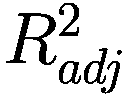 可能为负，但通常不会是负数。它总是低于 `R²`。

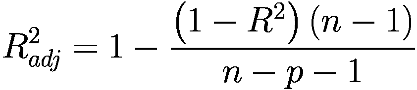

### `F` 统计量

`t` 统计量或 `β` 系数的 `p` 值用于判断该系数/变量在 5% 显著性水平下是否显著（参见第 14.1.2 节）。这意味着有 5% 的概率是假阳性结果（即 `β` 实际上不显著）。由于所有这些 `t` 统计量是独立的，因此模型中变量越多，就越有可能（至少有一个）`p` 值 < 0.05，而这仅仅是由于偶然因素。对于四个解释变量，至少有一个人为显著 `β`（`p` 值 < 0.05）的概率是 1 − (1 − 0.05)⁴ = 18.5%。换句话说，你有 18.5% 的概率会错误地得出模型有用的结论。对于超过 100 个变量，那么获得一个人为显著 `β`（`p` 值 < 0.05）的可能性将很高（99.4%），因此无论实际情况如何，你都很可能得出模型有用的结论。因此，你需要另一种方法来确定线性回归模型是否有用，即它是否真正拥有至少一个并非由偶然因素引起的显著解释变量。

`F` 统计量用于检验线性回归模型的整体显著性。零假设指出，所有解释变量与响应变量之间均无关系。备择假设则指出，至少存在一个显著变量。在 5% 的显著性水平下，如果 `F` 统计量的 `p` 值小于 0.05，你可以拒绝零假设，并得出结论认为该模型有用。可能存在 `F` 统计量不显著，但某些 `β` 的 `t` 统计量显著的情况；在这种情况下，你将接受零假设并拒绝该模型。另一方面，也可能存在 `F` 统计量显著，但所有 `β` 的 `t` 统计量都不显著（均不显著，或均小于 2）的情况；在这种情况下，你将拒绝零假设并接受该模型。底线是，在判断线性回归模型的整体显著性时，你应始终信赖与 `F` 统计量相关的 `p` 值的统计显著性，而非每个解释变量的 `p` 值。以下是一个 `F` 统计量不显著但部分 `β` 的 `t` 统计量显著的例子：

```
beta hat

beta^ = [3.055264, -0.347572, 0.019219, -4.357924]

beta^ standard error = [0.491998, 0.194540, 0.299207, 3.958854]

beta^ t = [6.209908, -1.786633, 0.064232, -1.100804]

residual F-stat = 0.528805679720477
```

以下是排版后的 Markdown 文档：

### 14.1.4 影响点

以下是一个 F 统计量显著但所有 β 的 t 统计量都不显著的例子：

```
beta^ = [0.055264, -0.347572, 0.019219, -4.357924]
beta^ standard error = [0.491998, 0.194540, 0.299207, 3.958854]
beta^ t = [0.112326, -1.786633, 0.064232, -1.100804]
residual F-stat = 13.528805679720477
```

回顾帽子矩阵 `H = X(X^T X)^(-1) X^T`，模型参数是观测值的线性组合，但每个观测值对帽子矩阵以及由此产生的 `beta hat` 和拟合值 `y hat` 的影响程度不同。某个观测值可能对回归产生不当影响，并且根据该特定观测值是否存在，可能会得到不同的结果。请参见图 14-7。

散点图显示 y 轴与 x 轴平面上，有三个点呈直线排列，第四个点远远偏离趋势线，位于下方。

**图 14-7** 红点对回归的强烈影响

例如，在图 14-7 中，如果没有红点（最右侧的点），线性回归模型将穿过三个蓝点（虚线）。红点的存在将回归线向 x 轴“拉动”了很多。可以说该红点对回归结果有强烈影响。OLS 的一个缺点是它容易受到数据集中少数影响点的干扰。

影响点有两种类型。第一种称为异常值。异常值是响应变量 `y` 不遵循其余数据整体趋势的数据点。例如，图 14-8 中的红点是一个异常值，因为它具有极端的 `y` 值。它不遵循其他三个蓝点构成的整体趋势。

散点图显示 y 与 x 平面上一个异常值点，其中三个点呈直线排列，第四个点位于趋势线上方。

**图 14-8** 异常值

第二种影响点称为高杠杆点。如果一个数据点的解释变量或其线性组合具有极端值，则称该点具有高杠杆作用。例如，图 14-9 中的红点相比其他三个蓝点具有大得多的 `x` 值。

散点图显示 y 与 x 轴平面上的一个高杠杆点。该图有三个点呈直线排列，但第四个点与其他三个点距离较远。

**图 14-9** 高杠杆点

一个数据点可以同时是异常值并具有高杠杆作用。例如，图 14-9 中的红点既有极端的 `y` 值，也有极端的 `x` 值。评估一个影响点是否对回归产生影响（以及影响有多大）的方法是运行两次回归：一次包含该点，另一次排除该点。然后你可以比较两次回归的结果，例如拟合响应、假设检验结果、置信区间和预测区间。

#### 杠杆值

展开 `y hat = H y` 得到以下公式：

```
y_1_hat = h_11 * y_1 + h_12 * y_2 + ... + h_1n * y_n
y_2_hat = h_21 * y_1 + h_22 * y_2 + ... + h_2n * y_n
...
y_i_hat = h_i1 * y_1 + h_i2 * y_2 + ... + h_in * y_n
```

杠杆值 `h[ii]` 量化了观测响应 `y[i]` 对其拟合值 `y_i_hat` 的影响程度。也就是说，如果 `h[ii]` 很小，那么观测响应 `y[i]` 对拟合响应 `y_i_hat` 的值只起很小的作用。另一方面，如果 `h[ii]` 很大，那么观测响应 `y[i]` 对拟合响应 `y_i_hat` 的值起很大的作用。这就是它被称为杠杆值的原因。

高杠杆数据点可能对回归结果产生不当影响。根据经验法则，如果一个数据点 `i` 的杠杆值大于平均杠杆值的三倍，则认为它具有高杠杆作用。

```
h_ii > 3 * h_bar = 3 * (p / n)
```

由于 `h[ii]` 是解释变量 `X` 的线性组合，极端的 `h[ii]` 意味着 `x` 值存在较大的线性组合。该数据点是否真正具有影响力还取决于观测响应 `y[i]`。

#### 学生化残差

极端的 `y` 值表明存在异常值，但普通残差 `epsilon_i = y_i - y_i_hat` 并不是量化异常值的好方法，因为其大小取决于测量单位，例如美元和美分。消除单位影响的一种方法是将残差除以其标准差的估计值，从而得到所谓的标准化残差。

标准化残差（也称为内部学生化残差）对每个观测值 `i = 1, ..., n` 定义，即普通残差除以其标准差的估计值：

```
r_i = epsilon_i / s(epsilon_i) = epsilon_i / (RMSE * sqrt(1 - h_ii))
```

给定数据点的标准化残差不仅取决于普通残差 `epsilon[i]`，还取决于均方根误差 (RMSE) 及其杠杆值 `h[ii]`。

标准化残差的一个问题是，潜在异常值的存在可能会将回归线“拉向”它自身，以致该特定数据点不会被“标记”为异常值。为了解决这个问题，你可以一次删除一个观测值，每次对剩余的 `n - 1` 个观测值拟合一个新回归。然后，将观测响应 `y[i]` 与基于删除了第 `i` 个观测值的回归模型得到的拟合响应 `y_(i)_hat` 进行比较。第 `i` 个删除残差定义如下：

```
d_i = y_i - y_(i)_hat
```

具有较大删除残差的数据点表明该点具有影响力，因为它的存在会“移动”回归线。

外部学生化残差或简称为学生化残差，是删除残差除以其估计标准差的值。可以证明，它等于普通残差除以基于删除了第 `i` 个观测值的回归模型得到的均方根误差 `RMSE[(i)]`，再除以杠杆值 `h[ii]`。即：

```
t_i = d_i / s(d_i) = epsilon_i / (RMSE_(i) * sqrt(1 - h_ii))
```

# 14.1.4 异常值、影响点与杠杆值

根据经验法则，如果 `|t[i]| > 3`，你应该将该数据点视为异常值。

## DFFITS

为了评估某个影响点（例如第 `i` 个数据点）的影响，其思路是运行两次回归，一次包含第 `i` 个数据点，一次删除第 `i` 个数据点；然后比较这两个模型的拟合响应值。这就是差异拟合（DFFITS）背后的思想。

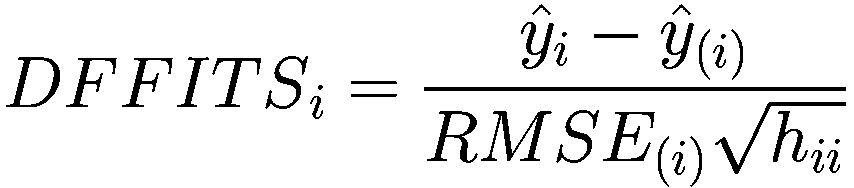

分子是包含和不包含第 `i` 个数据点进行回归时，拟合响应值之间的差异。分母是分子/差值的估计标准差。换句话说，`DFFITS[i]` 衡量的是当移除第 `i` 个数据点时，标准差数量的变化。

作为一个经验法则，如果满足以下条件，则数据点 `i` 被认为是有影响力的：

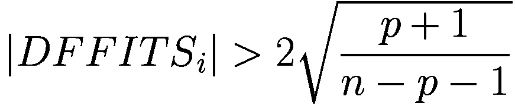

## Cook's Distance

`Cook's distance` 定义如下：

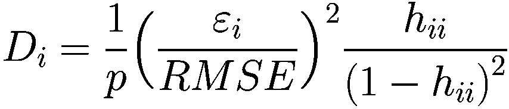

该定义同时依赖于残差（针对极端 *y* 值）和杠杆值（针对极端 *x* 值）。它衡量当删除第 `i` 个观测值时，所有拟合值的变化程度。作为一个经验法则，如果 `D[i] > 0.5`，该数据点可能具有影响力；如果 `D[i] > 1`，该数据点很可能具有影响力；如果 `D[i]` 远大于其他 `Cook's distance` 值，则几乎可以肯定该数据点具有影响力。在图 14-10 中，有一个数据点的 `Cook's distance`（红色虚线）勉强超过 0.5。值得考虑是否将其包含在回归中，因为它具有一定的杠杆作用。

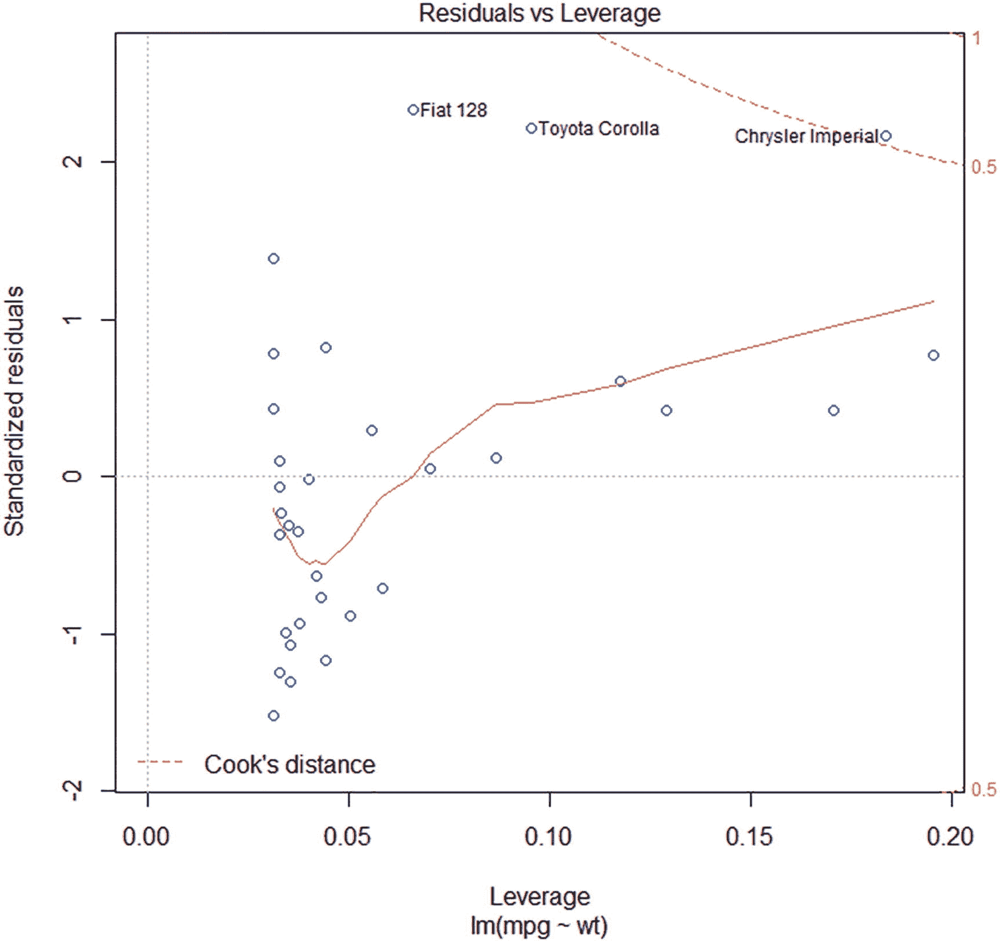

**Figure 14-10** `mtcars` 数据集中每个数据点的影响力

## 14.1.5 信息准则

针对一组数据，给定多个竞争模型，信息准则（IC）会估计每个模型相对于其他模型的质量，并根据 IC 值对它们进行排序。这提供了一种模型选择的方法。例如，IC 值最低的模型可能被选为最佳模型。通过使用 IC 值，你可以推断出前三名模型属于同一梯队，而其余模型则差得多。然而，为一个给定模型是否被“拒绝”设定一个阈值是非常武断的。请注意，IC 值并不说明模型的绝对质量，而只说明相对于其他模型的质量。如果所有候选模型拟合效果都很差，IC 也不会给出任何警告。因此，在使用 IC 选择模型后，通常最好验证一下模型的绝对质量。这种验证通常包括检查模型的残差（以确定残差是否看起来像白噪声）以及测试模型的预测。

### AIC

通常，当使用统计模型来表示生成数据的真实过程时，该模型几乎永远不会是精确的表示。使用模型表示会丢失信息。Akaike 信息准则（AIC）估计给定模型所丢失信息的相对量：模型丢失的信息越少，其质量越高。在估计模型丢失的信息量时，AIC 处理的是模型拟合优度与模型简洁性之间的权衡。换句话说，AIC 同时处理过拟合和欠拟合的风险。AIC 奖励拟合优度（通过似然函数评估，对于线性回归模型则为 `RSS`），并且它还包含一个惩罚项，该惩罚项是估计参数数量的递增函数，以防止过拟合。具体来说，其数学定义如下：

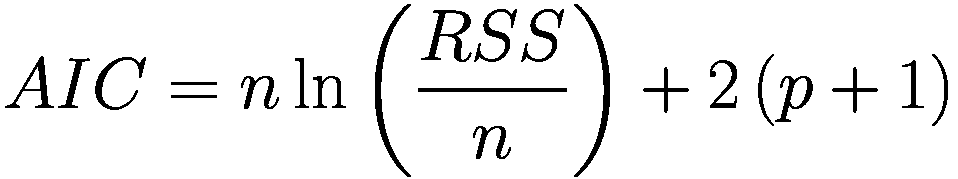

### BIC

贝叶斯信息准则（BIC）的公式与 AIC 类似，但对参数数量的惩罚不同。AIC 的惩罚系数是 2，而 BIC 的惩罚系数是 `ln n`。通常，BIC 对自由参数的惩罚比 AIC 更严厉。

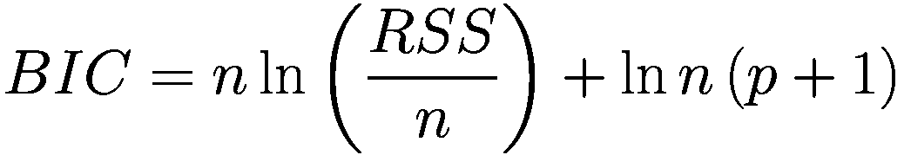

有人指出，AIC 和 BIC 适用于不同的任务。具体来说，如果“真实模型”在候选集中，BIC 被认为适用于从一组候选模型中选择“真实模型”（即生成数据的过程），而 AIC 则不适用。更具体地说，如果“真实模型”在候选集中，那么当 `n → ∞` 时，BIC 将以概率为 1 选择该“真实模型”。相比之下，当通过 AIC 进行选择时，该概率可能小于 1。然而，有人认为这个问题无关紧要，因为“真实模型”实际上几乎从不在候选集中。事实上，统计学中有一句常见的格言：“所有模型都是错的”；因此，“真实模型”（即现实）不可能在候选集中。

另一项研究展示了一项模拟研究，该研究允许“真实模型”存在于候选集中。该模拟特别表明，即使“真实模型”在候选集中，AIC 有时也能选择比 BIC 好得多的模型。原因是，对于有限的 `n`，BIC 可能会有相当大的风险从候选集中选择一个糟糕的模型。即使当 `n` 远大于 `p²` 时，也可能出现这个原因。使用 AIC 时，选择非常差模型的风险被最小化。如果“真实模型”不在候选集中，你最多能期望做的就是选择最接近“真实模型”的模型。在某些假设下，AIC 适用于寻找最佳近似模型。在回归中，在假设“真实模型”不在候选集的情况下，AIC 对于选择具有最小均方误差的模型是渐近最优的。在此假设下，BIC 并非渐近最优。

# NM Dev 线性回归包

NM Dev 拥有一个功能丰富的包，可以使用多种回归方法来解决多种类型的线性模型问题：普通最小二乘法（非加权，第 14.1 节；加权，第 14.2 节）、逻辑回归（第 14.3 节）、广义线性模型（第 14.4 节）、逐步回归（第 14.5 节）和 LASSO（第 14.6 节）。要构建并分析一个线性模型，你必须首先构造一个 `LMProblem`。该类的签名如下：

```java
/**

* 构造一个线性回归问题。

*

* @param y         因变量

* @param X         自变量因子

* @param intercept 如果为 {@code true}，则在线性回归中额外添加一个截距项

* @param weights   分配给每个观测值的权重

*/

public LMProblem(Vector y, Matrix X, boolean intercept, Vector weights)
```

应用 NM Dev 包中的任何回归方法都会生成一个 `LinearModel` 对象。该接口的签名如下：

```java
public interface LinearModel {

/**

* 获取 \(\hat{\beta}\) 及其统计量。

*

* @return \(\hat{\beta}\) 及其统计量

*/

public LMBeta beta();

/**

* 获取 OLS 回归的残差分析结果。

*

* @return 残差分析结果

*/

public LMResiduals residuals();

/**

* 根据给定的输入计算期望值 \(E(y(x))\)。

*

* @param x 一个输入值

* @return \(E(y(x))\)

*/

public double Ey(Vector x); // TODO: 置信区间，预测区间

}
```

这个 `LinearModel` 对象包含了估计的 `\hat{\beta}` `LMBeta`、预测方法 `Ey` 以及残差 `LMResiduals` 的结果。`Ey` 函数可用于计算模型拟合值。`LMBeta` 包含了 `\hat{\beta}` 的期望值、估计 `\beta` 的协方差矩阵、它们的标准误差以及 t 统计量。该类的签名如下：

```java
public abstract class LMBeta {

/**

* 获取系数估计值, \(\hat{\beta}\)。

*

* @return 系数估计值, \(\hat{\beta}\)

*/

public ImmutableVector betaHat();

/**

* 获取系数估计值 \(\hat{\beta}\) 的协方差矩阵。

*

* @return 系数估计值 \(\hat{\beta}\) 的协方差矩阵

*/

public abstract ImmutableMatrix covariance();

/**

* 获取系数 \(\hat{\beta}\) 的标准误差。

*

* @return 系数 \(\hat{\beta}\) 的标准误差

*/

public ImmutableVector stderr();

/**

* 获取回归系数 \(\hat{\beta}\) 的 t 值或 z 值。

*

* @return 回归系数 \(\hat{\beta}\) 的 t 值或 z 值

*/

public abstract ImmutableVector t(); // TODO: p-value
}
```


# 关于残差和诊断

`LMResiduals` 类包含大量关于残差及其分析的信息。该类的签名如下：

```java
public class LMResiduals {
    /**
     * 获取拟合值, y^。
     *
     * @return 拟合值, y^
     */
    public ImmutableVector fitted();

    /**
     * 获取残差, ε，即样本值与拟合值之间的差值。
     *
     * @return 残差, ε
     */
    public ImmutableVector residuals();

    /**
     * 获取加权的拟合值。
     *
     * @return 加权的拟合值
     */
    public ImmutableVector weightedFittedValues();

    /**
     * 获取加权的残差。
     *
     * @return 加权的残差
     */
    public ImmutableVector weightedResiduals();

    /**
     * 获取诊断度量：残差平方和, \(\sum \epsilon²\)。
     * @return 残差平方和, \(\sum \epsilon²\)
     */
    public double RSS();

    /**
     * 获取诊断度量：总平方和, \(\sum (y-y_mean)²\)。
     * @return 总平方和, \(\sum (y-y_mean)²\)
     */
    public double TSS();

    /**
     * 获取诊断度量：R 平方。
     *
     * @return R 平方
     */
    public double R2();

    /**
     * 获取诊断度量：调整后的 R 平方。
     *
     * @return 调整后的 R 平方
     */
    public double AR2();

    /**
     * 获取残差的标准误差。
     *
     * @return 残差的标准误差
     */
    public double stderr();

    /**
     * 获取诊断度量：F 统计量
     *
     * 回归均方 / 均方误差 =
     * sum((y_i_hat-y_mean)²) / 均方误差 =
     * [(TSS-RSS)/n] / [RSS/(m-n)]
     *
     * y_i_hat 是回归的拟合值。
     *
     * @return F 统计量
     * @see "Kutner, Nachtsheim and Neter, "p.69, equation (2.60)," Applied linear regression
     * models. 4th edition."
     */
    public double Fstat();

    /**
     * 获取投影矩阵, H-hat。
     *
     * @return 投影矩阵
     * @see "Sanford Weisberg, "p.168, Section 8.1, Chapter 8," Applied Linear
     * Regression, 3rd
     * edition, 2005. Wiley-Interscience."
     */
    public ImmutableMatrix hHat();

    /**
     * 获取杠杆值。
     * 一个观测值的杠杆值越大，其对预测的影响就越大。
     *
     * @return 杠杆值
     */
    public ImmutableVector leverage();

    /**
     * 标准化残差 = 残差 / v1 / sqrt(RSS / (n-m))
     *
     * @return 标准化残差
     */
    public ImmutableVector standardized();

    /**
     * 学生化残差 = 标准化残差 * sqrt((n-m-1) /
     * (n-m-标准化残差²))
     *
     * @return 学生化残差
     * @see
     * "Chatterjee, Hadi and Price, "p.90 (4.15), Section 4.3," Regression
     * Analysis by Example,
     * 3rd edition, 2000. Wiley Series in Probability and Statistics."
     * @see
     * Wikipedia:
     * Studentized
     * residual
     */
    public ImmutableVector studentized();

    /**
     * 获取自由度。
     *
     * TODO: 用户应该能够为不同的回归修改此方法。
     *
     * @return 自由度
     */
    public int df();
}
```

`LMDiagnostics` 类用于计算影响点。该类的签名如下：

```java
public class LMDiagnostics {
    /**
     * DFFITS, Welsch 和 Kuh 度量。
     *
     * @return DFFITS
     * @see
     * "Chatterjee, Hadi and Price, "p.105 (4.23), Section 4.9.2, Regression
     * Analysis by Example," 3rd edition, 2000. Wiley Series in Probability and
     * Statistics."
     * "David A. Belsley, Edwin Kuh, Roy E. Welsch, Regression diagnostics:
     * identifying influential data and sources of collinearity. Wiley series in
     * probability and mathematical statistics. New York: John Wiley & Sons.
     * ISBN 0471058564. 1980."
     */
    public ImmutableVector DFFITS;

    /**
     * Cook 距离。
     *
     * @return Cook 距离
     * @see "Sanford Weisberg, "p.200," Applied Linear Regression, 3rd edition,
     * 2005.
     * Wiley-Interscience."
     */
    public ImmutableVector cookDistances();

    /**
     * Hadi 影响度量。
     *
     * @return Hadi 影响度量
     * @see "Chatterjee, Hadi and Price, "p.105 (4.24), Section 4.9.2,"
     * Regression Analysis by Example, 3rd edition, 2000. Wiley Series in
     * Probability and Statistics."
     */
    public ImmutableVector Hadi();
}
```

`LMInformationCriteria` 类计算模型的 AIC 和 BIC。

`OLSRegression` 类以 `LMProblem` 作为输入，运行 OLS 回归并生成一个 `LinearModel`。其类签名如下：

```java
public class OLSRegression implements LinearModel {
    /**
     * Constructs an OLSRegression instance.
     *
     * @param problem the linear regression problem to be solved
     * @param epsilon a precision parameter: when a number |x| ≤ ε,
     *                it is considered 0
     */
    public OLSRegression(LMProblem problem, double epsilon);
}
```

以下是一个求解 OLS 问题的示例。

### 响应向量
响应向量如下：

![$$ \boldsymbol{y}=\left[\begin{array}{c}2.32\\ {}0.452\\ {}4.53\\ {}12.34\\ {}32.2\end{array}\right] $$](images/528380_1_En_14_Chapter/528380_1_En_14_Chapter_TeX_Equak.png)

### 解释变量的设计矩阵
解释变量的设计矩阵如下：

![$$ X=\left[\begin{array}{ccc}1.52& 2.23& 4.31\\ {}3.22& 6.34& 3.46\\ {}4.32& 12.2& 23.1\\ {}10.1034& 43.2& 22.3\\ {}12.1& 2.12& 3.27\end{array}\right] $$](images/528380_1_En_14_Chapter/528380_1_En_14_Chapter_TeX_Equal.png)

### Kotlin 代码实现
```kotlin
// 构造一个线性模型问题
val problem = LMProblem(
    // 因变量 y
    DenseVector(2.32, 0.452, 4.53, 12.34, 32.2),
    // 自变量的设计矩阵 X
    DenseMatrix(
        arrayOf(
            doubleArrayOf(1.52, 2.23, 4.31),
            doubleArrayOf(3.22, 6.34, 3.46),
            doubleArrayOf(4.32, 12.2, 23.1),
            doubleArrayOf(10.1034, 43.2, 22.3),
            doubleArrayOf(12.1, 2.12, 3.27)
        )
    ),
    true // 包含截距项
)

// 求解一个 OLS 问题
val ols = OLSRegression(problem)

println("beta hat")
// beta 的均值
println("beta^ = " + ols.beta().betaHat())
// beta 的标准误
println("beta^ standard error = " + ols.beta().stderr())
// 如果某个 beta/变量的 t 统计量大于 2，则视为显著
println("beta^ t = " + ols.beta().t())
```

### 输出结果：参数估计与统计量
输出包含前几节讨论的所有结果和统计量：
```
beta hat
beta^ = [3.055264, -0.347572, 0.019219, -4.357924]
beta^ standard error = [0.491998, 0.194540, 0.299207, 3.958854]
beta^ t = [6.209908, -1.786633, 0.064232, -1.100804]

println("residuals")
println("residual F-stat = " + ols.residuals().Fstat())
println("fitted values: " + ols.residuals().fitted())
println("residuals: " + ols.residuals().residuals())
println("residual standard error = " + ols.residuals().stderr())
println("RSS = " + ols.residuals().RSS())
println("TSS = " + ols.residuals().TSS())
println("R2 = " + ols.residuals().R2())
println("AR2 = " + ols.residuals().AR2())
```
输出如下：
```
residuals
residual F-stat = 13.528805679720477
fitted values: [-0.406176, 3.342917, 5.044391, 11.924108, 31.936759]
residuals: [2.726176, -2.890917, -0.514391, 0.415892, 0.263241]
residual standard error = 4.036867249675668
RSS = 16.29629719150399
TSS = 677.7046112
R2 = 0.9759536870161641
AR2 = 0.9038147480646566
```

### 输出结果：诊断与影响点分析
```
println("influential points")
println("standardized residuals: " + ols.residuals().standardized())
println("studentized residuals: " + ols.residuals().studentized())
println("leverage/hat values: " + ols.residuals().leverage())
println("DFFITS: " + ols.diagnostics().DFFITS())
println("cook distances: " + ols.diagnostics().cookDistances())
println("Hadi: " + ols.diagnostics().Hadi())
```
输出如下：
```
influential points
standardized residuals: [1.000000, -1.000000, -1.000000, 1.000000, 1.000000]
studentized residuals: [0.000000, 0.000000, 0.000000, 0.000000, 0.000000]
leverage/hat values: [0.543943, 0.487159, 0.983763, 0.989386, 0.995748]
DFFITS: [0.000000, 0.000000, 0.000000, 0.000000, 0.000000]
cook distances: [0.298178, 0.237481, 15.147200, 23.304136, 58.542696]
Hadi: [8.546417, 9.160788, 64.654821, 97.259457, 238.187865]
```

### 输出结果：信息准则
```
println("information criteria")
println("AIC = " + ols.informationCriteria().AIC())
println("BIC = " + ols.informationCriteria().BIC())
```
输出如下：
```
information criteria
AIC = 30.096885349082104
BIC = 28.144074911252606
```

## 14.2 加权最小二乘法

OLS 中的一个重要假设是同方差性，即所有误差或残差具有相同的恒定方差。这一假设在许多实际应用中常常不成立。如收入示例所示，高收入者的方差往往比低收入者更大。方差的大小通常取决于数值的大小。加权最小二乘法（WLS）是 OLS 的扩展，用于解决异方差性问题，即所有误差或残差具有不同的方差。数学上，对于如下回归模型：

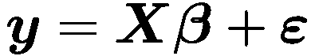

假设你可以按每个观测值的误差标准差对其进行缩放。

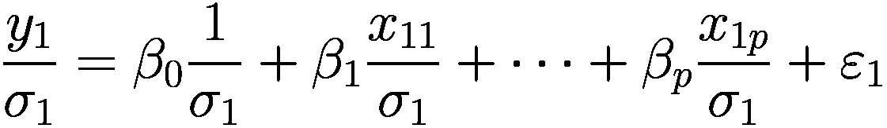

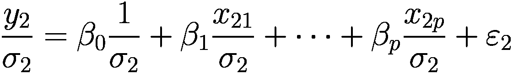

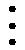

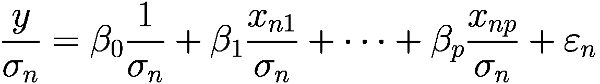

那么缩放后的模型具有恒定的误差方差。残差平方和如下：

![$$ S\left({\beta}_0,\dots, {\beta}_p\right)=\sum \limits_{i=1}^n{\left[\frac{y_i}{\sigma_i}-\left({\beta}_0\frac{1}{\sigma_i}+{\beta}_1\frac{x_{i1}}{\sigma_i}+\cdots +{\beta}_p\frac{x_{ip}}{\sigma_i}\right)\right]}²=\sum \limits_{i=1}^n{\sigma_i}^{-2}{\left[{y}_i-\left({\beta}_0+{\beta}_1{x}_{i1}+\cdots +{\beta}_p{x}_{ip}\right)\right]}² $$](images/528380_1_En_14_Chapter/528380_1_En_14_Chapter_TeX_Equar.png)

系数`w[i] = σ[i]^(-2)`本质上是分配给观测值的权重。

正规方程如下：

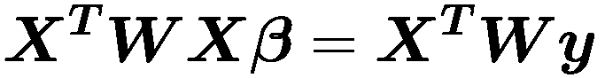

其中`W`是一个`n × n`的对角权重矩阵。


当你想为观测值分配不同的重要性时，权重可以扩展到更一般的情况。例如，你可能希望将回归模型聚焦于数据（或实验）中难以、昂贵或耗时再现的特定部分。你可能更倾向于赋予测量更准确、更可靠的数据更高的偏好，而赋予估计或不可靠的数据更低的偏好。需要注意的是，每个观测值的权重是相对于其他观测值的权重给出的，因此不同的绝对权重集可能产生相同的效果。权重之和不一定为 1。

为求解正规方程，需要找到一个最小化该目标函数的`β̂`。

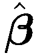


`β̂` 的 WLS 估计量如下所示：

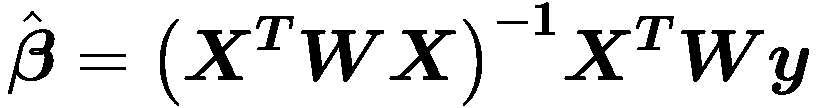

在实践中，你可能无法精确知道权重和方差。使用估计得到的权重可能会产生不良结果，特别是当权重是根据小样本估计时。WLS 也存在异常值问题。当你无意中给某个异常值赋予很大权重，从而增大了它的影响时，这个问题会更加突出。

在 NM Dev 中，`OLSRegression` 类可以接受权重作为输入来执行 WLS。下面是一个示例：

```kotlin
// 构建一个线性模型问题
val problem = LMProblem(
    // 因变量 y
    DenseVector(2.32, 0.452, 4.53, 12.34, 32.2),
    // 自变量设计矩阵 X
    DenseMatrix(
        arrayOf(
            doubleArrayOf(1.52, 2.23, 4.31),
            doubleArrayOf(3.22, 6.34, 3.46),
            doubleArrayOf(4.32, 12.2, 23.1),
            doubleArrayOf(10.1034, 43.2, 22.3),
            doubleArrayOf(12.1, 2.12, 3.27)
        )
    ),
    // 包含截距项
    true,
    // 赋予每个观测值的权重
    DenseVector(0.2, 0.4, 0.1, 0.3, 0.1) // 权重之和不必为 1
)

// 求解加权 OLS 问题
val ols = OLSRegression(problem)
println("beta hat")
// 贝塔的均值
println("beta^ = " + ols.beta().betaHat())
// 贝塔的标准误差
println("beta^ standard error = " + ols.beta().stderr())
// 如果某个贝塔/变量的 t 统计量大于 2，则其显著
println("beta^ t = " + ols.beta().t())
```

输出结果如下：

```
beta hat
beta^ = [3.105333, -0.379722, 0.119115, -5.651285]
beta^ standard error = [0.707175, 0.257982, 0.428017, 3.876511]
beta^ t = [4.391181, -1.471895, 0.278296, -1.457828]
```

# 14.3 逻辑回归

思考这个问题：一组 20 名学生为一场考试学习的时间在零到五个半小时之间。学习时间的多少如何影响学生通过考试的概率？数据如下表所示。它显示了每个学生花费的学习小时数，以及他们是通过（1）还是失败（0）。请注意，1 和 0 是名义响应，意味着它们仅仅是标签或类别。表达 `(1+0)/2` 或 `1 > 0` 是没有意义的。

| 学习小时数 | 0.5 | 0.75 | 1.00 | 1.25 | 1.50 | 1.75 | 1.75 | 2.00 | 2.25 | 2.50 | 2.75 | 3.00 | 3.25 | 3.50 | 4.00 | 4.25 | 4.50 | 4.75 | 5.00 | 5.50 |
| --- | --- | --- | --- | --- | --- | --- | --- | --- | --- | --- | --- | --- | --- | --- | --- | --- | --- | --- | --- | --- |
| 是否通过 | 0 | 0 | 0 | 0 | 0 | 0 | 1 | 0 | 1 | 0 | 1 | 0 | 1 | 0 | 1 | 1 | 1 | 1 | 1 | 1 |

你不能使用普通最小二乘法（`OLS`）的主要原因在于，响应变量 `y` 不是数值，而是标签。假设你改用通过概率 `p = Pr(y = 1)` 作为因变量。你仍然不能使用 `OLS`，因为 `p` 的取值范围是 [0, 1]，而不是 (−∞, ∞)。你可以使用 `logit` 函数来转换这个范围。它也被称为对数几率，因为它就是比值比 `p/(1-p)` 的对数。见图 14-11。

`logit(p) = σ⁻¹(p) = log(p/(1-p))`

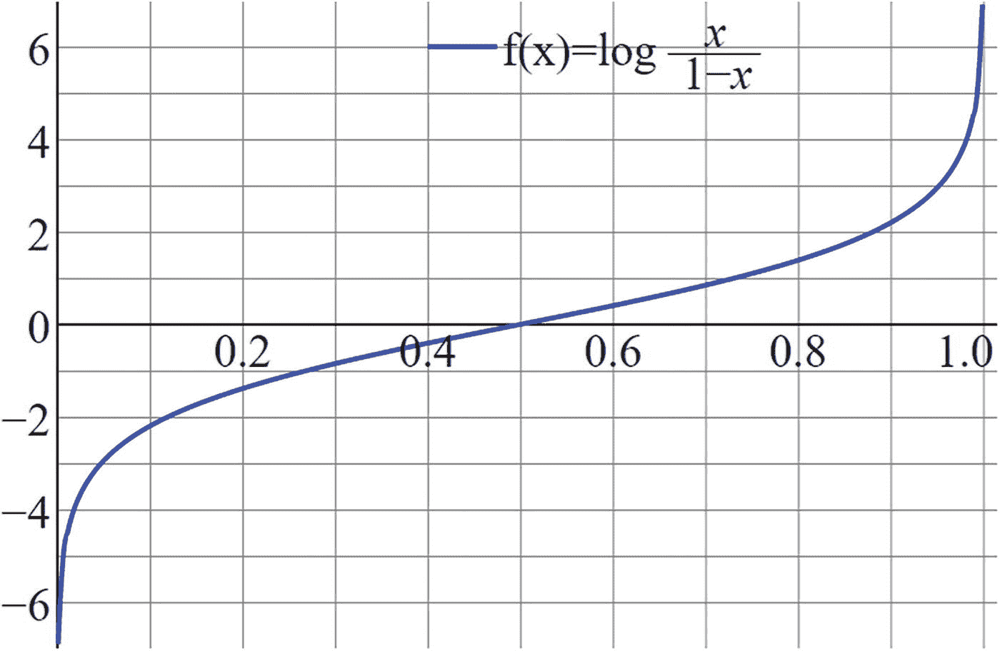

该图形展示了函数 `x` 等于 `x` 除以 1 减 `x` 的对数的曲线。它具有上升趋势。

**图 14-11** `logit` 或对数几率函数

这些变换建立了一个线性回归问题，使得响应变量 (`p`) 的某个函数 (`logit`) 是自变量 (`hours`) 的线性模型。即：

`l = log(p/(1-p)) = β₀ + β₁h`

你可以通过对对数几率取指数来恢复通过概率，如下所示：

`p/(1-p) = e^(β₀+β₁h)`

或者等价地：

`p = 1 / (1 - e^-(β₀+β₁h)) = S(β₀+β₁h)`

其中 `S` 是 Sigmoid 函数。见图 14-12。

`S(x) = 1/(1+e⁻ˣ) = eˣ/(eˣ+1) = 1 - S(-x)`

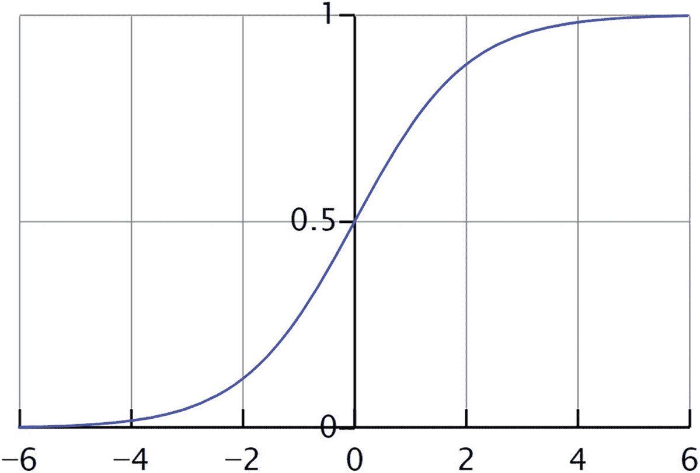

该图形展示了 Sigmoid 函数的 S 形曲线，其最低范围为负 6，最高范围为 6。该图形呈上升趋势。

**图 14-12** Sigmoid 函数

对变换后的问题运行 `OLS` 回归，或者运行逻辑回归，会得到以下结果：

| | Beta Hat | 标准误差 | T 统计量 | P 值 |
| --- | --- | --- | --- | --- |
| 截距项 | -4.0777 | 1.7610 | -2.316 | 0.0206 |
| 学习小时数 | 1.5046 | 0.6287 | 2.393 | 0.0167 |

输出结果表明，学习时间与通过考试的概率显著相关，`p` 值为 0.0167 < 5%。你可以将考试通过的概率 (`y = 1`) 计算为学习小时数 (`h`) 的函数：

`Pr(y=1) = 1 / (1 + exp(-(1.5046 × h - 4.0777)))`

图 14-13 展示了这个作为学习小时数函数的考试通过概率。

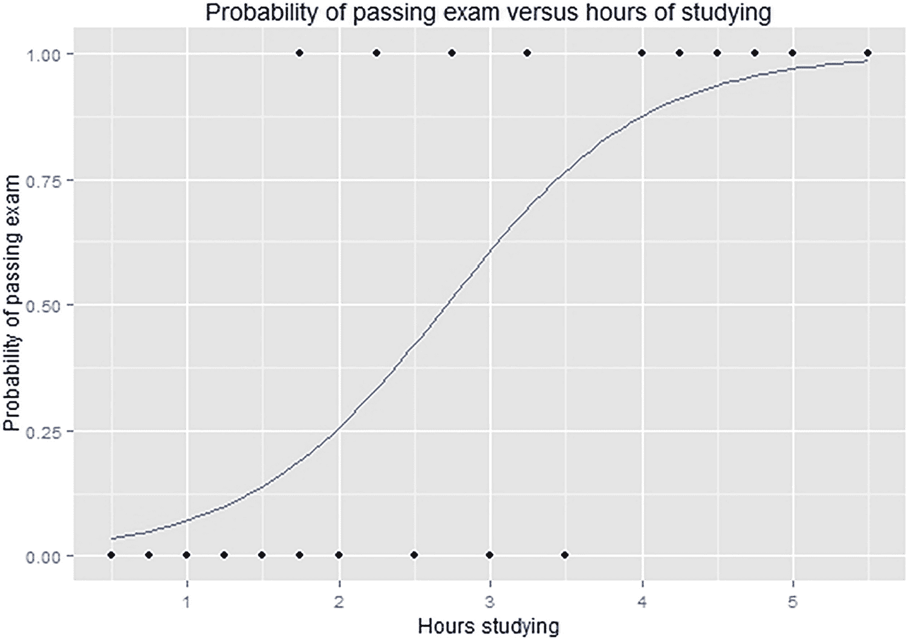

通过概率与学习小时数的上升趋势线图。通过概率在 y 轴上，学习小时数在 x 轴上。

**图 14-13** 逻辑回归结果，展示了考试通过概率与学习小时数之间的关系

NM Dev 库中名为 `LogisticRegression` 的类用于对 `LMProblem` 执行逻辑回归。以下代码片段解决了前面讨论的问题：

```kotlin
// 构建一个线性模型问题
val problem = LMProblem(
// 因变量 y，{通过，未通过}
// ... 其余代码
)
```

首先，运行残差诊断。

```kotlin
println("residuals")

println("residual F-stat = " + ols.residuals().Fstat())

println("fitted values: " + ols.residuals().fitted())

println("weighted residuals: " + ols.residuals().weightedResiduals())

println("residuals: " + ols.residuals().residuals())

println("residual standard error = " + ols.residuals().stderr())

println("RSS = " + ols.residuals().RSS())

println("TSS = " + ols.residuals().TSS())

println("R2 = " + ols.residuals().R2())

println("AR2 = " + ols.residuals().AR2())
```

输出结果如下：

```
residuals
residual F-stat = 6.986438687095603
fitted values: [-1.264570, 2.352592, 5.882717, 11.975437, 31.507745]
weighted residuals: [1.603069, -1.202040, -0.427767, 0.199680, 0.218910]
residuals: [3.584570, -1.900592, -1.352717, 0.364563, 0.692255]
residual standard error = 2.070146550717054
RSS = 4.285506741445716
TSS = 94.10679701818182
R2 = 0.9544612410874239
AR2 = 0.8178449643496957
```

接下来，检查影响点。

```kotlin
println("influential points")

println("standardized residuals: " + ols.residuals().standardized())

println("studentized residuals: " + ols.residuals().studentized())

println("leverage/hat values: " + ols.residuals().leverage())

println("DFFITS: " + ols.diagnostics().DFFITS())

println("cook distances: " + ols.diagnostics().cookDistances())

println("Hadi: " + ols.diagnostics().Hadi())
```

输出结果如下：

```
influential points
standardized residuals: [1.000000, -1.000000, -1.000000, 1.000000, 1.000000]
studentized residuals: [-0.000000, -0.000000, -0.000000, -0.000000, 0.000000]
leverage/hat values: [0.400344, 0.662840, 0.957302, 0.990696, 0.988818]
DFFITS: [-0.000000, -0.000000, -0.000000, -0.000000, 0.000000]
cook distances: [0.166906, 0.491488, 5.605022, 26.620466, 22.106825]
Hadi: [10.659025, 8.000590, 26.598499, 110.519428, 92.472535]
```

最后，查看信息准则。

```kotlin
println("information criteria")

println("AIC = " + ols.informationCriteria().AIC())

println("BIC = " + ols.informationCriteria().BIC())
```

输出结果如下：

```
information criteria
AIC = 31.753261426689598
BIC = 29.8004509888601
```

DenseVector(0.0, 0.0, 0.0, 0.0, 0.0, 0.0, 1.0, 0.0, 1.0, 0.0, 1.0, 0.0, 1.0, 0.0, 1.0, 1.0, 1.0, 1.0, 1.0, 1.0),

// 自变量的设计矩阵 X，学习小时数

DenseMatrix(

arrayOf(

doubleArrayOf(0.5),

doubleArrayOf(0.75),

doubleArrayOf(1.0),

doubleArrayOf(1.25),

doubleArrayOf(1.5),

doubleArrayOf(1.75),

doubleArrayOf(1.75),

doubleArrayOf(2.0),

doubleArrayOf(2.25),

doubleArrayOf(2.5),

doubleArrayOf(2.75),

doubleArrayOf(3.0),

doubleArrayOf(3.25),

doubleArrayOf(3.5),

doubleArrayOf(4.0),

doubleArrayOf(4.25),

doubleArrayOf(4.5),

doubleArrayOf(4.75),

doubleArrayOf(5.0),

doubleArrayOf(5.5)

)

),

// 包含截距项

true)

// 解决一个逻辑回归问题

`val` `logistic` = `LogisticRegression`(`problem`)

`println`("beta hat")

// 贝塔的均值

`println`("beta^ = " + `logistic.beta()`.`betaHat`())

// 贝塔的标准误差

`println`("beta^ standard error = " + `logistic.beta()`.`stderr`())

// 如果贝塔/变量的 t 统计量大于 2，则显著

`println`("beta^ t = " + `logistic.beta()`.`t`())

`println`("残差")

`println`("拟合值: " + `logistic.residuals()`.`fitted`())

`println`("偏差残差: " + `logistic.residuals()`.`devianceResiduals`())

`println`("偏差: " + `logistic.residuals()`.`deviance`())

`println`("零模型偏差: " + `logistic.residuals()`.`nullDeviance`())

`println`("信息准则")

`println`("AIC = " + `logistic.AIC`())

```
输出如下：
```

```
beta hat
beta^ = [1.504645, -4.077713]
beta^ standard error = [0.628721, 1.760994]
beta^ t = [2.393185, -2.315574]
残差
拟合值: [0.034710, 0.049773, 0.070892, 0.100029, 0.139344, 0.190837, 0.190837, 0.255703, 0.333530, 0.421627, 0.515011, 0.607359, 0.692617, 0.766481, 0.874448, 0.910278, 0.936624, 0.955611, 0.969097, 0.985194]
偏差残差: [-0.265808, -0.319544, -0.383485, -0.459113, -0.547834, -0.650775, 1.820076, -0.768525, 1.481905, -1.046456, 1.152013, -1.367376, 0.857062, -1.705574, 0.518002, 0.433603, 0.361867, 0.301346, 0.250561, 0.172721]
偏差: 16.059756928689346
零模型偏差: 27.725887222397812
信息准则
AIC = 20.059756928689346
```

# 14.4 广义线性模型

普通最小二乘法（OLS）存在许多无法处理的情况（您已见过两种），例如异方差性；离散、二元或分类响应变量；响应变量取值范围受限——例如 `[0, 1]`，而非整个实数轴 `(−∞, ∞)`；以及非正态的概率分布。（请注意，对解释变量没有限制。）广义线性模型（GLM）放宽了 OLS 的许多限制性假设，从而为更广泛的问题提供了执行线性回归的框架。

以简单线性回归为例。它最适用于图 14-14 所示的数据：聚集在趋势线上的连续数据，响应变量和误差呈正态分布，且误差具有恒定方差。

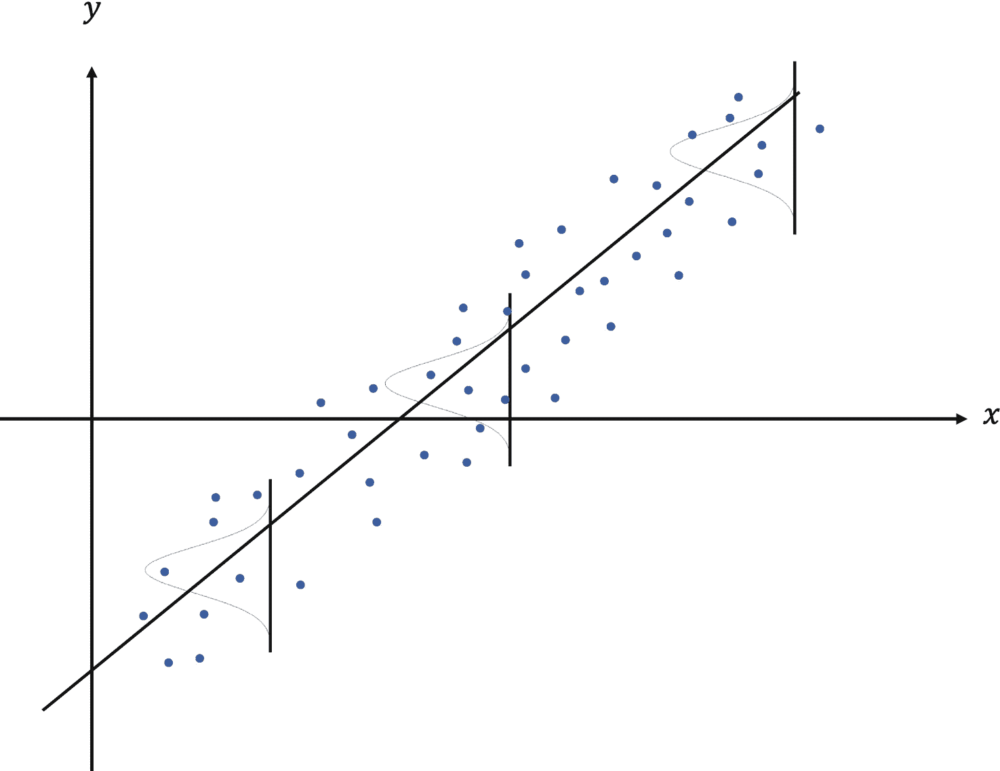

广义线性模型在 `y` 对 `x` 平面上的散点图。可见一条上升的趋势线。图上有几个数据点。

**图 14-14** OLS 回归

从数学上讲，线性预测器 `b[0] + b[1]*x` 预测了响应变量 `y[i]` 的均值。然后 `y[i]` 由一个先验分布决定，在此例中为具有恒定方差 `ε` 的正态分布。

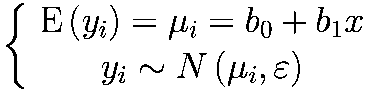

考虑另一组数据，例如，后院兔子数量随时间的变化，如图 14-15 所示。种群数量是随机的，因为它们的出生和死亡不确定。如果你在数据点之间画一条线，这条曲线看起来更像指数曲线而非直线（非线性）。随着 `t` 增大，数据点扩散得更开（异方差性）。兔子种群数量是一个正整数（离散型，取值范围受限）。显然，OLS 不适用于这组数据，因为它几乎违反了所有假设。

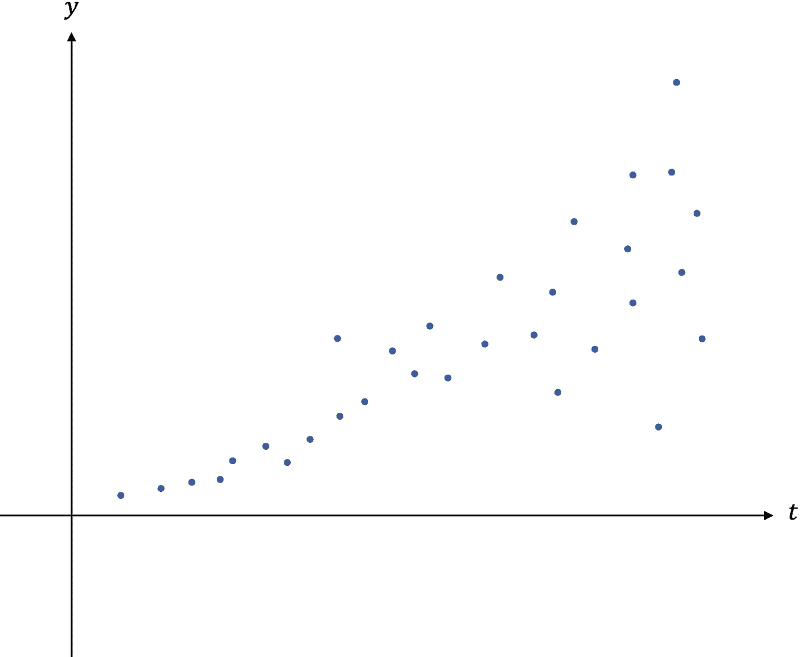

兔子种群数量在 `y` 轴与时间在 `x` 轴平面上的散点图。它有一条由点标记的不均匀趋势线。

**图 14-15** 兔子种群数量与时间的关系

为了修正响应变量的概率分布及其取值范围，你可以使用泊松分布代替正态分布。泊松分布是一种离散概率分布，用于给出计数事件发生的概率。它只有一个参数 `λ`，该参数同时也是分布的均值和方差。参见第 12.3.5 节。一旦你使用预测函数确定了均值，方差和泊松分布就完全确定了。你可以对更大的 `t` 使用更大的 `λ` 来模拟随时间增大的方差。见图 14-16。

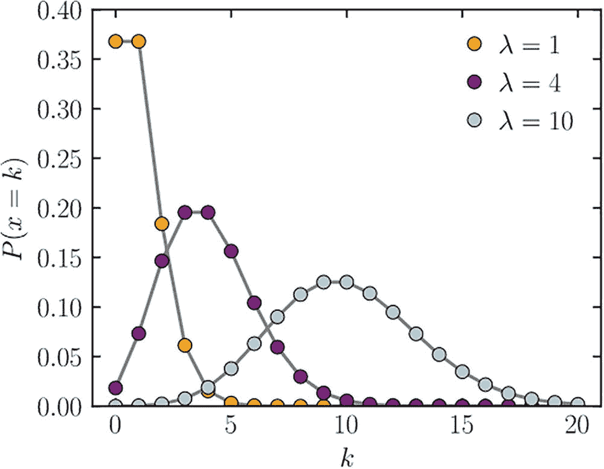

泊松分布概率质量函数在 `p` 对 `k` 平面上的折线图。图中可见 lambda 分别等于 1、4 和 10 时的三条曲线。

**图 14-16** 泊松分布的概率质量函数

为了修正穿过数据点的回归线，你可以对预测值进行变换，使其与分布的期望相匹配。在 OLS 中，预测值就是期望值。直线回归线是使用恒等函数将预测值与期望值“连接”起来的结果。为了模拟指数曲线，你可以改用指数函数。即：

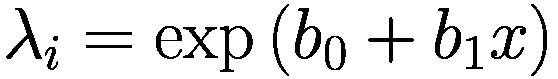

或者等价地：

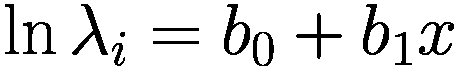

这种回归（泊松分布、线性预测器、指数函数）被称为泊松回归。结果如图 14-17 所示。不同方差的泊松分布叠加在指数回归线上。

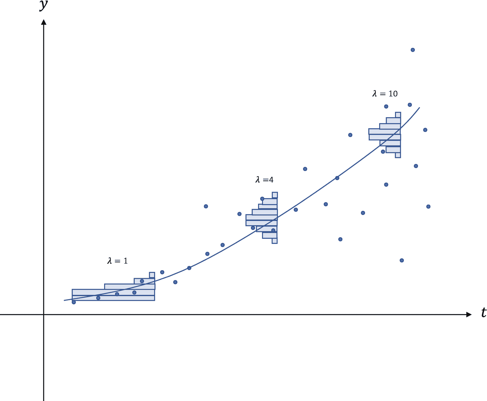

泊松回归在 `x` 轴和 `y` 轴平面上的绘图。趋势线形状类似指数曲线。

**图 14-17** 泊松回归

## GLM 的要素

广义线性模型（GLM）通过适应不同的方差以及残差（从而也是响应变量）的替代分布，扩展了线性建模的应用范围。GLM 统一了许多其他统计模型。WLS、逻辑回归和泊松回归都是 GLM 框架下的特例。所有 GLM 回归都有三个共同要素。首先，系统性和确定性组成部分是预测函数，它是解释变量的线性组合，即 `Xβ`。其次，随机组成部分是残差/响应变量概率分布的 specification。这些分布都来自指数分布族，其特征由均值的某个函数（典范参数或位置参数）和方差的某个函数（离散参数）决定。来自指数分布族的概率分布的概率密度函数的一般形式如下：

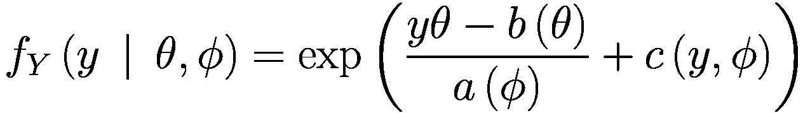

其中，参数 `θ` 是典范参数，`b(θ)` 是累积量函数，`ϕ` 是离散参数。NM Dev 接口 `GLMExponentialDistribution` 代表这一族指数概率分布。

第三，链接函数（通常记为 `g`）将系统性组成部分与随机组成部分连接起来。其逆函数将预测值转换为概率分布的均值。数学上，表示为：

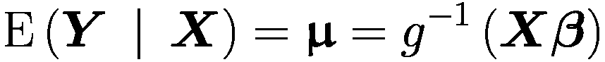

下表总结了各种 GLM 回归的这三个组成部分及其在 NM Dev 中的支持情况：

| 回归模型 | 响应变量 | 概率分布 | 典范链接函数 | NM Dev 类 |
| --- | --- | --- | --- | --- |
| 线性回归 | 连续测量值 | 正态分布 | 恒等 | `GLMGaussian` |
| 逻辑回归 | 二元 | 二项分布 | Logit | `GLMBinomial` |
| 泊松回归 | 计数 | 泊松分布 | Log | `GLMPoisson` |
| 伽马回归 | 生存时间 | 伽马分布 | Log | `GLMGamma` |
| 逆高斯回归 |   | 逆高斯分布 | 1/μ² | `GLMInverseGaussian` |

## 在 NM Dev 中运行 GLM

在 NM Dev 中，要运行 GLM 回归，首先需要使用 `GLMProblem` 类构建一个问题实例。该类签名如下：

```java
/**
 * 构建一个 GLM 问题。
 *
 * @param y         因变量
 * @param X         因子
 * @param intercept 如果为 {@code true}，则向线性回归中添加额外的截距项
 * @param family    均值的指数分布族
 */
public GLMProblem(
    Vector y,
    Matrix X,
    boolean intercept,
    GLMFamily family
)
```

`GeneralizedLinearModel` 类用于运行 GLM 回归。该类签名如下：

```java
/**
 * 构建一个 {@code GeneralizedLinearModel} 实例。
 *
 * @param problem 待解决的广义线性回归问题
 * @param fitting 拟合方法，参见 {@link GLMFitting}
 */
public GeneralizedLinearModel(GLMProblem problem, GLMFitting fitting)
```

参数 `fitting` 指定了用于估计回归参数的方法。默认估计方法是迭代重加权最小二乘算法（IWLS），它是一种最大似然算法。

以下示例使用二项分布和 logit 链接函数运行 GLM 回归：

```scala
// construct a linear model problem
val problem = GLMProblem(
    // the independent variable, y
    DenseVector(1.0, 1.0, 0.0, 1.0, 1.0),
    // the design matrix of dependent variable, X
    DenseMatrix(
        arrayOf(
            doubleArrayOf(1.52),
            doubleArrayOf(3.22),
            doubleArrayOf(4.32),
            doubleArrayOf(10.1034),
            doubleArrayOf(12.1)
        )
    ),
    // with intercept
    true,
    // use the binomial distribution
    GLMFamily(GLMBinomial())
)
```

## 14.4.1 准族

*过度分散*是指数据集中存在的变异性或方差大于给定统计模型预期的情况。在使用 GLM 对离散数据进行建模时尤其常见，因为指数分布规定了均值与方差之间的特定关系。例如，对于泊松分布，均值等于方差，两者都是*λ*。离散数据集可能具有均值*λ*，但表现出大于*λ*的变异性。

解决这个问题的一种方法是在泊松模型中引入一个分散参数*σ*²，使得修正后的响应条件方差如下：

$$ V\left({y}_i\kern0.5em |\kern0.5em {\lambda}_i\right)={\sigma}²{\lambda}_i $$

如果*σ*² > 1，则响应的条件方差增加速度比其均值更快。指数族中没有分布对应此规范以用于 GLM。相反，您就像前面的缩放方差方程那样直接指定条件均值和条件方差。尽管没有似然函数（因为没有概率密度函数），但 GLM 最大似然估计的常规程序会产生所谓的回归系数的准似然估计量，这些估计量共享最大似然估计的许多性质。实际上，这种处理过度分散的方法会得到相同的$$ \hat{\boldsymbol{\beta}} $$估计。然而，估计的标准误差必须乘以因子$$ \sigma =\sqrt{\sigma²} $$。

NM Dev 库支持多种准分布。接口是`QuasiDistribution`。类签名如下：

```java
public interface QuasiDistribution extends GLMExponentialDistribution {
    /**
     * the quasi-likelihood function corresponding to a single observation
     * Q(&mu;; y)
     *
     * @param mu &mu;
     * @param y  y
     * @return Q(&mu;; y)
     *
     * @see "P. J. MacCullagh and J. A. Nelder, Generalized Linear
     * Models, 2nd ed. Chapter 9\. Table 9.1\. p.326."
     */
    public double quasiLikelihood(double mu, double y);

    /**
     * the quasi-deviance function corresponding to a single observation
     *
     * @param y  y
     * @param mu &mu;
     * @return D(y; &mu;;)
     *
     * @see "P. J. MacCullagh and J. A. Nelder, Generalized Linear
```

以下示例使用泊松分布和 log 链接函数运行 GLM 回归：

```scala
// construct a linear model problem
val problem = GLMProblem(
    // the independent variable, y
    DenseVector(4.0, 1.0, 4.0, 5.0, 7.0),
    // the design matrix of dependent variable, X
    DenseMatrix(
        arrayOf(
            doubleArrayOf(1.52, 2.11),
            doubleArrayOf(3.22, 4.32),
            doubleArrayOf(4.32, 1.23),
            doubleArrayOf(10.1034, 8.43),
            doubleArrayOf(12.1, 7.31),
        )
    ),
    // with intercept
    true,
    // use the binomial distribution
    GLMFamily(GLMPoisson()))

// solve a GLM regression problem
val glm = GeneralizedLinearModel(problem)

println("beta hat")
// the means of betas
println("beta^ = " + glm.beta().betaHat())
// the standard errors of betas
println("beta^ standard error = " + glm.beta().stderr())
// a beta/variable is significant if its t-stat is bigger than 2
println("beta^ t = " + glm.beta().t())

println("residuals")
println("fitted values: " + glm.residuals().fitted())
println("deviance residuals: " + glm.residuals().devianceResiduals())
println("deviance: " + glm.residuals().deviance())
println("over dispersion: " + glm.residuals().overdispersion())

println("information criteria")
println("AIC = " + glm.AIC())
```

输出如下：

```
beta hat
beta^ = [0.159667, -0.126816, 0.952348]
beta^ standard error = [0.107230, 0.154416, 0.470909]
beta^ t = [1.489023, -0.821261, 2.022359]
residuals
fitted values: [2.528082, 2.505862, 4.419947, 4.465919, 7.080190]
deviance residuals: [0.852544, -1.083724, -0.203045, 0.247925, -0.030194]
deviance: 2.0048958300580386
over dispersion: 1.0
information criteria
AIC = 23.8245863701111
```

以下是一个解决 GLM 回归问题的基础示例：

```scala
// solve a GLM regression problem
val glm = GeneralizedLinearModel(problem)

println("beta hat")
// the means of betas
println("beta^ = " + glm.beta().betaHat())
// the standard errors of betas
println("beta^ standard error = " + glm.beta().stderr())
// a beta/variable is significant if its t-stat is bigger than 2
println("beta^ t = " + glm.beta().t())

println("residuals")
println("fitted values: " + glm.residuals().fitted())
println("deviance residuals: " + glm.residuals().devianceResiduals())
println("deviance: " + glm.residuals().deviance())
println("over dispersion: " + glm.residuals().overdispersion())

println("information criteria")
println("AIC = " + glm.AIC())
```

输出如下：

```
beta hat
beta^ = [0.165250, 0.487592]
beta^ standard error = [0.328662, 1.917517]
beta^ t = [0.502798, 0.254283]
residuals
fitted values: [0.676727, 0.734914, 0.768787, 0.896338, 0.923234]
deviance residuals: [0.883727, 0.784859, -1.711383, 0.467841, 0.399681]
deviance: 4.704428247887891
over dispersion: 1.0
information criteria
AIC = 8.70442824788789
```

* Models, 2nd ed. Chapter 9\. Eq. 9.4., the integral form, p.327."

*/

public double quasiDeviance(double y, double mu);

}

```

NM Dev 支持的准分布如下：

*   `QuasiBinomial`
*   `QuasiGamma`
*   `QuasiGaussian`
*   `QuasiInverseGaussian`
*   `QuasiPoisson`

以下示例使用准二项分布和 `logit` 链接函数运行 OLS 回归：

```
// construct a linear model problem

val problem = QuasiGLMProblem(

// the independent variable, y

DenseVector(1.0, 1.0, 0.0, 1.0, 1.0),

// the design matrix of dependent variable, X

DenseMatrix(

arrayOf(

doubleArrayOf(1.52),

doubleArrayOf(3.22),

doubleArrayOf(4.32),

doubleArrayOf(10.1034),

doubleArrayOf(12.1)

)

),

// with intercept

true,

QuasiFamily(

QuasiBinomial(), // the quasi-binomial distribution

LinkLogit() // logit link function

))

// solve a GLM regression problem

val glm = GeneralizedLinearModelQuasiFamily(problem)

println("beta hat")

// the means of betas

println("beta^ = " + glm.beta().betaHat())

// the standard errors of betas

println("beta^ standard error = " + glm.beta().stderr())

// a beta/variable is significant if its t-stat is bigger than 2

println("beta^ t = " + glm.beta().t())

println("residuals")

println("fitted values: " + glm.residuals().fitted())

println("deviance residuals: " + glm.residuals().devianceResiduals())

println("deviance: " + glm.residuals().deviance())

println("over dispersion: " + glm.residuals().overdispersion())

```

输出如下：

```text
beta hat
beta^ = [0.165250, 0.487592]
beta^ standard error = [0.396316, 2.312236]
beta^ t = [0.416966, 0.210875]
residuals
fitted values: [0.676727, 0.734914, 0.768787, 0.896338, 0.923234]
deviance residuals: [0.883727, 0.784859, -1.711383, 0.467841, 0.399681]
deviance: 4.704428247887892
over dispersion: 1.4540719510495013
```

注意，过度离势（`overdispersion`）的值为 1.454 > 1。如果使用常规的泊松分布（`Poisson distribution`），该数据集将拟合得很差。

以下示例使用拟正态分布（`quasi-normal distribution`）和逆链接函数（`inverse link function`）运行普通最小二乘（OLS）回归：

```
// construct a linear model problem

val problem = QuasiGLMProblem(

// the independent variable, y

DenseVector(1.0, 1.0, 0.0, 1.0, 1.0),

// the design matrix of dependent variable, X

DenseMatrix(

arrayOf(

doubleArrayOf(1.52),

doubleArrayOf(3.22),

doubleArrayOf(4.32),

doubleArrayOf(10.1034),

doubleArrayOf(12.1)

)

),

// with intercept

true,

QuasiFamily(

QuasiGaussian(), // the quasi-normal distribution

LinkInverse() // inverse link function

))

// solve a GLM regression problem

val glm = GeneralizedLinearModelQuasiFamily(problem)

println("beta hat")

// the means of betas

println("beta^ = " + glm.beta().betaHat())

// the standard errors of betas

println("beta^ standard error = " + glm.beta().stderr())

// a beta/variable is significant if its t-stat is bigger than 2

println("beta^ t = " + glm.beta().t())

println("residuals")

println("fitted values: " + glm.residuals().fitted())

println("deviance residuals: " + glm.residuals().devianceResiduals())

println("deviance: " + glm.residuals().deviance())

println("over dispersion: " + glm.residuals().overdispersion())

```

输出结果如下：

```
beta hat
beta^ = [-0.045443, 1.566066]
beta^ standard error = [0.083658, 0.800455]
beta^ t = [-0.543192, 1.956470]
residuals
fitted values: [0.668008, 0.704356, 0.730060, 0.903390, 0.984046]
deviance residuals: [0.331992, 0.295644, -0.730060, 0.096610, 0.015954]
deviance: 0.7401995829806532
over dispersion: 0.24673319432688443
```

注意，过度离势（`overdispersion`）的值为 0.2467 < 1，表明该数据集存在欠离势（`underdispersion`）现象。

## 14.5 逐步回归

对于包含许多可能解释变量的高维数据集，你可能无法确定应将哪些子集包含在回归模型中。一种系统性的解释变量选择方法是逐步回归（`stepwise regression`）。在每一步中，基于某个指定的准则，考虑将某个变量加入解释变量集合或从中减去。通常，这表现为一系列 F 检验或 t 检验的形式，但也可能采用其他技术，例如调整后的 `R²`、`AIC`、`BIC` 等。

主要有三种方法：

**前向选择**（Forward selection）从模型中不包含任何变量开始，使用选定的模型拟合准则测试每个变量的添加，添加（若有）其包含能带来最显著的统计拟合改进的变量，并重复此过程，直到没有变量能在统计显著程度上改进模型为止。NM Dev 类 `ForwardSelection` 实现了这一过程。以下示例使用 `AIC` 作为选择准则，对一个广义线性模型（GLM）运行逐步前向选择：

```
// read the birth weight data from a csv file
```

## 逐步回归

`val birthwt = DataFrame.readCSV("https://raw.githubusercontent.com/nmltd/s2-public/main/Data/linear-reg-data.csv")`

`// construct a linear model problem`

`val problem = GLMProblem(`

`DenseVector(birthwt["y"].asDoubles()), // Y, the dependent variables`

`DenseMatrix(DenseVector(birthwt["x"].asDoubles())), // X, the independent variables`

`true, // with intercept`

`GLMFamily(GLMBinomial()) // GLM with binomial distribution`

`)`

`// run a step-wise forward selection on covariates`

`val forwardSelection = ForwardSelection(problem, SelectionByAIC())`

`println("selection sequence:")`

`println(Arrays.toString(forwardSelection.getFlags()))`

```
// run a step-wise forward selection on covariates

val forwardSelection = ForwardSelection(problem, SelectionByAIC())

println("selection sequence:")

println(Arrays.toString(forwardSelection.getFlags()))
```

输出是每次添加一个协变量的选择序列：

```
selection sequence:

[0, 2, 3, 4, 5, 6, 7, 0]
```

**后向消除**（Backward elimination）从包含所有候选变量开始，使用选定的模型拟合准则测试每个变量的删除，删除（若有）其剔除会导致模型拟合在统计上最不显著恶化的变量，并重复此过程，直到没有变量可以在不造成统计上显著的拟合损失的情况下被删除。NM Dev 类`BackwardElimination`实现了这一过程。以下示例使用 AIC 作为消除准则，对一个广义线性模型（GLM）运行逐步后向消除：

```
// read the birth weight data from a csv file

val birthwt = DataFrame.readCSV("https://raw.githubusercontent.com/nmltd/s2-public/main/Data/linear-reg-data.csv")

// construct a linear model problem

val problem = GLMProblem(

DenseVector(birthwt["y"].asDoubles()), // Y, the dependent variables

DenseMatrix(DenseVector(birthwt["x"].asDoubles())), // X, the independent variables

true, // with intercept

GLMFamily(GLMBinomial()) // GLM with binomial distribution

)

val backwardElimination = BackwardElimination(problem, EliminationByAIC())

println("elimination sequence:")

println(Arrays.toString(backwardElimination.getFlags()))
```

输出是每次移除一个协变量的消除序列：

```
elimination sequence:

[0, 2, 3, 4, 5, 6, 7, 0]
```

**双向消除**（Bidirectional elimination）是上述两种方法的结合，在每一步检验要包含或排除的变量。逐步回归的主要缺点包括：参数估计的偏差、模型选择算法之间的不一致性、固有的（但常被忽视的）多重假设检验问题，以及不恰当地关注或依赖单一最佳模型。这些方法仅在特定情况下能提高预测精度，例如，当只有少数协变量与结果有强关系时。然而，在其他情况下，它们可能会增加预测误差。

# 14.6 LASSO

**最小绝对收缩与选择算子（LASSO）** 是另一种能够自动/系统性地进行变量选择的方法。它通过对贝塔系数（beta coefficients）的总和大小施加正则化或惩罚，迫使其中部分系数归零，从而有效地将它们从模型中排除。与逐步回归（一种一次只考虑一个变量的贪婪算法）不同，LASSO 能够同时且全局性地选择所有重要变量。从数学上看，LASSO 解决了一个以*ℓ*[1]正则化为约束条件的残差平方和（RSS）问题。

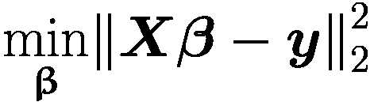，其中，‖***β***‖[1] ≤ *t*

NM Dev 库中名为`ConstrainedLASSOProblem`的类用于构造此类问题。该类签名如下：

```
/**

 * 构造一个约束形式的 LASSO 问题。

 *

 * @param y 响应变量向量 (n * 1)，已进行适当的去均值和缩放处理

 * @param X 因子设计矩阵 (n * m)，已进行适当的去均值和缩放处理

 * @param t 惩罚参数

 */

public ConstrainedLASSOProblem(Vector y, Matrix X, double t)
```

等价地，你可以将带约束的问题以拉格朗日形式写成一个无约束最小化问题。

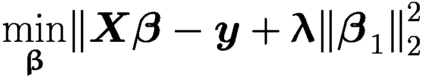

其中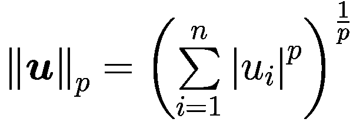是标准的*ℓ*[*p*]-范数。

NM Dev 库中名为`UnconstrainedLASSOProblem`的类用于构造此类问题。该类签名如下：

```
/**

 * 构造一个 LASSO 问题。

 *

 * @param y      响应变量向量 (n * 1)，已进行适当的去均值和缩放处理

 * @param X      因子设计矩阵 (n * m)，已进行适当的去均值和缩放处理

 * @param lambda 惩罚参数

 */

public UnconstrainedLASSOProblem(Vector y, Matrix X, double lambda)
```

解决 LASSO 问题有两种方法：二次规划（QP）或最小角回归（LARS）。

二次规划方法将问题转化为一个具有 *2p* 个约束的单一二次规划问题，其中 *p* 是设计矩阵的列数或解释变量的数量。

以下代码示例通过使用 QP 方法`ConstrainedLASSObyQP`求解 LASSO 问题，为糖尿病数据集中 ^(¹¹) 的解释变量选择了一个子集，从而构建了一个线性模型。

```
// 正则化惩罚项

var t = 0.0

// 构造一个带约束的 LASSO 问题

var problem = ConstrainedLASSOProblem(diabetes_y, diabetes_X, t)

// 运行 LASSO 回归

var betaHat: Vector = ConstrainedLASSObyQP(problem).beta().betaHat()

println("beta^ = " + betaHat)

t = 1500.0

problem = ConstrainedLASSOProblem(diabetes_y, diabetes_X, t)

betaHat = ConstrainedLASSObyQP(problem).beta().betaHat()

println("beta^ = " + betaHat)

// 放松约束后，本质上等同于 OLS 解

t = 10000.0

problem = ConstrainedLASSOProblem(diabetes_y, diabetes_X, t)
```

## LASSO 回归与最小角回归（LARS）

首先，使用二次规划求解 LASSO 问题：
```
betaHat = ConstrainedLASSObyQP(problem).beta().betaHat()
println("beta^ = " + betaHat)
```

输出结果如下：

```
beta^ = [0.000000, 0.000000, 0.000000, 0.000000, 0.000000, 0.000000, 0.000000, 0.000000, 0.000000, 0.000000]

beta^ = [0.000000, -96.348737, 508.285354, 243.727200, 0.000000, 0.000000, -186.148813, 0.000000, 455.180652, 10.309244]

beta^ = [-18.448399, -235.622288, 516.365580, 323.720107, -798.129152, 477.715312, 112.248720, 189.372882, 754.619923, 70.468112]
```

最后一个结果对应的`t`值非常大，因此贝塔系数未受约束。该结果将等同于运行 OLS 的结果。

### 最小角回归（LARS）简介

最小角回归（LARS）是一种通过选择协变量子集来对高维数据进行线性回归模型拟合的算法。LARS 解并非仅仅给出一个向量结果，而是包含一条曲线，该曲线表示了参数向量的`ℓ[1]-范数`每个取值对应的解。该算法类似于前向逐步回归，但在每一步中，不是直接纳入变量，而是沿着与各变量残差相关性等角的方向来增加估计参数。

### 使用 LARS 求解

以下代码使用 LARS 方法`ConstrainedLASSObyLARS`解决了相同的 LASSO 问题：
```
// 正则化惩罚项
var t = 0.0

// 构造一个带约束的 LASSO 问题
var problem = ConstrainedLASSOProblem(diabetes_y, diabetes_X, t)

// 运行 LASSO 回归
var betaHat: Vector = ConstrainedLASSObyLARS(problem).beta().betaHat()
println("beta^ = " + betaHat)

t = 1500.0
problem = ConstrainedLASSOProblem(diabetes_y, diabetes_X, t)
betaHat = ConstrainedLASSObyLARS(problem).beta().betaHat()
println("beta^ = " + betaHat)

// 放松约束后，本质上等同于 OLS 解
t = 10000.0
problem = ConstrainedLASSOProblem(diabetes_y, diabetes_X, t)
betaHat = ConstrainedLASSObyLARS(problem).beta().betaHat()
println("beta^ = " + betaHat)
```

输出结果与之前的结果类似：
```
beta^ = [0.000000, 0.000000, 0.000000, 0.000000, 0.000000, 0.000000, 0.000000, 0.000000, 0.000000, 0.000000]

beta^ = [0.000000, -96.348697, 508.285327, 243.727190, 0.000000, 0.000000, -186.148803, 0.000000, 455.180663, 10.309320]

beta^ = [-18.448420, -235.622167, 516.365552, 323.720053, -798.128410, 477.714962, 112.248151, 189.372251, 754.619805, 70.468203]
```

`ConstrainedLASSObyLARS`实际上调用了另一个名为`LARSFitting`的 NM Dev 类来计算所有的选择步骤。以下代码重复了前面展示的 LARS 计算过程，并展示了选择步骤：
```
// 构造一个 LARS 问题
val problem = LARSProblem(
    diabetes_y,
    diabetes_X,
    true) // 使用 LASSO 变体

// 运行 LARS 拟合算法
val fit = LARSFitting(problem, 1e-8, 100)
val estimators: LARSFitting.Estimators = fit.getEstimators()

// 采取的动作序列：它们是在每次迭代中添加或删除的变量。
println("action sequence: " + estimators.actions())

// 估计的 LARS 回归系数的完整序列，按每行的 L2 范数进行缩放。
println("sequence of estimated LARS regression coefficients:")
println(estimators.scaledBetas())
```

输出结果如下：
```
action sequence: [3, 9, 4, 7, 2, 10, 5, 8, 1, 6, -7, 7]
sequence of estimated LARS regression coefficients:

13x10
[,1] [,2] [,3] [,4] [,5] [,6] [,7] [,8] [,9] [,10]
[1,] 0.000000, 0.000000, 0.000000, 0.000000, 0.000000, 0.000000, 0.000000, 0.000000, 0.000000, 0.000000,
[2,] 0.000000, 0.000000, 52.609314, 0.000000, 0.000000, 0.000000, 0.000000, 0.000000, 0.000000, 0.000000,
[3,] 0.000000, 0.000000, 359.691510, 0.000000, 0.000000, 0.000000, 0.000000, 0.000000, 307.082199, 0.000000,
[4,] 0.000000, 0.000000, 430.923197, 77.462073, 0.000000, 0.000000, 0.000000, 0.000000, 378.584828, 0.000000,
[5,] 0.000000, 0.000000, 502.777391, 191.000733, 0.000000, 0.000000, -115.633979, 0.000000, 444.203866, 0.000000,
[6,] 0.000000, -64.714355, 507.691240, 228.045408, 0.000000, 0.000000, -163.671347, 0.000000, 453.708049, 0.000000,
[7,] 0.000000, -109.231911, 508.527271, 250.113659, 0.000000, 0.000000, -195.302838, 0.000000, 455.780391, 14.507832,
[8,] 0.000000, -191.033013, 518.274174, 292.677114, -99.127088, 0.000000, -221.890826, 0.000000, 515.246160, 55.218187,
[9,] 0.000000, -211.502913, 521.607265, 305.105662, -164.885174, 0.000000, -170.351154, 76.710531, 526.186572, 62.229531,
[10,] -7.654507, -221.991725, 523.427831, 313.543043, -199.964577, 0.000000, -141.794223, 118.564050, 532.755032, 67.213806,
[11,] -13.679150, -229.599582, 519.486007, 319.223360, -533.830831, 266.637493, 0.000000, 158.085779, 656.589267, 69.030254,
[12,] -15.114733, -232.602466, 517.737868, 320.563603, -562.905016, 296.771112, 0.000000, 148.040585, 669.812407, 69.972772,
[13,] -18.448420, -235.622167, 516.365552, 323.720053, -798.128410, 477.714962, 112.248151, 189.372251, 754.619805, 70.468203,
```

脚注 1

# 15. 时间序列分析

时间序列分析是一种研究时间序列数据的统计技术。时间序列是按离散时间顺序索引的一系列数据点。通常，时间序列是在时间上连续等间隔点（但并非必须）采集的序列。时间序列的例子包括标普 500 指数（SPX）的每日收盘值、过去 100 年的人口数据以及月度销售额。时间序列分析从时间序列数据中提取有意义的统计量和其他特征。时间序列预测则根据观测值预测未来值。

在回归分析中，你分析的是响应变量与（其他）解释变量之间的关系。而在时间序列分析中，你关心的不仅是观测值与解释变量（即时间）之间的关系，更重要的是观测值本身之间的关系，例如时间 `t` 的值与其前两个最近值之间的关系。例如，回归分析计算响应变量与解释变量之间的相关性；时间序列分析则计算观测值本身之间的相关性。回归分析不假设观测值有顺序，而时间序列数据具有天然的时间顺序。时间序列模型通常反映出时间上相近的观测值比时间相隔较远的观测值关系更密切。在简单线性回归（一个解释变量）和时间序列分析中，你都是在数据点上画一条线来最佳拟合该序列。时间序列分析通常使用线性回归来研究数据。

时间序列分析可应用于实值连续数据、离散数值数据，甚至离散符号数据（例如，英文字母和单词等字符序列）。时间序列分析（及预测）是一个庞大的课题。研究时间序列的方法众多：参数化与非参数化、线性与非线性、频域与时域。在本章中，我们仅简要讨论一个重要的类别：线性参数化时域方法。

时间序列作为一种主要的统计工具，广泛应用于众多领域。在统计学、计量经济学、量化金融、地震学、气象学和地球物理学中，时间序列分析的主要目标是预测。在信号处理、控制工程和通信工程中，它用于信号检测。在机器学习、数据挖掘和模式识别中，它用于聚类、分类、按内容查询、异常检测和预测。

任何时间序列分析的第一步都是绘制数据图表。可视化对于发现数据集的模式（例如识别趋势、检测异常和寻找聚类）至关重要。在构建模型之前，你需要对数据的形态有所了解。例如，图 15-1 展示了 2015 年 1 月至 2019 年 12 月 SPX 每日价格图。你可以看到 SPX 总体呈上升趋势（这正是沃伦·巴菲特建议被动投资者买入 SPX 股票的原因）。此外，请注意几次大幅回撤，指数可能下跌超过 40%，但最终都会恢复（这正是沃伦·巴菲特建议被动投资者持有 SPX 指数多年，并忽略市场无论如何波动带来的所有涨跌的原因）。另一个发现是，SPX 存在多种状态：上涨、下跌和横盘。此外，小的波动期之后通常跟着小的波动期，大的波动期之后跟着大的波动期；因此，这称为波动率聚类。

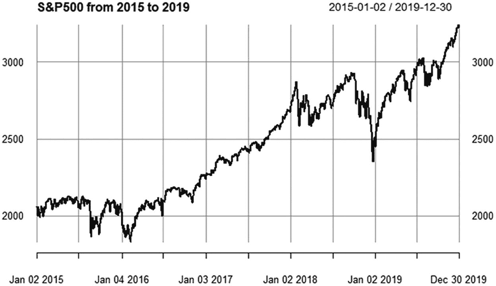
一幅时间序列图绘制了 2015 年 1 月至 2019 年 12 月标普 500 指数的每日价格。线条呈现整体上升趋势。

**图 15-1**

## 标普 500 指数每日收盘价时间序列

理解时间序列是一个随机过程至关重要。某个时间点的观测值是该时间点随机变量的一个实现。（它可能取另一个值。）时间序列通常表示如下：

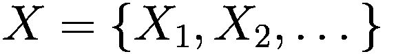

其中下标为自然数。

或者，也可以这样表示：

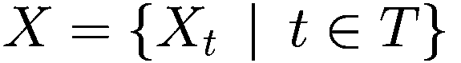

其中 `T` 为索引集。

每个 `X[t]` 都是一个随机变量。因此，时间序列是一系列相互关联的索引随机变量。

表示线性时间序列（即数值仅线性依赖于过去数值）的模型主要有三大类：自回归（AR）模型、移动平均（MA）模型和积分（I）模型。将这些思想结合，就产生了自回归移动平均（ARMA）模型和自回归积分移动平均（ARIMA）模型。这些类的扩展可用于处理向量值数据，通常归入多元时间序列模型的范畴，有时前述缩写词会加上首字母 `V` 表示“向量”，例如 `VAR` 表示向量自回归。这些模型描述了一阶效应，即时间序列的均值或水平。为了描述（非线性）时间序列的二阶效应，即波动性，需要使用自回归条件异方差（ARCH）模型和广义自回归条件异方差（GARCH）模型。

在 NM Dev 库中，有大量类用于表示单变量和多变量时间序列的模型和预测。此外，还收集了用于操作、转换和计算时间序列属性的实用函数和类。通用时间序列的接口是 `TimeSeries`。其签名如下：

```java
public interface TimeSeries<T, V, E extends TimeSeries.Entry> extends Iterable<E> {

    /**
     * 时间序列由一系列 {@code Entry} 组成。
     * 
     * {@code TimeSeries.Entry} 是不可变的。
     *
     * @param T 时间类型
     * @param V 数值类型
     */
    public static interface Entry<T, V> {

        /**
         * 获取时间戳。
         *
         * @return 时间戳
         */
        public T getTime();

        /**
         * 获取条目数值。
         *
         * @return 条目数值
         */
        public V getValue();
    }

    /**
     * 获取时间序列的长度。
     *
     * @return 时间序列长度
     */
    public int size();
}
```

此实现将数据点及其时间戳表示为数值和索引（通常称为时间）的对。这些条目（对）按其时间戳升序排列。这是一个通用接口，其中泛型类型 `T` 可以是任何允许排序或可比较的类。例如，`T` 可以是 `LocalDateTime` 实现的实际时间戳。以下是一个示例：

```java
public class DateTimeGenericTimeSeries
        implements TimeSeries<LocalDateTime, ...> {...}
```

另一方面，泛型类型 `V` 可以表示任何数值类型。当 `V` 是向量时，它可以表示一个多变量时间序列。在单变量时间序列的情况下，最常需要研究实数的时间序列，这些实数由 `double` 表示。`UnivariateTimeSeries` 接口扩展了 `TimeSeries`，并实现了此类时间序列。索引是某种时间概念，数值为 `double`。

```java
public interface UnivariateTimeSeries<T, E extends UnivariateTimeSeries.Entry>
        extends dev.nm.stat.timeseries.datastructure.TimeSeries<T, Double, E> {...}
```

在大多数应用中，索引集由自然数组成。`IntTimeTimeSeries` 接口扩展了 `UnivariateTimeSeries`，由整数索引，数值类型为 `double`。

```java
public interface IntTimeTimeSeries
        extends dev.nm.stat.timeseries.datastructure.univariate.UnivariateTimeSeries<Integer, ...> {...}
```

为了简化编码和使用，NM Dev 使用实现了 `IntTimeTimeSeries` 的 `SimpleTimeSeries` 类来表示由自然数索引且取实数值的时间序列。此类还支持一系列常见操作来操作此类时间序列。其签名如下：

```java
public class SimpleTimeSeries implements IntTimeTimeSeries {

    /**
     * 构造一个 {@code SimpleTimeSeries} 实例。
     *
     * @param values 数值数组
     */
    public SimpleTimeSeries(double[] values);

    @Override
    public int size();

    @Override
    public Iterator<UnivariateTimeSeries.Entry<Integer, Double>> iterator();

    @Override
    public double[] toArray();

    @Override
    public double get(int t);

    /**
     * 通过删除前 {@code nItems} 个条目来构造一个 {@code SimpleTimeSeries} 实例。
     *
     * @param nItems 要删除的前导条目数量
     * @return 一个 {@code SimpleTimeSeries}
     */
    public SimpleTimeSeries drop(int nItems);

    /**
     * 通过进行 {@code d} 次一阶差分来构造一个 {@code SimpleTimeSeries} 实例。
     *
     * @param d 差分次数
     * @return {@code diff(x, lag = 1, differences = d)}，如 DoubleUtils 中所示
     */
    public SimpleTimeSeries diff(int d);
}
```

## 图 15-2 单变量时间序列的类层次结构

通过对时间序列进行滞后操作来构造一个 `SimpleTimeSeries` 实例。此操作仅对等距数据点有意义。

```java
public SimpleTimeSeries lag(int nLags, int length);
```

通过对时间序列进行滞后操作来构造一个 `SimpleTimeSeries` 实例。此操作仅对等距数据点有意义。

```java
public SimpleTimeSeries lag(int nLags);
```

```java
@Override
public String toString();
}
```

图 15-2 展示了根据时间或索引类型以及数值类型来表示不同单变量时间序列的类层次结构。

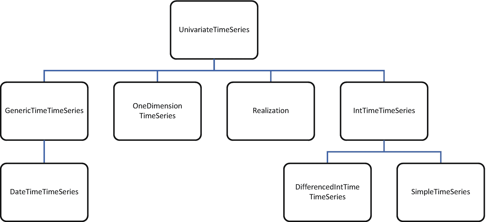

一个框图展示了单变量时间序列的层次结构。它分为四个部分：泛型、一维、实现和整数时间序列。其中两个部分进一步细分了子部分。

**图 15-2** 表示单变量时间序列的类层次结构

以下示例构造了一个单变量时间序列，并演示了对其进行的几个操作：

```
// 构造一个时间序列
var ts1 = SimpleTimeSeries(doubleArrayOf(1.0, 2.0, 3.0, 4.0, 5.0, 6.0, 7.0, 8.0, 9.0, 10.0))
println("ts1:" + ts1)

// 通过对另一个时间序列进行一阶差分来构造一个时间序列
// 每一项是原始时间序列中连续两项之间的差
val ts2 = ts1.diff(1)
println("ts2:" + ts2)

// 通过删除另一个时间序列的前两项来构造一个时间序列
val ts3 = ts1.drop(2)
println("ts3:" + ts3)

// 通过对另一个时间序列进行滞后操作来构造一个时间序列
// 此操作仅对等距数据点有意义。
val ts4 = ts1.lag(2)
println("ts4:" + ts4)
```

输出如下：

```
ts1:length = 10
[1,] 1.000000, [2,] 2.000000, [3,] 3.000000, [4,] 4.000000, [5,] 5.000000, [6,] 6.000000, [7,] 7.000000, [8,] 8.000000, [9,] 9.000000, [10,] 10.000000,
ts2:length = 9
[1,] 1.000000, [2,] 1.000000, [3,] 1.000000, [4,] 1.000000, [5,] 1.000000, [6,] 1.000000, [7,] 1.000000, [8,] 1.000000, [9,] 1.000000,
ts3:length = 8
[1,] 3.000000, [2,] 4.000000, [3,] 5.000000, [4,] 6.000000, [5,] 7.000000, [6,] 8.000000, [7,] 9.000000, [8,] 10.000000,
ts4:length = 8
[1,] 1.000000, [2,] 2.000000, [3,] 3.000000, [4,] 4.000000, [5,] 5.000000, [6,] 6.000000, [7,] 7.000000, [8,] 8.000000,
```

前导或删除操作（`drop` 函数）会将时间序列向左移动。请注意，时间序列将最早的观测值（左侧）列到最新的观测值（右侧）。删除第一个或前导观测值意味着删除最早的观测值。例如，对于以下情况：


最早观测值是 1，最新的观测值是 10。你可能会预测下一个项为 11。因此，前移或丢弃两个观测值后得到如下结果：


相比之下，滞后操作（`lag`函数）会将序列向右移动，使得最近的观测值变为最旧的。


滞后一期意味着最新的观测值来自一个时间单位（例如年、月或日）之前。


滞后两期意味着最新的观测值来自两个时间单位之前。


NM Dev 不会在数组或时间序列中输出 `NaN`。如有需要，用户可能需要自行添加填充值。

本章的源代码可在 S2 平台上运行，地址如下：

[`https://s21.nm.dev/hub/user-redirect/lab/tree/s2-public/Numerical%20Methods%20Using%20Kotlin/chapter15.ipynb`](https://s21.nm.dev/hub/user-redirect/lab/tree/s2-public/Numerical%2520Methods%2520Using%2520Kotlin/chapter15.ipynb)

源代码也可在 GitHub 上找到：

[`https://github.com/apress/numerical-methods-kotlin`](https://github.com/apress/numerical-methods-kotlin)

## 15.1 单变量时间序列

单变量时间序列是一个随机（“随机”的学术化表述）过程，它由一系列按时间索引的随机变量 `X[t] = {X[1], X[2], ...}` 组成，其中 `X[1]` 表示时间 `t = 1` 时的随机变量，`X[2]` 表示时间 `t = 2` 时的随机变量，以此类推。该随机过程的观测值，即 `X[1] = x[1]`、`X[2] = x[2]` 等，被称为该随机过程的一个实现。序列 `{X[t]} = {x[1], x[2], ...}` 也称为时间序列。根据上下文，可以明确我们指的是随机过程本身还是该过程的某个特定实现。

以下 NM Dev 代码读取 SPX 数据，并使用 2015 年 1 月 2 日至 2019 年 12 月 30 日期间该指数的每日调整收盘价，创建一个单变量时间序列。调整收盘价与每日公布的指数收盘价并不完全相同。由于股票过去可能发生分拆和派息，必须根据证券价格研究中心（CRSP）的标准，使用相应的分拆和股息乘数对数据进行调整。我们通常使用调整后的价格（而非原始价格）来分析权益资产价格。

```
// 从 csv 文件中读取每日标普 500 数据
val spx_arr = DoubleUtils.readCSV2d("./resources/sp500_daily.csv", true, true)

// 将 csv 文件转换为矩阵以便操作
val spx_M: Matrix = DenseMatrix(spx_arr)

// 提取调整收盘价列
val spx_v: Vector = spx_M.getColumn(5) // 调整收盘价

// 根据数据构建单变量时间序列
val spx = SimpleTimeSeries(spx_v.toArray())
println(spx)
```

（节选的）输出如下：

```
长度 = 1257
```

[1,] 2058.199951, [2,] 2020.579956, [3,] 2002.609985, [4,] 2025.900024, [5,] 2062.139893, [6,] 2044.810059, [7,] 2028.260010, [8,] 2023.030029, [9,] 2011.270020, [10,] 1992.670044, [11,] 2019.420044, [12,] 2022.550049, [13,] 2032.119995, [14,] 2063.149902, [15,] 2051.820068, [16,] 2057.090088, [17,] 2029.550049, [18,] 2002.160034, [19,] 2021.250000, [20,] 1994.989990, [21,] 2020.849976, [22,] 2050.030029, [23,] 2041.510010, [24,] 2062.520020, [25,] 2055.469971, [26,] 2046.739990, [27,] 2068.590088, [28,] 2068.530029, [29,] 2088.479980, [30,] 2096.989990, [31,] 2100.340088, [32,] 2099.679932, [33,] 2097.449951, [34,] 2110.300049, [35,] 2109.659912, [36,] 2115.479980, [37,] 2113.860107, [38,] 2110.739990, [39,] 2104.500000, [40,] 2117.389893, [41,] 2107.780029, [42,] 2098.530029, [43,] 2101.040039, [44,] 2071.260010, [45,] 2079.429932, [46,] 2044.160034, [47,] 2040.239990, [48,] 2065.949951, [49,] 2053.399902, [50,] 2081.189941, [51,] 2074.280029, [52,] 2099.500000, [53,] 2089.270020, [54,] 2108.100098, [55,] 2104.419922, [56,] 2091.500000, [57,] 2061.050049, [58,] 2056.149902, [59,] 2061.020020, [60,] 2086.239990

再次强调，任何数据分析的第一步都是可视化，此处即绘制数据（在数据收集、数据清洗等步骤之后）。标普 500 数据如图 15-3 所示。


图 15-3 标普 500 指数每日收盘价的时间序列

`SPX`（或股票）的（每日）价格在不同时间具有不同的统计特征。例如，2015 年价格的均值水平大约在 2000 点左右（但每日仍有所不同）；而到了 2019 年，价格范围则在 2500 点至 3000 点之间。不能直接对价格数据进行分析，因为统计分析通常要求数据是平稳的，即数据具有相同的概率分布、相同的均值、相同的方差等。

# 价格与回报率的关系

一种解决该问题的方法是将价格`P[t]`转换为简单收益率`R[t]`。这种归一化以可比较的度量标准（即百分比）来衡量所有股票。这使得能够评估两只或多只股票之间的关系（例如协方差矩阵），尽管它们的价格可能具有不同的量级。（截至今天，`SPX`价格为`4370.04`，`GOOG`价格为`2619.38`，`AAPL`价格为`145.62`，`SRNE`价格为`8.25`。）


继续前面的示例，以下代码从价格计算简单收益率：

```kotlin
// compute simple returns from prices

val diff: DoubleArray = spx.diff(1).toArray()

val p0: DoubleArray = spx.lag(1).toArray()

var simple_returns: DoubleArray = DoubleArray(diff.size)

for (i in 0 until diff.size) {

    simple_returns[i] = diff[i] / p0[i]

}

println(Arrays.toString(simple_returns))
```

（简略的）输出如下：

```
[-0.01827810508970322, -0.008893471870112912, 0.011629842642575248, 0.01788828104579755, -0.008403811040573337, -0.008093685243358803, -0.002578555497921567, -0.005813066949783809, -0.00924787612555373, 0.013424199395451945, 0.0015499524278268393, 0.0047316238254433785, 0.015269721805970466, -0.0054915224477955155, 0.002568461085935695, -0.013387862379316457, -0.013495609538427277, 0.009534685377702431, -0.01299196536796535, 0.012962464037225537, 0.014439494938539686, -0.004156045950290833, 0.010291406800400634, -0.003418172396697485, -0.0042471946188310196, 0.010675561188404731, -2.903378506370865E-5, 0.009644506350069552, 0.004074738604868008, 0.001597574626476824, -3.14309098689124E-4,
```

在量化金融中，出于多种原因，我们经常使用对数收益率`r[t]`而不是简单收益率：


首先，通常应假设价格服从对数正态分布而非正态分布。对数正态分布始终为正，而正态分布可能产生负价格。此时对数收益率恰好服从正态分布，这与经典统计学通常假设正态性一致。价格、简单收益率和对数收益率之间的关系如下：


其次，当收益率非常小时（短期价格变动常见，但高频交易等极短周期除外），简单收益率和对数收益率非常接近：


第三，简单收益率不具有时间可加性，但对数收益率具有。具体而言，一系列简单收益率的复合收益率如下：


这个复合收益率是（独立）正态变量的乘积，因此不服从正态分布。

相比之下，复合收益率的对数是一系列对数收益率的和：


复合收益率的对数作为（独立）正态变量的和，因此服从正态分布。即使对数收益率不服从正态分布，当`t`足够大时，由于中心极限定理，它们的和（以及平均值）也近似服从正态分布。

第四，金融数学的很大一部分建立在连续时间随机过程之上，这严重依赖于积分与微分。对数收益率的指数形式（即价格）在微积分中易于处理：


第五，对小数进行加法运算在数值上更稳定，但乘法运算则不然，因为它容易受到算术下溢的影响。对于长时间计算而言，这可能成为一个严重的问题。为了解决这个问题，要么需要修改算法使其在数值上更稳健，要么通过取对数将其转换为数值安全的求和运算。

继续前面的示例，以下代码从价格计算对数收益率：

```
// compute log returns from prices

val p1: DoubleArray = spx.drop(1).toArray()

val p: DoubleArray = spx.toArray()

var log_returns: DoubleArray = DoubleArray(p1.size)

for (i in 0 until p1.size) {

log_returns[i] = log10(p1[i]) - log10(p[i])

}

println(Arrays.toString(log_returns))
```

（简略的）输出如下：

```
-0.008011523019181066, -0.0038796632820945476, 0.0050216323606129265, 0.0077001143584523035, -0.003665151042045789, -0.003529344887759578, -0.001121298711597607, -0.002531949245178744, -0.004034987996080819, 0.005791270527407466, 6.726146608051486E-4, 0.002050071849203139, 0.006581434496294225, -0.002391510439545552, 0.0011140384061145703, -0.005853546010243349, -0.0059009775694272015, 0.004121244933307455, -0.005679311988768365, 0.005593352602593971, 0.006226149153559124, -0.001808708970410855, 0.0044466590418430485, -0.0014870363336996206, -0.00184846135865957, 0.004611764296467147, -1.2609395692031455E-5, 0.004168486547660777, 0.0017660408524449167, 6.932642213732798E-4, -1.3652416369014375E-4, -4.614908574080978E-4, 0.002652602461047149, -1.3175858134362173E-4, 0.001196469267293221, -3.3267693078009586E-4, -6.415044317846785E-4, -0.0012858082624620515, 0.002651905633783258, -0.00197555041841
```

图[15-4 绘制了此输出，即`SPX`的对数收益率时间序列。


噪声回波图显示了 2015 年 1 月至 2019 年 12 月期间标准普尔 500 指数的对数收益率。

**图 15-4**
标准普尔 500 指数对数收益率的时间序列

### 15.1.1 平稳性

平稳时间序列是指其统计性质不依赖于观测时间点的时间序列。因此，具有趋势或季节性的时间序列是非平稳的。趋势和季节性会影响时间序列在不同时间点的值，例如水平值/均值。另一方面，白噪声序列是平稳的。在任意时间点，每个观测值看起来都像是从同一个（正态）分布中抽取的。比较图 15-3 和图 15-4，你可以看到标普 500 指数价格是非平稳的，因为它随时间增长；而对数收益率（或简单收益率）是平稳的，它们像白噪声一样在 0 附近振荡。预测未来收益率的位置（大概在 0 附近）要比猜测未来标普 500 指数的位置容易得多（华尔街最聪明的人尝试过，但多数都失败了！）。你可以对平稳时间序列进行预测，因为其统计性质不随时间变化，但无法对非平稳时间序列进行预测。此外，样本统计量（如均值、方差以及与其他变量的相关性）只有在数据平稳时才有意义。一阶差分——即对连续观测值取差分，或对连续观测值的对数取差分——是将非平稳时间序列转换为平稳序列的常用技术。如果一次差分不够，可以进行两次，即二阶差分。在实践中，几乎不需要进行超过二阶的差分。

从数学上讲，时间序列 {`X[t]`} 是一阶强平稳的，如果对于所有 `t = 1, ..., T`，所有随机变量 `X[t]` 都具有相同的概率密度函数。时间序列 {`X[t]`} 是一阶弱平稳的，如果对于所有 `t = 1, ..., T`，所有随机变量 `X[t]` 都具有相同的有限均值。它是二阶弱平稳的，如果对于所有 `t = 1, ..., T`，所有随机变量 `X[t]` 都具有相同的有限均值和有限方差，并且协方差不依赖于 `t`，而只依赖于变量之间的滞后阶数。一个（二阶）弱平稳过程 {`X[t]`} 满足以下条件：

- `E(X[t]) = μ < ∞`
- `E(|X[t]|²) = σ² < ∞`
- `cov(X[t], X[s]) = f (|t − s|)` 且与 `t` 和 `s` 无关

### 15.1.2 自协方差

第三个条件定义了一个称为自协方差函数的函数。从数学上讲，给定时间序列 {`X[t]`} 和自协方差函数（ACVF），`cov(X[t], X[s])` 给出了该过程在时间点对 (`t`, `s`) 上的自身协方差。对于平稳过程，该函数仅依赖于 `t` 和 `s` 之间的距离或滞后阶数 `k = ∣ t − s∣`，而不依赖于 `t` 和 `s` 本身。也就是说，对于所有 `k = 0, 1, 2, ...`：


注意，由于自协方差函数的对称性（只关心距离，不关心索引），你可以得到：


具体来说，你有：


阶数为 `k` 的样本自协方差系数（ACVF），对于 `k = 0, 1, 2, ...`，定义如下：


其中  是时间序列的样本均值。

在 NM Dev 中，`SampleAutoCovariance` 类计算每个滞后阶数的样本 ACVF。例如，以下代码计算了 1981 年 1 月至 2019 年 12 月期间标普 500 指数月度调整收盘价的前 25 个滞后阶数的 ：

```kotlin
// 从 csv 文件读取标普 500 指数月度数据

val spx_arr = DoubleUtils.readCSV2d("./resources/sp500_monthly.csv", true, true)

// 将 csv 文件转换为矩阵以便操作

val spx_M: Matrix = DenseMatrix(spx_arr)

// 提取调整收盘价列

val spx_v: Vector = spx_M.getColumn(5) // 调整收盘价

// 从数据构建单变量时间序列

val spx = SimpleTimeSeries(spx_v.toArray())

//      println(spx)

// 计算滞后阶数 0, 1, 2, ..., 24 的 ACVF

val acvf = SampleAutoCovariance(spx)

for (i in 0 until 25) {

    println(String.format("acvf(%d) = %f", i, acvf.evaluate(i)))

}
```

输出如下：

```
acvf(0) = 551182.987070
acvf(1) = 543953.818490
acvf(2) = 537216.947501
acvf(3) = 530958.035823
acvf(4) = 524883.334938
acvf(5) = 519097.358346
acvf(6) = 512715.454348
acvf(7) = 506618.687345
acvf(8) = 501222.083894
acvf(9) = 494564.151860
acvf(10) = 488414.476447
acvf(11) = 482362.807657
acvf(12) = 476667.617979
acvf(13) = 471903.185864
acvf(14) = 465878.602696
acvf(15) = 460072.984734
acvf(16) = 453220.603768
acvf(17) = 446307.958179
acvf(18) = 439721.402860
acvf(19) = 433499.577238
acvf(20) = 427157.843522
acvf(21) = 421179.456775
acvf(22) = 415192.648687
acvf(23) = 409011.565601
acvf(24) = 402280.844734
```

### 15.1.3 自相关

自相关函数（ACF）是自协方差函数（ACVF）的归一化形式，其阶数`k`的定义如下：


请注意以下内容：


ACF 具有对称性质：`ρ(k) = ρ(-k)`。

对于`k = 0, 1, 2, ...`，阶数为`k`的样本自相关系数（ACF）定义如下：


其中，`X̄` = `∑_{t=1}^n X_t / n` 是时间序列的样本均值。

当时间序列存在趋势时，较小滞后阶数的 ACF 往往较大且为正；连续项之间相关性更强。当时间序列存在季节性时，ACF 在季节性滞后阶数或季节性频率的整数倍处会更大；同季节项之间相关性更强。当时间序列同时具有这两种特性时，ACF 将呈现这些特征的组合效果。

在 NM Dev 中，`SampleAutoCorrelation` 类用于计算每个滞后阶数的样本 ACF。延续之前的示例，以下代码计算了从 1981 年 1 月到 2019 年 12 月月度标普 500 调整收盘价的前 25 个滞后阶数的 `p̂_k`：

```
// ACF for lags 0, 1, 2, ..., 24

val acf = SampleAutoCorrelation(spx)

for (i in 0 until 25) {

println(String.format("acf(%d) = %f", i, acf.evaluate(i)))

}
```

输出结果如下：

```
acvf(0) = 1.000000
acvf(1) = 0.986884
acvf(2) = 0.974662
acvf(3) = 0.963306
acvf(4) = 0.952285
acvf(5) = 0.941788
acvf(6) = 0.930209
acvf(7) = 0.919148
acvf(8) = 0.909357
acvf(9) = 0.897278
acvf(10) = 0.886120
acvf(11) = 0.875141
acvf(12) = 0.864808
acvf(13) = 0.856164
acvf(14) = 0.845234
acvf(15) = 0.834701
acvf(16) = 0.822269
acvf(17) = 0.809727
acvf(18) = 0.797778
acvf(19) = 0.786489
acvf(20) = 0.774984
acvf(21) = 0.764137
acvf(22) = 0.753276
acvf(23) = 0.742061
acvf(24) = 0.729850
```

图 15-5 展示了结果。^(¹²) 你可以看到，月度标普 500 的样本 ACF 在滞后 22 阶后从正数下降为负数。


一个柱状图展示了月度标普 500 的 ACF。在 x 轴起点处有向上延伸的竖条，在 20 点之后则变为向下延伸的竖条。

**图 15-5** 月度标普 500 收益率的 ACF

### 15.1.4 偏自相关

偏自相关系数（PACF）`ϕ[k]` 衡量的是两个变量 `X[t - k]` 和 `X[t]` 之间的相关性，同时去除了它们之间所有中间变量的影响。它是指 `X[t - k]` 和 `X[t]` 之间未被滞后阶数 `t - k + 1` 到 `t - 1`（共 `k - 1` 项）所解释的自相关。数学上，可得：


对于一个均值为零的平稳时间序列，你需要运行两次回归来消除中间变量的线性依赖关系。（由于 `X[t]` 的均值为零，因此没有截距项。）


然后，可得：


， `k ≥ 2`

样本 PACF 可以基于样本 ACF `ρ̂(k)` 通过递归方式计算：


以及


其中 `j = 1, ..., k`。

在 NM Dev 中，`SamplePartialAutoCorrelation` 类用于计算每个滞后阶数的样本 PACF。延续之前的示例，以下代码计算了从 1981 年 1 月到 2019 年 12 月月度标普 500 调整收盘价的前 24 个滞后阶数的 `ϕ̂_k`（从 1 开始，而非 0）：

```
// PACF for lags 1, 2, ..., 24
```

val `pacf` = `SamplePartialAutoCorrelation`(spx)

for (`i` in 1 until 25) {

`println`(String.format("pacf(%d) = %f", `i`, `pacf`.`evaluate`(`i`)))

}

输出结果如下：

```
pacf(1) = 0.986884
pacf(2) = 0.027673
pacf(3) = 0.028265
pacf(4) = 0.009367
pacf(5) = 0.016586
pacf(6) = -0.044565
pacf(7) = 0.012763
pacf(8) = 0.042335
pacf(9) = -0.089551
pacf(10) = 0.025976
pacf(11) = 0.001272
pacf(12) = 0.019560
pacf(13) = 0.056418
pacf(14) = -0.078582
pacf(15) = 0.006884
pacf(16) = -0.089247
pacf(17) = -0.005869
pacf(18) = 0.000041
pacf(19) = 0.028124
pacf(20) = -0.015747
pacf(21) = 0.010677
pacf(22) = 0.012282
pacf(23) = -0.032621
pacf(24) = -0.031604
```

图 15-6 展示了输出结果。


一个柱状图展示了月度标普 500 的偏自相关函数（PACF）。它由向上和向下延伸的竖条组成，无规律模式。

**图 15-6** 月度标普 500 收益率的 PACF

### 15.1.5 白噪声过程与随机游走

有一种特殊的时间序列被称为白噪声。设 `{ε[t]}` 是一个白噪声过程，则 `ε[t]` 满足以下条件：

*   `E(ε[t]) = μ < ∞`, `∀t`
*   `var(ε[t]) = σ² < ∞`, `∀t`
*   `cov(ε[t], ε[s]) = 0`, `∀t ≠ s`

白噪声过程的 ACF 和 PACF 在所有滞后阶数上都为零，因为根据其定义，对于所有 `k = 1, 2, ...`，有 `ρ(k) = γ(k) / γ(0) = 0`。

随机游走是一种随机过程，它是随机步长之和。对 `ε[t]` 求和，`W_t = Σ_{i=1}^t ε_i`，就是一个随机游走。每一个后续值 `W[t + 1]` 都是从先前值出发的一个随机步长。当 `E(ε[t]) = 0` 时，`W[t]` 被称为`无漂移随机游走模型`。`漫步华尔街`表明市场是一个随机游走。这与有效市场假说是一致的，该假说认为过去的信息无助于预测未来。我个人（完全是我自己的）观点是，技术分析与占星术一样虚幻。它背后没有科学、证据或数学原理。相比之下，量化交易建立在坚实的数学和证明之上。量化交易之于技术分析，就如同天文学之于占星术。正如运气使然，占星术有时可能蒙对，就像停了的钟一天也能准两次。

例如，如果你模拟一个随机游走过程（比如通过对 100 个标准正态变量求和），你会发现其中许多显示出看似显著的走势，如图 15-7 所示。实际上，同一个模型在重复迭代中通常会同时产生向上和向下的趋势，以及一些有趣的曲线，这些曲线似乎需要某种复杂的模型来解释。这仅仅是一种统计错觉。我们的大脑努力寻找模式，即使这些模式并不存在。图 15-7 看起来像是一只值得买入的好股票，因为它有强劲的上升趋势。然而，这个时间序列纯粹是一个无漂移随机游走模型，它由对 100 个均值为 0、方差为 1 的标准正态变量求和生成。长期来看，买入这只股票很可能会一无所获。试图预测其未来价格，例如使用技术分析，是具有欺骗性的。

一张折线图描绘了 x 轴上从 0 到 100 的不同指数值之间的递增趋势。

**图 15-7** 标准正态变量之和的随机游走

### 15.1.6 白噪声的 Ljung-Box 检验

检验时间序列是否为随机游走的一种方法（正如你将在本章中看到的，还有很多其他方法）是检验其一阶差分是否为白噪声。白噪声的理论 ACF 为 0。然而，你从数据中计算出的样本 ACF 值虽然很小，但不太可能恰好为 0。问题在于这些值必须小到何种程度才能被判定为数值上的 0，以便你能够高置信度地（但绝不可能绝对确定）推断该过程是白噪声。

Ljung-Box 检验是一种用于检验时间序列或残差序列是否存在零自相关的假设检验。它检验时间序列中任意数量滞后阶数的自相关是否为零。针对你想要检验的若干滞后阶数计算样本 ACF `ρ̂` 值。原假设是前 `m` 个自相关系数联合为零。

```
H₀: ρ̂(1) = ρ̂(2) = ... = ρ̂(m) = 0
```

拒绝原假设意味着直到 `m` 阶的某些自相关系数不为零。

Ljung-Box 检验统计量如下：

```
Q(m) = n(n + 2) Σ_{k=1}^m (ρ̂(k)² / (n - k))
```

其中 `n` 是样本量。

在原假设下，该统计量服从自由度为 `m` 的卡方分布，`χ²_m`。如果该检验统计量大于临界值（p 值小于阈值），则拒绝原假设，并得出结论：该时间序列不是白噪声过程。否则，接受原假设（严格来说是未能拒绝原假设），并得出结论：该时间序列是白噪声过程。

你可以使用 Ljung-Box 检验来检查标普 500 指数的日收益率是否为白噪声。首先，绘制 ACF 图，检查有多少滞后阶数是不显著的。图 15-8 显示前 14 个滞后阶数可能不显著（`ρ̂(1) = 1` 始终成立）。因此，你检验如下原假设：

```
H₀: ρ̂(1) = ρ̂(2) = ... = ρ̂(14) = 0
```

一张关于标普 500 指数日收益率 ACF 的条形图显示了向上和向下柱形趋势。起始的柱形值最高。

**图 15-8** 标普 500 指数日收益率的 ACF

拒绝原假设意味着直到第 14 阶的某些自相关系数不为零。这里自由度是 `m = 14`。NM Dev 类库中名为 `LjungBox` 的类实现了 Ljung-Box 检验。以下代码解决了这个示例：

```kotlin
// 运行 Ljung-Box 检验
val lb_test = LjungBox(log_returns, 14, 0)
println(String.format("原假设为：%s%n", lb_test.getNullHypothesis()))
println(String.format("备择假设为：%s%n", lb_test.getAlternativeHypothesis()))
println(String.format("检验统计量 = %f%n", lb_test.statistics()))
println(String.format("p 值 = %f", lb_test.pValue()))
```

输出如下：

```
原假设为：直到滞后 14 阶的所有自相关系数都不显著异于零；数据是随机的
备择假设为：在指定的显著性水平下，至少有一个自相关系数值在统计上显著异于零；数据不是随机的
检验统计量 = 20.203475
p 值 = 0.123856
```

检验统计量为 20.20。p 值为 0.124，大于 5% 的显著性水平。因此，你未能拒绝原假设，即直到滞后 14 阶的所有自相关系数都不显著异于零。你得出结论：这些收益率是白噪声。

### 15.1.7 模型分解

白噪声过程在时间序列分析中至关重要。它是所有时间序列的基础构建块。沃尔德分解定理指出，对于任意协方差平稳随机过程 `{X[t]}`，它可以被写成一个确定性时间序列和一个随机性时间序列之和。从数学上讲，如果 `{X[t]}` 是一个协方差平稳过程，并且 `{ε[t]}` 是一个零均值白噪声过程，那么存在一个唯一的线性表示，如下所示：


其中 `V[t]` 是确定性分量， 是满足 `ψ[0] = 1` 的随机性分量，并且 。由于 ，必然存在某个时间点 `j`，使得对于 `i = j + 1, j + 2, ...` 的 `ψ[i]` 会变得越来越小。

如果没有确定性分量，那么 `{X[t]}` 就是一个带有漂移项 `μ` 的随机游走：


并且：


其中 `μ` 是常数，`ε[t]` 是白噪声。

确定性分量可以是趋势分量、季节分量，或者两者兼有。通常，一个时间序列可以分解为以下三个分量：

-   趋势分量
-   季节分量
-   不规则随机分量

当数据存在长期的增加或减少趋势时，就存在趋势分量。例如，标普 500 指数随时间增长。当数据表现出随月份或季度等季节变化的模式时，就存在季节分量。例如，迪士尼乐园的游客数量随季节变化（夏季人多，冬季人少）。不规则随机分量，也称为随机分量或白噪声，由随时间变化的创新项组成。它是时间序列不确定性的来源。例如，标普 500 指数的收益就是一个不规则过程。

这种分解被称为经典分解模型。分解有两种形式：加法模型和乘法模型。它们通过组合趋势分量 `T[t]`、季节分量 `S[t]` 和随机分量 `ε[t]` 来构建时间序列模型。

加法模型将这些分量相加：


在 NM Dev 中，`AdditiveModel` 类用于构建此类加法模型。趋势、季节和随机分量以数组形式给出。示例如下：

```
val rng = StandardNormalRNG()

// 构造一个加法模型

val additive_model = AdditiveModel(

// 趋势分量

doubleArrayOf(

1.0, 3.0, 5.0, 7.0, 9.0, 11.0, 13.0, 15.0, 17.0, 19.0

),

// 季节分量

doubleArrayOf(

0.0, 1.0

),

// 随机性来源

rng

)

println(additive_model)
```

输出结果如下：

```
length = 10

[1,] 0.657586, [2,] 3.794529, [3,] 5.718166, [4,] 6.634372, [5,] 9.802750, [6,] 10.789668, [7,] 12.700581, [8,] 16.614644, [9,] 15.694052, [10,] 20.973963,
```

请注意，季节分量数组的长度仅为 2，而不是 10。这是因为数组中的元素会被重复使用，以表示一个季节模式的周期。

乘法模型将这些分量相乘：


在 NM Dev 中，`MultiplicativeModel` 类用于构建此类乘法模型。趋势、季节和随机分量以数组形式给出。示例如下：

```
// 构造一个乘法模型

val multiplicative_model = MultiplicativeModel(

// 趋势分量

doubleArrayOf(

1.0, 3.0, 5.0, 7.0, 9.0, 11.0, 13.0, 15.0, 17.0, 19.0

),

// 季节分量

doubleArrayOf(

-1.0, 1.0

),

// 随机性来源

rng

)

println(multiplicative_model)
```

输出结果如下：

```
length = 10

[1,] 0.035056, [2,] 4.531332, [3,] -5.732130, [4,] -1.103154, [5,] 0.125291, [6,] 4.601235, [7,] -35.735400, [8,] -8.219343, [9,] -14.441234, [10,] -11.707299,
```

另一方面，NM Dev 中名为 `MADecomposition` 的类使用对称窗口的移动平均估计方法，将时间序列分解为趋势、季节和随机分量。该类首先使用移动平均（使用等权重的对称窗口）确定趋势分量，并将其从时间序列中移除。然后，通过对每个时间单位的所有周期进行平均来计算季节因子，并对其进行中心化处理。最后，通过从原始时间序列中移除趋势和季节因子（根据需要循环使用）来确定误差分量。它按如下方式构建时间序列模型：


由此得到：

-   `E(ε[t]) = 0`
-   `var(ε[t]) = σ²`
-   `cov(ε[t], ε[s]) = 0`
-   `S[t + d] = S[t]`；`d` 是一个季节周期的长度

以下代码将标普 500 指数的月度收益分解为三个分量。季节性长度设置为 12。

```
// 将标普 500 指数月度收益分解为经典加法模型

val spx_model = MADecomposition(

spx.toArray(), // 标普 500 指数月度收益

12 // 季节性长度

)
```

`println(String.format("趋势分量: %s", Arrays.toString(spx_model.getTrend())))`

```java
println(String.format("趋势分量: %s", Arrays.toString(spx_model.getTrend())))
```

（简略的）输出结果如下：

```
趋势分量：NaN, NaN, NaN, NaN, NaN, NaN, 127.46125054166667, 126.32333370833332, 124.56500020833334, 122.88125033333331, 121.33625054166666, 119.57333366666664, 117.68041666666666, 116.55083329166666, 116.59083325, 117.26041658333331, 118.26083337499999, 119.52208324999998, 121.313333125, 123.80708304166664, 126.97166658333332, 130.67958320833333, 134.7837495833333, 139.30624958333334, 144.03541625000003, 148.21708266666667, 151.98958270833333, 155.13458316666663, 157.53874970833334, 159.7120825833333, 161.47874904166665, 162.60833241666666, 163.24249849999998, 163.31916499999997, 162.64333225, 161.54749883333332, 160.4491655, 160.04833237499997, 160.14458229166664, 160.25166529166668, 160.23999866666668, 160.2187495, 160.990833375, 162.67166654166667, 164.5716667916667, 166.29083387500003, 168.74000050000004, 171.97625104166664, 175.26500133333332, 177.85708491666668, 179.4375019166667, 181.09208554166668, 183.6887525, 187.13166875000002, 190.30625158333334, 193.55166820833333, 197.884168, 202.631251, 207.36000120833333, 212.22625091666666, 216.56750037499998, 221.12999975, 225.86083279166667, 230.16916587499998, 234.38624887499998, 237.63374895833334, 241.51666508333332, 246.49916516666661, 251.0858331666666, 255.48749979166666, 259.47041566666667, 263.4666658333333, 269.12083304166663, 275.7629165416667, 282.73708216666665, 286.83374787500003, 286.3708311666667, 285.78708141666664, 285.28291575, 283.891666375, 281.8420829583333, 279.34874983333333, 277.05833316666667, 274.62333308333336, 271.4091657916667, 266.62083187499996, 261.695832625, 260.74833366666667, 263.68916770833334, 266.77416804166666, 269.7341677499999, 272.2941665833334, 274.6699981666667, 278.1820818333334, 282.6266657083334, 286.9116655416667, 291.8508325833334, 298.6837501250001, 305.64916733333337, 311.42541625, 316.9954
```

`println(String.format("季节性分量：%s", Arrays.toString(spx_model.getSeasonal())))`

输出（缩略版）如下：

```java
println(String.format("季节性分量：%s", Arrays.toString(spx_model.getSeasonal())))
```

```
季节性分量：[-0.5639809618055622, -3.041018432200329, 3.4700367717470804, 13.175939164290902, 7.950252372624271, 4.350280714729547, 7.173618380299682, -3.484653234831845, -13.151856919042393, -10.369815636147619, -3.732548819261692, -1.7762534004020436, -0.5639809618055622, -3.041018432200329, 3.4700367717470804, 13.175939164290902, 7.950252372624271, 4.350280714729547, 7.173618380299682, -3.484653234831845, -13.151856919042393, -10.369815636147619, -3.732548819261692, -1.7762534004020436, -0.5639809618055622, -3.041018432200329, 3.4700367717470804, 13.175939164290902, 7.950252372624271, 4.350280714729547, 7.173618380299682, -3.484653234831845, -13.151856919042393, -10.369815636147619, -3.732548819261692, -1.7762534004020436, -0.5639809618055622, -3.041018432200329, 3.4700367717470804, 13.175939164290902, 7.950252372624271, 4.350280714729547, 7.173618380299682, -3.484653234831845, -13.151856919042393, -10.369815636147619, -3.732548819261692, -1.7762534004020436, -0.5639809618055622, -3.041018432200329, 3.4700367717470804, 13.175939164290902, 7.950252372624271, 4.350280714729547, 7.173618380299682, -3.484653234831845, -13.151856919042393, -10.369815636147619, -3.732548819261692, -1.7762534004020436, -0.5639809618055622, -3.041018432200329, 3.4700367717470804, 13.175939164290902, 7.950252372624271, 4.350280714729547, 7.173618380299682, -3.484653234831845, -13.151856919042393, -10.369815636147619, -3.732548819261692, -1.7762534004020436, -0.5639809618055622, -3.041018432200329, 3.4700367717470804, 13.175939164290902, 7.950252372624271,
```

`println(String.format("随机分量：%s", Arrays.toString(spx_model.getRandom())))`

输出（缩略版）如下：

```java
println(String.format("随机分量：%s", Arrays.toString(spx_model.getRandom())))
```

随机分量：`[NaN, NaN, NaN, NaN, NaN, NaN, -3.714870921966366, -0.04867947350147972, 4.76685671070905, 9.378564302814297, 8.746296277595036, 4.752922733735403, 3.283566295138897, -0.3998138594663345, -8.100871021747082, -13.996353747624212, -14.331088747624264, -14.262362964729533, -21.396955505299687, -0.8124278068348048, 6.600188335709092, 13.41023342781429, 7.478798235928394, 3.110002817068704, 1.8285677118055332, 2.883933765533669, -2.4996124800804296, -3.880529330957529, -3.0990030809576297, 3.5776357019371403, -6.0923694219663105, 5.27631481816519, 15.97936541904241, 10.600653636147655, 7.489210569261701, 5.15874756706873, 3.5248194618055493, 0.052684057200366397, -4.434626063413731, -13.377601455957574, -17.640248039290952, -11.389037214729541, -17.50444775529968, 7.492979693165182, 14.680196127375694, 10.168977761147602, -1.4274496807383343, -2.9599926412645914, 4.92898462847225, 6.363926515533649, -2.2475346884137934, -14.438022705957565, -2.089001872624266, 0.3680565352704548, -6.5598719636330145, -1.4370099735014605, -2.6523090809575933, -2.441428363852367, -1.4574543890716427, 0.8300014837354013,`

图 15-9 绘制了三分量时间序列图，验证了预期结果。趋势时间序列呈上升趋势。季节性时间序列呈现周期性模式。随机时间序列是一个白噪声过程。


这是一张折线图，展示了 2015 年至 2020 年间随机、季节性、趋势及观测变量在加法时间序列分解后的结果。

**图 15-9** 使用加法模型对标准普尔 500 指数月度收益进行分解

## 15.2 时间序列模型

通常，你可以使用时间函数或平滑方法（如移动平均）来对趋势分量建模。你可以使用虚拟变量函数来对季节性分量建模。在去除趋势和季节性分量后，剩下的就是随机残差。以下列表总结了时间序列建模的一般步骤：
1. 绘制时间序列图，检查是否存在非平稳行为，例如趋势和季节性分量。
2. 通过减去趋势和季节性、计算一阶差分等方法去除非平稳分量，从而获得平稳的随机残差时间序列。
3. 选择合适的时间序列模型来拟合残差。
4. 检查模型的拟合优度。
5. 逆向执行第 2 步中的操作（例如重新加入趋势和季节性分量、对残差进行积分等），以构建原始时间序列的模型。

有许多重要的时间序列模型可用于对随机残差建模。它们就是本节的主题。

### 15.2.1 自回归模型

给定一个时间序列 `X[t]`，滞后算子或后移算子 `B` 的作用是将该时间序列向右移动。在数学上，可以得到：


其中 `k` 是表示滞后阶数的正整数，`c` 是一个常数。

例如，假设你有：

那么，你可以得到：


名为 `lag` 的 NM Dev 函数实现了后移算子。

你可以将应用于 `X[t]` 的一阶差分算子 ∆ 用后移算子表示：


后移算子在时间序列模型中应用广泛，因为许多时间序列模型都依赖于过去的值。

#### AR(1)

自回归（AR）模型规定，输出变量线性地依赖于其自身先前的值（或滞后值）以及一个随机项。最简单的 AR 模型是 `AR(1)`，即一阶自回归模型。其输出依赖于一个常数（水平项）、上一个值以及白噪声。具体地，公式如下：

其中，`ϕ[0]` 是常数，`ϕ[1]` 是自回归系数，`ε[t]` 是随机项或误差项。它是具有以下性质的白噪声：
- 均值为零，`E[ε[t]] = 0`
- 方差恒定 `σ²`，`var[ε[t]] = E[ε[t]ε[t]] = σ²`
- 独立分布，`E[ε[t]ε[t - 1]] = 0`

`AR(1)` 被称为一阶模型，是因为它只包含一个过去值作为因变量。

用后移算子表示，公式如下：


重新排列各项并使用多项式表示法，得到以下公式：


条件期望和条件方差如下：


如果 `{X[t]}` 是一个平稳过程（即 `X[t]` 具有恒定的均值和方差），那么无条件期望如下：


无条件方差如下（请注意，`X[t - 1]` 和 `ε[t]` 是独立的，因此它们的协方差为 0）：


从方差公式的最后一个表达式可以看出，`AR(1)` 仅在 `∣ϕ[1]∣ < 1` 时才是平稳的。`AR(1)` 为协方差平稳的一个必要条件（并且可证明也是充分条件）是 `|ϕ| < 1`。这个条件防止序列“发散”。`ϕ[1]` 衡量模型的持久性。`ϕ[1]` 越小，方差越小。

假设 `AR(1)` 是一个具有恒定均值 `μ` 的平稳过程，那么去均值过程如下：

或者，令：


那么，去均值变量与误差之间的协方差如下：
![$$ \textrm{E}\left[{\overset{\sim }{X}}_t{\varepsilon}_t\right]=\textrm{E}\left[\left({\phi}_1{\overset{\sim }{X}}_{t-1}+{\varepsilon}_t\right){\varepsilon}_t\right]={\phi}_1\textrm{E}\left[{\overset{\sim }{X}}_{t-1}{\varepsilon}_t\right]+{\sigma}²={\sigma}² $$](images/528380_1_En_15_Chapter/528380_1_En_15_Chapter_TeX_Equbo.png)

方差如下：
![$$ \gamma (0)=\textrm{E}\left[{\overset{\sim }{X}}_t{\overset{\sim }{X}}_t\right]=\textrm{E}\left[\left({\phi}_1{\overset{\sim }{X}}_{t-1}+{\varepsilon}_t\right)\left({\phi}_1{\overset{\sim }{X}}_{t-1}+{\varepsilon}_t\right)\right] $$](images/528380_1_En_15_Chapter/528380_1_En_15_Chapter_TeX_Equbp.png)
![$$ =\textrm{E}\left[\left({\phi}_1²{\overset{\sim }{X}}_{t-1}{\overset{\sim }{X}}_{t-1}+2{\phi}_1{\overset{\sim }{X}}_{t-1}{\varepsilon}_t+{\varepsilon}_t²\right)\right] $$](images/528380_1_En_15_Chapter/528380_1_En_15_Chapter_TeX_Equbq.png)
![$$ ={\phi}_1²\textrm{E}\left[{\overset{\sim }{X}}_{t-1}{\overset{\sim }{X}}_{t-1}\right]+2{\phi}_1\textrm{E}\left[{\overset{\sim }{X}}_{t-1}{\varepsilon}_t\right]+\textrm{E}\left[{\varepsilon}_t²\right] $$](images/528380_1_En_15_Chapter/528380_1_En_15_Chapter_TeX_Equbr.png)
即：


`AR(1)` 的 ACVF（自协方差函数）如下：
![$$ \textrm{E}\left[{\overset{\sim }{X}}_t{\overset{\sim }{X}}_{t-j}\right]=\textrm{E}\left[\left({\phi}_1{\overset{\sim }{X}}_{t-1}+{\varepsilon}_t\right){\overset{\sim }{X}}_{t-j}\right] $$](images/528380_1_En_15_Chapter/528380_1_En_15_Chapter_TeX_Equbu.png)
![$$ ={\phi}_1\textrm{E}\left[{\overset{\sim }{X}}_{t-1}{\overset{\sim }{X}}_{t-j}\right]+\textrm{E}\left[{\varepsilon}_t{\overset{\sim }{X}}_{t-j}\right] $$](images/528380_1_En_15_Chapter/528380_1_En_15_Chapter_TeX_Equbv.png)
![$$ ={\phi}_1\textrm{E}\left[{\overset{\sim }{X}}_{t-1}{\overset{\sim }{X}}_{t-j}\right] $$](images/528380_1_En_15_Chapter/528380_1_En_15_Chapter_TeX_Equbw.png)
即，得到以下公式：


`AR(1)` 的 ACF（自相关函数）如下：


当 `|ϕ[1]| < 1` 时，`AR(1)` 的 ACF 幅度 `|ρ(j)|` 呈指数衰减。

`AR(1)` 模型是连续时间均值回复过程（即奥恩斯坦-乌伦贝克过程）的离散时间模拟。因此，理解以等价形式表示的 `AR(1)` 模型的属性有时会很有用。在这种形式下，带有均值回复参数 `θ` 的 `AR(1)` 模型由下式给出：


以下是可以被证明的：
```
E[X_{t+n} | X_t] = μ(1 - θ^n) + X_t θ^n
var[X_{t+n} | X_t] = σ² (1 - θ^{2n}) / (1 - θ²)
```

在 NM Dev 中，`ARModel` 类用于构建 AR 模型。该类的签名如下：
```java
public class ARModel extends TimeSeriesModel {
    /**
     * 构建一个自回归模型。
     *
     * @param phis 自回归系数数组 φ₀, φ₁, ..., φₚ。其中 φ₀ 是常数项。
     */
    public ARModel(double[] phis) { ... }

    /**
     * 计算给定输入 x_t 和上一步误差 ε_{t-1} 的预测值。
     *
     * @param xLast 上一步的观测值 x_{t-1}。
     * @param εLast 上一步的误差项 ε_{t-1}。
     * @return 预测值 x̂_t。
     */
    public double forecast(double xLast, double εLast) { ... }
}
```

# ARModel 类定义

```java
public class ARModel extends ARMAModel {
    /**
     * 构建一个单变量 AR 模型。
     *
     * @param mu    `mu` 截距（常数）项
     * @param `AR`    `AR` 系数（不包括初始的 1）
     * @param `sigma` `sigma` 白噪声方差
     */
    public ARModel(double `mu`, double[] `AR`, double `sigma`) {
        super(`mu`, `AR`, null, `sigma`);
    }

    /**
     * 构建一个具有单位方差的单变量 AR 模型。
     *
     * @param `mu` `mu` 截距（常数）项
     * @param `AR` `AR` 系数（不包括初始的 1）
     */
    public ARModel(double `mu`, double[] `AR`) {
        this(`mu`, `AR`, 1);
    }

    /**
     * 构建一个零截距（mu）的单变量 AR 模型。
     *
     * @param `AR`    `AR` 系数（不包括初始的 1）
     * @param `sigma` `sigma` 白噪声方差
     */
    public ARModel(double[] `AR`, double `sigma`) {
        this(0, `AR`, `sigma`);
    }

    /**
     * 构建一个具有单位方差和零截距（mu）的单变量 AR 模型。
     *
     * @param `AR` `AR` 系数（不包括初始的 1）
     */
    public ARModel(double[] `AR`) {
        this(`AR`, 1);
    }

    /**
     * 拷贝构造函数。
     *
     * @param `that` 一个单变量 AR 模型
     */
    public ARModel(`ARModel` `that`) {
        super(`that`);
    }
}
```

## 使用示例

例如，以下代码构建了此 AR(1) 模型并为其计算了 `ACVF` 和 `ACF`：

```
X_t = 0.6 X_{t-1} + ε_t
```

```kotlin
// 定义一个 AR(1) 模型
val `ar1` = ARModel(
    doubleArrayOf(0.6) // φ_1 = 0.6
)
val `nLags` = 10

// 计算模型的自协方差函数
val `acvf1` = AutoCovariance(`ar1`)
for (`i` in 0 until `nLags`) {
    println(String.format("AR(1) 模型在滞后%d 处的自协方差 = %f", `i`, `acvf1`.evaluate(`i`.toDouble())))
}
```

输出如下：

```
AR(1) 模型在滞后 0 处的自协方差 = 1.562500
AR(1) 模型在滞后 1 处的自协方差 = 0.937500
AR(1) 模型在滞后 2 处的自协方差 = 0.562500
AR(1) 模型在滞后 3 处的自协方差 = 0.337500
AR(1) 模型在滞后 4 处的自协方差 = 0.202500
AR(1) 模型在滞后 5 处的自协方差 = 0.121500
AR(1) 模型在滞后 6 处的自协方差 = 0.072900
AR(1) 模型在滞后 7 处的自协方差 = 0.043740
AR(1) 模型在滞后 8 处的自协方差 = 0.026244
AR(1) 模型在滞后 9 处的自协方差 = 0.015746
```

以下代码计算了该模型的自相关函数。

```kotlin
val `acf1` = AutoCorrelation(`ar1`, `nLags`)
for (`i` in 0 until `nLags`) {
    println(String.format("AR(1) 模型在滞后%d 处的自相关 = %f", `i`, `acf1`.evaluate(`i`.toDouble())))
}
```

输出如下：

```
AR(1) 模型在滞后 0 处的自相关 = 1.000000
AR(1) 模型在滞后 1 处的自相关 = 0.600000
AR(1) 模型在滞后 2 处的自相关 = 0.360000
AR(1) 模型在滞后 3 处的自相关 = 0.216000
AR(1) 模型在滞后 4 处的自相关 = 0.129600
AR(1) 模型在滞后 5 处的自相关 = 0.077760
AR(1) 模型在滞后 6 处的自相关 = 0.046656
AR(1) 模型在滞后 7 处的自相关 = 0.027994
AR(1) 模型在滞后 8 处的自相关 = 0.016796
AR(1) 模型在滞后 9 处的自相关 = 0.010078
```

你可以看到，`ACVF` 和 `ACF` 都指数级衰减到 0。图 15-10 绘制了 `ACF` 值。

一幅柱状图描绘了 `AR(1)` 模型的 `ACF`。y 轴表示 `ACF`，而 x 轴表示滞后。柱状图呈现递减趋势。

图 15-10. 当 `φ[1] = 0.6` 时 `AR(1)` 过程的 ACF

### AR(2)

一个 `AR(2)` 模型如下：

`X_t = φ_0 + φ_1 X_{t-1} + φ_2 X_{t-2} + ε_t`

其中 `φ[1]` 和 `φ[2]` 是自回归系数。`ε[t]` 是误差项或白噪声，具有零均值和恒定方差 `σ²`。`AR(2)` 被称为具有阶数 2，因为它以 `X[t-1]` 和 `X[t-2]` 作为其因变量。

使用后移算子，你可以得到：

`X_t = φ_0 + φ_1 B X_t + φ_2 B² X_t + ε_t`

重新排列各项并使用多项式符号，你得到：

`(1 - φ_1 B - φ_2 B²) X_t = φ_0 + ε_t`

`X_t = 1/(1 - φ_1 B - φ_2 B²) (φ_0 + ε_t)`

将 `X[t-1]` 和 `X[t-2]` 视为常数，`AR(2)` 的条件均值和方差如下：

`E[X_t | X_{t-1}, X_{t-2}] = φ_0 + φ_1 X_{t-1} + φ_2 X_{t-2}`

`var[X_t | X_{t-1}, X_{t-2}] = σ²`

假设 `{X[t]}` 是平稳的，那么无条件期望如下：

`E[X_t] = E[φ_0 + φ_1 X_{t-1} + φ_2 X_{t-2} + ε_t]`

`= φ_0 + φ_1 E[X_{t-1}] + φ_2 E[X_{t-2}]`

`= φ_0 + φ_1 E[X_t] + φ_2 E[X_t]`

即：

`(1 - φ_1 - φ_2) E[X_t] = φ_0`

`E[X_t] = φ_0 / (1 - φ_1 - φ_2)`

无条件方差计算起来稍微复杂一些，因为你需要考虑 `X[t-1]` 和 `X[t-2]` 之间的协方差，该协方差非零。你可以用 `ACVF` 来计算方差，它与滞后 0 处的自协方差 `γ(0)` 相同。

假设 `AR(2)` 是一个具有恒定均值 `μ` 的平稳过程，则去均值后的过程如下：

`X_t - μ = φ_1 (X_{t-1} - μ) + φ_2 (X_{t-2} - μ) + ε_t`

或者等价地：

`X̃_t = φ_1 X̃_{t-1} + φ_2 X̃_{t-2} + ε_t`

那么，去均值后的变量与误差之间的协方差如下：

`E[ε_t X̃_t] = E[ε_t (φ_1 X̃_{t-1} + φ_2 X̃_{t-2} + ε_t)]`

`= φ_1 E[ε_t X̃_{t-1}] + φ_2 E[ε_t X̃_{t-2}] + E[ε_t²] = σ²`

`AR(2)` 的 `ACVF` 如下：

![$$ \textrm{E}\left[{\overset{\sim }{X}}_t{\overset{\sim }{X}}_{t-j}\right]=\textrm{E}\left[\left({\phi}_1{\overset{\sim }{X}}_{t-1}+{\phi}_2{\overset{\sim }{X}}_{t-2}+{\varepsilon}_t\right){\overset{\sim }{X}}_{t-j}\right] $$](images/528380_1_En_15_Chapter/528380_1_En_15_Chapter_TeX_Equcs.png)

![$$ =\textrm{E}\left[{\phi}_1{\overset{\sim }{X}}_{t-1}{\overset{\sim }{X}}_{t-j}+{\phi}_2{\overset{\sim }{X}}_{t-2}{\overset{\sim }{X}}_{t-j}+{\varepsilon}_t{\overset{\sim }{X}}_{t-j}\right] $$](images/528380_1_En_15_Chapter/528380_1_En_15_Chapter_TeX_Equct.png)

![$$ ={\phi}_1\textrm{E}\left[{\overset{\sim }{X}}_{t-1}{\overset{\sim }{X}}_{t-j}\right]+{\phi}_2\textrm{E}\left[{\overset{\sim }{X}}_{t-2}{\overset{\sim }{X}}_{t-j}\right] $$](images/528380_1_En_15_Chapter/528380_1_En_15_Chapter_TeX_Equcu.png)

即：


初始条件如下：

![$$ \gamma (0)=\textrm{E}\left[{\overset{\sim }{X}}_t{\overset{\sim }{X}}_t\right]=\textrm{E}\left[{\overset{\sim }{X}}_t\left({\phi}_1{\overset{\sim }{X}}_{t-1}+{\phi}_2{\overset{\sim }{X}}_{t-2}+{\varepsilon}_t\right)\right] $$](images/528380_1_En_15_Chapter/528380_1_En_15_Chapter_TeX_Equcw.png)

![$$ =\textrm{E}\left[{\phi}_1{\overset{\sim }{X}}_t{\overset{\sim }{X}}_{t-1}+{\phi}_2{\overset{\sim }{X}}_t{\overset{\sim }{X}}_{t-2}+{\overset{\sim }{X}}_t{\varepsilon}_t\right] $$](images/528380_1_En_15_Chapter/528380_1_En_15_Chapter_TeX_Equcx.png)

![$$ ={\phi}_1\textrm{E}\left[{\overset{\sim }{X}}_t{\overset{\sim }{X}}_{t-1}\right]+{\phi}_2\textrm{E}\left[{\overset{\sim }{X}}_t{\overset{\sim }{X}}_{t-2}\right]+\textrm{E}\left[{\overset{\sim }{X}}_t{\varepsilon}_t\right] $$](images/528380_1_En_15_Chapter/528380_1_En_15_Chapter_TeX_Equcy.png)


线性方程组如下：


你可以求解 ![$$ \gamma (0)=\textrm{E}\left[{\overset{\sim }{X}}_t{\overset{\sim }{X}}_t\right] $$](images/528380_1_En_15_Chapter/528380_1_En_15_Chapter_TeX_IEq17.png)、`γ(1)` 和 `γ(2)`，然后使用递推关系计算 `j = 1, 2, ....` 的 `γ(j)`。

`ACF` 如下：


类似地，初始条件如下：


进一步进行代数运算，可得该变量的方差如下：

![$$ \textrm{E}\left[{\overset{\sim }{X}}_t{\overset{\sim }{X}}_t\right]=\gamma (0)=\frac{1}{1-{\phi}_1\rho (1)-{\phi}_2\rho (2)}{\sigma}² $$](images/528380_1_En_15_Chapter/528380_1_En_15_Chapter_TeX_Equdh.png)

以下代码构建了这个 `AR(2)` 模型并计算了其 `ACVF` 和 `ACF`：


```

## AR(2) 示例与输出

// 定义一个 AR(2) 模型
val ar2 = ARModel(doubleArrayOf(1.2, -0.35))

// 计算模型的自协方差函数
val acvf2 = AutoCovariance(ar2)
for (i in 1 until nLags) {
    println(String.format("AR(2) 模型在滞后 %d 处的自协方差 = %f", i, acvf2.evaluate(i.toDouble())))
}

// 计算模型的自相关函数
val acf2 = AutoCorrelation(ar2, 10)
for (i in 0 until nLags) {
    println(String.format("AR(2) 模型在滞后 %d 处的自相关函数 = %f", i, acf2.evaluate(i.toDouble())))
}

输出如下：

```
AR(2) 模型在滞后 1 处的自协方差 = 4.826546
AR(2) 模型在滞后 2 处的自协方差 = 3.891403
AR(2) 模型在滞后 3 处的自协方差 = 2.980392
AR(2) 模型在滞后 4 处的自协方差 = 2.214480
AR(2) 模型在滞后 5 处的自协方差 = 1.614238
AR(2) 模型在滞后 6 处的自协方差 = 1.162018
AR(2) 模型在滞后 7 处的自协方差 = 0.829438
AR(2) 模型在滞后 8 处的自协方差 = 0.588620
AR(2) 模型在滞后 9 处的自协方差 = 0.416040
AR(2) 模型在滞后 0 处的自相关函数 = 1.000000
AR(2) 模型在滞后 1 处的自相关函数 = 0.888889
AR(2) 模型在滞后 2 处的自相关函数 = 0.716667
AR(2) 模型在滞后 3 处的自相关函数 = 0.548889
AR(2) 模型在滞后 4 处的自相关函数 = 0.407833
AR(2) 模型在滞后 5 处的自相关函数 = 0.297289
AR(2) 模型在滞后 6 处的自相关函数 = 0.214005
AR(2) 模型在滞后 7 处的自相关函数 = 0.152755
AR(2) 模型在滞后 8 处的自相关函数 = 0.108404
AR(2) 模型在滞后 9 处的自相关函数 = 0.076621
```

图 15-11 绘制了该模型的 ACF。其值呈指数衰减至 0。


**图 15-11：** 当 `ϕ[1] = 1.2`，`ϕ[2] = -0.35` 时，AR(2) 过程的 ACF

## AR(p)

`AR(1)` 和 `AR(2)` 是更一般的 p 阶 `AR(p)` 模型的重要特例。其定义如下：

```
X_t = φ_0 + φ_1 * X_{t-1} + φ_2 * X_{t-2} + ... + φ_p * X_{t-p} + ε_t
```

其中 {`φ_i`} 是自回归系数，`ε_t` 是白噪声。使用后移算子，可以写成如下形式：

```
X_t = φ_0 + φ_1 * B * X_t + φ_2 * B² * X_t + ... + φ_p * B^p * X_t + ε_t
```

```
X_t - φ_1 * B * X_t - φ_2 * B² * X_t - ... - φ_p * B^p * X_t = φ_0 + ε_t
```

```
(1 - φ_1 * B - φ_2 * B² - ... - φ_p * L^p) * X_t = φ_0 + ε_t
```

```
φ(B) * X_t = φ_0 + ε_t
```

```
X_t = (φ_0 + ε_t) / φ(B)
```

当执行右侧的多项式除法时，应用于 `ε_t` 的后移算子多项式具有无限阶，这意味着方程右侧会出现无限多个 `ε_t`、`ε_{t-1}`、`ε_{t-2}`……。因此，`AR` 模型可以被视为无限多个过去误差项的总和。因此，一次性冲击会永久且无限深远地影响演变变量的值。例如，考虑 `AR(1)` 模型 `X_t = φ_0 + φ_1 * X_{t-1} + ε_t`。假设在时间 `t = 1` 时 `ε_t` 为非零值，则 `X_1` 受到 `ε_1` 大小的影响。然后，根据 `X_2` 关于 `X_1` 的 AR 方程，`X_2` 会受到 `φ_1 * ε_1` 大小的影响。接着，根据 `X_3` 关于 `X_2` 的 AR 方程，`X_3` 会受到 `φ_1² * ε_1` 大小的影响。继续这个过程表明，`ε_1` 的影响永远不会消失，尽管如果过程是平稳的，其影响会逐渐趋近于零。

最简单的 AR 过程是 `AR(0)`，其各项之间没有依赖关系。只有误差项对该过程的输出有贡献。`AR(0)` 对应图 15-12 中的白噪声。对于具有正 `φ_1` 的 `AR(1)` 过程，只有过程中的前一项和噪声项对输出有贡献。如果 `φ_1` 接近 0，则该过程看起来仍像白噪声；但随着 `φ_1` 接近 1，与前一项相比，输出会更多地受到前一项的影响。这导致输出的“平滑”或积分，类似于图 15-12 中的低通滤波器。对于 `AR(2)` 过程，前两项和噪声项对输出有贡献。如果 `φ_1` 和 `φ_2` 均为正，则输出将类似于低通滤波器，噪声的高频部分被削弱。如果 `φ_1` 为正而 `φ_2` 为负，则该过程倾向于改变各项之间的符号。输出会振荡。这可以类比为边缘检测或方向变化检测，如图 15-12 所示。


**图 15-12：** 比较不同的 AR 过程

`AR(p)` 的无条件均值如下：

```
E(X_t) = φ_0 / (1 - φ_1 - ... - φ_p)
```

## 估计

给定一个时间序列数据，你可能希望为其构建一个 `AR(p)` 模型。首先需要做的是确定滞后阶数 `p`。这决定了 AR 模型的设定。然后你只需要确定自回归系数 `φ_i`，其中 `0 ≤ i ≤ p`。

考虑一个 `AR(p)` 模型：

```
X_t = φ_0 + φ_1 * X_{t-1} + φ_2 * X_{t-2} + ... + φ_p * X_{t-p} + ε_t
```

直观上，由于 `X_t` 是 `X_{t-i}`（`1 ≤ i ≤ p`）的线性组合，因此在考虑了中间变量 `X_{t-i}`（`1 ≤ i ≤ p`）之后，`X_{t-i}`（`i ≥ p + 1`）对 `X_t` 没有影响。`X_t - E[X_t | X_{t-i}, 1 ≤ i ≤ p] = ε_t` 只是白噪声，因此与 `t` 之前的任何事物（例如 `X_{t-i}`，`i ≥ p + 1`）都不相关。可以证明，`AR(p)` 模型的 PACF（即在去除中间变量 `X_{t-i}`（`i ≥ p + 1`）的影响后，`X_t` 与 `X_{t+k}` 之间的相关性）在滞后 `p` 之后消失（等于 0）。你可以利用这个事实，通过 PACF 图（例如月度标普 500 收益率的 PACF 图）来确定 AR 模型的适当滞后阶数。换句话说，非零偏自相关的数量表明了 AR 模型的阶数。

在确定 `p` 之后，有多种方法可以估计系数。其中一种方法是尤尔-沃克方程。NM Dev 并不使用尤尔-沃克方程进行 AR 估计，但这里我们将其包含在内以求完整性。从去均值后的 AR 模型（`φ_0 = 0`）开始，得到：

```
X̃_t = φ_1 * X̃_{t-1} + φ_2 * X̃_{t-2} + ... + φ_p * X̃_{t-p} + ε_t
```

在等式两边乘以 `X_{t-k}`，得到：

```
X̃_t * X̃_{t-k} = φ_1 * X̃_{t-1} * X̃_{t-k} + φ_2 * X̃_{t-2} * X̃_{t-k} + ... + φ_p * X̃_{t-p} * X̃_{t-k} + ε_t * X̃_{t-k}
```

两边取期望，得到：

```
E(X̃_t * X̃_{t-k}) = φ_1 * E(X̃_{t-1} * X̃_{t-k}) + φ_2 * E(X̃_{t-2} * X̃_{t-k}) + ... + φ_p * E(X̃_{t-p} * X̃_{t-k}) + E(ε_t * X̃_{t-k})
```

```
= φ_1 * E(X̃_{t-1} * X̃_{t-k}) + φ_2 * E(X̃_{t-2} * X̃_{t-k}) + ... + φ_p * E(X̃_{t-p} * X̃_{t-k})
```

## 自协方差与自相关

如果使用自协方差 `γ(k) = cov(X̃_t, X̃_{t+k}) = E(X̃_t * X̃_{t+k})` 和对称性 `γ(k) = γ(-k)` 来重写，得到：

```
γ(k) = φ_1 * γ(k-1) + φ_2 * γ(k-2) + ... + φ_p * γ(k-p), 对于 k = 1, ..., p
```

除以方差，得到自相关函数的等价形式如下：

```
ρ(k) = φ_1 * ρ(k-1) + φ_2 * ρ(k-2) + ... + φ_p * ρ(k-p), 对于 k = 1, ..., p
```

将其展开（注意 `ρ(0) = 1` 且 `ρ(k) = ρ(-k)`），得到：


或用矩阵形式表示为：

![$$\left[\begin{array}{cccc}1&amp; \rho (1)&amp; \cdots &amp; \rho \left(p-1\right)\\ {}\rho (1)&amp; 1&amp; \cdots &amp; \rho \left(p-2\right)\\ {}\vdots &amp; \vdots &amp; \vdots &amp; \vdots \\ {}\rho \left(p-1\right)&amp; \rho \left(p-2\right)&amp; \cdots &amp; 1\end{array}\right]\left[\begin{array}{c}{\phi}_1\\ {}{\phi}_2\\ {}\vdots \\ {}{\phi}_p\end{array}\right]=\left[\begin{array}{c}\rho (1)\\ {}\rho (2)\\ {}\vdots \\ {}\rho (p)\end{array}\right] $$](images/528380_1_En_15_Chapter/528380_1_En_15_Chapter_TeX_Equdy.png)

这被称为 Yule-Walker 方程。

## Yule-Walker 方程

对于 AR(2) 模型，可表示为：

![$$\left[\begin{array}{cc}1&amp; \rho (1)\\ {}\rho (1)&amp; 1\end{array}\right]\left[\begin{array}{c}{\phi}_1\\ {}{\phi}_2\end{array}\right]=\left[\begin{array}{c}\rho (1)\\ {}\rho (2)\end{array}\right] $$](images/528380_1_En_15_Chapter/528380_1_En_15_Chapter_TeX_Equdz.png)

求解该线性方程组得到：


## AR 模型参数估计

要估计 $${\hat{\phi}}_i$$，只需将公式中的 `ρ(i)` 替换为从数据中估计得到的自相关 $$\hat{\rho}(i)$$。

NM Dev 使用最大似然法来估计系数。`ConditionalSumOfSquares` 类实现了该估计算法。以下代码展示了如何从数据中估计系数。它首先定义了一个 AR(2) 模型。`ARIMASim` 类接收一个 AR 模型，并根据该模型生成一个随机数时间序列。然后，您通过 PACF 先确定滞后阶数（此处为 2），再拟合时间序列，从而估计另一个 AR(2) 模型。估计得到的系数应与原始模型中的系数匹配。

```kotlin
// 从 AR 模型创建随机数生成器
val sim = ARIMASim(ar2)
sim.seed(1234567890L)

// 生成随机时间序列
val T = 500 // 时间序列长度
var x: DoubleArray = DoubleArray(T)
for (i in 0 until T) {
    // 调用随机数生成器，根据规范生成随机数
    x[i] = sim.nextDouble()
}

// 使用偏自相关确定截尾滞后阶数
val acf2_hat = SamplePartialAutoCorrelation(SimpleTimeSeries(x))
for (i in 1 until 5) {
    println(String.format("经验偏自相关函数在滞后%d 期处的值: %f", i, acf2_hat.evaluate(i)))
}

// 使用数据拟合 AR(2) 模型
val fit = ConditionalSumOfSquares(
    x,
    2, // AR 阶数
    0,
    0
)
println(String.format("phi: %s", Arrays.toString(fit.getARMAModel().phi())))
println(String.format("误差项方差: %s", fit.`var`()))
```

输出如下：

```
经验偏自相关函数在滞后 1 期处的值: 0.870717
经验偏自相关函数在滞后 2 期处的值: -0.361752
经验偏自相关函数在滞后 3 期处的值: 0.006046
经验偏自相关函数在滞后 4 期处的值: 0.050507
phi: [1.0, 1.1861775215396104, -0.3622433585852758]
误差项方差: 1.0322854887339732
```

用于生成随机时间序列的原始模型为 ``。

估计得到的系数和方差为 ``。两者相当接近。

好的，作为一名高级文档工程师和翻译员，我将严格按照您提供的注意事项和示例，将给定的英文文本翻译成中文。

## 预测

给定一个 `AR(p)` 模型，如下所示：

``

单步预测 `f[t + 1]` 是 `X[t + 1]` 的条件期望，它是最后 `p` 个观测值的线性组合。

``

对于两步预测 `f[t + 2]`，您没有 `t + 1` 时刻的观测值，但您有预测值 `f[t + 1]` 来代替它。也就是说，您有：

``

``

``

区分两步预测 `f[t + 2]` 和延迟一步的单步预测 `f[t + 2 | t + 1]` 非常重要。前者是在没有 `t + 1` 时刻观测值的情况下做出的，而后者则包含了该信息，因为该预测是在该信息出现之后、在未来做出的。让我们比较一下它们。这个是：

``

与下面这个对比：

``

通常，首先，您使用 `t` 来指代数据尚不可用的第一个时期。您将已知的前值 `X[t - i]`，`1 ≤ i ≤ p` 代入自回归方程，同时将误差项 `ε[t]` 设为零（因为您预测 `X[t]` 等于其期望值，而未观测到的误差项的期望值为零）。自回归方程的输出即是第一个未观测时期的预测值。接下来，您使用自回归方程进行预测，但有一个区别：当前被预测时期的前一期 `X[t + 1]` 的值是未知的，因此使用其期望值，即先前预测步骤产生的预测值来代替。对于未来的时期，使用相同的过程，每次在预测方程的右侧多使用一个预测值，直到经过 `p` 次预测后，所有 `p` 个右侧值都是来自先前步骤的预测值。您会得到：

``

``

``

在 `NM Dev` 中，`ARMAForecast` 类接收一个模型规格，并计算接下来的 `n` 步预测。该类的签名如下：

```java
/**

* 为时间序列构建一个预测器，假设为 ARMA 模型。

*

* @param xt   一个时间序列

* @param arma ARMA 规格

*/

public `ARMAForecast`(`IntTimeTimeSeries` xt, `ARMAModel` arma);

/**

* 获取下一个预测值。

*

* @return 下一个预测值

*/

public `Forecast` next();

/**

* 获取接下来 n 步的预测值。

*

* @param nSteps 要预测的步数

* @return 所有 n 步预测值

*/

public `List` next(int nSteps);
```

以下代码片段延续了前面的示例，并计算接下来的十步 `n` 步预测：

```scala
// 进行预测

val `forecast_ar2` = `ARMAForecast`(`SimpleTimeSeries`(x), `ar2`)

println("AR(2) 模型的预测结果为：")

for (j in 0 until 10) {

println(`forecast_ar2`.next())

}
```

输出如下：

```
AR(2) 模型的预测结果为：

[501]: 0.355169 (1.000000)

[502]: 0.370225 (2.440000)

[503]: 0.319961 (3.628100)

[504]: 0.254374 (4.416644)

[505]: 0.193263 (4.884637)

[506]: 0.142884 (5.144859)

[507]: 0.103819 (5.283771)

[508]: 0.074574 (5.355976)

[509]: 0.053152 (5.392841)

[510]: 0.037681 (5.411433)
```

# 15.2.2 MA 模型

移动平均模型指定输出变量线性地依赖于误差项（即随机冲击或白噪声）的当前值和各种过去值。与 AR 模型（只有当自回归系数满足特定条件时才平稳）相反，有限阶 MA 模型总是平稳的。

不应将移动平均模型与移动平均函数或方法（一个截然不同的概念）混淆。当人们在金融应用或技术分析中提到数据的移动平均时，他们实际上指的是数据的（加权）平均值，而不是不可观测误差项的（加权）平均值。更令人困惑的是，数据的移动平均（或加权平均）实际上是一个自回归过程。例如，简单移动平均 (SMA) 是前 `k` 个数据点的未加权平均值。


这是一个阶数为 `k` 且所有系数都等于  的 AR 过程。

实际上，一大类技术指标或技术规则由过去价格的不同移动平均线组成。它们不过是过去价格或收益率的有限线性组合，因此它们是 AR 模型。Emmanual & Stephen (2002) 分析了这些交易规则，并数学上证明了它们能盈利的条件。一个必要条件是所交易的股票需要具有自相关性。然而，股票中并不存在序列依赖性。据我所知，理论（有效市场假说）和实证（没有显著序列相关性）证据都表明，除了运气之外，没有科学理由说明为何使用技术分析的交易能够盈利。当有足够多的人这么做时，一些人注定会赚钱，就像一场抛硬币比赛，获胜者是连续抛出 20 次正面的人。考虑到自我出生以来美国市场一直在上涨，这甚至更容易。感兴趣的读者可以在我的另一本书《量化交易中的数值方法》中找到更多细节。

## MA(1)

阶数为 `1` 的移动平均模型，即 `MA(1)` 模型，如下所示：

```
X_t = θ_0 + θ_1 * ε_{t-1} + ε_t
```

其中 `θ_0` 为常数，`θ_1` 为自回归系数，`ε_t` 为随机项或误差项。它是白噪声，具有以下特性：

- 均值为零，`E[ε_t] = 0`
- 恒定方差 `σ²`，`var[ε_t] = E[ε_t * ε_t] = σ²`
- 独立分布，`E[ε_t * ε_{t-1}] = 0`

`X_t` 的无条件均值如下：

```
E(X_t) = E(θ_0 + θ_1 * ε_{t-1} + ε_t) = E(θ_0) + θ_1 * E(ε_{t-1}) + E(ε_t) = θ_0
```

`X_t` 的无条件方差如下：

```
γ(0) = var(X_t) = E(X_t²) - [E(X_t)]² = E(X_t²)

= E((θ_0 + θ_1 * ε_{t-1} + ε_t)²)

= E(θ_0² + θ_1² * ε_{t-1}² + ε_t²)

= θ_1² * E(ε_{t-1}²) + E(ε_t²)

= θ_1² * σ² + σ²

= (1 + θ_1²) * σ²
```

去均值的时间序列如下：

```
\tilde{X}_t = X_t - θ_0
```

`X_t` 的自协方差函数如下：

```
γ(1) = E(\tilde{X}_t * \tilde{X}_t) = E((ε_t + θ_1 * ε_{t-1}) * (ε_{t-1} + θ_1 * ε_{t-2})) = θ_1 * E(ε_{t-1}²) = θ_1 * σ²

γ(k) = E(\tilde{X}_t * \tilde{X}_{t-k}) = E((ε_t + θ_1 * ε_{t-1}) * (ε_{t-k} + θ_1 * ε_{t-k-1})) = 0, k > 1
```

`X_t` 的自相关函数如下：

```
ρ(0) = γ(0) / γ(0) = 1

ρ(1) = γ(1) / γ(0) = (θ_1 * σ²) / ((1 + θ_1²) * σ²) = θ_1 / (1 + θ_1²)

ρ(k) = γ(k) / γ(0) = 0 / ((1 + θ_1²) * σ²) = 0, k > 1
```

以下是一个 `MA(1)` 模型的示例：

```
X_t = 0.8 * ε_{t-1} + ε_t
```

在 NM Dev 中，可以使用 `MAModel` 类构建一个 MA 模型。以下代码片段构建了上述模型：

```kotlin
// 定义一个 MA(1) 模型
val ma1 = MAModel(
    doubleArrayOf(0.8) // theta_1 = 0.8
)
val nLags = 10

// 计算该模型的自协方差函数
val acvf1 = AutoCovariance(ma1)
for (i in 0 until nLags) {
    println(String.format("the acvf of the MA(1) model at lag%d = %f", i, acvf1.evaluate(i.toDouble())))
}
println("")

// 计算该模型的自相关函数
val acf1 = AutoCorrelation(ma1, nLags)
for (i in 0 until nLags) {
    println(String.format("the acf of the MA(1) model at lag%d = %f", i, acf1.evaluate(i.toDouble())))
}
```

输出如下：

```
the acvf of the MA(1) model at lag0 = 1.640000
the acvf of the MA(1) model at lag1 = 0.800000
the acvf of the MA(1) model at lag2 = 0.000000
the acvf of the MA(1) model at lag3 = 0.000000
the acvf of the MA(1) model at lag4 = 0.000000
the acvf of the MA(1) model at lag5 = 0.000000
the acvf of the MA(1) model at lag6 = 0.000000
the acvf of the MA(1) model at lag7 = 0.000000
the acvf of the MA(1) model at lag8 = 0.000000
the acvf of the MA(1) model at lag9 = 0.000000
the acf of the MA(1) model at lag0 = 1.000000
the acf of the MA(1) model at lag1 = 0.487805
the acf of the MA(1) model at lag2 = 0.000000
the acf of the MA(1) model at lag3 = 0.000000
the acf of the MA(1) model at lag4 = 0.000000
the acf of the MA(1) model at lag5 = 0.000000
the acf of the MA(1) model at lag6 = 0.000000
the acf of the MA(1) model at lag7 = 0.000000
the acf of the MA(1) model at lag8 = 0.000000
the acf of the MA(1) model at lag9 = 0.000000
```

注意，所有超过滞后`1`的ACVF和ACF均为`0`，即`γ(k) = 0`，`k > 1`。这是一个有用的性质，可用于确定MA模型的阶数。请参见图15-13。

**图15-13**：当`θ₁ = 0.8`时，`MA(1)`过程的ACF

### MA(p)

一般地，阶数为`q`的`MA(q)`模型如下：


其中`θ[t]`是移动平均系数。

等价地，你可以使用后移算子（backshift operator）来书写：


其中`θ[0]`是过程在时间0时的值，`ε[t]`是白噪声。

`X[t]`的均值如下：


`X[t]`的方差如下：


综合这两点，这意味着一个MA过程随时间变化，只是围绕其起始点`θ[0]`上下波动，并具有恒定的方差。移动平均模型本质上是一个应用于白噪声的有限脉冲响应滤波器，并附加了一些额外的解释。随机冲击在MA模型中的作用与在AR模型中的作用有两个不同之处。首先，它们直接传播到时间序列的未来值；例如，在MA模型中，像`ε[t − 1]`这样的过去冲击直接出现在`X[t]`等式的右侧。相比之下，在AR模型中，`ε[t − 1]`不会出现在`X[t]`等式的右侧。它确实出现在`X[t − 1]`等式的右侧，而`X[t − 1]`出现在`X[t]`等式的右侧，这仅提供了`ε[t − 1]`对`X[t]`的间接影响。其次，在MA模型中，一个冲击仅影响当前时期及未来`q`个时期的时间序列；相比之下，在AR模型中，一个冲击会永久且无限期地影响时间序列值，因为`ε[t]`影响`X[t]`，`X[t]`影响`X[t + 1]`，`X[t + 1]`又影响`X[t + 2]`，以此类推，永无止境。

ACVF（自协方差函数）如下：


其中`θ[0] = 1`。

例如，对于`MA(2)`，ACVF如下：


ACF（自相关函数）如下：


以下代码构建了这个`MA(2)`模型，并计算了ACVF和ACF，公式如下：


```kotlin
// define an MA(2) model

val ma2 = MAModel(

doubleArrayOf(-0.2, 0.01) // the moving-average coefficients

)

val acvf2 = AutoCovariance(ma2)

for (i in 1 until 10) {

println(String.format("The acvf of the MA(2) model at lag%d: %f", i, acvf2.evaluate(i.toDouble())))

}

val acf2 = AutoCorrelation(ma2, 10)

for (i in 0 until 10) {

println(String.format("The acf of the MA(2) model at lag%d: %f", i, acf2.evaluate(i.toDouble())))

}
```

输出如下：

```
the acvf of the MA(2) model at lag1: -0.202000
the acvf of the MA(2) model at lag2: 0.010000
the acvf of the MA(2) model at lag3: 0.000000
the acvf of the MA(2) model at lag4: 0.000000
the acvf of the MA(2) model at lag5: 0.000000
```

# 可逆性与因果性

考虑一个 MA(1) 模型：


使用后移算子可将其表示为：


等价地：


你可以将多项式除法写成一个无穷级数的和。


该级数在`|a| < 1`时收敛。

这里`a = (−θ₁L)`。当`|θ₁| < 1`时，可以得到：
![$$ {\displaystyle \begin{array}{c}{\varepsilon}_t=\left({X}_t-{\theta}_0\right)\sum \limits_{i=0}^{\infty }{\left(-{\theta}_1B\right)}^i=\left({X}_t-{\theta}_0\right)\left(1-{\theta}_1B+{\theta}_1²{B}²-{\theta}_1³{B}³+\dots \right)\\ {}=\left({X}_t-{\theta}_0\right)-{\theta}_1B\left({X}_t-{\theta}_0\right)+{\theta}_1²{B}²\left({X}_t-{\theta}_0\right)-{\theta}_1³{B}³\left({X}_t-{\theta}_0\right)+\dots \\ {}=\left({X}_t-{\theta}_0\right)-{\theta}_1\left({X}_{t-1}-{\theta}_0\right)+{\theta}_1²\left({X}_{t-2}-{\theta}_0\right)-{\theta}_1³\left({X}_{t-3}-{\theta}_0\right)+\dots \end{array}} $$](img/528380_1_En_15_Chapter_TeX_Equfq.png)

注意，这是一个无限阶的 AR 过程，即`AR(∞)`。

如果一个 MA 模型在代数上等价于一个收敛的无限阶 AR 模型，则称该 MA 模型是可逆的。所谓收敛，是指 AR 系数绝对可和`$$ \sum \limits_{i=0}^{\infty}\left|{\theta}_1^i\right|&lt;\infty $$`。对于 MA(1) 模型，当`|θ₁| < 1`时，这一条件成立。施加可逆性条件是为了确保对于给定的自相关函数，存在唯一的 MA 过程。这是从数据中估计移动平均系数时的一个约束。

另一方面，考虑一个 AR(1) 过程（为简化起见，假设均值为零）：


可以通过递归代入过去误差项来展开它：


如果一个 AR(1) 过程可以写成无穷多个过去误差项的和，并且 MA 系数序列是绝对可和的`$$ \sum \limits_{i=0}^{\infty}\left|{\phi}_1^i\right|&lt;\infty $$`，则称该过程是*因果*的。因果性意味着一个过程可以用冲击`εₜ`的线性过程来表示。通常，一个有限阶的 MA 等价于一个无限阶的 AR，而一个有限阶的 AR 等价于一个无限阶的 MA。

## 估计

要将一组数据拟合到 MA 模型，首先要通过观察 ACF 来确定阶数`q`。`MA(q)`过程的 ACF 在滞后`q + 1`及之后为零。因此，通过检查样本自相关函数，找出从某个滞后开始所有更大滞后的自相关函数值均与零无显著差异的点，并将该点对应的滞后确定为最大滞后`q`，即可确定估计所需的适当最大滞后阶数。

寻找 MA 系数并不容易，因为滞后误差项是不可观测的。在 NM Dev 中，我们使用极大似然法来估计系数。`ConditionalSumOfSquares`类实现了这种估计算法。以下代码演示了如何从数据中估计系数。它首先定义了一个 MA(2) 模型。`ARIMASim`类接受一个 MA 模型，并根据该模型生成一个随机时间序列。然后，通过首先使用 ACF 识别滞后阶数（这里为 2），再拟合该时间序列，来估计另一个 MA(2) 模型。估计出的系数应与原始模型中的系数相匹配。

```
// 定义一个 MA(2) 模型

val ma3 = MAModel(

    0.1, // 均值

    doubleArrayOf(-0.5, 0.01), // 移动平均系数

    10.0 // 标准差

)

// 从 MA 模型创建一个随机数生成器

val sim = ARIMASim(ma3)

sim.seed(1234567890L)

// 生成一个随机时间序列

val T = 500 // 时间序列的长度

var x: DoubleArray = DoubleArray(T)
```

以下为模型的 ACF 与 ACVF 输出结果。

`the acvf of the MA(2) model at lag6: 0.000000`
`the acvf of the MA(2) model at lag7: 0.000000`
`the acvf of the MA(2) model at lag8: 0.000000`
`the acvf of the MA(2) model at lag9: 0.000000`
`the acf of the MA(2) model at lag0: 1.000000`
`the acf of the MA(2) model at lag1: -0.194212`
`the acf of the MA(2) model at lag2: 0.009614`
`the acf of the MA(2) model at lag3: 0.000000`
`the acf of the MA(2) model at lag4: 0.000000`
`the acf of the MA(2) model at lag5: 0.000000`
`the acf of the MA(2) model at lag6: 0.000000`
`the acf of the MA(2) model at lag7: 0.000000`
`the acf of the MA(2) model at lag8: 0.000000`
`the acf of the MA(2) model at lag9: 0.000000`

注意，对于滞后大于 2 的 MA(2)模型，其 PACF（偏自相关函数）和 ACF 均为零。参见`图 15-14`。


一个条形图描述了一个 MA(1)模型的 ACF。Y 轴代表 ACF，X 轴代表滞后。图形包含垂直向上和垂直向下的条形。

`图 15-14`
当`θ[1] = − 0.2`，`θ[2] = 0.01`时，MA(2)过程的 ACF

## 代码示例

```kotlin
for (i in 0 until T) {

    // 调用 RNG 根据规范生成随机数

    x[i] = sim.nextDouble()

}

// 使用自相关确定截止滞后

val acf3_hat = SampleAutoCorrelation(SimpleTimeSeries(x))

for (i in 0 until 5) {

    println(String.format("时间序列在滞后%d 处的经验自相关函数: %f", i, acf3_hat.evaluate(i)))

}

// 使用数据拟合 MA(2) 模型

val fit = ConditionalSumOfSquares(

    x,

    0,

    0,

    2) // MA 阶数

println(String.format("Theta: %s", Arrays.toString(fit.getARMAModel().theta())))

println(String.format("误差项方差: %s", fit.`var`()))
```

输出如下：

```
时间序列在滞后 0 处的经验自相关函数: 1.000000
时间序列在滞后 1 处的经验自相关函数: -0.400610
时间序列在滞后 2 处的经验自相关函数: 0.021983
时间序列在滞后 3 处的经验自相关函数: -0.056620
时间序列在滞后 4 处的经验自相关函数: 0.034655
theta: [1.0, -0.4990165791512235, -0.00881872629264049]
误差项方差: 98.13651792771375
```

用于生成随机时间序列的原始模型是 。

估计出的系数和方差为 。它们的值相当接近。

### 预测

给定一个 MA(q) 过程：


一步预测如下：


类似地，对于两步预测 `f[t + 2]`，我们有以下公式：


你需要计算过去的误差项（新息）。所有未来误差项的期望为 0。因此，对于 `n > q` 的 `n` 步预测，其预测值为过程的均值 `θ[0]`：


在 NM Dev 中，`ARMAForecast` 类接收一个模型规格，并计算接下来的 `n` 步预测。以下代码片段延续了前面的示例，并计算了接下来的十步 `n` 步预测：

```kotlin
// 进行预测

val forecast_ma3 = ARMAForecast(SimpleTimeSeries(x), ma3)

println("MA(2) 模型的预测结果为")

for (j in 0 until 10) {

println(forecast_ma3.next())

}
```

输出如下：

```
The forecasts for the MA(2) model are
[1001]: -3.918696 (1.000000)
[1002]: 0.180772 (1.250000)
[1003]: 0.100000 (1.250100)
[1004]: 0.100000 (1.250100)
[1005]: 0.100000 (1.250100)
[1006]: 0.100000 (1.250100)
[1007]: 0.100000 (1.250100)
[1008]: 0.100000 (1.250100)
[1009]: 0.100000 (1.250100)
[1010]: 0.100000 (1.250100)
```

# 15.2 ARMA 模型

请注意，所有超过两步的预测都简单地等于均值 `θ[0] = 0.1`。

ARMA 模型结合了 AR 模型和 MA 模型，其中未来值既依赖于过去的观测值，也依赖于过去的新息（误差项）。

## 15.2.1 ARMA(1,1)

最简单的情况是 ARMA(1, 1) 模型，它结合了 AR(1) 和 MA(1)。该模型的结构如下（假设 `μ = 0` 或者去均值后的 `X[t] - μ`）：


或者，它通常写成等式左边是 AR 项，右边是 MA 项的形式：


其中 `ε[t]` 是独立同分布的白噪声。

当 `-ϕ[1] ≠ θ[1]` 时，你可以使用后移算子来写出该模型：


或者等价地：


否则，通过在等式两边同时除以 `(1 - ϕ[1]B)` 或 `(1 + θ[1]B)`，模型会退化为仅包含白噪声的形式。

展开以下表达式：


其中 `ψ[0] = 1` 且 `ψ[i] = (ϕ[1] + θ[1]) ϕ[1]^{i-1}`。

因此，MA(∞) 表示形式如下：


仅当 `|ϕ[1]| < 1` 时，该表示形式才成立，这样 `ψ[i]` 在 `i` 很大时不会发散。也就是说，ARMA(1, 1) 的因果性条件（因此也是平稳性条件）是 `|ϕ[1]| < 1`。

此外，你可以写出以下形式：


考虑这个幂级数展开：


将这两个方程结合起来，你得到：


仅当 `|θ[1]| < 1` 时，该表达式才成立，这样 AR 系数不会发散。这就是 ARMA(1, 1) 的可逆性条件。图 15-15 总结了 ARMA(1, 1) 过程的因果性和可逆性条件以及其容许参数范围。


**图 15-15**  
**ARMA(1,1) 的可容许参数区域**

通常你可以假设一个 ARMA 过程是平稳、因果且可逆的，因此你可以在时间序列的 AR 和 MA 表示之间进行切换。

你可以使用 MA 形式计算 ARMA(1,1)的 ACVF：


然后 ACVF 如下所示：


![γ(0) = σ² ∑_{i=0}^∞ ψ_i² = σ² [1 + (φ₁ + θ₁)² ∑_{i=1}^∞ φ₁^{2(i-1)}]](images/528380_1_En_15_Chapter/528380_1_En_15_Chapter_TeX_Equgr.png)

![= σ² [1 + (φ₁ + θ₁)² / (1 - φ₁²)]](images/528380_1_En_15_Chapter/528380_1_En_15_Chapter_TeX_Equgs.png)


![= σ² [(φ₁ + θ₁) + (φ₁ + θ₁)(φ₁ + θ₁)φ₁ + (φ₁ + θ₁)φ₁(φ₁ + θ₁)φ₁² + (φ₁ + θ₁)φ₁²(φ₁ + θ₁)φ₁³ + ...]](images/528380_1_En_15_Chapter/528380_1_En_15_Chapter_TeX_Equgu.png)

![= σ² [(φ₁ + θ₁) + (φ₁ + θ₁)² φ₁ (1 + φ₁² + φ₁⁴ + ...)] = σ² [(φ₁ + θ₁) + (φ₁ + θ₁)² φ₁ ∑_{i=0}^∞ φ₁^{2i}]](images/528380_1_En_15_Chapter/528380_1_En_15_Chapter_TeX_Equgv.png)

![= σ² [(φ₁ + θ₁) + (φ₁ + θ₁)² φ₁ / (1 - φ₁²)]](images/528380_1_En_15_Chapter/528380_1_En_15_Chapter_TeX_Equgw.png)


ACF 是通过将 `γ(k)` 除以 `γ(0)` 得到的。

![ρ(1) = γ(1) / γ(0) = {σ² [(φ₁ + θ₁) + (φ₁ + θ₁)² φ₁ / (1 - φ₁²)]} / {σ² [1 + (φ₁ + θ₁)² / (1 - φ₁²)]}](images/528380_1_En_15_Chapter/528380_1_En_15_Chapter_TeX_Equgy.png)


请注意，当 `-φ₁ = θ₁` 时，有 `γ(1) = γ(k) = ρ(1) = ρ(k) = 0`。该过程就是白噪声。

NM Dev 使用 `ARMAModel` 类来构建一个 ARMA 过程。该类的签名如下：

```java
```

public class `ARMAModel` extends `ARIMAModel` {

/**

* 构造一个单变量 `ARMAModel`。

*

* @param mu    截距（常数）项

* @param AR    AR 系数（不包括首项 1）；如果没有 AR 系数则为`null`

* @param MA    MA 系数（不包括首项 1）；如果没有 MA 系数则为`null`

* @param sigma 白噪声方差

*/

public `ARMAModel`(double mu, double[] AR, double[] MA, double sigma) {

super(mu, AR, 0, MA, sigma);

}

/**

* 构造一个具有单位方差的单变量 `ARMAModel`。

*

* @param mu 截距（常数）项

* @param AR AR 系数（不包括首项 1）；如果没有 AR 系数则为`null`

* @param MA MA 系数（不包括首项 1）；如果没有 MA 系数则为`null`

*/

public `ARMAModel`(double mu, double[] AR, double[] MA) {

this(mu, AR, MA, 1);

}

/**

* 构造一个具有零截距（mu）的单变量 `ARMAModel`。

*

* @param AR    AR 系数（不包括首项 1）；如果没有 AR 系数则为`null`

* @param MA    MA 系数（不包括首项 1）；如果没有 MA 系数则为`null`

* @param sigma 白噪声方差

*/

public `ARMAModel`(double[] AR, double[] MA, double sigma) {

this(0, AR, MA, sigma);

}

/**

* 构造一个具有单位方差和零截距（mu）的单变量 `ARMAModel`。

*

* @param AR AR 系数（不包括首项 1）；如果没有 AR 系数则为`null`

* @param MA MA 系数（不包括首项 1）；如果没有 MA 系数则为`null`

*/

public `ARMAModel`(double[] AR, double[] MA) {

this(AR, MA, 1);

}

/**

* 拷贝构造函数。

*

* @param that 一个单变量 `ARMAModel`

*/

public `ARMAModel`(`ARMAModel` that) {

super(that);

}

/**

* 计算给定所有滞后项的单变量 `ARMAModel` 条件均值。

*

* @param arLags AR 滞后项

* @param maLags MA 滞后项

* @return 条件均值

*/

public double `conditionalMean`(double[] arLags, double[] maLags);

/**

* 计算多变量 `ARMAModel` 无条件均值。

*

* @return 无条件均值

*/

public double `unconditionalMean`();

/**

* 获取时间序列模型的去均值版本。

*

* $ Y_t = (X_t - \mu) = \sum_{i=1}^p \varphi_i (X_{t-i} - \mu) + \sum_{j=1}^q \theta_j \varepsilon_{t-j} + \varepsilon_t $

*

* $\mu$ 是无条件均值。

*

* @return 去均值的时间序列

*/

public `ARMAModel` `getDemeanedModel`();

}

以下代码为下面的 `ARMAModel(1,1)` 构造一个实例，并计算其 `ACVF` 和 `ACF`：


```kotlin
// 构建一个 ARMA(1, 1)
val arma11 = ARMAModel(
    doubleArrayOf(0.2), // AR 系数
    doubleArrayOf(1.1)  // MA 系数
)

// 计算模型的自协方差函数
val acvf = AutoCovariance(arma11)
for (i in 1 until 10) {
    println(String.format("滞后%d 处 ARMA(1,1)模型的 acvf 值: %f", i, acvf.evaluate(i.toDouble())))
}

// 计算模型的自相关函数
val acf = AutoCorrelation(arma11, 10)
for (i in 0 until 10) {
    println(String.format("滞后%d 处 ARMA(1,1)模型的 acf 值: %f", i, acf.evaluate(i.toDouble())))
}
```

输出如下：

```
ARMA(1,1) 模型在滞后 1 处的 acvf：1.652083
ARMA(1,1) 模型在滞后 2 处的 acvf：0.330417
ARMA(1,1) 模型在滞后 3 处的 acvf：0.066083
ARMA(1,1) 模型在滞后 4 处的 acvf：0.013217
ARMA(1,1) 模型在滞后 5 处的 acvf：0.002643
ARMA(1,1) 模型在滞后 6 处的 acvf：0.000529
ARMA(1,1) 模型在滞后 7 处的 acvf：0.000106
ARMA(1,1) 模型在滞后 8 处的 acvf：0.000021
ARMA(1,1) 模型在滞后 9 处的 acvf：0.000004
ARMA(1,1) 模型在滞后 0 处的 acf：1.000000
ARMA(1,1) 模型在滞后 1 处的 acf：0.598491
ARMA(1,1) 模型在滞后 2 处的 acf：0.119698
ARMA(1,1) 模型在滞后 3 处的 acf：0.023940
ARMA(1,1) 模型在滞后 4 处的 acf：0.004788
ARMA(1,1) 模型在滞后 5 处的 acf：0.000958
ARMA(1,1) 模型在滞后 6 处的 acf：0.000192
ARMA(1,1) 模型在滞后 7 处的 acf：0.000038
ARMA(1,1) 模型在滞后 8 处的 acf：0.000008
ARMA(1,1) 模型在滞后 9 处的 acf：0.000002
```

图 15-16 绘制了该模型输出的自相关函数图。请注意，`ACF`（和 `PACF`）在滞后 1 之后并未消失，尽管它们衰减至零。对于 `ARMA` 模型，`ACF` 和 `PACF` 不存在截断滞后。它们仅能指示 `AR` 和 `MA` 的阶数可能是什么。


该柱状图描绘了 `ARMA(1,1)` 模型的 `ACF`。y 轴代表 `ACF`，x 轴代表滞后。柱状图呈现递减趋势。

**图 15-16**

采用 `ϕ1 = 0.2`、`θ1 = 1.1` 的 `ARMA(1,1)` 过程的 `ACF`

### ARMA(p, q)

`ARMA(p, q)` 模型结合了 `AR(p)` 模型和 `MA(q)` 模型。前者将其自身过去的行为作为模型的输入，用于解释（例如）金融市场中常见的动量和均值回归效应。后者则纳入了冲击效应，例如影响过程的意外事件（如意外收益公告、战争和 `COVID-19`）。因此，`ARMA` 模型在建模时间序列时，试图捕捉这两方面的影响。请注意，`AR`、`MA` 和 `ARMA` 都是对过程的一阶（水平）进行建模，而不是二阶（波动性），例如波动率聚集——这是许多金融时间序列的一个关键经验现象。这是第 15.2.5 节的主题。

`ARMA(p, q)` 模型，其中 `p` 是 `AR` 模型的阶数，`q` 是 `MA` 模型的阶数，定义为 `AR(p)` 模型和 `MA(q)` 模型之和。模型结构如下（假设 `μ = 0` 或已去均值 `X[t] – μ`）：


或者，通常将其写成 `AR` 项在等式左侧、`MA` 项在等式右侧的形式：


其中 `ε[t]` 是独立同分布的白噪声。

你可以用后移算子表示该模型：


或者等效地：


其中 `B` 是滞后算子，`ε[t]` 是误差项，`ϕ[t]` 是自回归系数，`θ[t]` 是移动平均系数。

该模型需要对 `θ(B)` 和 `ϕ(B)` 施加若干条件。具体如下：

- 可识别性条件：多项式 `ϕ(B)` 和 `θ(B)` 没有公共零点；否则，在除法运算中会出现  的情况。
- 归一化条件：`ϕ(0) = θ(0) = 1`。
- `{X[t]}` 是平稳的。
- `{X[t]}` 是可逆的。
- `{X[t]}` 是因果的。

最后一个因果性条件意味着存在一个绝对可求和的系数序列 `{ψ[i]}`，使得 `X[t]` 可以写成 `MA` 项的无穷和。这种白噪声的无穷线性组合被称为时间序列的线性表示。


设：


你可以使用以下方程求解 `ψ[i]` 的值：


即：


通过匹配 `B` 的系数，可得出以下结果。

对于滞后 0，有：


对于滞后 1：


对于 `ARMA(1, 1)` 过程，其中 `ψ[i] = θ[i] = 0`，`i ≥ 2`，则有：

对于滞后 2：


对于滞后 `k`，其中 `k ≥ 2`，有：


在 `NM Dev` 中，`LinearRepresentation` 类用于计算 `ARMA` 过程的线性表示，并计算 `ψ[k]` 的值。假设有以下模型：


`ϕ[1] = 0.2`，`θ[1] = 1.1`。

以下代码求解前 20 个滞后的 `ψ[k]`：

```
```

// 构建一个 ARMA(1, 1) 模型
```kotlin
val arma11 = ARMAModel(
    doubleArrayOf(0.2), // AR 系数
    doubleArrayOf(1.1)  // MA 系数
)

// 计算线性表示
val ma = LinearRepresentation(arma11)
for (i in 1..20) {
    println(String.format("滞后 %d 的线性表示系数 = %f", i, ma.AR(i)))
}
```

输出结果如下：
```
滞后 1 的线性表示系数 = 1.300000
滞后 2 的线性表示系数 = 0.260000
滞后 3 的线性表示系数 = 0.052000
滞后 4 的线性表示系数 = 0.010400
滞后 5 的线性表示系数 = 0.002080
滞后 6 的线性表示系数 = 0.000416
滞后 7 的线性表示系数 = 0.000083
滞后 8 的线性表示系数 = 0.000017
滞后 9 的线性表示系数 = 0.000003
滞后 10 的线性表示系数 = 0.000001
滞后 11 的线性表示系数 = 0.000000
滞后 12 的线性表示系数 = 0.000000
滞后 13 的线性表示系数 = 0.000000
滞后 14 的线性表示系数 = 0.000000
滞后 15 的线性表示系数 = 0.000000
滞后 16 的线性表示系数 = 0.000000
滞后 17 的线性表示系数 = 0.000000
滞后 18 的线性表示系数 = 0.000000
滞后 19 的线性表示系数 = 0.000000
滞后 20 的线性表示系数 = 0.000000
```

由于这些系数是绝对可和的，它们最终会收敛到 0。

ARMA 的线性表示是移动平均项的无限和。利用第 15.2.3.2 节的结论，可以计算 ARMA 的自协方差函数。


自相关函数如下：


可以证明，序列 `{γ(k)}` 也是绝对可和的。换句话说，有：


因此，随着滞后阶数的增加，自协方差收敛到 0。即：


以下代码计算 ARMA(2, 3) 模型的线性表示、自协方差和自相关函数：


```kotlin
// 构建一个 ARMA(2, 3) 模型
val arma23 = ARMAModel(
    doubleArrayOf(0.6, -0.23), // AR 系数
    doubleArrayOf(0.1, 0.2, 0.4) // MA 系数
)

// 计算线性表示
val ma = LinearRepresentation(arma23)
for (i in 1..20) {
    println(String.format("滞后 %d 的线性表示系数 = %f", i, ma.AR(i)))
}
```

输出结果如下：
```
滞后 1 的线性表示系数 = 0.700000
滞后 2 的线性表示系数 = 0.390000
滞后 3 的线性表示系数 = 0.473000
滞后 4 的线性表示系数 = 0.194100
滞后 5 的线性表示系数 = 0.007670
滞后 6 的线性表示系数 = -0.040041
滞后 7 的线性表示系数 = -0.025789
滞后 8 的线性表示系数 = -0.006264
滞后 9 的线性表示系数 = 0.002173
滞后 10 的线性表示系数 = 0.002745
滞后 11 的线性表示系数 = 0.001147
滞后 12 的线性表示系数 = 0.000057
滞后 13 的线性表示系数 = -0.000230
滞后 14 的线性表示系数 = -0.000151
滞后 15 的线性表示系数 = -0.000038
滞后 16 的线性表示系数 = 0.000000
滞后 17 的线性表示系数 = 0.000000
滞后 18 的线性表示系数 = 0.000000
滞后 19 的线性表示系数 = 0.000000
滞后 20 的线性表示系数 = 0.000000
```

```kotlin
// 计算模型的自协方差函数
val acvf = AutoCovariance(arma23)
for (i in 1 until 10) {
    println(String.format("ARMA(2,3)模型在滞后 %d 的自协方差: %f", i, acvf.evaluate(i.toDouble())))
}
```

输出结果如下：
```
ARMA(2,3)模型在滞后 1 的自协方差: 1.251651
ARMA(2,3)模型在滞后 2 的自协方差: 0.792637
ARMA(2,3)模型在滞后 3 的自协方差: 0.587703
ARMA(2,3)模型在滞后 4 的自协方差: 0.170315
ARMA(2,3)模型在滞后 5 的自协方差: -0.032983
ARMA(2,3)模型在滞后 6 的自协方差: -0.058962
ARMA(2,3)模型在滞后 7 的自协方差: -0.027791
ARMA(2,3)模型在滞后 8 的自协方差: -0.003113
ARMA(2,3)模型在滞后 9 的自协方差: 0.004524
```

以下代码计算模型的自相关函数。

```kotlin
// 计算模型的自相关函数
val acf = AutoCorrelation(arma23, 10)
for (i in 0 until 10) {
    println(String.format("ARMA(2,3)模型在滞后 %d 的自相关: %f", i, acf.evaluate(i.toDouble())))
}
```

```markdown
## ARMA(2,3) 模型的自相关函数（ACF）

`ARMA(2,3)` 模型在滞后 0 的 ACF：1.000000
`ARMA(2,3)` 模型在滞后 1 的 ACF：0.656730
`ARMA(2,3)` 模型在滞后 2 的 ACF：0.415890
`ARMA(2,3)` 模型在滞后 3 的 ACF：0.308362
`ARMA(2,3)` 模型在滞后 4 的 ACF：0.089363
`ARMA(2,3)` 模型在滞后 5 的 ACF：-0.017306
`ARMA(2,3)` 模型在滞后 6 的 ACF：-0.030937
`ARMA(2,3)` 模型在滞后 7 的 ACF：-0.014582
`ARMA(2,3)` 模型在滞后 8 的 ACF：-0.001634
`ARMA(2,3)` 模型在滞后 9 的 ACF：0.002374

图 15-17 绘制了该 `ARMA(2, 3)` 过程的 ACF。尽管 ACF（和 PACF）在滞后 `q`（和 `p`）之后指数收敛到 0，但不同于 AR 和 MA 模型的图，ARMA 模型没有明确的截断滞后来确定 `p` 或 `q`。


该条形图展示了 ARMA(2,3) 模型的 ACF。y 轴表示 ACF，x 轴表示滞后。条形呈现下降趋势。

图 15-17  
ARMA(2, 3) 过程的 ACF

## 预测

给定所有观测值 `X[1], X[2], ..., X[n]`，对（零均值或去均值后的）ARMA 模型进行下一步预测 `X_{n+1}` 等同于计算条件均值，如下所示：


从而使均方误差最小化：


通常，`g` 是一个非线性函数，但你希望找到一个（最优的）线性预测器。即，`g` 是过去观测值的线性组合，使得下式成立：


为了求解 `a`，你使用等价表述：预测误差与观测值不相关。


将 `X_{n+1}` 替换为线性预测器，如下所示：


展开如下：


用 ACF 表示，则有：


用矩阵表示，则有：


其中 `Γ[n][ij] = γ(i − j)`。

求解该矩阵方程将给出下一步预测的最优线性预测器。

，其中 `a = Γ_n^{-1} γ`。

在实践中，你不是直接求解数值上困难的矩阵方程，而是使用迭代算法来求解 `a`，特别是在 `n` 较大时。迭代将计算所有条件期望 `X_j`，其中 `j = 1, 2, ..., n, n + 1`。这个 Yule-Walker 方程可以扩展到多步预测 `X_{n+h}`。

在 NM Dev 中，`ARMAForecastOneStep` 类实现了迭代创新算法，用于计算一步预测。（`ARMAForecastMultiStep` 类计算 `h` 步预测。）它接受一系列观测值和一个模型规格，并输出随时间变化的条件期望。例如，以下代码从 ARMA(1, 1) 模型生成随机时间序列，并计算每个时间步的条件期望：

```
println("making forecasts for an ARMA model")

// define an ARMA(1, 1)
val arma11 = ARMAModel(
    doubleArrayOf(0.2), // the AR coefficients
    doubleArrayOf(1.1)  // the MA coefficients
)

// create a random number generator from the ARMA model
val sim = ARIMASim(arma11)
sim.seed(1234567890L)

// generate a random time series
val T = 50 // length of the time series
var x: DoubleArray = DoubleArray(T)
for (i in 0 until T) {
```


// call the RNG to generate random numbers according to the specification

```kotlin
x[i] = sim.nextDouble()
}
```

// compute the one-step conditional expectations for the model

```kotlin
val forecaset = ARMAForecastOneStep(x, arma11)
var x_hat: DoubleArray = DoubleArray(T)
var residuals: DoubleArray = DoubleArray(T)
for (i in 0 until T) {
    // the one-step conditional expectations
    x_hat[i] = forecaset.xHat(i)
    // the errors
    residuals[i] = x[i] - x_hat[i]
}
println(Arrays.toString(x))
```

（简略的）输出如下：

```
0.1968790947035005, 0.16584033866577874, 0.7910121229310072, 0.10657769691646068, -1.0371447908191465, 0.04412684959211502, 0.7241722424723148, -1.7538519814924725, -4.772738896937248, -2.7244783039780023, -1.1110789790665505, -2.106322783331434, -1.1271763863477884, 0.9965503611140754,
```

```kotlin
println(Arrays.toString(x_hat))
```

（简略的）输出如下：

```
[0.0, 0.11783028083009503, 0.06297686421253082, 0.6826462678185927, -0.42568727132717654, -0.7032843656741394, 0.632629314138487, 0.22277838517806908, -2.058229893163323, -3.3247441761833425, -0.016461199464652077, -1.1919709121238073, -1.2353528600412458, -0.1287408986154927, 1.2083288982851947,
```

图 15-18 绘制了输出结果。观测值用红线表示，一步预测值用蓝线表示。


一个折线图展示了 x 轴上从 0 到 50 的不同索引值对应的趋势。有两条线，呈现出相似的高低起伏模式。

**图 15-18**

**观测值（红色）与条件期望（蓝色）对比**

```kotlin
println(Arrays.toString(residuals))
```

（简略的）输出如下：

```
0.1968790947035005, 0.04801005783568371, 0.7280352587184764, -0.576068570902132, -0.6114575194919699, 0.7474112152662544, 0.09154292833382782, -1.9766303666705416, -2.7145090037739252, 0.6002658722053402, -1.0946177796018985, -0.9143518712076266, 0.1081764736934574, 1.1252912597295681,
```

图 15-19 绘制了残差（即观测值与条件期望之间的差异或误差）。


一个折线图展示了 x 轴上从 0 到 50 的不同索引值对应的趋势。它包含了一系列突然上升和下降的模式。

**图 15-19**

**残差或误差**

### 估计

通常，在给定数据集的情况下，你可以使用 ACF 和 PACF 图来确定要拟合数据的模型。如果 PACF 图在 `p` 个显著滞后之后急剧下降，而 ACF 图逐渐减小，则强烈表明是 `AR(p)` 过程。如果 ACF 图在 `q` 个显著滞后之后急剧下降，而 PACF 图逐渐减小，则强烈表明是 `MA(q)` 过程。另一方面，如果 ACF 和 PACF 图都逐渐减小，则应考虑使用 ARMA 过程进行建模。尽管 ACF 和 PACF 没有截断滞后点，但其衰减的位置可以指示正确的阶数。例如，如果 ACF 和 PACF 在滞后 1 之后都很小，你可以尝试 `ARMA(1, 1)`。你还应该尝试其他几个竞争模型，例如 `ARMA(0, 1)`、`ARMA(1, 0)`、`ARMA(2, 1)`、`ARMA(1, 2)` 和 `ARMA(2, 2)`。你将数据拟合到这些模型中的每一个，并通过选择具有最小 `AIC` 和 `AICc`（或 `BIC`）的模型来从候选池中选出最佳模型。然后，你检查拟合优度以验证选择。

`AIC` 定义如下：


其中 ln(`L`) 是模型的对数似然函数，`k` 是参数的数量。

`AICc` 定义如下：


其中 ln(`L`) 是模型的对数似然函数，`k` 是参数的数量，`n` 是样本量。

为了拟合每个可能的模型，`ConditionalSumOfSquares` 类（属于 NM Dev）使用条件平方和法。这是一种极大似然方法，它利用了数据中的所有信息，而不是像矩法那样仅使用一阶矩和二阶矩。NM Dev 使用的似然函数（以 ARMA 模型参数 {`ϕ`, `θ`, `σ`²} 表示）如下：


它找到 `ARMA(p, q)` 模型的完整规格，包括 `ϕ`（AR 系数）、`θ`（MA 系数）和 `σ`²（误差项方差），以使观测值 `X[t]` 与预测/期望值  之间的平方差之和最小。此外，该类还计算 `AIC` 和 `AICc` 进行模型选择。该类签名如下：

```java
public class ConditionalSumOfSquares implements ARMAFit {
    /**
     * 基于条件平方和（CSS）为观测值拟合 ARIMA 模型。请注意，该算法仅拟合 ARMA 模型。{@code d}作为输入参数。如果差分后的输入时间序列不是零均值，则按照 Brockwell 和 Davis 的方法，在运行算法前先对其进行去均值处理。报告模型时，我们会计算截距以匹配均值。
     *
     * @param x             时间序列观测值
     * @param p             AR 项的数量
     * @param d             差分阶数
     * @param q             MA 项的数量
     * @param maxIterations 最大迭代次数
     */
    public ConditionalSumOfSquares(
        double[] x,
        final int p,
        final int d,
        final int q,
        int maxIterations
    );

    /**
     * 基于条件平方和（CSS）为观测值拟合 ARIMA 模型。请注意，该算法仅拟合 ARMA 模型。{@code d}作为输入参数。如果差分后的输入时间序列不是零均值，则按照 Brockwell 和 Davis 的方法，在运行算法前先对其进行去均值处理。报告模型时，我们会计算截距以匹配均值。
     *
     * @param x  时间序列观测值
     * @param p  AR 项的数量
     * @param d  差分阶数
     * @param q  MA 项的数量
     */
    public ConditionalSumOfSquares(
        double[] x,
        final int p,
        final int d,
        final int q
    );
    /**
```


## ARMA 模型的拟合优度检验

要判断所选的 `ARMA(p, q)` 模型在拟合模型参数后是否能很好地拟合数据，需要验证残差 `r_t = X_t - \bar{X}_t` 应该是无序列相关的白噪声过程。可以对残差进行 Ljung-Box 检验，以检查是否存在非零自相关。`\chi_m^2` 检验的自由度为 `m = l - (p + q)`，即待检滞后阶数减去模型参数数量。如果检验的 p 值小于所需的显著性水平（例如 5%），则说明残差中存在拟合模型未能解释的自相关，需要选择不同的模型。否则，可以认为残差是独立的白噪声，从而得出模型选择良好的结论。

以下代码演示了如何对数据拟合模型并检验其拟合优度。首先从一个（已知的）模型生成一个随机时间序列 `{X[t]}`。然后对数据拟合一个 `ARMA(1, 1)` 模型。（此时，我们只是猜测 `p = q = 1`。如果此模型未能通过拟合优度检验，则必须选择另一对阶数。）利用拟合模型，计算拟合值 `\{\bar{X}_t\}` 和残差 `r_t = X_t - \bar{X}_t`。最后，使用 `LjungBox` 类检验残差是否白噪声，检查至前四阶滞后。零假设是这四阶滞后的自相关函数（ACF）均为零。因此自由度为 `(4 - (1 + 1)) = 2`。（由于 `ARMA(1, 1)` 模型中模型参数的数量，自由度减少了 2。）

```kotlin
// 定义一个 ARMA(1, 1)模型
val arma11 = ARMAModel(
    doubleArrayOf(0.2), // AR 系数
    doubleArrayOf(1.1) // MA 系数
)

// 根据 ARMA 模型创建一个随机数生成器
val sim = ARIMASim(arma11)
sim.seed(1234567890L)

// 生成一个随机时间序列
val T = 50 // 序列长度
var x: DoubleArray = DoubleArray(T)
for (i in 0 until T) {
    // 调用 RNG 根据规格生成随机数
    x[i] = sim.nextDouble()
}

// 拟合 ARMA(1,1)模型
val css = ConditionalSumOfSquares(x, 1, 0, 1)
val arma11_css = css.getARMAModel()
println(String.format("拟合的 ARMA(1,1)模型为 %s%n", arma11_css))
println(String.format("去均值后的拟合 ARMA(1,1)模型为 %s%n", arma11_css.getDemeanedModel()))
println(String.format("AIC = %f", css.AIC()))
```

输出结果如下：

```
The fitted ARMA(1,1) model is x_t = -0.25855664657157695 + (0.4087316816737802*x_{t-1}) + (1.0193696854247496*e_{t-1}) + e_t; var(e_t) = 0.886664, d = 0

The fitted ARMA(1,1) model, demeanded, is x_t = 0.0 + (0.4087316816737802*x_{t-1}) + (1.0193696854247496*e_{t-1}) + e_t; var(e_t) = 1.000000, d = 0

AIC = 93.971130
```

以下代码运行拟合优度检验：

```kotlin
// 运行拟合优度检验
val test = LjungBox(
    residuals,
    4, // 检查至第 4 阶滞后
    2 // 参数数量
)
println(String.format("检验统计量 = %f", test.statistics()))
println(String.format("p 值 = %f", test.pValue()))
```

输出结果如下：

```
The test statistic = 2.686421
The p-value = 0.261006
```

### 15.2.4 ARIMA 模型

真实过程如下：


拟合过程如下：


检验统计量为 2.686421。p 值为 0.261006，大于 5%的显著性水平。因此，无法拒绝“截止到第 4 阶滞后的所有自相关系数均为零”的零假设。必须得出结论：残差是随机的白噪声。拟合模型是合适的。请注意，尽管拟合模型与生成数据的真实模型在数值上（尤其是在 `ϕ[1]` 上）不完全一致，但它很好地拟合了数据。结果会受到所使用的数值优化方法、其实现方式以及样本量的影响。如果在模拟中将样本量 `T` 增加到 1000，那么拟合模型将与真实模型相匹配。

图 15-20 绘制了观测值（红色）和来自拟合模型的拟合值（蓝色）的时间序列。图 15-21 绘制了残差，其看起来很像白噪声。因此，该模型很好地拟合了数据。


折线图展示了 x 轴上 0 到 50 范围内不同指数值的变化趋势，其中包含若干急剧上升和下降的组合。

图 15-21 拟合 `ARMA(1, 1)` 模型后的残差


折线图描绘了 x 轴上 0 到 50 范围内不同指数值的变化趋势。共有两条线，其上下波动模式相似。

图 15-20 观测值（红色）与拟合值（蓝色）对比

到目前为止介绍的 `AR`、`MA` 和 `ARMA` 过程均为平稳过程。它们是均值回归过程，当出现偏离时，具有回归均值的趋势。其均值随时间保持恒定，方差也同样恒定。然而，许多现实数据（例如金融数据）并非如此。例如，图 15-22 中的标准普尔 500 指数价格 `Y[t]` 明显呈现出（随机性）趋势，并且（价格）水平随时间上升。这些价格似乎并不存在一个试图回归的均值或水平。


时序图展示了 2015 年 1 月至 2019 年 12 月标准普尔 500 指数的价格。该线条整体呈上升趋势。

图 15-22 2015 年至 2019 年标准普尔 500 指数价格

#### 单位根

考虑一个简单的 `AR(1)` 过程（零均值或去均值）：


差分后的序列如下：


如果 `λ = 0`，那么当前水平 `Y[t − 1]` 对未来值 `Y[t]` 没有影响。此时  仅仅是白噪声的累加，因此是一个随机游走。另一方面，如果 `λ < 0`，那么当前值 `Y[t − 1]` 越正，下一增量 `ΔY[t]` 就越负；同样，当前值 `Y[t − 1]` 越负，下一增量 `ΔY[t]` 就越正。因此，便存在均值回归。注意，当 `λ < 0` 时，有 `ϕ[1] < 1`，这是 `AR(1)` 平稳性的（部分）条件。而 `λ = 0` 时，有 `ϕ[1] = 1`。此时该过程被称为具有单位根，并且是非平稳的。

当 `ϕ[1] = 1` 时，单位根过程有三种类型：无漂移或时间趋势的单位根、含漂移的单位根、以及含漂移和确定性时间趋势的单位根。

给定一个独立同分布的白噪声过程 `{ε[t]}`，其均值为零，方差 `σ²` 为常数，则无漂移或无时间趋势的单位根过程如下：


或者等价地：


于是，有：


也就是说，当 `ϕ[1] = 1` 时，该过程的方差是时间 `t` 的线性函数，因此是非平稳的。

带漂移 `α` 的单位根过程如下：


或者等价地：


于是，有：


也就是说，当 `ϕ[1] = 1` 时，该过程的均值和方差都是时间 `t` 的线性函数，因此是非平稳的。

带漂移和确定性时间趋势的单位根过程如下：


或者等价地：


于是，形式如下：


也就是说，当 `ϕ[1] = 1` 时，该过程的均值和方差都是时间 `t` 的线性函数，因此是非平稳的。可以通过差分或对数据拟合多项式以获得残差时间序列的方法，来去除漂移和确定性趋势。原始时间序列被称为趋势平稳序列。

迪基-富勒（DF）假设检验通过检验 `ϕ[1] = 1` 来判断数值单位根是否存在。增广迪基-富勒（ADF）检验将此思想推广到更一般的自回归模型中，如下所示：


其中，`α` 是常数漂移项，`β` 是时间趋势项的系数，`p` 是自回归过程的滞后阶数。ADF 检验的原假设是 `λ = 0`，即存在单位根。备择假设是 `λ < 0`。


要计算检验统计量，首先将 `Y[t]` 对 `Y[t − 1]` 进行回归，得到估计值 `λ̂`（或 `φ̂₁`）及其样本标准差 `σ̂_λ̂`。检验统计量如下：


将该检验统计量与迪基-富勒分布的相关临界值进行比较。由于该检验是单侧检验，你只需关注检验统计量的负值。如果计算出的检验统计量小于（更负）临界值，则拒绝 `λ = 0` 的原假设，并得出结论：不存在单位根，因此序列是平稳的。

NM Dev 库中名为 `AugmentedDickeyFuller` 的类实现了 ADF 检验。针对前面提到的三种情况，存在三种不同的迪基-富勒分布：无漂移项和时间趋势项（`α = β = 0`）、有漂移项（`α ≠ 0, β = 0`）、有漂移项和确定性时间趋势项（`α ≠ 0, β ≠ 0`）。这三种情况的临界值不同。`TrendType.NO_CONSTANT`、`TrendType.CONSTANT` 和 `TrendType.CONSTANT_TIME` 标志分别代表这三种情况。以下代码演示了如何运行 ADF 检验：

```
```

# Augmented Dickey-Fuller 检验与ARIMA模型

以下是使用 NM Dev 库进行 Augmented Dickey-Fuller 检验的代码示例：

```kotlin
val sample: DoubleArray = doubleArrayOf(0.2, 0.3, -0.1, 0.4, -0.5, 0.6, 0.1, 0.2, 0.2, 0.3, -0.1, 0.4, -0.5, 0.6, 0.1, 0.2)

val adf = AugmentedDickeyFuller(
    sample,
    TrendType.CONSTANT, // 常数漂移项
    4, // 滞后阶数
    null
)

println("H0: " + adf.getNullHypothesis())
println("H1: " + adf.getAlternativeHypothesis())
println(String.format("\nThe p-value for the test = %f", adf.pValue()))
println(String.format("The statistics for the test = %f", adf.statistics()))
```

输出如下：

```
H0: there is a unit root in the process, hence non-stationarity
H1: there is no unit root in the process, hence stationarity
the statistics = -2.641969
the p-value = 0.100000
```

`p`值为 0.1，这个值太大。在 5% 的显著性水平下，你无法拒绝原假设。你必须得出结论：该数据存在单位根，且非平稳。

你可以在 R（统计学家实际使用的标准工具）中运行相同的示例：

```r
there is a unit root in the process, hence non-stationarity
there is no unit root in the process, hence stationarity
the p-value for the test = 0.100000
the statistics for the test = -2.641969
```

R 的输出如下：

```
    Augmented Dickey-Fuller Test
data:  c(x, x)
Dickey-Fuller = -2.642, Lag order = 4, p-value = 0.3278
alternative hypothesis: stationary
```

尽管代码片段中的统计量一致，但 `p` 值差异很大（NM Dev 的 0.1 对比 R 的 0.3278）。我认为 R 的结果是错误的，因为 R 实际上并未实现迪基-富勒分布。R 只有一些临界值的表格。为了计算某个统计量的 `p` 值，R 使用表格中几个临界值进行插值。以下是 R 的计算过程：


-3.24 和 -1.14 这两个值来自 Banerjee、Dolado、Galbraith 和 Hendry (1993) 的表 4.2c。

相比之下，NM Dev 实现了三种迪基-富勒分布。`p` 值每次都是从分布中直接计算得出的，而不是从表中查找几个临界值并进行插值。

继续沿用图 15-22 中标准普尔 500 指数的示例，以下代码测试每日价格中是否存在单位根：

```kotlin
val adf = AugmentedDickeyFuller(spx.toArray())
println(String.format("The p-value for the test = %f", adf.pValue()))
println(String.format("The statistics for the test = %f", adf.statistics()))
```

输出如下：

```
the p-value for the test = 0.200000
the statistics for the test = -2.767399
```

结果显示 `p` 值为 0.200，因此在 5% 的显著性水平下，你无法拒绝原假设。你必须得出结论：标准普尔 500 指数的数据存在单位根，且非平稳。

## ARIMA(p, d, q)

根据 ADF 检验，标普 500 指数价格并非平稳序列。然而，如第 15.1 节所示，价格差分项 `ΔY[t]` 表现为类似白噪声的平稳序列。


你可以将 `Y[t]` 写为差分序列的一阶累积和：


此时称 `Y[t]` 具有一阶单整性，或者说是 1 阶单整序列。在数学中，积分一词意为求和。在微积分中，积分是无穷小元素的加总；而此处指的是时间序列的求和。

更一般地，如果一个时间序列需要经过 `d` 次差分才能得到协方差平稳序列，则称其为 `d` 阶单整序列，记作 `I(d)`。也就是说，以下序列是平稳的：


`Y[t]` 是差分序列的 `d` 阶累积和，如下所示：


在实践中，`d` 很少超过 2。

一般而言，一个 `ARIMA(p, d, q)` 过程 `Y[t]` 的含义是：若对其进行 `d` 次差分，得到的新时间序列 `Δ^d Y[k]` 是一个平稳的 `ARMA` 过程。字母 `I` 代表“积分”。例如，`ARIMA(0, 1, 0)` 是一个纯随机游走过程，它是对误差项进行累积求和的结果（尽管如第 15.2.5 节所示，误差项的方差可能不同）。NM Dev 库中的 `ARIMAModel` 类用于构建此类时间序列。该类的签名如下：

```java
public class ARIMAModel extends ARIMAXModel {

    /**
     * 构建一个单变量 ARIMA 模型。
     *
     * @param mu    截距（常数）项
     * @param AR    AR 系数（不包括初始的 1）；如果没有 AR 系数则为 {@code null}
     * @param d     单整阶数
     * @param MA    MA 系数（不包括初始的 1）；如果没有 MA 系数则为 {@code null}
     * @param sigma 白噪声方差
     */
    public ARIMAModel(double mu, double[] AR, int d, double[] MA, double sigma);

    /**
     * 构建一个具有单位方差的单变量 ARIMA 模型。
     *
     * @param mu 截距（常数）项
     * @param AR AR 系数（不包括初始的 1）；如果没有 AR 系数则为 {@code null}
     * @param d  单整阶数
     * @param MA MA 系数（不包括初始的 1）；如果没有 MA 系数则为 {@code null}
     */
    public ARIMAModel(double mu, double[] AR, int d, double[] MA);

    /**
     * 构建一个零截距（mu）的单变量 ARIMA 模型。
     *
     * @param AR    AR 系数（不包括初始的 1）；如果没有 AR 系数则为 {@code null}
     * @param d     单整阶数
     * @param MA    MA 系数（不包括初始的 1）；如果没有 MA 系数则为 {@code null}
     * @param sigma 白噪声方差
     */
    public ARIMAModel(double[] AR, int d, double[] MA, double sigma);

    /**
     * 构建一个具有单位方差和零截距（mu）的单变量 ARIMA 模型。
     *
     * @param AR AR 系数（不包括初始的 1）；如果没有 AR 系数则为 {@code null}
     * @param d  单整阶数
     * @param MA MA 系数（不包括初始的 1）；如果没有 MA 系数则为 {@code null}
     */
    public ARIMAModel(double[] AR, int d, double[] MA);
}
```

# ARIMA 模型

public ARIMAModel(double[] AR, int d, double[] MA);

/**
 * 拷贝构造函数。
 *
 * @param that 一个单变量 ARIMA 模型
 */
public ARIMAModel(ARIMAModel that);

/**
 * 获取此 ARIMA 模型的 ARMA 部分，本质上忽略差分操作。
 *
 * @return ARMA 部分
 */
public ARMAModel getARMA();
}

## NM Dev 库中的`ARIMASim`类

NM Dev 库中的`ARIMASim`类用于根据 ARIMA 规范生成随机数生成器。它生成一个基于模型（无论是 AR、MA、ARMA 还是 ARIMA）分布的随机数序列。该类的签名如下：

```java
public class ARIMASim implements RandomNumberGenerator {
    /**
     * 构建一个 ARIMA 模型。
     *
     * @param arima       ARIMA 模型
     * @param lags        AR 滞后项；lags[0] 为 x_{t-1}
     * @param innovations MA 新息项；innovations[0] 为 e_{t-1}
     * @param rng         用于生成新息项的随机数生成器
     */
    public ARIMASim(
        ARIMAModel arima,
        double[] lags,
        double[] innovations,
        RandomNumberGenerator rng
    );

    /**
     * 构建一个 ARIMA 模型。
     * 滞后项和新息项初始化为 0。
     *
     * @param arima ARIMA 模型
     * @param rng   用于生成新息项的随机数生成器
     */
    public ARIMASim(
        ARIMAModel arima,
        RandomNumberGenerator rng
    );

    /**
     * 构建一个 ARIMA 模型，使用标准高斯分布的新息项。
     *
     * @param arima ARIMA 模型
     */
    public ARIMASim(ARIMAModel arima);

    @Override
    public void seed(long... seeds);

    @Override
    public double nextDouble();
}
```

### ARIMAX(p, d, q)

`ARIMAModel`类继承自`ARIMAXModel`类，后者表示一个 ARIMAX 模型。ARIMAX 过程的含义是：若对其进行`d`次差分，得到的新时间序列`Δ^d Y[k]`是一个包含外生变量或独立变量的平稳 ARMA 过程。字母`X`代表“外生”。数学表达式如下：


处理此类模型的一种方法是，将其重新解释为`X[t]`对`D[t]`的线性回归，加上平稳的均值回复 ARMA 误差`u[t]`，如下所示：


其中`D[t]`是一个`m × 1`的向量，包含了在时间`t`的所有`m`个外生变量（不包括截距项），其系数由一个`m`维向量`ψ`表示。

ARIMAX 模型的一个用途是，将产品收入增长建模为年度通货膨胀率、年度 GDP 和年度人口增长率的线性函数。该示例中的外生因素是年度通货膨胀率、年度 GDP 和年度人口增长率。然后可以将线性回归的残差建模为 ARMA 过程。NM Dev 库中的`ARIMAXModel`类表示一个 ARIMAX 模型。你可以通过指定`ϕ[i]`、`θ[j]`和`ψ`来构建这样的 ARIMAX 模型。该类的签名如下：

```java
public class ARIMAXModel {
    /**
     * 构建一元 ARIMAX 模型。
     *
     * @param mu    截距（常数）项
     * @param AR    AR 系数（不包括初始的 1）；若无 AR 系数，则为 null
     * @param d     差分阶数
     * @param MA    MA 系数（不包括初始的 1）；若无 MA 系数，则为 null
     * @param psi   确定性项的系数（不包括截距项）
     * @param sigma 白噪声方差
     */
    public ARIMAXModel(
        double mu,
        double[] AR,
        int d,
        double[] MA,
        double[] psi,
        double sigma
    );

    /**
     * 构建单位方差的一元 ARIMAX 模型。
     *
     * @param mu  截距（常数）项
     * @param AR  AR 系数（不包括初始的 1）；若无 AR 系数，则为 null
     * @param d   差分阶数
     * @param MA  MA 系数（不包括初始的 1）；若无 MA 系数，则为 null
     * @param psi 确定性项的系数（不包括截距项）
     */
    public ARIMAXModel(
        double mu,
        double[] AR,
        int d,
        double[] MA,
        double[] psi
    );

    /**
     * 构建零截距（mu）的一元 ARIMAX 模型。
     *
     * @param AR    AR 系数（不包括初始的 1）；若无 AR 系数，则为 null
     * @param d     差分阶数
     * @param MA    MA 系数（不包括初始的 1）；若无 MA 系数，则为 null
     * @param psi   确定性项的系数（不包括截距项）
     * @param sigma 白噪声方差
     */
    public ARIMAXModel(
        double[] AR,
        int d,
        double[] MA,
        double[] psi,
        double sigma
    );

    /**
     * 构建单位方差且零截距（mu）的一元 ARIMAX 模型。
     *
     * @param AR  AR 系数（不包括初始的 1）；若无 AR 系数，则为 null
     * @param d   差分阶数
     * @param MA  MA 系数（不包括初始的 1）；若无 MA 系数，则为 null
     * @param psi 确定性项的系数（不包括截距项）
     */
    public ARIMAXModel(
        double[] AR,
        int d,
        double[] MA,
        double[] psi
    );
    // ...（其他方法）
}
```

### 估计

给定一组数据集，NM Dev 类 `AutoARIMAFit` 会自动构建最适合该数据的模型。它会生成一个包含不同模型参数 *p*, *d*, *q* 的候选池，然后基于 AIC 或 AICc 选择最优模型。每个候选模型均使用最大似然法拟合数据，如第 15.2.3.4 节所述。类签名如下：

```java
public class AutoARIMAFit {

    /**
     * 使用自定义参数自动选择并估计 ARIMA 模型。
     *
     * @param x            时间序列
     * @param maxP         考虑的 AR 阶数最大值
     * @param maxD         考虑的差分阶数最大值
     * @param maxQ         考虑的 MA 阶数最大值
     * @param minP         考虑的 AR 阶数最小值
     * @param minQ         考虑的 MA 阶数最小值
     * @param maxIteration 优化最大迭代次数
     */
    public AutoARIMAFit(
        double[] x,
        int maxP,
        int maxD,
        int maxQ,
        int minP,
        int minQ,
        int maxIteration
    );

    /**
     * 使用默认参数自动选择并估计 ARIMA 模型。
     *
     * @param x 时间序列
     */
    public AutoARIMAFit(double[] x);

    /**
     * 通过 AIC 选择最优 ARIMA 模型。
     *
     * @return 最优 ARIMA 模型
     */
    public ARIMAModel optimalModelByAIC();

    /**
     * 通过 AICC 选择最优 ARIMA 模型。
     *
     * @return 最优 ARIMA 模型
     */
    public ARIMAModel optimalModelByAICC();
}
```

继续之前对 S&P 500 的示例，以下代码片段基于 S&P 500 的每日价格和对数收益率构建 ARIMA 模型。由于您已从第 15.2.4.1 节知道数据具有单位根，因此应预期结果模型中的差分阶数为 1，但尚不清楚 AR 和 MA 的滞后阶数。另一方面，由于对数收益率数据是平稳的，您应预期差分阶数为 0。代码将自动找到最优的 AR 和 MA 滞后阶数。

```kotlin
// 自动将 ARIMA 模型拟合到 S&P 500 价格
val fit_sp500_1 = AutoARIMAFit(spx.toArray(), 5, 1, 5, 0, 0, 1000)
val arima1 = fit_sp500_1.optimalModelByAIC()
val arima2 = fit_sp500_1.optimalModelByAICC()

println("基于 AIC 的 S&P500 价格最优模型为：")
println(arima1)
```

输出结果如下：

```
基于 AIC 的 S&P500 价格最优模型为：
x_t = 1.7922553356473905 + (-0.8770604472900667*x_{t-1}+-0.05836375140117205*x_{t-2}) + (0.857937953677179*e_{t-1}) + e_t; var(e_t) = 416.996308, d = 1
```

```kotlin
println("基于 AICc 的 S&P500 价格最优模型为：")
println(arima2)
```

输出结果如下：

```
基于 AICc 的 S&P500 价格最优模型为：
x_t = 1.7922553356473905 + (-0.8770604472900667*x_{t-1}+-0.05836375140117205*x_{t-2}) + (0.857937953677179*e_{t-1}) + e_t; var(e_t) = 416.996308, d = 1
```

```kotlin
// 自动将 ARIMA 模型拟合到 S&P 500 对数收益率
val fit_sp500_2 = AutoARIMAFit(log_returns, 5, 1, 5, 0, 0, 1000)
val arima3 = fit_sp500_2.optimalModelByAIC()
```

val arima4 = `fit_sp500_2.optimalModelByAICC()`

println("基于 AIC 的 S&P500 对数收益率最优模型为：")

println(`arima3`)

```
输出结果如下：
```

基于 AIC 的 S&P500 对数收益率最优模型为：

x_t = 1.906712718546103E-5 + (0.5853547135786259*x_{t-1}+0.36118328122948645*x_{t-2}) + (-0.6148623312793726*e_{t-1}+-0.41230588621083164*e_{t-2}+0.0547444231494261*e_{t-3}) + e_t; var(e_t) = 0.000073, d = 0
```

println("基于 AICc 的 S&P500 对数收益率最优模型为：")

println(`arima4`)

```
输出结果如下：
```

基于 AICc 的 S&P500 对数收益率最优模型为：

x_t = 1.906712718546103E-5 + (0.5853547135786259*x_{t-1}+0.36118328122948645*x_{t-2}) + (-0.6148623312793726*e_{t-1}+-0.41230588621083164*e_{t-2}+0.0547444231494261*e_{t-3}) + e_t; var(e_t) = 0.000073, d = 0
```

AIC 和 AICc 对价格和对数收益率选择了相同的模型。为 S&P 500 价格选择的模型如下：


这是一个 ARIMA(2, 1, 1) 模型。

为标普 500 对数收益率选择的模型如下：


这是一个 ARMA(2, 3) 模型。注意，误差项的方差似乎小得可疑，为 0.000073。

### 预测

NM Dev 类 `ARIMAForecast` 使用创新算法对 ARIMA 时间序列进行预测，如第 15.2.3.3 节所述。继续以标普 500 为例，以下代码片段预测了未来十个价格：

```
// 基于拟合模型进行价格预测

val forecast_prices = ARIMAForecast(spx, arima1)

println("使用 ARIMA(2,1,1) 模型对 sp500 未来 10 个价格的预测为：")

for (i in 0 until 10) {

println(forecast_prices.next())

}
```

输出如下：

```
使用 ARIMA(2,1,1) 模型对 sp500 未来 10 个价格的预测为：

[1258]: 3222.504320 (0.000006)

[1259]: 3224.324729 (0.000011)

[1260]: 3224.449506 (0.000016)

[1261]: 3226.026079 (0.000022)

[1262]: 3226.428302 (0.000027)

[1263]: 3227.775769 (0.000032)

[1264]: 3228.362739 (0.000038)

[1265]: 3229.561543 (0.000043)

[1266]: 3230.268117 (0.000048)

[1267]: 3231.370697 (0.000054)
```

图 15-23 绘制了结果。上方的蓝色线条显示了实际价格，下方的橙色线条显示了来自 ARIMA(2, 1, 1) 模型的预测。


一幅折线图展示了标普 500 未来 10 天的实际价格与预测价格趋势。

图 15-23

标普 500 未来十天：实际价格与预测价格对比

以下代码片段预测了未来十个对数收益率：

```
// 基于拟合模型进行对数收益率预测

val forecast_returns = ARIMAForecast(SimpleTimeSeries(log_returns), arima4)

println("使用 ARMA(2, 3) 模型对 sp500 未来 10 个对数收益率的预测为：")

for (i in 0 until 10) {

println(forecast_returns.next())

}
```

输出如下：

```
使用 ARMA(2,3) 模型对 sp500 未来 10 个价格的预测为：

[1257]: -0.000121 (1.000000)

[1258]: 0.000000 (1.000871)

[1259]: -0.000305 (1.005549)

[1260]: -0.000160 (1.005565)

[1261]: -0.000185 (1.006064)

[1262]: -0.000147 (1.006198)

[1263]: -0.000134 (1.006419)

[1264]: -0.000112 (1.006586)

[1265]: -0.000095 (1.006752)

[1266]: -0.000077 (1.006901)
```

图 15-24 绘制了结果。波动较大的蓝色线条显示了实际对数收益率，而较为平稳的橙色线条显示了来自`ARMA(2, 3)`模型的预测。


一幅折线图展示了标普 500 对数收益率未来 10 天的实际值与预测值趋势。实际指数值在多个点上超过了预测值。

图 15-24

标普 500 未来十天：实际对数收益率与预测值对比

在图 15-23 和图 15-24 中，很明显，预测或模型严重低估了数据的波动性。这是下一节的主题。

## 15.2.5 GARCH 模型

到目前为止，我们已经涵盖了广义自回归条件异方差（GARCH）模型，该模型分析时间序列的条件均值。我们现在介绍研究时间序列波动性或方差的方法。波动性在估计预测误差和置信区间中非常重要。在金融领域，波动性常被用作风险的度量。图 15-25 绘制了标普 500 的收益率。我们在第 15.1.6 节已经展示了收益率是白噪声，但其波动性随时间变化。此外，大波动时期之后往往跟着大波动时期；小波动时期之后跟着小波动时期。这被称为波动率聚类。


一幅噪声回波图展示了 2015 年 1 月至 2019 年 12 月期间标普 500 的收益率。

图 15-25

标普 500 收益率

在第 15.2.4.4 节中，您了解了如何校准收益率的`ARMA`模型。也就是说，收益率 `r[t]` 遵循一个`ARMA(p, q)`过程：


收益率的条件均值 `μ[t]` 如下：


条件方差 `σ[t]²` 如下：


### ARCH(q)

误差项如下所示：


`ε[t]`值被拆分为一个随机部分`z[t]`和一个随时间变化的标准差`σ[t]`，后者表征了这些项的一般大小，因此得到如下关系：


其中`z[t]`是均值为零、方差为单位值的独立同分布白噪声。

如果你绘制`ε[t]²`的图形，你会发现其 PACF 相比于 ACF 衰减得更快。这意味着 AR 模型适合对`σ[t]²`进行建模。自回归条件异方差（ARCH）模型是一种用于时间序列的统计模型，它将当前误差项或新息项的方差描述为先前误差项实际大小的函数。


其中`α[0] > 0`，`α[i] ≥ 0`，`i = 1, 2, ..., q`，并且`var(ε[t]) < ∞`。

可以使用普通最小二乘回归来估计`ARCH(q)`模型。关于`ARCH`效应滞后长度`q`的假设检验如下所示。首先，在数据上估计拟合效果最佳的自回归模型`AR(q)`：


然后计算误差平方`ε[t]²`，并将其对一个常数和`q`个滞后值进行回归：


其中`q`是`ARCH`的滞后长度。

最后，原假设是，在不存在`ARCH`效应的情况下，对于所有`i = 1, ..., q`，有`α[i] = 0`：


备择假设是，在存在`ARCH`效应的情况下，至少有一个估计的`α[i]`系数必须是显著的（非零）。在不存在`ARCH`误差的原假设下，使用`T`个残差样本，检验统计量如下所示：


其中`R²`是`ε[t]²`回归的决定系数。

该检验统计量服从自由度为`q`的`χ²`分布。如果`s`大于卡方分布表的值，则拒绝原假设，并得出`ARMA`模型中存在`ARCH`效应的结论。如果`s`小于卡方分布表的值，则不拒绝原假设。

那么，`{r[t]}`的条件方差可以写成过去误差或新息项之和的形式。


对于`ARCH(1)`，有：


其中`α[0] > 0`，`0 < α[1] < 1`。

无条件均值如下所示：


因为`z[t]`是均值为 0 的独立同分布噪声。

无条件方差如下所示：


令`var(ε[t]) = var(ε[t-1]) = E(ε[t-1]²)`，得到：


自协方差函数如下所示：


原因同上，`z[t]`是均值为 0 的独立同分布噪声。

假设数据服从`AR(1)`模型，即：


并且`ε[t]`服从`ARCH(1)`。

该过程的无条件均值如下所示：


由于`E(X[t]) = E(X[t-1])`且`E(ε[t]) = 0`，得到：


该过程的无条件方差如下所示：


## GARCH(p, q)

若`ARCH`模型需要较大的 `q` 或高阶数，则广义自回归条件异方差（GARCH）模型可能更为简洁，从而更易于识别和估计。`GARCH`模型是`ARCH`模型的扩展，它在自回归成分的基础上，引入了过去方差的移动平均成分。具体而言，一个`GARCH(p, q)`模型包含 `p` 个方差项的滞后（例如，若对另一过程的白噪声残差进行建模，则指观测值），以及 `q` 个来自某过程的残差滞后项。


其中，`z[t]` 是均值为零、单位方差的独立同分布白噪声。`α[0] > 0`，对于 `i = 1, ..., q`，`α[t - i] ≥ 0`；对于 `j = 1, ..., p`，`β[t - j] ≥ 0`。

确定`GARCH(p, q)`过程中的滞后长度 `p` 可分为三步。首先，在数据上估计最适合的自回归模型`AR(q)`。


然后，按下式计算并绘制 `ε²` 的自相关：


最后，`ρ(i)` 的渐近标准差（即对于大样本而言）为 `1/√T`。若个别值大于该值，则表明存在`GARCH`误差。

最佳的识别工具可能是绘制时间序列图。通常很容易在数据中观察到此处或彼处波动性增大的时期。查看 `y[t]` 和 `y[t]²` 的 ACF 和 PACF 会很有帮助。例如，如果 `y[t]` 看起来是白噪声，而 `y[t]²` 看起来是`AR(1)`，那么方差的`ARCH(1)`模型可能是合适的。如果 `y[t]²` 的 PACF 在滞后 `q` 处截尾，那么`ARCH(q)`可能适用。如果 ACF 和 PACF 都缓慢衰减，则可以尝试使用`GARCH`。

给定一个`GARCH(1, 1)`过程如下：


条件均值如下：


无条件均值如下：


无条件方差如下：


在 NM Dev 中，您可以使用 `GARCHModel` 类来构建 GARCH 模型，进而也可构建 ARCH 模型。该类签名如下：

```

# GARCHModel 类

```java
public class GARCHModel {

    /**
     * 构造一个 GARCH 模型。
     *
     * @param a0 常数项
     * @param a  ARCH 系数
     * @param b  GARCH 系数
     */
    public GARCHModel(double a0, double[] a, double[] b);

    /**
     * 拷贝构造函数。
     *
     * @param that 一个 GARCH 模型
     */
    public GARCHModel(GARCHModel that);

    /**
     * 获取常数项。
     *
     * @return 常数项
     */
    public double a0();

    /**
     * 获取 ARCH 系数。
     *
     * @return ARCH 系数；可能为 {@code null}
     */
    public double[] alpha();

    /**
     * 获取 GARCH 系数。
     *
     * @return GARCH 系数；可能为 {@code null}
     */
    public double[] beta();

    /**
     * 获取 GARCH 项的数量。
     *
     * @return GARCH 项的数量
     */
    public int p();

    /**
     * 获取 ARCH 项的数量。
     *
     * @return ARCH 项的数量
     */
    public int q();

    /**
     * 获取 ARCH 长度或 GARCH 长度的最大值。
     *
     * @return max(# ARCH 项数, # GARCH 项数)
     */
    public int maxPQ();

    /**
     * 计算 GARCH 模型的无条件方差。
     *
     * @return 无条件方差
     */
    public double var();

    /**
     * 基于过去信息计算条件方差。
     *
     * @param e2         最近 q 个平方观测值
     * @param sigma2_lag 最近 p 个条件方差
     * @return 条件方差，h(t | Ft)
     */
    public double sigma2(double[] e2, double[] sigma2_lag);

    @Override
    public String toString();
}
```

## 示例

### ARCH(1) 过程

例如，以下代码片段构造了这个 ARCH(1) 过程：


```kotlin
// σ_t² = 0.2 + 0.212 * ε_(t-1)²
val arch1 = GARCHModel(
    0.2, // 常数
    doubleArrayOf(0.212), // ARCH 项
    doubleArrayOf() // 无 GARCH 项
)
println(arch1)
println(String.format("条件方差 = %f", arch1.`var`()))
```

输出如下：

```
0.2+ 0.212000 * e_{t-1}
条件方差 = 0.253807
```

### GARCH(1, 1) 过程

以下代码片段构造了这个 GARCH(1, 1) 过程：


```kotlin
// σ_t²= 0.2+0.212ε_(t-1)²+0.106σ_(t-1)²
val garch11 = GARCHModel(
    0.2, // 常数项
    doubleArrayOf(0.212), // ARCH 项
    doubleArrayOf(0.106) // GARCH 项
)
println(garch11)
println(String.format("条件方差 = %f", garch11.`var`()))
```

输出结果如下：

```
0.2+ 0.212000 * e_{t-1}+ 0.106000 * h_{t-1}
条件方差 = 0.293255
```

## GARCHSim 类

NM Dev 库中的 `GARCHSim` 类用于从 GARCH 模型构建随机数生成器。它能够基于模型（无论是 ARCH 还是 GARCH）所规定的分布，生成一系列随机数。该类的签名如下：

```java
public class GARCHSim implements RandomNumberGenerator {

    /**
     * 模拟一个 GARCH 模型。
     *
     * @param model 一个 GARCH 模型
     * @param z     创新值; 长度为 q
     * @param rng   一个随机数生成器
     */
    public GARCHSim(
            GARCHModel model,
            double[] z,
            RandomNumberGenerator rng
    );

    /**
     * 模拟一个 GARCH 模型。
     * 创新值初始化为 0。
     *
     * @param model 一个 GARCH 模型
     * @param rng   一个随机数生成器
     */
    public GARCHSim(
            GARCHModel model,
            RandomNumberGenerator rng
    );

    /**
     * 模拟一个 GARCH 模型。
     * 创新值初始化为 0。
     *
     * @param model 一个 GARCH 模型
     */
    public GARCHSim(GARCHModel model);

    @Override
    public void seed(long... seeds);

    @Override
    public double nextDouble();

    /**
     * 获取下一个随机对 (e2_t, h_t)。
     *
     * @return 下一个随机对 (e2_t, h_t)
     */
    public Pair nextPair();
}
```

请注意，`nextPair()` 函数生成下一个随机对 。

### 模拟 GARCH 过程

以下代码为上述 GARCH(1, 1) 过程生成了一个  序列：

```kotlin
// 模拟 GARCH 过程
val sim = GARCHSim(garch11)
sim.seed(1234567890L)
val series: DoubleArray = RNGUtils.nextN(sim, 200)
println(Arrays.toString(series))
```

（节选的）输出结果如下：

```
0.09464235164181764, -0.04287154757437102, 0.4059365561386082, -0.505733772227959, 0.018704443199705746, 0.10203313531778042, 0.2290917436991943, -1.1774233639361313, -1.2612835802035602, 0.1202380988464397, -0.3805367043220213, -0.545565537829306, 0.2552633108201118, 0.34673063120199493, 0.3443670090107649, -0.3782080513709261, -0.21524174277686497, -0.3657868
```

图 15-26 展示了输出结果，而图 15-27 则绘制了该结果。


这张图表展示了 GARCH 过程的模拟情况。其 x 轴为从 0 到 200 的索引值，y 轴为其他值，在向上和向下方向上均有一些尖峰。

**图 15-26** GARCH 过程模拟 `ε[t] = σ[t]z[t]`, 

### 估计

ARMA（或 ARIMA）模型给出时间序列的（条件）均值，而 GARCH（或 ARCH）模型则给出其（条件）方差。估计模型参数有两种方法。一种方法是分别估计，先估计 ARMA，再估计 GARCH。另一种方法是同时估计。

以下是分别估计 ARMA 和 GARCH 模型的步骤：

1. 使用 ARMA 模型拟合给定的时间序列 `{X}[t]`。
2. 计算拟合值 。
3. 获取残差 。
4. 使用 GARCH 模型拟合残差 `{Z}[t]`。

我们通过继续第 15.2.5 节中的标普 500 示例来说明这些步骤。

**步骤 1**

在该节中，你已经为指数数据的对数收益率拟合了一个 ARMA 模型。标普 500 对数收益率的模型是一个 ARMA(2, 3) 模型。


**步骤 2**

在第 15.2.3.3 节中，你学习了如何使用 `ARMAForecastOneStep` 类计算拟合值。以下代码片段根据 ARMA 模型计算了对数收益率的拟合值：

```kotlin
// 计算每个时刻模型的条件均值
val log_returns_hat = ARMAForecastOneStep(log_returns, arima4.getARMA())
```

**步骤 3**

残差就是观测值与拟合值之间的差值。

```kotlin
// 计算残差 = 观测值 - 拟合值
var residuals: DoubleArray = DoubleArray(log_returns.size)
for (t in 0 until log_returns.size) {
    residuals[t] = log_returns[t] - log_returns_hat.xHat(t)
}
println("残差:")
println(Arrays.toString(residuals))
```

（节选的）输出结果如下：

```
残差:
[-0.018803861662403516, -0.009667995537079697, 0.009867948291772356, 0.017230524405766275, -0.008052457343284872, -0.00802263763874365, -0.00388207620190564, -0.006538145657867553, -0.010089298244179472, 0.012219831049269827, 6.923295906500515E-4, 0.0049467495116336125, 0.014384919218676588, -0.005355196442542493, 0.0027100743427746175, -0.014354852007562454, -0.01389617168273286, 0.007807679503488708, -0.013934967193129357, 0.01256537802026989, 0.01290446728032751, -0.003443932600304114, ......]
```

图 15-27 绘制了这些残差。


一张噪声回波图展示了残差值的趋势。

**图 15-27** 残差

**步骤 4**

最后，使用 NM Dev 库中的 `GARCHFit` 类将残差拟合到 GARCH(1, 1) 模型：

```kotlin
// 将残差拟合到 GARCH(1,1) 模型
val garch_fit = GARCHFit(residuals, 1, 1)
val garch = garch_fit.getModel()
println(String.format("残差的 GARCH(1,1) 模型为: %s", garch))
```

输出结果如下：

```
残差的 GARCH(1,1) 模型为: 8.526563917448361E-6 + 0.240668 * e_{t-1}² + 0.603932 * h_{t-1}²
```

拟合残差数据的 GARCH 模型如下：


因此，使用两步法得到的标普 500 对数收益率的完整 ARMA-GARCH 模型如下：


另外，NM Dev 中的 `ARMAGARCHFit` 类可以一步到位地将数据同时拟合到 ARMA 模型和 GARCH 模型。请注意，该算法得出的结果与两步法会有（略微）不同。`ARMAGARCHFit` 使用准最大似然估计（QMLE）。它假设新息（在实现中）服从正态分布，并使用稳健标准误进行推断。以下是代码片段：

```
// 一步到位地同时拟合 ARMA 和 GARCH 模型
val arma_garch_fit = ARMAGARCHFit(
log_returns, // 输入序列
2, // ARMA 模型中 AR 的阶数
3, // ARMA 模型中 MA 的阶数
1, // GARCH 模型中 GARCH 的阶数
1 // GARCH 模型中 ARCH 的阶数
)
println("ARMA 模型为：")
println(arma_garch_fit.getARMAGARCHModel().getARMAModel())
println("\nGARCH 模型为：")
println(arma_garch_fit.getARMAGARCHModel().getGARCHModel())
```

输出如下：

# ARMA-GARCH模型与多元时间序列


```
ARMA 模型为：
x_t = 1.906712718546103E-5 + (0.5185474463591396*x_{t-1}+0.4510540652006832*x_{t-2}) + (-0.6106836970210202*e_{t-1}+-0.39996126652483494*e_{t-2}+0.03177641621643222*e_{t-3}) + e_t; var(e_t) = 1.000000, d = 0
GARCH 模型为：
3.355640148051882E-6+ 0.203885 * e_{t-1}+ 0.749625 * h_{t-1}
```

## 预测

ARMA-GARCH 模型描述了随机过程的动态特性，用于预测条件均值和条件方差。即：


使用 ARMA 模型预测 `X_hat_t` 已在第 15.2.3.3 节讨论过。本节介绍如何对 GARCH(1, 1) 模型的 `sigma_t²` 进行预测。


一步预测如下：


常数项 `alpha_0` 对应长期均值。第二项 `alpha_1 * epsilon_t²` 是之前预测时不可用的新信息。第三项 `beta_1 * sigma_t²` 是上一期做出的预测。这三项的权重决定了方差随新信息变化的速度，以及它回归长期均值的速度。

两步预测如下：


一般来说，对于 `h >= 2`，`h` 步预测如下：


## 多元时间序列

许多现实中的时间序列最好放在一起综合考虑，因为它们相互交织、关系密切。例如，一组空气质量数据集可能包含随时间变化的温度、气压、风速和风向的时间序列。每个单独的时间序列不能告诉你太多关于空气质量的信息，但这些组成序列结合在一起，就能让你对现实情况有一个更全面的了解。将多个时间序列的联合属性一起考虑，可能会带来一些仅独立考虑每个序列时无法获得的新信息。

图 15-28 绘制了从 1981 年 1 月 1 日到 2019 年 12 月 12 日期间标准普尔 500 指数和 AAPL（苹果股票）的价格图。请注意，AAPL 直到 2008 年才成为市场的主要参与者并跟随标准普尔 500 指数波动。这一年是 iPhone 3 发布之年。AAPL 经历了三次大规模抛售。在 2012 年 9 月至 2013 年 5 月期间，其股价下跌了 46.8%，而同期标准普尔 500 指数上涨了 11.7%。当 AAPL 在 2015 年 2 月至 2016 年 5 月期间下跌 25.8% 时，标准普尔 500 指数持平。在 AAPL 从 2018 年 10 月的历史最高交易价到 2019 年 1 月收盘价下跌 36% 期间，标准普尔 500 指数几乎没有变动。当我们说 AAPL 定价过高（或过低）时，将其与标准普尔 500 指数等基准进行比较才更有意义。我们希望联合研究这两个时间序列（AAPL，标准普尔 500），并探讨它们之间的相互依赖关系和共同运动。许多为单变量时间序列开发的概念和技术——如自回归、移动平均、平稳性、自协方差、估计和预测——自然地延伸到多元时间序列。


一个折线图展示了从 1981 年 1 月到 2019 年 4 月标准普尔 500 指数和 AAPL 的趋势。顶部文字写道：两只股票的故事。

图 15-28

1981 年至 2019 年标准普尔 500 指数和 AAPL 的月度价格

一个多元时间序列 `{X[t]}` 由 `m` 个时间序列 `{X[ti], t = 0, +/-1, +/-2, ...}`，`i = 1, ..., m` 组成，其中 `X[t]` 的每一行都是一个单变量时间序列。


一个联合平稳过程 `{X[t]}` 意味着每一个单变量组成过程 `{X[ti]}` 都是平稳的。

在 NM Dev 中，用于表示多元时间序列的数据结构（如图 15-28 所示）与单变量时间序列的数据结构相呼应。顶层接口是 `MultivariateTimeSeries`。根据时间戳或索引的类型，有适用于任何可比较索引类型的 `MultivariateGenericTimeTimeSeries`、适用于实值时间（如连续时间随机过程）的 `MultivariateRealization`，以及适用于整数索引时间序列的 `MultivariateIntTimeTimeSeries` 和 `MultivariateSimpleTimeSeries`。


一个框图展示了多元时间序列的分类，分为多元通用时间序列、多元实现时间序列和多元整数时间序列。

图 15-29

表示多元时间序列的类层次结构

在本节中，我们主要使用 `MultivariateSimpleTimeSeries` 类，因为我们研究的是等间隔数据。该类的签名及其支持的操作如下：

# MultivariateSimpleTimeSeries 类文档

以下是 `MultivariateSimpleTimeSeries` 类的定义，它实现了 `MultivariateIntTimeTimeSeries` 接口。

```java
public class MultivariateSimpleTimeSeries implements MultivariateIntTimeTimeSeries {
/**
* 构造一个{@code MultivariateSimpleTimeSeries}实例。
*
* @param values 时间序列的矩阵表示
*/
public MultivariateSimpleTimeSeries(Matrix values);
/**
* 构造一个{@code MultivariateSimpleTimeSeries}实例。
*
* @param values 时间序列的二维数组表示
*/
public MultivariateSimpleTimeSeries(double[]... values);
/**
* 构造一个{@code MultivariateSimpleTimeSeries}实例。
*
* @param values 时间序列的向量表示
*/
public MultivariateSimpleTimeSeries(Vector... values);
/**
* 从一元时间序列构造{@code MultivariateSimpleTimeSeries}实例。
*
* @param ts 一元时间序列
*/
public MultivariateSimpleTimeSeries(IntTimeTimeSeries ts);
@Override
public Matrix toMatrix();
@Override
public int size();
@Override
public int dimension();
@Override
public Iterator iterator();
@Override
public Vector get(int t);
/**
* 通过删除前{@code nItems}个条目来构造{@code MultivariateSimpleTimeSeries}实例。
*
* @param nItems 要删除的头部条目数量
* @return 一个{@code MultivariateSimpleTimeSeries}对象
*/
public MultivariateSimpleTimeSeries drop(int nItems);
/**
* 通过对时间序列进行{@code d}次差分来构造{@code MultivariateSimpleTimeSeries}实例。
*
* @param d 差分次数
* @return 相当于 DoubleUtils 中的{@code diff(x, lag = 1, differences = d)}
*/
public MultivariateSimpleTimeSeries diff(int d);
/**
* 通过对时间序列进行滞后操作来构造{@code MultivariateSimpleTimeSeries}实例。
* 该操作仅对等间距数据点有意义。
*
* @param nLags  滞后阶数
* @param length 滞后时间序列的长度
* @return 一个滞后时间序列
*/
public MultivariateSimpleTimeSeries lag(int nLags, int length);
/**
* 通过对时间序列进行滞后操作来构造{@code MultivariateSimpleTimeSeries}实例。
* 该操作仅对等间距数据点有意义。
*
* @param nLags 滞后阶数
* @return 一个滞后时间序列
*/
public MultivariateSimpleTimeSeries lag(int nLags);
@Override
public String toString();
}
```

## 使用示例

例如，以下代码片段构建并操作一个整数索引的二元时间序列。时间序列中的每个时间点或行由一对实数组成。请注意，NM Dev 代码的约定与数学符号不同，在数学符号中，每一行是一个分量一元时间序列。

```
println("多变量时间序列")
// 构建一个二元时间序列
val X_T0 = MultivariateSimpleTimeSeries(
DenseMatrix(
arrayOf(
doubleArrayOf(-1.875, 1.693),
doubleArrayOf(-2.518, -0.03),
doubleArrayOf(-3.002, -1.057),
doubleArrayOf(-2.454, -1.038),
doubleArrayOf(-1.119, -1.086),
doubleArrayOf(-0.72, -0.455),
doubleArrayOf(-2.738, 0.962),
doubleArrayOf(-2.565, 1.992),
doubleArrayOf(-4.603, 2.434),
doubleArrayOf(-2.689, 2.118)
)))
println("X_T0: " + X_T0)
```

输出如下：

```
X_T0: [[-1.875000, 1.693000] , [-2.518000, -0.030000] , [-3.002000, -1.057000] , [-2.454000, -1.038000] , [-1.119000, -1.086000] , [-0.720000, -0.455000] , [-2.738000, 0.962000] , [-2.565000, 1.992000] , [-4.603000, 2.434000] , [-2.689000, 2.118000] ]
```

### 一阶差分

二元时间序列的一阶差分：

```
val X_T1 = X_T0.diff(1)
println("diff(1): " + X_T1)
```

输出如下：

```
diff(1): [[-0.643000, -1.723000] , [-0.484000, -1.027000] , [0.548000, 0.019000] , [1.335000, -0.048000] , [0.399000, 0.631000] , [-2.018000, 1.417000] , [0.173000, 1.030000] , [-2.038000, 0.442000] , [1.914000, -0.316000] ]
```

### 一阶滞后

一阶滞后时间序列：

```
val X_T2 = X_T0.lag(1)
println("lag(1): " + X_T2)
```

输出如下：

```
lag(1): [[-1.875000, 1.693000] , [-2.518000, -0.030000] , [-3.002000, -1.057000] , [-2.454000, -1.038000] , [-1.119000, -1.086000] , [-0.720000, -0.455000] , [-2.738000, 0.962000] , [-2.565000, 1.992000] , [-4.603000, 2.434000] ]
```

### 删除头部条目

删除前两个条目：

```
val X_T3 = X_T0.drop(1)
println("drop(1): " + X_T3)
```

输出如下：

```
drop(1): [[-2.518000, -0.030000] , [-3.002000, -1.057000] , [-2.454000, -1.038000] , [-1.119000, -1.086000] , [-0.720000, -0.455000] , [-2.738000, 0.962000] , [-2.565000, 1.992000] , [-4.603000, 2.434000] , [-2.689000, 2.118000] ]
```

## 金融数据应用

以下代码读取标普 500 指数和苹果公司（AAPL）的月度价格数据，并计算它们的对数收益率。

## 代码示例

```scala
// 从 csv 文件读取月度标普 500 数据
val spx_arr = DoubleUtils.readCSV2d("./resources/sp500_monthly.csv", true, true)
// 将 csv 文件转换为矩阵以便操作
val spx_M: Matrix = DenseMatrix(spx_arr)
// 提取调整后收盘价的列
val spx_v: Vector = spx_M.getColumn(5) // 调整后的收盘价
// 从 csv 文件读取月度苹果公司数据
val appl_arr = DoubleUtils.readCSV2d("./resources/AAPL_monthly.csv", true, true)
// 将 csv 文件转换为矩阵以便操作
val aapl_M: Matrix = DenseMatrix(appl_arr)
// 提取调整后收盘价的列
val aapl_v: Vector = aapl_M.getColumn(5) // 调整后的收盘价
// 合并 SPX 和 AAPL 以形成二元时间序列
val mts = MultivariateSimpleTimeSeries(cbind(spx_v, aapl_v))
println("(spx, aapl) 价格: \n" + mts)
// 计算对数收益率的二元时间序列
val p1: Matrix = mts.drop(1).toMatrix()
val p: Matrix = mts.toMatrix()
var log_returns_M: Matrix = p1.ZERO() // 为矩阵分配空间
for (i in 1 until p1.nRows()) { // 矩阵和向量索引从 1 开始
  var r: Double = log10(p1.get(i, 1)) - log10(p.get(i, 1))
  log_returns_M.set(i, 1, r)
  r = log10(p1.get(i, 2)) - log10(p.get(i, 2))
  log_returns_M.set(i, 2, r)
}
// 将矩阵转换为多元时间序列
val log_returns = MultivariateSimpleTimeSeries(log_returns_M)
println("(spx, aapl) 对数收益率: \n" + log_returns)
```

（节选的）输出如下：

```
(spx, aapl) 价格:
[[129.550003, 0.397911] , [131.270004, 0.373261] , [136.000000, 0.345091] , [132.809998, 0.399671] , [132.589996, 0.466576] , [131.210007, 0.366219] , [130.919998, 0.352133] , [122.790001, 0.283467] , [116.180000, 0.214801] , [121.889999, 0.281707] , [126.349998, 0.262339] , [122.550003, 0.311638] , [120.400002, 0.286989] , [113.110001, 0.257057] , [111.959999, 0.237690] , [116.440002, 0.207759] , [111.879997, 0.197195] , [109.610001, 0.179588] , [107.089996, 0.190152] , [119.510002, 0.253536] , 120.419998,
```

## 图表展示

图 15-30 和图 15-31 绘制了输出结果。图 15-32 是将两只股票的月度对数收益率绘制在同一张图上的散点图。它清晰地显示了时间序列的共同变动。


该散点图描绘了苹果公司与标普 500 指数收益率的比较。

**`图 15-32`** – 标普 500 指数与苹果公司月度对数收益率散点图


一张收益率对时间的噪音回波图，展示了 1980 年至 2020 年间苹果公司的对数收益率。

**`图 15-31`** – 苹果公司 1980 年至 2019 年月度对数收益率


一张收益率对时间的噪音回波图，展示了 1980 年至 2020 年间标普 500 指数的对数收益率。

**`图 15-30`** – 标普 500 指数 1980 年至 2019 年月度对数收益率

## 数学定义

设 ，则 **X**~**t** 的均值为


`X[it]` 和 `X[jt]` 之间的互协方差函数是滞后距离 `k = |i - j|` 的函数。它表示超前滞后变量之间以及各分量对之间的协方差。


![$$ =\left[\begin{array}{cccc}\mathit{\operatorname{cov}}\left({X}_{1t},{X}_{1\left(t+k\right)}\right)&amp; \mathit{\operatorname{cov}}\left({X}_{1t},{X}_{2\left(t+k\right)}\right)&amp; \dots &amp; \mathit{\operatorname{cov}}\left({X}_{1t},{X}_{m\left(t+k\right)}\right)\\ {}\mathit{\operatorname{cov}}\left({X}_{2t},{X}_{1\left(t+k\right)}\right)&amp; \mathit{\operatorname{cov}}\left({X}_{2t},{X}_{2\left(t+k\right)}\right)&amp; &amp; \mathit{\operatorname{cov}}\left({X}_{2t},{X}_{m\left(t+k\right)}\right)\\ {}\vdots &amp; &amp; \ddots &amp; \vdots \\ {}\mathit{\operatorname{cov}}\left({X}_{mt},{X}_{1\left(t+k\right)}\right)&amp; \mathit{\operatorname{cov}}\left({X}_{mt},{X}_{2\left(t+k\right)}\right)&amp; \dots &amp; \mathit{\operatorname{cov}}\left({X}_{mt},{X}_{m\left(t+k\right)}\right)\end{array}\right] $$](images/528380_1_En_15_Chapter/528380_1_En_15_Chapter_TeX_Equmg.png)

## 互协方差与互相关

![$$ =\left[\begin{array}{cccc}{\gamma}_{11}(k)&amp; {\gamma}_{12}(k)&amp; \dots &amp; {\gamma}_{1m}(k)\\ {}{\gamma}_{21}(k)&amp; {\gamma}_{22}(k)&amp; &amp; {\gamma}_{2m}(k)\\ {}\vdots &amp; &amp; \ddots &amp; \vdots \\ {}{\gamma}_{m1}(k)&amp; {\gamma}_{m2}(k)&amp; \dots &amp; {\gamma}_{mm}(k)\end{array}\right] $$](images/528380_1_En_15_Chapter/528380_1_En_15_Chapter_TeX_Equmh.png)
其中 `i = 1, 2, ..., m`，`j = 1, 2, ..., m`，并且有以下关系：

![$$ {\gamma}_{ij}(k)=E\left[\left({X}_{it}-{\mu}_i\right)\kern0.5em \left({X}_{j\left(t+k\right)}-{\mu}_j\right)\right]=E\left[\left({X}_{i\left(t-k\right)}-{\mu}_i\right)\left({X}_{jt}-{\mu}_j\right)\right]={\gamma}_{ij}\left(-k\right) $$](images/528380_1_En_15_Chapter/528380_1_En_15_Chapter_TeX_Equmi.png)

`Γ(k)` 被称为向量过程 `{X[t]}` 的互协方差矩阵函数。`γij` 被称为交叉滞后协方差。第 `i` 个分量的自协方差为 `γii`。矩阵 `Γ(0)` 是该过程的同期方差-协方差矩阵。第 `i` 个分量与第 `j` 个分量之间的协方差为 `γij`。第 `i` 个分量的方差为 `γii`。

向量过程的互相关矩阵函数如下所示：

![$$ \boldsymbol{\rho} (k)={\boldsymbol{D}}^{-\frac{1}{2}}\boldsymbol{\Gamma} (k){\boldsymbol{D}}^{-\frac{1}{2}}=\left[{\boldsymbol{\rho}}_{ij}(k)\right] $$](images/528380_1_En_15_Chapter/528380_1_En_15_Chapter_TeX_Equmj.png)
其中 `i = 1, 2, ..., m`，`j = 1, 2, ..., m`。

`D` 是对角矩阵，其第 `i` 个对角元素是第 `i` 个分量过程的方差。即：

![$$ \boldsymbol{D}=\operatorname{diag}\left[{\gamma}_{11}(0),{\gamma}_{22}(0),\dots, {\gamma}_{nn}(0)\right] $$](images/528380_1_En_15_Chapter/528380_1_En_15_Chapter_TeX_Equmk.png)

`ρij` 是 `X[it]` 与 `X[jt]` 之间的互相关函数：

![$$ {\rho}_{ij}(k)=\frac{\gamma_{ij}(k)}{{\left[{\gamma}_{ii}(0){\gamma}_{jj}(0)\right]}^{\frac{1}{2}}} $$](images/528380_1_En_15_Chapter/528380_1_En_15_Chapter_TeX_Equml.png)

`ρii` 是第 `i` 个分量序列 `X[it]` 的自相关函数。

## 15.3.1 VAR 模型

向量自回归模型 (VAR) 是单变量自回归模型向多元时间序列的自然扩展。由于 VAR 模型整合了各分量时间序列之间的结构或依赖关系，它可能比使用单变量自回归模型提供更优的预测。

### VAR(1)

考虑以下 VAR(1)模型：


写成矩阵形式如下：


其中 `X[t]` 是一个 (m × 1) 向量，`μ` 是一个 (m × 1) 向量，`ϕ[1]` 是一个 (m × m) 的 AR 系数矩阵。

`ε[t]` 是一个 (m × 1) 的白噪声向量，均值为零，协方差矩阵结构如下所示：


其中 `Σ` 是一个 (m × m) 的对称正定矩阵。

使用后移算子 `B` 表示，可得：


其中 `I[m]` 是 (m × m) 的单位矩阵。

如果特征方程的根 `z` 位于复单位圆之外，即 |z| > 1，则 VAR(1)为平稳过程。

当 |z| ≤ 1 时，`det(I[m] − ϕ[1]z) = 0`。

VAR(1)的 ACVF（自协方差函数）如下：


对于 k ≥ 1。方差 `Γ(0)` 的计算方式如下：


因此矩阵方程为：


求解 `Γ(0)` 通常表示为移动平均系数的无穷和。

### VAR(p)

更一般地，VAR(p)模型表示为对滞后值的回归。


其中 `ϕ[i]` 是一个 (m × m) 的 AR 系数矩阵。`ε[t]` 是一个 (m × 1) 的白噪声向量，均值为零，协方差矩阵结构如下所示：


其中 `Σ` 是一个 (m × m) 的对称正定矩阵。使用后移算子 `B` 表示，可得：


或：


平稳性条件是特征多项式的根 `z` 应位于复单位圆之外，即 |z| > 1。当 |z| ≤ 1 时，`det(I[m] − ∑ϕ[i] * z^i) = 0`。

例如，一个二元 VAR(p)模型可以写成如下形式：

![$$ \left(\begin{array}{l}{X}_t\\ {}{Y}_t\end{array}\right)=\left(\begin{array}{l}{\mu}_1\\ {}{\mu}_2\end{array}\right)+\left(\begin{array}{cc}{\phi}_{11}¹&amp; {\phi}_{12}¹\\ {}{\phi}_{21}¹&amp; {\phi}_{22}¹\end{array}\right)\left(\begin{array}{l}{X}_{t-1}\\ {}{Y}_{t-1}\end{array}\right)+\dots +\left(\begin{array}{cc}{\phi}_{11}^p&amp; {\phi}_{12}^p\\ {}{\phi}_{21}^p&amp; {\phi}_{22}^p\end{array}\right)\left(\begin{array}{l}{X}_{t-p}\\ {}{Y}_{t-p}\end{array}\right)+\left(\begin{array}{l}{\varepsilon}_{xt}\\ {}{\varepsilon}_{yt}\end{array}\right) $$](img/528380_1_En_15_Chapter_TeX_Equmz.png)

在 NM Dev 中，你可以使用 `VARModel` 类构建一个 VAR 模型。该类的签名如下：

# VAR 模型与 VARX 模型

`VARModel` 类用于构建向量自回归模型。其类签名如下：

```java
public class VARModel extends VARMAModel {
    /**
     * 构建一个 VAR 模型。
     *
     * @param mu    截距（常数）向量
     * @param phi   AR 系数（不包含初始的 1）
     * @param sigma 白噪声协方差矩阵
     */
    public VARModel(Vector mu, Matrix[] phi, Matrix sigma);
    /**
     * 构建一个具有单位方差的 VAR 模型。
     *
     * @param mu  截距（常数）向量
     * @param phi AR 系数（不包含初始的 1）
     */
    public VARModel(Vector mu, Matrix[] phi);
    /**
     * 构建一个零截距（mu）的 VAR 模型。
     *
     * @param phi   AR 系数（不包含初始的 1）
     * @param sigma 白噪声协方差矩阵
     */
    public VARModel(Matrix[] phi, Matrix sigma);
    /**
     * 构建一个具有单位方差和零截距（mu）的 VAR 模型。
     *
     * @param phi AR 系数（不包含初始的 1）
     */
    public VARModel(Matrix[] phi);
    /**
     * 从一个单变量 AR 模型构建一个多变量模型。
     *
     * @param model 单变量 AR 模型
     */
    public VARModel(dev.nm.stat.timeseries.linear.univariate.stationaryprocess.arma.ARModel model);
    /**
     * 拷贝构造函数。
     *
     * @param that 一个 VAR 模型
     */
    public VARModel(VARModel that);
}
```

以下代码片段构建了这个 VAR(1)模型：


或者等价地表示为：


```java
// 构建一个 VAR(1) 模型
val PHI: Array = arrayOfNulls(1)
PHI[0] = DenseMatrix(
    arrayOf(
        doubleArrayOf(0.7, 0.12),
        doubleArrayOf(0.31, 0.6)
    ))
val var1 = VARModel(PHI)
println("无条件均值 = " + var1.unconditionalMean())
```

输出结果如下：

```
无条件均值 = [0.000000, 0.000000]
```

## VARX(p)

VARX 模型是 VAR 模型的一种扩展，允许纳入外生变量，例如通过线性回归确定的变量。`VARX(p)` 模型的定义如下：


其中 `D_t` 是一个 (m × 1) 向量，包含时刻 t 的所有外生变量（不包括截距项），其系数由一个 m 维向量 `ψ` 表示。

在 NM Dev 中，你可以通过指定 `ϕ_i` 和 `ψ`，使用 `VARXModel` 类来构建一个 VARX 模型。该类签名如下：

```java
public class VARXModel extends VARMAXModel {
    /**
     * 构建一个 VARX 模型。
     *
     * @param mu    截距（常数）向量
     * @param phi   AR 系数（不包含初始的 1）
     * @param psi   确定性项的系数（不包括截距）
     * @param sigma 白噪声协方差矩阵
     */
    public VARXModel(
        Vector mu,
        Matrix[] phi,
        Matrix psi,
        Matrix sigma
    );
    /**
     * 构建一个具有单位方差的 VARX 模型。
     *
     * @param mu  截距（常数）向量
     * @param phi AR 系数（不包含初始的 1）
     * @param psi 确定性项的系数（不包括截距）
     */
    public VARXModel(
        Vector mu,
        Matrix[] phi,
        Matrix psi
    );
    /**
     * 构建一个零均值的 VARX 模型。
     *
     * @param phi   AR 系数（不包含初始的 1）
     * @param psi   确定性项的系数（不包括截距）
     * @param sigma 白噪声协方差矩阵
     */
    public VARXModel(
        Matrix[] phi,
        Matrix psi,
        Matrix sigma
    );
    /**
     * 构建一个具有单位方差和零均值的 VARX 模型。
     *
     * @param phi AR 系数（不包含初始的 1）
     * @param psi 确定性项的系数（不包括截距）
     */
    public VARXModel(
        Matrix[] phi,
        Matrix psi
    );
    /**
     * 从过渡型 VECM(p)构建一个 VARX(p)模型。
     *
     * @param vecm 一个过渡型 VECM(p)
     */
    public VARXModel(VECMTransitory vecm);
    /**
     * 从长期型 VECM(p)构建一个 VARX(p)模型。
     *
     * @param vecm 一个长期型 VECM(p)
     */
    public VARXModel(VECMLongrun vecm);
    /**
     * 拷贝构造函数。
     *
     * @param that 一个 VARX 模型
     */
    public VARXModel(VARXModel that);
}
```

## 估计

对于 `VAR(p)` 模型的参数 `μ`、`ϕ_i`、`Σ` 的估计有多种方法。有些涉及最大似然估计；有些则涉及某种形式的线性回归。最简单的方法是对分量序列（例如 `X_{1t}`）关于滞后观测值（例如 `{X_{1(t-1)}, X_{2(t-1)}}`）执行 OLS 回归，每次处理一个分量，总共进行 `m` 次回归。NM Dev 类 `VARFit` 实现了这种估计算法。以下示例对由已知 `VAR(2)` 模型随机生成的数据集进行拟合。然后你可以将估计出的模型与真实模型进行比较。

# VAR 模型拟合与预测示例

## 模型构建与模拟

构建一个 `VAR(2)` 模型：

```kotlin
// 构建一个 VAR(2) 模型
val MU: Vector = DenseVector(1.0, 2.0)
val PHI = arrayOf(
    DenseMatrix(
        arrayOf(
            doubleArrayOf(0.2, 0.3),
            doubleArrayOf(0.0, 0.4))),
    DenseMatrix(
        arrayOf(
            doubleArrayOf(0.1, 0.2),
            doubleArrayOf(0.3, 0.1)))
)
val model0 = VARModel(MU, PHI)
// 从模型构建一个随机数生成器
val sim = VARIMASim(model0)
sim.seed(1234567891L)
// 生成一个随机多元时间序列
val N = 5000
var ts = arrayOfNulls(N)
for (i in 0 until N) {
    ts[i] = sim.nextVector()
}
val mts = MultivariateSimpleTimeSeries(DenseMatrix(ts))
```

## 数据拟合

将数据拟合到 `VAR(2)` 模型：

```kotlin
// 将数据拟合到 VAR(2) 模型
val model1 = VARFit(mts, 2)
println("\nμ = ")
println(model1.mu())
println("\nϕ_1 =")
println(model1.AR(1))
println("\nϕ_2 =")
println(model1.AR(2))
println("\nsigma =")
println(model1.sigma())
```

输出结果如下：

```
μ =
[1.074960, 1.980312]
ϕ _1 =
2x2
[,1] [,2]
[1,] 0.214364, 0.275072,
[2,] -0.005042, 0.408162,
ϕ _2 =
2x2
[,1] [,2]
[1,] 0.106844, 0.197318,
[2,] 0.293868, 0.106817,
sigma =
2x2
[,1] [,2]
[1,] 1.000000, 0.000000,
[2,] 0.000000, 1.000000,
```

数据生成过程的模型参数如下：

![$$\left\{\begin{array}{c}\boldsymbol{\upmu} =\left[\begin{array}{c}1\\ {}2\end{array}\right]\\ {}{\phi}_{\textbf{1}}=\left[\begin{array}{cc}0.2& 0.3\\ {}0& 0.4\end{array}\right]\\ {}{\phi}_{\textbf{2}}=\left[\begin{array}{cc}0.1& 0.2\\ {}0.3& 0.1\end{array}\right]\\ {}\boldsymbol{\Sigma} =\left[\begin{array}{cc}1& 0\\ {}0& 1\end{array}\right]\end{array}\right. $$](images/528380_1_En_15_Chapter/528380_1_En_15_Chapter_TeX_Eqund.png)

估计出的模型如下：

![$$\left\{\begin{array}{c}\boldsymbol{\mu} =\left[\begin{array}{c}1.074960\\ {}1.980312\end{array}\right]\\ {}{\phi}_{\textbf{1}}=\left[\begin{array}{cc}0.214364& 0.275072\\ {}-0.005042& 0.408162\end{array}\right]\\ {}{\phi}_{\textbf{2}}=\left[\begin{array}{cc}0.106844& 0.197318\\ {}0.293868& 0.106817\end{array}\right]\\ {}\boldsymbol{\Sigma} =\left[\begin{array}{cc}1& 0\\ {}0& 1\end{array}\right]\end{array}\right. $$](images/528380_1_En_15_Chapter/528380_1_En_15_Chapter_TeX_Equne.png)

因此，拟合出的模型与真实模型非常接近。

继续以 S&P 500 和 AAPL 为例，将 `VAR(1)` 模型拟合到数据上：

```kotlin
// 将对数收益率拟合到 VAR(1) 模型
val fit = VARFit(log_returns, 1)
println("the estimated phi_1 for var(1) is")
println(fit.AR(1))
```

输出结果如下：

```
the estimated phi_1 for var(1) is
2x2
[,1] [,2]
[1,] 0.013789, 0.020325,
[2,] 0.027695, 0.060242,
```

S&P 500 的对数收益率 `X[t]` 和 AAPL 的对数收益率 `Y[t]` 的拟合模型如下：


## 预测

NM Dev 使用创新算法的多元版本对 `VAR` 模型（或更一般的 `VARMA` 模型）进行预测，如第 15.2.3.3 节所示。该算法仅需要时间序列的自协方差结构来进行预测。更多细节请参见 Brockwell & Davis (2006)。NM Dev 的 `MultivariateForecastOneStep` 类实现了这种算法。

为了说明目的，以下代码对一个被视为多元时间序列的单变量 `MA(1)` 过程进行预测：


自协方差函数如下：


```kotlin
// MA(1) 模型参数
val theta: Double = -0.9
val sigma: Double = 1.0
// 一个多元时间序列（尽管维度仅为 1）
val Xt = MultivariateSimpleTimeSeries(
    DenseMatrix(
        arrayOf(
            doubleArrayOf(-2.58),
            doubleArrayOf(1.62),
            doubleArrayOf(-0.96),
            doubleArrayOf(2.62),
            doubleArrayOf(-1.36)
        ))
)
// 自协方差函数
val K = object : MultivariateAutoCovarianceFunction() {
    override fun evaluate(x1: Double, x2: Double): Matrix {
        val i: Int = x1.toInt()
        val j: Int = x2.toInt()
        var k: Double = 0.0
        if (i == j) {
            k = sigma * sigma
            k *= 1 + theta * theta
        }
        if (Math.abs(j - i) == 1) {
            k = theta
            k *= sigma * sigma
        }
        // 否则 γ = 0
        val result: DenseMatrix = DenseMatrix(arrayOf(doubleArrayOf(k)))
        return result
    }
}
// 运行创新算法
val forecast = MultivariateForecastOneStep(Xt, K)
// 进行预测
for (i in 0..5) {
    println(Arrays.toString(forecast.xHat(i).toArray()))
}
```

输出结果如下：

### 示例：S&P 500 和 AAPL 的收益率预测
```
[0.0]
[1.2828729281767954]
[-0.22269169944446712]
[0.5459302808535396]
[-1.632259252377928]
[-0.22241089478200632]
```

继续以 S&P 500 和 AAPL 为例，你可以使用创新算法来预测这两只股票未来的对数收益率。NM Dev 类 `MultivariateAutoCovarianceFunction` 会自动从一个（去均值后的）模型构建自协方差函数。

```
val log_returns2 = fit.getDemeanedModel() // 去均值版本
// 使用创新算法预测未来值
val K = VARMAAutoCovariance(log_returns2, log_returns.size())
val forecast = MultivariateForecastOneStep(log_returns, K)
for (i in 0..5) {
println(Arrays.toString(forecast.xHat(i).toArray()))
}
```

输出结果如下：

```
[-0.0011136954759254775, -0.0034724968295386954]
[-0.0010870486562220205, -0.0036785428307488867]
[0.002652352403164996, 0.008171489429722277]
[0.0031357055857177477, 0.009321715600157739]
[-0.005096491742666534, -0.014981786357934351]
```

## VMA 模型

向量移动平均（VMA）模型是一系列 `m` 维白噪声随机向量的线性组合。

### VMA(1)

考虑一个 VMA(1) 模型：


用矩阵表示法，如下所示：


其中 `X[t]` 是一个 (m × 1) 向量，`μ` 是一个 (m × 1) 向量，`θ[1]` 是一个 (n × n) 矩阵。

`ε[t]` 是一个 (m × 1) 白噪声向量，具有零均值和如下所示的协方差矩阵结构：


其中 `Σ` 是一个 (m × m) 的对称正定矩阵。

### VMA(q)

一般来说，一个 q 阶 VMA(q) 模型是观测值对先前白噪声的回归，如下所示：

![$$ \left(\begin{array}{l}\begin{array}{c}{X}_{1t}\\ {}\vdots \end{array}\\ {}{X}_{mt}\end{array}\right)=\left(\begin{array}{l}\begin{array}{c}{\mu}_1\\ {}\vdots \end{array}\\ {}{\mu}_m\end{array}\right)+{\boldsymbol{\uptheta}}_{\textbf{1}}\left(\begin{array}{l}\begin{array}{c}{\varepsilon}_{1\left(t-1\right)}\\ {}\vdots \end{array}\\ {}{\varepsilon}_{m\left(t-1\right)}\end{array}\right)+\dots +{\boldsymbol{\uptheta}}_{\textbf{q}}\left(\begin{array}{l}\begin{array}{c}{\varepsilon}_{1\left(t-q\right)}\\ {}\vdots \end{array}\\ {}{\varepsilon}_{m\left(t-q\right)}\end{array}\right)+\left(\begin{array}{l}\begin{array}{c}{\varepsilon}_{1t}\\ {}\vdots \end{array}\\ {}{\varepsilon}_{mt}\end{array}\right) $$](img/528380_1_En_15_Chapter_TeX_Equnl.png)

其中 `θ[i]` 是 (m × m) 的 MA 系数矩阵。

`ε[t]` 是 m 维白噪声随机向量，具有零均值和如下所示的协方差矩阵结构：


其中 `Σ` 是一个 (m × m) 的对称正定矩阵。

用后移算子 `B` 来表示，可以得到：


与标量情况一样，对于有限阶 q，任何 VMA(q) 过程都是平稳的。对于 VMA(∞) 过程，如果矩阵序列  是绝对可和的，则该过程是平稳的。也就是说，对于任意 i = 1, 2, ..., m 和 j = 1, 2, ..., m，有：


其中 `θ[ij, s]` 是矩阵 `θ[ij, s]` 中第 i 行第 j 列的元素。

在 NM Dev 中，可以使用 `VMAModel` 类来构造 VMA 模型。该类的签名如下：

```java
public class VMAModel extends VARMAModel {
/**
* 构造一个多变量 MA 模型。
*
* @param mu    截距（常数）向量
* @param theta MA 系数（不包括初始的 1）；如果没有 MA 系数，则为 {@code null}
* @param sigma 白噪声协方差矩阵
*/
public VMAModel(
Vector mu,
Matrix[] theta,
Matrix sigma
);
/**
* 构造一个具有单位方差的多变量 MA 模型。
*
* @param mu    截距（常数）向量
* @param theta MA 系数（不包括初始的 1）；如果没有 MA 系数，则为 {@code null}
*/
public VMAModel(
Vector mu,
Matrix[] theta
);
/**
* 构造一个零均值的多变量 MA 模型。
*
* @param theta MA 系数（不包括初始的 1）；如果没有 MA 系数，则为 {@code null}
* @param sigma 白噪声协方差矩阵
*/
public VMAModel(
Matrix[] theta,
Matrix sigma
);
/**
* 构造一个具有单位方差和零均值的多变量 MA 模型。
*
* @param theta MA 系数（不包括初始的 1）；如果没有 MA 系数，则为 {@code null}
*/
public VMAModel(Matrix[] theta);
/**
* 从一个单变量 MA 模型构造多变量 MA 模型。
*
* @param model 一个单变量 MA 模型
*/
public VMAModel(dev.nm.stat.timeseries.linear.univariate.stationaryprocess.arma.MAModel model);
/**
* 复制构造函数。
*
* @param that 一个多变量 MA 模型
*/
public VMAModel(VMAModel that);
}
```

以下代码展示了如何构造这个 VMA(1) 模型：


```kotlin
// 构造一个 VAR(1) 模型
val THETA: Array = arrayOfNulls(1)
THETA[0] = DenseMatrix(
arrayOf(
doubleArrayOf(0.5, 0.16),
doubleArrayOf(-0.7, 0.28)
))
val vma1 = VMAModel(THETA)
println("无条件均值 = " + vma1.unconditionalMean())
```

输出如下：

```
无条件均值 = [0.000000, 0.000000]
```

### 15.3.3 VARMA 模型

多元 VARMA 模型是 VAR 和 VMA 模型的组合，即：

![$$ \left(\begin{array}{c}\begin{array}{c}{X}_{1t}\\ {}\vdots \end{array}\\ {}.{X}_{mt}\end{array}\right)=\left(\begin{array}{c}\begin{array}{c}{\mu}_1\\ {}\vdots \end{array}\\ {}{\mu}_m\end{array}\right)+{\phi}_{\textbf{1}}\left(\begin{array}{c}\begin{array}{c}{X}_{1\left(t-1\right)}\\ {}\vdots \end{array}\\ {}{X}_{m\left(t-1\right)}\end{array}\right)+\dots +{\phi}_{\boldsymbol{p}}\left(\begin{array}{c}\begin{array}{c}{X}_{1\left(t-p\right)}\\ {}\vdots \end{array}\\ {}{X}_{m\left(t-p\right)}\end{array}\right)+{\theta}_{\textbf{1}}\left(\begin{array}{c}\begin{array}{c}{\varepsilon}_{1\left(t-1\right)}\\ {}\vdots \end{array}\\ {}{\varepsilon}_{m\left(t-1\right)}\end{array}\right)+\dots +{\theta}_q\left(\begin{array}{c}\begin{array}{c}{\varepsilon}_{1\left(t-q\right)}\\ {}\vdots \end{array}\\ {}{\varepsilon}_{m\left(t-q\right)}\end{array}\right)+\left(\begin{array}{c}\begin{array}{c}{\varepsilon}_{1t}\\ {}\vdots \end{array}\\ {}{\varepsilon}_{mt}\end{array}\right) $$](img/528380_1_En_15_Chapter_TeX_Equnq.png)

其中 `ϕ[i]` 是一个 (*m* × *m*) 阶的自回归系数矩阵，`θ[j]` 是一个 (*m* × *m*) 阶的移动平均系数矩阵。

用矩阵符号表示如下：


`X[t]`、`μ` 和 `ε[t]` 是 *m* 维向量。

`ε[t]` 是一个 (*m* × 1) 的白噪声向量，其均值为零，协方差矩阵结构如下所示：


其中 `Σ` 是一个 (*m* × *m*) 阶对称正定矩阵。

在 NM Dev 中，你可以使用 `VARMAModel` 类来构建 VARMA 模型。该类的签名如下：

# VARMAModel 类

`VARMAModel` 类继承自 `VARIMAModel`，提供多种构造函数和用于计算多元 ARMA 模型统计量的方法。

## 构造函数

```java
public class VARMAModel extends VARIMAModel {
    /**
     * 构造一个多元 ARMA 模型。
     *
     * @param mu    截距（常数）向量
     * @param phi   自回归系数（不包括初始的 1）；若无自回归系数，则为 {@code null}
     * @param theta 移动平均系数（不包括初始的 1）；若无移动平均系数，则为 {@code null}
     * @param sigma 白噪声协方差矩阵
     */
    public VARMAModel(
            Vector mu,
            Matrix[] phi,
            Matrix[] theta,
            Matrix sigma
    );
    /**
     * 构造一个具有单位方差的多元 ARMA 模型。
     *
     * @param mu    截距（常数）向量
     * @param phi   自回归系数（不包括初始的 1）；若无自回归系数，则为 {@code null}
     * @param theta 移动平均系数（不包括初始的 1）；若无移动平均系数，则为 {@code null}
     */
    public VARMAModel(
            Vector mu,
            Matrix[] phi,
            Matrix[] theta
    );
    /**
     * 构造一个零截距（`mu`）的多元 ARMA 模型。
     *
     * @param phi   自回归系数（不包括初始的 1）；若无自回归系数，则为 {@code null}
     * @param theta 移动平均系数（不包括初始的 1）；若无移动平均系数，则为 {@code null}
     * @param sigma 白噪声协方差矩阵
     */
    public VARMAModel(
            Matrix[] phi,
            Matrix[] theta,
            Matrix sigma
    );
    /**
     * 构造一个具有单位方差和零截距（`mu`）的多元 ARMA 模型。
     *
     * @param phi   自回归系数（不包括初始的 1）；若无自回归系数，则为 {@code null}
     * @param theta 移动平均系数（不包括初始的 1）；若无移动平均系数，则为 {@code null}
     */
    public VARMAModel(
            Matrix[] phi,
            Matrix[] theta
    );
    /**
     * 从一元 ARMA 模型构造多元模型。
     *
     * @param model 一元 ARMA 模型
     */
    public VARMAModel(dev.nm.stat.timeseries.linear.univariate.stationaryprocess.arma.ARMAModel model);
    /**
     * 复制构造函数。
     *
     * @param that 一个多元 ARMA 模型
     */
    public VARMAModel(VARMAModel that);
```

## 方法

```java
    /**
     * 计算多元 ARMA 条件均值，给定所有滞后值。
     *
     * @param arLags 自回归滞后值
     * @param maLags 移动平均滞后值
     * @return 条件均值
     */
    public Vector conditionalMean(
            Matrix arLags,
            Matrix maLags
    );
    /**
     * 计算多元 ARMA 无条件均值。
     *
     * @return 无条件均值
     */
    public Vector unconditionalMean();
    /**
     * 获取时间序列模型的去均值版本。
     * \[
     * Y_t = (X_t - \mu) = \sum_{i=1}^p \phi_i (X_{t-i} - \mu) + \sum_
     {i=1}^q
     * \theta_j
     * \epsilon_{t-j} + \epsilon_t
     * \]
     * &mu; 是无条件均值。
     *
     * @return 去均值后的时间序列
     */
    public VARMAModel getDemeanedModel();
}
```

## 使用示例

例如，以下代码为 `X[t]` 和 `Y[t]` 构建了此 `VARMA(1, 1)` 模型：


```kotlin
// 构建一个 VARIMA(1,1) 模型
val PHI1: Array = arrayOfNulls(1)
PHI1[0] = DenseMatrix(
    arrayOf(
        doubleArrayOf(0.7, 0.0),
        doubleArrayOf(0.0, 0.6)
    ))
val THETA1: Array = arrayOfNulls(1)
THETA1[0] = DenseMatrix(
    arrayOf(
        doubleArrayOf(0.5, 0.6),
        doubleArrayOf(-0.7, 0.8)
    ))
val varma11: VARMAModel = VARMAModel(
    PHI1,
    THETA1
)
println("无条件均值 = " + varma11.unconditionalMean())
```

输出结果如下：

```
无条件均值 = [0.000000, 0.000000]
```

对于一个去均值的 `VARMA(p, q)` 过程，如下所示：


或如下形式：


其中：


以及：


`I`是单位矩阵。`ϕ(B)`和`Θ(B)`是矩阵值多项式，因此有：


以及：


可以证明，`X[t]`是因果的，意味着`X[t]`可以表示为无穷多项MA（移动平均）项之和，当且仅当`ϕ(z)`的根`z`位于复单位圆之外，即`|z| > 1`。

也就是说，当且仅当满足：
`det ϕ(z) ≠ 0`, 对于 `|z| ≤ 1`

则有：


其中：


另一方面，可以证明`X[t]`是可逆的，意味着`X[t]`可以表示为无穷多项AR（自回归）项之和，当且仅当`Θ(z)`的根`z`位于复单位圆之外，即`|z| > 1`。

也就是说，当且仅当满足：
`det Θ(z) ≠ 0`, 对于 `|z| ≤ 1`

则有如下形式：


其中：


通常应假设`X[t]`是平稳的、因果的且可逆的。

为求过程的协方差函数`Γ(k)`，考虑将ARMA方程两边同时右乘`X'[t-k]`并取期望。ARMA方程如下：


由此得到：


为了计算`E(ε[t-i] X'[t-k])`，可以使用ARMA过程的无穷阶移动平均表示（因果性）：


将两个方程结合，得到：


注意以下几点：


可将方程简化为：


因果ARMA过程的协方差函数可以通过求解以下Yule-Walker方程组递归确定：


在纯`p`阶自回归过程的情况下，对于`i > 1`有`θ[i] = 0`，则得到：


在纯`q`阶移动平均过程的情况下，对于`i > 0`有`ϕ[i] = 0`，则得到：


其中 *k* = 0, ..., *q*。

在 NM Dev 中，`VARMAAutoCovariance` 类用于计算因果 VARMA 过程的自协方差函数。`VARMAAutoCorrelation` 类用于计算自相关函数。第 15.3.1.5 节展示了如何计算标普 500 对数收益率的自协方差函数。以下是一个计算 VARMA 模型自协方差函数的另一个示例：

```
// AR 系数
val AR = arrayOf(
DenseMatrix(
arrayOf(
doubleArrayOf(0.5, 0.5),
doubleArrayOf(0.0, 0.5)))
)
// MA 系数
var MA = arrayOf(
AR[0].t()
)
// SIGMA
val SIGMA: Matrix = DenseMatrix(
arrayOf(
doubleArrayOf(1.0, 0.2),
doubleArrayOf(0.2, 1.0)
))
// 定义一个 VARIMA(1,1) 模型
val varma11 = VARMAModel(AR, MA, SIGMA)
// 计算一个 VARIMA 过程在特定滞后阶数内的自协方差函数
val GAMMA = VARMAAutoCovariance(
varma11,
10 // 滞后阶数
)
// 打印自协方差函数
for (i in 0..5) {
println(String.format("GAMMA(%d) = %n", i))
println(GAMMA.evaluate(1.0))
println()
}
```

输出结果如下：

```
GAMMA(0) =
2x2
[,1] [,2]
[1,] 5.598667, 3.897333,
[2,] 3.524000, 3.241333,
GAMMA(1) =
2x2
[,1] [,2]
[1,] 5.598667, 3.897333,
[2,] 3.524000, 3.241333,
GAMMA(2) =
2x2
[,1] [,2]
[1,] 5.598667, 3.897333,
[2,] 3.524000, 3.241333,
GAMMA(3) =
2x2
[,1] [,2]
[1,] 5.598667, 3.897333,
[2,] 3.524000, 3.241333,
GAMMA(4) =
2x2
[,1] [,2]
[1,] 5.598667, 3.897333,
[2,] 3.524000, 3.241333,
GAMMA(5) =
2x2
[,1] [,2]
[1,] 5.598667, 3.897333,
[2,] 3.524000, 3.241333,
```

### 15.3.4 VARIMA 模型

与标量时间序列情况类似，当存在单位根或数据非平稳时，可以对数据进行一阶差分，然后对差分后的数据建模。`VARIMA(p, d, q)` 过程是一个多元时间序列 `Y[t]`，其定义如下：


在 NM Dev 中，`VARIMAModel` 类代表此类模型。该类的签名如下：

# VARIMAModel 类说明

```
public class VARIMAModel extends VARIMAXModel {
    /**
     * 构造一个多元 ARIMA 模型。
     *
     * @param MU    截距（常数）向量
     * @param PHI   AR 系数（不包括初始的 1）；如果无 AR 系数，则为 {@code null}
     * @param d     差分阶数
     * @param THETA MA 系数（不包括初始的 1）；如果无 MA 系数，则为 {@code null}
     * @param SIGMA 白噪声协方差矩阵
     */
    public VARIMAModel(
        Vector MU,
        Matrix[] PHI,
        int d,
        Matrix[] THETA,
        Matrix SIGMA
    );
    /**
     * 构造一个具有单位方差的多元 ARIMA 模型。
     *
     * @param MU    截距（常数）向量
     * @param PHI   AR 系数（不包括初始的 1）；如果无 AR 系数，则为 {@code null}
     * @param d     差分阶数
     * @param THETA MA 系数（不包括初始的 1）；如果无 MA 系数，则为 {@code null}
     */
    public VARIMAModel(
        Vector MU,
        Matrix[] PHI,
        int d,
        Matrix[] THETA
    );
    /**
     * 构造一个零截距（mu）的多元 ARIMA 模型。
     *
     * @param PHI   AR 系数（不包括初始的 1）；如果无 AR 系数，则为 {@code null}
     * @param d     差分阶数
     * @param THETA MA 系数（不包括初始的 1）；如果无 MA 系数，则为 {@code null}
     * @param SIGMA 白噪声协方差矩阵
     */
    public VARIMAModel(
        Matrix[] PHI,
        int d,
        Matrix[] THETA,
        Matrix SIGMA
    );
    /**
     * 构造一个具有单位方差和零截距（mu）的多元 ARIMA 模型。
     *
     * @param PHI   AR 系数（不包括初始的 1）；如果无 AR 系数，则为 {@code null}
     * @param d     差分阶数
     * @param THETA MA 系数（不包括初始的 1）；如果无 MA 系数，则为 {@code null}
     */
    public VARIMAModel(
        Matrix[] PHI,
        int d,
        Matrix[] THETA
    );
    /**
     * 从一元 ARIMA 模型构造一个多元模型。
     *
     * @param model 一个一元 ARIMA 模型
     */
    public VARIMAModel(dev.nm.stat.timeseries.linear.univariate.arima.ARIMAModel model);
    /**
     * 复制构造函数。
     *
     * @param that 一个多元 ARIMA 模型
     */
    public VARIMAModel(VARIMAModel that);
    /**
     * 获取该 ARIMA 模型的 ARMA 部分，实质上是忽略差分部分。
     *
     * @return ARMA 部分
     */
    public VARMAModel getVARMA();
}
```

例如，以下是一个 VARIMA 过程：


你也可以在方程中添加外生变量或因子。`VARIMAX(p, d, q)` 模型的定义如下：


其中 `D[t]` 是一个向量，包含时间 `t` 的所有外生变量（不包括截距项），其系数表示为向量 `ψ[t]`。

在 NM Dev 中，`VARIMAXModel` 类代表此类模型。该类的签名如下：

```
public class `VARIMAXModel` {
/**
* 构造一个多元 ARIMAX 模型。
*
* @param `MU`    截距（常数）向量
* @param `PHI`   AR 系数（不包含初始的 1）；如果无 AR 系数则为`null`
* @param `d`     积分阶数
* @param `THETA` MA 系数（不包含初始的 1）；如果无 MA 系数则为`null`
* @param `PSI`   确定性项的系数（不包含截距项）
* @param `SIGMA` 白噪声协方差矩阵
*/
public `VARIMAXModel`(
`Vector` `MU`,
`Matrix`[] `PHI`,
int `d`,
`Matrix`[] `THETA`,
`Matrix` `PSI`,
`Matrix` `SIGMA`
);
/**
* 构造一个具有单位方差的多元 ARIMAX 模型。
*
* @param `MU`    截距（常数）向量
* @param `PHI`   AR 系数（不包含初始的 1）；如果无 AR 系数则为`null`
* @param `d`     积分阶数
* @param `THETA` MA 系数（不包含初始的 1）；如果无 MA 系数则为`null`
* @param `PSI`   确定性项的系数（不包含截距项）
*/
public `VARIMAXModel`(
`Vector` `MU`,
`Matrix`[] `PHI`,
int `d`,
`Matrix`[] `THETA`,
`Matrix` `PSI`
);
/**
* 构造一个具有零截距（`MU`）的多元 ARIMAX 模型。
*
* @param `PHI`   AR 系数（不包含初始的 1）；如果无 AR 系数则为`null`
* @param `d`     积分阶数
* @param `THETA` MA 系数（不包含初始的 1）；如果无 MA 系数则为`null`
* @param `PSI`   确定性项的系数（不包含截距项）
* @param `SIGMA` 白噪声协方差矩阵
*/
public `VARIMAXModel`(
`Matrix`[] `PHI`,
int `d`,
`Matrix`[] `THETA`,
`Matrix` `PSI`,
`Matrix` `SIGMA`
);
/**
* 构造一个具有单位方差和零截距（`MU`）的多元 ARIMAX 模型。
*
* @param `PHI`   AR 系数（不包含初始的 1）；如果无 AR 系数则为`null`
* @param `d`     积分阶数
* @param `THETA` MA 系数（不包含初始的 1）；如果无 MA 系数则为`null`
* @param `PSI`   确定性项的系数（不包含截距项）
*/
public `VARIMAXModel`(
`Matrix`[] `PHI`,
int `d`,
`Matrix`[] `THETA`,
`Matrix` `PSI`
);
/**
* 拷贝构造函数。
*
* @param `that` 一个多元 ARIMAX 模型
*/
public `VARIMAXModel`(`VARIMAXModel` `that`);
/**
* 从一元 ARIMAX 模型构造一个多元 ARIMAX 模型。
*
* @param `model` 一个一元 ARIMAX 模型
*/
public `VARIMAXModel`(
`dev.nm.stat.timeseries.linear.univariate.arima.ARIMAXModel` `model`
);
/**
* 获取截距（常数）向量。
*
* @return 截距（常数）向量
*/
public `ImmutableVector` `mu`();
/**
* 获取第 `i` 个 AR 系数；`AR(0) = 1`。
*
* @param `i` 索引
* @return 第 `i` 个 AR 系数
*/
public `ImmutableMatrix` `AR`(int `i`);
/**
* 获取所有 AR 系数。
*
* @return 所有 AR 系数
*/
public `ImmutableMatrix`[] `phi`();
/**
* 获取第 `i` 个 MA 系数；`MA(0) = 1`。
*
* @param `i` 索引
* @return 第 `i` 个 MA 系数
*/
public `ImmutableMatrix` `MA`(int `i`);
/**
* 获取所有 MA 系数。
*
* @return 所有 MA 系数
*/
public `ImmutableMatrix`[] `theta`();
/**
* 获取确定性项的系数。
*
* @return 确定性项的系数；可能为`null`
*/
public `ImmutableMatrix` `psi`();
/**
* 获取积分阶数。
*
* @return 积分阶数
*/
public int `d`();
/**
* 获取多元时间序列的维度。
*
* @return 多元时间序列的维度
*/
public int `dimension`();
/**
* 获取 AR 项的数量。
*
* @return AR 项的数量
*/
public int `p`();
/**
* 获取 MA 项的数量。
*
* @return MA 项的数量
*/
public int `q`();
/**
* 获取 AR 长度或 MA 长度的最大值。
*
* @return `max(AR 项数, MA 项数)`
*/
public int `maxPQ`();
/**
* 获取白噪声协方差矩阵。
*
* @return 白噪声协方差矩阵
*/
public `ImmutableMatrix` `sigma`();
/**
* 获取此 ARIMAX 模型的 ARMAX 部分，本质上忽略差分操作。
*
* @return ARMAX 部分
*/
public `VARMAXModel` `getVARMAX`();
}
```

NM Dev 类`VARIMASim`接收一个 VARIMA 模型（或其任意变体），并构造一个随机数生成器，用于生成符合该模型概率分布的随机向量序列。以下是一个示例：

## 15.4 协整

在时间序列分析与预测中，你通常会处理平稳数据，以确保均值和方差不随时间变化。如果数据的统计特性持续变化，做出任何预测都将相当困难。然而，许多现实世界的数据（如金融数据）并非平稳。虽然你可以通过一阶差分使其平稳，但这会丢失数据中的任何长期信息。更关键的是，差分无法让你发现数据之间存在的任何（长期）关系。

考虑这个假设性序列：

$$ \left\{\begin{array}{c}{Y}_{1t}=\sum \limits_{i=1}^t{\varepsilon}_{1i}\\ {}{Y}_{2t}={Y}_{1t}+{\varepsilon}_{2t}\end{array}\right. $$

显然，`Y[1t]`和`Y[2t]`都是随机游走。如果你分别研究它们，你首先会使用差分使其各自平稳。但这样做只会得到两个白噪声过程。你无法了解它们的任何信息。你必定会错过它们实际上紧密耦合，甚至共享一个共同（随机）趋势——即`Y[1t]`——的事实。

$$ \left\{\begin{array}{c}\Delta {Y}_{1t}={\varepsilon}_{1t}\\ {}\Delta {Y}_{2t}={\varepsilon}_{1t}+\left({\varepsilon}_{2t}-{\varepsilon}_{2\left(t-1\right)}\right)\end{array}\right. $$

在金融领域，如果你单独观察价格时间序列的每个分量，它们大多非常类似于随机游走。然而，经济理论告诉我们，同一行业的资产往往共享相同的市场趋势。例如，在一个大牛市中，所有知名的科技股如 GOOD、M$FT、AAPL 和 AMZN 往往会一起上涨；而在熊市中，它们会同时遭到抛售。CAPM 理论普及了股票“贝塔”的概念。股票的贝塔值`β`衡量股票对市场波动的敏感程度。它是股票（超额）收益率`R[i]`对（超额）市场收益率`R[M]`的敏感度。换句话说，市场上所有股票共享一个（随机的）共同市场趋势：

$$ \textrm{E}\left({R}_i\right)-{R}_f={\beta}_i\left[\textrm{E}\left({R}_M\right)-{R}_f\right] $$

图 15-33 描绘了 2008 年至 2019 年间标普 500 指数和 AAPL 的价格。它们每个看起来都像随机游走（很可能就是）。然而，我们不禁想知道它们之间是否存在关系。它们之间的距离看起来或多或少是稳定的。尽管预测股市未来走向极其困难，但预测标普 500 指数与 AAPL 之间的距离似乎相当容易。事实上，如果你计算标普 500 指数的价格减去（缩放的）AAPL 的价格，它们的差值确实是平稳的。这表明这些股票共享一个共同的随机趋势。图 15-34 描绘了这些差值。


图 15-34

标普 500 指数与缩放后 AAPL 的差值


图 15-33

2008 年至 2019 年标普 500 指数和 AAPL 的月度价格

### 15.4.1 VEC 模型

考虑这个简单的 VAR 例子：

$$ \left\{\begin{array}{c}{x}_t={a}_{11}{x}_{t-1}+{a}_{12}{y}_{t-1}+{\varepsilon}_{xt}\\ {}{y}_t={a}_{21}{x}_{t-1}+{a}_{22}{y}_{t-1}+{\varepsilon}_{yt}\end{array}\right. $$

取其差分，如下所示：

```kotlin
// 要生成的随机数数量
val T = 100000
// 均值
val MU: Vector = DenseVector(1.0, 1.0)
// AR 系数
val PHI = arrayOf(
    DenseMatrix(
        arrayOf(
            doubleArrayOf(0.5, 0.5),
            doubleArrayOf(0.0, 0.5)
        )))
// MA 系数
val THETA = arrayOf(PHI[0])
// 白噪声协方差结构
val SIGMA: Matrix = DenseMatrix(
    arrayOf(
        doubleArrayOf(1.0, 0.2),
        doubleArrayOf(0.2, 1.0)
    ))
// 构造一个 VARMA 模型
val VARMA = VARMAModel(MU, PHI, THETA, SIGMA)
// 从 VARMA 模型构造一个随机数生成器
val SIM = VARIMASim(VARMA)
SIM.seed(1234567890L)
// 生成随机向量
val data = arrayOfNulls(T)
for (i in 0 until T) {
    data[i] = SIM.nextVector()
}
// 关于模拟的统计量
// println(String.format("每个向量大小 = %d%n", data[0].size()))
// println(String.format("样本大小 = %d%n", data.length))
// 计算数据的理论均值
// val theoretical_mean: DoubleArray = Inverse(DenseMatrix(arrayOf(doubleArrayOf(2.0, 2.0))).ONE().minus(VARMA.AR(1))).multiply(DenseVector(MU)).toArray()
// println("理论均值 =")
// println(Arrays.toString(theoretical_mean))
// 将随机数据转换为矩阵形式以便于操作
val dataM: Matrix = MatrixFactory.rbind(DenseMatrix(data))
// 计算数据的样本均值
val sample_mean1: Double = Mean(dataM.getColumn(1).toArray()).value()
val sample_mean2: Double = Mean(dataM.getColumn(2).toArray()).value()
println(String.format("第一个变量的样本均值 = %f%n", sample_mean1))
println(String.format("第二个变量的样本均值 = %f%n", sample_mean2))
// 计算数据的理论协方差
val cov_theoretical: Matrix = DenseMatrix(
    arrayOf(
        doubleArrayOf(811.0 / 135.0, 101.0 / 45.0),
        doubleArrayOf(101.0 / 45.0, 7.0 / 3.0)
    ))
println("理论协方差 =")
println(cov_theoretical)
// 计算数据的样本协方差
val sample_cov = SampleCovariance(dataM)
println("\n 样本协方差 =")
println(sample_cov)
```

```
每个向量大小 = 2
样本大小 = 100000
理论均值 =
[4.0, 2.0]
第一个变量的样本均值 = 3.994879
第二个变量的样本均值 = 2.005700
理论协方差 =
2x2
[,1] [,2]
[1,] 6.007407, 2.244444,
[2,] 2.244444, 2.333333,
样本协方差 =
2x2
[,1] [,2]
[1,] 5.315639, 1.790519,
[2,] 1.790519, 2.340646,
```

请注意，模拟数据的样本统计量与理论统计量吻合得相当好。

## 协整与向量误差修正模型（VECM）


或者等价地，如下所示：
![$$ \left[\begin{array}{c}\Delta {x}_t\\ {}\Delta {y}_t\end{array}\right]=\left[\begin{array}{cc}{a}_{11}-1&amp; {a}_{12}\\ {}{a}_{21}&amp; {a}_{22}-1\end{array}\right]\left[\begin{array}{c}{x}_{t-1}\\ {}{y}_{t-1}\end{array}\right]+\left[\begin{array}{c}{\varepsilon}_{xt}\\ {}{\varepsilon}_{yt}\end{array}\right] $$](images/528380_1_En_15_Chapter/528380_1_En_15_Chapter_TeX_Equoy.png)
假设你有：

那么你有：
![$$ \left[\begin{array}{c}\Delta {x}_t\\ {}\Delta {y}_t\end{array}\right]=\left[\begin{array}{cc}\frac{-{a}_{12}{a}_{21}}{1-{a}_{22}}&amp; {a}_{12}\\ {}{a}_{21}&amp; {a}_{22}-1\end{array}\right]\left[\begin{array}{c}{x}_{t-1}\\ {}{y}_{t-1}\end{array}\right]+\left[\begin{array}{c}{\varepsilon}_{xt}\\ {}{\varepsilon}_{yt}\end{array}\right] $$](images/528380_1_En_15_Chapter/528380_1_En_15_Chapter_TeX_Equpa.png)
重新整理项，你会得到：

其中：

你知道`Δx[t]`、`Δy[t]`、`ϵ[xt]`和`ϵ[yt]`都是平稳的，所以公共因子`(x[t − 1] − βy[t − 1])`也必须是平稳的。事实上，它是`x[t]`和`y[t]`背后的长期均衡关系。`β`被称为协整系数。`x[t]`和`y[t]`被称为是协整的，并且协整关系`x[t] − βy[t]`是平稳的。假设由`β`张成的长期均衡为 0（或预期为 0）；那么`Δx[t]`和`Δy[t]`都只对冲击做出反应。`α[x]`和`α[y]`被称为调整速度。假设`α[x] < 0`且`α[y] > 0`；那么`{x[t]}`会因正向偏离均衡而减少，而`{y[t]}`会因正向偏离均衡而增加。换句话说，每当其中一个分量序列偏离长期均衡时，`α`就像一个统计引力，将其拉回均衡。图 15-35 阐释了协整的概念。


图 15-35
`X[1]`和`X[2]`关于由`β[⊥]`张成的长期均衡的协整关系

## 一般的 VECM 形式

一般来说，你可以像之前处理简单例子那样，将 VAR 模型`Y[t]`写成（过渡形式的）向量误差修正模型（VECM）。一个 VECM 形式如下：

其中，`μ`、`Y[t]` 和 `ϵ[t]` 是 m 维向量。影响矩阵 `Π` 和滞后时间序列的系数 `Γ[i]` 是 (m × m) 矩阵。`D[t]` 是一个向量，包含时间 t 处的所有外生变量（不包括截距项）。其系数由矩阵 `Ψ` 表示（例如，来自线性回归）。

如果 `Y[t]` 存在协整关系，则存在 `β`，并且存在 VECM。此外，影响矩阵可以分解为：

在这个简单示例中，你得到以下结果：
![$$ \left[\begin{array}{c}\Delta {x}_t\\ {}\Delta {y}_t\end{array}\right]=\left[\begin{array}{c}{\alpha}_x\\ {}{\alpha}_y\end{array}\right]\left[1-\beta \right]\left[\begin{array}{c}{x}_t\\ {}{y}_t\end{array}\right]+\left[\begin{array}{c}{\varepsilon}_{xt}\\ {}{\varepsilon}_{yt}\end{array}\right] $$](images/528380_1_En_15_Chapter/528380_1_En_15_Chapter_TeX_Equpf.png)

## 在 NM Dev 中的实现

在 NM Dev 中，`VECMTransitory` 类表示过渡形式 VECM。类的签名如下：

```java
public class VECMTransitory extends VECM {
    /**
     * 构造一个过渡形式 `VECM(p)` 模型。
     *
     * @param MU    截距（常数）向量
     * @param PI    影响矩阵
     * @param GAMMA 滞后差分项的 AR 系数；如果 p = 1，则为 null
     * @param PSI   确定性项（不包括截距项）的系数
     * @param SIGMA 白噪声协方差矩阵
     */
    public VECMTransitory(
        Vector MU,
        Matrix PI,
        Matrix[] GAMMA,
        Matrix PSI,
        Matrix SIGMA
    );
    /**
     * 构造一个零截距（`mu`）的过渡形式 `VECM(p)` 模型。
     *
     * @param PI    影响矩阵
     * @param GAMMA 滞后差分项的 AR 系数；如果 p = 1，则为 null
     * @param PSI   确定性项（不包括截距项）的系数
     * @param SIGMA 白噪声协方差矩阵
     */
    public VECMTransitory(
        Matrix PI,
        Matrix[] GAMMA,
        Matrix PSI,
        Matrix SIGMA
    );
    /**
     * 从 `VARX(p)` 构造过渡形式 `VECM(p)`。
     *
     * @param varx 一个 `VARX` 模型
     */
    public VECMTransitory(VARXModel varx);
    /**
     * 拷贝构造函数。
     *
     * @param that 一个过渡形式 `VECM` 模型
     */
    public VECMTransitory(VECMTransitory that);
}
```
它提供了一个在过渡形式 `VECM(p)` 和 `VARX(p)` 模型之间进行转换的方法。示例如下：

```kotlin
// 定义一个 VAR(2) 模型
val varxModel = VARXModel(
    arrayOf(
        DenseMatrix(
            arrayOf(
                doubleArrayOf(-0.210, 0.167),
                doubleArrayOf(0.512, 0.220)
            )
        ),
        DenseMatrix(
            arrayOf(
                doubleArrayOf(0.743, 0.746),
                doubleArrayOf(-0.405, 0.572)
            )
        )
    ),
    null
)
// 从 VAR 构造 VECM
val vecm = VECMTransitory(varxModel)
println("dimension = " + vecm.dimension())
println("PI, the impact matrix = ")
println(vecm.pi())
println("GAMMA = ")
println(vecm.gamma(1))
```

输出如下：

```
dimension = 2
PI, the impact matrix =
2x2
[,1] [,2]
[1,] -0.467000, 0.913000,
[2,] 0.107000, -0.208000,
GAMMA =
2x2
[,1] [,2]
[1,] -0.743000, -0.746000,
[2,] 0.405000, -0.572000,
```

考虑一个 `VAR(p)` 模型，其分量序列 `y[1t]`、`y[2t]`、...、`y[kt]` 是一阶非平稳的。`D[t]` 是一个外生向量，表示确定性趋势项、截距项等。


一阶 `I(1)` 过程在取一阶差分后变为零阶 `I(0)` 平稳过程：


通过匹配系数，你得到以下结果：


`∆y[t]` 和 `∆y[t − j]`（`j = 1, 2, ...., p`）是 `I(0)` 的。如果 `Πy[t − 1]` 也是 `I(0)` 的，则 `y[1t]`、`y[2t]`、...、`y[kt]` 之间存在协整关系。你可以通过协整将 `I(1)` 过程降阶为 `I(0)` 过程。

一般来说，如果被研究的时间序列具有相同的整合阶数 `y[it] ~ I(d)`，并且存在某个线性组合（协整向量 `β`）能够将组合后的时间序列降阶为更低阶的 `β'Y[t] ~ I(d − b)`，则称这些时间序列之间存在显著的协整关系。换句话说，m 维向量 `Y[t] = (y[1t], y[2t], ..., y[mt])'` 的分量称为 (d, b) 阶协整，记为 `Y[t] ~ CI(d, b)`。

## 15.4.2 Johansen 协整检验

让我们继续这个简单的 `VAR` 示例。

![$$ \left[\begin{array}{c}\Delta {x}_t\\ {}\Delta {y}_t\end{array}\right]=\left[\begin{array}{cc}\frac{-{a}_{12}{a}_{21}}{1-{a}_{22}}&amp; {a}_{12}\\ {}{a}_{21}&amp; {a}_{22}-1\end{array}\right]\left[\begin{array}{c}{x}_{t-1}\\ {}{y}_{t-1}\end{array}\right]+\left[\begin{array}{c}{\varepsilon}_{xt}\\ {}{\varepsilon}_{yt}\end{array}\right] $$](images/528380_1_En_15_Chapter/528380_1_En_15_Chapter_TeX_Equpk.png)

影响矩阵如下：

![$$ \boldsymbol{\Pi} =\left[\begin{array}{cc}\frac{-{a}_{12}{a}_{21}}{1-{a}_{22}}&amp; {a}_{12}\\ {}{a}_{21}&amp; {a}_{22}-1\end{array}\right] $$](images/528380_1_En_15_Chapter/528380_1_En_15_Chapter_TeX_Equpl.png)

注意，行不是线性独立的。具体来说，你得到以下结果：

![$$ \left[\frac{-{a}_{12}{a}_{21}}{1-{a}_{22}}{a}_{12}\right]\times \frac{-\left(1-{a}_{22}\right)}{a_{12}}=\left[{a}_{21}\kern0.5em {a}_{22}-1\right] $$](images/528380_1_En_15_Chapter/528380_1_En_15_Chapter_TeX_Equpm.png)

一般来说，影响矩阵 `Π` 的秩决定了各分量序列之间是否存在协整关系以及协整关系的数量。如果 `Π` 是满秩的，则 `VAR` 系统（在水平值上）已经是平稳的。如果秩为零，则各分量时间序列之间不存在协整关系。有趣的情况是当秩不是满秩，即 `r < m` 时。确定 `Π` 的秩 `k` 意味着确定 `Π` 的非零特征值的数量。在数值计算中，你不能仅仅检查一个数是否为 0。`Π` 通常是通过数据中的数值 `VAR` 估计得到的。`Π` 的特征值是通过数值过程计算出来的。经过一系列数值计算后，它几乎不可能恰好为 0。因此，你需要一个有效的过程来确定特征值的数值 0。

#### 迹检验

设矩阵 `Π` 的特征根或特征值记为 `λ[1] > λ[2] > ... > λ[m]`。非零特征值的个数 `r` 即为协整向量的个数。其余 `m - r` 个非协整特征值 `λ[r + 1], ... λ[m]` 应为 0。对于每个 `r`，迹假设检验的内容如下：


相应的检验统计量如下：


`η[r]` 称为特征根迹统计量。

你可以通过循环检验不同的 `r`。若 `η[0]` 不显著，则接受 `H[00]` (`r = 0`)，意味着存在 0 个协整向量（即不存在协整关系），检验终止。若 `η[0]` 显著，拒绝 `H[00]` 则意味着至少存在一个协整向量。接着检验 `η[1]` 的显著性。若 `η[1]` 不显著，则接受 `H[10]`，意味着仅有一个协整向量，检验终止。否则重复该过程，直至接受 `H[r0]`，即存在 `r` 个协整向量。这 `r` 个协整向量对应于最大的 `r` 个特征值。

### 最大特征值检验

在 Johansen 协整检验中，还存在另一种类似的假设检验来确定 `r`。


检验统计量如下：


你同样可以通过迭代方式检验不同的 `r`，直至确定最大 `r`。

假设 `Π` 的秩为 `r`。则可将 `Π` 分解如下：


其中 `Π` 是 (`m × m`) 矩阵，`α` 是 (`m × r`) 矩阵，`β'` 是 (`r × m`) 矩阵。

`β` 可通过最大化 Johansen (1995) 中所述极为复杂且冗长的对数似然函数来估计。在 NM Dev 中，`JohansenTest` 类实现了 Johansen 算法，并通过检验来寻找 `β`。它既可以计算迹统计量，也可以计算特征值统计量，并支持多种趋势假设。

1.  `NO_CONSTANT`：这是趋势类型 I：无常数项，无线性趋势。
2.  `RESTRICTED_CONSTANT`：这是趋势类型 II：无约束常数项，无线性趋势。
3.  `CONSTANT`：这是趋势类型 III：有常数项，无线性趋势。
4.  `CONSTANT_RESTRICTED_TIME`：这是趋势类型 IV：有常数项，有约束线性趋势。
5.  `CONSTANT_TIME`：这是趋势类型 V：有常数项，有线性趋势。

以下代码计算了标普 500 指数与苹果公司股票（AAPL）之间的协整关系：

```scala
// 从 csv 文件中读取月度标普 500 数据
val spx_arr = DoubleUtils.readCSV2d("./resources/sp500_monthly.csv", true, true)
// 将 csv 文件转换为矩阵以便操作
val spx_M1: Matrix = DenseMatrix(spx_arr)
// 移除 2008 年之前的数据
val spx_M2: Matrix = MatrixFactory.subMatrix(spx_M1, 325, spx_M1.nRows(), 1, spx_M1.nCols())
// 提取调整后收盘价所在的列
val spx_v: Vector = spx_M2.getColumn(5) // 调整后收盘价
// 从 csv 文件中读取月度苹果公司数据
val appl_arr = DoubleUtils.readCSV2d("./resources/AAPL_monthly.csv", true, true)
// 将 csv 文件转换为矩阵以便操作
val aapl_M1: Matrix = DenseMatrix(appl_arr)
// 移除 2008 年之前的数据
val aapl_M2: Matrix = MatrixFactory.subMatrix(aapl_M1, 325, aapl_M1.nRows(), 1, aapl_M1.nCols())
// 提取调整后收盘价所在的列
val aapl_v: Vector = aapl_M2.getColumn(5) // 调整后收盘价
// 合并 SPX 和 AAPL 以形成双变量时间序列
val mts = MultivariateSimpleTimeSeries(cbind(spx_v, aapl_v))
//      println("(spx, aapl) 价格: \n" + mts)
// 在所有可用的检验类型与趋势类型组合上运行协整检验
for (test: Test in Test.values()) {
  for (trend: dev.nm.stat.cointegration.JohansenAsymptoticDistribution.TrendType in dev.nm.stat.cointegration.JohansenAsymptoticDistribution.TrendType.values()) {
    val coint = CointegrationMLE(mts, true)
    val johansen = JohansenTest(test, trend, coint.getEigenvalues().size())
    println("alpha（α）:")
    println(coint.alpha())
    println("beta（β）:")
    println(coint.beta())
    println("Johansen 检验: "
      + test.toString()
      + "\t" + trend.toString()
      + "\t 特征值: " + coint.getEigenvalues()
      + "\t 统计量: " + johansen.getStats(coint)
    )
    println("")
  }
}
// 运行 ADF 检验以检查协整序列是否确实平稳
val betas: DoubleArray = doubleArrayOf(-12.673296, -6.995392)
for (beta: Double in betas) {
  println(String.format("检验 beta = %f%n", beta))
  val ci: Vector = spx_v.add(aapl_v.scaled(beta))
  val adf = AugmentedDickeyFuller(
    ci.toArray(),
    TrendType.CONSTANT, // 常数漂移项
    4, // 滞后阶数
    null
  )
  println("H0: " + adf.getNullHypothesis())
  println("H1: " + adf.getAlternativeHypothesis())
  println(String.format("该检验的 p 值 = %f%n", adf.pValue()))
  println(String.format("该检验的统计量 = %f%n", adf.statistics()))
  println("")
}
```

输出结果如下：

### Johansen 检验

```text
alpha:
2x2
[,1] [,2]
[1,] 0.014356, -0.025999,
[2,] 0.005514, -0.000736,
beta:
2x2
[,1] [,2]
[1,] 1.000000, 1.000000,
[2,] -6.995392, -12.673296,
Johansen test: EIGEN   NO_CONSTANT    eigenvalues: [0.027251, 0.006941]     statistics: [3.923298, 0.989090]
alpha:
2x2
[,1] [,2]
[1,] 0.014356, -0.025999,
[2,] 0.005514, -0.000736,
beta:
2x2
[,1] [,2]
[1,] 1.000000, 1.000000,
[2,] -6.995392, -12.673296,
Johansen test: EIGEN   RESTRICTED_CONSTANT    eigenvalues: [0.027251, 0.006941]     statistics: [3.923298, 0.989090]
alpha:
2x2
[,1] [,2]
[1,] 0.014356, -0.025999,
[2,] 0.005514, -0.000736,
beta:
2x2
[,1] [,2]
[1,] 1.000000, 1.000000,
[2,] -6.995392, -12.673296,
Johansen test: EIGEN   CONSTANT    eigenvalues: [0.027251, 0.006941]     statistics: [3.923298, 0.989090]
alpha:
2x2
[,1] [,2]
[1,] 0.014356, -0.025999,
[2,] 0.005514, -0.000736,
beta:
2x2
[,1] [,2]
[1,] 1.000000, 1.000000,
[2,] -6.995392, -12.673296,
Johansen test: EIGEN   CONSTANT_RESTRICTED_TIME    eigenvalues: [0.027251, 0.006941]     statistics: [3.923298, 0.989090]
alpha:
2x2
[,1] [,2]
[1,] 0.014356, -0.025999,
[2,] 0.005514, -0.000736,
beta:
2x2
[,1] [,2]
[1,] 1.000000, 1.000000,
[2,] -6.995392, -12.673296,
Johansen test: EIGEN   CONSTANT_TIME    eigenvalues: [0.027251, 0.006941]     statistics: [3.923298, 0.989090]
alpha:
2x2
[,1] [,2]
[1,] 0.014356, -0.025999,
[2,] 0.005514, -0.000736,
beta:
2x2
[,1] [,2]
[1,] 1.000000, 1.000000,
[2,] -6.995392, -12.673296,
Johansen test: TRACE   NO_CONSTANT    eigenvalues: [0.027251, 0.006941]     statistics: [4.912388, 0.989090]
alpha:
2x2
[,1] [,2]
[1,] 0.014356, -0.025999,
[2,] 0.005514, -0.000736,
beta:
2x2
[,1] [,2]
[1,] 1.000000, 1.000000,
[2,] -6.995392, -12.673296,
Johansen test: TRACE   RESTRICTED_CONSTANT    eigenvalues: [0.027251, 0.006941]     statistics: [4.912388, 0.989090]
alpha:
2x2
[,1] [,2]
[1,] 0.014356, -0.025999,
[2,] 0.005514, -0.000736,
beta:
2x2
[,1] [,2]
[1,] 1.000000, 1.000000,
[2,] -6.995392, -12.673296,
Johansen test: TRACE   CONSTANT     eigenvalues: [0.027251, 0.006941]     statistics: [4.912388, 0.989090]
alpha:
2x2
[,1] [,2]
[1,] 0.014356, -0.025999,
[2,] 0.005514, -0.000736,
beta:
2x2
[,1] [,2]
[1,] 1.000000, 1.000000,
[2,] -6.995392, -12.673296,
Johansen test: TRACE   CONSTANT_RESTRICTED_TIME    eigenvalues: [0.027251, 0.006941]     statistics: [4.912388, 0.989090]
alpha:
2x2
[,1] [,2]
[1,] 0.014356, -0.025999,
[2,] 0.005514, -0.000736,
beta:
2x2
[,1] [,2]
[1,] 1.000000, 1.000000,
[2,] -6.995392, -12.673296,
Johansen test: TRACE   CONSTANT_TIME    eigenvalues: [0.027251, 0.006941]     statistics: [4.912388, 0.989090]
```

### 假设检验

对 `beta` = `-12.673296` 进行检验
H0：该过程存在单位根，因此为非平稳
H1：该过程不存在单位根，因此为平稳
检验的 `p` 值 = `0.520000`
检验的统计量 = `-1.520184`

对 `beta` = `-6.995392` 进行检验
H0：该过程存在单位根，因此为非平稳
H1：该过程不存在单位根，因此为平稳
检验的 `p` 值 = `0.000000`
检验的统计量 = `-3.683306`

### 协整关系

根据统计结果，仅存在一个协整关系。协整向量 `beta` 为 `-6.995392`。协整关系如下：


你可以对该协整时间序列运行 ADF 检验。`p` 值为 `0`，意味着可以拒绝原假设。这表明标普 500 指数与 AAPL 之间的“距离”确实是平稳的。当 AAPL 偏离统计均衡状态时，可能意味着一个交易信号。对于均值回归特性强烈的股票对，你可以围绕它们设计交易策略。更多细节可参阅我的另一本书《量化交易中的数值方法》。见图 15-36。


折线图展示了 2008 年至 2019 年间 SPX 减 6.99 倍 AAPL 的趋势，整体呈上升态势。

**图 15-36** SPX 与 AAPL 存在协整关系

### 脚注

索引

A

绝对误差

抽象矩阵接口

抽象单变量实函数

接受-拒绝采样

有效集方法

亚当斯-巴什福斯隐式公式

亚当斯-巴什福斯方法

    系数

    隐式公式

    积分公式

AI

赤池信息准则 (`AIC`)

代数

代数精度

特征值的代数重数

交替方向隐式 (`ADI`) 方法

`AlternatingDirectionImplicitMethod`

安德森-达林 `K` 样本检验

Android

`AnnealingFunction`

对偶变量

`Apache Commons Math`

`AR(1)` 模型

`AR(2)` 模型

`ARCH(q)`

`ARIMAModel`

`ARIMA` 模型，时间序列

`ARIMA(p, q, d)`

    估计

    预测

    单位根

`ARIMA (p, q, d)`

`ARIMASim` 类

`ARIMAX` 模型

算术平均数

`ARMAForecast` 类

`ARMAForecastOneStep` 类

`ARMA` 模型

`ARMA(1,1)`

`ARMA(p, q)`

    估计

    预测

`ARMAModel` 类

`ARModel` 类

`AR(p)` 模型

非对称克罗内克积

`AugmentedDickeyFuller`

自相关函数 (`ACF`)

自协方差系数 (`ACVF`)

自协方差函数

自回归 (`AR`) 模型

    `AR(1)`

    `AR(2)`

    估计

    预测

自回归条件异方差 (`ARCH`)

自回归积分滑动平均 (`ARIMA`) 模型

自回归滑动平均 (`ARMA`)

平均斜率

B

后向算法

后向差分

后向消除

后向代入

# `BackwardSubstitution` 类

## 鲍姆-韦尔奇算法

## 贝叶斯信息准则 (BIC)

## 基准方法

## 伯努利试验

## 伯努利过程

## 伯努利试验

## 最佳线性无偏估计量 (BLUE)

## Beta 导数函数

## Beta 分布

- 贝叶斯推断
- CDF
- 实现
- 多元
- PDF
- 百分比与比例
- 分位数函数
- 抽样

## Beta 函数

## 双共轭梯度求解器 (BiCG)

## 双共轭梯度稳定求解器 (BiCGSTAB)

## 双三次插值

## `BicubicInterpolation` 类

## 双对角矩阵

## 大数据分析

## 大矩阵

## 大 O 记号

## 二项分布

- 累积概率函数
- 实现
- 参数
- 概率质量函数
- 随机事件

## 二分法

## 二分法求根

## `BisectionRoot` 类

## `BivariateArrayGrid` 类

## 二元分布

## 二元插值

## 二元正态分布

## `BivariateRegularGrid` 类

## 布莱克-舒尔斯方程

## 布莱克-舒尔斯公式

## 阻塞

## 方块-斯特拉森算法

## 自助法估计

## 自助法方法

## 自助法重采样器

## 边界节点

## 划界法

## 布伦特搜索

- 二分搜索
- 斐波那契搜索法
- 黄金分割搜索
- 左区间
- 右区间
- 单变量算法

## `BrentRoot` 类

## 布伦特法

- 划界法
- 插值法
- 逆二次插值
- 线性插值
- 割线法

## 布伦特搜索

## Broyden-Fletcher-Goldfarb-Shanno 方法

## 暴力搜索

# C

# C++

- 性能

## C² 函数

## `C²OptimProblem`

## 变分法

## 标准型

- 等式约束
- 不等式约束
- 线性规划问题

## 资本资产定价模型 (CAPM)

## Catmull-Rom 样条

## Catmull-Rom 切线

## 柯西边界条件

## 因果关系

## C 代码

## 证券价格研究中心 (CRSP) 标准

## 中心差分

## 中心极限定理

## 中心路径

## 特征根

- 迹统计量

## 中国数学论著

## 卡方近似

## 卡方分布

## Cholesky-Banachiewicz 算法

## Cholesky 分解

## 选定的模型拟合准则

## 染色体

## 固定端样条

## 经典分解模型

## 经典优化算法

## 类节俭性

## Clojure

## 系数矩阵

## 协整系数

## 协整

- Johansen 协整检验
- 标普 500 与 AAPL
- VEC 模型

## 列索引

## 列矩阵

## 公共随机数 (CRNs)

## 互补误差函数

## 压缩行存储 (CRS)

## 压缩稀疏行 (CSR)

## 计算算法

## 条件依赖网络

## 条件概率分布

## `ConditionalSumOfSquares`

## 条件数

## 共轭方向

## 共轭方向定理

## 共轭梯度法

## 共轭梯度法（法方程误差）(CGNE)

## 共轭梯度法（法方程残差）(CGNR)

## 共轭梯度求解器 (CG)

## 共轭梯度平方求解器 (CGS)

## 共轭转置

## 共轭向量

## `ConstrainedLASSObyLARS`

## `ConstrainedLASSOProblem`

## 约束优化

- 优化问题
- QP 参见 `二次规划 (QP)`
- SDP 参见 `半定规划 (SDP)`
- SOCP

## 约束

- 等式
- 不等式

## 连续随机变量

## 控制变量法

## 收敛

## 带等式约束的凸二次规划问题

## 凸集

## Cook 距离

## 相关系数

## 相关矩阵

## 科茨序列

## `CourantPenalty`

## 协方差

- 大值
- 相关系数
- Ledoit-Wolf 线性收缩
- Ledoit-Wolf 非线性收缩
- 矩阵
- 样本协方差
- 样本/变量
- 小值

## 协方差矩阵

## 协方差选择

## `CovarianceSelectionGLASSOFAST`

## 克拉默-冯·米塞斯检验

## Crank-Nicolson 有限差分法

## `CrankNicolsonHeatEquation1D` 类

## Crank-Nicolson 方法

## 互协方差函数

## 互协方差矩阵函数

## 跨滞后协方差

## 交叉

## 交叉算子

## 三次 Hermite 样条插值

## 三次样条插值

## 三次样条

## 累积分布函数 (CDF)

- 指数分布
- 公平硬币抛掷
- 对数正态分布
- 正态分布
- 概率密度函数
- 瑞利分布
- 威布尔分布

## 累积概率函数

- 二项分布
- 泊松分布
- t 分布

## 曲线拟合

- 数据点
- 误差
- 五次多项式

## 自定义模拟退火算法

# D

## 达戈斯蒂诺检验

## 数据分析

## Davidon-Fletcher-Powell (DFP) 方法

## 默认构造函数

## 退化

## `DenseMatrix`

## `DenseVector`

## `DerivativeFunction`

## 导数函数

## 描述性统计

## 行列式

## DF 分布

## 对角矩阵

## Dickey-Fuller (DF) 假设检验

## 字典键 (DOK)

## 差异拟合值 (DFFITS)

## 差分进化 (DE) 算法

## 微分几何

## 差分变异

## `dimensionOfDomain`

## 降维

## 直接传递

## 狄利克雷边界条件

## 狄利克雷分布

## 离散概率分布

## 离散随机变量

## 离散时间马尔可夫链 (DTMC)

## 离散参数

## 分布检验

- 安德森-达林检验
- 克拉默-冯·米塞斯检验
- 科尔莫戈罗夫-斯米尔诺夫检验
- 正态性
- 皮尔逊卡方检验

## 点积与夹角

## 双指数

## DQDS 算法

## 删除操作

## 对偶有效集方法

## 对偶问题

## 对偶 SDP 问题

## 动态剥离

# E

## 边缘检测

## 边

## 有效前沿

## 特征分解

- 签名

## `EigenProperty` 类

## 特征签名

## 特征值

## 特征值算法

## 特征向量

## 逐元素运算

## 椭圆方程

- 边界条件
- 有限差分法
- 二阶偏微分方程

## 经验累积分布函数

## 经验分布

## 编码

## 入基变量

## 时期

## 等式约束

- 凸二次规划问题
- 最小化问题
- SQP

## `EqualityConstraints` 接口

## `equals()` 函数

## `equals()` 方法

## 单变量方程

## 等价无约束优化问题

## 误差导数函数

## 误差

## 误差项

## 欧几里得向量

## 欧拉图

## 欧拉公式

## 欧拉法（多边形法）

- 欧拉公式
- 隐式欧拉公式
- 预测-校正法
- 梯形公式

## 穷举搜索

## 外生性

## 期望最大化算法 (EM 算法)

## 已解释平方和 (ESS)

## 解释变量

## `ExplicitCentralDifference1D`

## `ExplicitCentralDifference2D`

## 显式方法

## 指数

## 指数分布

- 累积分布函数
- 实现
- 泊松过程
- 概率密度函数
- 分位数函数
- 随机时间
- 抽样
- 等待时间

## 外推法

# F

## 因子分析

## 因式分解

## 因子载荷

## 因子

## 假阴性

## 假阳性

## 快速矩阵乘法算法

## 快速乘法算法

## 快速单变量方法

## 厚尾 vs. 薄尾分布

## F 分布

- 累积分布函数
- 自由度
- 实现
- 矩生成函数
- 概率密度函数
- 随机变量

## FerrisMangasarianWrightPhase1

## 斐波那契搜索法

## 斐波那契数列

## 有限差分

- 后向差分
- 中心差分
- 前向差分
- 函数值
- 高阶导数
- 数值导数
- 单变量函数

## `FiniteDifference` 类

## 有限差分公式

## 有限差分法

- 数值方法
- 数值解
- 椭圆方程
- 双曲方程
- 抛物方程

## 一阶必要条件

## 一阶最速下降法

## 第一类边界条件

## Fisher-Pearson 系数

## `fit` 方法

## 适应度函数

## 拟合模型

## 五点菱形差分格式

## 五点差分模板

## Fletcher 罚函数

## Fletcher-Reeves 方法

## 预测

## FORTRAN/C

## FORTRAN 代码

## 前向算法

## 前向-后向算法

## 前向差分

## 前向代入

## 四阶亚当斯-巴什福斯法

## 四阶龙格-库塔公式

## 四阶龙格-库塔法

## F 统计量检验

## 满秩矩阵

## 函数值

# G

## 伽马分布

- 累积分布函数
- 实现
- 参数化
- 概率密度函数
- 分位数函数
- 随机变量
- 抽样

## 伽马函数

## GARCH(p, q)

## Gauss-Chebyshev 求积公式

## 高斯系数

## Gauss-Hermite 求积公式

## 高斯导数函数

## 高斯分布

## 高斯消元法

## 高斯或正态分布

## 高斯求积

## Gauss-Jordan 消元法

## Gauss-Laguerre 求积公式

## Gauss-Newton 法

## 高斯求积法

- 代数精度
- Gauss-Chebyshev 求积公式
- Gauss-Hermite 求积公式
- Gauss-Legendre 求积公式
- 与梯形法则的比较

## Gauss-Seidel 法

# Gauss-Seidel 求解器

`GeneralEqualityConstraints` 类

`GeneralGreaterThanConstraints` 类

## 广义自回归条件异方差 (GARCH)

### ARCH(q)

### 估计

### 预测

### GARCH(p, q)

### 标普 500 收益率

## 广义共轭残差求解器 (GRES)

## 广义最小二乘法 (GLS)

## 广义线性模型 (GLM)

### 应用

### 范围

### 类组件，回归

### 线性回归

### 正态分布

### 泊松分布

### 泊松回归

### 兔种群数量与时间

### 回归

## 广义最小残差求解器 (GMRES)

`GeneralLessThanConstraints` 类

## 通用优化算法

`GeneticAlgorithm` 类

## 遗传算法 (GA)

### 算法

### 交叉

### 差分进化算法

### 编码

### 适应度函数

### 函数优化

### 实现

### 初始种群

### 接口 Chromosome

### 变异

### 操作过程

### 优化问题

### 选择操作

`SimpleGridMinimizer`

## 几何解释

GitHub

## Givens 旋转（`GivensMatrix` 类）

## Glivenko-Cantelli 定理

## 黄金分割搜索

## Golub-Kahan 算法

Google

梯度函数

梯度向量

## Gram-Schmidt 过程

`GreaterThanConstraints` 接口

## 网格法

Groovy

# H

## Halley 法

帽子矩阵

热扩散

## 热方程

### 显式格式

### 隐式格式

### 初边值问题

### 流体动力学激波的数学表述

### 一维

### 热力学第二定律

### 金融数学中价值万亿的布莱克-舒尔斯方程

`HeatEquation1D` 类

`HeatEquation2D` 构造

## Hermite 多项式

埃尔米特转置

## 海森伯格分解

海森伯格矩阵

海森行列式

海森函数

海森矩阵

## 启发式算法

### 穷举搜索

### GA 参见 `遗传算法 (GA)`

### 罚函数法

### SA

## 隐马尔可夫模型 (HMM)

### 解码问题

### 学习问题

### 似然问题

### 随机过程

### 股票市场

### 村民健康状况

凸规划层次

高阶导数

## 高阶常微分方程

## 高阶龙格-库塔法

高杠杆点

## 爬山搜索

## Himmelblau 函数

齐次线性方程组

同方差性

## Householder 变换

## Huang 更新公式

## 混合方块-斯特拉森 (HBS)

## 双曲方程

### 有限差分法

### 初值问题

### 二阶偏微分方程

超球面

超曲面

## 假设检验

### 定义

### 分布

### 一般步骤

### 实现

### 总体分布

### 秩

### 拒绝域

### 第一类错误

### 第二类错误

# I

## IJK 算法

## 隐式欧拉公式

隐式方法

重要性抽样

## 不完全 Beta 函数

## 不等式约束

### SQP

推论统计

下确界算子

影响点

## 信息准则 (IC)

热方程初边值问题

初始种群

## 初值问题 (IVP)

内积与夹角

输入矩阵

## 积分

积分（I）模型

积分

## 换元积分法

### 双指数

### 半实轴双指数

### 实轴双指数

### 指数

### 变量倒换

### 混合法则

### 幂律奇异性

### 简化形式

### 标准区间

内节点

## 内点算法

### 中心路径

### 原始-对偶解

### SDP 问题

## 插值

### 三次 Hermite

### 三次样条

### 定义

### 线性

### 多元

### 牛顿多项式

## 逆矩阵

逆协方差矩阵

## 逆累积分布函数

## 逆二次插值

### 渐近行为

### 二次函数

## 逆变换抽样

可逆性

变量倒换

迭代

`IterativeCentralDifference`

`IterativeComputation`

`IterativeLinearSystemSolver`

`IterativeLinearSystemSolver.Solution`

## 迭代重加权最小二乘算法 (IWLS)

# J

## 雅可比矩阵

雅可比矩阵和海森矩阵

## 雅可比行列式

雅可比函数

雅可比矩阵

雅可比求解器

## Jarque-Bera 检验

Java

## Java 脚本

### 定积分

### 交互模式

### Kotlin

### 编程语言

### 语言

### 矩阵运算

### 详细模式

## Java 虚拟机 (JVM)

## Jenkins-Traub 算法

## Johansen 协整检验

联合概率密度函数

联合概率分布

# K

## Karush-Kuhn-Tucker (KKT) 条件

`KolmogorovSmirnov1Samples`

`KolmogorovSmirnov2Samples`

## 科尔莫戈罗夫-斯米尔诺夫检验

Kotlin

Kotlin 编程语言

## 克罗内克积

## Kruskal-Wallis 检验

Ktor

峰度

# L

## 拉格朗日乘数

## 拉格朗日多项式

拉格朗日函数

拉格朗日函数

## 拉盖尔多项式

## Lanczos 算法

## 拉普拉斯方程

## 拉普拉斯算子

`LARSFitting`

## 最小绝对收缩和选择算子 (LASSO)

## 最小角回归 (LARS)

## 最小二乘估计

## 最小二乘法

### 曲线拟合

### 曲线拟合误差

### 函数

### 线性与高阶多项式

### 过拟合

### 抛物曲线拟合

### 多项式函数形式

### 均方根误差

### 数据点可视化

数据的最小二乘拟合

`LeastSquares` 对象

离基变量

`LedoitWolf2004`

`LedoitWolf2016`

Ledoit-Wolf 线性收缩

Ledoit-Wolf 非线性收缩

## 勒让德多项式

## Lehmer 随机数生成器

## 库设计

### 类节俭性

### Java vs C++

### 性能

## Lilliefors 检验

## 线性代数

## 线性代数算法

## 线性代数包

## 线性同余生成器 (LCGs)

线性同余方法

## 线性方程组

### 方阵系统

## 线性函数

`LinearGreaterThanConstraints` 类

## 线性不等式

## 线性插值

## 线性多步法

### 亚当斯-巴什福斯方法

### 截断误差

### 值与导数

线性目标函数

线性参数时域方法

## 线性偏微分方程

线性多项式

## 线性规划 (LP)

### 一阶必要条件

### 数学优化问题

### 单纯形法

## 线性回归

### GDP 增长

### 流动资产

### 逻辑

### OLS 参见 `普通最小二乘法 (OLS)`

### 逐步

### WLS

## 线性回归包

`LinearRepresentation` 类

线性表示，时间序列

## 线性收缩方法

## 线性收缩协方差矩阵估计量

## 线性收缩估计量

`LinearSystemSolver`

线性时间序列

线搜索

## Lipschitz 条件

## 列表的列表 (LIL)

## Ljung-Box 检验

`LMDiagnostics` 类

`LMInformationCriteria` 类

`LMResiduals`

## 对数伽马函数

## 逻辑回归

对数似然函数

## 对数正态分布

`LogNormalDistribution`

## 对数几率函数

## 低次多项式

`LowerBoundConstraints`

## 下三角-上三角 (LU) 分解

## 低阶 Gauss-Legendre 求积法则

`LPCanonicalProblem2`

`LPRevisedSimplexSolver`

`LSProblem`

## LU 分解

### 因子

# M

## 机器学习

## 机器学习库

`MAModel` 类

MA(1) 模型

MA(p) 模型

## 边际概率密度函数

## 边际概率分布

`MarketImpact1`

## 马尔可夫链蒙特卡罗 (MCMC)

## 马尔可夫模型

### DTMC

### HMM 参见 `隐马尔可夫模型 (HMM)`

## 数学库

`Matrix` 接口

## 矩阵

### 精度测试

### 算法代码片段

### 构造

### 定义

### 行列式

### 逐元素运算

### 逆与伪逆

### 克罗内克积

### 乘法

### 运算

### 秩

### 转置

### 子矩阵

### 时间节省

## 矩阵分解

### Cholesky 分解

### 特征分解

### 海森伯格分解

### LU 分解

### QR 分解

### SVD

### 上三角矩阵

## 矩阵不等式约束

`MatrixMeasure.det`

`MatrixMeasure.rank`

## 矩阵乘法

## 矩阵乘积

`MatrixPropertyUtils.areEqual`

`MatrixSpace` 接口

## 矩阵-向量运算

## 最大特征值检验

## 最大逐元素相对误差

## 最大似然估计 (MLE)

# 术语列表

## 最大似然法

## 中位数

## 无记忆性

## 梅森旋转算法 (MT)

## 元启发式算法

## 最小残差求解器 (MINRES)

## 混合法则

## 混合隐马尔可夫模型（混合 HMM）

## `MixtureHMMEM`

## 模型分解

## 模型性质，OLS

## 矩生成函数

## 矩

## 矩尺度不变

## 蒙特卡罗方法

## 蒙特卡罗模拟

## Moore-Penrose 逆

## 滑动平均

- 估计方法

## 滑动平均 (MA) 模型

- 估计
- 预测
- 可逆性与因果关系
- MA(1)
- MA(p)

## MR3 算法

## 多项分布

## 多目标函数优化问题

## 多元线性回归

## 多重相对稳健表示 (MRRR)

## 多元约束优化问题

## 多元有限差分

- 参数 `varidx`
- 二元函数
- 梯度
- 海森矩阵
- 雅可比矩阵
- 切线

## `MultivariateFiniteDifference`

## `MultivariateGenericTimeTimeSeries`

## 多元插值

- 二元

## 多元正态分布

## 多元概率分布

- Beta 分布
- 二元分布
- 联合概率分布
- 多项分布
- 正态分布
- 随机样本
- 随机变量
- t 分布
- 分布类型

## `MultivariateRealization`

## 多元实值函数

## 多元时间序列

- 类签名与操作
- 组件
- 单变量时间序列
- 互协方差函数
- 类的层次结构
- 整数索引二元时间序列
- AAPL 对数月收益率
- 标普 500 对数月收益率
- 对数收益率
- 标普 500 对数月收益率散点图
- VARIMA 模型
- VARMA 模型
- VAR 模型
- VMA 模型

## 多元均匀分布

- 超立方体上
- 超球面上

## 多元 VARMA 模型

## 多元向量值函数

## 变异

# N

## 朴素二分搜索

## 自然样条

## 纳维-斯托克斯方程

## 负协方差

## Netlib

## 诺伊曼边界条件

## 神经网络 (NN)

## 牛顿-科茨公式

- 辛普森求积公式
- 梯形求积公式

## 牛顿线性多项式

## 牛顿多项式插值

- 一般形式
- 线性形式
- 二次形式

## 牛顿二次多项式

## 牛顿-拉夫森法

## `NewtonRoot` 类

## 牛顿均差插值多项式

## 牛顿法

## 牛顿多项式与三次样条

## `NewtonSystemRoot`

## `nextDouble` 方法

## NM Dev

- 代码对比
- 设计
- 快速矩阵乘法
- 接口
- 可逆矩阵
- Java 数学库
- 库
- 线性回归包
- LU 分解
- 矩阵行列式计算
- 矩阵实现
- 性能优势
- 类 QR
- QR 分解
- 准分布
- R 源代码
- SVD 分解
- 线性方程组

## 非凸集

## 非齐次系统

## 不可逆矩阵

## 非线性优化问题

## 非线性偏微分方程

## 非线性问题

## 非线性收缩协方差矩阵估计量

## 非线性收缩估计量

## `NonNegativityConstraints` 类

## 非随机变量

## 非冗余性

## 非规则内节点

## 非零自相关

## 范数

## 正态分布

- 累积分布函数
- 与经验分布
- 均值与方差
- 多元
- 概率密度函数

## 正规方程

## 正态性

## 正态性检验

- 达戈斯蒂诺检验
- Jarque-Bera 检验
- Lilliefors 检验
- Shapiro-Wilk 检验

## 正态得分

## 法向量

## `NoRootFoundException` 异常

## 非扭结样条

## NP 难组合优化问题

## 原假设

## 零空间

## 数值计算

## 数值微分

- 导数函数
- 误差项
- 一阶导数
- 线性近似
- 多元函数
- Ridders 法

## 数值积分

## 数值线性代数

## 数值优化算法

## 数值求积公式

## NumPy

# O

## 目标函数

## 目标值

## `OLSRegression` 类

## 一维波动方程

## 一步预测

## 单变量方程

## 单因素方差分析检验

## 在线 IDE

## 操作过程

## 优化算法

## 优化问题

- 约束
- 凸集
- 等式约束
- 通用优化算法
- 不等式约束
- LP 参见 `线性规划 (LP)`

## `OptimProblem` 类

## 常微分方程 (ODE)

- 高阶
- 数值解
- 一个自变量
- 单步法
- 方程组

## 普通最小二乘法 (OLS)

- 假设
- 影响点
- 信息准则
- 线性回归包
- 模型性质
- 正规方程
- 回归
- 残差

## Ornstein-Uhlenbeck 过程

## 离群值

## 超定线性系统

## 过度离散

## 过拟合

# P

## PACF 图

## Pandas

## 抛物曲线拟合

## 抛物方程

- 有限差分法
- 二阶偏微分方程

## 抛物线搜索

## `ParallelExecutor`

## 并行 IJK

## 参数化

## 偏自相关系数 (PACF)

## 偏微分方程 (PDE)

- 有限差分 参见 `有限差分法`
- 数学与科学研究
- 多个变量
- 多元函数
- 二阶

## 偏微分

## `PDESolutionGrid2D`

## 皮尔逊卡方检验

## 惩罚协方差估计

## 惩罚最大似然估计问题

## 罚因子

## 罚函数法

## `PenaltyMethodMinimizer` 类

## 平均损失百分比相对改善 (PRIAL)

## 置换矩阵

## 物理随机数生成器

## 主元

## 泊松分布

- 累积概率函数
- 离散概率分布
- 实现
- 概率质量函数
- 分位数函数
- 抽样

## 泊松方程

## 泊松过程

## 泊松回归

## Politis-White-Patton 方法

## `Polynomial` 类

## 多项式导数函数

## 多项式除法

## `PolyRoot`

## 种群

## 投资组合优化

## 正协方差

## 半正定矩阵

## Powell 法

## Powell 算法

## Powell 法

## 幂律奇异性

## 预处理

## 预测-校正法

## 定价

## 原始有效集算法

## 原始有效集方法

## 原始-对偶法

- SOCP 问题

## 原始-对偶路径跟踪法

## `PrimalDualPathFollowingMinimizer` 类

## 原始-对偶解

## 原始问题

## 原始 SDP 问题

## 主成分分析 (PCA)

- 协方差矩阵
- 旋转 XY 平面上的数据
- XY 平面上的数据
- 实现
- 测量，球的运动
- 主要性质
- SVD

## 概率密度函数 (PDF)

- 累积分布函数
- 狄利克雷分布
- 指数分布
- 伽马分布
- 对数正态分布
- 正态分布
- 瑞利分布
- 威布尔分布

## 概率分布

- Beta 分布
- 二项分布
- CDF
- 卡方分布
- 经验分布
- 指数分布
- F 分布
- 公式
- 伽马分布
- 逆变换抽样
- 峰度
- 对数正态分布
- 数学函数
- 矩
- 正态分布
- 泊松分布
- 分位数函数
- 瑞利分布
- 阶跃函数
- t 分布
- 威布尔分布

## `ProbabilityDistribution`

## 概率质量函数 (PMF)

- 二项分布
- 泊松分布

## 伪逆矩阵

## 伪随机数生成器

## p 值

## Python 替代品

# Q

## QL 算法

## `QPSimpleMinimizer` 类

## QR 算法

## QR 分解

- 代码实现

## QR 分解

## 二次型

## 二次规划 (QP)

- 凸二次规划问题
- 仅含等式约束的对偶有效集方法
- 原始有效集方法
- 投资组合有效前沿
- LASSO 问题
- 现代投资组合理论问题
- 风险厌恶系数
- 投资组合方差

## 二次样条

## 求积

## 分位数函数

## 分位数

## 量化金融

## 量化交易

## 准族

## 拟线性偏微分方程

## 拟最小残差求解器 (QMR)

## 拟牛顿法

- BFGS
- DFP 法
- Huang 更新公式
- 性质
- 秩一方法
- 逐次梯度

# R

## `Rand1Bin` 类

## 随机数生成器 (RNGs)

- 实现
- 性质

## 随机数

- 概率分布
- 统计量

## 随机变量

## 随机向量

## 随机游走

## 无漂移随机游走模型

## 不确定区间

## 秩

## 排序

- 最大值与最小值
- 中位数
- 分位数

## 秩-零度定理

## 秩一方法

## 秩检验

- Kruskal-Wallis 检验
- 单因素方差分析检验
- Siegel-Tukey 检验
- t 检验
- Van der Waerden 检验
- Wilcoxon 符号秩检验

## 速率参数

## 比率检验

## 瑞利分布

## R 代码

## `RealScalarFunction`

## `RealVectorFunction`

# 简化行阶梯形

# 正则化不完全 Beta 函数

# 重采样方法

## 自助法

## Politis-White-Patton 方法

# 残差

# 残差分析，OLS

## 调整 R 方

## ESS

## F 统计量

## RMSE

## RSE

## R 方

## RSS

## TSS

# 残差图

# 残差标准误 (RSE)

# 残差平方和 (RSS)

# Ridders 法

# 黎曼积分

# 黎曼和

# 风险厌恶系数

# R/MATLAB

# 龙贝格公式

# 龙贝格积分

# 龙贝格积分法

# 龙贝格求积公式

# 求根算法

## 二分法

## 布伦特法

## Halley 法

## Jenkins-Traub 算法

## 牛顿-拉夫森法

## 方程组

## 多元方程组

## 三个方程的系统

## 两个非线性方程的系统

# 根的位置

# 均方根误差

# 均方根误差 (RMSE)

# 行加法变换

# 行标准形

# 行阶梯形

# 行乘法变换

# 行交换变换

# R 替代品

# RSS 问题

# 龙格-库塔法

## 高阶

## 中值定理

## 二阶

## 三阶

# S

# S2 1+1

## 条形图

## 箱线图

## 密度图

## 进行积分

## 直方图

## 作业车间调度问题

## 线性规划

## 加载

## 网络收敛

## 新空白笔记本

## NN

## 数值算法

## OLS 回归

## 在线 IDE

## Python 二次规划

## 快速入门指南

## 随机数生成

## R 替代品

## 散点图

## 二阶锥规划

## 统计分布

## 曲面图

## 时间序列分析

## 欢迎界面

# 样本协方差

# `SamplePartialAutoCorrelation` 类

# 样本方差

# Scala

# 标量复共轭

# 标量值函数

# 尺度参数

# 调度系统

# 量子力学的薛定谔方程

# SciPy

# 搜索算法

# 割线

# 割线法

# 二阶锥规划 (SOCP)

## 问题

## 凸锥

## 对偶

## 等式约束

## 非凸锥

## 投资组合优化

## 原始

## 原始-对偶内点算法

## 原始-对偶法

## 维数二阶锥

# `SOCPGeneralConstraint` 类

# `SOCPGeneralProblem` 类

# `SOCPPortfolioConstraint`

# 二阶导数

# 二阶线性偏微分方程

## 椭圆方程

## 双曲方程

## 抛物方程

# 二阶混合偏导数

# 二阶龙格-库塔法

# 二阶泰勒展开

# 半定规划 (SDP)

## 中心路径

## 凸优化

## 日益受关注的领域

## 线性矩阵不等式

## 原始与对偶 SDP 问题

## 原始-对偶路径跟踪法

# 敏感性

# 序列二次规划 (SQP)

## 带不等式约束的问题

## 仅含等式约束

# 形状参数

# Shapiro-Wilk 检验

# 收缩

# 收缩强度

# 收缩

# Siegel-Tukey 检验

# Sigmoid 函数

# 签名

# `SimpleGridMinimizer`

# 简单线性回归

# 简单滑动平均 (SMA)

# 简单收益率

# 单纯形法

## `LPSimplexSolver` 接口

## `LPTwoPhaseSolver` 类

## `SimplexTable` 类

# 单纯形法代数

## 标准型

## 入基变量

## 迭代法

## 离基变量

## 线性规划问题

## 非负性约束

## 目标函数

## 松弛变量

## 两阶段算法

## `x_slack` 变量

# 辛普森求积公式

# 辛普森序列

# 模拟退火 (SA)

## 退火函数

## 退火函数

## 复杂函数

## 定制算法

## 全局最优解

## 困难计算优化问题

## 物理类比

## 重启

# `SimulatedAnnealingMinimizer`

## 温度

## 温度函数

## 缓和接受概率函数

# 模拟

# 单步法

## 收敛性

## 欧拉法

## 预测-校正法

## 龙格-库塔法

## 稳定性

# 奇异

# 奇异值分解 (SVD)

## 几何解释

## Golub-Kahan 算法

## 实现

## 线性变换矩阵

## 近似方法

## NM Dev 代码

## 伪逆

# `SVDDecomposition`

# 奇异值

# 偏度

# 松弛变量

# 解集

# `Solve` 函数

# 可靠性

# 张成

# 稀疏数据

# 稀疏矩阵

## 压缩稀疏行

## 定义

## DOK

## LIL

## 线性方程组求解器

## 向量运算

## 零值元素

# 稀疏向量

# 斯皮尔曼秩相关

# 特殊函数

# 特定热扩散率

# 调整速度

# SPX 数据

# `SQPActiveSetOnlyInequalityConstraintMinimizer`

# 稳定性

# 标准区间

# 标准化 Beta 系数

# 标准化矩

# 标准优化算法

# 平稳时间序列

# 统计假设检验

# `Statistic` 接口

# 统计量

## 协方差

## 峰度

## 均值

## 矩

## 秩

## 偏度

## 方差

## 加权样本均值

## 加权样本方差

# 最速上升方向

# 最速下降算法

# 最速下降法

## 一阶框架

## Gauss-Newton 法

## 梯度与海森信息

## 牛顿-拉夫森法

# 最速下降求解器

# 逐步法

# 逐步回归

# 随机微分方程

# Strassen 算法

# 学生化残差

# SuanShu 矩阵乘法

# 代换法则

# 逐次半加速法

# 逐次超松弛求解器 (SOR)

# `SVDDecomposition`

# 对称分布

# 对称克罗内克积

# 对称逐次超松弛求解器 (SSOR)

# 方程组

# 线性方程组

## 后向代入

## 行为

## 初等运算

## 行加法变换

## 行乘法变换

## 行交换变换

## 前向代入

## Gauss-Jordan 消元法

## 齐次与非齐次系统

## NM Dev

## 超定线性系统

## 平行平面

## 行阶梯形与简化行阶梯形

## 解

## 解的张成向量空间理论

## 变量

# 非线性方程组

# 两个非线性方程的系统

# T

# 泰勒展开

# t 分布

## 累积概率函数

## 实现

## 多元

## 与正态分布

## 分位数函数

## 统计分析

## 对称且钟形

# 温度函数

# 缓和接受概率函数

# 理论算法

# 薄尾分布

# 三阶导数

# 三阶龙格-库塔公式

# 三阶龙格-库塔法

# 三阶泰勒展开

# 时间序列分析

## 应用

## 协整

## 类的层次结构

## 实现

## 索引随机变量

## 绘制数据

## 实值、连续数据、离散数值数据

## 回归, 737

## 标普 500 指数

# `SimpleTimeSeries` 类

## 统计技术

## 随机过程

## 单变量

# 时间序列模型

## ARMA 模型

## ARMA(1,1)

## ARMA(p, q)

## 估计

## 预测

## AR 模型

## GARCH

## MA

# 时间步长

# 地形学

# 全序排名

# 总平方和 (TSS)

# 迹检验

# 训练集

# 变换

# 转置

# 梯形

# 梯形公式

# 梯形求积公式

# 旅行商问题

# 趋势平稳

# 三角矩阵

# 三对角化

# 截断误差

# t 统计量

# t 检验

# 二次可微函数

# 二维线性空间

# 两阶段算法

# 两步预测

# U

# 无条件方差

# `UnconstrainedLASSOProblem`

# 无约束优化

## 应用

## BFGS 求解器

## 划界法

## `C²OptimProblem`

## 共轭方向法

## 问题

## 拟牛顿法

## 最速下降法

# `UniformDistributionOverBox` 类

# 单峰分布

# 单峰函数

# 单位根过程

# 单位三角矩阵

# 单变量分布

## Beta 分布

## 指数分布

## 伽马分布

## 高斯/正态分布

## 泊松分布

# 单变量函数

## 一阶导数

# 单变量插值算法

# 单变量方法

# 单变量优化算法

# 单变量优化问题

# 单变量概率函数

# `UnivariateRealFunction`

# 单变量时间序列

## 自相关函数

## 自协方差函数

## 白噪声的 Ljung-Box 检验

## 复合收益率的对数

## 价格的对数收益率

## 标普 500 指数的对数收益率

## 模型分解

## 运算

## 偏自相关

## 实现

## 价格收益率

## 标普 500 指数

## 平稳性

## 随机性

## 可视化

## 白噪声过程与随机游走

# 单变量无约束优化问题

# V

# Van der Waerden 检验

# VAR(1)

# 方差

# 方差缩减

## 估计量精度

## 对偶变量

## 控制变量法

## CRNs

## 重要性抽样

# VARIMA 模型


`VARIMASim`

`VARIMAXModel` 类

`VARMAAutoCorrelation` 类

`VARMAAutoCovariance` 类

`VARMA 模型`

`VARMAModel` 类

`VARModel` 类

`VAR(p)`

`VARX(p)`

`VEC 模型`

向量
- 算术运算
- 逐元素运算
- 欧几里得空间
- 内积与夹角
- 范数

向量自回归 (`VAR`) 模型
- 估计
- 预测
- `VAR(1)`
- `VAR(p)`
- `VARX(p)`

向量误差修正模型 (`VECM`)

向量不等式约束

向量滑动平均 (`VMA`) 模型

向量值函数

`VMA(1) 模型`

`VMA(q) 模型`

`波动率聚集`

`W`, `X`

等待时间

`波动方程`

`WaveEquation1D` 类

`WaveEquation2D` 类

`弱序排名`

`威布尔分布`

`加权最小二乘法 (WLS)`

`加权样本均值`

`加权样本方差`

`WEKA`

`白噪声`

`白噪声过程`

`Wilcoxon 符号秩检验`

`Y`
